[English](README.md) | **日本語** | [简体中文](README.zh-CN.md)

<!-- The release badge is static: CI checks that its version equals VERSION. GitHub rounds an image's corners only when it has both width and height, so every badge carries its exact size (in px, from shields.io). -->
<p>
  <a href="../../releases/latest"></a>
</p>

<p align="center">
  
</p>

<p align="center">
  <a href="https://hub.docker.com/r/yuminspace/xexam-frontend"></a>
  <a href="https://hub.docker.com/r/yuminspace/xexam-frontend"></a>
  <a href="https://hub.docker.com/r/yuminspace/xexam-frontend"></a>
</p>
<p align="center">
  <a href="https://hub.docker.com/r/yuminspace/xexam-backend"></a>
  <a href="https://hub.docker.com/r/yuminspace/xexam-backend"></a>
  <a href="https://hub.docker.com/r/yuminspace/xexam-backend"></a>
</p>

# Xexam

Xexam は、ブラウザで使うセルフホスト型の模擬試験アプリです。ご自身の Excel 問題集を取り込んで模擬試験を受け、間違えた問題を復習できます。**提出するまでは採点されません**。提出すると、得点と、間違えた問題（またはすべての問題）ごとに、あなたの回答、正解、解説、覚え方が表示されます。パソコンでもスマートフォン（iPhone）でも使えます。

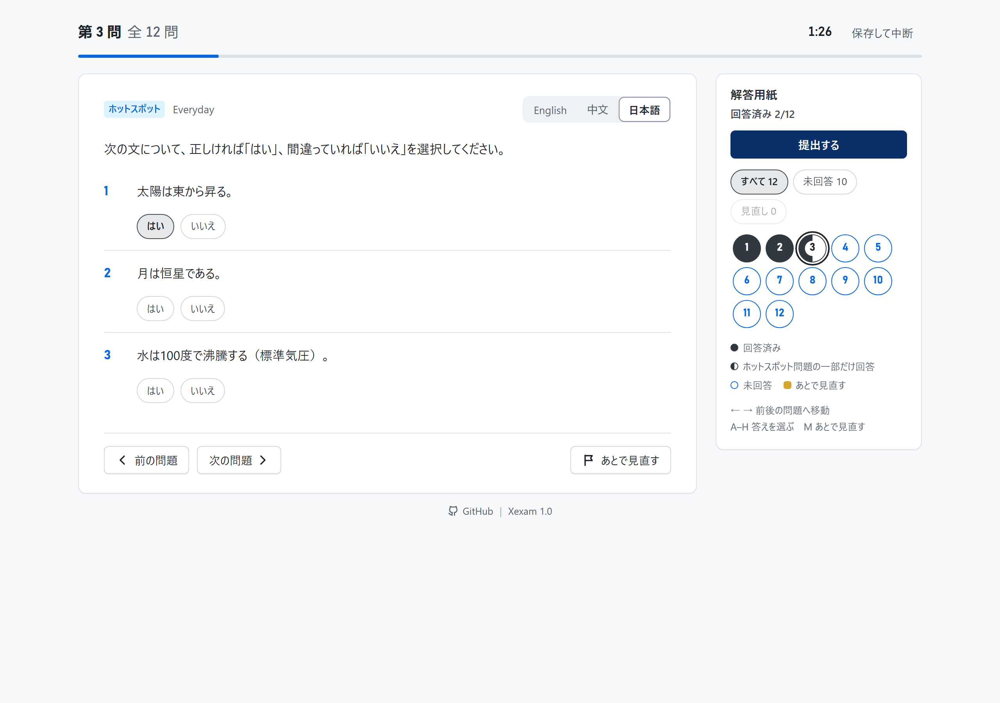

リポジトリには**問題は含まれていません**。Xexam が提供するのは、問題を取り込み、整理し、練習するための機能だけです。問題集はご自身の Excel ファイルであり、コミットされません（`.gitignore` で除外済み）。スクリーンショットには 2 つの**架空のデモ用問題集**「General knowledge」と「Kitchen basics」を使っており、実際の試験の内容ではありません。この README のスクリーンショットは日本語の画面です。英語と中国語の画面のスクリーンショットは `docs/en/screenshots/` と `docs/zh-CN/screenshots/` にあります。

| | |
|---|---|
| 現在のバージョン | **v0.5.1**（[更新履歴](#更新履歴)、またはリポジトリの [Releases](../../releases) ページを参照。アプリでは：メニュー → **Xexam v0.5.1**） |
| イメージ | Docker Hub（公開、ログイン不要）：`docker.io/yuminspace/xexam-frontend` と `docker.io/yuminspace/xexam-backend`。タグは `latest` / `v0.5.1` / `sha-<コミット>`（`sha-` のタグは問題の調査用）。ミラー：`ghcr.io/yumin-space/xexam-frontend` と `ghcr.io/yumin-space/xexam-backend`（非公開、タグは同じ） |
| CPU アーキテクチャ | `linux/amd64`、`linux/arm64`（同じタグの中から自動的に適切なものが選ばれます） |
| ポート | `8765`（既定ではローカルマシンのみにバインド） |
| ライセンス | [MIT](LICENSE) |

ドキュメント：[アーキテクチャ](docs/ja/architecture.md) · [API](docs/ja/api.md)（[OpenAPI](docs/en/openapi.yaml)、英語のみ）· [データベース](docs/ja/database.md) · [セキュリティ](docs/ja/security.md) · [デプロイ](docs/ja/deployment.md) · [移行とロールバック](docs/ja/migration.md) · [開発](docs/ja/development.md)

---

## 目次

- [できること](#できること)
- [クイックスタート（インストールとデプロイ）](#クイックスタートインストールとデプロイ)
- [設定](#設定)
- [スマートフォンや別のパソコンから開く](#スマートフォンや別のパソコンから開く)
- [使い方](#使い方)
- [Excel 問題集の形式](#excel-問題集の形式)
- [問題集の取り込み](#問題集の取り込み)
- [v0.4 からのアップグレード](#v04-からのアップグレード)
- [データ、バックアップ、復元](#データバックアップ復元)
- [Cloudflare Tunnel でインターネットからアクセスする](#cloudflare-tunnel-でインターネットからアクセスする)
- [アーキテクチャ](#アーキテクチャ)
- [セキュリティについて](#セキュリティについて)
- [自動ビルドとリリース](#自動ビルドとリリース)
- [開発](#開発)
- [ディレクトリ構成](#ディレクトリ構成)
- [ライセンス](#ライセンス)
- [更新履歴](#更新履歴)

---

## できること

- **自分の問題集。** 取り込んだ Excel ブック（`.xlsx`）は、それぞれが独立した問題集になります。ブック内の各ワークシートは、試験で選べる問題グループです。ブックを新しい問題集として取り込むことも、既存の問題集をそのファイルの新しい版で更新することもできます。保存する前に、何が変わるかをプレビューで確認できます。
- **模擬試験。** 問題集とシート、すべての問題か間違いノートの問題だけか、問題数（選んだ問題より少なければランダムに選ばれます）、問題の順番をシャッフルするかどうかを選びます。単一選択・複数選択・ホットスポット問題（いくつかの文に、それぞれ「はい / いいえ」のような選択肢を 1 つずつ選ぶ問題）に対応しています。解答中は正誤が表示されません。問題の間を自由に移動でき、あとで見直したい問題に印を付けたり、保存して中断し、あとで続けたりできます。
- **3 つの言語。** 画面全体（メニュー、ボタン、メッセージ。試験ページとサーバーからのエラーメッセージも含みます）を英語・中国語・日本語で使えます。言語は **画面設定** で選びます。ブックに英語・中国語・日本語の列があれば、試験ページではいつでも問題文をそれらの言語に切り替えられます。選んだ答えはそのままです。
- **結果と学習記録。** 提出すると、まず得点が表示され、続いて各問題についてあなたの回答、正解、解説、覚え方が表示されます。すべての試験は **学習記録** に残り（直近 500 回分）、絞り込み、各試験の詳細、間違えた問題のやり直しや受け直しのボタンがあります。
- **間違いノート。** 間違えた問題は自動的に集められ、2 回続けて正解するとノートから外れます。見直すことも、それらの問題だけを練習することもできます。
- **設定はサーバーに保存。** テーマ、表示言語、自動で次の問題へ進む設定はデータディレクトリに保存されるので、どのブラウザ・端末でも同じになり、再起動やイメージの更新でも消えません。
- **パソコンとスマートフォン。** メニューボタンのある細いヘッダー、広い画面では中央に寄せたページ、スマートフォンでは 44 px 以上のタッチ領域。

---

## クイックスタート（インストールとデプロイ）

### 必要なもの

- **Docker**（Compose v2 を含む）が入ったマシン。Windows / macOS / Linux のいずれでも動作し、**x86 でも ARM でも構いません**。
- ブラウザ。

### 方法 A：公開済みのイメージを pull する（推奨）

必要なのは、リポジトリにある [`docker-compose.yml`](docker-compose.yml) **1 ファイルだけ**です。ほかのコードは必要ありません。

**リポジトリのオーナーでない場合**：2 つのイメージは Docker Hub で公開されているので、pull するのにアカウントも `docker login` も必要ありません。非公開なのはリポジトリだけです。そこから `docker-compose.yml` を `curl` でダウンロードする（または `git clone` する）には、オーナーに頼んで、あなたの GitHub アカウントをリポジトリのコラボレーター（collaborator）に追加してもらってください。そのうえで、GitHub → **Settings** → **Developer settings** → **Personal access tokens** → **Tokens (classic)** で、スコープ `repo` を付けたトークンを 1 つ作成します。このトークンを、`curl` の `YOUR_TOKEN` と `git clone` のパスワードとして使います。オーナーにファイルを送ってもらうだけでも構いません。

**1. `docker-compose.yml` をダウンロードします**。新しいフォルダ（例：`xexam`）に保存してください。いちばん簡単なのは、GitHub でこのファイルを開いて **Download raw file** をクリックする方法です。コマンドラインなら次のとおりです。

```bash
curl -fLO https://raw.githubusercontent.com/Yumin-Space/xexam/main/docker-compose.yml
```

`curl` では、`-fLO` の後に `-H "Authorization: token YOUR_TOKEN"` を加えてください（`YOUR_TOKEN` は上で作成したトークンです）。Windows PowerShell では、`curl` の代わりに `curl.exe` と入力します（PowerShell の `curl` は別のコマンドです）。

**2. ログインは不要です。** `docker-compose.yml` は 2 つのイメージを Docker Hub（`docker.io/yuminspace/xexam-backend` と `docker.io/yuminspace/xexam-frontend`）から pull します。そこでは公開されているので、そのまま手順 3 に進んでください。GitHub のコンテナレジストリにある非公開のミラーを使う権限があり（オーナーとコラボレーター）、そちらを使いたい場合だけ、一度ログインしてから、`docker-compose.yml` の 2 つの `image:` の行を `ghcr.io/yumin-space/xexam-backend:latest` と `ghcr.io/yumin-space/xexam-frontend:latest` に変更します。

```bash
docker login ghcr.io -u YOUR_GITHUB_USERNAME
# GHCR のミラーを使う場合のみ。パスワードには、スコープ read:packages を付けた GitHub のトークンを入力します
# （GitHub → Settings → Developer settings → Personal access tokens → Tokens (classic)）
```

ミラーでは、読み取り権限がない場合や、classic ではなく fine-grained のトークンを使った場合に、`docker login` または次の手順が拒否されます（`denied` または `unauthorized`）。Docker Hub では、こうした準備は一切必要ありません。

**3. 起動します。** `docker-compose.yml` があるフォルダで、次を実行します。

```bash
docker compose up -d
```

このコマンドで 2 つのイメージが Docker Hub から pull され、**2 つのコンテナ**（`xexam-frontend`、`xexam-backend`）が起動します。その後、同じマシンのブラウザで <http://localhost:8765> を開きます。

Docker を別のマシン（サーバー、NAS、仮想マシン）で動かしている場合は、[スマートフォンや別のパソコンから開く](#スマートフォンや別のパソコンから開く) を参照してください。

画面は最初は英語で表示されます。日本語に切り替えるには、メニュー（右上の三本線のボタン）を開いて **Settings** を選び、**Language** で **日本語** を選びます。すると、これらの項目は **画面設定** と **言語** という表示に変わります（中国語は **中文**）。続いて [最初の試験](#最初の試験) に従って、ご自身の Excel ファイルを取り込み、試験を受けてください。

> v0.4 からアップグレードする場合は、先に [v0.4 からのアップグレード](#v04-からのアップグレード) を読んでください。v0.5 の初回起動時に、データベースが（バックアップのコピーを書き出したうえで）移行されます。

| 操作 | コマンド |
|---|---|
| 最新バージョンに更新 | `docker compose pull` の後に `docker compose up -d`。お使いの `docker-compose.yml` にまだ `ghcr.io` と書かれている場合（v0.5.1 より前のファイル）は、先に新しいファイルに差し替えてください。データボリュームはそのまま残ります |
| 特定のバージョンに固定 | `docker-compose.yml` 内の 2 つのイメージの `:latest` をどちらも `:v0.5.1` に変更してから、`docker compose up -d` を実行 |
| 状態を確認 | `docker compose ps`（2 つのコンテナがどちらも `healthy` になっていれば正常） |
| 停止 / 再起動 | `docker compose stop` / `docker compose start` |
| ログを見る | `docker compose logs -f` |
| 動いているバージョンとアーキテクチャを確認 | ブラウザで <http://localhost:8765/api/info> を開く |

> ⚠️ **`docker compose down -v` は実行しないでください**：`-v` を付けるとデータボリューム `xexam_data` も一緒に削除されます。このボリュームには、問題集、学習記録、設定が入っています。

既定のままで 1 台のパソコンで使えます。すべてのオプションは [設定](#設定) にあります。

### 方法 B：ソースからビルドする（コードを変更するとき）

リポジトリのコード一式が必要です。

```bash
git clone https://github.com/Yumin-Space/xexam.git
cd xexam
docker compose -f docker-compose.build.yml up -d --build
```

リポジトリが非公開の間は、`git clone` で GitHub へのサインインを求められます（コマンドラインでパスワードを求められたら、リポジトリを読める GitHub のトークンを入力します）。

初回のビルドには数分かかります（Rust とフロントエンドをコンパイルするため）。方法 A と**同じボリューム**（`xexam_data`）と同じコンテナ名を使うため、データは同一のものになり、両者は**同時に実行できません**。切り替える前に `docker compose stop` を実行してください。

---

## 設定

既定のままなら、何も設定せずに 1 台のパソコンで使えます。変更したいときは、`docker-compose.yml` と同じ場所に `.env` ファイルを作成します（テンプレートは [`.env.example`](.env.example) を参照。compose ファイル自体の編集は不要です）。`.env` を変更したら、もう一度 `docker compose up -d` を実行してください。

| `.env` の変数名 | 既定 | 役割 |
|---|---|---|
| `XEXAM_BIND` | `127.0.0.1:8765` | 待ち受けるアドレスとポート（Nginx）。`IP:ポート番号` の形式で指定する必要があります。既定では本機からのみ接続できます。`0.0.0.0:8765` にすると LAN 内の他のマシンからも接続できます。⚠️ ポート番号だけ（例：`8766`）を書くと、すべてのネットワークインターフェースから接続できてしまいます |
| `XEXAM_ALLOWED_HOSTS` | 空 | アクセスに使ってよいドメイン / IP。カンマ、スペース、セミコロンのいずれかで区切ります。例：`xexam.example.com,192.168.1.20` |
| `XEXAM_ALLOWED_ORIGINS` | 空 | リバースプロキシが Host をオリジンサーバーのアドレスに書き換える場合にのみ必要です。公開ドメインを（`https://` を含めて）指定します |
| `XEXAM_ALLOW_ANY_HOST` | `0` | `1` にすると Host を検査しなくなります（前段にすでに認証がある場合にのみ使用してください） |
| `XEXAM_PARSE_TIMEOUT_SECS` | `30` | Excel 1 ファイルの解析にかける最大時間（秒） |
| `TZ` | `Asia/Tokyo` | データベース内のタイムスタンプに使うタイムゾーン |

詳細：[docs/ja/deployment.md](docs/ja/deployment.md) の第 3 節。

---

## スマートフォンや別のパソコンから開く

**Xexam にはログイン機能がありません**。また、既定ではローカルマシン（`127.0.0.1`）にのみバインドされるため、<http://localhost:8765> を開けるのは Docker を動かしているマシンだけです。ほかの端末から開く方法は 2 つあります。

### SSH で別のパソコンから開く（設定不要）

Xexam が、SSH でログインできるサーバー、NAS、仮想マシンで動いている場合は、ご自身のパソコンで次を実行します。

```bash
ssh -L 8765:127.0.0.1:8765 user@server
```

この SSH 接続を開いている間は、ご自身のパソコンのブラウザで <http://localhost:8765> を開けます。サーバー側では何も変わらず、ポートも開きません。

### ネットワーク内のスマートフォンやパソコンから直接開く

これは**信頼できるネットワークでのみ**（自宅の Wi-Fi など）行ってください。カフェや職場のネットワークでは行わないでください。

1. Docker を動かしているマシンの LAN 内 IP アドレスを調べます（多くは `192.168.x.x` か `10.x.x.x`）。
   - Windows：`ipconfig` を実行し、「IPv4 アドレス」の行を見ます。
   - macOS：`ipconfig getifaddr en0` を実行します。
   - Linux：`hostname -I` を実行します。通常は最初のアドレスです。
2. `docker-compose.yml` と同じ場所に `.env` ファイルを作成し、`XEXAM_BIND=0.0.0.0:8765` と、`XEXAM_ALLOWED_HOSTS=` に続けてその IP アドレス（例：`XEXAM_ALLOWED_HOSTS=192.168.1.20`）の 2 行を書きます。
3. `docker compose up -d` を実行し、スマートフォン（iPhone では Safari）またはもう 1 台のパソコンのブラウザで、その IP アドレスとポート 8765（例：`http://192.168.1.20:8765`）を開きます。

外出先（自宅の Wi-Fi 以外）で使う場合は、下記の [Cloudflare Tunnel でインターネットからアクセスする](#cloudflare-tunnel-でインターネットからアクセスする) を参照してください。ポートを直接インターネットに公開しないでください。

---

## 使い方

### 最初の試験

1. メニュー（右上の三本線のボタン）を開き、**問題集の管理** を選びます。**Excel の取り込み** で **新しい問題集** を選んだまま、**Excel ファイルを選ぶ** を押してブックを選びます（[Excel 問題集の形式](#excel-問題集の形式) を参照）。プレビューを確認して、**問題集を作成する** を押します。
2. 取り込みの完了メッセージにある **試験を始める** を押します（またはメニューで **ホーム** を選びます）。**試験を始める** パネルでは、最初はすべてのシートにチェックが入っています。不要なシートのチェックを外し、パネルの下部のバーにある **試験を開始** を押します（同じバーの **問題数** と **シャッフル** で、出題する数と順番を変えられます）。
3. 問題に答えて、**提出する** を押します。結果ページには得点と、間違えた問題ごとに正解と解説が表示されます（**すべての問題（n）** ですべての問題を表示します）。
4. あとでもう一度その試験を見るには：メニューを開いて **学習記録** を選び、試験の日時をクリックします。

### 画面の構成

- 試験以外のすべてのページには細いヘッダーがあり、左上に Xexam のロゴ（ホームに移動します）、右上に三本線のメニューボタンがあります。
- メニューボタンを押すと小さなメニューが開き、**ホーム**、**問題集の管理**、**学習記録**、**画面設定** と、区切り線の下に **Xexam v0.5.1** があります。**Xexam v0.5.1** は [Xexam について](#xexam-について) のページを開きます。項目を選ぶ、メニューの外側をクリックする、または Esc キーを押すと、メニューは閉じます。
- 広い画面では、ページの内容は中央に寄せられ、幅は最大 1120 px です。
- 試験そのものは、ヘッダーのない、集中して解ける全画面のページです。

### 問題集の管理

ここでは Excel ブックを取り込みます。ページはホームと同じくらいコンパクトです。**Excel の取り込み** では **新しい問題集** か **既存を更新** を選び（タイトルの横にある 2 つの小さなボタンで、マウスを重ねると説明が表示されます。更新する場合は、**更新する問題集** でその問題集を選びます）、**Excel ファイルを選ぶ** を押すか、パネルのどこかにファイルをドロップします。**Excel ファイルを選ぶ** の上にあるヒントの 1 行は、**Excel の書き方** へのリンクで終わります。**登録済みの問題集** には問題集ごとにコンパクトな 1 行があり（ファイル、問題数、シート数、最終更新日と、**更新** と **削除**。シートは行の右側の矢印の下に折りたたまれています）、**取り込み履歴** には 1 回の取り込みが 1 行で表示されます。ページにある **Excel の書き方と取り込みの説明** は、開くまで折りたたまれており、[Excel 問題集の形式](#excel-問題集の形式) の要約です。取り込みの手順とルールは [問題集の取り込み](#問題集の取り込み) にあります。

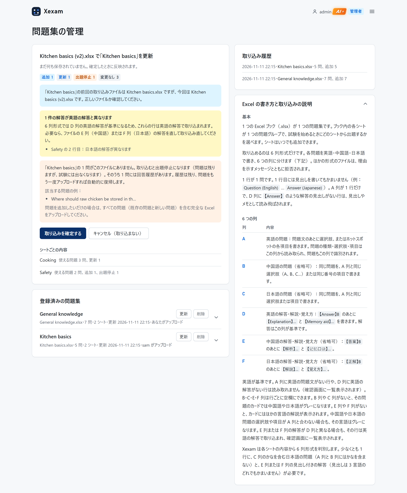

スクリーンショットは、「Kitchen basics」を新しいファイル `Kitchen basics (v2).xlsx` で更新するときの、保存する前のプレビューです。数のチップ（追加 1、更新 1、出題停止 1、変更なし 3）、ファイル名が前回の取り込みと違うという案内、出題停止になる問題についての注意、そしてシート「Cooking」と「Safety」が表示されています。その下の **登録済みの問題集** には 2 つのデモ用問題集、右側には取り込み履歴と、折りたたまれた書き方の説明があります。出題停止になる問題は、問題の列（このデモ用問題集では日本語の C 列）の文で一覧表示されます。

### ホーム

最初の取り込みの前は、**試験を始める** パネルに短い説明と **問題集の管理へ** が表示されます。取り込んだ後のホームには、次のものがあります。

- **未提出の試験**：**保存して中断** で抜けた試験は、ページの一番上の小さなバナーに表示されます。タイトルと **このブラウザにだけ保存** の下に、問題集 · 回答した問題数 · 経過時間が並びます。**続きから回答** で中断したところから再開し、**破棄する** で破棄します。この試験はこのブラウザにだけ保存されているので、ほかの端末には表示されません。
- **試験を始める**：
  - パネルの右上で、出題する問題を選びます：**すべて**（選んだシートのすべての問題）または **間違いノート**（まだ復習が必要な問題だけ）。それぞれに問題数が表示されます。選んだシートに復習する問題がないときは **間違いノート** を選べず、タイトルの下の 1 行にその理由が表示されます。**間違いノート** を選んでいる間は、同じ行に、問題がノートから外れる条件が表示されます。スマートフォンでは、2 つのボタンはタイトルの横に並んだままで、日本語と英語の表示ではアイコンと問題数だけを表示します（中国語の表示では短い語も残ります）。
  - **問題集とシート**：問題集ごとに 1 枚のカードがあり、その中にシートが行として並びます。
    - この見出しの行の右側にある **すべて選択** と **解除** で、すべてのシートを一度に選択・解除できます。
    - 問題集のチェックボックスで、その問題集のすべてのシートを選択・解除できます。シートを 1 つずつ選ぶこともできます。一部のシートだけを選んでいる間は − が表示され、カードには例えば **2 シート中 1 シートを選択** と表示されます（シートを隠しているときも表示されます）。
    - 問題集の行の右側にある矢印ボタンで、そのシートを表示したり隠したりできます。問題集が 2 つまでなら最初はシートが表示され、3 つ以上なら隠れています。表示するか隠すかの選択は、ページを再読み込みするまで保たれます。
    - **要復習 2** のようなバッジは、その問題集やシートに間違いノートの問題が何問あるかを示します。
  - 下部のバー：**試験を開始**、現在の範囲（例：**現在の範囲：12 問**。問題数を減らすと **現在の範囲 12 問からランダムに 11 問を出題**）、その横に **問題数** と **シャッフル**。パネルが画面に表示されている間、このバーは画面下部に固定されます。スマートフォンでは、1 行目に範囲と 2 つのオプション、2 行目に **試験を開始** が並びます。
  - **問題数** と **シャッフル**（下部のバーの中）：**問題数** が選んだ範囲の問題数より小さいときは、選んだ範囲全体から問題がランダムに選ばれます。**シャッフル** は、出題の順番をランダムにするか、問題集の順番にするかだけを決めます。
- **直近の試験**：前回の試験の得点と、**詳細を見る**、**すべての学習記録**。
- **概要**：問題集、使えるシート、有効な問題、間違いノートの問題がそれぞれいくつあるかと、**間違えた問題を復習**（間違いノートに問題があるとき）と **問題集の管理**。

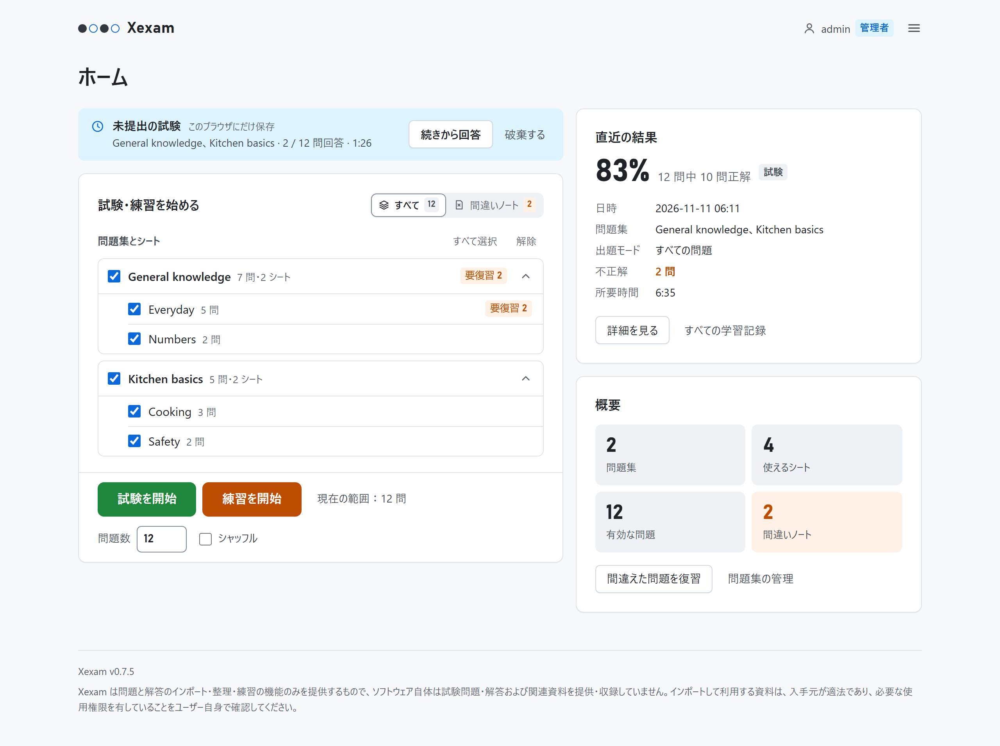

ページの一番上の小さなバナーになった未提出の試験、**試験を始める** の右上にある **すべて** と **間違いノート**、右側に **すべて選択** と **解除** がある **問題集とシート** の見出し、シートを含むカードになった 2 つのデモ用問題集（どちらもシートを表示した状態）、そして **試験を開始**、範囲、**問題数**、**シャッフル** のある下部のバー。右側には直近の試験と概要があります。

### 試験ページ

このページの最初のスクリーンショットが試験ページです。

- 上部：**第 4 問 全 12 問**（例）、経過時間、**保存して中断**。**保存して中断** は回答と経過時間を保存するので、同じブラウザのホームからあとで続けられます。
- **解答中は正誤もスコアも表示されません。**
- **英語** / **中国語** / **日本語** で問題文を切り替えます（4 列形式の Excel の A、B、C 列）。切り替わるのは文字だけで、選んだ答え、選択肢の記号、タイマー、採点は変わりません。ホットスポット問題の選択肢ボタンも一緒に切り替わります。その問題にない言語や、文が日本語と対応していない言語は、その問題ではグレーアウトされます。選んだ言語は設定として保存され、提出後の見直しにも使われます。
- **前の問題** と **次の問題** で問題を移動します（最後の問題では **次の問題** が **提出する** に変わります）。**あとで見直す** で、あとで戻りたい問題に印を付けます。
- **解答用紙**：問題ごとに 1 つのタイルがあります。塗りつぶし = 回答済み、半分塗りつぶし = ホットスポット問題の一部だけ回答、白抜き = 未回答、黄色の小さな四角 = あとで見直す。タイルをクリックすると、その問題に移動します。タイルの下に **回答済み 3 / 12 問** と **提出する** があります。
- **提出する** を押すと確認が表示されます。未回答の問題は不正解として採点されます。
- 採点：単一選択・複数選択問題は、正しい選択肢だけをすべて選んだ場合にのみ正解です。ホットスポット問題は、すべての小問が正しい場合にのみ正解です。
- キーボード（パソコン）：`←` `→` で前後の問題へ移動、`A`–`H` で答えを選ぶ（選択問題）、`M` であとで見直す印を付けます。

### 結果ページ

得点、正解数と不正解数、そして問題ごとに 1 つの枠が並んだ帯が表示されます。**正解と解説** では **間違えた問題のみ（n）** または **すべての問題（n）** を表示し、あなたの選択、正解、解説、覚え方、中国語訳（あれば）、その問題をこれまでに何回回答したかが分かります。ボタン：**間違えた問題だけやり直す**、**もう一度受ける**、**学習記録で見る**、**ホームに戻る**。

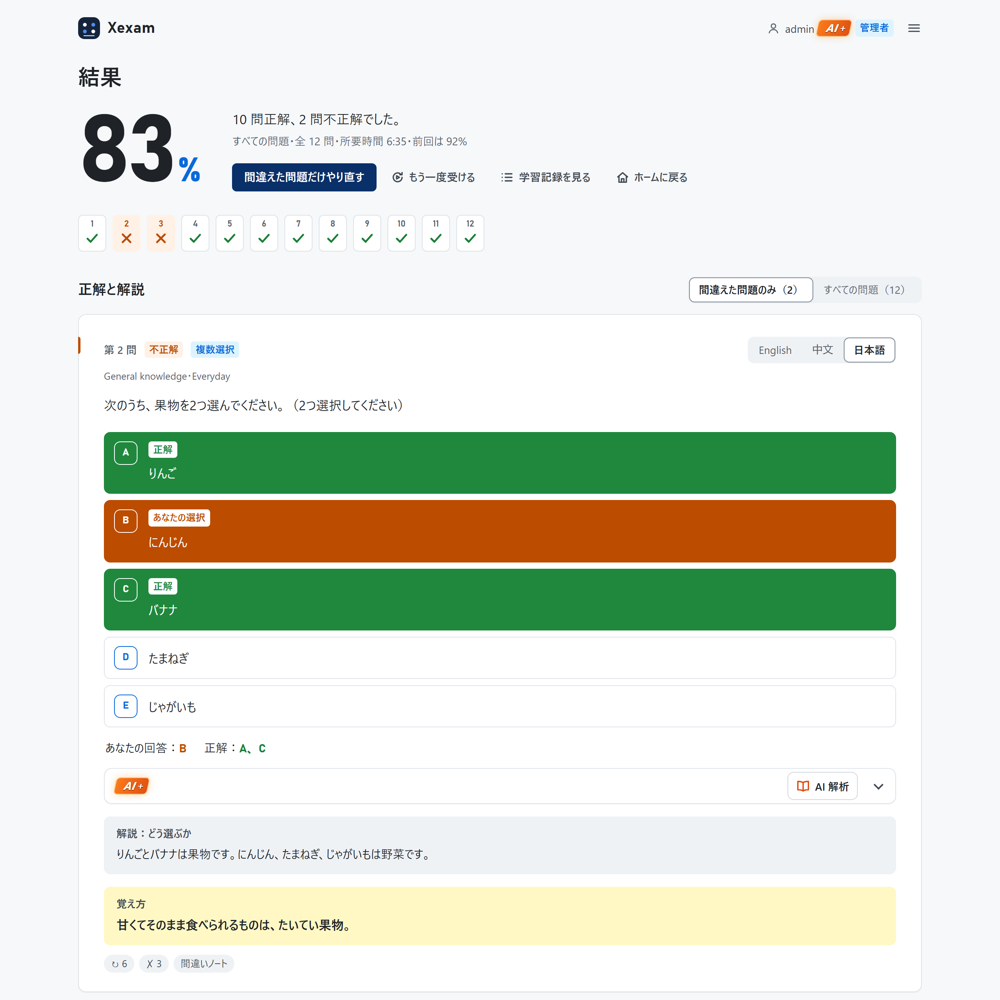

解説と覚え方は、ブックに書かれているとおりに表示されます。このデモ用問題集では中国語で書かれています。

### 学習記録

- **概要**：**受験回数**、**平均正答率**、**最高正答率** と、直近の結果を示す小さな棒グラフ。
- **絞り込み**：**問題集**、**正答率**（**指定なし**、**60% 未満**、**60%〜79%**、**80% 以上**）、そして **開始日** と **終了日** による期間。**絞り込みを解除** で元に戻ります。
- **試験の一覧**：試験ごとに 1 行（スマートフォンでは 1 枚のカード）で、受験日時、問題集、回答した問題数、所要時間、正解数、正答率を表示します。日時をクリックするとその試験が開き、**削除** でその記録を削除します。
- **試験の詳細**（1 回分の試験）：得点と試験の情報、続いてすべての問題について、あなたの回答、正解、解説、覚え方を表示します。**間違えた問題のみ（n）** / **すべての問題（n）** で、間違えた問題だけかすべての問題かを切り替えます。**間違えた問題をやり直す** は、その試験で間違えた問題だけで試験を始めます。**この試験をもう一度受ける** は、同じ問題でもう一度試験を始めます。**この記録を削除** は、その記録を削除します。v0.5 より前に受けた試験は得点だけが表示されます。v0.4 は回答内容を保存していなかったためです。
- 右上の **間違えた問題を復習** で **間違えた問題の復習** が開きます。間違いノートのすべての問題が、回答した回数と、あと何回続けて正解すればノートから外れるかと一緒に表示されます。1 つの問題集に絞り込むこともでき、**これらを練習する** でそれらの問題の試験を始めます。
- 削除について：記録を 1 件削除しても、各問題の統計は残るので、間違いノートは変わりません。**すべて削除** は、すべての試験記録を削除します。**間違いノートと各問題の回答統計も消去する** にチェックを入れると、それらも消去されます。削除のたびに確認があり、元に戻すことはできません。
- Xexam は直近 500 回分の試験を保存します。それより古い記録は自動的に削除されます。

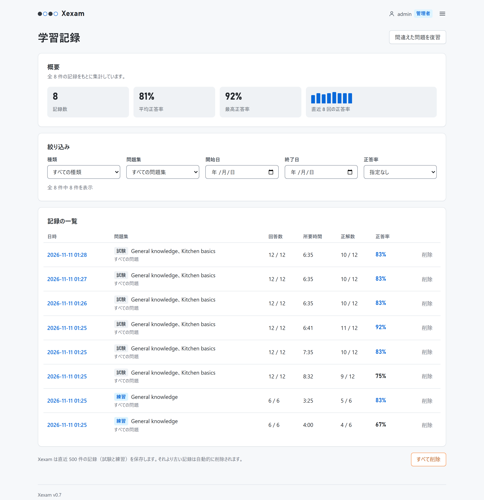

### 間違いノート

間違えた問題は間違いノートに入り、**2 回続けて**正解すると外れます。使い方は 3 つあります。ホーム（**試験を始める** の右上にある **間違いノート**）、**学習記録** → **間違えた問題を復習** → **これらを練習する**、または試験の直後の **間違えた問題だけやり直す** です。

### 画面設定

- **外観**（テーマ）：**システムに合わせる**（既定。端末のライト／ダーク設定に従います）、**ライト**、**ダーク**。
- **言語**（表示言語）：**English**（既定）、**中文**、**日本語**。メニュー、ボタン、メッセージがすべてこの言語になります。試験ページや、サーバーからのエラーメッセージも含みます。問題文の言語は、試験ページで別に切り替えます。
- **回答** → **回答したら自動で次の問題へ進む**（既定はオフ）：単一選択問題に答えたとき、またはホットスポット問題のすべての小問に答えたときに、次の問題が自動で開きます。複数選択問題では自動では進みません。オンの間は、試験ページの上部に **自動で次へ：オン** と表示されます。
- **既定の設定に戻す**：テーマ、表示言語、「回答したら自動で次の問題へ進む」を既定値に戻します。問題の言語はそのままです。

設定は、試験ページで最後に選んだ問題の言語と一緒に、Xexam サーバーのデータディレクトリにあるデータベースに保存されます。そのため、再起動やイメージの更新、ブラウザのキャッシュの削除、別のブラウザや端末への切り替えでも消えません。アカウントはないので、この Xexam を使う全員が 1 つの設定を共有します。現在のブラウザにだけ残るのは、未提出の試験だけです。

<table>
<tr>
<td width="50%">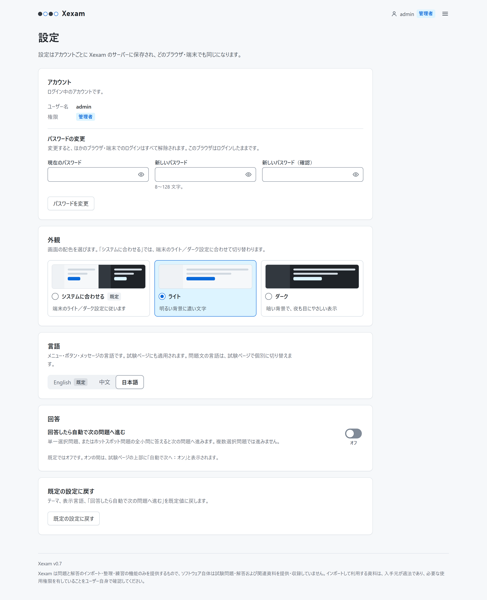</td>
<td width="50%">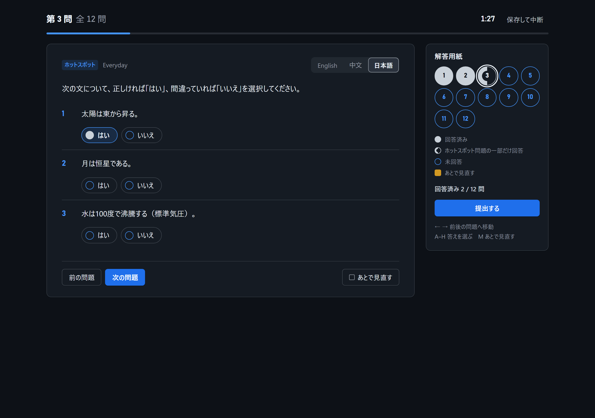</td>
</tr>
<tr>
<td>画面設定：<b>外観</b>、<b>言語</b>、<b>回答</b>、<b>既定の設定に戻す</b>。</td>
<td><b>ダーク</b> テーマ（ここでは試験ページ）。</td>
</tr>
</table>

### Xexam について

メニューの最後の項目 **Xexam v0.5.1** を選ぶと、**Xexam について** が開きます。**バージョン**、**サーバー** の CPU アーキテクチャ、**ライセンス**、そして **更新内容** が表示されます。**更新内容** は、表示言語の README の [更新履歴](#更新履歴) です（日本語表示では、この README のもの）。最新のバージョンは開いた状態で、それより前のバージョンは **以前のバージョン** の下に折りたたまれています。

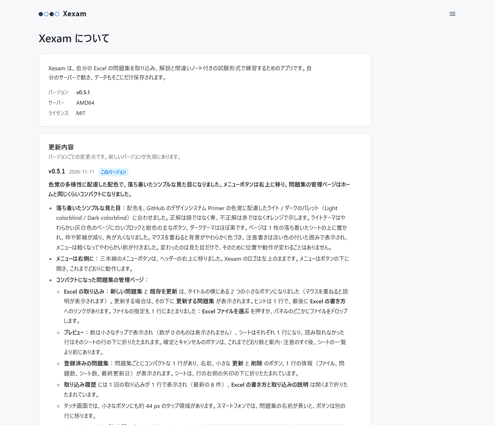

### iPhone で使う

- iPhone の Safari でサービスのアドレスを開きます（先に [スマートフォンや別のパソコンから開く](#スマートフォンや別のパソコンから開く) の設定が必要です）。**iOS 15.4 以降**が必要です。
- 共有ボタン → **ホーム画面に追加** をタップすると、以降は独立したアプリのように全画面で開きます。アイコンは解答用紙風の Xexam です。
- 右上の三本線のボタンで、パソコンと同じ小さなメニューが開きます。ホームでは、**すべて** と **間違いノート** が **試験を始める** のタイトルの横に（日本語と英語の表示ではアイコンと問題数だけで）表示され、画面下部に固定されたバーでは、1 行目に範囲、**問題数**、**シャッフル**、2 行目に **試験を開始** が並びます。試験ページでは **前の問題**、**次の問題**、**あとで見直す** が画面下部に固定され、解答用紙は問題の下にあり、タイルの上に **回答済み x / n 問** と **提出する** があります。学習記録はコンパクトなカードで表示されます。
- ボタンなどのタッチ領域は 44 px 以上で、ノッチと下部のホームバーのセーフエリアにも対応しています。

iPhone でのスクリーンショット（幅 390 px）：

<table>
<tr>
<td width="25%">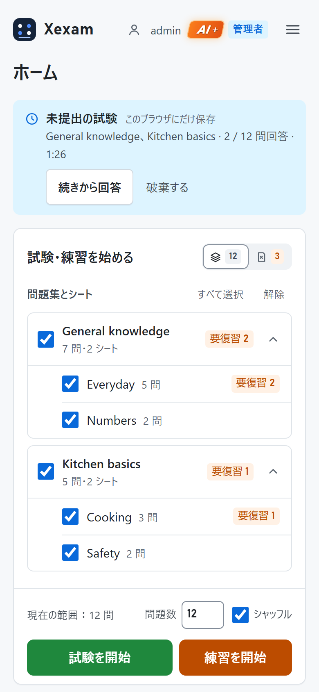</td>
<td width="25%">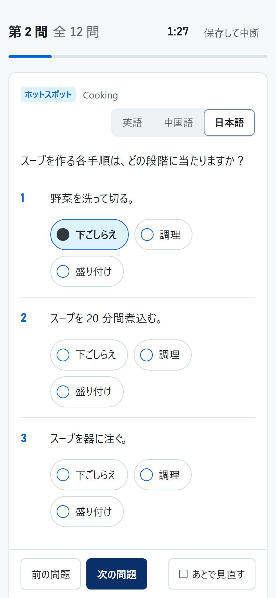</td>
<td width="25%">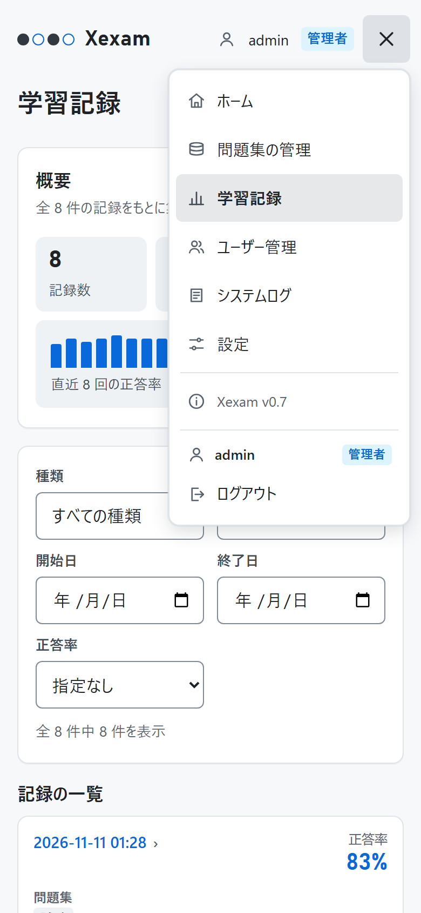</td>
<td width="25%">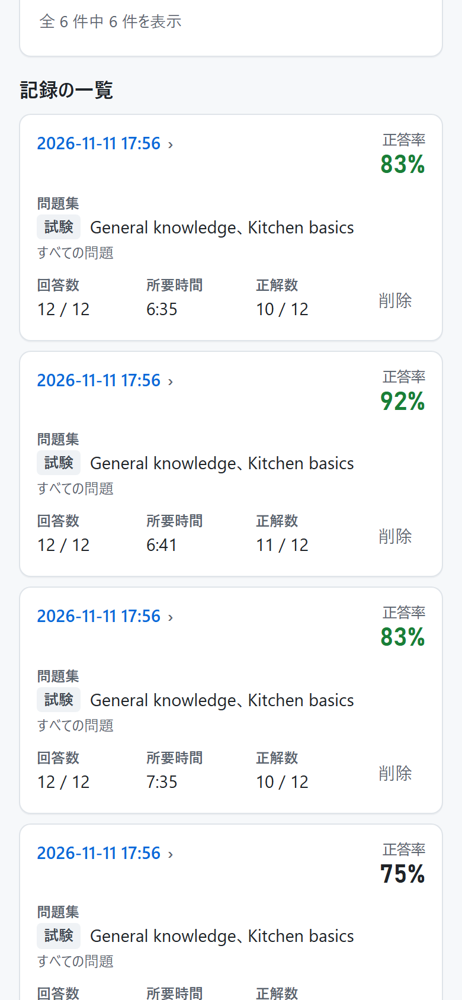</td>
</tr>
<tr>
<td>ホーム：画面下部に固定されたバー。1 行目に範囲、<b>問題数</b>、<b>シャッフル</b>、2 行目に <b>試験を開始</b>。</td>
<td>試験：<b>前の問題</b>、<b>次の問題</b>、<b>あとで見直す</b> は画面下部に固定されています。</td>
<td>三本線のボタンから開いたメニュー（ここでは学習記録のページ）。</td>
<td>学習記録：試験ごとにコンパクトなカードで表示されます。</td>
</tr>
</table>

---

## Excel 問題集の形式

1 つのブック（`.xlsx`）が 1 つの問題集です。各シートが 1 つの問題グループで、1 行に 1 問を書きます。

### 3 列形式（いちばん簡単な形式）

次は、複数選択問題 1 問の完全な例です。シートの 1 行分になります（**問題集の管理** ページの **Excel の書き方と取り込みの説明** にあるものと同じ例です）。

| A | B | C |
|---|---|---|
| 次のうち果物はどれですか。2 つ選んでください。<br>A. にんじん<br>B. じゃがいも<br>C. りんご<br>D. たまねぎ<br>E. バナナ | （空） | 【答案】C、E<br>【解析·怎么选】りんごとバナナは果物で、ほかは野菜です。<br>【记忆口诀】甘いのが果物。 |

- **A 列**：問題。
- **B 列**：中国語訳（省略可。なければ空のままにします）。
- **C 列**：まず `【答案】`（答え）の後に答えを書きます。続けて、必要なら `【解析·怎么选】`（解説・選び方）の後に解説を、`【记忆口诀】`（覚え方）の後に覚え方を書きます。これらの見出しは、常にこの中国語の語のまま書くか、日本語（`【正解】`、`【解説】`）で書きます。

セルの中で改行するには、Alt+Enter（Windows）または Control+Option+Return（Mac）を押します。1 行目の A 列が `Question`、`問題`、`题目` のような見出しの場合、その行は読み飛ばされます。

**問題が 1 つの言語だけで書かれている場合**（英語、中国語、日本語のいずれか）は、この形式を使います。問題を A 列に書き、B 列は空にします。日本語は必要ありません。試験ページでは、どの問題の言語を選んでいても、これらの問題には常に A 列の文が表示されます（その問題では **英語** と **中国語** のボタンがグレーアウトされます）。

**選択問題の書き方**

- 選択肢は問題文の下に 1 行に 1 つずつ、`A.` から始めてアルファベット順に、2 つ以上書きます：`A. 内容`。
- 答えの記号が 1 つなら単一選択問題、複数なら複数選択問題になります：`【答案】C` または `【答案】C、E`。

**ホットスポット問題の書き方**（いくつかの文に、それぞれ選択肢を 1 つずつ選ぶ問題）

- A 列の 1 行目は `ホットスポット`（または `HOTSPOT`）で、次の行から問題文を書きます。
- 各小問を 1 行ずつ `1. 内容　はい / いいえ` の形で書きます。文の後に**全角スペース**（`　`）またはタブを置き、その後にその小問の選択肢を ` / `（前後にスペースを入れたスラッシュ）で区切って書きます。選択肢にはどんな語でも使えます。例：`下ごしらえ / 調理 / 盛り付け`。
- 答えには、すべての小問の選択を書きます：`【答案】1 はい；2 いいえ`。その小問の選択肢の語のどれかを書きます。はい / いいえ の小問では、`是`/`否`（中国語の「はい / いいえ」）や `Yes`/`No` も使えます。答えがその小問の選択肢にない場合、その問題はプレビューで読み取れない問題として、理由とともに一覧表示されます。

例えば、次のようなホットスポット問題です（A 列と C 列。B 列は空。`はい / いいえ` の前の空白は全角スペース）。

```
ホットスポット
次の各文が正しいかどうかを選んでください。
1. 太陽は東から昇る。　はい / いいえ
2. 月は恒星である。　はい / いいえ
```

```
【答案】1 はい；2 いいえ
【解析·怎么选】太陽は東から昇ります。月は太陽の光を反射しているだけで、恒星ではありません。
```

### 4 列形式（英語付き）

3 列形式を 1 列右にずらし、新しい A 列に英語を入れた形です。問題が C 列に日本語で書かれているブック向けの形式で、Xexam は C 列の日本語と D 列の答えからこの形式だと判断します。

| 列 | 内容 |
|---|---|
| **A** | **英語**の問題（空でも構いません）。ホットスポット問題では 1 行目に `HOTSPOT` と書き、各小問の末尾に `Yes / No` のような英語の選択肢を書きます |
| **B** | **中国語**訳（空でも構いません）。`【中文翻译】`（中国語訳）という見出しはあってもなくても構いません |
| **C** | **日本語**の問題。問題、選択肢、答えはこの列が基準になります。問題 id、選択肢の記号、ホットスポット問題の小問は、すべてこの列から取られます。ホットスポット問題は `ホットスポット` で始めます |
| **D** | 答えと解説。書き方は 3 列形式の C 列と同じです |

A、B、C の 3 列は**同じ問題の 3 つの言語版**で、構造は**完全に一対一で対応**している必要があります。同じ問題、同じ選択肢の記号、同じ数と順序の小問にしてください。A 列の 1 番目の小問 = B 列の 1 番目の小問 = C 列の 1 番目の小問であり、選択肢 A = 選択肢 A = 選択肢 A となります。答えは 1 回だけ（D 列）書き、3 つの言語で共用します。

**ホットスポット問題の選択肢は、言語ごとにそれぞれの列に書きます**。各小問の末尾にその列の言語で選択肢を書き、3 つの言語の j 番目の選択肢は同じ意味になります。例えば、同じ小問は次のようになります。

| 列 | 小問の書き方 |
|---|---|
| A 英語 | `1. Wash and cut the vegetables.　Preparation / Cooking / Serving` |
| B 中国語 | `1. 清洗并切好蔬菜。　准备 / 烹饪 / 上菜`（野菜を洗って切る。下ごしらえ / 調理 / 盛り付け） |
| C 日本語 | `1. 野菜を洗って切る。　下ごしらえ / 調理 / 盛り付け` |

選択肢は位置で一対一に対応しているので、小問の答えは 3 つの言語のどの選択肢の語で書いても構いません（例：`Cooking`、`調理`、`烹饪`）。試験ページで言語を切り替えると、問題文、選択肢、ホットスポット問題の選択肢ボタンが、対応する列のテキストに切り替わります。ある列に選択肢が書かれていない場合（または数が日本語と合わない場合）でも、その問題はその言語で引き続き使えますが、選択肢ボタンには日本語の選択肢が表示されます。

Xexam は内容を見て 2 つの形式を見分けるので（4 列形式では答えが D 列にあり、C 列が日本語です）、設定を変える必要はありません。3 列形式のブックも引き続きアップロードできます。英語がないだけです。

読み取れない問題は**推測されません**。プレビューに理由とともに一覧表示され（多くは答えの列に `【答案】…` が書かれていないか、答えの記号が選択肢にないことが原因です）、黙って不正解と判定されることはありません。

---

## 問題集の取り込み

### 新しい問題集か、更新か

問題集とは、取り込んだ 1 つの Excel ブックのことです。**問題集の管理** → **Excel の取り込み** で、タイトルの横にある 2 つの小さなボタンでファイルの取り込み先を選びます（マウスを重ねると説明が表示されます）。

| 選択 | 何が起きるか |
|---|---|
| **新しい問題集** | 新しい問題集が作られ、ファイル名（`.xlsx` を除く）がその名前になります（同じ名前がすでにある場合は ` (2)`、` (3)`、… が付きます）。既存の問題集は変更されません。同じブックを 2 回取り込んで別々の 2 つの問題集にすることもでき、それぞれの学習記録は混ざりません |
| **既存を更新** | **更新する問題集** で選んだ問題集の問題を、このファイルで置き換えます。ファイルにない問題は、**その問題集の中でだけ**出題停止になります。問題集の名前は変わりません |

別のブックには **新しい問題集** を、取り込み済みのブックの新しい版には **既存を更新** を使います。新しい問題だけではなく、必ずブック**全体**をアップロードしてください。

### プレビューしてから確定

アップロードすると、Xexam はファイルを読み込んでチェックし、プレビューを表示します。**追加**、**更新**、**出題再開**、**出題停止** になる問題の数と **変更なし**、**読み取れず** の数を示す小さなチップ（数が 0 のものは表示されません）、シートごとに 1 行でその数、そして読み取れなかった行ごとの行番号と理由です。読み取れなかった行は、そのシートの行の下に折りたたまれています（例：**読み取れず 2 問**）。**確定するまで何も書き込まれません**（**問題集を作成する** または **取り込みを確定する** で確定し、**キャンセル（取り込まない）** で破棄します）。次の場合は、プレビューに注意が表示されます。

- 既存の問題集の取り込み元と同じ名前のファイルから、新しい問題集を作ろうとしたとき（代わりにその問題集を更新するよう提案されます）
- 前回の取り込みとは名前の違うファイルで、問題集を更新しようとしたとき
- 出題停止になる問題があるとき。その一部が一覧表示され、取り込む前にもう一度確認されます。

### 取り込みのルール

ファイルは、取り込み先の**問題集の全内容**として扱われます。ほかの問題集には一切影響しません。

| 状況 | 結果 |
|---|---|
| ファイルにあり、問題集にない問題 | **追加** |
| 同じ問題で、それ以外の内容（選択肢、答え、解説、翻訳）が変わった | **更新**（回答履歴には影響しません） |
| 問題集にあり、ファイルに見つからない問題 | **出題停止**：回答履歴とともに保存されたままですが、試験には出なくなります |
| 以前に出題停止になった問題が再び現れた | **出題再開**。間違いノートの登録も一緒に戻ります |
| シート名、問題文、または最初の選択肢が変わった | **新しい問題**として扱われます。古い問題は出題停止になり、新しい問題は回答履歴なしで始まります |
| ファイルに使える問題が 1 問もない | 取り込みを拒否（問題集が空になるのを防ぐため） |

問題は、ワークシート名、問題文、最初の選択肢で識別されます（スペースの違いは無視されます）。

### 問題集の削除

問題集の行の **削除** を押すと、確認が表示されます（例：**「Kitchen basics」を削除しますか？**）。問題集の問題（有効なものと出題停止中のもの）と、取り込み履歴が削除されます。チェックボックス **この問題集の学習記録も削除する** は、既定ではオフです。

- **チェックなし**：回答履歴と試験記録は残ります。それらの記録では、この問題集の問題は削除済みとして表示されます。
- **チェックあり**：この問題集の問題の回答履歴と、残っているほかの問題集を含まない試験記録も削除されます。

削除は元に戻せません。戻す方法は、ご自身のバックアップだけです（[データ、バックアップ、復元](#データバックアップ復元) を参照）。

---

## v0.4 からのアップグレード

デプロイの面では、v0.5 でも同じ 2 つのイメージ、同じポート、同じボリュームを使い、新しい環境変数もありません。変わるのは画面、**データベースのスキーマ**（v1 → v2）、そして v0.5.1 からはイメージの取得元です。新しい `docker-compose.yml` は、イメージを `ghcr.io` ではなく Docker Hub（`docker.io/yuminspace/…`、公開、ログイン不要）から pull します。お使いの `docker-compose.yml` を新しいファイルに差し替えるか、その 2 つの `image:` の行を `docker.io/yuminspace/xexam-backend:latest` と `docker.io/yuminspace/xexam-frontend:latest` に変更してください。プロジェクト名とデータボリューム `xexam_data` は変わらないので、データはそのまま残ります。

### アップグレード

次のコマンドは、Linux / macOS のターミナルでも Windows PowerShell でも動きます。

```bash
# 1. ボリュームをバックアップする（先に停止します。バックアップファイルにはデータベース全体が入っているので、コミットしないでください）
docker compose stop
docker run --rm -v xexam_data:/data -v "${PWD}:/backup" alpine tar czf /backup/xexam-data-v04.tgz -C /data .

# 2. 新しい docker-compose.yml（Docker Hub のイメージ）を配置したうえで、v0.5 を pull して起動する（down -v は使わないでください）
docker compose pull
docker compose up -d

# 3. アップグレードのメッセージと、コピーのファイル名を確認する
docker compose logs backend
```

**初回起動時**、バックエンドはリクエストに応答する前に、次の処理を行います。

1. 現在のデータベースの**コピーを書き出します**。書き出し先は、ボリューム内の `/data/backups/xexam-schema1-<YYYYmmdd-HHMMSS>.db` です（Docker を使わない場合は、データディレクトリの `backups/`）。既存のファイルを上書きすることはありません。コピーを書き出せない場合（ディスクがいっぱい、権限がないなど）、バックエンドは起動を中止し、データベースには手を付けません。理由は `docker compose logs backend` で確認できます。
2. データベースを 1 つのトランザクションで**移行します**。既存のデータはすべて **1 つの問題集**になり、その名前は最後に取り込んだファイルの名前（`.xlsx` を除く。一度も取り込んでいなければ `Question bank`）になります。**問題 id は変わらない**ので、間違いノート、問題ごとの統計、成績の履歴は、引き続きそれぞれの問題に結び付いています。これまでの試験記録は残り、この問題集の記録になります。ただし、v0.4 は回答内容を保存していなかったため、問題ごとの詳細はありません。

その後、ログに `Upgraded the database to schema 2. A copy of the previous version was saved first: /data/backups/xexam-schema1-20261110-140501.db (…)`（「データベースをスキーマ 2 に更新しました。先に以前のバージョンのコピーを保存しました」）のような行が出ます。2 回目以降の起動では移行は行われず、余分な書き込みもありません。

ほかに気づく点：

- **画面は英語で始まります**（v0.4 は中国語でした）。メニューの **Settings** → **Language** で **日本語** を選んでください（日本語表示では **画面設定** → **言語**）。一度設定すれば、すべてのブラウザ・端末に反映されます。
- テーマは、**画面設定** で選ぶまでは端末の設定（ライト／ダーク）に従います。
- 問題の言語は、これまではブラウザごとに記憶されていました。あるブラウザで初めて v0.5 を開くと、そのブラウザでの選択がサーバーに移されます（サーバー側がまだ既定値の日本語のままの場合）。
- ブラウザに保存されている未提出の試験は残り、続きから回答できます。

アップグレード後の確認：<http://localhost:8765/api/info> に `"version": "0.5.1"` と、以前と同じ `bankCount` が表示されること（名前とは違い、この項目が数えるのは問題集ではなく有効な問題です）。**問題集の管理** に、すべてのシートを含む問題集が 1 つあること。**学習記録** に以前の試験が並んでいること。**学習記録** → **間違えた問題を復習** の問題数が、以前の間違いノートの問題数と同じであること。

### ロールバック（v0.4 に戻す）

ロールバックとは、**移行の前に書き出されたコピーを復元して**、v0.4 のイメージを動かすことです。移行後に v0.5 で行ったこと（新しい問題集、取り込み、試験記録、設定）はすべて失われます。

```bash
# 1. v0.5 を停止する（down -v は使わないでください）
docker compose stop

# 2. コピーを探す
docker run --rm -v xexam_data:/data alpine ls -l /data /data/backups

# 3. コピーを xexam.db として戻す（ファイル名は手順 2 で見つけたものを使います）
docker run --rm -v xexam_data:/data alpine cp /data/backups/xexam-schema1-20261110-140501.db /data/xexam.db

# 4. v0.4 は非公開の GHCR ミラーにしかありません（Docker Hub は v0.5.1 から）。docker login ghcr.io を実行し、docker-compose.yml の
#    2 つのイメージを ghcr.io/yumin-space/xexam-backend:v0.4 と ghcr.io/yumin-space/xexam-frontend:v0.4 に変更してから起動する
docker compose up -d
```

手順 3 の代わりに、アップグレード時に作ったご自身の `.tgz` を復元しても構いません（[バックアップと復元](#バックアップと復元) を参照）。⚠️ コピーを復元する代わりに、**問題集が複数あるデータベースで v0.4 を動かすことは絶対にしないでください**。v0.4 はすべての問題集を 1 つとして扱うため、次の取り込みでほかのすべての問題集の問題が出題停止になり、試験記録も 60 件に切り詰められます。詳細：[docs/ja/migration.md](docs/ja/migration.md) と、[docs/ja/database.md](docs/ja/database.md) の第 6 節。

### 旧バージョン（v0.2.x、Python 単一イメージ）からのアップグレード

データボリューム `xexam_data` は同じものです。ただし、旧バージョンは 1 つのコンテナ、新バージョンは 2 つのコンテナで、コンテナ名とポートが同じなので、次の手順で行います。

1. `docker compose stop`（旧バージョンのほう）。
2. データボリュームをバックアップします（[バックアップと復元](#バックアップと復元) を参照）。
3. `docker rm xexam`：旧バージョンのコンテナを削除します（**コンテナだけを削除し、データボリュームは削除しません**）。旧バージョンのコンテナ名は `xexam`、新バージョンは `xexam-frontend` と `xexam-backend` です。削除しないと、旧コンテナが 8765 ポートを占有したままになり、新しいコンテナが起動できません。
4. 新しい `docker-compose.yml` に差し替えて、`docker compose pull` と `docker compose up -d` を実行します。初回起動時には、上で説明したとおり、データベースがスキーマ v2 に移行されます（`backups/` にコピーが書き出されます）。
5. <http://localhost:8765> を開き、問題数、間違えた問題の数、成績履歴がアップグレード前と同じであることを確認します。

旧バージョンに戻したい場合：旧コードは Git タグ `python-v0.2` にあり、旧イメージ `ghcr.io/yumin-space/xexam:v0.2.2` も引き続き GHCR から pull できます（非公開なので、先に `docker login ghcr.io` を実行します。Docker Hub にはありません）。起動する前に、`backups/` にあるスキーマ 1 のコピー（またはご自身のバックアップ）を復元してください。詳細は [docs/ja/migration.md](docs/ja/migration.md) を参照してください。

---

## データ、バックアップ、復元

データは **Docker 名前付きボリューム** に保存されます。お使いの PC 上で直接見えるフォルダではありません。

- ボリューム名は `xexam_data`（プロジェクト名 `xexam` + ボリューム名 `data`）です。中身は `xexam.db` と、アップグレード後は、スキーマ移行の前に書き出されたコピーが入った `backups/` フォルダです。プログラムがこれらのコピーを削除することはありません。不要になったら、ご自身で削除してください。
- イメージの更新、`docker compose down`、コンテナの削除と再作成を行っても、**データはそのまま残ります**。
- ⚠️ **`docker compose down -v` は実行しないでください**：`-v` を付けるとボリュームごと削除され、データが失われます。

何がどこに保存されるか：

| 場所 | 内容 |
|---|---|
| ボリューム内の `xexam.db` | 問題集とその問題（出題停止中のものを含む）、取り込み履歴、問題ごとの統計（間違いノート）、問題ごとの詳細を含む試験記録、設定（テーマ、表示言語、自動で次の問題へ進む設定、問題の言語） |
| ボリューム内の `backups/` | スキーマ v2 への移行の前に書き出されたデータベースのコピー |
| ブラウザ（`localStorage`） | 未提出の試験（問題 id、回答、印、経過時間。問題文は含みません）、最初の画面を表示するための設定のコピー |

### バックアップと復元

アプリを停止してから操作すると、データベースがより安全です。ボリュームのバックアップには `backups/` も含まれます。次のコマンドは、Linux / macOS のターミナルでも Windows PowerShell でも動きます。

```bash
docker compose stop

# バックアップ：ボリュームを現在のフォルダ内の xexam-data.tgz にまとめる
docker run --rm -v xexam_data:/data -v "${PWD}:/backup" alpine tar czf /backup/xexam-data.tgz -C /data .

docker compose start
```

```bash
# 復元（ボリューム内の同名ファイルは上書きされます）
docker compose stop
docker run --rm -v xexam_data:/data -v "${PWD}:/backup" alpine tar xzf /backup/xexam-data.tgz -C /data
docker compose start
```

PC を替える場合：新しい PC に新しい `docker-compose.yml` を配置し（イメージは Docker Hub から取得するので、ログインは不要です）、まず `docker compose up -d` でボリュームを作成してから、上記の方法でバックアップを復元します。バックアップファイルにはデータベース全体が入っているので、**Git にコミットしないでください**（`.gitignore` で `*.tgz` は無視されます）。詳細（接続設定、バックアップの検証）は [docs/ja/database.md](docs/ja/database.md) を参照してください。

### 以前のバージョンの学習記録を移行する（`progress.json`）

以前のバージョンで作成された `progress.json` がある場合は、一時的なコンテナを使ってボリュームに入れ、再起動してください（コマンドは bash でも PowerShell でも動きます）。

```bash
docker compose stop
docker run --rm -v xexam_data:/data -v "${PWD}:/src:ro" alpine sh -c "cp /src/progress.json /data/progress.json && chown 10001:10001 /data/progress.json"
docker compose start
```

再起動すると、ファイル内の成績と間違えた問題の記録が自動的にデータベースへ移行されます。移行は**一度だけ**行われ、ログには `Migrated the old study records into the database`（「旧い学習記録をデータベースに移行しました」）と出力されます（`docker compose logs` で確認できます）。移行が行われるのは、データベースにまだ学習記録がない場合だけで、既存の記録が上書きされることはありません。ファイルの形式が正しくない場合はログに原因が書かれるので、ファイルを修正してから再起動すれば、もう一度試せます。

> ここでは `docker cp` を使っていません。`docker cp` は既定で root として書き込むため、ファイルの所有者が root になります。コンテナ内のプログラムは非 root ユーザー（uid 10001）で動いているので、そのファイルを読み取れない場合があります。

---

## Cloudflare Tunnel でインターネットからアクセスする

想定するシナリオ：Xexam を自宅の LAN 内で動かしていて、`cloudflared`（Cloudflare のトンネルクライアント）も LAN 内のいずれかのマシン上にあり（Xexam と同じマシンでなくても構いません）、自分のドメイン名で外出先からアクセスし、**Cloudflare Access** で認証を設定したい場合です。

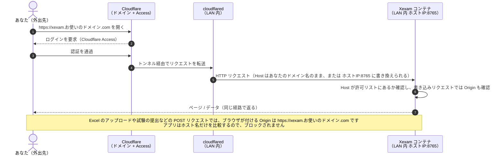

### 必要な三つの作業

**1. LAN 内の cloudflared からコンテナに接続できるようにする。** 既定ではコンテナはローカルマシン（`127.0.0.1`）にのみバインドされます。`docker-compose.yml` と同じ場所に `.env` ファイルを作成します。

```ini
# LAN 内の他のマシン（cloudflared）からこのマシンの 8765 番ポートに接続できるようにする
XEXAM_BIND=0.0.0.0:8765
# 自分のドメイン名でのアクセスを許可する（複数指定可、カンマ区切り）
XEXAM_ALLOWED_HOSTS=xexam.お使いのドメイン.com
```

その後 `docker compose up -d` を実行します。

> cloudflared と Xexam が**同じマシン**上にある場合は、`XEXAM_BIND` を変更する必要はありません（既定のローカルマシンのみのバインドのままにします）。トンネルの転送先を `http://localhost:8765` にすれば動作します。

**2. Cloudflare でドメイン名を Xexam に向ける。** Zero Trust コンソール → Networks → Tunnels → お使いのトンネル → Public Hostname：

| 項目 | 入力する内容 |
|---|---|
| Subdomain / Domain | `xexam` / `お使いのドメイン.com` |
| Service Type | `HTTP`（HTTPS ではありません） |
| URL | `Xexam を動かしているホストのLAN内IP:8765`、例：`192.168.1.20:8765` |

**3. Cloudflare Access にアプリケーションポリシーを追加する**。自分のアカウント（メールアドレス）だけがこのドメイン名にアクセスできるようにします。

### よくあるケース

| 状況 | 設定方法 |
|---|---|
| トンネルが **Host をそのままドメイン名として転送する** | `XEXAM_ALLOWED_HOSTS=xexam.お使いのドメイン.com` だけで足ります。上記の手順 1 で十分です |
| Cloudflare で **HTTP Host Header**（`httpHostHeader`）を設定し、Host を `192.168.1.20:8765` に書き換えている | `XEXAM_ALLOWED_HOSTS=192.168.1.20` に加えて `XEXAM_ALLOWED_ORIGINS=https://xexam.お使いのドメイン.com` を設定します。ブラウザが送る `Origin` は引き続き公開ドメイン名のままなので、別途許可する必要があります |
| Host が実際に何なのか分からない | まず上記の手順 1 のとおり設定してからページを開いてください。拒否された場合（403）、ページ上のメッセージに、サーバーが受け取った `Host`（または `Origin`）が表示されます。その値を `XEXAM_ALLOWED_HOSTS`（または `XEXAM_ALLOWED_ORIGINS`）に追加し、`docker compose up -d` でコンテナを再作成すれば完了です |
| ドメイン名を列挙したくなく、前段にすでに Access の認証がある | `XEXAM_ALLOW_ANY_HOST=1`（`Host` をもう検査しません。書き込みリクエストの `Origin` 検査は引き続き有効です） |

どこまでテストしたか：二つの Host のケースについて、ブラウザでの一連の操作（本物の Chrome と HTTPS リバースプロキシを使用）を、旧 Python 版に対して最後まで確認しました。現在の構成では、`tests/integration/stack_check.py` と `nginx_check.py` が、Nginx が Host を変更せずに転送すること、その背後でも Host / Origin のガードが働くことを、ヘッダーのレベルで確認しています。本物の Cloudflare では**テストしていません**。初めて公開するときは、上の「分からない」の行に従い、403 のメッセージを読んでください。

### 忘れてはいけないこと

- ⚠️ **アプリ自体にはログイン機能がありません。** `XEXAM_BIND` を `0.0.0.0` に設定した場合や `XEXAM_ALLOW_ANY_HOST=1` を設定した場合、**このポートに接続できる人は誰でも、問題集、学習記録、設定を閲覧・変更できます**。そのため、次のようにしてください：
  - cloudflared だけがこのポートに接続できるようにします。ルーターでポートフォワーディングを**しないでください**。Linux では、ホストのファイアウォール（ufw、firewalld）は Docker が公開したポートを**制限できません**。接続元を制限するには `DOCKER-USER` チェーンにルールを追加するか、`XEXAM_BIND` を具体的な LAN の IP（例：`192.168.1.20:8765`）にしてください。最も確実なのは、cloudflared と Xexam を同じマシンに置き、既定の `127.0.0.1` のままにすることです。
  - Cloudflare Access のポリシーを必ず設定し、**自分だけ**を許可してください。ポリシーを設定していないドメイン名は、全世界に公開しているのと同じです。
- Cloudflare 経由でアクセスしている場合、ログインの有効期限が切れることがあります。期限切れ後にアップロードや提出を行うと失敗し、ログインの有効期限が切れている可能性がある、というメッセージが表示されます。ページを再読み込みして、ログインし直せば問題ありません。**途中まで進めた試験はブラウザに保存されているので、失われません**。
- 拒否された（403）場合、ページまたは `docker compose logs` のメッセージに、受け取った `Host` / `Origin` が何であるか、どの値をどの設定項目に追加すべきかが書かれています。

---

## アーキテクチャ

以下の図はすべて [Mermaid](https://mermaid.js.org/) で書かれており、GitHub 上ではそのまま図として表示されます。詳しい説明は [docs/ja/architecture.md](docs/ja/architecture.md) を参照してください。

### 構成要素のつながり

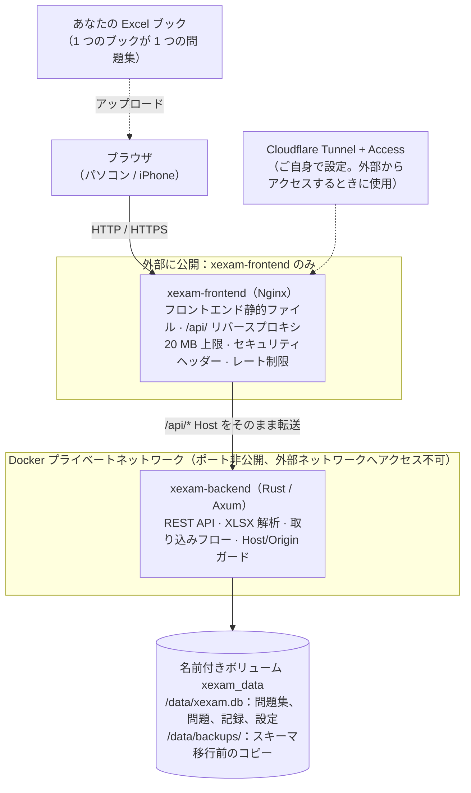

| コンテナ / イメージ | 中身 | 外部公開 |
|---|---|---|
| `xexam-frontend` | Nginx + フロントエンド静的ファイル（HTML / JS / CSS）。`/api/` をバックエンドに転送します。20 MB 上限、セキュリティヘッダー、レート制限、タイムアウト付き | あり：ホストの `XEXAM_BIND`（既定は `127.0.0.1:8765`）→ コンテナの 8080 |
| `xexam-backend` | 静的リンクされた Rust 実行ファイル 1 つ：REST API、Excel の解析、SQLite の読み書き | **なし**：`ports` がなく、ネットワークは `internal: true` |

ブラウザは [REST API](docs/ja/api.md) を通じてのみバックエンドとやり取りし、フロントエンドからデータベースに直接アクセスすることはありません。**採点はブラウザ内で行われます**。サーバーが受け取るのは、各問題の問題 id、正誤、そして（v0.5 からは）選んだ答えです。答えは見直しのために保存するだけです。

### データフロー A：問題集への取り込み（アップロード → プレビュー → 確定）

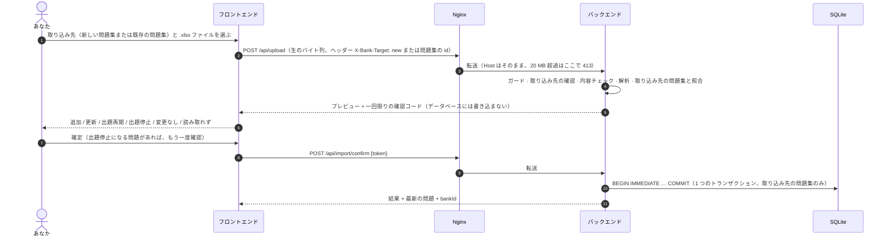

プレビューはメモリ上にだけ 30 分間保持され、確認コードは 1 回しか使えません。プレビューを開いたまま問題集の管理ページを離れると、その取り込みはキャンセルされます（`POST /api/import/cancel`）。`X-Bank-Target` のないアップロード（古いクライアントや、コマンドラインの `import`）は、v0.4 とまったく同じように、v0.5 より前のデータを持つ問題集に取り込まれます。

### データフロー B：試験を 1 回受ける

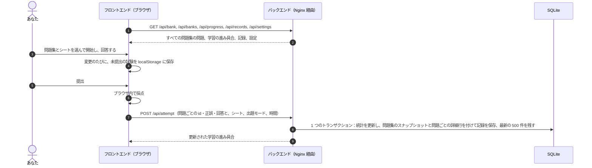

### データベース：8 つのテーブル（スキーマ v2）

`questions`、`stats`、`attempts`、`imports`、`meta` はスキーマ v1 からあるテーブルで、その定義文は変わっていません。v0.5 で `banks`、`attempt_items`、`settings` の 3 つのテーブルと、3 つの列（`questions.bank_id`、`attempts.banks`、`imports.bank_id`）が加わりました。すべてのフィールドの説明は [docs/ja/database.md](docs/ja/database.md) を参照してください。

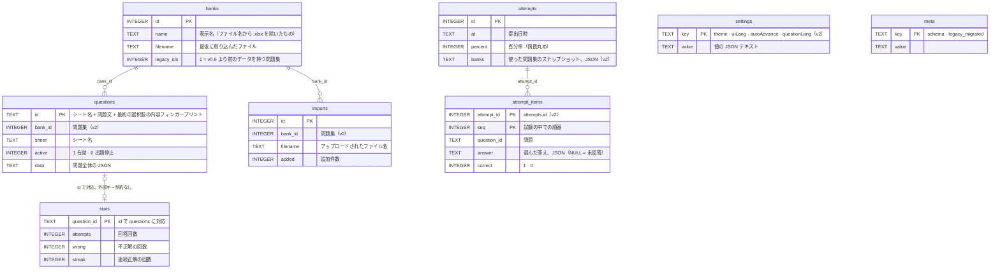

**問題 id：** v0.5 より前のデータを持つ問題集の問題は、以前の id のままです。ほかの問題集では、問題は問題集ごとに区別された id で保存されるため、同じブックを 2 つの問題集として取り込んでも、それぞれの記録が混ざりません。

**`stats` を問題と一緒に削除しない理由：** 出題停止は `active` を 0 に変更するだけで、回答履歴はそのまま保持されます。後でその問題が再び Excel に現れると、自動的に出題再開されます。問題が削除されるのは、問題集を削除したときだけです。

**間違いノートの判定方法：** `wrong > 0` かつ `streak < 2`（連続正解が 2 回未満）の問題は間違いノートに入り、連続で 2 回正解すると自動的に外れます。

### 画面のつながり

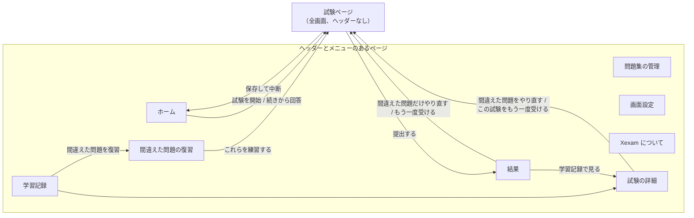

4 つの主要なページ（**ホーム**、**問題集の管理**、**学習記録**、**画面設定**）と **Xexam について** には、ヘッダーのあるどのページからでもメニューで移動できます。単一選択・複数選択・ホットスポット問題は見た目が少し異なりますが、どれも同じ試験ページを使います。

---

## セキュリティについて

詳細な脅威モデルと各防御の説明は [docs/ja/security.md](docs/ja/security.md) を参照してください。要点は次のとおりです。

- **外部に公開されるのは Nginx だけです**。バックエンドはポートを公開しておらず、ネットワークは `internal: true` です（外部インターネットにもアクセスできません）。
- 既定ではこのマシン宛てのリクエストだけを受け付けます（`Host` を検査）。Cloudflare など認証付きのリバースプロキシの背後に置く場合は、ご自身のドメイン名を `XEXAM_ALLOWED_HOSTS` に書いてください。書き込みリクエストでは、`Origin` が `Host` と同じホストであること（または `XEXAM_ALLOWED_ORIGINS` に含まれていること）も検査され、悪意のある Web ページがブラウザ経由で操作するのを防ぎます。バックエンドが読むのは実際の `Host` ヘッダーだけで、`X-Forwarded-*` は読みません。
- **アプリ自体はログインを行いません。** インターネットからアクセスする場合は、前段に認証（Cloudflare Access）を必ず置き、ポートを直接インターネットに公開しないでください。アカウントはなく、設定はこのインスタンスを使う全員に適用されます。
- v0.5 で追加されたルート（問題集、記録、設定）も、ほかのルートと同じガードを同じ順序で通ります。問題集や記録の削除は必ず JSON ボディ付きの POST で、1 つのトランザクションで実行され、画面では必ず確認が表示されます。問題集と一緒に学習データを削除すること、すべての記録と一緒に間違いノートを消去することは、それぞれ別のチェックボックスで、既定ではオフです。設定は決められた値しか受け付けません。
- アップロードされたファイルは**内容**に基づいて検査されます。空ファイル、`.xlsx` 以外、壊れた圧縮ファイル、重複した圧縮エントリ、XML エンティティ宣言（DOCTYPE）を含むファイルは拒否されます。ファイルサイズの上限は 20 MB です。解析には合計時間の上限とメモリの上限があります。
- アップロード後のプレビューはメモリ上に 30 分間保持され、確定には使い切りの検証コード（128 ビットのランダム値）が必要で、一度使うと無効になります。
- データベースへの書き込みは一つのトランザクション内で行われます。途中でエラーが起きると全体がロールバックされ、中途半端なデータは残りません。スキーマ v2 への移行の前に、バックエンドはバックアップのコピーを書き出し、書き出せない場合は起動しません。
- 二つのコンテナはどちらも非 root で実行され、`cap_drop: ALL`、`no-new-privileges`、読み取り専用のルートファイルシステムが設定されています。
- イメージにはシークレット、データベース、問題集は含まれていません。

---

## 自動ビルドとリリース

[`.github/workflows/ci.yml`](.github/workflows/ci.yml) が**唯一の**パイプラインです。`main` または `dev` へのプッシュ、`main` へのプルリクエスト、Actions ページからの手動実行のたびに、次の処理が自動で実行されます。

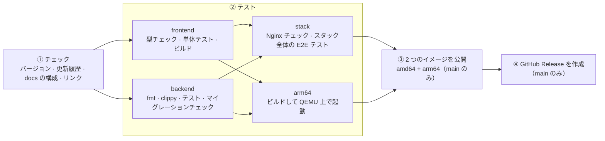

- **トリガー：** `main` へのプッシュ（公開します）、`dev` へのプッシュ、`main` へのプルリクエスト、または Actions ページからの手動実行。公開するのは `main` だけで、`dev`、プルリクエスト、ほかのブランチでの手動実行ではチェックとテストだけを行い、**公開は一切しません**。それ以外のブランチへのプッシュではパイプラインは動きません。
- **更新のたびに必要なこと：** `VERSION` を変更し、**3 つの README すべて**（`README.md`、`README.ja.md`、`README.zh-CN.md`）の更新履歴の先頭に、同じバージョンのエントリを書きます。`backend/Cargo.toml` と `frontend/package.json` も同じバージョンにします。そうしないとステップ ① が失敗します。
- **ドキュメントのチェック（これもステップ ①）：** 7 つのドキュメントが `docs/en`、`docs/ja`、`docs/zh-CN` のそれぞれにあること、`docs/` にはこの 3 つのフォルダ以外に何もないこと、README とドキュメント内のすべての相対リンクが実在するファイルを指していることを確認します。
- **すべて通過して初めて公開：** 2 つのイメージ（`xexam-frontend`、`xexam-backend`）をそれぞれマルチアーキテクチャのイメージとして公開し、そのうえでマニフェストに `amd64` と `arm64` の両方が含まれていること、タグがプッシュしたばかりのダイジェストを指していることを確認します。テストが失敗した場合、`latest` は直前の動作するバージョンのままです。
- **公開されるタグ：** `latest`、`v<VERSION>`、`sha-<コミット>`。Docker Hub と ghcr.io で同じです。
- **バックエンドイメージの arm64 ビルド方法：** ビルドマシン上で zig を使ってクロスコンパイルし、QEMU 上で Rust をコンパイルすることはしません（QEMU では 1 桁遅くなります）。ターゲットアーキテクチャになるのは、最後の非常に小さな alpine ステージだけです。
- **Releases ページ：** 2 つのイメージの公開と検証がどちらも成功したあとで、`v<VERSION>` という名前の Release を自動で作成（または更新）します。説明文は英語版 README の「Changelog」にある当該バージョンの部分から取得し（[`scripts/release-notes.py`](scripts/release-notes.py)）、同名の git タグも自動で付けます。イメージの公開に失敗した場合、この Release は作られません。
- **Releases とイメージは別々の場所にあります：** イメージは **Docker Hub**（`docker.io/yuminspace/xexam-frontend` と `docker.io/yuminspace/xexam-backend`、公開。`docker-compose.yml` が pull するのはこちら）と、非公開のミラーとしてリポジトリの **Packages**（ghcr.io）にあります。Release は **Releases** ページにあり、Docker Hub からの pull コマンドを最初に載せています。いずれも同じビルドから一緒に生成されます。

Docker Hub への公開には、リポジトリのシークレット `DOCKERHUB_USERNAME` と `DOCKERHUB_TOKEN`（**Read & Write** の権限を持つ Docker Hub のアクセストークン）の 2 つが必要です。必要に応じて、リポジトリ変数 `DOCKERHUB_NAMESPACE` も設定できます。シークレットがない場合や、`docker-compose.yml` がその名前空間の Docker Hub のイメージを指していない場合、公開ジョブは何もプッシュせずに止まります。ghcr.io ではイメージは非公開です（リポジトリが非公開のため）。そこで新しいイメージ名を初めて公開するときは、GitHub のパッケージ設定で、このリポジトリを **Manage Actions access** に追加し、ロールとして **Admin** を選んでください。そうしないとプッシュが拒否されます（`permission_denied: write_package`）。

---

## 開発

日常的なコードの変更やテスト実行に使うコマンドは [docs/ja/development.md](docs/ja/development.md) を参照してください。よく使うものは次のとおりです。

```bash
# バックエンド（Rust 1.99.1。rustup が backend/rust-toolchain.toml に従って自動でインストールします）
cd backend && cargo fmt --check && cargo clippy --all-targets -- -D warnings && cargo test --all-targets

# フロントエンド（Node 24）
cd frontend && npm ci && npm run typecheck && npm test && npm run build

# 開発時：バックエンドは 127.0.0.1:8765、フロントエンドは http://127.0.0.1:5173（/api はバックエンドにプロキシされます）
cd backend && cargo run -- serve --data ../data --no-browser
cd frontend && npm run dev

# スタック全体のチェック（Docker を使い、一時的なプロジェクト名と一時ボリュームで実行するため、xexam_data には触れません）
python -I tests/integration/stack_check.py
```

- バックエンドのテストは 181 件、フロントエンドの単体テストは 44 件です。バックエンドのテストは、`tests/baseline/` にコミット済みの**旧版のスナップショット**と突き合わせて行います。内訳は、ゴールデンレスポンス 172 件、パース用フィクスチャ 49 件とその出力、問題 id ベクタ 85 件です。これらのフィクスチャはすべて架空のもので、実際の問題集がリポジトリに入ることはありません。
- v0.5 の動作（スキーマの移行とバックアップ、問題集、記録、設定、新しいルートのガード）は `backend/tests/v05_banks_records_settings.rs` でテストしています。
- 画面のテキストはすべて `frontend/src/i18n/catalog/*.ts` にあり、英語・中国語・日本語で書かれています。ある言語にキーが欠けているとテストが失敗し、バックエンドのエラーメッセージに翻訳がない場合も別のテストが失敗します。
- **Xexam について** のページには、3 つの README の更新履歴が表示されます。更新履歴はフロントエンドのビルド時に読み込まれる（`frontend/vite.config.ts` の `xexam-changelog` プラグイン）ため、フロントエンドをビルドするには、`frontend/` の 1 つ上のフォルダに `README.md`、`README.ja.md`、`README.zh-CN.md` が必要です。
- v0.4 以前のデータベースを v0.5 で開くと移行が行われ、その隣に `backups/` が書き出されます。試すときはコピーを使ってください。

---

## ディレクトリ構成

```
README.md                  英語版の README。README.ja.md（このファイル）と README.zh-CN.md が日本語版と中国語版
LICENSE                    MIT ライセンス
VERSION                    バージョン番号（更新履歴の先頭のエントリと一致させる）
docker-compose.yml         2 つのイメージを pull して実行（必要なのはこのファイルだけ）
docker-compose.build.yml   ソースから 2 つのイメージをビルドして実行
.env.example               ローカル設定のテンプレート（.env にコピーして使う。.env はコミットしない）
backend/                   Rust バックエンド（Axum + rusqlite）
  src/api/                   ルーティング、ガード（Host / Origin / Content-Type / サイズ）、JSON 形式、成績データのサニタイズ
  src/services/              確認待ちインポートのスロット、パースエンジンのインターフェース、取り込みフロー
  src/parser/                .xlsx のパース：ZIP 対策、XML、問題の判別、問題 id
  src/database/              SQLite ストレージ、スキーマ（v1 そのまま + v2 の追加分）、旧 progress.json の移行、タイムスタンプ
    store/                     問題集、記録、設定、スキーマ v1 から v2 への移行（バックアップのコピー付き）
  src/security/ src/config/  Host / Origin の判定、サイズ制限付きのリクエストボディ読み取り；環境変数
  tests/                     単体、ゴールデンレスポンス、パース突き合わせ、id ベクタ、並行処理、v0.5（問題集、記録、設定、移行）
  Dockerfile                 ビルドマシン上でクロスコンパイル（zig）。実行イメージは静的リンクされた単一の実行ファイル
frontend/                  TypeScript + Vite フロントエンド（素の DOM）
  src/main.ts src/router.ts  エントリポイント。ハッシュルート（#/、#/banks、#/records、#/settings、#/about、#/quiz、#/result など）
  src/pages/                 home、banks、records、settings、about、quiz、result
  src/components/            シェル（メニューボタンとそのドロップダウンメニューのあるヘッダー）、見直し表示（解答カード）、共通部品
  src/i18n/                  英語・中国語・日本語の画面テキスト（catalog/*.ts）、サーバーメッセージの翻訳
  src/api/ types/ domain/ state/ utils/ styles/
  vite.config.ts             ビルド設定。「Xexam について」のページ用に 3 つの README の更新履歴を読み込む
nginx/                     nginx.conf + Dockerfile（3 つの README と一緒にフロントエンドをビルド → 静的な成果物だけを同梱）
tests/baseline/            旧版 Python の挙動スナップショット（ゴールデンレスポンス、パース用フィクスチャ、id ベクタ、サンプル DB）
tests/integration/         Nginx の挙動チェック、スタック全体の E2E チェック、progress.json の移行チェック
docs/                      en/（英語）、ja/（日本語）、zh-CN/（中国語）：アーキテクチャ、API、データベース、セキュリティ、デプロイ、移行、開発。
                           各フォルダに専用の screenshots/。en/openapi.yaml。zh-CN/history/ には過去の文書（中国語のみ）
scripts/release-notes.py   更新履歴から GitHub Release の説明文を生成（CI で使用。ローカルでも実行可能）
.github/workflows/ci.yml   唯一のパイプライン：チェック → テスト → 公開 → Release
```

---

## ライセンス

Xexam は [MIT ライセンス](LICENSE) で公開されています。Copyright (c) 2026 Yumin-Space.

このライセンスの対象は、このリポジトリ内のソフトウェアです。リポジトリに試験問題は含まれていません。取り込む問題集はご自身のファイルであり、それを使用してよいかどうかの確認はご自身の責任で行ってください。

---

## 更新履歴

更新のたびにここに 1 件ずつ記録します。**バージョン番号はリポジトリ直下の `VERSION` ファイルと一致させます**（自動ビルドが検査し、一致しない場合はビルドを通しません）。最新のイメージには `latest` と、対応する `vX.Y` のタグが両方付きます。

アプリの **Xexam について** のページにはここのエントリが表示されます（フロントエンドに組み込まれます）。そのため、エントリは簡単な Markdown で書いてください：段落、`- ` の箇条書き、`  - ` の入れ子の箇条書き、`**太字**`、`` `コード` ``。リンクは、そのページではただの文字として表示されます。

### v0.5.1 — 2026-11-11

**色覚の多様性に配慮した配色で、落ち着いたシンプルな見た目になりました。メニューボタンは右上に移り、問題集の管理ページはホームと同じくらいコンパクトになりました。**

- **落ち着いたシンプルな見た目**：配色を、GitHub のデザインシステム Primer の色覚に配慮したライト / ダークのパレット（Light colorblind / Dark colorblind）に合わせました。正解は緑ではなく青、不正解は赤ではなくオレンジで示します。ライトテーマはやわらかい灰白色のページに白いブロックと紺色の主なボタン、ダークテーマはほぼ黒です。ページは 1 枚の落ち着いたシートの上に置かれ、枠や罫線が減り、角が丸くなりました。マウスを重ねると背景がやわらかく色づき、注意書きは淡い色の付いた囲みで表示され、メニューは軽くなってやわらかい影が付きました。変わったのは見た目だけで、そのために位置や動作が変わることはありません。
- **メニューは右側に**：三本線のメニューボタンは、ヘッダーの右上に移りました。Xexam のロゴは左上のままです。メニューはボタンの下に開き、これまでどおりに動作します。
- **コンパクトになった問題集の管理ページ**：
  - **Excel の取り込み**：**新しい問題集** と **既存を更新** は、タイトルの横にある 2 つの小さなボタンになりました（マウスを重ねると説明が表示されます）。更新する場合は、その下に **更新する問題集** が表示されます。ヒントは 1 行で、最後に **Excel の書き方** へのリンクがあります。ファイルの指定も 1 行にまとまりました：**Excel ファイルを選ぶ** を押すか、パネルのどこかにファイルをドロップします。
  - **プレビュー**：数は小さなチップで表示され（数が 0 のものは表示されません）、シートはそれぞれ 1 行になり、読み取れなかった行はそのシートの行の下に折りたたまれます。確定とキャンセルのボタンは、これまでどおり数と案内・注意のすぐ後、シートの一覧より前にあります。
  - **登録済みの問題集**：問題集ごとにコンパクトな 1 行があり、名前、小さな **更新** と **削除** のボタン、1 行の情報（ファイル、問題数、シート数、最終更新日）が表示されます。シートは、行の右側の矢印の下に折りたたまれています。
  - **取り込み履歴** には 1 回の取り込みが 1 行で表示され（最新の 8 件）、**Excel の書き方と取り込みの説明** は開くまで折りたたまれています。
  - タッチ画面では、小さなボタンにも約 44 px のタップ領域があります。スマートフォンでは、問題集の名前が長いと、ボタンは別の行に移ります。
- **Docker Hub でイメージを公開**：各リリースは、Docker Hub にも `yuminspace/xexam-frontend` と `yuminspace/xexam-backend` として公開されるようになりました（誰でも pull でき、`amd64` と `arm64` は同じタグで提供されます）。`docker-compose.yml` はそこから pull するので、`docker login` はもう必要ありません。同じタグは、非公開のミラーとして `ghcr.io/yumin-space` にも引き続き置かれます。v0.5 を古い `docker-compose.yml` で動かしている場合は、新しいものに置き換えてください（データボリュームはそのまま残ります）。README の冒頭に Docker Hub のバッジを付けました。
- README とドキュメントを新しいレイアウトに合わせて書き直し、スクリーンショットを撮り直しました。

### v0.5 — 2026-11-10

**複数の問題集、学習記録、画面設定を備えた新しい画面になり、英語・中国語・日本語で使えるようになりました。データベースは、バックアップのコピーを書き出したうえで、自動的にスキーマ v2 に移行します。**

- **新しいレイアウト**：試験以外のすべてのページに、三本線のメニューボタンのある細いヘッダーが付きました。ボタンを押すと、ホーム、問題集の管理、学習記録、画面設定のある小さなメニューが開きます。項目を選ぶ、メニューの外側をクリックする、または Esc キーを押すと、メニューは閉じます。広い画面では、ページの内容は中央に寄せられます（幅は最大 1120 px）。試験そのものは、集中して解ける全画面のページです。
- **「Xexam について」のページ**：メニューの最後の項目、Xexam v0.5（区切り線の下）から開きます。バージョン、サーバーの CPU アーキテクチャ、ライセンス、各バージョンの更新内容を表示します。更新内容はこの更新履歴で、表示言語のものが、最新のバージョンを開き、それより前のバージョンを折りたたんだ状態で表示されます。
- **コンパクトになったホーム**：未提出の試験は、「続きから回答」と「破棄する」のある 1 行のバナーになりました。「試験を始める」パネルの右上にある 2 つの小さなボタンで、出題する問題を選びます：「すべて」と「間違いノート」で、それぞれに問題数が表示されます（選んだシートに復習する問題がない間は、「間違いノート」は選べず、1 行で理由が表示されます）。問題集ごとに 1 枚のカードがあり、その中にシートがコンパクトな行として並びます。問題集のチェックボックスでそのすべてのシートを選択でき、シートは折りたたむこともできます（問題集が 3 つ以上あるときは、最初から折りたたまれています）。
- **ランダムな出題**：問題数が選んだ範囲より小さいときは、範囲全体から問題がランダムに選ばれるようになりました（以前は、シャッフルしない場合、問題集の順番で先頭から選ばれていました）。「問題の順番をシャッフルする」は、出題の順番をランダムにするか、問題集の順番にするかだけを決めます。
- **複数の問題集**：取り込んだブックは、それぞれが独立した問題集になります。ファイルを新しい問題集として取り込むことも、既存の問題集を更新・置き換えることもできます。ファイルにない問題は、その問題集の中でだけ出題停止になります。問題集の一覧には、問題集ごとのシートと問題数が表示されます。問題集を削除するときは確認があり、その問題集の学習記録も削除するかどうかを選べます。
- **学習記録ページ**：絞り込み（問題集、期間、正答率）付きの試験の一覧。各試験の詳細では、すべての問題についてあなたの回答、正解、解説を表示します（v0.5 以降に受けた試験）。間違えた問題の復習と練習。間違えた問題のやり直しと、試験の受け直し。記録の 1 件削除（間違いノートは変わりません）と、すべての記録の削除（間違いノートも消去するオプション付き）。Xexam は直近 500 回分の試験を保存します（以前は 60 回分）。
- **画面設定ページ**：テーマ（システムに合わせる / ライト / ダーク）、表示言語（既定は English、ほかに 中文、日本語）、回答後に自動で次の問題へ進む設定（単一選択と、すべての小問に答えたホットスポット問題が対象。複数選択では進みません）、既定の設定に戻す機能。設定と問題の言語はサーバーのデータディレクトリに保存されるため、再起動、イメージの更新、ブラウザのキャッシュの削除、別のブラウザや端末への切り替えでも消えません。未提出の試験は、これまでどおり現在のブラウザにだけ保存されます。
- **画面全体を英語・中国語・日本語で表示**：試験ページや、サーバーからのエラーメッセージも含みます（バックエンドは引き続き中国語で送り、画面側で翻訳します）。
- **スマートフォン向けの改善**：ホームでは「試験を開始」ボタンが画面下部に固定され、一覧はよりコンパクトになり、解答用紙では回答済みの数と「提出する」が問題のタイルの上に表示され、タッチ領域は 44 px 以上になりました。
- **データベーススキーマ v2**：新しいテーブル `banks`、`attempt_items`、`settings`、新しい列 `questions.bank_id`、`attempts.banks`、`imports.bank_id`。v0.5 の初回起動時に、既存のデータベースを自動で移行します。その前に、コピーを `<データディレクトリ>/backups/xexam-schema1-<日時>.db` に書き出します（コピーを書き出せない場合、バックエンドは起動せず、何も変更しません）。既存のデータは 1 つの問題集になり、問題 id、間違いノート、成績履歴はそのまま残ります。ロールバック = 停止し、そのコピーを復元して、v0.4 を動かす。問題集が複数あるデータベースで v0.4 を動かすことは絶対にしないでください。手順：[docs/ja/migration.md](docs/ja/migration.md)。
- **新しい API**：`GET /api/banks`、`POST /api/banks/delete`、`GET /api/records`、`GET /api/record?id=`、`POST /api/records/delete`、`GET` / `POST /api/settings`、`POST /api/settings/reset`、そして `POST /api/upload` の省略可能なヘッダー `X-Bank-Target`（付けない場合、アップロードは v0.4 とまったく同じように動作します）。`GET /api/bank` の各問題には、キー `bank` が 1 つ増えます。[docs/ja/api.md](docs/ja/api.md) を参照してください。
- **ドキュメントを言語ごとに分割**：`docs/en`、`docs/ja`、`docs/zh-CN`。中国語のみの過去の文書は `docs/zh-CN/history` に移しました。言語フォルダごとに、その言語の画面で撮ったスクリーンショットがあります。CI はこの構成と、すべての相対リンクを確認します。
- **`dev` ブランチへのプッシュでも CI が動くようになりました**（チェックとテストのみで、公開はしません）。
- README、ドキュメント、4 列形式のパーサーテストにある Excel の例を、架空の例に置き換えました。`tests/baseline/` にある旧版のテストスナップショットは変わっていません。それより前の更新履歴で変えたのは、リンク（新しいドキュメントのフォルダへ）と、例として挙げた語の一覧 1 か所だけです。
- **MIT ライセンス**を追加しました（`LICENSE`）。
- テスト：バックエンド 151 → 181（移行とバックアップ、問題集、記録、設定、新しいルートのガード）、フロントエンド 27 → 44（画面のテキスト、サーバーメッセージの翻訳、「Xexam について」のページの更新履歴、ランダムな出題）。

### v0.4 — 2026-11-10

- **3 言語の対照表示：英語 / 中国語 / 日本語。** Excel に新しい形式を追加しました。A 列が英語、B 列が中国語、C 列が日本語（問題そのもの）、D 列が答え・解説・暗記用の語呂です。A・B・C の 3 列は同じ 1 問の 3 言語版で、1 対 1 に対応し、答えは 1 つだけ書きます。解答画面の言語ボタンは `英语 / 中文 / 日语`（「英語 / 中国語 / 日本語」）になり、成績画面の誤答解説も選択した言語で表示されます。
- **ホットスポット問題の選択肢も言語に連動します**。各小項目の末尾にその言語で選択肢を書きます（日本語は `はい / いいえ`、中国語は `是 / 否`（「はい / いいえ」の意）、英語は `Yes / No`。実行レイヤーのような三択も同様）。言語を切り替えると選択肢ボタンも一緒に切り替わります。ある列に選択肢が書かれていない場合でも、その言語は引き続き使えますが、選択肢ボタンには日本語のものが表示されます。
- **ホットスポット問題の答えは、どの言語の選択肢語で書いても認識されます**（`調理`、`烹饪`（「調理」）、`Cooking`。混ぜて書いても構いません）。3 言語の選択肢は位置で 1 対 1 に対応し、個数が合わない列は照合に使わず、推測もしません。
- **旧来の 3 列形式（A が日本語、B が中国語、C が答え）は変更不要で、そのままアップロードできます**。英語がないだけです。プログラムが内容から自動的に形式を判別します。4 列形式でも問題 id は引き続き C 列の日本語から作られるため、同じ問題は 2 つの形式で同じ id になり、学習記録は影響を受けません。
- ホーム画面のフッターの説明文を次の文に変更しました：`Xexam 仅提供题目与答案的导入、整理及练习功能，软件本身不提供或收录考试题目、答案及相关资料；用户应确保导入和使用的资料来源合法，并拥有相应使用权限。`（「Xexam は問題と答えのインポート・整理・練習の機能のみを提供し、ソフトウェア自体は試験問題・答え・関連資料を提供・収録しません。ユーザーは、インポートして使用する資料の入手元が適法であり、相応の使用権限を持っていることを確認してください」）
- **README を 3 つの言語に分割しました**：`README.md`（英語、既定）、`README.ja.md`（日本語）、`README.zh-CN.md`（中国語）。ページ先頭の言語バーで相互に移動でき、更新履歴はそれぞれの言語で書きます。GitHub の Release ノートは英語版から作られます。
- **`docs/` のドキュメントも 3 つの言語になりました**：現行の 7 つ（アーキテクチャ、API、データベース、セキュリティ、デプロイ、移行、開発）は、`X.md`（英語）、`X.ja.md`（日本語）、`X.zh-CN.md`（中国語）があり、先頭に言語バーがあります。`openapi.yaml` は英語です。Phase 0 の監査・計画文書は過去の記録なので、中国語のみのままです。CI は 3 つがそろっていることと、すべての相対リンクが実在するファイルを指していることを確認します。
- **スクリーンショットを撮り直しました**：v0.4 の画面と、架空の 4 列デモ用問題バンクで撮影しています。同じ問題を英語・中国語・日本語で表示でき、ホットスポット問題の選択肢ボタンも言語に連動します。（画面そのもの、ボタンやラベルは、まだ中国語のみです。）
- **言語の取り決め**：コードのコメントと、プログラム・ツール・CI の出力は英語、画面と README はそれぞれの言語を使います。この変更でコードは一切変わっていません（直前のコミットとの機械的な比較で確認済み）。
- テスト：バックエンド 136 → 151（4 列形式、3 言語の選択肢と答え、対応が合わない場合のフォールバック）、フロントエンド 19 → 27（言語ルール）。

### v0.3 — 2026-11-10

**アプリ全体を Rust + TypeScript + Nginx で書き直しました。データベースファイルとスキーマは変わらず、API は後方互換です。旧 Python 実装はリポジトリから削除しました。**

- **バックエンドを Rust に変更**（Axum 0.8 + Tokio + rusqlite、ツールチェーンは 1.99.1 に固定）：REST インターフェース、XLSX の解析、インポート（プレビューはデータベースに書き込まない → 一回限りの確認コード → 1 つのトランザクションで書き込み）、成績と誤答の統計、Host/Origin ガード、`xexam-backend import / healthcheck / migrate-progress` サブコマンド。挙動は Python 版と 1 対 1 に対応しています。172 件の旧版レスポンスを項目ごとに突き合わせて、説明のつかない差異はありませんでした。49 個の合成ワークブックの解析出力と 85 件の問題 id ベクトルもすべて一致したため、問題 id は旧版とバイト単位で同一で、学習記録が問題から切り離されることはありません。
- **フロントエンドを TypeScript に変更**（strict）+ **Vite**、素の DOM でフレームワークは使いません。インラインスタイルがないため、CSP を厳しく設定できます。ビルドターゲットは `safari15` で、iPhone は iOS 15.4 以上が必要です。
- **2 つのイメージ、2 つのコンテナ**：`xexam-frontend`（Nginx + フロントエンドの静的ファイル、唯一外部に公開）と `xexam-backend`（Rust、`internal` のプライベートネットワーク内でポートを公開しない）。非 root、`cap_drop: ALL`、読み取り専用のルートファイルシステム。Host はそのまま透過し、`X-Forwarded-*` は空にします。20 MB の上限、セキュリティヘッダー、レート制限、タイムアウトを備え、バックエンドに到達できないときは JSON の 502 を返します。どちらのイメージにも `amd64` と `arm64` の両方があります。
- **より厳格なアップロード検査（意図的な差異）**：どの文字コード・拡張子でも DOCTYPE とエンティティ宣言を拒否します。重複した ZIP エントリ名を拒否します。ZIP のエントリ数、XML の深さ・ノード数・要素あたりの属性数、セルの合計バイト数に上限があります。解析には協調的なタイムアウトがあり（時間になるとパーサー自身が停止します）、同時に実行できるのは最大 2 件です。エラーメッセージにライブラリの例外テキストを表示しなくなりました。未対応の HTTP メソッドには 405 を返します（以前は 501）。差異の一覧は [docs/ja/api.md](docs/ja/api.md) を参照してください。
- **1 本のパイプライン**（`.github/workflows/ci.yml`）：バージョンと更新履歴の検査 → フロントエンド / バックエンド / Nginx と全スタック / arm64 の 4 グループの検査 → すべて通ったら 2 つのイメージを公開し、Release を作成。
- **テスト**：バックエンド 136 件（コミット済みの旧版スナップショットとの突き合わせ：172 件のゴールデンレスポンス、49 個の解析フィクスチャ、85 件の id ベクトル）、フロントエンド 19 件。`tests/integration/` には Nginx 38 項目、全スタック 34 項目、`progress.json` 移行 10 項目があります。
- **ドキュメント**：`docs/` 以下にアーキテクチャ、API（OpenAPI を含む）、データベース、セキュリティ、デプロイ、移行、開発に加え、移行前の監査、リスク、計画を置きました。
- 採点は引き続きブラウザ内で行います（サーバーは `{問題 id, 正誤}` だけを受け取ります）。理由は [docs/zh-CN/history/migration-plan.md](docs/zh-CN/history/migration-plan.md) を参照してください。
- ⚠️ **アップグレード時の注意**：新旧のバージョンはコンテナ名とポートが同じなので、**同時に実行できません**。アップグレード前に `docker compose stop` を実行してください。データボリューム `xexam_data` は同じものなので、データの移行は不要です。旧来の単一イメージ `ghcr.io/yumin-space/xexam` は今後更新されません（最後は `v0.2.2`）。`docker-compose.yml` は、`xexam-frontend` と `xexam-backend` の 2 つを一度に pull するようになりました。ロールバック手順は [docs/ja/migration.md](docs/ja/migration.md) を参照してください。
- **検証していないもの（正直に記載）**：本物の Cloudflare Tunnel、iPhone の実機、本物の ARM ハードウェア上での実行（QEMU 上でビルドして起動を確認しただけです）、ご自身の実データベースのコピーを使った予行演習。

### v0.2.2 — 2026-11-10

- `tests/baseline/` を追加しました。旧版 Python の挙動ベースライン（172 件の実レスポンス、50 個の XLSX フィクスチャと解析出力、85 件の問題 id ベクトル、サンプルデータベース、セキュリティプローブ、Host/Origin 検査とトンネルのシミュレーションスクリプト）で、以降の Rust への書き直しはこれと項目ごとに突き合わせます。ツール内にローカルのパスを直接書かなくなり、`XEXAM_LEGACY_ROOT` でテスト対象のコードを指定できます。
- 前バージョンの更新履歴にあった v0.2 の Release に関する記述を訂正しました。

### v0.2.1 — 2026-11-10

- **ビルドが成功するたびに、GitHub の Releases ページに Release を自動作成するようにしました**（以前はイメージを push するだけで、Releases ページはずっと空でした）。パイプラインに 4 つ目のジョブ `release` を追加しました。イメージの公開と照合が成功した後に実行され、説明文は本更新履歴のそのバージョンの部分から取り、git タグ `v<バージョン>` も自動で付けます。
- v0.2 の Release は手動で 1 回作成しました（v0.2 のコミット `1ee64c8` に対応し、Latest にはしていません）。v0.2.1 からはパイプラインが自動で作成します。
- `scripts/release-notes.py` を追加しました。README から特定バージョンの更新履歴を抜き出します。ローカルでも実行でき、Releases ページに表示される内容をプレビューできます。

### v0.2 — 2026-11-10

- **ご自身のドメインでインターネットからアクセスできるようになりました**（Cloudflare Tunnel + Cloudflare Access）：
  - 許可するドメインを `XEXAM_ALLOWED_HOSTS` に設定します。書き込みリクエストの `Origin` はホスト名だけを比較するようになったため、**HTTPS** のドメイン経由でアップロードや提出をしても 403 で止められなくなりました。
  - プロキシが `Host` を書き換える場合は、`XEXAM_ALLOWED_ORIGINS` で公開ドメインだけを別に許可できます。前段で認証済みの場合は `XEXAM_ALLOW_ANY_HOST=1` を設定できます。
  - 拒否されたときは、どの条件を通らなかったのか、どう許可すればよいかが表示されます。ログインが期限切れになったときは、再読み込みして再ログインするよう画面に案内が出ます。
- ポートのバインドを設定可能にしました（`XEXAM_BIND`）。デフォルトは引き続きローカルのみのバインドです。
- `docker stop` の停止シグナルを受けると正常に終了するようになりました（以前は 10 秒待たされた末に強制終了されていました）。データベースもきれいに閉じられます。
- CI：「バージョンと更新履歴の検査 → 2 つのアーキテクチャそれぞれでテスト → 公開」の 3 段階に分割しました（v0.2.1 からは 4 段階目として Release の作成を追加）。スモークテストは `scripts/smoke-test.sh` に移し、ローカルに Docker があればそのまま実行できます。公開後はダイジェストでイメージマニフェストを照合します。
- `/api/info` に `arch`（現在の CPU アーキテクチャ）を追加しました。
- 監査後の修正（すべて実測による確認付き）：
  - サーバー：早い段階で拒否するリクエスト（403/415）は、リクエストボディを読み切ってから応答するようにしました。ブラウザには「サーバーに接続できません」ではなく本当の原因が表示されます。拒否されたリクエストはログに 1 行残ります（`docker compose logs` で確認できます）。不正な JSON（数値をリストとして渡す、`Infinity`、深すぎるネスト、非 ASCII の確認コード）には、接続を切るのではなく 400/409 を返します。POST の `Content-Type` は実際に `application/json` である必要があります。`XEXAM_ALLOWED_HOSTS` は、スペースやセミコロン区切りでも認識されます。
  - データベース：`COMMIT` に失敗したときはロールバックし、接続がトランザクション内に居座らないようにしました。形式が不正な古い `progress.json` があってもプログラムが起動しなくなることはありません。データディレクトリに別の `.db` ファイルしかない場合は、起動ログで知らせます（そのファイルには手を加えません）。
  - 画面：提出時は、成績の送信に成功してから一時保存を消すようにしました。失敗した場合は保存を残し、`刷新页面重新登录后再交卷`（「ページを再読み込みして再ログインしてから提出してください」）と表示します。新しい試験を始める前に、未提出の試験があれば確認を出します。成績画面のパーセンテージを学習記録と同じ丸め方にして、1 のずれが出なくなりました。通知バーが下部のページ送りバーに隠れなくなりました。長い英字列で横スクロールバーが出なくなりました。`<dialog>` のない古い Safari ではシステムの確認ダイアログを使います。英字キーを長押ししても答えが繰り返し切り替わらなくなりました。
  - イメージと CI：ヘルスチェックはプロキシを経由せず、`XEXAM_PORT` に従います。`.dockerignore` は階層を問わず有効になりました。`.gitignore` にバックアップ用の圧縮ファイルと `.env.*` を追加しました。公開は `main` からのみで、`main` で待機中のものはキャンセルしません。スモークテスト内のコンテナ内パスは、Windows の Git Bash でも動きます。
  - このバージョンは、ローカルで Docker を使って実際にイメージ（amd64）をビルドし、CI と同じスモークテストを通しました：非 root、Host/Origin の遮断、コンテナ削除後もデータが残ること、`docker stop` が 1 秒。arm64 と公開については、引き続き GitHub Actions の結果を確認する必要があります。
- 名称を **xexam** に統一しました：環境変数は `XEXAM_DATA` / `XEXAM_HOST` / `XEXAM_PORT` / `XEXAM_ALLOWED_HOSTS` / `XEXAM_ALLOWED_ORIGINS` / `XEXAM_ALLOW_ANY_HOST`、データベースファイルは `xexam.db`、ブラウザに保存するキー名は `xexam.*` です。ドキュメントにも、ご自身の Excel ファイル名を直接書かなくなりました。
- ⚠️ **v0.1 からのアップグレード時の注意：** データベースファイルの名前が変わり、新バージョンは `xexam.db` だけを読み込みます。それ以前のバージョンですでに問題集をインポートしている場合は、いったんプログラムを停止し、データディレクトリ内のその `.db` ファイルを `xexam.db` に改名してから起動してください。そうしないと問題集が空になります（古いファイルは削除されず、読み込まれないだけです）。ブラウザに一時保存していた試験や言語選択のキー名も変わったため、アップグレード前に提出を済ませてください。言語は日本語に戻ります。ご自身で変更した compose に古い環境変数名を設定している場合は、上記の `XEXAM_*` に書き換えてください。そうしないと無視されます。
- `docker-compose.yml` から `pull_policy: always` を外しました。`docker compose up -d` は毎回ネットワークで確認しなくなったため、更新には `docker compose pull && docker compose up -d` を使ってください。
- `.env`（ローカル設定）を `.gitignore` と `.dockerignore` に追加しました。コミットされず、イメージにも入りません。

### v0.1 — 2026-11-10

最初のバージョンです。

- ブラウザでの解答：単一選択、複数選択、ホットスポット問題。**提出後に初めて採点**し、誤答には答え、解説、暗記用の語呂を表示します。
- 日本語 / 中国語の対照切り替え。解答カード、フラグ付け、一時保存して終了し、あとで再開。
- 誤答ノート：間違えた問題は 2 回連続で正解すると外れます。成績履歴。
- 問題集と学習記録の保存先を **SQLite**（Docker 名前付きボリューム `xexam_data`）に変更し、Excel に依存しなくなりました。
- 管理ページで **Excel をアップロードして問題集を更新**：まずプレビュー（新規 / 更新 / 復元 / 下架 / 読み取れない行）を表示し、確認後に初めて書き込みます。下架した問題も解答記録は残り、再びアップロードすると自動で復元されます。
- 旧版の `progress.json` は、初回起動時に自動で移行されます。
- **iPhone** に対応：タッチ領域は 44 px 以上、セーフエリア、下部固定のページ送りバー、ホーム画面への追加。
- Docker イメージは **x86（amd64）と ARM（arm64）** の両方に対応し、GitHub Actions でビルドとテストを行います。
- ⚠️ v0.1 の「公開」ステップは成功しなかったため、`ghcr.io/yumin-space/xexam` には `v0.1` のタグが**ありません**。イメージは v0.2 から公開されています（`latest` / `v0.2`）。
- アプリ名を **Xexam** に変更しました。

<!-- 新しいバージョンはこの行の上に書く。形式：### vX.Y — 日付 -->
