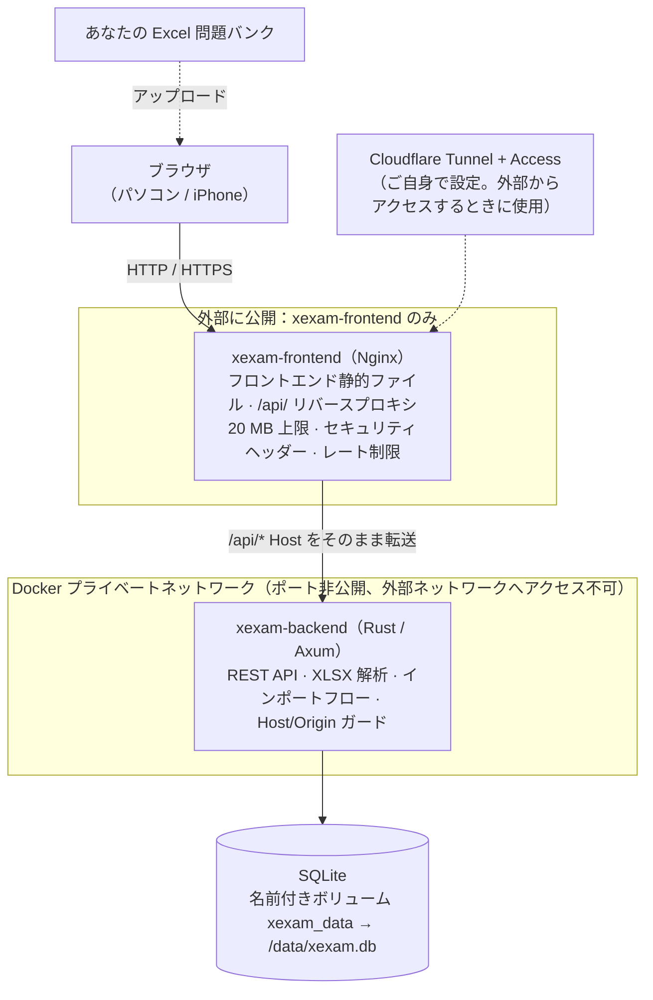
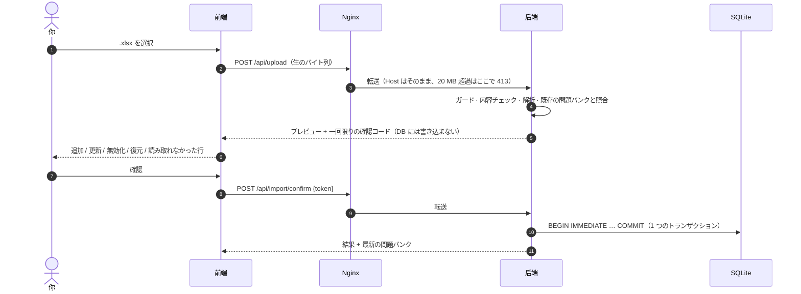
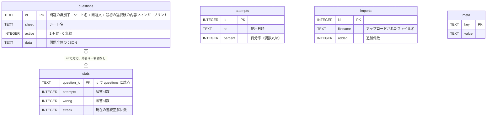
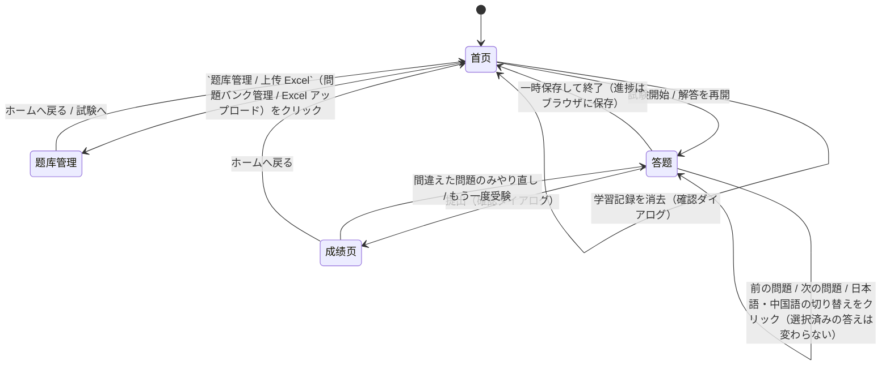
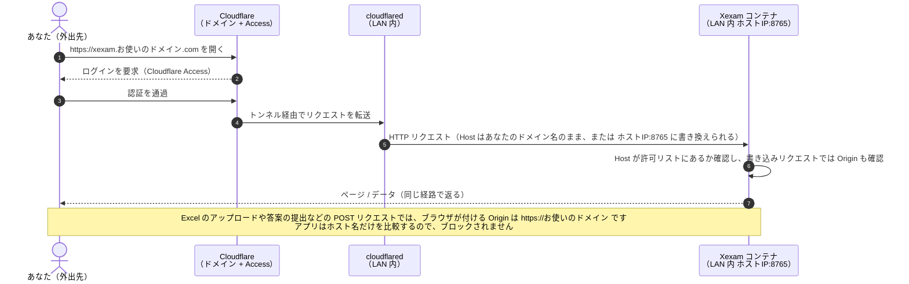
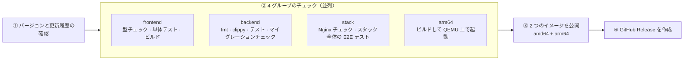

[English](README.md) | **日本語** | [简体中文](README.zh-CN.md)

# Xexam

ブラウザ上で問題を解く模擬試験プログラムです。問題はご自身の Excel から取り込み、一度アップロードすれば SQLite に保存されます。解き終わって**提出した後にはじめて採点**され、間違えた各問題の答え・解説・覚え方が表示されます。スマートフォン（iPhone）でもパソコンでも使えます。

- **Rust バックエンド + TypeScript フロントエンド + Nginx** を Docker Compose で 2 つのコンテナとして動かします。外部に公開されるのは Nginx だけで、バックエンドはプライベートネットワーク内にあります。
- 問題バンク、成績、誤答の記録はすべて 1 つの SQLite ファイルに保存され、**Docker の名前付きボリューム**に置かれるため、コンテナを更新・削除しても失われません。
- 英語 / 中国語 / 日本語をいつでも切り替えて見比べられます（問題文、選択肢、ホットスポット問題の選択肢ボタンも一緒に切り替わります）。誤答ノートと成績履歴もあります。
- リポジトリには**問題バンクは含まれていません**。問題バンクはご自身の Excel であり、コミットされません（`.gitignore` で除外済み）。

| | |
|---|---|
| 現在のバージョン | **v0.4**（[更新履歴](#更新履歴)を参照。リポジトリの [Releases](../../releases) ページでも確認できます） |
| イメージ | `ghcr.io/yumin-space/xexam-frontend` と `ghcr.io/yumin-space/xexam-backend`。タグは `latest` / `v0.3` / `sha-<コミット>` |
| CPU アーキテクチャ | `linux/amd64`、`linux/arm64`（同じタグの中から自動的に適切なものが選ばれます） |
| ポート | `8765`（デフォルトではローカルマシンのみにバインド） |

ドキュメント：[アーキテクチャ](docs/architecture.md) · [API](docs/api.md)（[OpenAPI](docs/openapi.yaml)）· [データベース](docs/database.md) · [セキュリティ](docs/security.md) · [デプロイ](docs/deployment.md) · [移行とロールバック](docs/migration.md) · [開発](docs/development.md)

> `docs/` 配下のドキュメントは現在、中国語で書かれています。

---

## 目次

- [スクリーンショット](#スクリーンショット)
- [アーキテクチャ](#アーキテクチャ)
- [クイックスタート（インストールとデプロイ）](#クイックスタートインストールとデプロイ)
- [使い方](#使い方)
- [Excel 問題集の形式](#excel-問題集の形式)
- [データ、バックアップ、復元](#データバックアップ復元)
- [スマートフォンからアクセスする](#スマートフォンからアクセスする)
- [Cloudflare Tunnel でインターネットからアクセスする](#cloudflare-tunnel-でインターネットからアクセスする)
- [セキュリティについて](#セキュリティについて)
- [自動ビルドとリリース](#自動ビルドとリリース)
- [開発](#開発)
- [ディレクトリ構成](#ディレクトリ構成)
- [更新履歴](#更新履歴)

---

## スクリーンショット

スクリーンショットには**架空のデモ用問題バンク**（日本語の小問 5 問）を使っており、実際の試験内容ではありません。左がパソコン、右が iPhone の画面幅（390 px）です。

### ホーム画面：範囲を選んで試験を開始

ホーム画面では、問題バンクにシートがいくつあるか、誤答ノートに復習待ちの問題が何問あるか、そして直近の成績を確認できます。

<table>
<tr>
<td width="62%"></td>
<td width="38%"></td>
</tr>
</table>

### 解答画面：右上で英語 / 中国語 / 日本語を切り替え、右側は解答カード

解答中は**正誤もスコアも表示されません**。解答カードでは、塗りつぶし = 解答済み、半分塗りつぶし = ホットスポット問題の一部のみ解答、中空 = 未解答、黄色の小さな四角 = マーク済み、を表します。iPhone では `上一题 / 下一题`（前の問題 / 次の問題）が画面下部に固定されているため、長い問題でも一番下までスクロールせずにページを送れます。

<table>
<tr>
<td width="62%"></td>
<td width="38%"></td>
</tr>
</table>

`中文`（中国語）や `英语`（英語）のボタンを押すと、Excel の対応する列の文字に切り替わります。切り替わるのは文字だけで、選択済みの答え、選択肢の記号、タイマーは変わらず、採点にも影響しません。（以下のスクリーンショットは旧バージョンの画面で、日本語 / 中国語の 2 つのボタンしかありません。）

<table>
<tr>
<td width="62%"></td>
<td width="38%"></td>
</tr>
</table>

### 提出：まずスコアを見て、次に各問題の正誤を確認

<table>
<tr>
<td width="62%"></td>
<td width="38%"></td>
</tr>
</table>

### 間違えた問題の解説：あなたの答え、正解、解説、覚え方

<table>
<tr>
<td width="62%"></td>
<td width="38%"></td>
</tr>
</table>

### 問題バンク管理：Excel をアップロードし、プレビューしてからインポート

アップロードすると、まず `新增几题、更新几题、恢复几题、下架几题、没变化几题、读不出来几题`（追加が何問、更新が何問、復元が何問、無効化が何問、変更なしが何問、読み取れないものが何問）が表示されます。確認するまでは何も書き込まれません。

<table>
<tr>
<td width="62%"></td>
<td width="38%"></td>
</tr>
</table>

---

## アーキテクチャ

以下の図はすべて [Mermaid](https://mermaid.js.org/) で書かれており、GitHub 上ではそのまま図として表示されます。詳しい説明は [docs/architecture.md](docs/architecture.md) を参照してください。

### 構成要素のつながりとデータの流れ



| コンテナ / イメージ | 中身 | 外部公開 |
|---|---|---|
| `xexam-frontend` | Nginx + フロントエンド静的ファイル（HTML / JS / CSS）。`/api/` をバックエンドに転送します。20 MB 上限、セキュリティヘッダー、レート制限、タイムアウト付き | あり：ホストの `XEXAM_BIND`（デフォルトは `127.0.0.1:8765`）→ コンテナの 8080 |
| `xexam-backend` | 静的リンクされた Rust 実行ファイル 1 つ：REST API、Excel の解析、SQLite の読み書き | **なし**：`ports` がなく、ネットワークは `internal: true` |

ブラウザは [REST API](docs/api.md) を通じてのみバックエンドとやり取りし、フロントエンドからデータベースに直接アクセスすることはありません。**採点はブラウザ内で行われます**。サーバーが受け取るのは、問題 ID と正誤の組 `{問題 ID, 正誤}` だけです。

### データフロー A：問題バンクの更新（アップロード → プレビュー → 確認）



インポートのルール（このファイルは**問題バンク全体**として扱われます）：

| 状況 | 結果 |
|---|---|
| ファイルにあり、DB にない問題 | **追加** |
| 問題文が同じで、それ以外の内容（選択肢、答え、解説、翻訳）が変わった問題 | **更新**（解答記録には影響しません） |
| DB にあり、ファイルに見つからない問題 | **無効化**（`active = 0`。解答記録は保持され、削除されません） |
| 以前に無効化され、今回再び現れた問題 | **復元**。誤答ノートも一緒に戻ります |
| 問題文の言い回しを変更した | **新しい問題 1 問**として扱われます（古い問題は無効化され、記録は新しい問題に引き継がれません） |
| このファイルに使える問題が 1 つもない | インポートを拒否（問題バンクが空になるのを防ぐため） |

### データフロー B：試験を 1 回受ける

問題バンクを一度にブラウザへ取得 → ブラウザ内で解答し、提出時に採点 → `POST /api/attempt` は `{id, correct}` のリストだけを送信 → バックエンドが問題ごとの統計と成績履歴を更新 → 最新の学習記録を返す。途中まで進めた試験はブラウザに保存されるため、ページを更新しても失われません。

### データベース：5 つのテーブル

テーブル構造とフィールドの意味の詳細は [docs/database.md](docs/database.md) を参照してください。



**`stats` を問題と一緒に削除しない理由：** 問題の無効化は `active` を 0 に変更するだけで、解答記録はそのまま保持されます。後でその問題が再び Excel に現れると、自動的に復元されます。

**誤答ノートの判定方法：** `wrong > 0` かつ `streak < 2`（連続正解が 2 回未満）の問題は誤答ノートに入り、連続で 2 回正解すると自動的に外れます。

### 画面遷移



解答ページでは、単一選択・複数選択・ホットスポット問題の 3 種類で画面が少し異なりますが、いずれも同じ `答题`（解答）ページ内で切り替わります。

---

## クイックスタート（インストールとデプロイ）

### 必要なもの

- **Docker**（Compose v2 を含む）が入ったマシン。Windows / macOS / Linux のいずれでも動作し、**x86 でも ARM でも構いません**。
- ブラウザ。

### 方法 A：公開済みのイメージをそのまま pull する（推奨）

リポジトリにある [`docker-compose.yml`](docker-compose.yml) という**このファイル 1 つだけ**あれば十分です。任意のマシンの任意のフォルダにコピーしてください。ほかのコードは必要ありません。

```bash
# 初回のみ：GitHub のコンテナレジストリにログインします（イメージは非公開のため、一度ログインが必要です）
docker login ghcr.io -u Yumin-Space
# パスワードには read:packages 権限を持つ GitHub のトークンを入力します
# （GitHub → Settings → Developer settings → Personal access tokens）

# docker-compose.yml があるフォルダで実行します：
docker compose up -d
```

その後、ブラウザで <http://localhost:8765> を開き、`题库管理 / 上传 Excel`（問題集の管理 / Excel のアップロード）をクリックして自分の Excel をインポートします。**2 つのコンテナ**（`xexam-frontend`、`xexam-backend`）が一度に pull されて起動します。

| 操作 | コマンド |
|---|---|
| 最新バージョンに更新 | `docker compose pull && docker compose up -d` |
| 特定のバージョンに固定 | `docker-compose.yml` 内の 2 つのイメージの `:latest` をどちらも `:v0.3` に変更してから、`docker compose up -d` を実行 |
| 停止 / 再起動 | `docker compose stop` / `docker compose start` |
| ログを見る | `docker compose logs -f` |
| 現在のバージョンとアーキテクチャを確認 | ブラウザで <http://localhost:8765/api/info> を開く |

> ⚠️ **`docker compose down -v` は実行しないでください**：`-v` を付けるとデータボリューム `xexam_data` も一緒に削除され、問題集と学習記録がすべて失われます。

調整できるオプションはすべて、`docker-compose.yml` と同じ場所にある `.env` ファイルで設定します（テンプレートは [`.env.example`](.env.example) を参照。compose ファイル自体の編集は不要です）：

| `.env` の変数名 | デフォルト | 役割 |
|---|---|---|
| `XEXAM_BIND` | `127.0.0.1:8765` | 外部向けに待ち受けるアドレスとポート（Nginx）。`IP:ポート番号` の形式で指定する必要があります。デフォルトでは本機からのみ接続できます。`0.0.0.0:8765` にすると LAN 内の他のマシンからも接続できます。⚠️ ポート番号だけ（例：`8766`）を書くと、すべてのネットワークインターフェースから接続できてしまいます |
| `XEXAM_ALLOWED_HOSTS` | 空 | アクセスを許可するドメイン / IP をカンマ区切りで指定します。例：`xexam.example.com,192.168.1.20` |
| `XEXAM_ALLOWED_ORIGINS` | 空 | リバースプロキシが Host をオリジンサーバーのアドレスに書き換える場合にのみ必要です。公開ドメインを指定します |
| `XEXAM_ALLOW_ANY_HOST` | `0` | `1` にすると Host を検査しなくなります（前段にすでに認証がある場合にのみ使用してください） |
| `XEXAM_PARSE_TIMEOUT_SECS` | `30` | Excel 1 ファイルの解析にかける最大時間（秒） |
| `TZ` | `Asia/Tokyo` | データベース内のタイムスタンプに使うタイムゾーン |

### 方法 B：ソースからビルドする（コードを変更するとき）

リポジトリのコード一式が必要です：

```bash
git clone git@github.com:Yumin-Space/xexam.git
cd xexam
docker compose -f docker-compose.build.yml up -d --build
```

初回のビルドには数分かかります（Rust とフロントエンドをコンパイルするため）。方法 A と**同じボリューム**（`xexam_data`）と同じコンテナ名を使うため、データは同一のものになり、両者は**同時に実行できません**。切り替える前に `docker compose stop` を実行してください。

### イメージのバージョンタグ

| タグ | 意味 | 使う場面 |
|---|---|---|
| `latest` | 直近で正常に公開されたバージョン | 常に最新版を使いたいとき |
| `v0.3` など | 固定された特定のバージョン | バージョンを固定したい、ロールバックが必要なとき |
| `sha-xxxxxxx` | 特定のコミット | 問題の調査 |

### 旧バージョン（v0.2.x、Python 単一イメージ）からのアップグレード

データボリューム `xexam_data` は同じものなので、**データの移行は不要**です。ただし、旧バージョンは 1 つのコンテナ、新バージョンは 2 つのコンテナで、コンテナ名とポートが同じなので、次の手順で行います。

1. `docker compose stop`（旧バージョンのほう）。
2. データボリュームをバックアップします（下の「データ、バックアップ、復元」を参照）。データが変わるからではなく、念のための習慣です。
3. `docker rm xexam`：旧バージョンのコンテナを削除します（**コンテナだけを削除し、データボリュームは削除しません**）。旧バージョンのコンテナ名は `xexam`、新バージョンは `xexam-frontend` と `xexam-backend` です。削除しないと、旧コンテナが 8765 ポートを占有したままになり、新しいコンテナが起動できません。
4. 新しい `docker-compose.yml` に差し替えて、`docker compose pull && docker compose up -d` を実行します。
5. <http://localhost:8765> を開き、問題数、誤答問題数、成績履歴がアップグレード前と同じであることを確認します。

旧バージョンに戻したい場合：旧コードは Git タグ `python-v0.2` にあり、旧イメージ `ghcr.io/yumin-space/xexam:v0.2.2` も引き続き pull できます。旧バージョンは、新バージョンが書き込んだデータベースをそのまま読み書きできます。詳細は [docs/migration.md](docs/migration.md) を参照してください。

---

## 使い方

### 初回：問題集をインポートする

1. ページを開くと問題集は空なので、`去上传题库`（問題集のアップロードへ）をクリックします。右上の `题库管理 / 上传 Excel`（問題集の管理 / Excel のアップロード）からでも構いません。
2. 自分の Excel ファイルを選択します（点線の枠にドラッグ＆ドロップしても構いません）。
3. **チェック結果**を確認します。追加される問題数と、読み取れない問題（ワークシート、行番号、理由が表示されます）が分かります。
4. 問題がなければ `确认导入`（インポートを確定）をクリックします。

### 問題集を更新する

1. 自分の PC で Excel を編集します。ワークシートの追加、問題の追加・修正のどちらも可能です。
2. 保存したら、Excel **全体**をもう一度アップロードします。
3. チェック結果を確認して、インポートを確定します。ルールは上の [データフロー A](#データフロー-a問題バンクの更新アップロード--プレビュー--確認) を参照してください。

### 試験を受ける

1. ホーム画面で出題するワークシートにチェックを入れ、`全部题目`（全問題）または `错题本`（誤答ノート）を選び、問題数を設定して `开始考试`（試験開始）をクリックします。
2. 解答中は**正誤もスコアも表示されません**。いつでも問題を飛ばしたり、解答カードで進捗を確認したり、自信のない問題にマークを付けたりできます。
3. `交卷`（提出）をクリックして初めて採点され（正答率をパーセントで表示）、間違えた問題ごとに、あなたの解答、正解、解説（どう選ぶか）、記憶の語呂合わせ、中国語訳が表示されます。
4. 単一選択・複数選択は**すべて正しく選んだ**場合のみ正解、ホットスポット問題は**すべての小項目が正しい**場合のみ正解となります。
5. 最後まで終わっていない場合は `暂存退出`（一時保存して終了）できます。次回はホーム画面の `继续作答`（続きから解答）から再開できます（一時保存はブラウザ内にあるため、ブラウザを変えると失われます）。

### 英語 / 中国語 / 日本語の対照表示

問題の右上に `英语 / 中文 / 日语`（英語 / 中国語 / 日本語）の 3 つのボタンがあり、順番は Excel の A、B、C 列と同じです。英語は **A 列**、中国語は **B 列**、日本語は **C 列** を使います（日本語は問題そのものなので、常に利用できます）。

- ある問題で特定の列が空だったり、選択肢 / 小項目の数が日本語と合わなかったりすると、その問題ではその言語のボタンが**グレーアウト**されます（ずれた内容が表示されることはありません）。
- ホットスポット問題の選択肢ボタンも言語に連動します。日本語では `はい / いいえ`、中国語では `是 / 否`（はい / いいえ）、英語では `Yes / No` を表示します（その列の各小項目の末尾に選択肢が書かれていることが前提です。下の「Excel 問題集の形式」を参照）。書かれていない場合は、選択肢ボタンには日本語のものが表示されます。
- 選択した言語はブラウザに記憶されます。成績ページの誤答解説でも、同じ言語で問題が表示されます。

### 誤答ノート

間違えた問題は誤答ノートに入り、その後**2 回連続で正解する**と自動的に外れます。ホーム画面で `错题本` を選ぶとこれらの問題だけを練習でき、提出後に `只重做错题`（間違えた問題だけやり直す）をクリックすることもできます。

### キーボード操作（PC）

`←` `→` で問題を切り替え、`A`–`E` で解答を選択し、`M` でマークを付けます。

### iPhone で使う

- iPhone の Safari でサービスのアドレスを開きます（先に [スマートフォンからのアクセス](#スマートフォンからアクセスする) の設定が必要です）。**iOS 15.4 以降**が必要です（それより古いバージョンには `<dialog>` がないため、ページはシステム標準の確認ダイアログに切り替わり、見た目が少し異なります）。
- 共有ボタン →「ホーム画面に追加」をタップすると、以降は独立したアプリのように全画面で開きます。アイコンは解答カード風の Xexam です。
- すべてのボタンは 44 px 以上で、指でのタップに適しています。ノッチと下部のホームバーのセーフエリアにも対応済みで、`上一题 / 下一题`（前の問題 / 次の問題）は画面下部に固定されています。

---

## Excel 問題集の形式

各ワークシートが 1 つの問題グループで、1 行に 1 問を書きます。

| 列 | 内容 |
|---|---|
| **A** | **英語**の問題（省略可）。構造は C 列の日本語と**完全に一対一で対応**します。同じ問題、同じ選択肢の記号、同じ小項目の数と順序にしてください。ホットスポット問題は 1 行目に `HOTSPOT` と書きます |
| **B** | **中国語**訳（省略可）。`【中文翻译】`（中国語訳）という見出しはあってもなくても構いません。構造は同様に C 列と一対一で対応します |
| **C** | **日本語**の問題 —— 問題そのものです。選択問題は、問題文の後に 1 行空け、選択肢を `A. 内容` の形式で 1 行に 1 つずつ書きます。ホットスポット問題は 1 行目に `ホットスポット` と書き、小項目は `1. 内容　はい / いいえ` の形式で書きます。問題 id、選択肢の記号、ホットスポット問題の答えはすべてこの列を基準とします |
| **D** | `【答案】`（答え）で始まり、その後に `【解析·怎么选】`（解説・選び方）と `【记忆口诀】`（記憶の語呂合わせ）を続けることができます |

A、B、C の 3 列は**同じ問題の 3 つの言語版**です。A 列の 1 番目の項目 = B 列の 1 番目の項目 = C 列の 1 番目の項目であり、選択肢 A = 選択肢 A = 選択肢 A となります。答えは 1 つだけ（D 列）書き、3 つの言語で共用します。

**ホットスポット問題の選択肢は、言語ごとにそれぞれの列に書きます**。各小項目の末尾にその言語で選択肢を書き、3 つの言語の j 番目の選択肢は同じ意味になります。例えば、同じ小項目は次のようになります。

| 列 | 小項目の書き方 |
|---|---|
| A 英語 | `1. Classify the invoice type using Claude.　Pre-Processing / Model Stage / Post-Processing` |
| B 中国語 | `1. 用Claude对发票类型进行分类。　前处理 / 模型阶段 / 后处理`（Claude で請求書の種類を分類する。前処理 / モデルステージ / 後処理） |
| C 日本語 | `1. Claudeを用いて請求書の種類を分類する。　前処理 / モデルステージ / 後処理` |

言語を切り替えると、問題文、選択肢、ホットスポット問題の選択肢ボタンが、対応する列のテキストに切り替わります。ある列に選択肢が書かれていない場合（または数が日本語と合わない場合）でも、その問題のその言語は引き続き利用できますが、選択肢ボタンには日本語の選択肢が表示されます。

**旧来の 3 列形式**（A 日本語、B 中国語、C 答え）も引き続きアップロードできます。ただし英語はありません。プログラムが内容を見てどちらの形式かを判断するので（4 列形式では答えが D 列にあり、C 列が日本語です）、設定を変更する必要はありません。

D 列の答えの書き方：

- 単一選択 / 複数選択：`【答案】C` または `【答案】C、E`
- ホットスポット問題：`【答案】1 是；2 否；3 是`（1 はい、2 いいえ、3 はい）。小項目の答えには `是/否`、`はい/いいえ`、`Yes/No`、あるいはいずれかの言語の選択肢の語（例えば `Model Stage`、`モデルステージ`、`模型阶段`、`Apple`）を書けます。3 つの言語の選択肢は位置で一対一に対応しているため、どの言語で書いても認識されます。どの言語にも属さない語を書いた場合は、チェック結果に一覧表示されます

例（D 列）：

```
【答案】C、E

【解析·怎么选】先排除……再比较……

【记忆口诀】……
```

読み取れない問題は**推測されません**。チェック結果に理由が一覧表示され（多くは答えの列に `【答案】…` が書かれていないか、答えの記号が選択肢にないことが原因です）、黙って不正解と判定されることはありません。

---

## データ、バックアップ、復元

データは **Docker 名前付きボリューム** に保存されます。お使いの PC 上で直接見えるフォルダではありません。

- ボリューム名は `xexam_data`（プロジェクト名 `xexam` + ボリューム名 `data`）で、中身は `xexam.db` だけです。問題集、成績、間違えた問題の記録は、すべてこの一つのファイルに入っています。
- イメージの更新、`docker compose down`、コンテナの削除と再作成を行っても、**データはそのまま残ります**。
- ⚠️ **`docker compose down -v` は実行しないでください**：`-v` を付けるとボリュームごと削除され、データが失われます。

### バックアップと復元

アプリを停止してから操作すると、データベースがより安全です。

```powershell
docker compose stop

# バックアップ：ボリュームを現在のフォルダ内の xexam-data.tgz にまとめる
docker run --rm -v xexam_data:/data -v "${PWD}:/backup" alpine tar czf /backup/xexam-data.tgz -C /data .

docker compose start
```

```powershell
# 復元（ボリューム内の同名ファイルは上書きされます）
docker compose stop
docker run --rm -v xexam_data:/data -v "${PWD}:/backup" alpine tar xzf /backup/xexam-data.tgz -C /data
docker compose start
```

PC を替える場合：新しい PC で `ghcr.io` にログインし、`docker-compose.yml` を配置して、まず `docker compose up -d` でボリュームを作成してから、上記の方法でバックアップを復元します。バックアップファイルにはデータベース全体が入っているので、**Git にコミットしないでください**（`.gitignore` で `*.tgz` は無視されます）。詳細（接続設定、バックアップの検証）は [docs/database.md](docs/database.md) を参照してください。

### 以前のバージョンの学習記録を移行する（`progress.json`）

以前のバージョンで作成された `progress.json` がある場合は、一時的なコンテナを使ってボリュームに入れ、再起動してください。

```powershell
docker compose stop
docker run --rm -v xexam_data:/data -v "${PWD}:/src:ro" alpine sh -c "cp /src/progress.json /data/progress.json && chown 10001:10001 /data/progress.json"
docker compose start
```

再起動すると、ファイル内の成績と間違えた問題の記録が自動的にデータベースへ移行されます。移行は**一度だけ**行われ、ログには `已把旧的学习记录迁移进数据库`（「旧い学習記録をデータベースに移行しました」）と出力されます（`docker compose logs` で確認できます）。データベースにすでに学習記録がある場合は上書きされません。ファイルの形式が正しくない場合はログに原因が書かれるので、ファイルを修正してから再起動すれば、もう一度試せます。

> ここでは `docker cp` を使っていません。`docker cp` は既定で root として書き込むため、ファイルの所有者が root になります。コンテナ内のプログラムは非 root ユーザー（uid 10001）で動いているので、そのファイルを読み取れない場合があります。

---

## スマートフォンからアクセスする

**このアプリにはログイン機能がありません**。既定ではローカルマシン（`127.0.0.1`）にのみバインドされます。同じ家庭内 Wi-Fi にある iPhone からアクセスしたい場合は、**信頼できるネットワークでのみ**この設定を行ってください。カフェや職場のネットワークでは有効にしないでください。

1. `docker-compose.yml` と同じ場所に `.env` ファイルを作成し、`XEXAM_BIND=0.0.0.0:8765` と `XEXAM_ALLOWED_HOSTS=お使いのPCのLAN内IPアドレス`（例：`192.168.1.20`）の二行を書きます。
2. `docker compose up -d` を実行し、iPhone の Safari で `http://お使いのPCのIP:8765` を開きます。

外出先（自宅の Wi-Fi 以外）で使う場合は、下記の [Cloudflare Tunnel でインターネットからアクセスする](#cloudflare-tunnel-でインターネットからアクセスする) を参照してください。ポートを直接インターネットに公開しないでください。

---

## Cloudflare Tunnel でインターネットからアクセスする

想定するシナリオ：Xexam を自宅の LAN 内で動かしていて、`cloudflared`（Cloudflare のトンネルクライアント）も LAN 内のいずれかのマシン上にあり（Xexam と同じマシンでなくても構いません）、自分のドメイン名で外出先からアクセスし、**Cloudflare Access** で認証を設定したい場合です。



### 必要な三つの作業

**1. LAN 内の cloudflared からコンテナに接続できるようにする。** 既定ではコンテナはローカルマシン（`127.0.0.1`）にのみバインドされます。`docker-compose.yml` と同じ場所に `.env` ファイルを作成します。

```ini
# LAN 内の他のマシン（cloudflared）からこのマシンの 8765 番ポートに接続できるようにする
XEXAM_BIND=0.0.0.0:8765
# 自分のドメイン名でのアクセスを許可する（複数指定可、カンマ区切り）
XEXAM_ALLOWED_HOSTS=xexam.お使いのドメイン.com
```

その後 `docker compose up -d` を実行します。

> cloudflared と Xexam が**同じマシン**上にある場合は、`XEXAM_BIND` を変更する必要はありません（既定のローカルマシンのみのバインドのままにします）。トンネルの転送先を `http://localhost:8765` にすれば動作します。

**2. Cloudflare でドメイン名を Xexam に向ける。** Zero Trust コンソール → Networks → Tunnels → お使いのトンネル → Public Hostname：

| 項目 | 入力する内容 |
|---|---|
| Subdomain / Domain | `xexam` / `お使いのドメイン.com` |
| Service Type | `HTTP`（HTTPS ではありません） |
| URL | `Xexam を動かしているホストのLAN内IP:8765`、例：`192.168.1.20:8765` |

**3. Cloudflare Access にアプリケーションポリシーを追加する**。自分のアカウント（メールアドレス）だけがこのドメイン名にアクセスできるようにします。

### よくあるケース

| 状況 | 設定方法 |
|---|---|
| トンネルが **Host をそのままドメイン名として転送する** | `XEXAM_ALLOWED_HOSTS=xexam.お使いのドメイン.com` だけで足ります。上記の手順 1 で十分です |
| Cloudflare で **HTTP Host Header**（`httpHostHeader`）を設定し、Host を `192.168.1.20:8765` に書き換えている | `XEXAM_ALLOWED_HOSTS=192.168.1.20` に加えて `XEXAM_ALLOWED_ORIGINS=https://xexam.お使いのドメイン.com` を設定します。ブラウザが送る `Origin` は引き続き公開ドメイン名のままなので、別途許可する必要があります |
| Host が実際に何なのか分からない | まず上記の手順 1 のとおり設定してからページを開いてください。拒否された場合（403）、ページ上のメッセージに、サーバーが受け取った `Host`（または `Origin`）が表示されます。その値を `XEXAM_ALLOWED_HOSTS`（または `XEXAM_ALLOWED_ORIGINS`）に追加し、`docker compose up -d` でコンテナを再作成すれば完了です |
| ドメイン名を列挙したくなく、前段にすでに Access の認証がある | `XEXAM_ALLOW_ANY_HOST=1`（`Host` をもう検査しません。書き込みリクエストの `Origin` 検査は引き続き有効です） |

ローカルマシン上で**本物の Chrome + HTTPS リバースプロキシ**を使い、この二つのケースをシミュレーションしました（ブラウザで Excel をアップロード → プレビュー → インポート確定 → 答案の提出まで、すべて通過）。本物の Cloudflare では**テストしていません**。

### 忘れてはいけないこと

- ⚠️ **アプリ自体にはログイン機能がありません。** `XEXAM_BIND` を `0.0.0.0` に設定した場合や `XEXAM_ALLOW_ANY_HOST=1` を設定した場合、**このポートに接続できる人は誰でも問題集を閲覧・変更できます**。そのため、次のようにしてください：
  - cloudflared だけがこのポートに接続できるようにします。ルーターでポートフォワーディングを**しないでください**。Linux では、ホストのファイアウォール（ufw、firewalld）は Docker が公開したポートを**制限できません**。接続元を制限するには `DOCKER-USER` チェーンにルールを追加するか、`XEXAM_BIND` を具体的な LAN の IP（例：`192.168.1.20:8765`）にしてください。最も確実なのは、cloudflared と Xexam を同じマシンに置き、既定の `127.0.0.1` のままにすることです。
  - Cloudflare Access のポリシーを必ず設定し、**自分だけ**を許可してください。ポリシーを設定していないドメイン名は、全世界に公開しているのと同じです。
- Cloudflare 経由でアクセスしている場合、ログインの有効期限が切れることがあります。期限切れ後にアップロードや答案の提出を行うと `可能是登录已过期，请刷新页面重新登录`（「ログインの有効期限が切れた可能性があります。ページを再読み込みして再ログインしてください」）と表示されるので、再読み込みして再ログインすれば問題ありません。**途中まで進めた試験はブラウザに保存されているので、失われません**。
- 拒否された（403）場合、ページまたは `docker compose logs` のメッセージに、受け取った `Host` / `Origin` が何であるか、どの値をどの設定項目に追加すべきかが書かれています。

---

## セキュリティについて

詳細な脅威モデルと各防御の説明は [docs/security.md](docs/security.md) を参照してください。要点は次のとおりです。

- **外部に公開されるのは Nginx だけです**。バックエンドはポートを公開しておらず、ネットワークは `internal: true` です（外部インターネットにもアクセスできません）。
- 既定ではこのマシン宛てのリクエストだけを受け付けます（`Host` を検査）。Cloudflare など認証付きのリバースプロキシの背後に置く場合は、ご自身のドメイン名を `XEXAM_ALLOWED_HOSTS` に書いてください。書き込みリクエストでは、`Origin` が `Host` と同じホストであること（または `XEXAM_ALLOWED_ORIGINS` に含まれていること）も検査され、悪意のある Web ページがブラウザ経由で操作するのを防ぎます。バックエンドが読むのは実際の `Host` ヘッダーだけで、`X-Forwarded-*` は読みません。
- **アプリ自体はログインを行いません。** インターネットからアクセスする場合は、前段に認証（Cloudflare Access）を必ず置き、ポートを直接インターネットに公開しないでください。
- アップロードされたファイルは**内容**に基づいて検査されます。空ファイル、`.xlsx` 以外、壊れた圧縮ファイル、重複した圧縮エントリ、XML エンティティ宣言（DOCTYPE）を含むファイルは拒否されます。ファイルサイズの上限は 20 MB です。解析には合計時間の上限とメモリの上限があります。
- アップロード後のプレビューはメモリ上に 30 分間保持され、確定には使い切りの検証コード（128 ビットのランダム値）が必要で、一度使うと無効になります。
- データベースへの書き込みは一つのトランザクション内で行われます。途中でエラーが起きると全体がロールバックされ、中途半端なデータは残りません。
- 二つのコンテナはどちらも非 root で実行され、`cap_drop: ALL`、`no-new-privileges`、読み取り専用のルートファイルシステムが設定されています。
- イメージにはシークレット、データベース、本物の問題集は含まれていません。

---

## 自動ビルドとリリース

[`.github/workflows/ci.yml`](.github/workflows/ci.yml) が**唯一の**パイプラインです。コードを GitHub にプッシュするたびに、次の処理が自動で実行されます。



- **トリガー：** `main` へのプッシュ、または Actions ページからの手動実行。プルリクエストやその他のブランチではチェックとテストだけを行い、**公開は一切しません**。
- **更新のたびに必要なこと：** `VERSION` を変更し、このファイルの「更新履歴」の先頭に同じバージョンのエントリを書きます。そうしないとステップ ① が失敗します。
- **すべて通過して初めて公開：** 2 つのイメージ（`xexam-frontend`、`xexam-backend`）をそれぞれマルチアーキテクチャのイメージとして公開し、そのうえでマニフェストに `amd64` と `arm64` の両方が含まれていること、タグがプッシュしたばかりのダイジェストを指していることを確認します。テストが失敗した場合、`latest` は直前の動作するバージョンのままです。
- **公開されるタグ：** `latest`、`v<VERSION>`、`sha-<コミット>`。
- **バックエンドイメージの arm64 ビルド方法：** ビルドマシン上で zig を使ってクロスコンパイルし、QEMU 上で Rust をコンパイルすることはしません（QEMU では 1 桁遅くなります）。ターゲットアーキテクチャになるのは、最後の非常に小さな alpine ステージだけです。
- **Releases ページ：** 2 つのイメージの公開と検証がどちらも成功したあとで、`v<VERSION>` という名前の Release を自動で作成（または更新）します。説明文はこのファイルの「更新履歴」にある当該バージョンの部分から取得し（[`scripts/release-notes.py`](scripts/release-notes.py)）、同名の git タグも自動で付けます。イメージの公開に失敗した場合、この Release は作られません。
- **Releases とイメージは別の場所にあります：** イメージはリポジトリの **Packages**（ghcr.io）に、Release は **Releases** ページにあり、どちらも同じビルドから一緒に生成されます。

イメージはプライベートなリポジトリから公開されるため、デフォルトではイメージもプライベートです。新しいイメージ名を初めて公開するときは、GitHub のパッケージ設定で、このリポジトリを **Manage Actions access** に追加し、ロールとして **Admin** を選んでください。そうしないとプッシュが拒否されます（`permission_denied: write_package`）。ログインなしで pull できるようにしたい場合は、パッケージ設定で公開に変更します。

---

## 開発

日常的なコードの変更やテスト実行に使うコマンドは [docs/development.md](docs/development.md) を参照してください。よく使うものは次のとおりです。

```bash
# バックエンド（Rust 1.99.1。rustup が backend/rust-toolchain.toml に従って自動でインストールします）
cd backend && cargo fmt --check && cargo clippy --all-targets -- -D warnings && cargo test --all-targets

# フロントエンド（Node 24）
cd frontend && npm ci && npm run typecheck && npm test && npm run build

# 開発時：バックエンドは 127.0.0.1:8765、フロントエンドは http://127.0.0.1:5173（/api はバックエンドにプロキシされます）
cd backend && cargo run -- serve --data ../data --no-browser
cd frontend && npm run dev

# スタック全体のチェック（Docker を使い、一時的なプロジェクト名と一時ボリュームで実行するため、xexam_data には触れません）
python -I tests/integration/stack_check.py
```

バックエンドのテストは、`tests/baseline/` にコミット済みの**旧版のスナップショット**と突き合わせて行います。内訳は、ゴールデンレスポンス 172 件、パース用フィクスチャ 49 件とその出力、問題 id ベクタ 85 件です。これらのフィクスチャはすべて架空のもので、実際の問題集がリポジトリに入ることはありません。

---

## ディレクトリ構成

```
README.md                  このファイル（アーキテクチャ、デプロイ、使い方、更新履歴）
VERSION                    バージョン番号（更新履歴の先頭のエントリと一致させる）
docker-compose.yml         2 つのイメージを pull して実行（必要なのはこのファイルだけ）
docker-compose.build.yml   ソースから 2 つのイメージをビルドして実行
.env.example               ローカル設定のテンプレート（.env にコピーして使う。.env はコミットしない）
backend/                   Rust バックエンド（Axum + rusqlite）
  src/api/                   ルーティング、ガード（Host / Origin / Content-Type / サイズ）、JSON 形式、成績データのサニタイズ
  src/services/              確認待ちインポートのスロット、パースエンジンのインターフェース
  src/parser/                .xlsx のパース：ZIP 対策、XML、問題の判別、問題 id
  src/database/              SQLite ストレージ、schema、旧 progress.json の移行、タイムスタンプ
  src/security/ src/config/  Host / Origin の判定、サイズ制限付きのリクエストボディ読み取り；環境変数
  tests/                     単体、ゴールデンレスポンス、パース突き合わせ、id ベクタ、並行処理
  Dockerfile                 ビルドマシン上でクロスコンパイル（zig）。実行イメージは静的リンクされた単一の実行ファイル
frontend/                  TypeScript + Vite フロントエンド（素の DOM）
  src/api/ types/ domain/ state/ pages/ components/ utils/ styles/
nginx/                     nginx.conf + Dockerfile（フロントエンドをビルド → 静的な成果物だけを同梱）
tests/baseline/            旧版 Python の挙動スナップショット（ゴールデンレスポンス、パース用フィクスチャ、id ベクタ、サンプル DB）
tests/integration/         Nginx の挙動チェック、スタック全体の E2E チェック、progress.json の移行チェック
docs/                      アーキテクチャ、API、データベース、セキュリティ、デプロイ、移行、開発、および移行前の監査
scripts/release-notes.py   更新履歴から GitHub Release の説明文を生成（CI で使用。ローカルでも実行可能）
.github/workflows/ci.yml   唯一のパイプライン：チェック → テスト → 公開 → Release
```

---

## 更新履歴

更新のたびにここに 1 件ずつ記録します。**バージョン番号はリポジトリ直下の `VERSION` ファイルと一致させます**（自動ビルドが検査し、一致しない場合はビルドを通しません）。最新のイメージには `latest` と、対応する `vX.Y` のタグが両方付きます。

### v0.4 — 2026-11-10

- **3 言語の対照表示：英語 / 中国語 / 日本語。** Excel に新しい形式を追加しました。A 列が英語、B 列が中国語、C 列が日本語（問題そのもの）、D 列が答え・解説・暗記用の語呂です。A・B・C の 3 列は同じ 1 問の 3 言語版で、1 対 1 に対応し、答えは 1 つだけ書きます。解答画面の言語ボタンは `英语 / 中文 / 日语`（「英語 / 中国語 / 日本語」）になり、成績画面の誤答解説も選択した言語で表示されます。
- **ホットスポット問題の選択肢も言語に連動します**。各小項目の末尾にその言語で選択肢を書きます（日本語は `はい / いいえ`、中国語は `是 / 否`（「はい / いいえ」の意）、英語は `Yes / No`。実行レイヤーのような三択も同様）。言語を切り替えると選択肢ボタンも一緒に切り替わります。ある列に選択肢が書かれていない場合でも、その言語は引き続き使えますが、選択肢ボタンには日本語のものが表示されます。
- **ホットスポット問題の答えは、どの言語の選択肢語で書いても認識されます**（`モデルステージ`、`模型阶段`（「モデル段階」）、`Model Stage`。混ぜて書いても構いません）。3 言語の選択肢は位置で 1 対 1 に対応し、個数が合わない列は照合に使わず、推測もしません。
- **旧来の 3 列形式（A が日本語、B が中国語、C が答え）は変更不要で、そのままアップロードできます**。英語がないだけです。プログラムが内容から自動的に形式を判別します。4 列形式でも問題 id は引き続き C 列の日本語から作られるため、同じ問題は 2 つの形式で同じ id になり、学習記録は影響を受けません。
- ホーム画面のフッターの説明文を次の文に変更しました：`Xexam 仅提供题目与答案的导入、整理及练习功能，软件本身不提供或收录考试题目、答案及相关资料；用户应确保导入和使用的资料来源合法，并拥有相应使用权限。`（「Xexam は問題と答えのインポート・整理・練習の機能のみを提供し、ソフトウェア自体は試験問題・答え・関連資料を提供・収録しません。ユーザーは、インポートして使用する資料の入手元が適法であり、相応の使用権限を持っていることを確認してください」）
- **README を 3 つの言語に分割しました**：`README.md`（英語、既定）、`README.ja.md`（日本語）、`README.zh-CN.md`（中国語）。ページ先頭の言語バーで相互に移動でき、更新履歴はそれぞれの言語で書きます。GitHub の Release ノートは英語版から作られます。
- **言語の取り決め**：コードのコメントと、プログラム・ツール・CI の出力は英語、画面と README はそれぞれの言語を使います。この変更でコードは一切変わっていません（直前のコミットとの機械的な比較で確認済み）。
- テスト：バックエンド 136 → 151（4 列形式、3 言語の選択肢と答え、対応が合わない場合のフォールバック）、フロントエンド 19 → 27（言語ルール）。

### v0.3 — 2026-11-10

**アプリ全体を Rust + TypeScript + Nginx で書き直しました。データベースファイルとスキーマは変わらず、API は後方互換です。旧 Python 実装はリポジトリから削除しました。**

- **バックエンドを Rust に変更**（Axum 0.8 + Tokio + rusqlite、ツールチェーンは 1.99.1 に固定）：REST インターフェース、XLSX の解析、インポート（プレビューはデータベースに書き込まない → 一回限りの確認コード → 1 つのトランザクションで書き込み）、成績と誤答の統計、Host/Origin ガード、`xexam-backend import / healthcheck / migrate-progress` サブコマンド。挙動は Python 版と 1 対 1 に対応しています。172 件の旧版レスポンスを項目ごとに突き合わせて、説明のつかない差異はありませんでした。49 個の合成ワークブックの解析出力と 85 件の問題 id ベクトルもすべて一致したため、問題 id は旧版とバイト単位で同一で、学習記録が問題から切り離されることはありません。
- **フロントエンドを TypeScript に変更**（strict）+ **Vite**、素の DOM でフレームワークは使いません。インラインスタイルがないため、CSP を厳しく設定できます。ビルドターゲットは `safari15` で、iPhone は iOS 15.4 以上が必要です。
- **2 つのイメージ、2 つのコンテナ**：`xexam-frontend`（Nginx + フロントエンドの静的ファイル、唯一外部に公開）と `xexam-backend`（Rust、`internal` のプライベートネットワーク内でポートを公開しない）。非 root、`cap_drop: ALL`、読み取り専用のルートファイルシステム。Host はそのまま透過し、`X-Forwarded-*` は空にします。20 MB の上限、セキュリティヘッダー、レート制限、タイムアウトを備え、バックエンドに到達できないときは JSON の 502 を返します。どちらのイメージにも `amd64` と `arm64` の両方があります。
- **より厳格なアップロード検査（意図的な差異）**：どの文字コード・拡張子でも DOCTYPE とエンティティ宣言を拒否します。重複した ZIP エントリ名を拒否します。ZIP のエントリ数、XML の深さ・ノード数・要素あたりの属性数、セルの合計バイト数に上限があります。解析には協調的なタイムアウトがあり（時間になるとパーサー自身が停止します）、同時に実行できるのは最大 2 件です。エラーメッセージにライブラリの例外テキストを表示しなくなりました。未対応の HTTP メソッドには 405 を返します（以前は 501）。差異の一覧は [docs/api.md](docs/api.md) を参照してください。
- **1 本のパイプライン**（`.github/workflows/ci.yml`）：バージョンと更新履歴の検査 → フロントエンド / バックエンド / Nginx と全スタック / arm64 の 4 グループの検査 → すべて通ったら 2 つのイメージを公開し、Release を作成。
- **テスト**：バックエンド 136 件（コミット済みの旧版スナップショットとの突き合わせ：172 件のゴールデンレスポンス、49 個の解析フィクスチャ、85 件の id ベクトル）、フロントエンド 19 件。`tests/integration/` には Nginx 38 項目、全スタック 34 項目、`progress.json` 移行 10 項目があります。
- **ドキュメント**：`docs/` 以下にアーキテクチャ、API（OpenAPI を含む）、データベース、セキュリティ、デプロイ、移行、開発に加え、移行前の監査、リスク、計画を置きました。
- 採点は引き続きブラウザ内で行います（サーバーは `{問題 id, 正誤}` だけを受け取ります）。理由は [docs/migration-plan.md](docs/migration-plan.md) を参照してください。
- ⚠️ **アップグレード時の注意**：新旧のバージョンはコンテナ名とポートが同じなので、**同時に実行できません**。アップグレード前に `docker compose stop` を実行してください。データボリューム `xexam_data` は同じものなので、データの移行は不要です。旧来の単一イメージ `ghcr.io/yumin-space/xexam` は今後更新されません（最後は `v0.2.2`）。`docker-compose.yml` は、`xexam-frontend` と `xexam-backend` の 2 つを一度に pull するようになりました。ロールバック手順は [docs/migration.md](docs/migration.md) を参照してください。
- **検証していないもの（正直に記載）**：本物の Cloudflare Tunnel、iPhone の実機、本物の ARM ハードウェア上での実行（QEMU 上でビルドして起動を確認しただけです）、ご自身の実データベースのコピーを使った予行演習。

### v0.2.2 — 2026-11-10

- `tests/baseline/` を追加しました。旧版 Python の挙動ベースライン（172 件の実レスポンス、50 個の XLSX フィクスチャと解析出力、85 件の問題 id ベクトル、サンプルデータベース、セキュリティプローブ、Host/Origin 検査とトンネルのシミュレーションスクリプト）で、以降の Rust への書き直しはこれと項目ごとに突き合わせます。ツール内にローカルのパスを直接書かなくなり、`XEXAM_LEGACY_ROOT` でテスト対象のコードを指定できます。
- 前バージョンの更新履歴にあった v0.2 の Release に関する記述を訂正しました。

### v0.2.1 — 2026-11-10

- **ビルドが成功するたびに、GitHub の Releases ページに Release を自動作成するようにしました**（以前はイメージを push するだけで、Releases ページはずっと空でした）。パイプラインに 4 つ目のジョブ `release` を追加しました。イメージの公開と照合が成功した後に実行され、説明文は本更新履歴のそのバージョンの部分から取り、git タグ `v<バージョン>` も自動で付けます。
- v0.2 の Release は手動で 1 回作成しました（v0.2 のコミット `1ee64c8` に対応し、Latest にはしていません）。v0.2.1 からはパイプラインが自動で作成します。
- `scripts/release-notes.py` を追加しました。README から特定バージョンの更新履歴を抜き出します。ローカルでも実行でき、Releases ページに表示される内容をプレビューできます。

### v0.2 — 2026-11-10

- **ご自身のドメインでインターネットからアクセスできるようになりました**（Cloudflare Tunnel + Cloudflare Access）：
  - 許可するドメインを `XEXAM_ALLOWED_HOSTS` に設定します。書き込みリクエストの `Origin` はホスト名だけを比較するようになったため、**HTTPS** のドメイン経由でアップロードや提出をしても 403 で止められなくなりました。
  - プロキシが `Host` を書き換える場合は、`XEXAM_ALLOWED_ORIGINS` で公開ドメインだけを別に許可できます。前段で認証済みの場合は `XEXAM_ALLOW_ANY_HOST=1` を設定できます。
  - 拒否されたときは、どの条件を通らなかったのか、どう許可すればよいかが表示されます。ログインが期限切れになったときは、再読み込みして再ログインするよう画面に案内が出ます。
- ポートのバインドを設定可能にしました（`XEXAM_BIND`）。デフォルトは引き続きローカルのみのバインドです。
- `docker stop` の停止シグナルを受けると正常に終了するようになりました（以前は 10 秒待たされた末に強制終了されていました）。データベースもきれいに閉じられます。
- CI：「バージョンと更新履歴の検査 → 2 つのアーキテクチャそれぞれでテスト → 公開」の 3 段階に分割しました（v0.2.1 からは 4 段階目として Release の作成を追加）。スモークテストは `scripts/smoke-test.sh` に移し、ローカルに Docker があればそのまま実行できます。公開後はダイジェストでイメージマニフェストを照合します。
- `/api/info` に `arch`（現在の CPU アーキテクチャ）を追加しました。
- 監査後の修正（すべて実測による確認付き）：
  - サーバー：早い段階で拒否するリクエスト（403/415）は、リクエストボディを読み切ってから応答するようにしました。ブラウザには「サーバーに接続できません」ではなく本当の原因が表示されます。拒否されたリクエストはログに 1 行残ります（`docker compose logs` で確認できます）。不正な JSON（数値をリストとして渡す、`Infinity`、深すぎるネスト、非 ASCII の確認コード）には、接続を切るのではなく 400/409 を返します。POST の `Content-Type` は実際に `application/json` である必要があります。`XEXAM_ALLOWED_HOSTS` は、スペースやセミコロン区切りでも認識されます。
  - データベース：`COMMIT` に失敗したときはロールバックし、接続がトランザクション内に居座らないようにしました。形式が不正な古い `progress.json` があってもプログラムが起動しなくなることはありません。データディレクトリに別の `.db` ファイルしかない場合は、起動ログで知らせます（そのファイルには手を加えません）。
  - 画面：提出時は、成績の送信に成功してから一時保存を消すようにしました。失敗した場合は保存を残し、`刷新页面重新登录后再交卷`（「ページを再読み込みして再ログインしてから提出してください」）と表示します。新しい試験を始める前に、未提出の試験があれば確認を出します。成績画面のパーセンテージを学習記録と同じ丸め方にして、1 のずれが出なくなりました。通知バーが下部のページ送りバーに隠れなくなりました。長い英字列で横スクロールバーが出なくなりました。`<dialog>` のない古い Safari ではシステムの確認ダイアログを使います。英字キーを長押ししても答えが繰り返し切り替わらなくなりました。
  - イメージと CI：ヘルスチェックはプロキシを経由せず、`XEXAM_PORT` に従います。`.dockerignore` は階層を問わず有効になりました。`.gitignore` にバックアップ用の圧縮ファイルと `.env.*` を追加しました。公開は `main` からのみで、`main` で待機中のものはキャンセルしません。スモークテスト内のコンテナ内パスは、Windows の Git Bash でも動きます。
  - このバージョンは、ローカルで Docker を使って実際にイメージ（amd64）をビルドし、CI と同じスモークテストを通しました：非 root、Host/Origin の遮断、コンテナ削除後もデータが残ること、`docker stop` が 1 秒。arm64 と公開については、引き続き GitHub Actions の結果を確認する必要があります。
- 名称を **xexam** に統一しました：環境変数は `XEXAM_DATA` / `XEXAM_HOST` / `XEXAM_PORT` / `XEXAM_ALLOWED_HOSTS` / `XEXAM_ALLOWED_ORIGINS` / `XEXAM_ALLOW_ANY_HOST`、データベースファイルは `xexam.db`、ブラウザに保存するキー名は `xexam.*` です。ドキュメントにも、ご自身の Excel ファイル名を直接書かなくなりました。
- ⚠️ **v0.1 からのアップグレード時の注意：** データベースファイルの名前が変わり、新バージョンは `xexam.db` だけを読み込みます。それ以前のバージョンですでに問題集をインポートしている場合は、いったんプログラムを停止し、データディレクトリ内のその `.db` ファイルを `xexam.db` に改名してから起動してください。そうしないと問題集が空になります（古いファイルは削除されず、読み込まれないだけです）。ブラウザに一時保存していた試験や言語選択のキー名も変わったため、アップグレード前に提出を済ませてください。言語は日本語に戻ります。ご自身で変更した compose に古い環境変数名を設定している場合は、上記の `XEXAM_*` に書き換えてください。そうしないと無視されます。
- `docker-compose.yml` から `pull_policy: always` を外しました。`docker compose up -d` は毎回ネットワークで確認しなくなったため、更新には `docker compose pull && docker compose up -d` を使ってください。
- `.env`（ローカル設定）を `.gitignore` と `.dockerignore` に追加しました。コミットされず、イメージにも入りません。

### v0.1 — 2026-11-10

最初のバージョンです。

- ブラウザでの解答：単一選択、複数選択、ホットスポット問題。**提出後に初めて採点**し、誤答には答え、解説、暗記用の語呂を表示します。
- 日本語 / 中国語の対照切り替え。解答カード、フラグ付け、一時保存して終了し、あとで再開。
- 誤答ノート：間違えた問題は 2 回連続で正解すると外れます。成績履歴。
- 問題集と学習記録の保存先を **SQLite**（Docker 名前付きボリューム `xexam_data`）に変更し、Excel に依存しなくなりました。
- 管理ページで **Excel をアップロードして問題集を更新**：まずプレビュー（新規 / 更新 / 復元 / 下架 / 読み取れない行）を表示し、確認後に初めて書き込みます。下架した問題も解答記録は残り、再びアップロードすると自動で復元されます。
- 旧版の `progress.json` は、初回起動時に自動で移行されます。
- **iPhone** に対応：タッチ領域は 44 px 以上、セーフエリア、下部固定のページ送りバー、ホーム画面への追加。
- Docker イメージは **x86（amd64）と ARM（arm64）** の両方に対応し、GitHub Actions でビルドとテストを行います。
- ⚠️ v0.1 の「公開」ステップは成功しなかったため、`ghcr.io/yumin-space/xexam` には `v0.1` のタグが**ありません**。イメージは v0.2 から公開されています（`latest` / `v0.2`）。
- アプリ名を **Xexam** に変更しました。

<!-- 新しいバージョンはこの行の上に書く。形式：### vX.Y — 日付 -->
