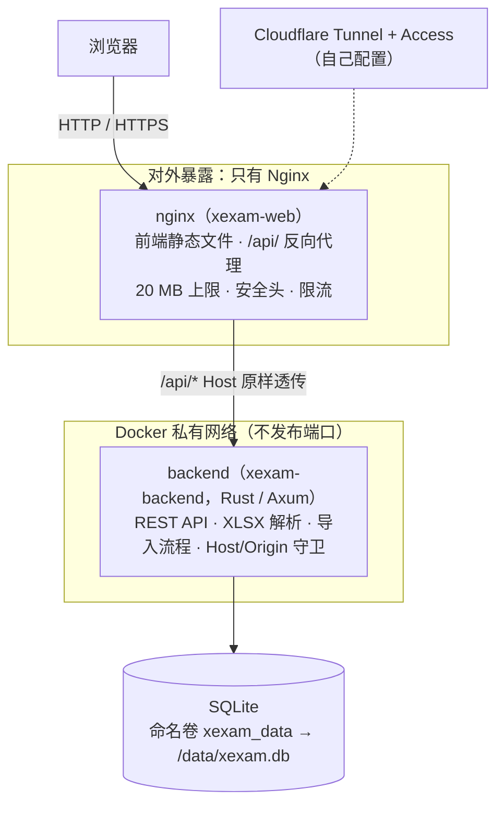
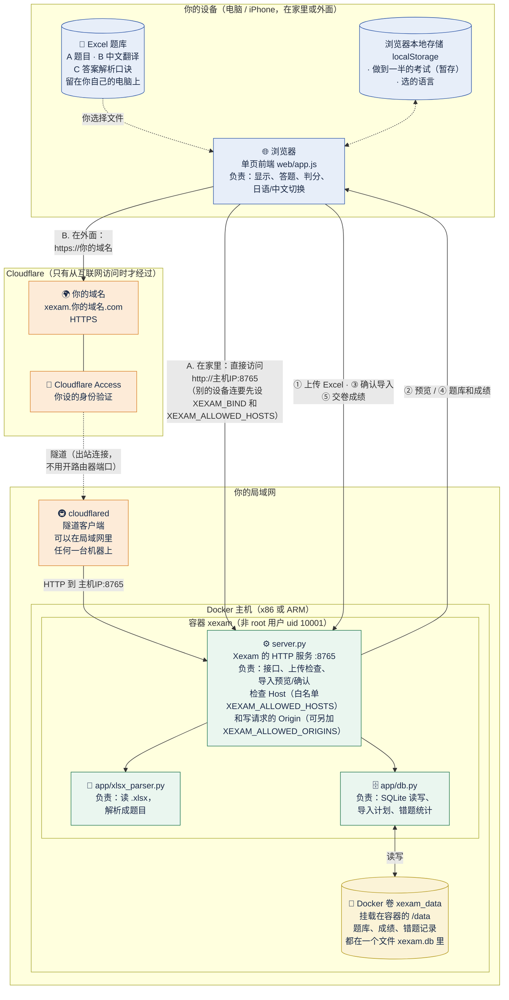
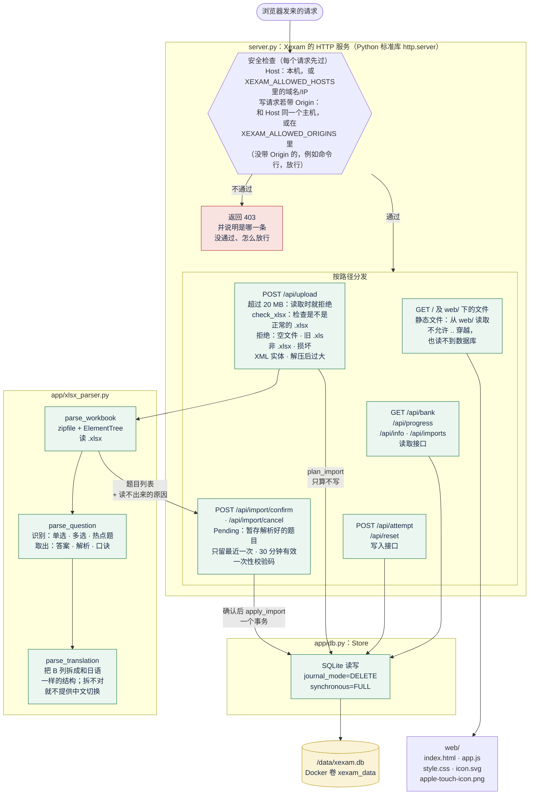
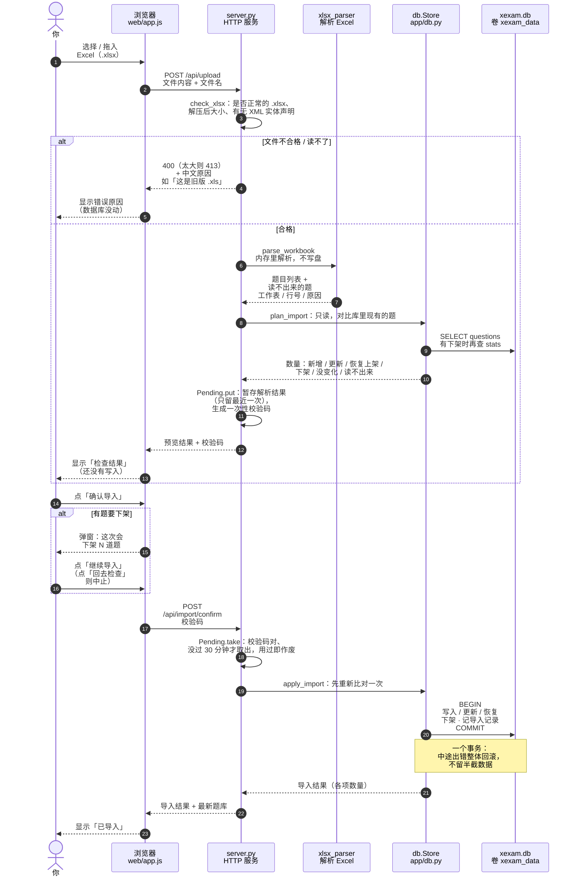
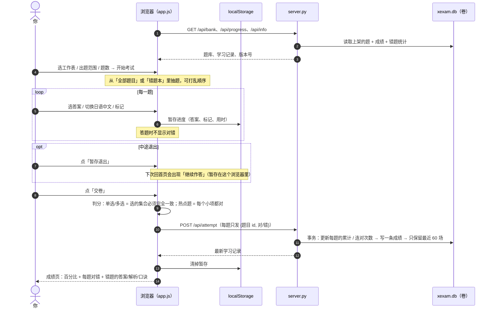
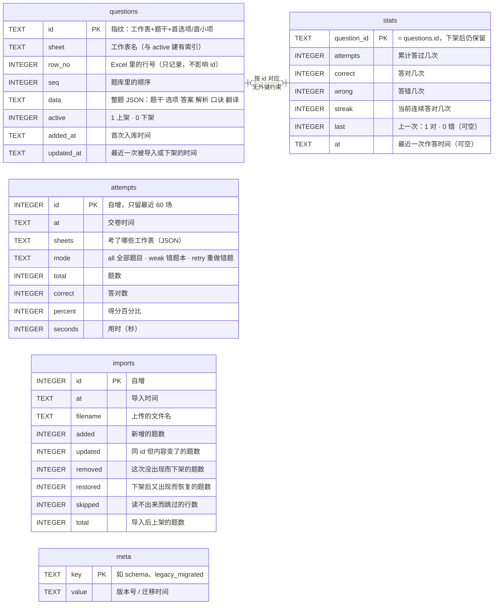
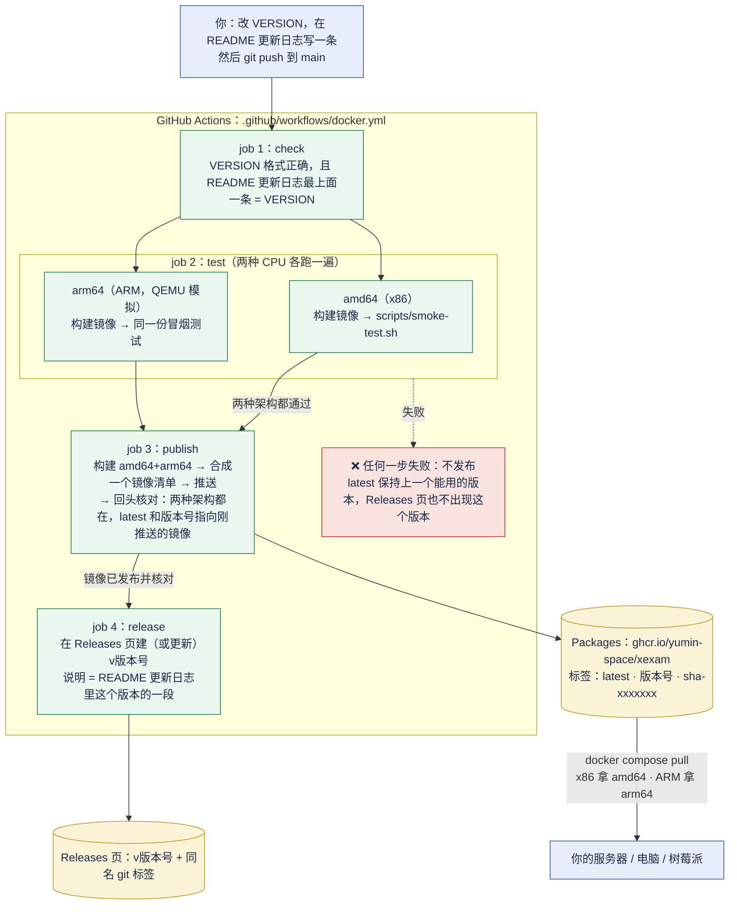
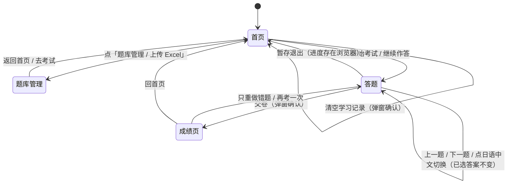
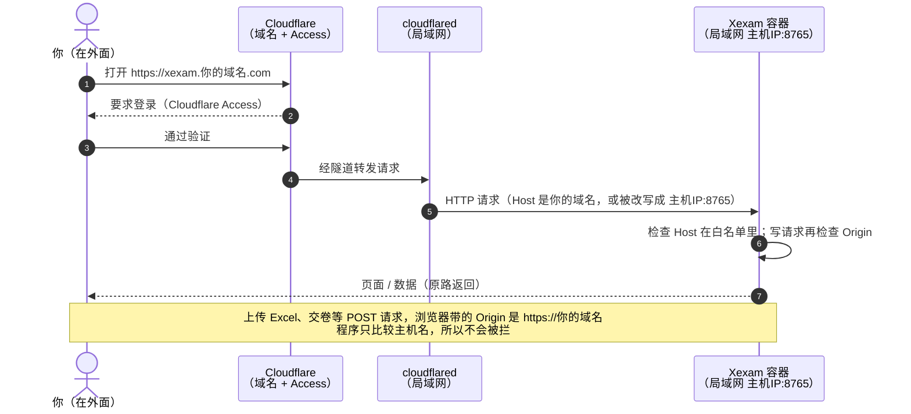

# Xexam

在浏览器里做题的模拟考程序。题目来自你自己的 Excel，上传一次就存进 SQLite；做完题**交卷后才计分**，并列出每道错题的答案、解析和记忆口诀。手机（iPhone）和电脑都能用。

- **v0.3 的新架构**：**Rust**（Axum）后端 + **TypeScript**（Vite，原生 DOM）前端 + **Nginx** 反向代理，Docker Compose 两个容器；只有 Nginx 对外，后端在私有网络里。详见 [docs/architecture.md](docs/architecture.md)。
- 数据库**没有变**：仍是一个 SQLite 文件 `xexam.db`，放在 **Docker 命名卷** `xexam_data` 里，更新或删除容器都不会丢；新旧版本读写同一个文件，随时能回滚（[docs/migration.md](docs/migration.md)）。
- 日语 / 中文随时对照切换；错题本；成绩历史。
- 仓库里**没有题库**：题库是你自己的 Excel，不会被提交（`.gitignore` 已排除）。
- 旧的 Python 实现（v0.2.x）完整保留：标签 `python-v0.2`，镜像 `ghcr.io/yumin-space/xexam:v0.2.2`。

| | 新架构（v0.3，本分支） | 已发布的旧版（v0.2.x，Python） |
|---|---|---|
| 版本 | **v0.3**（见 [更新日志](#更新日志)） | v0.2.2（[Releases](../../releases) 页） |
| 怎么运行 | `docker compose -f docker-compose.modern.yml up -d --build`（从源码构建，镜像**还没有发布**） | `docker compose up -d`（拉取 `ghcr.io/yumin-space/xexam`，`linux/amd64` + `linux/arm64`） |
| 端口 | `8765`（Nginx，默认只绑定本机） | `8765`（默认只绑定本机） |

> ⚠️ 这个分支（`modernize/rust-ts`）里新旧两套代码并存：根目录的 `server.py`、`app/`、`web/` 是旧的 Python 实现；新实现在 `backend/`、`frontend/`、`nginx/`。把新实现换成默认、把 Python 移到 `legacy/python/`，以及新镜像的发布流水线，是合并时另做的一步（见 [docs/migration.md](docs/migration.md) 的「还没做的事」）。**在那之前不要把这个分支合并进 `main`**：`main` 上的流水线会按旧方式发布镜像。

文档：[架构](docs/architecture.md) · [API](docs/api.md)（[OpenAPI](docs/openapi.yaml)）· [数据库](docs/database.md) · [安全](docs/security.md) · [部署](docs/deployment.md) · [迁移与回滚](docs/migration.md) · [开发](docs/development.md) · [迁移计划](docs/migration-plan.md)

---

## 目录

- [截图](#截图)
- [架构](#架构)
- [快速开始（安装部署）](#快速开始安装部署)
- [使用方法](#使用方法)
- [Excel 题库格式](#excel-题库格式)
- [数据、备份和迁移](#数据备份和迁移)
- [更新日志](#更新日志)
- [自动构建与发布](#自动构建与发布)
- [不用 Docker](#不用-docker)
- [让手机访问](#让手机访问)
- [通过 Cloudflare Tunnel 从互联网访问](#通过-cloudflare-tunnel-从互联网访问)
- [目录结构](#目录结构)
- [安全说明](#安全说明)

---

## 截图

截图用的是**虚构的演示题库**（5 道日语小题），不是任何真实考试内容。左边是电脑，右边是 iPhone 宽度（390 px）。

### 首页：选范围，开始考试

首页能看到题库有几个工作表、错题本里有几道待巩固的题，以及最近的成绩。

<table>
<tr>
<td width="62%"></td>
<td width="38%"></td>
</tr>
</table>

### 答题：右上角切换日语 / 中文，右侧是答题卡

答题时**不显示对错、不显示分数**。答题卡上：实心 = 已答，半实心 = 热点题只答了一部分，空心 = 未答，黄色小方块 = 已标记。iPhone 上「上一题 / 下一题」固定在屏幕底部，长题目不用滑到底才能翻页。

<table>
<tr>
<td width="62%"></td>
<td width="38%"></td>
</tr>
</table>

点「中文」切换成 Excel 里 B 列的翻译。切换只换文字，已选的答案、选项字母、计时都不变，判分也不变。

<table>
<tr>
<td width="62%"></td>
<td width="38%"></td>
</tr>
</table>

### 交卷：先看分数，再看每题对错

<table>
<tr>
<td width="62%"></td>
<td width="38%"></td>
</tr>
</table>

### 错题解析：你的答案、正确答案、解析、记忆口诀

<table>
<tr>
<td width="62%"></td>
<td width="38%"></td>
</tr>
</table>

### 题库管理：上传 Excel，先预览再导入

上传后会先显示「新增几题、更新几题、恢复几题、下架几题、没变化几题、读不出来几题」。确认前不会写入任何东西。

<table>
<tr>
<td width="62%"></td>
<td width="38%"></td>
</tr>
</table>

---

## 架构

下面的图都是 [Mermaid](https://mermaid.js.org/) 写的，GitHub 上直接显示成图。图里的名字（文件、接口、数据表）都是代码里真实存在的。

### v0.3：Nginx + Rust 后端 + SQLite



浏览器只通过 [REST 接口](docs/api.md) 和后端说话；前端里没有数据库访问。判分仍在浏览器里（服务端只收 `{题目 id, 对错}`）。目录、模块、数据流见 [docs/architecture.md](docs/architecture.md)。

**下面的 1–7 节是 v0.2.x（Python）的详细图。** 数据流 A/B、数据库、页面跳转对 v0.3 同样适用（行为被固定下来，新旧逐项对照过）；「容器里面」和「CI/CD」两节只描述旧版。

### 1. 总览：谁和谁连着，数据怎么走（v0.2.x）

一句话：**浏览器**只和**一个容器**说话；容器里的 Python 服务读写 **SQLite**；SQLite 文件放在 **Docker 卷**里；题库从你本机的 **Excel** 上传进来。在家里可以直接连容器；在外面经过 **Cloudflare**（你的域名 + Access 验证 + 隧道）连进来，路由器不用开任何端口。



**要点**

- 判分发生在**浏览器**里（交卷时），服务端只负责保存结果和错题统计。
- 服务端**从不修改**你的 Excel：Excel 只是上传的原料，上传后数据就在 SQLite 里了，之后不再依赖这份 Excel。
- 浏览器和容器之间**只有 HTTP**，没有别的连接。经 Cloudflare 访问时，HTTPS 在 Cloudflare 那一端结束，隧道把请求以普通 HTTP 转给容器。
- 程序**自己没有登录**。从互联网访问时，身份验证靠 Cloudflare Access；见 [通过 Cloudflare Tunnel 从互联网访问](#通过-cloudflare-tunnel-从互联网访问)。

### 2. 容器里面：每个文件做什么



> 图里没画的一个接口：`POST /api/shutdown`。只有用 `--allow-shutdown` 启动（`start.bat`）时才可用，Docker 里一律返回 403。

### 3. 数据流 A：更新题库（上传 → 预览 → 确认）

这是你每次改了 Excel 之后要走的流程。**预览阶段数据库一个字节都没动**，所以传错文件也不怕。



**导入的规则**（上传的文件被当成**完整的题库**）

| 情况 | 结果 |
|---|---|
| 文件里新出现的题 | 新增 |
| 文件里改过的题（选项、答案、解析、翻译） | 更新，答题记录不受影响 |
| 库里有、文件里找不到的题 | **下架**（不再出现在考试里），答题记录保留；导入前会弹窗提醒 |
| 下架的题以后又出现在文件里 | 自动**恢复上架**，答题记录和错题本也回来 |
| 改了某道题的**题干** | 被当成一道**新题**（旧题下架，旧题的答题记录不会带到新题上） |
| 整份文件一道可用的题都没有 | 拒绝导入，防止把题库清空 |

> 题目的身份由「工作表名 + 题干 + 第一个选项的内容指纹」决定，**与行号无关**：在 Excel 里挪动行的顺序，答题记录跟着题走。

### 4. 数据流 B：做一场考试



> 提交的只有「题目 id + 对错」，不会上传你选了什么，也不会上传题目内容。

### 5. 数据库：5 张表

整个数据库就是 `/data/xexam.db` 这一个文件。



**为什么 `stats` 不随题目一起删：** 题目下架只是把 `active` 改成 0，`stats` 里的答题记录原样保留；以后这道题重新出现在 Excel 里，会自动恢复上架，错题本也跟着回来。

**错题本怎么算：** 一道题只要 `wrong > 0` 且 `streak < 2`（连续答对不到 2 次）就在错题本里；连续答对 2 次后自动移出。

### 6. 自动构建与发布（CI/CD）

每次你把代码推到 GitHub，GitHub Actions 自动做完**检查版本和更新日志 → 两种 CPU 各自构建并测试 → 都通过才发布镜像 → 在 Releases 页建一个同版本的 Release**。



**冒烟测试检查什么（每种架构都跑一遍）**

| 检查 | 目的 |
|---|---|
| 镜像的 CPU 架构 = 期望的架构 | 防止悄悄构建成了另一种架构 |
| 容器不是 root 用户 | 安全 |
| 首页能打开；全新的卷里题库为空 | 基本可用 |
| `/api/info` 里的版本号 = `VERSION` | 镜像里带的版本是对的 |
| 图标和页面文件能取到 | iPhone「添加到主屏幕」要用 |
| 陌生 `Host` 被拒绝（403） | 防 DNS 重绑定 |
| 数据库文件写进了卷 | 数据在卷里，不在容器里 |
| 重启后服务正常、健康检查变 `healthy` | 稳定 |
| 跨站 Origin 的 POST 被拒绝（403），同源的 POST 放行 | 防跨站操作，同时确认没有把正常使用拦住 |
| **删除容器后用同一个卷重建，数据还在** | 这正是「更新镜像不丢数据」的保证 |
| `docker stop` 在 9 秒内正常结束 | 程序响应停止信号，数据库干净关闭，不是等 10 秒被强杀 |

### 7. 页面之间怎么走



答题页里单选、多选、热点题三种题型的界面略有不同（单选选一个、多选选几个、热点题每个小项各选一个），但都在同一个「答题」页面里切换，进度保存在浏览器里。

---

## 快速开始（安装部署）

### 需要什么

- 一台装了 **Docker** 的机器：Windows / macOS / Linux 都行，**x86 或 ARM 都行**（树莓派、云上的 ARM 服务器、苹果芯片的 Mac）。
- 一个浏览器。

### 方式 A：直接拉取现成的镜像（推荐）

只需要仓库里的 [`docker-compose.yml`](docker-compose.yml) 这**一个文件**，复制到任意机器的任意文件夹即可，不需要其他代码。

```bash
# 第一次：登录 GitHub 的容器仓库（镜像是私有的，所以要登录一次）
docker login ghcr.io -u Yumin-Space
# 密码处填一个有 read:packages 权限的 GitHub 令牌
# （GitHub → Settings → Developer settings → Personal access tokens）

# 在 docker-compose.yml 所在的文件夹里：
docker compose up -d
```

然后浏览器打开 <http://localhost:8765>，点「题库管理 / 上传 Excel」导入你的 Excel。

| 操作 | 命令 |
|---|---|
| 更新到最新版本 | `docker compose pull && docker compose up -d` |
| 固定在某个版本 | 把 `docker-compose.yml` 里的 `:latest` 改成 `:v0.2`，再 `docker compose up -d` |
| 停止 / 再启动 | `docker compose stop` / `docker compose start` |
| 看日志 | `docker compose logs -f` |
| 看现在是哪个版本、什么架构 | 浏览器打开 <http://localhost:8765/api/info> |

`docker-compose.yml` 的关键部分：

```yaml
name: xexam
services:
  xexam:
    image: ghcr.io/yumin-space/xexam:latest   # latest = 最新；也可以写 :v0.2 固定版本
    container_name: xexam
    restart: unless-stopped
    ports:
      - "${XEXAM_BIND:-127.0.0.1:8765}:8765"  # 默认只绑定本机；要给局域网里的 cloudflared 用，在 .env 里设 XEXAM_BIND=0.0.0.0:8765
    volumes:
      - data:/data                            # 题库和学习记录都在这个卷里
    environment:
      XEXAM_ALLOWED_HOSTS: "${XEXAM_ALLOWED_HOSTS:-}"   # 允许哪些域名/IP 访问；留空 = 只有本机
volumes:
  data:
```

可调的选项都通过 `docker-compose.yml` 旁边的 `.env` 文件设置（不需要改 compose 文件本身）：

| `.env` 里的名字 | 默认 | 作用 |
|---|---|---|
| `XEXAM_BIND` | `127.0.0.1:8765` | 对外监听的地址和端口，必须写成 `IP:端口`。默认只有本机能连；`0.0.0.0:8765` = 局域网里别的机器也能连。⚠️ 只写端口号（如 `8766`）= 所有网卡都能连 |
| `XEXAM_ALLOWED_HOSTS` | 空 | 允许用哪些域名 / IP 访问，逗号分隔，例如 `xexam.example.com,192.168.1.20` |
| `XEXAM_ALLOWED_ORIGINS` | 空 | 反向代理把 Host 改写成源站地址时才需要：填你的公网域名 |
| `XEXAM_ALLOW_ANY_HOST` | `0` | 设 `1` = 不再检查 Host（只在前面已经有身份验证时用） |

### 方式 B：从源码构建（改代码时用）

需要完整的仓库代码：

```bash
git clone git@github.com:Yumin-Space/xexam.git
cd xexam
docker compose -f docker-compose.build.yml up -d --build
```

它和方式 A 用**同一个卷**（`xexam_data`），所以两种方式的数据是同一份；容器名也相同，所以不能同时运行，切换前先 `docker compose stop`。

### 镜像的版本标签

| 标签 | 含义 | 什么时候用 |
|---|---|---|
| `latest` | 最近一次成功发布的版本 | 想一直用最新版 |
| `v0.2`、`v0.3`… | 固定的某个版本（v0.2 是第一个发布的版本） | 想锁定版本、需要回退 |
| `sha-xxxxxxx` | 某一次提交 | 排查问题 |

---

## 使用方法

### 第一次：导入题库

1. 打开页面，题库是空的，点「去上传题库」（或右上角「题库管理 / 上传 Excel」）。
2. 选择你的 Excel（也可以拖进虚线框）。
3. 看**检查结果**：新增几题、哪几题读不出来（会写明工作表、行号和原因）。
4. 没问题就点「确认导入」。

### 以后更新题库

1. 在自己电脑上改 Excel：新增工作表、新增或修改题目都可以。
2. 保存后，把**整份** Excel 再上传一次。
3. 看检查结果，确认导入。规则见上面 [数据流 A](#3-数据流-a更新题库上传--预览--确认)。

### 考试

1. 首页勾选要考的工作表，选「全部题目」或「错题本」，设置题数，点「开始考试」。
2. 答题过程中**不显示对错、不显示分数**。可以随时跳题、用答题卡看进度、标记不确定的题。
3. 点「交卷」后才计分（答对的百分比），并列出每道错题的：你的答案、正确答案、解析（怎么选）、记忆口诀、中文翻译。
4. 单选、多选要**选对全部**才算对；热点题**每个小项都对**才算这题对。
5. 没做完可以「暂存退出」，下次回到首页「继续作答」（暂存放在浏览器里，换浏览器就没有了）。

### 日语 / 中文对照

题目右上角有「日语 / 中文」两个按钮。中文用的是 Excel 里 **B 列**的翻译。如果某道题 B 列没写翻译，或翻译里的选项 / 小项数量和 A 列对不上，这道题的「中文」按钮会**置灰**（不会显示错位的内容）。选项本身（`はい / いいえ`、`Apple` 这类答案原文）不翻译。

### 错题本

答错的题进入错题本，之后**连续 2 次答对**自动移出。首页选「错题本」只练这些题；交卷后也可以点「只重做错题」。

### 键盘（电脑）

`←` `→` 切换题目，`A`–`E` 选答案，`M` 标记。

### 在 iPhone 上使用

- 在 iPhone 的 Safari 里打开服务地址（需要先做 [让手机访问](#让手机访问)）。需要 **iOS 15.4 或更新**（更早的版本没有 `<dialog>`，页面会改用系统自带的确认框，样式略有不同）。
- 点分享按钮 →「添加到主屏幕」，之后像独立应用一样全屏打开，图标是答题卡样式的 Xexam。
- 所有按钮都不小于 44 px，适合手指点；刘海和底部横条的安全区已处理；「上一题 / 下一题」固定在屏幕底部。

---

## Excel 题库格式

每个工作表是一组题，一行一道题。

| 列 | 内容 |
|---|---|
| **A** | 题目。选择题：题干后空一行，选项写成 `A. 内容`，一行一个。热点题：第一行写 `ホットスポット`，小项写成 `1. 内容　はい / いいえ` |
| **B** | 中文翻译（可以不写）。要和 A 列保持同样的结构：选项也写成 `A. 内容`，热点题的小项写成 `1. 内容`，这样才能切换成中文 |
| **C** | 以 `【答案】` 开头，后面可以接 `【解析·怎么选】` 和 `【记忆口诀】` |

C 列的答案写法：

- 单选 / 多选：`【答案】C` 或 `【答案】C、E`
- 热点题：`【答案】1 是；2 否；3 是`。小项的答案可以写 `是/否`、`はい/いいえ`，或者直接写选项文字（比如 `Apple`）

一个例子（C 列）：

```
【答案】C、E

【解析·怎么选】先排除……再比较……

【记忆口诀】……
```

读不出来的题**不会被猜**：它们会在检查结果里列出原因（多半是 C 列没写 `【答案】…`，或答案字母不在选项里），不会悄悄判错。

---

## 数据、备份和迁移

数据保存在一个 **Docker 命名卷**里，不是你电脑上看得见的文件夹。

- 卷名是 `xexam_data`（项目名 `xexam` + 卷名 `data`），里面只有 `xexam.db`：题库、成绩、错题记录都在这一个文件里。
- 更新镜像、`docker compose down`、删除并重建容器，**数据都还在**。
- ⚠️ **不要运行 `docker compose down -v`**：`-v` 会把卷一起删掉，数据就没了。

### 备份和恢复

先停止程序再操作，数据库更安全。

```powershell
docker compose stop

# 备份：把卷打包成当前文件夹里的 xexam-data.tgz
docker run --rm -v xexam_data:/data -v "${PWD}:/backup" alpine tar czf /backup/xexam-data.tgz -C /data .

docker compose start
```

```powershell
# 恢复（会覆盖卷里的同名文件）
docker compose stop
docker run --rm -v xexam_data:/data -v "${PWD}:/backup" alpine tar xzf /backup/xexam-data.tgz -C /data
docker compose start
```

换电脑：在新电脑上登录 `ghcr.io`，放好 `docker-compose.yml`，先 `docker compose up -d` 建好卷，再按上面的方法恢复备份。

### 迁移旧版的学习记录

如果你有旧版留下的 `progress.json`（旧版把成绩放在这个文件里），在**还没做过任何考试**的新卷上，用一个临时容器把它放进卷里，再重启：

```powershell
docker compose up -d
docker compose stop
docker run --rm -v xexam_data:/data -v "${PWD}:/src:ro" alpine sh -c "cp /src/progress.json /data/progress.json && chown 10001:10001 /data/progress.json"
docker compose start
```

重启时会自动把里面的成绩和错题记录迁移进数据库，**只迁移一次**，日志里会写「已把旧的学习记录迁移进数据库」（`docker compose logs` 能看到）。数据库里已经有学习记录时不会覆盖。

> 这里没有用 `docker cp`：它默认以 root 身份写入，文件属于 root，而容器里的程序是非 root 用户，可能读不了。上面的做法把文件的所有者设成了程序用户（uid 10001）。

---

## 更新日志

每次更新都要在这里写一条，**版本号和仓库根目录的 `VERSION` 文件一致**（自动构建会检查，不一致就不让构建）。最新的镜像同时有 `latest` 和对应的 `vX.Y` 标签。

### v0.3 — 2026-11-10

> 状态：在分支 `modernize/rust-ts` 上完成，**尚未合并到 `main`，镜像尚未发布**（`main` 上的流水线仍发布 v0.2.x 的 Python 镜像）。

**重写成 Rust + TypeScript + Nginx。数据库文件和 schema 没有变，API 向后兼容。**

- **后端改成 Rust**（Axum 0.8 + Tokio + rusqlite，工具链固定 1.99.1）：REST 接口、XLSX 解析、导入（预览不写库 → 一次性确认码 → 一个事务写入）、成绩与错题统计、Host/Origin 守卫、`xexam-backend import / healthcheck / migrate-progress` 子命令，行为与 Python 版一一对应（172 份旧版响应逐项对照，0 项未解释的差异；85 条题目 id 向量、49 个合成工作簿的解析输出全部一致；题目 id 与旧版逐字节相同，所以学习记录不会脱钩）。
- **前端改成 TypeScript**（strict）+ **Vite**，原生 DOM、没有框架：API 层、类型、页面、组件、状态、判分规则（纯函数 + 单元测试）分开；没有内联样式，CSP 可以很严。构建目标 `safari15`，iPhone 需要 iOS 15.4 以上。
- **Nginx 反向代理 + Docker Compose**：两个容器（`xexam-web`、`xexam-backend`），**只有 Nginx 对外**，后端在 `internal` 私有网络里不发布端口；非 root、`cap_drop: ALL`、只读根文件系统；Host 原样透传、`X-Forwarded-*` 清空；20 MB 上限、安全头、限流、超时；后端不可达时返回 JSON 502。新的 compose 文件是 `docker-compose.modern.yml`。
- **更严的上传检查（有意的差异）**：任何编码 / 扩展名里的 DOCTYPE 和实体声明都拒绝；重复的 ZIP 条目名拒绝；ZIP 条目数、XML 深度和节点数有上限；错误文案不再回显库的异常文本；不支持的 HTTP 方法回 405（以前是 501）。完整差异表见 [docs/api.md](docs/api.md)。
- **测试**：后端 130 个、前端 19 个；`tests/integration/` 里 Nginx 38 项、整栈 34 项、回滚演练 19 项；CI 新增 `modern.yml`（frontend / backend / stack，**从不发布**）。
- **回滚**：Python 实现完整保留（标签 `python-v0.2`，镜像 `ghcr.io/yumin-space/xexam:v0.2.2`）；新后端写过的库旧版仍能读写（`tests/integration/rollback_check.py` 用合成数据演练过往返）。步骤见 [docs/migration.md](docs/migration.md)。
- **新增文档**：`docs/` 下的架构、API（含 OpenAPI）、数据库、安全、部署、迁移、开发，以及 Phase 0 的审计、风险、迁移计划和测试策略。
- 判分仍在浏览器里（规格建议放服务端，这里有意不搬，理由见 [docs/migration-plan.md](docs/migration-plan.md)）。
- **没有验证的东西（如实写）**：真正的 Cloudflare 隧道、iPhone 真机、新镜像的 arm64 构建；没有用业主的真实数据库副本演练（请按 [docs/migration.md](docs/migration.md) 在自己的机器上做一遍）。

### v0.2.2 — 2026-11-10

- 新增 `tests/baseline/`：旧版 Python 的行为基线（172 份真实响应、50 个 XLSX 夹具及解析输出、85 条题目 id 向量、示例数据库、安全探针、Host/Origin 检查和隧道模拟脚本），后面的 Rust 重写要和它逐项对照。工具里不再写死任何本机路径，可用 `XEXAM_LEGACY_ROOT` 指定被测代码。
- 修正上一版更新日志里关于 v0.2 Release 的说法。

### v0.2.1 — 2026-11-10

- **每次构建成功后自动在 GitHub 的 Releases 页建一个 Release**（以前只推了镜像，Releases 页一直是空的）：流水线新增第 4 个 job `release`，在镜像发布并核对成功之后运行，说明取自本更新日志这个版本的那一段，并自动打 git 标签 `v<版本>`。
- v0.2 的 Release 手动补建了一次（对应 v0.2 的提交 `1ee64c8`，没有标成 Latest）；从 v0.2.1 起由流水线自动建。
- 新增 `scripts/release-notes.py`：从 README 抽出某个版本的更新日志；本机也能运行，用来预览 Release 页会显示什么。

### v0.2 — 2026-11-10

- **可以通过自己的域名从互联网访问**（Cloudflare Tunnel + Cloudflare Access）：
  - 允许的域名放进 `XEXAM_ALLOWED_HOSTS`；写请求的 `Origin` 改成只比较主机名，所以经 **HTTPS** 域名访问时上传、交卷不再被 403 拦下。
  - 代理改写了 `Host` 时，可以用 `XEXAM_ALLOWED_ORIGINS` 单独放行公网域名；前面已有身份验证时可设 `XEXAM_ALLOW_ANY_HOST=1`。
  - 被拒绝时会说明是哪一条没通过、该怎么放行；登录过期时页面会提示刷新重新登录。
- 端口绑定改成可配置（`XEXAM_BIND`），默认仍然只绑定本机。
- 收到 `docker stop` 的停止信号后正常退出（以前要等 10 秒被强杀），数据库干净关闭。
- CI：拆成「检查版本和更新日志 → 两种架构各自测试 → 发布」三步（v0.2.1 起再加第四步：建 Release）；冒烟测试挪进 `scripts/smoke-test.sh`，本机装了 Docker 也能直接跑；发布后按摘要核对镜像清单。
- `/api/info` 增加 `arch`（当前 CPU 架构）。
- 审计后的修复（每一条都有对应的实测）：
  - 服务端：提前拒绝的请求（403/415）先把请求体读掉再回复，浏览器看到的是真正的原因而不是「连不上服务」；被拒绝的请求在日志里留一行（`docker compose logs` 能看到）；畸形的 JSON（数字当列表、`Infinity`、过深嵌套、非 ASCII 的确认码）返回 400/409，而不是让连接断掉；POST 的 `Content-Type` 必须真的是 `application/json`；`XEXAM_ALLOWED_HOSTS` 用空格或分号分隔也能识别。
  - 数据库：`COMMIT` 失败时会回滚，不会让连接一直卡在事务里；格式不对的旧 `progress.json` 不再让程序起不来；数据目录里只有别的 `.db` 文件时，启动日志会提醒（不会改动那个文件）。
  - 页面：交卷时成绩提交成功才清掉暂存，失败会保留并提示「刷新页面重新登录后再交卷」；开始新考试前，如果有没交卷的考试会先确认；成绩页百分比与学习记录用同一种取整，不再差 1；提示条不再被底部翻页栏挡住；长英文串不再撑出横向滚动条；没有 `<dialog>` 的旧 Safari 改用系统确认框；长按字母键不会反复切换答案。
  - 镜像和 CI：健康检查不走代理并跟随 `XEXAM_PORT`；`.dockerignore` 改成任意层级生效；`.gitignore` 加了备份压缩包和 `.env.*`；只从 `main` 发布，`main` 上排队不取消；冒烟测试里容器内路径在 Windows 的 Git Bash 里也能跑。
  - 这版在本机用 Docker 真的构建了镜像（amd64），并用 CI 同一份冒烟测试跑通：非 root、Host/Origin 拦截、删除容器后数据还在、`docker stop` 1 秒。arm64 和发布仍要看 GitHub Actions 的结果。
- 名称统一成 **xexam**：环境变量 `XEXAM_DATA` / `XEXAM_HOST` / `XEXAM_PORT` / `XEXAM_ALLOWED_HOSTS` / `XEXAM_ALLOWED_ORIGINS` / `XEXAM_ALLOW_ANY_HOST`，数据库文件 `xexam.db`，浏览器里保存的键名 `xexam.*`；文档里也不再写死你自己的 Excel 文件名。
- ⚠️ **从 v0.1 升级时注意：** 数据库文件的名字变了，新版只读 `xexam.db`。如果你在更早的版本里已经导入过题库，请先停止程序，把数据目录里那个 `.db` 文件改名为 `xexam.db` 再启动，否则会看到空题库（旧文件不会被删，只是不会被读取）。浏览器里暂存的考试和语言选择用的键名也变了，升级前请先交卷，语言会恢复成日语。在自己改过的 compose 里设置过旧环境变量名的，要改成上面的 `XEXAM_*`，否则会被忽略。
- `docker-compose.yml` 去掉了 `pull_policy: always`：`docker compose up -d` 不再每次联网检查，更新请用 `docker compose pull && docker compose up -d`。
- `.env`（本机配置）加进 `.gitignore` 和 `.dockerignore`，不会被提交，也不会进镜像。

### v0.1 — 2026-11-10

第一个版本。

- 浏览器答题：单选、多选、热点题；**交卷后才计分**，错题显示答案、解析、记忆口诀。
- 日语 / 中文对照切换；答题卡；标记；暂存退出再继续。
- 错题本：答错的题连续答对 2 次后移出；成绩历史。
- 题库和学习记录改存 **SQLite**（Docker 命名卷 `xexam_data`），不再依赖 Excel。
- 管理页**上传 Excel 更新题库**：先预览（新增 / 更新 / 恢复 / 下架 / 读不出来），确认后才写入；下架的题保留答题记录，传回来自动恢复。
- 旧版的 `progress.json` 第一次启动时自动迁移。
- 支持 **iPhone**：触控区域不小于 44 px、安全区、底部固定翻页栏、可添加到主屏幕。
- Docker 镜像同时支持 **x86（amd64）和 ARM（arm64）**，由 GitHub Actions 构建并测试。
- ⚠️ v0.1 的「发布」步骤没有跑成，所以 `ghcr.io/yumin-space/xexam` 上**没有** `v0.1` 标签；镜像从 v0.2 起发布（`latest` / `v0.2`）。
- 应用名改为 **Xexam**。

<!-- 新版本写在这一行的上面，格式：### vX.Y — 日期 -->

---

## 自动构建与发布

[`.github/workflows/docker.yml`](.github/workflows/docker.yml)，流程图见上面 [CI/CD](#6-自动构建与发布cicd)。

- **触发：** 推送到 `main`，或在 Actions 页面手动运行；拉取请求只构建和测试，不发布。
- **每次更新必须：** 改 `VERSION`，并在本文件「更新日志」最上面写一条同版本的记录，否则检查步骤会失败。
- **两种架构各测一遍：** `amd64` 在 GitHub 的 x86 机器上原生跑；`arm64` 用 QEMU 模拟运行（比原生慢，但这个镜像很小）。
- **都通过才发布：** 发布成一个多架构镜像，并回头检查镜像清单里确实有 `amd64` 和 `arm64`。测试失败时 `latest` 仍是上一个能用的版本。
- **发布的标签：** `latest`、`v<VERSION>`、`sha-<提交>`。
- **Releases 页：** 镜像发布并核对成功之后，流水线会自动建（或更新）一个叫 `v<VERSION>` 的 Release，说明文字取自本文件「更新日志」里这个版本的那一段（[`scripts/release-notes.py`](scripts/release-notes.py)），并自动打上同名的 git 标签。镜像没发布成功，就不会有这个 Release。同一个版本重新跑只会更新说明，不会再建一个。
- **Releases 和镜像是两个地方：** 镜像在仓库的 **Packages** 里（ghcr.io），Release 在 **Releases** 页；两者现在由同一次构建一起产生。

镜像从私有仓库发布，默认也是私有的。想免登录拉取，到 GitHub 的包设置里把它改成公开。

---

## 不用 Docker

需要 Python 3.8 或更新版本。

```bash
python server.py                       # 数据放在 ./data，自动打开浏览器
python server.py --data D:\xexam-data  # 指定数据目录
python server.py --import 题库.xlsx    # 不启动服务，直接把 Excel 导入数据库
```

也可以用环境变量代替命令行参数：`XEXAM_DATA`（数据目录，等于 `--data`）、`XEXAM_HOST`（监听地址，等于 `--host`，默认 `127.0.0.1`）、`XEXAM_PORT`（端口，等于 `--port`，默认 `8765`）。Docker 镜像里它们已经设成 `/data`、`0.0.0.0`、`8765`。

Windows 上也可以双击 `start.bat`（会带上 `--allow-shutdown`，页面右下角有「关闭程序」按钮；Docker 里没有这个按钮，用 `docker compose stop`）。

## 让手机访问

**这个程序没有登录**，默认只绑定本机（`127.0.0.1`）。想让同一个家庭 Wi-Fi 里的 iPhone 访问，**只在你信任的网络里**这样做，不要在咖啡厅或公司网络里开：

1. 在 `docker-compose.yml` 旁边建 `.env` 文件，写两行：`XEXAM_BIND=0.0.0.0:8765` 和 `XEXAM_ALLOWED_HOSTS=你的电脑的局域网IP`（例如 `192.168.1.20`）。
2. `docker compose up -d`，iPhone 的 Safari 打开 `http://你的电脑IP:8765`。

要在外面（不在家里的 Wi-Fi）用，请看下面的 [通过 Cloudflare Tunnel 从互联网访问](#通过-cloudflare-tunnel-从互联网访问)，不要直接把端口开到互联网上。

## 通过 Cloudflare Tunnel 从互联网访问

适用场景：Xexam 跑在家里的局域网里，`cloudflared`（Cloudflare 的隧道客户端）也在局域网里的某台机器上（不一定是同一台），你想用自己的域名在外面访问，并且在 **Cloudflare Access** 里设置身份验证。



### 需要做的三件事

**1. 让局域网里的 cloudflared 连得到容器。** 默认容器只绑定本机（`127.0.0.1`）。在 `docker-compose.yml` 旁边建一个 `.env` 文件：

```ini
# 让局域网里别的机器（cloudflared）能连到这台机器的 8765 端口
XEXAM_BIND=0.0.0.0:8765
# 允许用你的域名访问（可以写多个，逗号分隔）
XEXAM_ALLOWED_HOSTS=xexam.你的域名.com
```

然后 `docker compose up -d`。

> 如果 cloudflared 和 Xexam 在**同一台机器**上，可以不改 `XEXAM_BIND`（保持默认的只绑定本机），隧道的目标写 `http://localhost:8765` 就行。

**2. 在 Cloudflare 里把域名指到 Xexam。** Zero Trust 控制台 → Networks → Tunnels → 你的隧道 → Public Hostname：

| 项目 | 填什么 |
|---|---|
| Subdomain / Domain | `xexam` / `你的域名.com` |
| Service Type | `HTTP`（不是 HTTPS） |
| URL | `运行 Xexam 的主机的局域网IP:8765`，例如 `192.168.1.20:8765` |

**3. 在 Cloudflare Access 里加一条应用策略**，只允许你自己的账号（邮箱）访问这个域名。

### 几种常见情况

| 你的情况 | 怎么配 |
|---|---|
| 隧道把 **Host 原样转成你的域名** | 只需要 `XEXAM_ALLOWED_HOSTS=xexam.你的域名.com`，上面第 1 步就够了 |
| 你在 Cloudflare 里设了 **HTTP Host Header**（`httpHostHeader`），把 Host 改成了 `192.168.1.20:8765` | `XEXAM_ALLOWED_HOSTS=192.168.1.20` 再加 `XEXAM_ALLOWED_ORIGINS=https://xexam.你的域名.com`。浏览器发的 `Origin` 仍是公网域名，要单独放行 |
| 不确定 Host 到底是什么 | 先照上面第 1 步配好再打开页面。如果被拒绝（403），页面上的提示会写出它看到的 `Host`（或 `Origin`）：把那个值加进 `XEXAM_ALLOWED_HOSTS`（或 `XEXAM_ALLOWED_ORIGINS`），`docker compose up -d` 重新创建容器即可 |
| 不想列域名，前面已经有 Access 验证 | `XEXAM_ALLOW_ANY_HOST=1`（不再检查 `Host`；写请求的 `Origin` 检查仍然有效） |

我在本机用**真实的 Chrome + 一个 HTTPS 反向代理**模拟过这两种情况（浏览器上传 Excel → 预览 → 确认导入 → 交卷，全程通过）。**没有**用真正的 Cloudflare 测过。

### 不要忘记的事

- ⚠️ **程序自己没有登录。** 一旦把 `XEXAM_BIND` 设成 `0.0.0.0`，或者设了 `XEXAM_ALLOW_ANY_HOST=1`，**能连到这个端口的人就能看到和修改题库**。所以：
  - 只让 cloudflared 连得到这个端口：路由器上**不要**做端口映射。在 Linux 上，主机防火墙（ufw、firewalld）**拦不住** Docker 发布的端口，要限制来源请在 `DOCKER-USER` 链里加规则，或者把 `XEXAM_BIND` 写成具体的局域网 IP（如 `192.168.1.20:8765`）；最稳的是让 cloudflared 和 Xexam 在同一台机器上，保持默认的 `127.0.0.1`。
  - Cloudflare Access 的策略一定要设好，并且**只允许你自己**。没设策略的域名等于对全世界公开。
- 经过 Cloudflare 访问时，登录会过期。过期后上传或交卷会提示「可能是登录已过期，请刷新页面重新登录」，刷新、重新登录就行。**做到一半的考试存在浏览器里，不会丢**。
- 被拒绝（403）时，页面或 `docker compose logs` 里的提示会写明：看到的 `Host` / `Origin` 是什么，应该把哪个值加进哪个选项。

## 目录结构

```
README.md                  本文件（架构、部署、使用、更新日志）
VERSION                    版本号（和更新日志最上面一条保持一致）
server.py                  HTTP 服务：接口、上传检查、导入预览/确认
app/db.py                  SQLite 存储：题库、导入计划、成绩、错题统计
app/xlsx_parser.py         读取 .xlsx 并解析题目（zipfile + ElementTree）
web/                       单页前端：index.html / app.js / style.css / icon.svg / apple-touch-icon.png
docs/screenshots/          README 里的截图（演示题库）
Dockerfile                 非 root 用户运行，/data 是卷
docker-compose.yml         拉取镜像运行（只需要这一个文件）
docker-compose.build.yml   从源码构建运行
.env                       （自己建，不提交）本机配置：端口、域名，见「快速开始」里的表
scripts/release-notes.py    从更新日志生成 GitHub Release 的说明（CI 用，本机也能跑）
scripts/smoke-test.sh      冒烟测试：CI 里每种 CPU 架构各跑一次，装了 Docker 的机器上也能直接运行
.github/workflows/         自动构建、测试、发布
使用说明.txt                面向使用者的简要说明
start.bat                  Windows 上不用 Docker 启动
```

## 安全说明

- 默认只接受发给本机的请求（检查 `Host`）；放在 Cloudflare 等有身份验证的反向代理后面时，把你的域名写进 `XEXAM_ALLOWED_HOSTS`。写请求还会检查 `Origin` 必须和 `Host` 是同一个主机（或在 `XEXAM_ALLOWED_ORIGINS` 里），防止恶意网页通过你的浏览器操作它。
- **程序自己不做登录。** 从互联网访问时必须在前面加身份验证（Cloudflare Access），不要把端口直接暴露到公网。
- 上传的文件会检查格式，拒绝空文件、非 `.xlsx`、损坏的压缩包、含 XML 实体声明的文件，最大 20 MB。
- 上传后的预览在内存里保留 30 分钟，确认时需要一次性的校验码，用过就作废。
- 数据库写入在一个事务里：中途出错整体回滚，不会留下半截数据。
- 容器以非 root 用户（uid 10001）运行。
- 静态文件只从 `web/` 目录提供，不允许 `..` 穿越，网页读不到数据库和代码。
