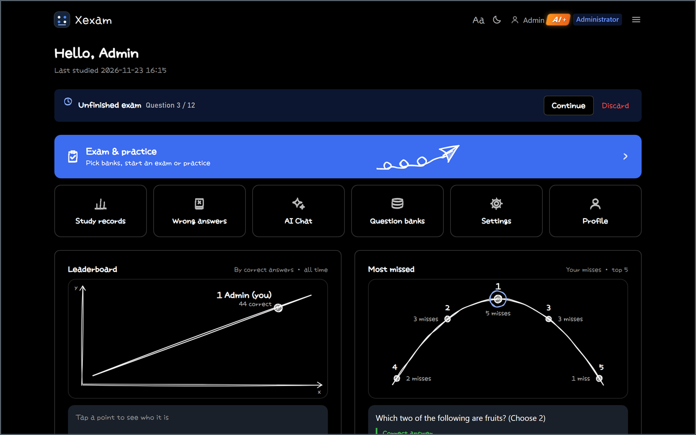
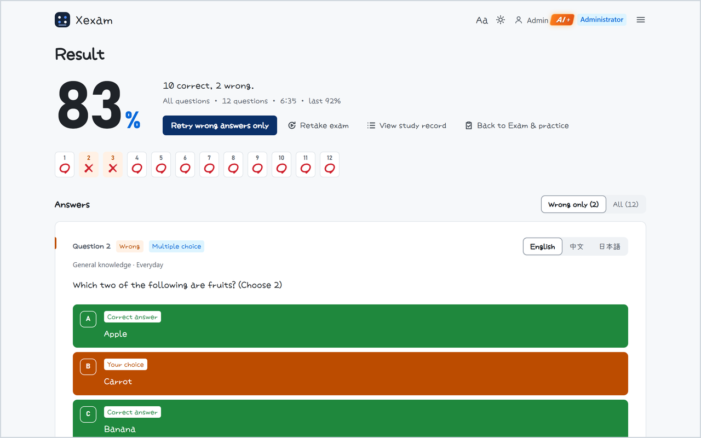
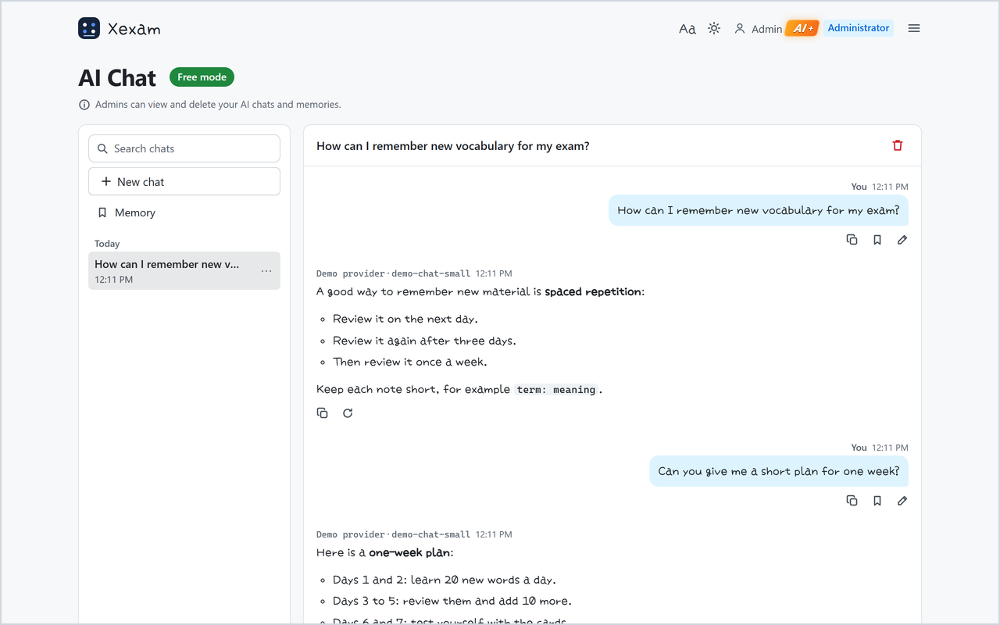
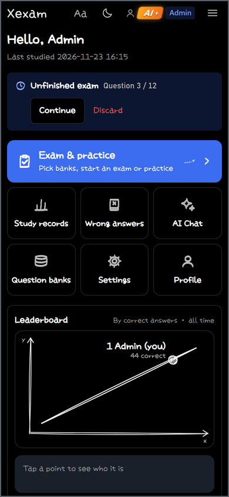
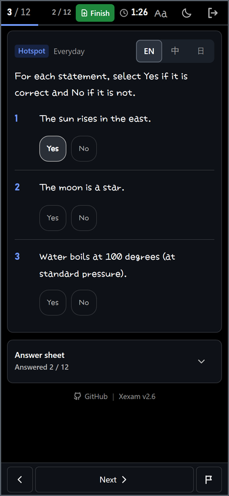
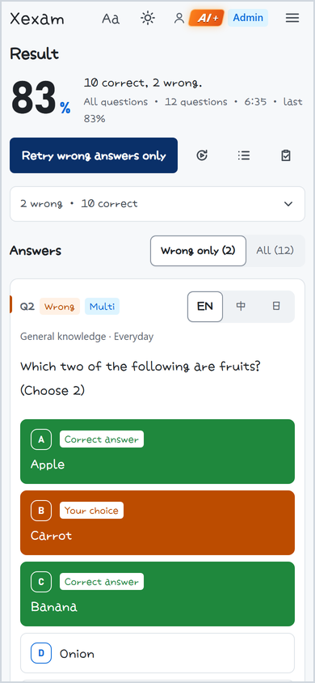
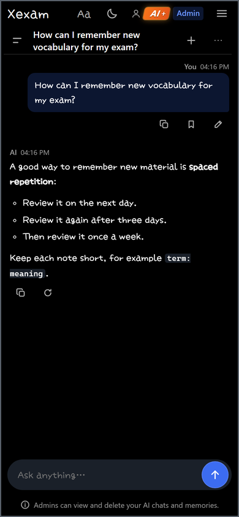

**English** | [日本語](README/README.ja.md) | [简体中文](README/README.zh-CN.md)

<!-- The release badge shows RELEASE_VERSION from VERSION, the last published release. Do not edit it by hand: the release job of .github/workflows/ci.yml writes it (scripts/set-release-version.py) after the images and the GitHub Release are published. GitHub rounds an image's corners only when it has both width and height, so every badge carries its exact size (in px, from shields.io). -->
<p>
  <a href="../../releases/latest"></a>
</p>

<p align="center">
  
</p>

<p align="center">
  <a href="https://hub.docker.com/r/yuminspace/xexam-frontend"></a>
  <a href="https://hub.docker.com/r/yuminspace/xexam-frontend"></a>
  <a href="https://hub.docker.com/r/yuminspace/xexam-frontend"></a>
</p>
<p align="center">
  <a href="https://hub.docker.com/r/yuminspace/xexam-backend"></a>
  <a href="https://hub.docker.com/r/yuminspace/xexam-backend"></a>
  <a href="https://hub.docker.com/r/yuminspace/xexam-backend"></a>
</p>
<p align="center">
  <a href="https://hub.docker.com/r/yuminspace/xexam-ai-service"></a>
  <a href="https://hub.docker.com/r/yuminspace/xexam-ai-service"></a>
  <a href="https://hub.docker.com/r/yuminspace/xexam-ai-service"></a>
</p>

# Xexam

Xexam is a self-hosted app for practising exam questions in the browser. You import your own Excel question banks, then take exams or practise with them, and review the questions you got wrong. If an administrator connects an AI provider and gives them the **AI+ feature**, users can also ask an AI model in **AI Chat** and get AI help while they study: hints in practice, an AI analysis of any question in practice and on result pages, an AI summary of their wrong answers and a short AI study assessment on Home. Home shows a leaderboard and your most missed questions, and the app has a hand-written look that can be switched to normal text with one button. It works on computers and on phones (iPhone).

> **A note from the author (v3.0).** From 3.0 on, Xexam stops being so serious and enters its "amusing ourselves to death" era. Knowledge should not become a record of pain: we should enjoy the thrill and the fun of taking it in.

<p align="center">
  
</p>
<p align="center">
  
  
</p>
<p align="center">
  
  
  
  
</p>

## AI features

**Connect your own AI provider and Xexam becomes a study partner: it writes new questions for you, coaches you through the hard ones and tells you where you are weak.**

- **AI questions**: tick banks that hold at least 30 single- or multiple-choice questions and get a brand-new bank of 20 questions, written in English, Chinese and Japanese, each with its answer and explanation (14 single and 6 multiple choice). Bank managers and administrators start it from **Exam & practice** or **Question banks**.
- **AI wrong-answer drill**: turn your mistakes into practice. In the wrong-answer notebook mode of **Exam & practice**, the same users get one button that writes 20 new questions from your wrong answers (at least 10 needed).
- **AI import**: drop in a PDF, Word, Excel, PowerPoint, Markdown, TXT or CSV file (up to 20 MB by default). The questions already in it become a bank (up to 100 by default); study material such as notes or slides becomes 20 questions written from it. You confirm before anything is saved; the file goes to your AI provider, is read in memory and is never stored on disk.
- **AI hint** and **AI analysis** while you practise: one tap opens the AI+ panel under the question. **AI hint** shows how to approach it and the knowledge points behind it, without giving the answer away; **AI analysis** gives the correct answer, why it is right and why each other option is wrong. Nothing AI appears during an exam.
- **AI analysis** and **AI summary** after the work: every question on a result page or in a study record has its own **AI analysis**, which also says what probably led you astray when you got it wrong; **AI summary** reads the wrong answers of a record and names your weak knowledge points, what to watch out for and how to approach such questions next time.
- **AI study assessment** on Home: a short, encouraging note on how you study, with one concrete next step, written only from the numbers of your last 30 days of study records, never from your questions.
- **AI Chat**: a full chat page for any study question. Answers stream in and keep being written when you close the page; chats are saved; **Regenerate** any answer or **Edit** an earlier question and switch between versions with `‹ 2/3 ›`; a reasoning model's thinking is shown in a block you can fold; **Memory** keeps short notes the AI uses in later chats. Every AI hint, analysis and summary is saved in AI Chat too, so you can carry on the conversation there. The AI always answers in the language of your **Settings**.
- **Your provider, your rules** (administrators, in **AI settings**): connect an OpenAI-compatible API, Anthropic or Cloudflare AI Gateway; every connection is tested before it is saved, its models are listed for you to pick, and the keys are stored encrypted. Choose the model and thinking strength for each feature, switch each feature on or off, pause or resume each user's **AI+ feature** (given in **User management**) and tick the features each user may use, set per-user request caps (5 a minute, 20 an hour and 100 a day by default) and follow the calls and tokens by user, model, feature and over time in **AI usage**.
- **Privacy built in**: AI runs in its own container, `xexam-ai-service`, with its own database; a study feature sends a question only when you press its button, and an **AI hint** request never includes the answer; usage statistics keep numbers only, never what was asked or answered. AI Chat tells every user that administrators can view and delete their chats and memories.

Every AI feature is optional and stays off until an administrator connects a provider, turns AI+ on and gives users the **AI+ feature**. The full tour: [docs/en/usage.md](docs/en/usage.md) (sections 2.1, 5.1, 6.1, 7.1, 13.8, 13.9, 16 and 17).

---

The repository contains **no questions**. Xexam only provides the tools to import, organize and practise questions; your question banks are your own Excel files and are never committed (`.gitignore` excludes them). The screenshots use made-up demo banks, not content from any real exam.

| | |
|---|---|
| Current version | **v3.0** (see the [changelog](docs/en/changelog.md) or the repository's [Releases](../../releases) page; in the app: menu → **Xexam v3.0**) |
| Images | Three, on Docker Hub (public, no login needed): `docker.io/yuminspace/xexam-frontend`, `docker.io/yuminspace/xexam-backend` and `docker.io/yuminspace/xexam-ai-service`, with tags `latest` / `v3.0` / `sha-<commit>` (the `sha-` tags are for troubleshooting). Mirror: `ghcr.io/yumin-space/xexam-frontend`, `ghcr.io/yumin-space/xexam-backend` and `ghcr.io/yumin-space/xexam-ai-service` (private, same tags) |
| CPU architecture | `linux/amd64`, `linux/arm64` (the right one is picked automatically under the same tag) |
| Port | `8765` (bound to the local machine only by default) |
| License | [MIT](LICENSE) |

---

## Contents

- [AI features](#ai-features)
- [What it does](#what-it-does)
- [Quick start](#quick-start)
- [Configuration](#configuration)
- [Upgrading](#upgrading)
- [Documentation](#documentation)
- [License](#license)
- [Changelog](#changelog)

---

## What it does

- **Exams**: nothing is scored until you submit. Then you see your score and each wrong question (or all of them) with your answer, the correct answer, the explanation and the memory aid. You can jump between questions, mark them to revisit, and save and exit to continue later.
- **Practice**: every answer is checked right away and shows the correct answer and the explanation; since v3.0 a right answer sprays confetti and a wrong one leaves two claw marks (**Answer effects** in Settings, on by default).
- **Your own question banks**: every Excel workbook you import is its own bank, and each worksheet a group of questions you can pick. Workbooks use the six-column layout: the question and the answer in English, and if you like in Chinese and Japanese too. A preview shows what an import will change before anything is saved.
- **Three languages**: the interface in English, Chinese or Japanese, and every question, answer and explanation switchable between **English**, **中文** and **日本語**.
- **Study records and a wrong-answer notebook**: every exam and practice is kept with its answers; questions you got wrong stay in the notebook until you answer them right twice in a row.
- **Several people, one Xexam**: everyone signs in and has their own records and settings. Administrators decide who sees which question bank and who may import banks (bank managers), and can follow the **System log**.
- **AI Chat** (optional, off until an administrator sets it up): administrators connect an OpenAI-compatible API, Anthropic or Cloudflare AI Gateway in **AI settings**, test it and switch the **AI+ feature** on, and give the **AI+ feature** to each user who may use it in **User management**. In **AI settings** they can **Pause** and **Resume** a user's **AI+ feature** without taking it away. Answers stream in (with **Thinking…** while a reasoning model works) and keep being written when the page is closed; the AI answers in the language chosen in **Settings**; chats are saved (and deleted automatically after 90 days by default); **Memory** keeps short notes the AI uses in later chats; administrators can choose **Free** under **AI chat mode** in **Settings** to talk to the model without the study-assistant instructions. Administrators see usage statistics and can view and delete the chats and memories of users with the AI+ feature, which AI Chat tells every user. The AI runs in its own container, `xexam-ai-service`, with its own database; the provider keys are stored encrypted.
- **AI help while you study** (for users with the **AI+ feature**; nothing during an exam): in a practice, **AI hint** (how to approach the question, without giving the answer) and **AI analysis** (the answer and why), in one panel under the question; on the results and in study records, **AI analysis** of every question and **AI summary** of your wrong answers. The answers are saved in **AI Chat**, and nothing in the AI panel leaves the page. Each user has per-minute, per-hour and per-day limits on AI requests, set by an administrator.
- **AI question banks** (for users with the **AI+ feature** and the matching features): **AI questions** writes a new bank of 20 questions, in English, Chinese and Japanese with answers and explanations, from the banks you tick; **AI wrong-answer drill** writes 20 new questions from the questions you got wrong; **AI import** reads a PDF, Word, Excel, PowerPoint, Markdown, TXT or CSV file: the questions in it become a bank (up to 100 by default), and study material becomes 20 questions written from it. The file is read in memory and never stored. Every AI bank carries an **AI+** badge that says where it came from.
- **Phones first**: every page works at phone width without sideways scrolling, with icon buttons that show their name on press and hold, touch targets of at least 44 px, a centred footer line with the project link, and the questions and answers getting most of the space. Desktop pages are centred on wide screens.

How each page works, the AI help in practice and results, AI Chat and AI settings, the Excel format and the import rules: [docs/en/usage.md](docs/en/usage.md).

---

## Quick start

You need a machine with **Docker** (including Compose v2), on Windows, macOS or Linux, **x86 or ARM**, and a web browser.

**1. Download [`docker-compose.yml`](docker/docker-compose.yml)** (in the `docker/` folder of this repository) into a new folder, for example `xexam`. It is the only file you need. The easiest way: open the file on GitHub and click **Download raw file**. Or on the command line:

```bash
curl -fLO https://raw.githubusercontent.com/Yumin-Space/xexam/main/docker/docker-compose.yml
```

The repository is private: to download the file with `curl` (or to `git clone` the repository), ask the owner to add your GitHub account as a collaborator, create a classic personal access token with the scope `repo` (GitHub → **Settings** → **Developer settings** → **Personal access tokens** → **Tokens (classic)**) and add `-H "Authorization: token YOUR_TOKEN"` after `-fLO`. Or ask the owner to send you the file. In Windows PowerShell, type `curl.exe` instead of `curl`. The images themselves are public on Docker Hub: pulling them needs no account and no `docker login`.

**2. Start.** In the folder that contains `docker-compose.yml`, run:

```bash
docker compose up -d
```

This pulls the three images and starts **three containers**: `xexam-frontend` (Nginx, the only one reachable from outside), `xexam-backend` (Rust, on a private network without internet access) and `xexam-ai-service` (Rust, the AI service; the only container that can reach the internet, which it does only to call the AI provider an administrator sets up). It reports to the backend every 25 seconds, so Xexam knows whether the AI is available. Xexam works without `ai-service` too; only AI Chat is then missing, and **AI settings** says that ai-service is not running.

**3. Sign in.** Open <http://localhost:8765> in a browser on the same machine and sign in with the username `admin` and the password `admin`. Xexam then asks you to choose your own password: do this right away, because until then anyone who can open the page can use the default password.

**4. Import a question bank and take an exam.** Open the menu (the three-line button at the top right), choose **Question banks** and import your Excel workbook, then start an exam on **Home**: see [Your first exam](docs/en/usage.md#1-your-first-exam). The interface starts in English; switch it to Chinese or Japanese under **Settings** → **Language**.

**5. AI Chat (optional).** AI is off until you set it up: menu → **AI settings** (it shows whether ai-service is connected), choose the provider, enter its address and key, pick a model from the list, **Test**, then switch on the **AI+ feature**. Administrators can use AI Chat at once; other users after you turn on the **AI+ feature** for them in **User management** (the switch appears there only while ai-service is connected and the AI+ feature is on). The steps are in [section 17 of docs/en/usage.md](docs/en/usage.md#17-ai-settings).

| Action | Command |
|---|---|
| Update to the latest version | `docker compose pull`, then `docker compose up -d` (read [Upgrading](#upgrading) first) |
| Pin to a specific version | Change `:latest` to `:v3.0` for all three images in `docker-compose.yml`, then run `docker compose up -d` |
| Check status | `docker compose ps` (all three containers should be `healthy`) |
| Stop / start again | `docker compose stop` / `docker compose start` |
| View logs | `docker compose logs -f backend` and `docker compose logs -f ai-service` (administrators can also open **System log** in the menu; it shows the AI service's lines too) |
| See which version and architecture are running | Open <http://localhost:8765/api/info> in a browser |

> ⚠️ **Do not run `docker compose down -v`**: `-v` also deletes the two data volumes, `xexam_backend_data` (your question banks, users, study records and settings) and `xexam_ai_data` (the AI settings, the encrypted keys and their key file, the chats and memories).

- **From a phone or another computer**, or **from the internet through Cloudflare Tunnel**: section 4 of [docs/en/deployment.md](docs/en/deployment.md).
- **Building the images from source** (when you change the code): `docker compose -f docker/docker-compose.build.yml up -d --build` in a clone, see section 2 of [docs/en/deployment.md](docs/en/deployment.md).
- **Backups**: stop Xexam and pack the two data volumes; the commands are in section 5 of [docs/en/database.md](docs/en/database.md). The AI volume also holds the key file that decrypts the saved AI keys, so keep its backup as safe as the keys themselves.

---

## Configuration

The defaults work on one computer without any configuration. To change something, create a `.env` file next to `docker-compose.yml` (in a clone: `docker/.env`; [`.env.example`](docker/.env.example) is a template), then run `docker compose up -d` again. You do not need to edit the compose file itself.

| Name in `.env` | Default | Purpose |
|---|---|---|
| `XEXAM_BIND` | `127.0.0.1:8765` | The address and port to listen on, written as `IP:port`. By default only this machine can connect; `0.0.0.0:8765` = other machines on the network too. ⚠️ Only a port number (such as `8766`) = reachable on all network interfaces |
| `XEXAM_ALLOWED_HOSTS` | empty | Which domain names / IPs may be used to open Xexam, separated by commas, spaces or semicolons, for example `xexam.example.com,192.168.1.20` |
| `XEXAM_ALLOWED_ORIGINS` | empty | Needed only when a reverse proxy rewrites the Host to the origin server's address: your public domain, with `https://` |
| `XEXAM_ALLOW_ANY_HOST` | `0` | `1` = stop checking the Host (only when authentication is already in front) |
| `XEXAM_PARSE_TIMEOUT_SECS` | `30` | Maximum time to parse one Excel file (seconds) |
| `XEXAM_SQLITE_JOURNAL` | unset (WAL) | `delete` keeps SQLite's older DELETE journal, only for a data volume on unusual storage (a network filesystem, or a Windows folder bind-mounted into Docker) |
| `XEXAM_COOKIE_SECURE` | unset | `1` = the session cookie always gets `Secure`; only when Xexam is always reached over HTTPS |
| `XEXAM_LOG` | unset (`info`) | The backend's log filter, for example `debug`; empty means `info` |
| `TZ` | unset (the host's time zone) | Time zone of the times Xexam shows and of the days in the AI usage statistics, for example `TZ=UTC` |
| `XEXAM_AI_SECRET_KEY` | unset (a key file in the AI volume) | The key that encrypts the saved AI provider keys: 32 bytes as 64 hex digits or as base64, for example from `openssl rand -base64 32`. Set it to keep the key apart from the AI volume, so that a copy of that volume alone cannot decrypt the keys. If it changes or is lost, the AI keys must be entered again in **AI settings** |
| `XEXAM_INTERNAL_TOKEN` | unset (a random token in the ai_auth volume) | The token the backend and the AI service share; the compose file passes the same value to both. At least 32 printable ASCII characters without spaces, for example from `openssl rand -hex 32`. It also authenticates the AI service's own calls to the backend, such as its state report. A value that breaks this rule switches AI Chat off: **AI settings** then says that ai-service cannot connect, and a log line says why |
| `XEXAM_AI_LOG` | unset (`info`) | The AI service's log filter, like `XEXAM_LOG` |
| `XEXAM_AI_SQLITE_JOURNAL` | unset (WAL) | `delete` for the AI database, like `XEXAM_SQLITE_JOURNAL` |
| `XEXAM_TRUSTED_PROXIES` | `10.0.0.0/8,172.16.0.0/12,192.168.0.0/16` (private networks) | The proxies whose `CF-Connecting-IP` and location headers Nginx believes, so rate limits, the IP column and the location refer to the visitor. The default suits a closed private network (a `cloudflared` on the host or on another private machine needs no setting). Narrow it (for example `172.31.254.2`, only the bundled `cloudflared`) or write `none` to trust nobody; blank or empty means the default (see [deployment](docs/en/deployment.md), section 3.5) |
| `XEXAM_REAL_IP_HEADER` | `CF-Connecting-IP` | The header with the visitor's address: `CF-Connecting-IP`, `X-Forwarded-For` or `X-Real-IP` |
| `TUNNEL_TOKEN` | unset | The token of the optional bundled `cloudflared` service (`docker compose --profile tunnel up -d`) |

Times follow the host's time zone because the compose file mounts the host's `/etc/localtime` into the backend and the AI service. On a host without that file, and on Docker Desktop (Windows, macOS), whose virtual machine usually runs on UTC, read section 3.1 of [docs/en/deployment.md](docs/en/deployment.md). Every option is explained in section 3 of that document. The AI provider, its address, the keys and the model are not set here but in the app, in **AI settings**.

---

## Upgrading

Every upgrade keeps the same port: `docker compose pull`, then `docker compose up -d`. **Upgrading from v1.3 or older to v1.4 renames the volumes** (`xexam_data` → `xexam_backend_data`, `xexam_link` → `xexam_ai_auth`) and Xexam starts with an empty database until you copy the old data over: 1. `docker compose down`; 2. `docker run --rm -v xexam_data:/from:ro -v xexam_backend_data:/to alpine sh -c 'find /to -mindepth 1 -delete && cp -a /from/. /to/'`; 3. `docker compose up -d` (Portainer: copy the contents of `xexam_data` into `xexam_backend_data` the same way). The old volumes stay until you remove them by hand. Back up first; the steps for every version, the backup copies and every rollback are in [docs/en/migration.md](docs/en/migration.md).

---

## Documentation

| Document | What is in it |
|---|---|
| [Usage](docs/en/usage.md) | Every page, exams and practice, study records, settings, the Excel format, importing, users and sign-in, the System log, AI Chat and AI settings, the iPhone |
| [Deployment](docs/en/deployment.md) | Starting, configuration, time zone, phone and LAN access, Cloudflare Tunnel, AI providers, backups, health checks, logs, recovery |
| [Migration and rollback](docs/en/migration.md) | Every upgrade path with its checks and rollback |
| [Database](docs/en/database.md) | The tables of the main database and of the AI database, question ids, backup and restore, schema migrations |
| [Security](docs/en/security.md) | Threat model, Host / Origin guard, sign-in and locks, permissions, upload checks, Nginx limits; the AI service: identity, encrypted keys, what administrators can see |
| [Architecture](docs/en/architecture.md) | How frontend, Nginx, backend and the AI service fit together, the data boundary, the directory layout, the request flows |
| [API](docs/en/api.md) ([OpenAPI](docs/en/openapi.yaml)) | Every endpoint, the AI routes and their event stream, who may call them, the errors |
| [Development](docs/en/development.md) | Building and testing (backend, AI service, frontend), the screenshot and icon tools, CI and releases |

---

## License

Xexam is released under the [MIT License](LICENSE). Copyright (c) 2026 Yumin-Space.

The license covers the software in this repository. The repository contains no exam questions: the question banks you import are your own files, and you are responsible for making sure that you may use them.

---

## Changelog

The changes in each version, newest first, are in [docs/en/changelog.md](docs/en/changelog.md).
