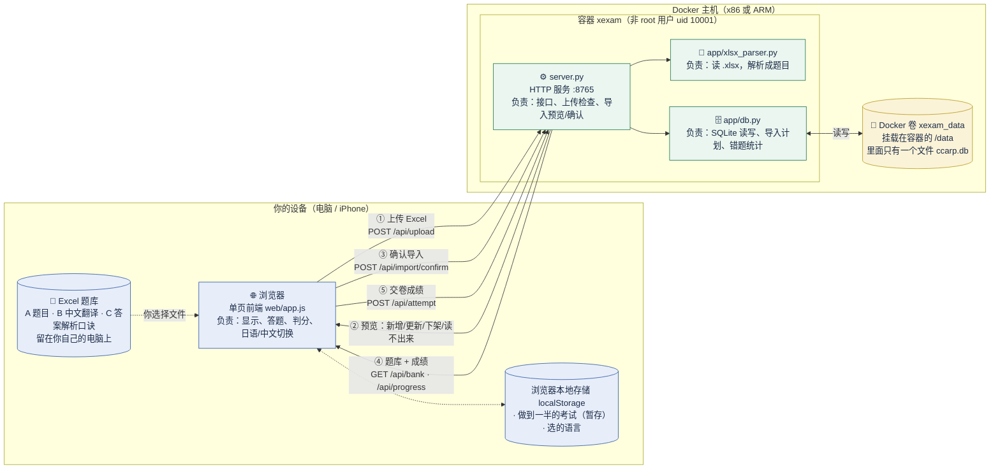
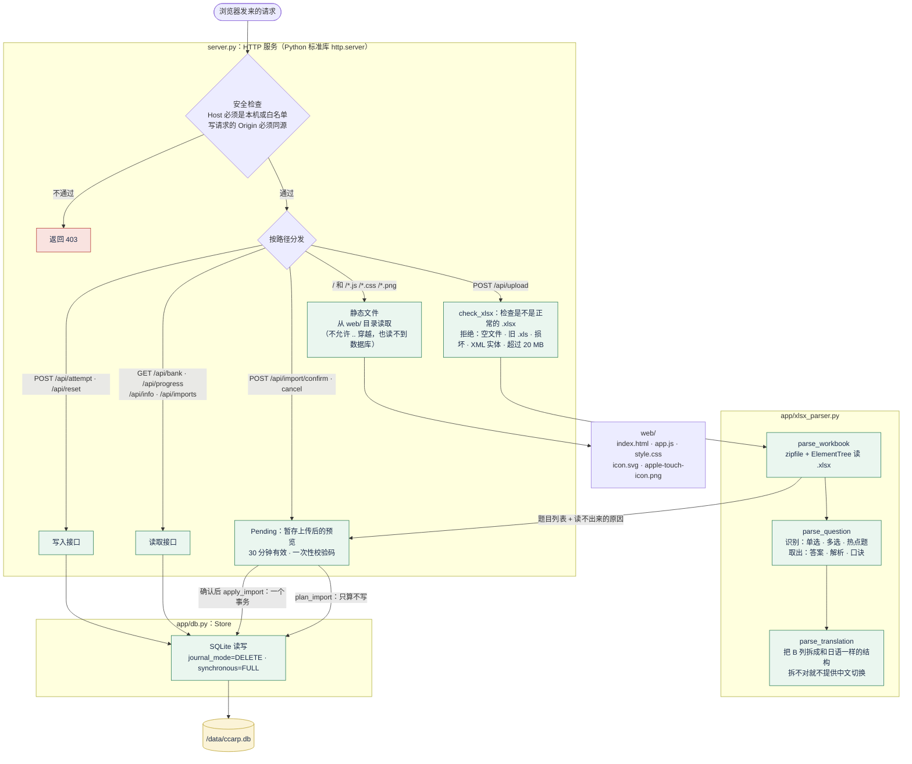
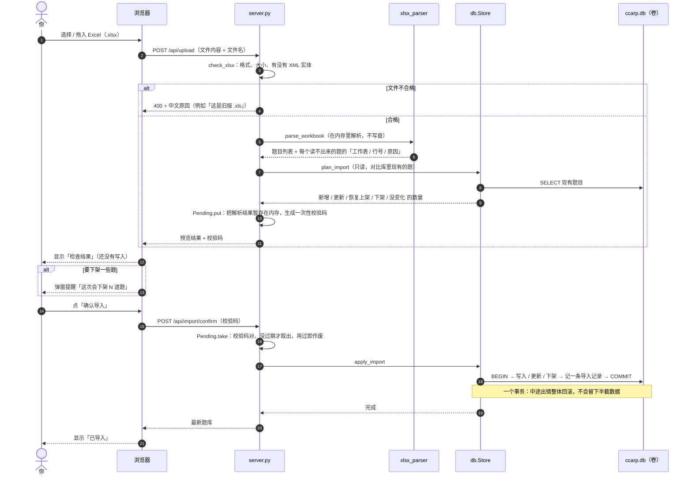
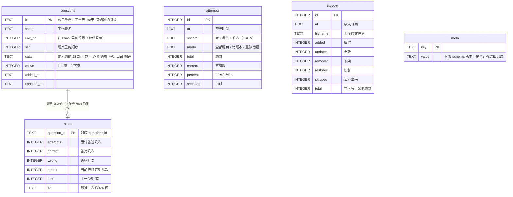
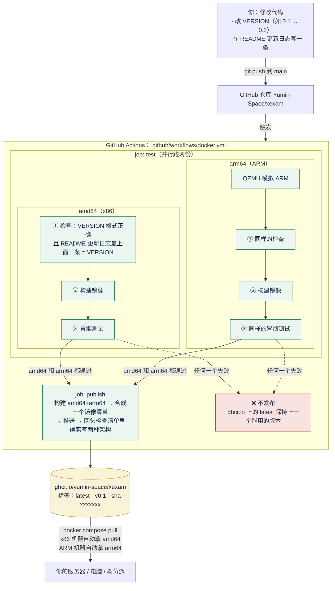
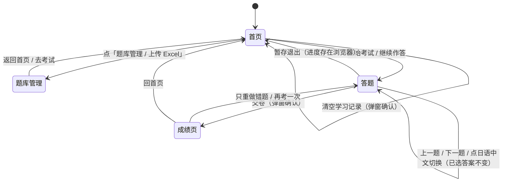

# Xexam

在浏览器里做题的模拟考程序。题目来自你自己的 Excel，上传一次就存进 SQLite；做完题**交卷后才计分**，并列出每道错题的答案、解析和记忆口诀。手机（iPhone）和电脑都能用，Docker 镜像同时支持 **x86（amd64）** 和 **ARM（arm64）**。

- 只用 Python 标准库，没有第三方依赖，镜像很小。
- 题库、成绩、错题记录都在一个 SQLite 文件里，放在 **Docker 命名卷**中，更新或删除容器都不会丢。
- 日语 / 中文随时对照切换；错题本；成绩历史。
- 仓库里**没有题库**：题库是你自己的 Excel，不会被提交（`.gitignore` 已排除）。

| | |
|---|---|
| 当前版本 | **v0.1**（见 [更新日志](#更新日志)） |
| 镜像 | `ghcr.io/yumin-space/xexam`，标签 `latest` / `v0.1` / `sha-<提交>` |
| CPU 架构 | `linux/amd64`、`linux/arm64`（同一个标签里自动选对的） |
| 端口 | `8765`（默认只绑定本机） |

---

## 目录

- [截图](#截图)
- [架构](#架构)
- [快速开始（安装部署）](#快速开始安装部署)
- [使用方法](#使用方法)
- [Excel 题库格式](#excel-题库格式)
- [数据、备份和迁移](#数据备份和迁移)
- [更新日志](#更新日志)
- [自动构建与发布](#自动构建与发布)
- [不用 Docker](#不用-docker)
- [让手机访问](#让手机访问)
- [目录结构](#目录结构)
- [安全说明](#安全说明)

---

## 截图

截图用的是**虚构的演示题库**（5 道日语小题），不是任何真实考试内容。左边是电脑，右边是 iPhone 宽度（390 px）。

### 首页：选范围，开始考试

首页能看到题库有几个工作表、错题本里有几道待巩固的题，以及最近的成绩。

<table>
<tr>
<td width="62%"></td>
<td width="38%"></td>
</tr>
</table>

### 答题：右上角切换日语 / 中文，右侧是答题卡

答题时**不显示对错、不显示分数**。答题卡上：实心 = 已答，半实心 = 热点题只答了一部分，空心 = 未答，黄色小方块 = 已标记。iPhone 上「上一题 / 下一题」固定在屏幕底部，长题目不用滑到底才能翻页。

<table>
<tr>
<td width="62%"></td>
<td width="38%"></td>
</tr>
</table>

点「中文」切换成 Excel 里 B 列的翻译。切换只换文字，已选的答案、选项字母、计时都不变，判分也不变。

<table>
<tr>
<td width="62%"></td>
<td width="38%"></td>
</tr>
</table>

### 交卷：先看分数，再看每题对错

<table>
<tr>
<td width="62%"></td>
<td width="38%"></td>
</tr>
</table>

### 错题解析：你的答案、正确答案、解析、记忆口诀

<table>
<tr>
<td width="62%"></td>
<td width="38%"></td>
</tr>
</table>

### 题库管理：上传 Excel，先预览再导入

上传后会先显示「新增几题、更新几题、恢复几题、下架几题、没变化几题、读不出来几题」。确认前不会写入任何东西。

<table>
<tr>
<td width="62%"></td>
<td width="38%"></td>
</tr>
</table>

---

## 架构

下面的图都是 [Mermaid](https://mermaid.js.org/) 写的，GitHub 上直接显示成图。图里的名字（文件、接口、数据表）都是代码里真实存在的。

### 1. 总览：谁和谁连着，数据怎么走

一句话：**浏览器**只和**一个容器**说话；容器里的 Python 服务读写 **SQLite**；SQLite 文件放在 **Docker 卷**里；题库从你本机的 **Excel** 上传进来。



**要点**

- 判分发生在**浏览器**里（交卷时），服务端只负责保存结果和错题统计。
- 服务端**从不修改**你的 Excel：Excel 只是上传的原料，上传后数据就在 SQLite 里了，之后不再依赖这份 Excel。
- 浏览器和容器之间**只有 HTTP**，没有别的连接。

### 2. 容器里面：每个文件做什么



### 3. 数据流 A：更新题库（上传 → 预览 → 确认）

这是你每次改了 Excel 之后要走的流程。**预览阶段数据库一个字节都没动**，所以传错文件也不怕。



**导入的规则**（上传的文件被当成**完整的题库**）

| 情况 | 结果 |
|---|---|
| 文件里新出现的题 | 新增 |
| 文件里改过的题（选项、答案、解析、翻译） | 更新，答题记录不受影响 |
| 库里有、文件里找不到的题 | **下架**（不再出现在考试里），答题记录保留；导入前会弹窗提醒 |
| 下架的题以后又出现在文件里 | 自动**恢复上架**，答题记录和错题本也回来 |
| 改了某道题的**题干** | 被当成一道**新题**（旧题下架，旧题的答题记录不会带到新题上） |
| 整份文件一道可用的题都没有 | 拒绝导入，防止把题库清空 |

> 题目的身份由「工作表名 + 题干 + 第一个选项的内容指纹」决定，**与行号无关**：在 Excel 里挪动行的顺序，答题记录跟着题走。

### 4. 数据流 B：做一场考试


> 提交的只有「题目 id + 对错」，不会上传你选了什么，也不会上传题目内容。

### 5. 数据库：5 张表

整个数据库就是 `/data/ccarp.db` 这一个文件。



**为什么 `stats` 不随题目一起删：** 题目下架只是把 `active` 改成 0，`stats` 里的答题记录原样保留；以后这道题重新出现在 Excel 里，会自动恢复上架，错题本也跟着回来。

**错题本怎么算：** 一道题只要 `wrong > 0` 且 `streak < 2`（连续答对不到 2 次）就在错题本里；连续答对 2 次后自动移出。

### 6. 自动构建与发布（CI/CD）

每次你把代码推到 GitHub，GitHub Actions 自动做完**检查 → 两种 CPU 各自构建并测试 → 都通过才发布**。



**冒烟测试检查什么（每种架构都跑一遍）**

| 检查 | 目的 |
|---|---|
| 镜像的 CPU 架构 = 期望的架构 | 防止悄悄构建成了另一种架构 |
| 容器不是 root 用户 | 安全 |
| 首页能打开；全新的卷里题库为空 | 基本可用 |
| `/api/info` 里的版本号 = `VERSION` | 镜像里带的版本是对的 |
| 图标和页面文件能取到 | iPhone「添加到主屏幕」要用 |
| 陌生 `Host` 被拒绝（403） | 防 DNS 重绑定 |
| 数据库文件写进了卷 | 数据在卷里，不在容器里 |
| 重启后服务正常、健康检查变 `healthy` | 稳定 |
| **删除容器后用同一个卷重建，数据还在** | 这正是「更新镜像不丢数据」的保证 |

### 7. 页面之间怎么走



答题页里单选、多选、热点题三种题型的界面略有不同（单选选一个、多选选几个、热点题每个小项各选一个），但都在同一个「答题」页面里切换，进度保存在浏览器里。

---

## 快速开始（安装部署）

### 需要什么

- 一台装了 **Docker** 的机器：Windows / macOS / Linux 都行，**x86 或 ARM 都行**（树莓派、云上的 ARM 服务器、苹果芯片的 Mac）。
- 一个浏览器。

### 方式 A：直接拉取现成的镜像（推荐）

只需要仓库里的 [`docker-compose.yml`](docker-compose.yml) 这**一个文件**，复制到任意机器的任意文件夹即可，不需要其他代码。

```bash
# 第一次：登录 GitHub 的容器仓库（镜像是私有的，所以要登录一次）
docker login ghcr.io -u Yumin-Space
# 密码处填一个有 read:packages 权限的 GitHub 令牌
# （GitHub → Settings → Developer settings → Personal access tokens）

# 在 docker-compose.yml 所在的文件夹里：
docker compose up -d
```

然后浏览器打开 <http://localhost:8765>，点「题库管理 / 上传 Excel」导入你的 Excel。

| 操作 | 命令 |
|---|---|
| 更新到最新版本 | `docker compose pull && docker compose up -d` |
| 固定在某个版本 | 把 `docker-compose.yml` 里的 `:latest` 改成 `:v0.1`，再 `docker compose up -d` |
| 停止 / 再启动 | `docker compose stop` / `docker compose start` |
| 看日志 | `docker compose logs -f` |
| 看现在是哪个版本、什么架构 | 浏览器打开 <http://localhost:8765/api/info> |

`docker-compose.yml` 的关键部分：

```yaml
name: xexam
services:
  xexam:
    image: ghcr.io/yumin-space/xexam:latest   # latest = 最新；也可以写 :v0.1 固定版本
    container_name: xexam
    restart: unless-stopped
    ports:
      - "127.0.0.1:8765:8765"                 # 只绑定本机
    volumes:
      - data:/data                            # 题库和学习记录都在这个卷里
volumes:
  data:
```

### 方式 B：从源码构建（改代码时用）

需要完整的仓库代码：

```bash
git clone git@github.com:Yumin-Space/xexam.git
cd xexam
docker compose -f docker-compose.build.yml up -d --build
```

它和方式 A 用**同一个卷**（`xexam_data`），所以两种方式的数据是同一份；容器名也相同，所以不能同时运行，切换前先 `docker compose stop`。

### 镜像的版本标签

| 标签 | 含义 | 什么时候用 |
|---|---|---|
| `latest` | 最近一次成功发布的版本 | 想一直用最新版 |
| `v0.1`、`v0.2`… | 固定的某个版本 | 想锁定版本、需要回退 |
| `sha-xxxxxxx` | 某一次提交 | 排查问题 |

---

## 使用方法

### 第一次：导入题库

1. 打开页面，题库是空的，点「去上传题库」（或右上角「题库管理 / 上传 Excel」）。
2. 选择你的 Excel（也可以拖进虚线框）。
3. 看**检查结果**：新增几题、哪几题读不出来（会写明工作表、行号和原因）。
4. 没问题就点「确认导入」。

### 以后更新题库

1. 在自己电脑上改 Excel：新增工作表、新增或修改题目都可以。
2. 保存后，把**整份** Excel 再上传一次。
3. 看检查结果，确认导入。规则见上面 [数据流 A](#3-数据流-a更新题库上传--预览--确认)。

### 考试

1. 首页勾选要考的工作表，选「全部题目」或「错题本」，设置题数，点「开始考试」。
2. 答题过程中**不显示对错、不显示分数**。可以随时跳题、用答题卡看进度、标记不确定的题。
3. 点「交卷」后才计分（答对的百分比），并列出每道错题的：你的答案、正确答案、解析（怎么选）、记忆口诀、中文翻译。
4. 单选、多选要**选对全部**才算对；热点题**每个小项都对**才算这题对。
5. 没做完可以「暂存退出」，下次回到首页「继续作答」（暂存放在浏览器里，换浏览器就没有了）。

### 日语 / 中文对照

题目右上角有「日语 / 中文」两个按钮。中文用的是 Excel 里 **B 列**的翻译。如果某道题 B 列没写翻译，或翻译里的选项 / 小项数量和 A 列对不上，这道题的「中文」按钮会**置灰**（不会显示错位的内容）。选项本身（`はい / いいえ`、`Model Stage` 这类答案原文）不翻译。

### 错题本

答错的题进入错题本，之后**连续 2 次答对**自动移出。首页选「错题本」只练这些题；交卷后也可以点「只重做错题」。

### 键盘（电脑）

`←` `→` 切换题目，`A`–`E` 选答案，`M` 标记。

### 在 iPhone 上使用

- 在 iPhone 的 Safari 里打开服务地址（需要先做 [让手机访问](#让手机访问)）。
- 点分享按钮 →「添加到主屏幕」，之后像独立应用一样全屏打开，图标是答题卡样式的 Xexam。
- 所有按钮都不小于 44 px，适合手指点；刘海和底部横条的安全区已处理；「上一题 / 下一题」固定在屏幕底部。

---

## Excel 题库格式

每个工作表是一组题，一行一道题。

| 列 | 内容 |
|---|---|
| **A** | 题目。选择题：题干后空一行，选项写成 `A. 内容`，一行一个。热点题：第一行写 `ホットスポット`，小项写成 `1. 内容　はい / いいえ` |
| **B** | 中文翻译（可以不写）。要和 A 列保持同样的结构：选项也写成 `A. 内容`，热点题的小项写成 `1. 内容`，这样才能切换成中文 |
| **C** | 以 `【答案】` 开头，后面可以接 `【解析·怎么选】` 和 `【记忆口诀】` |

C 列的答案写法：

- 单选 / 多选：`【答案】C` 或 `【答案】C、E`
- 热点题：`【答案】1 是；2 否；3 是`。小项的答案可以写 `是/否`、`はい/いいえ`，或者直接写选项文字（比如 `Model Stage`）

一个例子（C 列）：

```
【答案】C、E

【解析·怎么选】先排除……再比较……

【记忆口诀】……
```

读不出来的题**不会被猜**：它们会在检查结果里列出原因（多半是 C 列没写 `【答案】…`，或答案字母不在选项里），不会悄悄判错。

---

## 数据、备份和迁移

数据保存在一个 **Docker 命名卷**里，不是你电脑上看得见的文件夹。

- 卷名是 `xexam_data`（项目名 `xexam` + 卷名 `data`），里面只有 `ccarp.db`：题库、成绩、错题记录都在这一个文件里。
- 更新镜像、`docker compose down`、删除并重建容器，**数据都还在**。
- ⚠️ **不要运行 `docker compose down -v`**：`-v` 会把卷一起删掉，数据就没了。

### 备份和恢复

先停止程序再操作，数据库更安全。

```powershell
docker compose stop

# 备份：把卷打包成当前文件夹里的 xexam-data.tgz
docker run --rm -v xexam_data:/data -v "${PWD}:/backup" alpine tar czf /backup/xexam-data.tgz -C /data .

docker compose start
```

```powershell
# 恢复（会覆盖卷里的同名文件）
docker compose stop
docker run --rm -v xexam_data:/data -v "${PWD}:/backup" alpine tar xzf /backup/xexam-data.tgz -C /data
docker compose start
```

换电脑：在新电脑上登录 `ghcr.io`，放好 `docker-compose.yml`，先 `docker compose up -d` 建好卷，再按上面的方法恢复备份。

### 迁移旧版的学习记录

如果你有旧版留下的 `progress.json`（旧版把成绩放在这个文件里），在**还没做过任何考试**的新卷上，用一个临时容器把它放进卷里，再重启：

```powershell
docker compose up -d
docker compose stop
docker run --rm -v xexam_data:/data -v "${PWD}:/src:ro" alpine sh -c "cp /src/progress.json /data/progress.json && chown 10001:10001 /data/progress.json"
docker compose start
```

重启时会自动把里面的成绩和错题记录迁移进数据库，**只迁移一次**，日志里会写「已把旧的学习记录迁移进数据库」（`docker compose logs` 能看到）。数据库里已经有学习记录时不会覆盖。

> 这里没有用 `docker cp`：它默认以 root 身份写入，文件属于 root，而容器里的程序是非 root 用户，可能读不了。上面的做法把文件的所有者设成了程序用户（uid 10001）。

---

## 更新日志

每次更新都要在这里写一条，**版本号和仓库根目录的 `VERSION` 文件一致**（自动构建会检查，不一致就不让构建）。最新的镜像同时有 `latest` 和对应的 `vX.Y` 标签。

### v0.1 — 2026-11-10

第一个版本。

- 浏览器答题：单选、多选、热点题；**交卷后才计分**，错题显示答案、解析、记忆口诀。
- 日语 / 中文对照切换；答题卡；标记；暂存退出再继续。
- 错题本：答错的题连续答对 2 次后移出；成绩历史。
- 题库和学习记录改存 **SQLite**（Docker 命名卷 `xexam_data`），不再依赖 Excel。
- 管理页**上传 Excel 更新题库**：先预览（新增 / 更新 / 恢复 / 下架 / 读不出来），确认后才写入；下架的题保留答题记录，传回来自动恢复。
- 旧版的 `progress.json` 第一次启动时自动迁移。
- 支持 **iPhone**：触控区域不小于 44 px、安全区、底部固定翻页栏、可添加到主屏幕。
- Docker 镜像同时支持 **x86（amd64）和 ARM（arm64）**，由 GitHub Actions 构建并测试后发布到 `ghcr.io/yumin-space/xexam`（`latest` / `v0.1`）。
- 应用名改为 **Xexam**。

<!-- 新版本写在这一行的上面，格式：### vX.Y — 日期 -->

---

## 自动构建与发布

[`.github/workflows/docker.yml`](.github/workflows/docker.yml)，流程图见上面 [CI/CD](#6-自动构建与发布cicd)。

- **触发：** 推送到 `main`，或在 Actions 页面手动运行；拉取请求只构建和测试，不发布。
- **每次更新必须：** 改 `VERSION`，并在本文件「更新日志」最上面写一条同版本的记录，否则检查步骤会失败。
- **两种架构各测一遍：** `amd64` 在 GitHub 的 x86 机器上原生跑；`arm64` 用 QEMU 模拟运行（比原生慢，但这个镜像很小）。
- **都通过才发布：** 发布成一个多架构镜像，并回头检查镜像清单里确实有 `amd64` 和 `arm64`。测试失败时 `latest` 仍是上一个能用的版本。
- **发布的标签：** `latest`、`v<VERSION>`、`sha-<提交>`。

镜像从私有仓库发布，默认也是私有的。想免登录拉取，到 GitHub 的包设置里把它改成公开。

---

## 不用 Docker

需要 Python 3.8 或更新版本。

```bash
python server.py                       # 数据放在 ./data，自动打开浏览器
python server.py --data D:\xexam-data  # 指定数据目录
python server.py --import 题库.xlsx    # 不启动服务，直接把 Excel 导入数据库
```

Windows 上也可以双击 `start.bat`（会带上 `--allow-shutdown`，页面右下角有「关闭程序」按钮；Docker 里没有这个按钮，用 `docker compose stop`）。

## 让手机访问

**这个程序没有登录**，默认只绑定本机（`127.0.0.1`）。想让同一个家庭 Wi-Fi 里的 iPhone 访问，**只在你信任的网络里**这样做，不要在咖啡厅或公司网络里开：

1. 把 `docker-compose.yml` 里的 `"127.0.0.1:8765:8765"` 改成 `"8765:8765"`。
2. 在 `environment` 里加一行 `CCARP_ALLOWED_HOSTS: "你的电脑的局域网IP"`（例如 `192.168.1.20`）。
3. `docker compose up -d`，iPhone 的 Safari 打开 `http://你的电脑IP:8765`。

## 目录结构

```
README.md                  本文件（架构、部署、使用、更新日志）
VERSION                    版本号（和更新日志最上面一条保持一致）
server.py                  HTTP 服务：接口、上传检查、导入预览/确认
app/db.py                  SQLite 存储：题库、导入计划、成绩、错题统计
app/xlsx_parser.py         读取 .xlsx 并解析题目（zipfile + ElementTree）
web/                       单页前端：index.html / app.js / style.css / icon.svg / apple-touch-icon.png
docs/screenshots/          README 里的截图（演示题库）
Dockerfile                 非 root 用户运行，/data 是卷
docker-compose.yml         拉取镜像运行（只需要这一个文件）
docker-compose.build.yml   从源码构建运行
.github/workflows/         自动构建、测试、发布
使用说明.txt                面向使用者的简要说明
start.bat                  Windows 上不用 Docker 启动
```

## 安全说明

- 服务只接受发给本机的请求（检查 `Host`），写请求还会检查 `Origin`，防止恶意网页通过你的浏览器操作它。
- 上传的文件会检查格式，拒绝空文件、非 `.xlsx`、损坏的压缩包、含 XML 实体声明的文件，最大 20 MB。
- 上传后的预览在内存里保留 30 分钟，确认时需要一次性的校验码，用过就作废。
- 数据库写入在一个事务里：中途出错整体回滚，不会留下半截数据。
- 容器以非 root 用户（uid 10001）运行。
- 静态文件只从 `web/` 目录提供，不允许 `..` 穿越，网页读不到数据库和代码。
