**English** | [日本語](README.ja.md) | [简体中文](README.zh-CN.md)

# Xexam

A mock-exam app that runs in the browser. The questions come from your own Excel file: upload it once and it is stored in SQLite. **Scoring happens only after you submit**, and then every wrong question is listed with its answer, explanation and mnemonic. It works on phones (iPhone) and computers.

- **Rust backend + TypeScript frontend + Nginx**, running as two containers with Docker Compose; only Nginx is exposed, and the backend stays on a private network.
- The question bank, scores and wrong-answer records all live in one SQLite file, stored in a **Docker named volume**, so updating or deleting containers loses nothing.
- Switch between English / Chinese / Japanese at any time for side-by-side comparison (the question text, the options and the hotspot option buttons all change with it); wrong-answer notebook; score history.
- The repository contains **no question bank**: the bank is your own Excel file and is never committed (`.gitignore` excludes it).

| | |
|---|---|
| Current version | **v0.4** (see the [changelog](#changelog), or the repository's [Releases](../../releases) page) |
| Images | `ghcr.io/yumin-space/xexam-frontend` and `ghcr.io/yumin-space/xexam-backend`, with tags `latest` / `v0.3` / `sha-<commit>` |
| CPU architecture | `linux/amd64`, `linux/arm64` (the right one is picked automatically under the same tag) |
| Port | `8765` (bound to the local machine only by default) |

Documentation: [Architecture](docs/architecture.md) · [API](docs/api.md) ([OpenAPI](docs/openapi.yaml)) · [Database](docs/database.md) · [Security](docs/security.md) · [Deployment](docs/deployment.md) · [Migration and rollback](docs/migration.md) · [Development](docs/development.md)

> The documents under `docs/` are currently written in Chinese.

---

## Contents

- [Screenshots](#screenshots)
- [Architecture](#architecture)
- [Quick start (installation and deployment)](#quick-start-installation-and-deployment)
- [How to use](#how-to-use)
- [Excel question bank format](#excel-question-bank-format)
- [Data, backup and restore](#data-backup-and-restore)
- [Letting your phone connect](#letting-your-phone-connect)
- [Access from the internet via Cloudflare Tunnel](#access-from-the-internet-via-cloudflare-tunnel)
- [Security notes](#security-notes)
- [Automated build and release](#automated-build-and-release)
- [Development](#development)
- [Directory structure](#directory-structure)
- [Changelog](#changelog)

---

## Screenshots

The screenshots use a **fictional demo question bank** (5 short questions written in English, Chinese and Japanese), not content from any real exam. The desktop is on the left, iPhone width (390 px) on the right.

### Home: pick a scope and start the exam

The home page shows how many sheets the question bank has, how many questions in the wrong-answer notebook still need review, and the most recent scores.

<table>
<tr>
<td width="62%">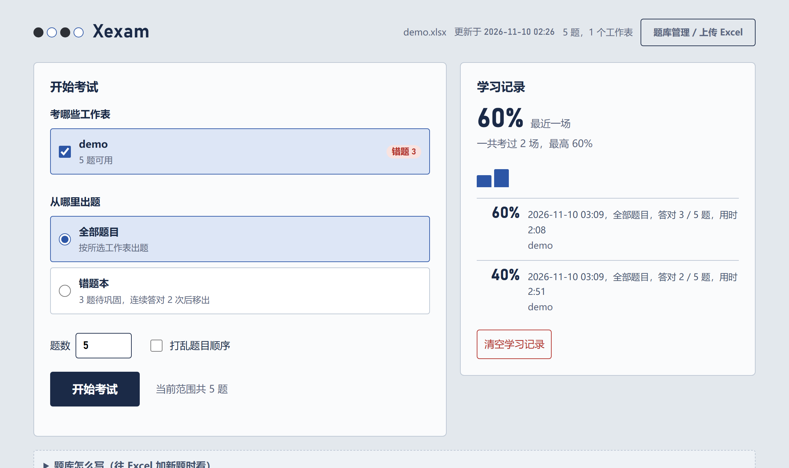</td>
<td width="38%">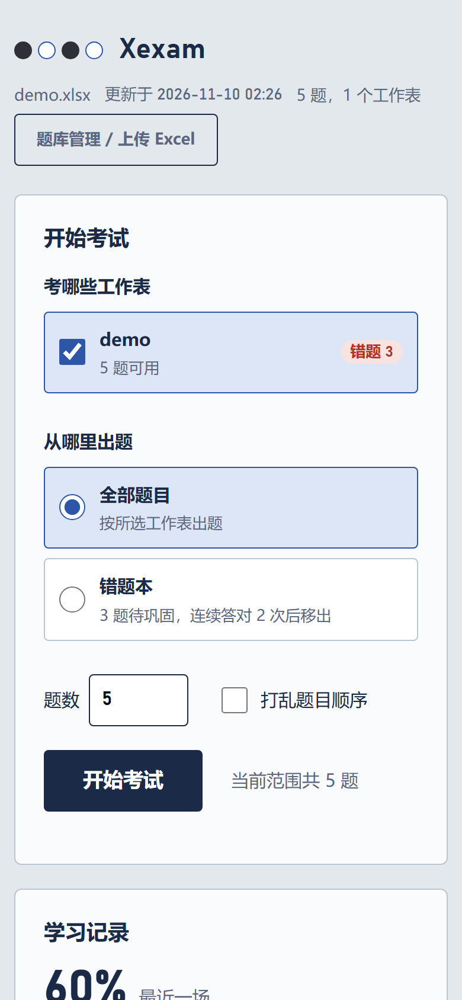</td>
</tr>
</table>

### Answering: switch English / Chinese / Japanese at the top right, answer sheet on the right

While answering, **correctness and score are not shown**. On the answer sheet: solid = answered, half-filled = a hotspot question only partly answered, hollow = unanswered, small yellow square = flagged. On iPhone the `上一题 / 下一题` ("Previous / Next") buttons are pinned to the bottom of the screen, so with a long question you don't have to scroll to the end to turn the page.

<table>
<tr>
<td width="62%">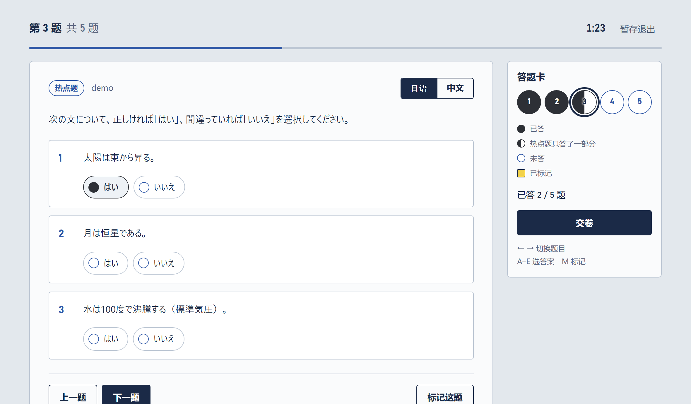</td>
<td width="38%">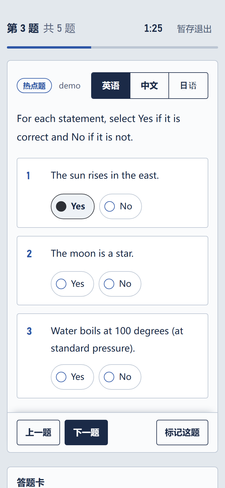</td>
</tr>
</table>

Click `中文` ("Chinese") or `日语` ("Japanese") to switch to the text from the matching column in the Excel file; `英语` ("English") switches back. Switching only changes the text: the selected answers, the option letters and the timer stay the same, and so does grading. The hotspot option buttons switch too (Yes / No, 是 / 否, はい / いいえ). The pictures below show the same question in Chinese, then in Japanese.

<table>
<tr>
<td width="62%">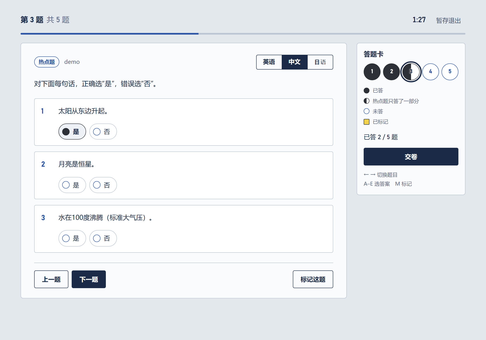</td>
<td width="38%">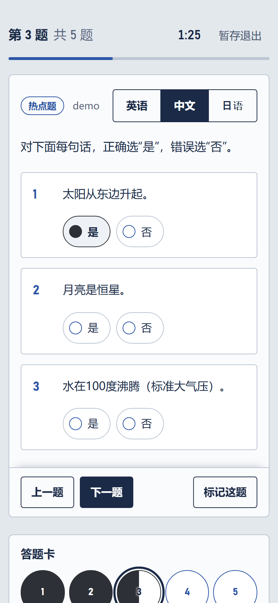</td>
</tr>
</table>

<table>
<tr>
<td width="62%">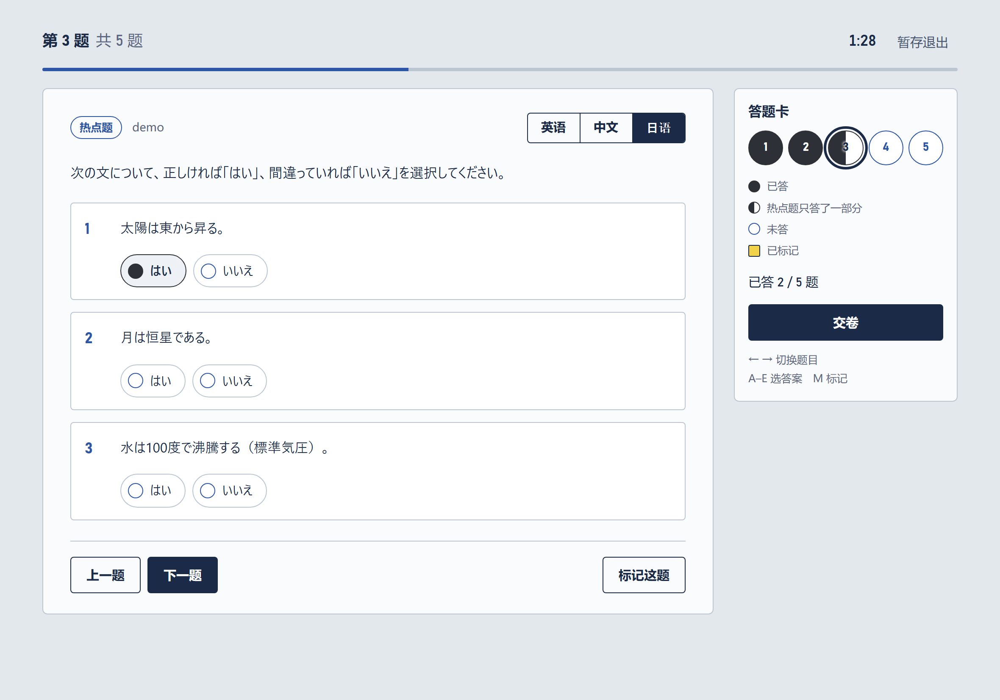</td>
<td width="38%">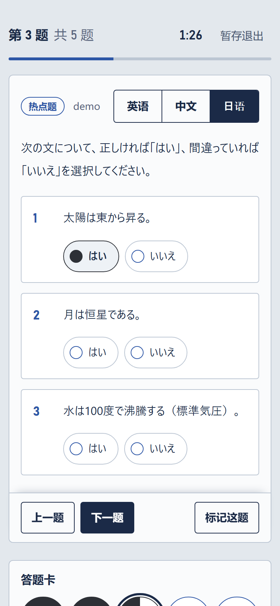</td>
</tr>
</table>

### Submit: the score first, then right or wrong for each question

<table>
<tr>
<td width="62%">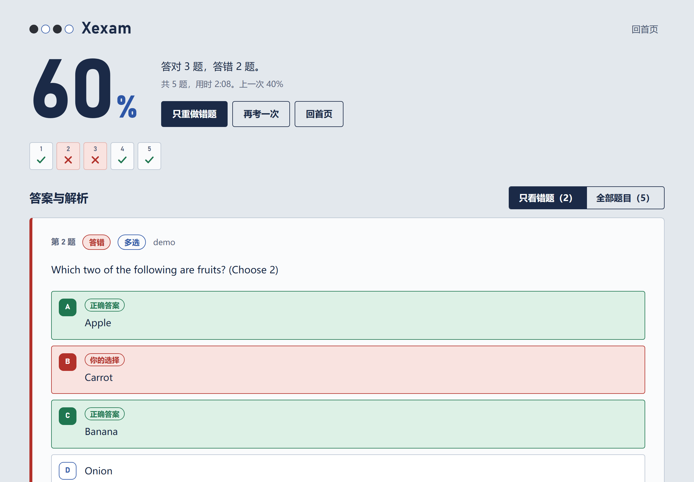</td>
<td width="38%">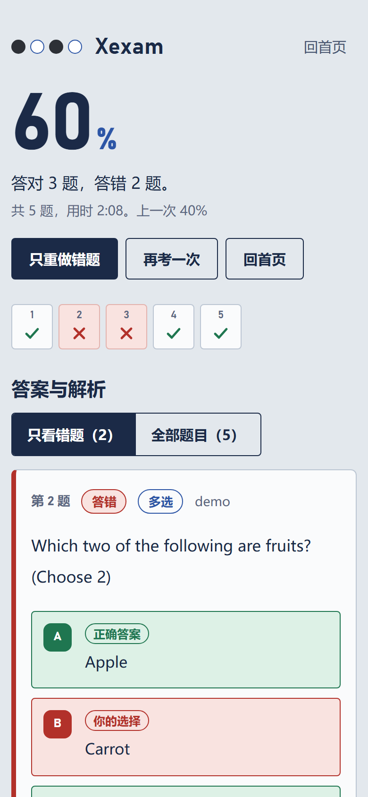</td>
</tr>
</table>

### Review of wrong answers: your answer, the correct answer, the explanation, the mnemonic

<table>
<tr>
<td width="62%">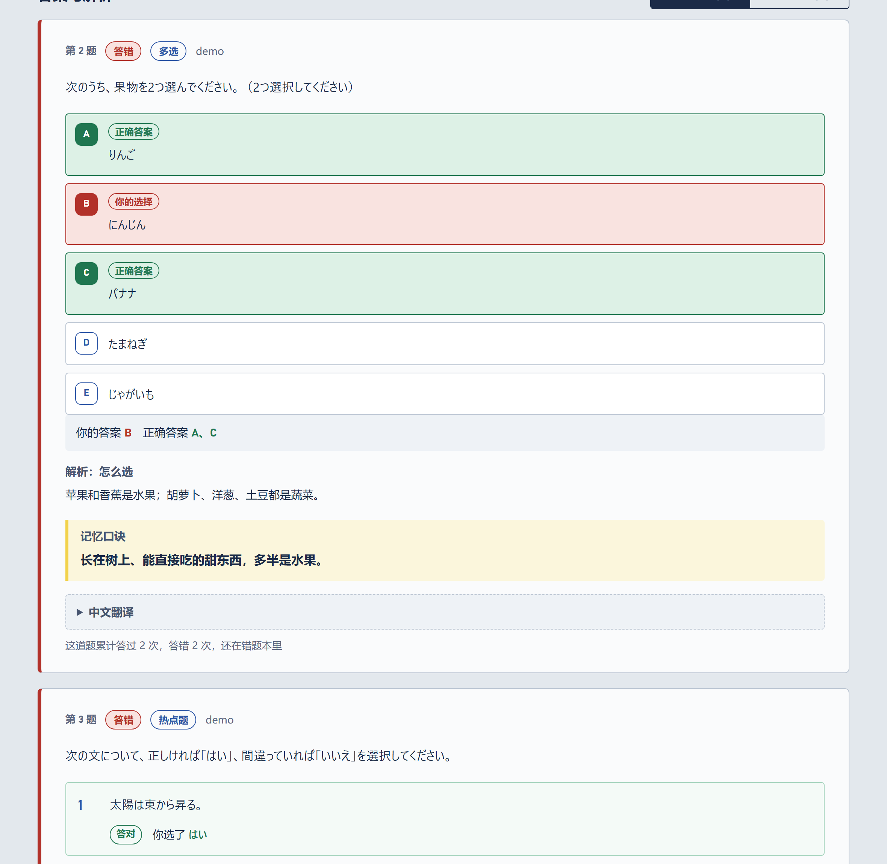</td>
<td width="38%">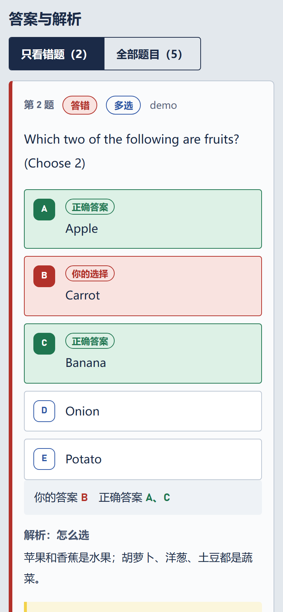</td>
</tr>
</table>

### Question bank management: upload Excel, preview first, then import

After an upload it first shows `新增几题、更新几题、恢复几题、下架几题、没变化几题、读不出来几题` ("N added, N updated, N restored, N deactivated, N unchanged, N unreadable"). Nothing is written until you confirm.

<table>
<tr>
<td width="62%">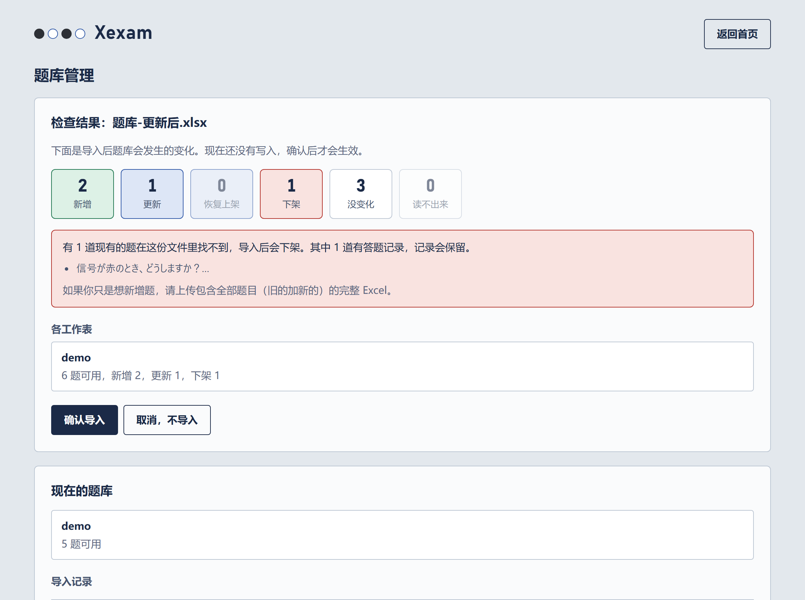</td>
<td width="38%">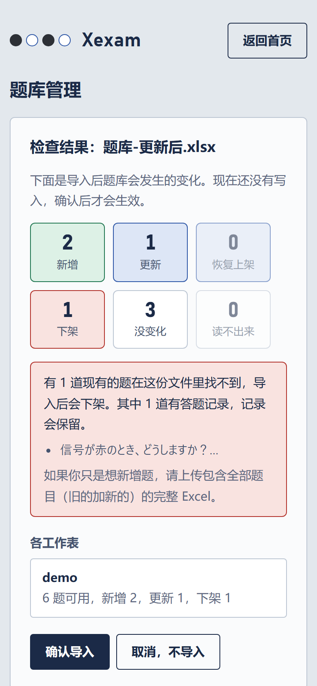</td>
</tr>
</table>

---

## Architecture

All the diagrams below are written in [Mermaid](https://mermaid.js.org/), which GitHub renders directly as images. See [docs/architecture.md](docs/architecture.md) for the full description.

### What connects to what, and how data flows

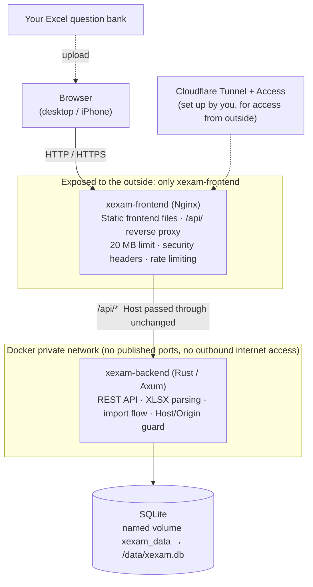

| Container / image | What is inside | Exposed? |
|---|---|---|
| `xexam-frontend` | Nginx + static frontend files (HTML / JS / CSS). Forwards `/api/` to the backend; 20 MB limit, security headers, rate limiting, timeouts | Yes: host `XEXAM_BIND` (default `127.0.0.1:8765`) → container port 8080 |
| `xexam-backend` | A single statically linked Rust executable: REST API, Excel parsing, SQLite reads and writes | **No**: no `ports`, and the network is `internal: true` |

The browser talks to the backend only through the [REST API](docs/api.md); the frontend has no database access. **Grading happens in the browser**: the server only receives `{question id, correct}`.

### Data flow A: updating the question bank (upload → preview → confirm)

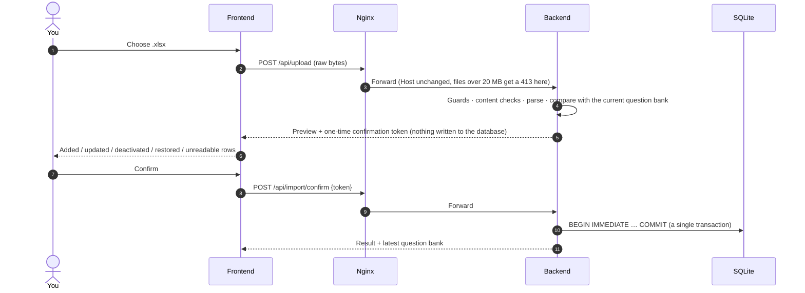

Import rules (the uploaded file is treated as the **complete question bank**):

| Case | Result |
|---|---|
| A question is in the file but not in the database | **Added** |
| Same question text, but other content (options, answer, explanation, translation) changed | **Updated** (answer history is not affected) |
| A question is in the database but cannot be found in the file | **Deactivated** (`active = 0`; answer history is kept, not deleted) |
| A question that was deactivated earlier appears again | **Restored** to active, and the wrong-answer notebook comes back with it |
| The wording of the question text changed | Counts as **a new question** (the old one is deactivated, and its history is not carried over to the new one) |
| The file contains not a single usable question | Import rejected (prevents wiping the question bank) |

### Data flow B: taking an exam

The question bank is fetched into the browser in one go → questions are answered in the browser and graded when you submit → `POST /api/attempt` sends only a list of `{id, correct}` → the backend updates the per-question statistics and the score history → it returns the latest study record. An exam in progress is stored in the browser, so refreshing the page does not lose it.

### Database: 5 tables

See [docs/database.md](docs/database.md) for the full table schema and the meaning of each field.

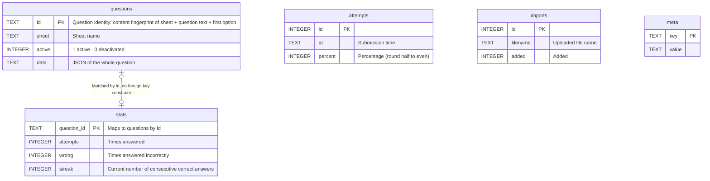

**Why `stats` is not deleted along with the question:** deactivating a question only sets `active` to 0, and the answer history is kept as it is; if the question appears in the Excel file again later, it is restored to active automatically.

**How the wrong-answer notebook works:** a question is in the notebook as long as `wrong > 0` and `streak < 2` (fewer than 2 consecutive correct answers); after 2 consecutive correct answers it is moved out automatically.

### How the pages connect

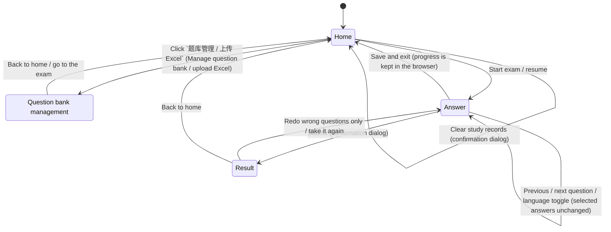

Single-choice, multiple-choice and hotspot questions look slightly different on the answering page, but they all switch within the same `答题` ("Answer") page.

---

## Quick start (installation and deployment)

### What you need

- A machine with **Docker** (including Compose v2) installed: Windows / macOS / Linux all work, **x86 or ARM**.
- A web browser.

### Option A: pull the prebuilt images (recommended)

You only need **one file** from the repository, [`docker-compose.yml`](docker-compose.yml). Copy it into any folder on any machine; no other code is required.

```bash
# First time: log in to GitHub's container registry (the images are private, so you log in once)
docker login ghcr.io -u Yumin-Space
# For the password, enter a GitHub token with the read:packages permission
# (GitHub → Settings → Developer settings → Personal access tokens)

# In the folder that contains docker-compose.yml:
docker compose up -d
```

Then open <http://localhost:8765> in a browser and click the `题库管理 / 上传 Excel` ("Manage question bank / upload Excel") button to import your Excel file. This pulls and starts **two containers** (`xexam-frontend`, `xexam-backend`) at once.

| Action | Command |
|---|---|
| Update to the latest version | `docker compose pull && docker compose up -d` |
| Pin to a specific version | Change `:latest` to `:v0.3` for both images in `docker-compose.yml`, then run `docker compose up -d` |
| Stop / start again | `docker compose stop` / `docker compose start` |
| View logs | `docker compose logs -f` |
| See which version and architecture are running | Open <http://localhost:8765/api/info> in a browser |

> ⚠️ **Do not run `docker compose down -v`**: `-v` also deletes the data volume `xexam_data`, which holds your question bank and study records.

All adjustable options are set through a `.env` file next to `docker-compose.yml` (see [`.env.example`](.env.example) for a template; you do not need to edit the compose file itself):

| Name in `.env` | Default | Purpose |
|---|---|---|
| `XEXAM_BIND` | `127.0.0.1:8765` | The address and port to listen on (Nginx); it must be written in the form `IP:port`. By default only this machine can connect; `0.0.0.0:8765` = other machines on the LAN can connect too. ⚠️ Writing only a port number (such as `8766`) = reachable on all network interfaces |
| `XEXAM_ALLOWED_HOSTS` | empty | Which domain names / IPs may be used to access it, comma-separated, for example `xexam.example.com,192.168.1.20` |
| `XEXAM_ALLOWED_ORIGINS` | empty | Needed only when a reverse proxy rewrites the Host to the origin server's address: enter your public domain |
| `XEXAM_ALLOW_ANY_HOST` | `0` | Set to `1` = stop checking the Host (use it only when authentication is already in front) |
| `XEXAM_PARSE_TIMEOUT_SECS` | `30` | Maximum time to parse one Excel file (seconds) |
| `TZ` | `Asia/Tokyo` | Time zone used for timestamps in the database |

### Option B: build from source (for when you change the code)

You need the full repository code:

```bash
git clone git@github.com:Yumin-Space/xexam.git
cd xexam
docker compose -f docker-compose.build.yml up -d --build
```

The first build takes a few minutes (it compiles Rust and the frontend). It uses the **same volume** (`xexam_data`) and the same container names as Option A, so the data is shared and the two **cannot run at the same time**; run `docker compose stop` before switching.

### Image version tags

| Tag | Meaning | When to use it |
|---|---|---|
| `latest` | The most recent successfully published version | You always want the newest version |
| `v0.3` etc. | One fixed, specific version | You want to lock the version or need to roll back |
| `sha-xxxxxxx` | One specific commit | Troubleshooting |

### Upgrading from the old version (v0.2.x, single Python image)

The data volume `xexam_data` is the same one, so **no data migration is needed**. However, the old version was one container and the new version is two, and the container name / port are the same, so:

1. Run `docker compose stop` (for the old version).
2. Back up the data volume (see "Data, backup and restore" below). This is just a good habit, not because the data will change.
3. Run `docker rm xexam` to remove the old version's container (**only the container, not the data volume**). The old container is called `xexam`; the new ones are `xexam-frontend` and `xexam-backend`. If you do not remove it, the old container still occupies port 8765 and the new ones will fail to start.
4. Swap in the new `docker-compose.yml`, then run `docker compose pull && docker compose up -d`.
5. Open <http://localhost:8765> and check that the number of questions, the number of wrong questions and the score history are the same as before the upgrade.

To go back to the old version: the old code is at the Git tag `python-v0.2`, the old image `ghcr.io/yumin-space/xexam:v0.2.2` can still be pulled, and the old version can directly read and write a database that the new version has written to. See [docs/migration.md](docs/migration.md) for details.

---

## How to use

### First time: import the question bank

1. Open the page. The question bank is empty; click `去上传题库` ("Go upload the question bank"), or `题库管理 / 上传 Excel` ("Manage question bank / upload Excel") at the top right.
2. Choose your Excel file (you can also drag it into the dashed box).
3. Read the **check result**: how many questions are new, and which ones could not be read (it states the sheet, row number and reason).
4. If everything looks fine, click `确认导入` ("Confirm import").

### Updating the question bank later

1. Edit the Excel file on your own computer: adding sheets and adding or changing questions are all fine.
2. After saving, upload the **whole** Excel file again.
3. Read the check result and confirm the import. See the rules in [Data flow A](#data-flow-a-updating-the-question-bank-upload--preview--confirm) above.

### Taking an exam

1. On the home page, tick the sheets you want to take, choose `全部题目` ("All questions") or `错题本` ("Mistake notebook"), set the number of questions, and click `开始考试` ("Start exam").
2. While answering, **no right/wrong feedback and no score is shown**. You can jump between questions at any time, use the answer sheet to see your progress, and mark questions you are unsure about.
3. Scoring (the percentage answered correctly) happens only after you click `交卷` ("Submit"), and the app lists, for each wrong question: your answer, the correct answer, the explanation (how to choose), the mnemonic, and the Chinese translation.
4. Single-choice and multiple-choice questions count as correct only if you **select all the correct options**; a hotspot question counts as correct only if **every sub-item is correct**.
5. If you have not finished, you can use `暂存退出` ("Save and exit"), and next time go back to the home page and use `继续作答` ("Resume") (the saved progress is stored in the browser and is gone if you switch browsers).

### English / Chinese / Japanese side by side

At the top right of each question there are three buttons, `英语 / 中文 / 日语` ("English / Chinese / Japanese"), in the same order as Excel columns A, B and C. English uses **column A**, Chinese uses **column B**, and Japanese uses **column C** (Japanese is the question itself and is always available).

- If a column is blank for a question, or its number of options / sub-items does not match the Japanese, that language's button is **greyed out** for that question (misaligned content is never shown).
- The option buttons of hotspot questions also follow the language: Japanese shows `はい / いいえ` ("yes / no"), Chinese shows `是 / 否` ("yes / no"), and English shows `Yes / No` (this requires every sub-item in that column to end with its options; see "Excel question bank format" below). If they are not written, the option buttons show the Japanese ones.
- The language you choose is remembered in the browser; the explanations of wrong questions on the result page also show the question in the same language.

### Mistake notebook

Questions you answer wrongly go into the mistake notebook, and are removed automatically after you answer them correctly **2 times in a row**. Choosing `错题本` on the home page practices only these questions; after submitting you can also click `只重做错题` ("Redo wrong questions only").

### Keyboard (desktop)

`←` `→` switch between questions, `A`–`E` select an answer, `M` marks a question.

### Using it on an iPhone

- Open the service address in Safari on your iPhone (first follow [Letting your phone connect](#letting-your-phone-connect)). It requires **iOS 15.4 or later** (earlier versions have no `<dialog>`, and the page falls back to the system's built-in confirmation box, which looks slightly different).
- Tap the Share button → `添加到主屏幕` ("Add to Home Screen"). After that it opens full-screen like a standalone app, with an Xexam icon in the style of an answer sheet.
- All buttons are at least 44 px, which suits fingertips; the safe areas for the notch and the bottom bar are handled; `上一题 / 下一题` ("Previous / Next") are pinned to the bottom of the screen.

---

## Excel question bank format

Each sheet is a set of questions, one question per row.

| Column | Contents |
|---|---|
| **A** | The **English** question (may be left blank). Its structure **corresponds exactly, one to one,** to the Japanese in column C: the same question, the same option letters, and the same number and order of sub-items. For a hotspot question, write `HOTSPOT` on the first line |
| **B** | The **Chinese** translation (may be left blank). The `【中文翻译】` ("Chinese translation") heading is optional; the structure likewise corresponds one to one to column C |
| **C** | The **Japanese** question, which is the question itself. Multiple choice: leave a blank line after the stem, and write each option as `A. content`, one per line. Hotspot: write `ホットスポット` ("hotspot") on the first line, and write each sub-item as `1. content　はい / いいえ` (the content, followed by its options, here yes / no). The question id, the option letters and the hotspot answers are all taken from this column |
| **D** | Starts with `【答案】` ("Answer"), and can be followed by `【解析·怎么选】` ("Explanation · how to choose") and `【记忆口诀】` ("Mnemonic") |

Columns A, B and C are **the same question in three languages**: item 1 of column A = item 1 of column B = item 1 of column C, and option A = option A = option A. The answer is written only once (column D) and is shared by all three languages.

**The options of hotspot questions are written in each language's own column**: at the end of each sub-item, write the options in that column's language; the j-th option in each of the three languages has the same meaning. For example, for the same sub-item:

| Column | How the sub-item is written |
|---|---|
| A English | `1. Classify the invoice type using Claude.　Pre-Processing / Model Stage / Post-Processing` |
| B Chinese | `1. 用Claude对发票类型进行分类。　前处理 / 模型阶段 / 后处理` ("1. Classify the invoice type using Claude. Pre-processing / Model stage / Post-processing") |
| C Japanese | `1. Claudeを用いて請求書の種類を分類する。　前処理 / モデルステージ / 後処理` (same meaning as above) |

When you switch language, the stem, the options and the option buttons of hotspot questions all change to the text of the corresponding column. If a column has no options written (or their number does not match the Japanese), the question is still available in that language; only the option buttons show the Japanese options.

**The old three-column format** (A Japanese, B Chinese, C answer) can still be uploaded, just without English: the program works out which format it is by looking at the content (in the four-column format the answer is in column D and column C is Japanese), so you do not need to change any setting.

How to write the answer in column D:

- Single choice / multiple choice: `【答案】C` or `【答案】C、E`
- Hotspot: `【答案】1 是；2 否；3 是` ("Answer: 1 yes; 2 no; 3 yes"). The answer for a sub-item can be written as `是/否` ("yes/no"), `はい/いいえ` (Japanese "yes/no"), `Yes/No`, or the option word in any language (for example `Model Stage`, `モデルステージ`, `模型阶段` (Chinese for "Model Stage"), `Apple`). The options in the three languages correspond one to one by position, so whichever language you write is accepted; a word that belongs to none of the three languages is listed in the check result

An example (column D):

```
【答案】C、E

【解析·怎么选】先排除……再比较……

【记忆口诀】……
```

Questions that cannot be read are **never guessed**: they are listed in the check result with the reason (usually the answer column does not contain `【答案】…`, or the answer letter is not among the options), and they are never silently marked wrong.

---

## Data, backup and restore

Data is stored in a **Docker named volume**, not in a folder you can see on your computer.

- The volume is named `xexam_data` (project name `xexam` + volume name `data`) and contains only `xexam.db`: the question bank, scores and wrong-answer records are all in this one file.
- Updating the image, running `docker compose down`, or deleting and recreating the container leaves **the data intact**.
- ⚠️ **Do not run `docker compose down -v`**: `-v` also deletes the volume, and the data is gone.

### Backup and restore

Stop the app before you start; the database is safer that way.

```powershell
docker compose stop

# Backup: pack the volume into xexam-data.tgz in the current folder
docker run --rm -v xexam_data:/data -v "${PWD}:/backup" alpine tar czf /backup/xexam-data.tgz -C /data .

docker compose start
```

```powershell
# Restore (overwrites files with the same name in the volume)
docker compose stop
docker run --rm -v xexam_data:/data -v "${PWD}:/backup" alpine tar xzf /backup/xexam-data.tgz -C /data
docker compose start
```

Moving to a new computer: log in to `ghcr.io` on the new machine, put `docker-compose.yml` in place, run `docker compose up -d` first to create the volume, then restore the backup as described above. The backup file contains your entire database, so **do not commit it to Git** (`.gitignore` already ignores `*.tgz`). For more details (connection settings, verifying a backup) see [docs/database.md](docs/database.md).

### Migrating progress records from earlier versions (`progress.json`)

If you have a `progress.json` left over from an earlier version, use a temporary container to put it into the volume, then restart:

```powershell
docker compose stop
docker run --rm -v xexam_data:/data -v "${PWD}:/src:ro" alpine sh -c "cp /src/progress.json /data/progress.json && chown 10001:10001 /data/progress.json"
docker compose start
```

On restart, the scores and wrong-answer records in it are migrated into the database automatically, **only once**, and the log will say `已把旧的学习记录迁移进数据库` ("Old progress records have been migrated into the database") (visible with `docker compose logs`). Existing progress records in the database are never overwritten; if the file format is wrong, the log states the reason, and you can fix the file and restart to try again.

> `docker cp` is not used here: by default it writes as root, so the file would belong to root, while the program in the container runs as a non-root user (uid 10001) and may not be able to read it.

---

## Letting your phone connect

**This app has no login** and by default binds only to the local machine (`127.0.0.1`). To let an iPhone on the same home Wi-Fi connect, do this **only on a network you trust**, and do not do it in a café or on an office network:

1. Create a `.env` file next to `docker-compose.yml` with two lines: `XEXAM_BIND=0.0.0.0:8765` and `XEXAM_ALLOWED_HOSTS=your-computer-LAN-IP` (for example `192.168.1.20`).
2. Run `docker compose up -d`, then open `http://your-computer-IP:8765` in Safari on the iPhone.

To use it away from home (not on your home Wi-Fi), see [Access from the internet via Cloudflare Tunnel](#access-from-the-internet-via-cloudflare-tunnel) below; do not open the port directly to the internet.

---

## Access from the internet via Cloudflare Tunnel

Use case: Xexam runs on your home LAN, `cloudflared` (Cloudflare's tunnel client) runs on a machine on the same LAN (not necessarily the same one), and you want to reach it from outside with your own domain, protected by authentication in **Cloudflare Access**.

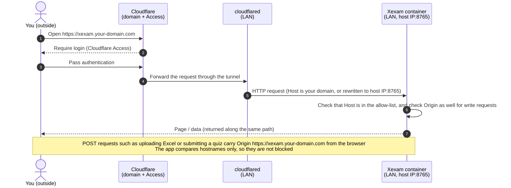

### The three things to do

**1. Make sure cloudflared on the LAN can reach the container.** By default the container binds only to the local machine (`127.0.0.1`). Create a `.env` file next to `docker-compose.yml`:

```ini
# Let other machines on the LAN (cloudflared) reach port 8765 on this machine
XEXAM_BIND=0.0.0.0:8765
# Allow access through your domain (you can list several, comma-separated)
XEXAM_ALLOWED_HOSTS=xexam.your-domain.com
```

Then run `docker compose up -d`.

> If cloudflared and Xexam are on the **same machine**, you can leave `XEXAM_BIND` alone (keep the default local-only binding) and simply set the tunnel's target to `http://localhost:8765`.

**2. In Cloudflare, point the domain at Xexam.** Zero Trust dashboard → Networks → Tunnels → your tunnel → Public Hostname:

| Field | What to enter |
|---|---|
| Subdomain / Domain | `xexam` / `your-domain.com` |
| Service Type | `HTTP` (not HTTPS) |
| URL | `LAN-IP-of-the-Xexam-host:8765`, for example `192.168.1.20:8765` |

**3. Add an application policy in Cloudflare Access** that allows only your own account (email) to reach this domain.

### Common situations

| Your situation | How to configure it |
|---|---|
| The tunnel **passes Host through as your domain** | Just set `XEXAM_ALLOWED_HOSTS=xexam.your-domain.com`; step 1 above is enough |
| You set an **HTTP Host Header** (`httpHostHeader`) in Cloudflare that rewrites Host to `192.168.1.20:8765` | `XEXAM_ALLOWED_HOSTS=192.168.1.20` plus `XEXAM_ALLOWED_ORIGINS=https://xexam.your-domain.com`. The `Origin` the browser sends is still the public domain, so it must be allowed separately |
| You are not sure what Host actually is | Configure step 1 above first, then open the page. If it is rejected (403), the message on the page states the `Host` (or `Origin`) it saw: add that value to `XEXAM_ALLOWED_HOSTS` (or `XEXAM_ALLOWED_ORIGINS`) and recreate the container with `docker compose up -d` |
| You do not want to list domains, and Access authentication is already in front | `XEXAM_ALLOW_ANY_HOST=1` (`Host` is no longer checked; the `Origin` check on write requests still applies) |

I simulated both cases locally with **a real Chrome and an HTTPS reverse proxy** (the browser uploads Excel → preview → confirm import → submit the quiz, all passing). I have **not** tested with real Cloudflare.

### Things not to forget

- ⚠️ **The app itself has no login.** Once you set `XEXAM_BIND` to `0.0.0.0`, or set `XEXAM_ALLOW_ANY_HOST=1`, **anyone who can reach this port can see and modify the question bank**. So:
  - Let only cloudflared reach this port: **do not** set up port forwarding on the router. On Linux, the host firewall (ufw, firewalld) **cannot stop** ports published by Docker; to restrict sources, add rules in the `DOCKER-USER` chain, or set `XEXAM_BIND` to a specific LAN IP (such as `192.168.1.20:8765`). The safest setup is to run cloudflared and Xexam on the same machine and keep the default `127.0.0.1`.
  - Make sure the Cloudflare Access policy is in place and allows **only you**. A domain without a policy is open to the whole world.
- When you access the app through Cloudflare, your login expires after a while. After it expires, uploading or submitting a quiz shows `可能是登录已过期，请刷新页面重新登录` ("The login may have expired, please refresh the page and log in again"); just refresh and log in again. **A quiz in progress is stored in the browser and is not lost**.
- When a request is rejected (403), the message on the page or in `docker compose logs` states what `Host` / `Origin` it saw and which value should be added to which option.

---

## Security notes

For the detailed threat model and every line of defense, see [docs/security.md](docs/security.md). Key points:

- **Only Nginx is exposed.** The backend publishes no port, and its network is `internal: true` (so it cannot reach the internet either).
- By default only requests addressed to the local machine are accepted (the `Host` is checked); when running behind an authenticating reverse proxy such as Cloudflare, put your domain in `XEXAM_ALLOWED_HOSTS`. Write requests also have their `Origin` checked: it must be the same host as `Host` (or be listed in `XEXAM_ALLOWED_ORIGINS`), which prevents a malicious web page from operating the app through your browser. The backend reads only the real `Host` header, never `X-Forwarded-*`.
- **The app does no login itself.** For internet access you must put authentication in front of it (Cloudflare Access); never expose the port directly to the public internet.
- Uploaded files are checked by **content**: empty files, non-`.xlsx` files, corrupt archives, duplicate archive entries, and files containing an XML entity declaration (DOCTYPE) are rejected, with a maximum of 20 MB; parsing has an overall time limit and a memory cap.
- After an upload, the preview is kept in memory for 30 minutes, and confirming requires a one-time verification code (128-bit random) that is invalidated once used.
- Database writes happen in a single transaction: if anything fails midway, the whole thing is rolled back and no half-written data is left.
- Both containers run as non-root, with `cap_drop: ALL`, `no-new-privileges`, and a read-only root filesystem.
- The images contain no secrets, no database, and no real question bank.

---

## Automated build and release

[`.github/workflows/ci.yml`](.github/workflows/ci.yml) is the **only** pipeline. Every time you push code to GitHub, it automatically does the following:

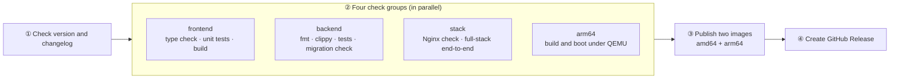

- **Trigger:** a push to `main` (publishes), a push to `dev`, a pull request into `main`, or a manual run from the Actions page. Only `main` publishes; `dev`, pull requests and any other branch are only checked and tested, and **never publish**.
- **Every update must:** change `VERSION` and add an entry for the same version at the very top of the Changelog section of this file, otherwise step ① fails.
- **Publish only if everything passes:** the two images (`xexam-frontend`, `xexam-backend`) are each published as a multi-architecture image, and the pipeline then checks that the image manifest really contains `amd64` and `arm64` and that the tag points to the digest that was just pushed. If a test fails, `latest` stays on the previous working version.
- **Published tags:** `latest`, `v<VERSION>`, `sha-<commit>`.
- **How the backend image gets arm64:** it is cross-compiled with zig on the build machine instead of compiling Rust under QEMU (which is an order of magnitude slower); only the final, very small alpine stage uses the target architecture.
- **Releases page:** once both images are published and verified, the pipeline automatically creates (or updates) a Release named `v<VERSION>`. Its description is taken from this version's section of the Changelog in this file ([`scripts/release-notes.py`](scripts/release-notes.py)), and a git tag with the same name is created automatically. If the images were not published successfully, there is no Release.
- **Releases and images live in two different places:** the images are under the repository's **Packages** (ghcr.io), the Release is on the **Releases** page; both are produced by the same build.

The images are published from a private repository and are private by default. The first time a new image name is published, add this repository under **Manage Actions access** in the GitHub package settings with the role **Admin**, otherwise the push is rejected (`permission_denied: write_package`). To allow pulling without logging in, change the package to public in its settings.

---

## Development

For the everyday commands for changing code and running tests, see [docs/development.md](docs/development.md). The most common ones:

```bash
# Backend (Rust 1.99.1; rustup installs it automatically from backend/rust-toolchain.toml)
cd backend && cargo fmt --check && cargo clippy --all-targets -- -D warnings && cargo test --all-targets

# Frontend (Node 24)
cd frontend && npm ci && npm run typecheck && npm test && npm run build

# During development: backend at 127.0.0.1:8765, frontend at http://127.0.0.1:5173 (/api is proxied to the backend)
cd backend && cargo run -- serve --data ../data --no-browser
cd frontend && npm run dev

# Full-stack check (uses Docker, a temporary project name and a temporary volume, does not touch xexam_data)
python -I tests/integration/stack_check.py
```

The backend tests run against the committed **legacy snapshot** in `tests/baseline/`: 172 golden responses, 49 parser fixtures and their outputs, and 85 question-id vectors. All of these fixtures are fictional; a real question bank is never committed.

---

## Directory structure

```
README.md                  This file (architecture, deployment, usage, changelog)
VERSION                    Version number (kept in sync with the top changelog entry)
docker-compose.yml         Pulls and runs the two images (this is the only file you need)
docker-compose.build.yml   Builds the two images from source and runs them
.env.example               Local configuration template (copy to .env; .env is not committed)
backend/                   Rust backend (Axum + rusqlite)
  src/api/                   Routes, guards (Host / Origin / Content-Type / size), JSON format, score sanitizing
  src/services/              Pending-import slot, parser engine interface
  src/parser/                .xlsx parsing: ZIP protection, XML, question detection, question id
  src/database/              SQLite storage, schema, legacy progress.json migration, timestamps
  src/security/ src/config/  Host / Origin checks, size-limited request body reading; environment variables
  tests/                     Unit, golden-response, parser comparison, id-vector, concurrency
  Dockerfile                 Cross-compiles on the build machine (zig); the runtime image is a single statically linked executable
frontend/                  TypeScript + Vite frontend (plain DOM)
  src/api/ types/ domain/ state/ pages/ components/ utils/ styles/
nginx/                     nginx.conf + Dockerfile (builds the frontend -> ships only the static output)
tests/baseline/            Behavior snapshot of the legacy Python version (golden responses, parser fixtures, id vectors, sample database)
tests/integration/         Nginx behavior checks, full-stack end-to-end checks, progress.json migration checks
docs/                      Architecture, API, database, security, deployment, migration, development (each in English, Japanese and Chinese: X.md, X.ja.md, X.zh-CN.md), OpenAPI, plus the pre-migration audit (Chinese only)
scripts/release-notes.py   Generates the GitHub Release notes from the changelog (used by CI, can also be run locally)
.github/workflows/ci.yml   The only pipeline: check -> test -> publish -> Release
```

---

## Changelog

Every update must add an entry here, and the **version number must match the `VERSION` file in the repository root** (the automated build checks this and refuses to build on a mismatch). The latest image carries both the `latest` tag and the matching `vX.Y` tag.

### v0.4 — 2026-11-10

- **Three-language side-by-side: English / Chinese / Japanese.** Excel gains a new format: column A is English, column B is Chinese, column C is Japanese (the question itself), and column D holds the answer, explanation and mnemonic. Columns A, B and C are the same question in three languages and correspond one to one; the answer is written only once. The language buttons on the quiz page become `英语 / 中文 / 日语` ("English / Chinese / Japanese"), and the wrong-answer review on the result page is also shown in the language you choose.
- **Hotspot options follow the language too**: write the options at the end of each sub-item in that language (Japanese `はい / いいえ`, Chinese `是 / 否` ("yes / no"), English `Yes / No`; the same applies to three-way choices such as the execution layer), and the option buttons switch together with the language. If a column has no options written, that language is still available and the option buttons show the Japanese ones.
- **Hotspot answers are accepted when written with option words from any language** (`モデルステージ`, `模型阶段`, `Model Stage`, and they can be mixed). The options of the three languages correspond one to one by position; a column whose option count does not match does not take part, and nothing is guessed.
- **The old three-column format (A Japanese, B Chinese, C answer) needs no changes and can still be uploaded**, just without English. The program detects the format from the content automatically; in the four-column format the question id still comes from the Japanese text in column C, so the same question has the same id in both formats and learning records are not affected.
- The footer text on the home page now reads: Xexam only provides import, organization and practice of questions and answers; the software itself does not provide or include exam questions, answers or related materials; users must ensure that the sources of the materials they import and use are lawful and that they hold the corresponding usage rights.
- **The README is split into three languages**: `README.md` (English, the default), `README.ja.md` and `README.zh-CN.md`, linked to each other from a language bar at the top; each keeps its own changelog, and the GitHub Release notes come from the English one.
- **The documents in `docs/` come in three languages too**: the seven current ones (architecture, API, database, security, deployment, migration, development) are `X.md` (English), `X.ja.md` (Japanese) and `X.zh-CN.md` (Chinese), with a language bar on top; `openapi.yaml` is in English. The Phase 0 audit and planning documents are historical and stay Chinese-only. CI checks that all three versions exist and that every relative link resolves.
- **New screenshots** taken with the v0.4 interface and a fictional four-column demo bank: the question in English, Chinese and Japanese, with the hotspot option buttons following the language. (The interface itself, buttons and labels, is still in Chinese only.)
- **Language convention**: code comments and the output of programs, tools and CI are in English; the UI and the READMEs use their own language. No code was changed by this (checked mechanically against the previous commit).
- Tests: backend 136 → 151 (four-column format, options and answers in three languages, fallback when they do not match), frontend 19 → 27 (language rules).

### v0.3 — 2026-11-10

**The whole program was rewritten in Rust + TypeScript + Nginx. The database file and schema are unchanged, the API is backward compatible, and the old Python implementation has been removed from the repository.**

- **Backend rewritten in Rust** (Axum 0.8 + Tokio + rusqlite, toolchain pinned to 1.99.1): REST API, XLSX parsing, import (preview without writing to the database → one-time confirmation token → one-transaction write), score and wrong-answer statistics, Host/Origin guard, and the `xexam-backend import / healthcheck / migrate-progress` subcommands. Behavior matches the Python version one to one: all 172 legacy responses were compared item by item with no unexplained differences; the parse output of 49 synthetic workbooks and all 85 question id vectors are identical, so question ids are byte-for-byte the same as in the old version and learning records do not become detached.
- **Frontend rewritten in TypeScript** (strict) + **Vite**, plain DOM, no framework; there are no inline styles, so the CSP can be very strict. The build target is `safari15`, so iPhone needs iOS 15.4 or later.
- **Two images, two containers**: `xexam-frontend` (Nginx + static frontend files, the only one exposed) and `xexam-backend` (Rust, on the `internal` private network with no published port). Non-root, `cap_drop: ALL`, read-only root filesystem; Host passed through unchanged, `X-Forwarded-*` cleared; 20 MB limit, security headers, rate limiting, timeouts; a JSON 502 is returned when the backend is unreachable. Both images ship for `amd64` and `arm64`.
- **Stricter upload checks (intentional differences)**: DOCTYPE and entity declarations are rejected in any encoding / extension; duplicate ZIP entry names are rejected; there are limits on the number of ZIP entries, XML depth / node count / attributes per element, and total cell bytes; parsing has a cooperative timeout (the parser stops by itself when time is up) and at most 2 parses run at the same time; error messages no longer echo the library's exception text; unsupported HTTP methods return 405 (previously 501). See [docs/api.md](docs/api.md) for the full table of differences.
- **One pipeline** (`.github/workflows/ci.yml`): check version and changelog → four check groups (frontend / backend / Nginx and full stack / arm64) → only if all pass, publish the two images and create the Release.
- **Tests**: 136 backend tests (against the committed legacy snapshot: 172 golden responses, 49 parse fixtures, 85 id vectors), 19 frontend tests; in `tests/integration/`, 38 Nginx checks, 34 full-stack checks and 10 `progress.json` migration checks.
- **Documentation**: architecture, API (including OpenAPI), database, security, deployment, migration and development under `docs/`, plus the pre-migration audit, risks and plan.
- Grading is still done in the browser (the server only receives `{id, correct}`, i.e. the question id and whether it was answered correctly); the reasoning is in [docs/migration-plan.md](docs/migration-plan.md).
- ⚠️ **Upgrade note**: the old and new containers have the same names and ports and **cannot run at the same time**, so run `docker compose stop` before upgrading; the data volume `xexam_data` is the same one, so no data migration is needed. The old single image `ghcr.io/yumin-space/xexam` is no longer updated (the last version was `v0.2.2`), and `docker-compose.yml` now pulls both `xexam-frontend` and `xexam-backend` at once. For rollback steps see [docs/migration.md](docs/migration.md).
- **What has not been verified (stated honestly)**: a real Cloudflare Tunnel, a real iPhone, running on real ARM hardware (it was only built and started under QEMU), and a dry run with a copy of your own real database.

### v0.2.2 — 2026-11-10

- Added `tests/baseline/`: the behavior baseline of the old Python version (172 real responses, 50 XLSX fixtures with their parse output, 85 question id vectors, a sample database, security probes, and Host/Origin check and tunnel simulation scripts), against which the later Rust rewrite is compared item by item. The tools no longer hardcode any local path; use `XEXAM_LEGACY_ROOT` to point at the code under test.
- Corrected the statement about the v0.2 Release in the previous changelog.

### v0.2.1 — 2026-11-10

- **A Release is now created automatically on GitHub's Releases page after every successful build** (previously only images were pushed and the Releases page stayed empty): the pipeline gains a 4th job, `release`, which runs after the images have been published and verified; its notes are taken from this version's section of this changelog, and it automatically creates the git tag `v<version>`.
- The v0.2 Release was created manually once (it corresponds to the v0.2 commit `1ee64c8` and is not marked Latest); from v0.2.1 on, the pipeline creates it automatically.
- Added `scripts/release-notes.py`: extracts the changelog of a given version from the README; it can also run locally to preview what the Release page will show.

### v0.2 — 2026-11-10

- **Can be reached from the internet through your own domain** (Cloudflare Tunnel + Cloudflare Access):
  - Allowed domains go into `XEXAM_ALLOWED_HOSTS`; the `Origin` of write requests is now compared by hostname only, so uploads and submitting a quiz are no longer blocked with 403 when accessed through an **HTTPS** domain.
  - When a proxy rewrites `Host`, `XEXAM_ALLOWED_ORIGINS` can be used to allow the public domain separately; when authentication is already in front, `XEXAM_ALLOW_ANY_HOST=1` can be set.
  - When a request is rejected, the message explains which check failed and how to allow it; when the login expires, the page prompts you to refresh and log in again.
- Port binding is now configurable (`XEXAM_BIND`); the default is still localhost only.
- After receiving the stop signal from `docker stop`, the program exits cleanly (previously it waited 10 seconds and was killed), and the database is closed cleanly.
- CI: split into three steps, "check version and changelog → test each of the two architectures → publish" (from v0.2.1 a fourth step is added: create the Release); the smoke test moved into `scripts/smoke-test.sh`, which can also be run directly on a machine with Docker installed; after publishing, the image manifest is verified by digest.
- `/api/info` gains `arch` (the current CPU architecture).
- Fixes after the audit (each one has a corresponding real test):
  - Server: requests rejected early (403/415) have their body read before the reply, so the browser sees the real reason instead of `连不上服务` ("cannot connect to the service"); a rejected request leaves one line in the log (visible with `docker compose logs`); malformed JSON (a number where a list is expected, `Infinity`, over-deep nesting, a non-ASCII confirmation token) returns 400/409 instead of dropping the connection; the `Content-Type` of a POST must really be `application/json`; `XEXAM_ALLOWED_HOSTS` separated by spaces or semicolons is also recognized.
  - Database: if `COMMIT` fails it rolls back instead of leaving the connection stuck in a transaction; a malformed old `progress.json` no longer keeps the program from starting; when the data directory contains only some other `.db` file, the startup log gives a warning (that file is not modified).
  - Pages: when submitting a quiz, the saved progress is cleared only after the score has been submitted successfully; on failure it is kept and a prompt `刷新页面重新登录后再交卷` ("Refresh the page, log in again, then submit") is shown; before starting a new exam, if there is an unsubmitted exam, it asks for confirmation first; the percentage on the result page uses the same rounding as the learning record and no longer differs by 1; the notification bar is no longer covered by the bottom paging bar; long English strings no longer cause a horizontal scrollbar; old Safari without `<dialog>` uses the system confirmation box; holding down a letter key no longer toggles the answer repeatedly.
  - Images and CI: the health check bypasses the proxy and follows `XEXAM_PORT`; `.dockerignore` now applies at any directory level; `.gitignore` gains backup archives and `.env.*`; publishing happens only from `main`, and queued runs on `main` are not cancelled; the in-container paths in the smoke test also work in Git Bash on Windows.
  - This version was really built locally with Docker (amd64) and passed the same smoke test that CI uses: non-root, Host/Origin blocking, data still there after deleting the container, `docker stop` in 1 second. arm64 and publishing still depend on the GitHub Actions results.
- Names unified to **xexam**: environment variables `XEXAM_DATA` / `XEXAM_HOST` / `XEXAM_PORT` / `XEXAM_ALLOWED_HOSTS` / `XEXAM_ALLOWED_ORIGINS` / `XEXAM_ALLOW_ANY_HOST`, database file `xexam.db`, key names saved in the browser `xexam.*`; the docs also no longer hardcode your own Excel file name.
- ⚠️ **When upgrading from v0.1:** the database file name changed, and the new version only reads `xexam.db`. If you already imported a question bank with an earlier version, stop the program first and rename that `.db` file in the data directory to `xexam.db` before starting, otherwise you will see an empty question bank (the old file is not deleted, it is just not read). The key names used for the saved exam and the language choice in the browser also changed, so submit your quiz before upgrading; the language will revert to Japanese. If you set the old environment variable names in a compose file you modified yourself, change them to the `XEXAM_*` names above, otherwise they will be ignored.
- `docker-compose.yml` no longer has `pull_policy: always`: `docker compose up -d` no longer checks online every time; to update, use `docker compose pull && docker compose up -d`.
- `.env` (local configuration) was added to `.gitignore` and `.dockerignore`, so it is not committed and does not end up in the image.

### v0.1 — 2026-11-10

First version.

- Quiz in the browser: single choice, multiple choice and hotspot questions; **scored only after submitting**, and wrong answers show the answer, explanation and mnemonic.
- Japanese / Chinese side-by-side switching; answer sheet; flagging; save and exit, then resume.
- Wrong-answer notebook: a wrongly answered question is removed after 2 consecutive correct answers; score history.
- The question bank and learning records are now stored in **SQLite** (Docker named volume `xexam_data`) and no longer depend on Excel.
- The admin page **uploads Excel to update the question bank**: preview first (added / updated / restored / retired / unreadable), and nothing is written until you confirm; retired questions keep their answer records and are restored automatically when they are uploaded again.
- The old version's `progress.json` is migrated automatically on first start.
- **iPhone** support: touch targets of at least 44 px, safe areas, a fixed bottom paging bar, and it can be added to the home screen.
- The Docker images support both **x86 (amd64) and ARM (arm64)**, built and tested by GitHub Actions.
- ⚠️ The "publish" step of v0.1 did not succeed, so there is **no** `v0.1` tag on `ghcr.io/yumin-space/xexam`; images are published from v0.2 on (`latest` / `v0.2`).
- The app was renamed to **Xexam**.

<!-- Write new versions above this line, format: ### vX.Y — date -->
