**English** | [日本語](README.ja.md) | [简体中文](README.zh-CN.md)

<p align="left">
    <a href="../../releases/latest">
        
    </a>
</p>
<p align="center">
    <a href="https://hub.docker.com/u/yuminspace">
        
    </a>
</p>

<p align="center">
    <a href="https://hub.docker.com/r/yuminspace/xexam-frontend"></a>
    <a href="https://hub.docker.com/r/yuminspace/xexam-frontend"></a>
    <a href="https://hub.docker.com/r/yuminspace/xexam-frontend"></a>
</p>
<p align="center">
    <a href="https://hub.docker.com/r/yuminspace/xexam-backend"></a>
    <a href="https://hub.docker.com/r/yuminspace/xexam-backend"></a>
    <a href="https://hub.docker.com/r/yuminspace/xexam-backend"></a>
</p>

# Xexam

Xexam is a self-hosted exam-practice app that runs in the browser. You import your own Excel question banks, take practice exams with them, and review the questions you got wrong. **Nothing is scored until you submit**; then you see your score and each wrong question (or all of them) with your answer, the correct answer, the explanation and the memory aid. It works on computers and on phones (iPhone).

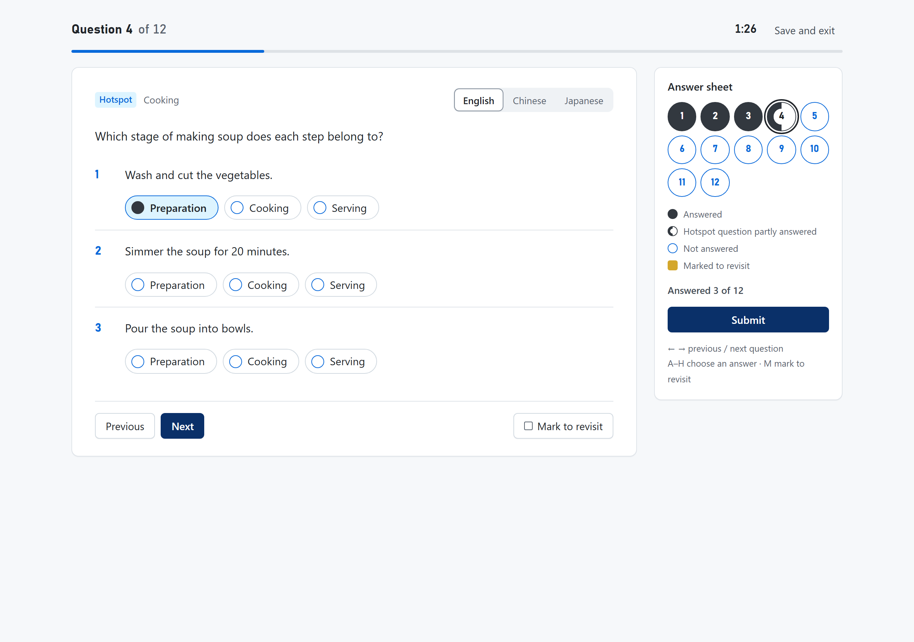

The repository contains **no questions**. Xexam only provides the tools to import, organize and practise questions; your question banks are your own Excel files and are never committed (`.gitignore` excludes them). The screenshots use two **made-up demo banks**, "General knowledge" and "Kitchen basics", not content from any real exam. They show the English interface; screenshots of the Japanese and the Chinese interface are in `docs/ja/screenshots/` and `docs/zh-CN/screenshots/`.

| | |
|---|---|
| Current version | **v0.5.1** (see the [changelog](#changelog) or the repository's [Releases](../../releases) page; in the app: menu → **Xexam v0.5.1**) |
| Images | On Docker Hub (public, no login needed): `docker.io/yuminspace/xexam-frontend` and `docker.io/yuminspace/xexam-backend`, with tags `latest` / `v0.5.1` / `sha-<commit>` (the `sha-` tags are for troubleshooting). Mirror: `ghcr.io/yumin-space/xexam-frontend` and `ghcr.io/yumin-space/xexam-backend` (private, same tags) |
| CPU architecture | `linux/amd64`, `linux/arm64` (the right one is picked automatically under the same tag) |
| Port | `8765` (bound to the local machine only by default) |
| License | [MIT](LICENSE) |

Documentation: [Architecture](docs/en/architecture.md) · [API](docs/en/api.md) ([OpenAPI](docs/en/openapi.yaml)) · [Database](docs/en/database.md) · [Security](docs/en/security.md) · [Deployment](docs/en/deployment.md) · [Migration and rollback](docs/en/migration.md) · [Development](docs/en/development.md)

---

## Contents

- [What it does](#what-it-does)
- [Quick start (installation and deployment)](#quick-start-installation-and-deployment)
- [Configuration](#configuration)
- [Opening Xexam from your phone or another computer](#opening-xexam-from-your-phone-or-another-computer)
- [Using Xexam](#using-xexam)
- [Excel question bank format](#excel-question-bank-format)
- [Importing question banks](#importing-question-banks)
- [Upgrading from v0.4](#upgrading-from-v04)
- [Data, backup and restore](#data-backup-and-restore)
- [Access from the internet via Cloudflare Tunnel](#access-from-the-internet-via-cloudflare-tunnel)
- [Architecture](#architecture)
- [Security notes](#security-notes)
- [Automated build and release](#automated-build-and-release)
- [Development](#development)
- [Directory structure](#directory-structure)
- [License](#license)
- [Changelog](#changelog)

---

## What it does

- **Your own question banks.** Every Excel workbook (`.xlsx`) you import becomes its own question bank, and each worksheet in it is a group of questions you can pick for an exam. Import a workbook as a new bank, or update an existing bank with a newer version of its file. A preview shows what will change before anything is saved.
- **Practice exams.** Pick banks and sheets, all questions or only the wrong-answer notebook, the number of questions (fewer than you selected = picked at random) and whether to shuffle the order. Single-choice, multiple-choice and hotspot questions (a list of statements, each answered with one choice such as Yes / No). While you answer there is no right/wrong feedback; you can jump between questions, mark questions to revisit, and save and exit to continue later.
- **Three languages.** The whole interface (menus, buttons and messages, the exam page and the server's error messages included) is available in English, Chinese and Japanese; you choose it in **Settings**. If your workbook has English, Chinese and Japanese columns, the exam page also switches the question text between them at any time. Your answers stay as they are.
- **Results and study records.** After you submit: the score, then each question with your answer, the correct answer, the explanation and the memory aid. Every exam is kept in **Study records** (the latest 500), with filters, the detail of each exam, and buttons to retry the wrong answers or retake the exam.
- **Wrong-answer notebook.** Questions you answer wrong are collected automatically and leave the notebook after 2 correct answers in a row. You can review them or practise only them.
- **Settings stored on the server.** Theme, interface language and auto-advance are saved in the data directory, so they are the same in every browser and on every device, and they survive restarts and image updates.
- **Desktop and phone.** A slim header with a menu button, pages centered on wide screens, and touch targets of at least 44 px on phones.

---

## Quick start (installation and deployment)

### What you need

- A machine with **Docker** (including Compose v2) installed: Windows / macOS / Linux all work, **x86 or ARM**.
- A web browser.

### Option A: pull the prebuilt images (recommended)

You only need **one file** from the repository, [`docker-compose.yml`](docker-compose.yml); no other code is required.

**If you are not the owner:** the two images are public on Docker Hub, so pulling them needs no account and no `docker login`. Only the repository is private: to download `docker-compose.yml` from it with `curl` (or to `git clone` it), ask the owner to add your GitHub account as a collaborator on the repository, then create one token under GitHub → **Settings** → **Developer settings** → **Personal access tokens** → **Tokens (classic)** with the scope `repo`. Use it as `YOUR_TOKEN` for `curl` and as the password for `git clone`. Or simply ask the owner to send you the file.

**1. Download `docker-compose.yml`** into a new folder (for example `xexam`). The easiest way: open the file on GitHub and click **Download raw file**. Or on the command line:

```bash
curl -fLO https://raw.githubusercontent.com/Yumin-Space/xexam/main/docker-compose.yml
```

With `curl`, add `-H "Authorization: token YOUR_TOKEN"` after `-fLO`. In Windows PowerShell, type `curl.exe` instead of `curl` (there, `curl` is a different command).

**2. No login needed.** `docker-compose.yml` pulls both images from Docker Hub (`docker.io/yuminspace/xexam-backend` and `docker.io/yuminspace/xexam-frontend`), where they are public, so go straight to step 3. Only if you have access to the private mirror on GitHub's container registry and want to use it instead (the owner and collaborators): log in once, then change the two `image:` lines in `docker-compose.yml` to `ghcr.io/yumin-space/xexam-backend:latest` and `ghcr.io/yumin-space/xexam-frontend:latest`.

```bash
docker login ghcr.io -u YOUR_GITHUB_USERNAME
# Only for the GHCR mirror. For the password, enter a GitHub token with the read:packages scope
# (GitHub → Settings → Developer settings → Personal access tokens → Tokens (classic))
```

For the mirror, without read access or with a fine-grained token instead of a classic one, `docker login` or the next step is refused (`denied` or `unauthorized`). Docker Hub needs none of this.

**3. Start.** In the folder that contains `docker-compose.yml`, run:

```bash
docker compose up -d
```

This pulls the two images from Docker Hub and starts **two containers** (`xexam-frontend`, `xexam-backend`). Then open <http://localhost:8765> in a browser on the same machine.

Docker runs on another machine (a server, a NAS, a virtual machine)? See [Opening Xexam from your phone or another computer](#opening-xexam-from-your-phone-or-another-computer).

The interface starts in English. To switch it to Chinese or Japanese, open the menu (the three-line button at the top right), choose **Settings** and pick the language under **Language**. Then follow [Your first exam](#your-first-exam) to import your Excel file and take an exam.

> Coming from v0.4? Read [Upgrading from v0.4](#upgrading-from-v04) first: the first start of v0.5 migrates the database (after writing a backup copy).

| Action | Command |
|---|---|
| Update to the latest version | `docker compose pull`, then `docker compose up -d`. If your `docker-compose.yml` still names `ghcr.io` (files from before v0.5.1), replace it with the new one first; the data volume stays |
| Pin to a specific version | Change `:latest` to `:v0.5.1` for both images in `docker-compose.yml`, then run `docker compose up -d` |
| Check status | `docker compose ps` (both containers should be `healthy`) |
| Stop / start again | `docker compose stop` / `docker compose start` |
| View logs | `docker compose logs -f` |
| See which version and architecture are running | Open <http://localhost:8765/api/info> in a browser |

> ⚠️ **Do not run `docker compose down -v`**: `-v` also deletes the data volume `xexam_data`, which holds your question banks, study records and settings.

The defaults work on one computer; all options are listed under [Configuration](#configuration).

### Option B: build from source (for when you change the code)

You need the full repository code:

```bash
git clone https://github.com/Yumin-Space/xexam.git
cd xexam
docker compose -f docker-compose.build.yml up -d --build
```

While the repository is private, `git clone` asks you to sign in to GitHub (when the command line asks for a password, enter a GitHub token that can read the repository).

The first build takes a few minutes (it compiles Rust and the frontend). It uses the **same volume** (`xexam_data`) and the same container names as Option A, so the data is shared and the two **cannot run at the same time**; run `docker compose stop` before switching.

---

## Configuration

The defaults work on one computer without any configuration. To change something, create a `.env` file next to `docker-compose.yml` (see [`.env.example`](.env.example) for a template; you do not need to edit the compose file itself). After changing `.env`, run `docker compose up -d` again.

| Name in `.env` | Default | Purpose |
|---|---|---|
| `XEXAM_BIND` | `127.0.0.1:8765` | The address and port to listen on (Nginx); it must be written in the form `IP:port`. By default only this machine can connect; `0.0.0.0:8765` = other machines on the LAN can connect too. ⚠️ Writing only a port number (such as `8766`) = reachable on all network interfaces |
| `XEXAM_ALLOWED_HOSTS` | empty | Which domain names / IPs may be used to access it, separated by commas, spaces or semicolons, for example `xexam.example.com,192.168.1.20` |
| `XEXAM_ALLOWED_ORIGINS` | empty | Needed only when a reverse proxy rewrites the Host to the origin server's address: enter your public domain (including `https://`) |
| `XEXAM_ALLOW_ANY_HOST` | `0` | Set to `1` = stop checking the Host (use it only when authentication is already in front) |
| `XEXAM_PARSE_TIMEOUT_SECS` | `30` | Maximum time to parse one Excel file (seconds) |
| `TZ` | `Asia/Tokyo` | Time zone used for timestamps in the database |

More details: section 3 of [docs/en/deployment.md](docs/en/deployment.md).

---

## Opening Xexam from your phone or another computer

**Xexam has no login**, and by default it binds only to the local machine (`127.0.0.1`): only the machine that runs Docker can open <http://localhost:8765>. There are two ways to open it from another device.

### From another computer through SSH (no configuration)

If Xexam runs on a server, NAS or virtual machine that you can log in to with SSH, run this on your own computer:

```bash
ssh -L 8765:127.0.0.1:8765 user@server
```

While this SSH connection is open, open <http://localhost:8765> in the browser on your own computer. Nothing changes on the server, and no port is opened.

### Directly from a phone or a computer on your network

Do this **only on a network you trust** (such as your home Wi-Fi), not in a café or on an office network:

1. Find the LAN IP address of the machine that runs Docker (usually `192.168.x.x` or `10.x.x.x`):
   - Windows: run `ipconfig` and look at the "IPv4 Address" line;
   - macOS: run `ipconfig getifaddr en0`;
   - Linux: run `hostname -I`; it is usually the first address.
2. Create a `.env` file next to `docker-compose.yml` with two lines: `XEXAM_BIND=0.0.0.0:8765` and `XEXAM_ALLOWED_HOSTS=` followed by that IP address (for example `XEXAM_ALLOWED_HOSTS=192.168.1.20`).
3. Run `docker compose up -d`, then open that IP address with port 8765 (for example `http://192.168.1.20:8765`) in the browser of the phone (Safari on an iPhone) or of the other computer.

To use it away from home (not on your home Wi-Fi), see [Access from the internet via Cloudflare Tunnel](#access-from-the-internet-via-cloudflare-tunnel) below; do not open the port directly to the internet.

---

## Using Xexam

### Your first exam

1. Open the menu (the three-line button at the top right) and choose **Question banks**. Under **Import Excel**, leave **New bank** selected, click **Choose Excel file** and pick your workbook (see [Excel question bank format](#excel-question-bank-format)). Check the preview, then click **Create the question bank**.
2. Click **Start an exam** in the message that confirms the import (or choose **Home** in the menu). In the **Start an exam** panel every sheet is ticked at first: untick the ones you do not want, then click **Start exam** in the bar at the bottom of the panel (**Count** and **Shuffle** in the same bar set how many questions are asked and in which order).
3. Answer the questions, then click **Submit**. The result page shows the score and, for each wrong question, the correct answer and the explanation (**All questions (n)** shows every question).
4. To see the exam again later: open the menu, choose **Study records** and click the time of the exam.

### The layout

- Every page except the exam has a slim header: the Xexam logo at the top left (it takes you to Home) and the three-line menu button at the top right.
- The menu button opens a small menu with **Home**, **Question banks**, **Study records** and **Settings** and, under a divider, **Xexam v0.5.1**, which opens the [About page](#about-xexam). The menu closes after a choice, a click outside it or the Escape key.
- On wide screens the page content is centered and at most 1120 px wide.
- The exam itself is a focused full-screen page without the header.

### Question banks

Here you import Excel workbooks, on a page as compact as Home. Under **Import Excel** you pick **New bank** or **Update a bank** (two small buttons next to the title; their tooltips explain them, and for an update you choose the bank under **Bank to update**), then click **Choose Excel file** or drop the file anywhere on the panel; the hint line above it ends in a link to the **Excel format guide**. **Your question banks** has one compact row per bank (its file, number of questions and sheets and last update, with **Update** and **Delete**; its sheets are folded under the arrow on the right of the row), and the **Import history** shows one line per import. **Excel format and import guide** on the page, folded until you open it, is the short version of [Excel question bank format](#excel-question-bank-format). The steps and rules of an import are in [Importing question banks](#importing-question-banks).

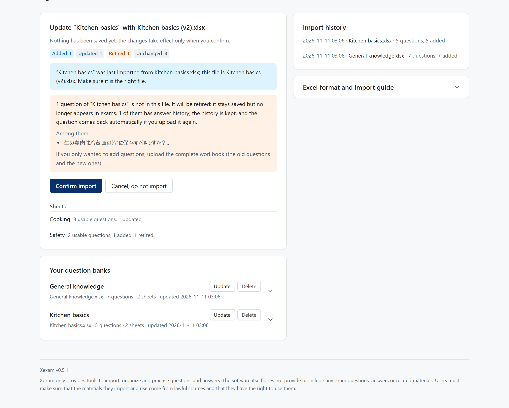

The screenshot shows the preview of an update of "Kitchen basics" with a newer file, `Kitchen basics (v2).xlsx`, before anything is saved: the chips (1 added, 1 updated, 1 retired, 3 unchanged), the note that the file name differs from the last import, the warning about the question that would be retired, and the sheets Cooking and Safety. Below it are the two demo banks under **Your question banks**; on the right, the import history and the folded format guide. The question that would be retired is listed with the text of the question column (column C, Japanese, in this demo bank).

### Home

Before the first import, the **Start an exam** panel shows a short note and **Go to Question banks** instead. After that, Home has:

- **Unfinished exam**: a compact banner at the top for an exam you left with **Save and exit**: its title with **Saved in this browser only**, then its question banks, the number of questions answered and the time used. **Continue** picks it up where you stopped; **Discard** throws it away. Your other devices do not see it.
- **Start an exam**:
  - In the top-right corner of the panel you choose where the questions come from: **All** (every question in the selected sheets) or **Wrong answers** (only the questions you still need to review). Each shows its number of questions. When the notebook has nothing to review in the selected sheets, **Wrong answers** cannot be chosen and one line under the title says why; while **Wrong answers** is chosen, that line says how a question leaves the notebook. On a phone the two buttons stay next to the title; in English and Japanese they show only their icon and number, in Chinese they keep their short words.
  - **Banks and sheets**: each bank is one card with its sheets as rows inside.
    - **Select all** and **Clear** are on the right of the heading row.
    - The bank's checkbox selects or clears all its sheets, and you can also tick single sheets. While only some are selected, the checkbox shows − and the card says, for example, **1 of 2 sheets selected** (also while the bank is folded).
    - The arrow button on the right of a bank's row folds or unfolds its sheets. With at most two banks they start unfolded, with more they start folded; your choice is kept until you reload the page.
    - A badge such as **2 to review** shows how many notebook questions a bank or sheet has.
  - The bar at the bottom of the panel: **Start exam**, the scope (for example **12 questions in scope**, or **11 of 12 in scope, picked at random**) and two options, **Count** (the number of questions) and **Shuffle** (the question order). The bar stays at the bottom of the screen while the panel is in view.
  - **Count**: when it is smaller than the scope, the questions are picked at random from the whole scope. **Shuffle** only decides whether they are asked in random order or in bank order.
- **Latest exam**: the score of your last exam, with **View details** and **All study records**.
- **Overview**: how many question banks, usable sheets, active questions and notebook questions you have, with **Review wrong answers** (when the notebook has questions) and **Question banks**.

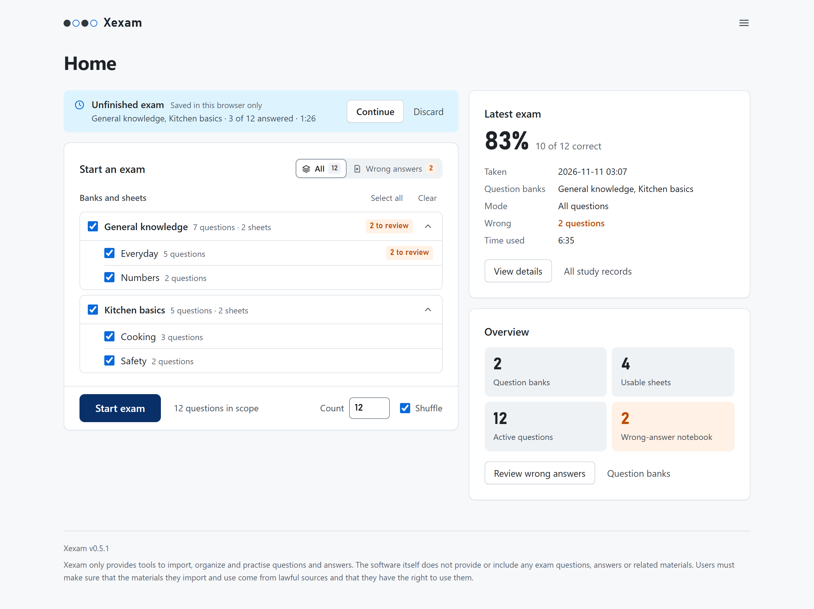

The unfinished exam as a compact banner; **All** and **Wrong answers** in the corner of **Start an exam**; **Select all** and **Clear** on the row of **Banks and sheets**; the two demo banks as unfolded cards with their sheets; the bar with **Start exam**, the scope, **Count** and **Shuffle**; on the right, the latest exam and the overview.

### The exam page

The screenshot at the top of this page shows it.

- At the top: **Question 4 of 12** (for example), the time used, and **Save and exit**, which keeps your answers and the time used so you can continue later from Home in the same browser.
- **No right/wrong feedback and no score while you answer.**
- **English** / **Chinese** / **Japanese** switches the question text (Excel columns A, B and C of the 4-column layout). Switching changes only the text: your answers, the option letters, the timer and the grading stay the same. The option buttons of hotspot questions switch too. A language that a question does not have, or whose text does not line up with the Japanese, is greyed out for that question. Your choice is saved as a setting and is also used for the review after you submit.
- **Previous** and **Next** move between questions (on the last question, **Next** becomes **Submit**). **Mark to revisit** marks a question you want to come back to.
- **Answer sheet**: one tile per question. Solid = answered, half-filled = a hotspot question partly answered, hollow = not answered, small yellow square = marked to revisit. Click a tile to jump there. Below the tiles: **Answered 3 of 12** and **Submit**.
- **Submit** asks for confirmation; unanswered questions count as wrong.
- Grading: a single-choice or multiple-choice question is correct only when you chose exactly the correct options; a hotspot question is correct only when every item is right.
- Keyboard (desktop): `←` `→` previous / next question, `A`–`H` choose an answer (choice questions), `M` mark to revisit.

### The result page

The score, the number right and wrong, and a strip with one box per question. **Answers and explanations** shows **Wrong only (n)** or **All questions (n)**: your choice, the correct answer, the explanation, the memory aid, the Chinese translation (if any) and how often you have answered the question so far. Buttons: **Retry wrong answers only**, **Take it again**, **View in study records** and **Back to home**.

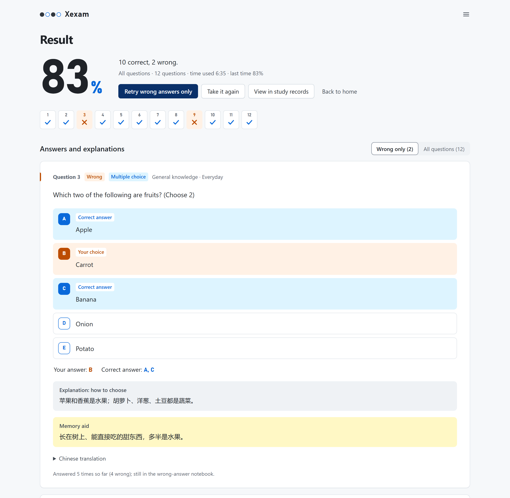

The explanation and the memory aid are shown as they are written in the workbook; in this demo bank they are in Chinese.

### Study records

- **Overview**: the number of exams, **Average accuracy**, **Best accuracy** and small bars for the latest results.
- **Filters**: **Question bank**, **Accuracy** (**Any accuracy**, **Below 60%**, **60–79%**, **80% and above**), and a date range with **From** and **To**. **Clear filters** resets them.
- **Exams**: one row per exam (on a phone: one card) with the time, the question banks, how many questions were answered, the time used, the number correct and the accuracy. Click the time to open the exam; **Delete** removes that record.
- **Exam record** (one exam): the score and the facts of the exam, then every question with your answer, the correct answer, the explanation and the memory aid. **Wrong only (n)** / **All questions (n)** switches between the wrong questions and all of them. **Retry wrong answers** starts an exam with only the questions you got wrong in that exam; **Retake this exam** starts the same questions again; **Delete this record** removes it. Exams taken before v0.5 show only the score, because v0.4 did not store the answers.
- **Review wrong answers** (top right) opens **Wrong-answer review**: every question in the wrong-answer notebook, with how often you answered it and how many more correct answers in a row take it out. You can narrow it to one question bank, and **Practise these** starts an exam with them.
- Deleting: deleting one record keeps the per-question statistics, so the wrong-answer notebook does not change. **Delete all** deletes every exam record; tick **Also clear the wrong-answer notebook and per-question stats** to clear those too. Every delete asks for confirmation and cannot be undone.
- Xexam keeps your latest 500 exams; older records are removed automatically.

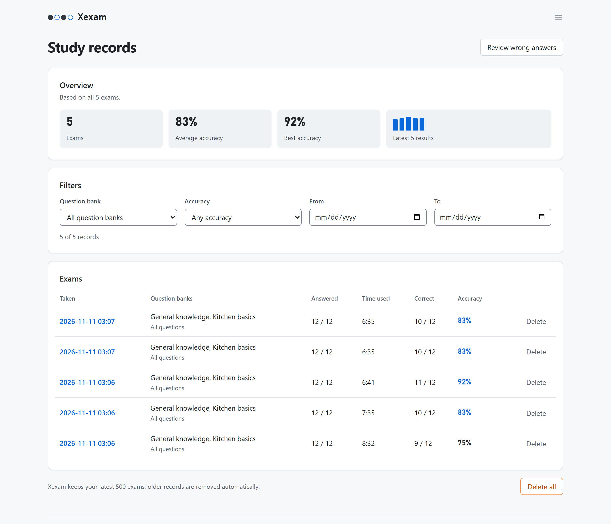

### Wrong-answer notebook

Questions you answer wrong go into the wrong-answer notebook and leave it after you answer them correctly **2 times in a row**. Use it from Home (**Wrong answers** in the top-right corner of **Start an exam**), from **Study records** → **Review wrong answers** → **Practise these**, or right after an exam with **Retry wrong answers only**.

### Settings

- **Appearance** (the theme): **System** (the default; follows the light or dark setting of your device), **Light** or **Dark**.
- **Language** (the interface language): **English** (the default), **中文** or **日本語**. It changes the menus, buttons and messages everywhere, the exam page and the error messages from the server included. The question text has its own switch on the exam page.
- **Answering** → **Auto-advance to the next question** (off by default): after you answer a single-choice question, or every item of a hotspot question, the next question opens by itself. Multiple-choice questions never move on by themselves. While it is on, the exam page shows **Auto-advance on** at the top.
- **Reset to defaults**: theme, interface language and auto-advance go back to their defaults. The question language is kept.

Settings are saved on the Xexam server, in the database in the data directory, together with the question language you last chose on the exam page. So they survive restarts and image updates, clearing the browser cache, and switching to another browser or device. There are no accounts: everyone who uses this Xexam shares one set of settings. Only an unfinished exam stays in the current browser.

<table>
<tr>
<td width="50%">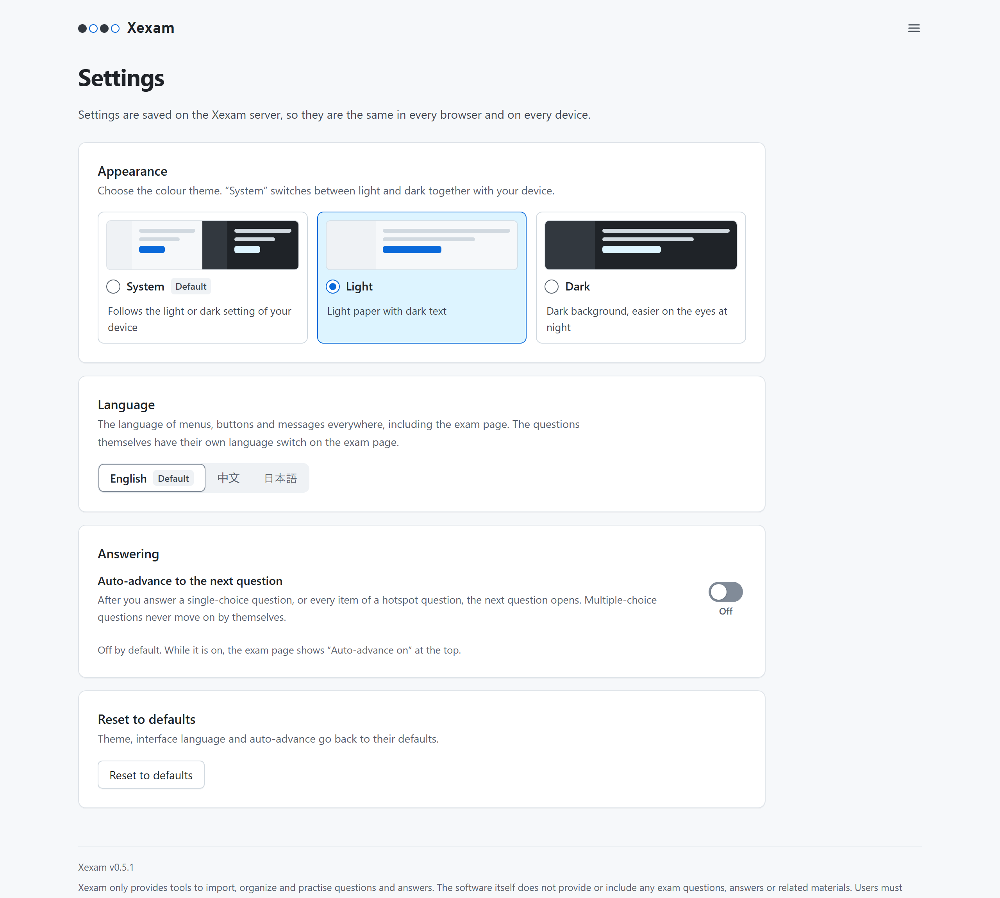</td>
<td width="50%">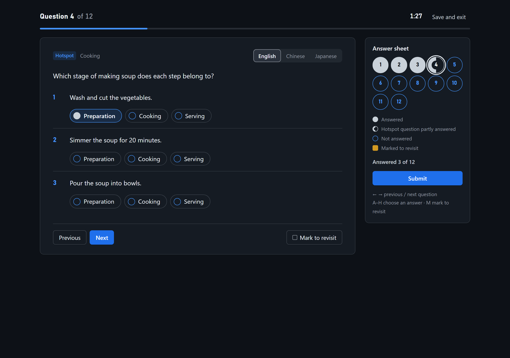</td>
</tr>
<tr>
<td>Settings: <b>Appearance</b>, <b>Language</b>, <b>Answering</b> and <b>Reset to defaults</b>.</td>
<td>The <b>Dark</b> theme, here on the exam page.</td>
</tr>
</table>

### About Xexam

The last menu entry, **Xexam v0.5.1**, opens **About Xexam**: the **Version**, the CPU architecture of the **Server**, the **License**, and **What’s new**, which is the [changelog](#changelog) of this README in the interface language. The newest version is open; the earlier ones are folded under **Earlier versions**.

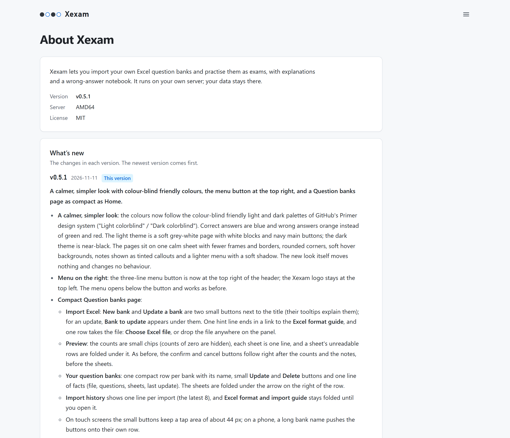

### On an iPhone

- Open the service address in Safari on your iPhone (first follow [Opening Xexam from your phone or another computer](#opening-xexam-from-your-phone-or-another-computer)). It needs **iOS 15.4 or later**.
- Tap the Share button → **Add to Home Screen**. After that it opens full-screen like a standalone app, with an Xexam icon in the style of an answer sheet.
- The three-line button at the top right opens the same small menu as on a computer. On Home, **All** and **Wrong answers** stay next to the **Start an exam** title (in English and Japanese with only their icon and number), and the bar at the bottom of the screen has two rows: the scope, **Count** and **Shuffle** on the first, **Start exam** on the second. On the exam page, **Previous**, **Next** and **Mark to revisit** stay at the bottom, and the answer sheet sits below the question with **Answered x of n** and **Submit** above the tiles. Study records are shown as compact cards.
- Buttons and other touch targets are at least 44 px; the safe areas for the notch and the bottom bar are handled.

Screenshots on an iPhone (390 px wide):

<table>
<tr>
<td width="25%">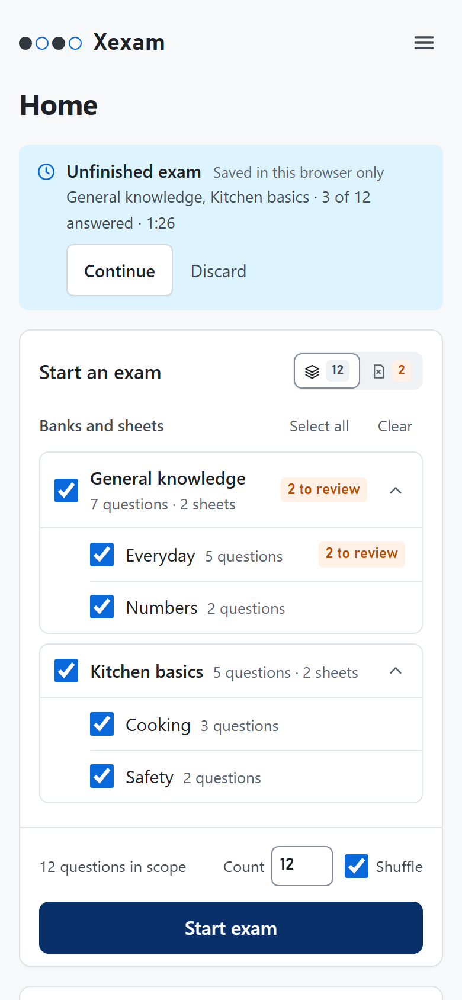</td>
<td width="25%">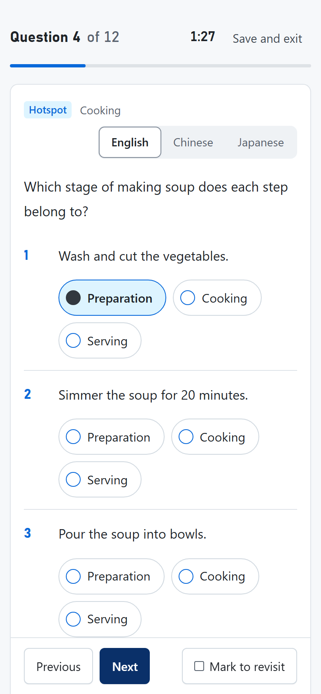</td>
<td width="25%">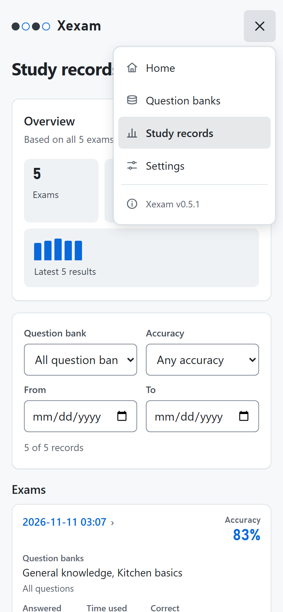</td>
<td width="25%">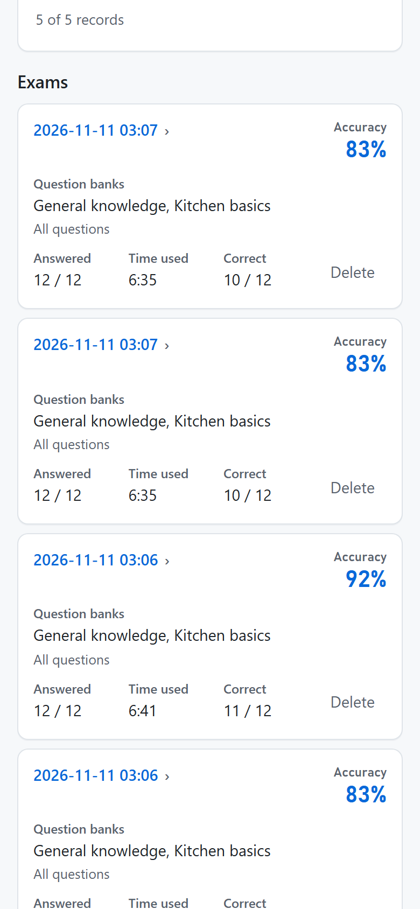</td>
</tr>
<tr>
<td>Home: the scope, <b>Count</b> and <b>Shuffle</b>, with <b>Start exam</b> below them, at the bottom of the screen.</td>
<td>Exam: <b>Previous</b>, <b>Next</b> and <b>Mark to revisit</b> stay at the bottom.</td>
<td>The menu, opened from the three-line button (here on Study records).</td>
<td>Study records: each exam is a compact card.</td>
</tr>
</table>

---

## Excel question bank format

One workbook (`.xlsx`) is one question bank. Each sheet is a group of questions, one question per row.

### 3-column layout (the simplest)

Here is one complete multiple-choice question; it fills one row of a sheet (it is the same example as in **Excel format and import guide** on the **Question banks** page):

| A | B | C |
|---|---|---|
| Which two of the following are fruits?<br>A. Carrot<br>B. Potato<br>C. Apple<br>D. Onion<br>E. Banana | (empty) | 【答案】C、E<br>【解析·怎么选】Apples and bananas are fruits; the others are vegetables.<br>【记忆口诀】Sweet ones are fruit. |

- **Column A**: the question.
- **Column B**: the Chinese translation (optional; leave it empty if there is none).
- **Column C**: first the answer after `【答案】` ("answer"); then, if you like, the explanation after `【解析·怎么选】` ("explanation: how to choose") and a memory aid after `【记忆口诀】` ("memory aid"). These headings are always written with these Chinese words, or in Japanese (`【正解】`, `【解説】`).

To start a new line inside a cell, press Alt+Enter (Windows) or Control+Option+Return (Mac). A first row with a heading such as `Question` or `题目` in column A is skipped.

**If your questions are in only one language** (English, Chinese or Japanese), use this layout: the question in column A, column B empty. You do not need any Japanese. On the exam page these questions always show the text of column A, whichever question language is chosen (their **English** and **Chinese** buttons are greyed out).

**Writing a choice question**

- Write the options under the question text, one per line, in alphabetical order starting with `A.`, at least two: `A. text`.
- One letter in the answer makes a single-choice question, several letters a multiple-choice question: `【答案】C` or `【答案】C、E`.

**Writing a hotspot question** (a list of statements, each answered with one choice)

- The first line of column A is `HOTSPOT` (or `ホットスポット`); the question text follows on the next line.
- Write each item on its own line as `1. text　Yes / No`: after the text comes a **full-width space** (`　`) or a tab, then the item's choices separated by ` / ` (a slash with a space on each side). Any words work as choices, for example `Preparation / Cooking / Serving`.
- The answer gives the choice for every item: `【答案】1 Yes；2 No`. Write one of that item's choice words; for yes / no items, `是`/`否` and `はい`/`いいえ` work too. If an answer is not one of the item's choices, the question is listed in the preview as unreadable, with the reason.

For example, this hotspot question (columns A and C; column B empty; the gap before `Yes / No` is a full-width space):

```
HOTSPOT
For each statement, choose Yes or No.
1. The sun rises in the east.　Yes / No
2. The moon is a star.　Yes / No
```

```
【答案】1 Yes；2 No
【解析·怎么选】The sun rises in the east. The moon only reflects sunlight; it is not a star.
```

### 4-column layout (with English)

This is the 3-column layout moved one column to the right, with English in a new column A. It is meant for workbooks whose questions are written in Japanese in column C; Xexam recognises the layout by the Japanese in column C and the answers in column D.

| Column | Contents |
|---|---|
| **A** | The **English** question (may be left blank). For a hotspot question, the first line is `HOTSPOT` and each item ends with English choices such as `Yes / No` |
| **B** | The **Chinese** translation (may be left blank). The `【中文翻译】` ("Chinese translation") heading is optional |
| **C** | The **Japanese** question. The question, the options and the answer are taken from this column: the question id, the option letters and the hotspot items all come from here. A hotspot question starts with `ホットスポット` |
| **D** | The answer and the explanation, written like column C of the 3-column layout |

Columns A, B and C are **the same question in three languages**, and their structure must **correspond exactly, one to one**: the same question, the same option letters, and the same number and order of items. Item 1 of column A = item 1 of column B = item 1 of column C, and option A = option A = option A. The answer is written only once (column D) and is shared by all three languages.

**The choices of hotspot questions are written in each language's own column**: at the end of each item, write the choices in that column's language; the j-th choice in each of the three languages has the same meaning. For example, for the same item:

| Column | How the item is written |
|---|---|
| A English | `1. Wash and cut the vegetables.　Preparation / Cooking / Serving` |
| B Chinese | `1. 清洗并切好蔬菜。　准备 / 烹饪 / 上菜` ("1. Wash and cut the vegetables. Preparation / Cooking / Serving") |
| C Japanese | `1. 野菜を洗って切る。　下ごしらえ / 調理 / 盛り付け` (same meaning as above) |

The answer for an item can then be written with its choice word in any of the three languages (for example `Cooking`, `調理` or `烹饪`), because the choices correspond one to one by position. When you switch language on the exam page, the question text, the options and the choice buttons of hotspot questions all change to the text of the corresponding column. If a column has no choices written (or their number does not match the Japanese), the question is still available in that language; only the choice buttons show the Japanese choices.

Xexam tells the two layouts apart by their content (in the 4-column layout the answers are in column D and column C is Japanese), so there is no setting to change. Workbooks in the 3-column layout can still be uploaded; they just have no English.

Questions that cannot be read are **never guessed**: they are listed in the preview with the reason (usually the answer column does not contain `【答案】…`, or the answer letter is not among the options), and they are never silently marked wrong.

---

## Importing question banks

### New bank or update

A question bank is one imported Excel workbook. On **Question banks** → **Import Excel** you choose where the file goes with two small buttons next to the title (their tooltips explain them):

| Choice | What happens |
|---|---|
| **New bank** | A new bank is created, named after the file (without `.xlsx`; ` (2)`, ` (3)`, … is added if the name is taken). Existing banks are not changed. The same workbook can be imported twice as two separate banks; their study records do not mix |
| **Update a bank** | The file replaces the questions of the bank you pick under **Bank to update**. Questions missing from the file are retired **in that bank only**. The bank keeps its name |

Use **New bank** for a different workbook, and **Update a bank** for a newer version of a workbook you have already imported. Always upload the **whole** workbook, not only the new questions.

### Preview, then confirm

After the upload Xexam reads and checks the file and shows a preview: small chips with how many questions will be **Added**, **Updated**, **Restored** or **Retired** and how many are **Unchanged** and **Unreadable** (counts of zero are hidden), one line per sheet with its numbers, and for every row that could not be read, the row number and the reason, folded under the line of its sheet (for example **2 unreadable**). **Nothing is written until you confirm** (**Create the question bank** or **Confirm import**; **Cancel, do not import** drops it). The preview also warns you when:

- you create a new bank from a file with the same name as the file an existing bank was imported from (it offers to update that bank instead);
- you update a bank with a file whose name differs from the last import;
- questions would be retired. It lists some of them, and asks once more before the import.

### Import rules

The file is treated as the **complete content of the bank** it goes to. Other banks are never touched.

| Case | Result |
|---|---|
| A question is in the file but not in the bank | **Added** |
| Same question, but other content (other options, answer, explanation, translation) changed | **Updated** (answer history is not affected) |
| A question is in the bank but cannot be found in the file | **Retired**: it stays saved with its answer history, but no longer appears in exams |
| A question that was retired earlier appears again | **Restored**, and its wrong-answer notebook entry comes back with it |
| The sheet name, the question text or the first option changed | Counts as **a new question**: the old one is retired, and the new one starts without answer history |
| The file contains not a single usable question | Import rejected (this prevents wiping the bank) |

A question is recognised by its worksheet name, its question text and its first option (spaces do not matter).

### Deleting a bank

**Delete** on a bank’s row asks for confirmation (for example **Delete “Kitchen basics”?**). The bank's questions (active and retired) and its import history are deleted. The checkbox **Also delete this bank’s study records** is off by default:

- **Unchecked**: the answer history and the exam records stay. In those records, the bank's questions show as deleted.
- **Checked**: the answer history of the bank's questions and the exam records that no other remaining bank is part of are deleted too.

A delete cannot be undone; your own backup is the only way back (see [Data, backup and restore](#data-backup-and-restore)).

---

## Upgrading from v0.4

In the deployment, v0.5 keeps the same two images, the same port, the same volume and adds no environment variables. What changes is the interface, the **database schema** (v1 → v2) and, since v0.5.1, where the images come from: the new `docker-compose.yml` pulls them from Docker Hub (`docker.io/yuminspace/…`, public, no login) instead of `ghcr.io`. Replace your `docker-compose.yml` with the new one, or change its two `image:` lines to `docker.io/yuminspace/xexam-backend:latest` and `docker.io/yuminspace/xexam-frontend:latest`. The project name and the data volume `xexam_data` stay the same, so your data stays where it is.

### Upgrade

These commands work in a Linux / macOS terminal and in Windows PowerShell.

```bash
# 1. Back up the volume (stop first; the backup file holds your whole database, do not commit it)
docker compose stop
docker run --rm -v xexam_data:/data -v "${PWD}:/backup" alpine tar czf /backup/xexam-data-v04.tgz -C /data .

# 2. With the new docker-compose.yml in place (Docker Hub images), pull v0.5 and start (do not use down -v)
docker compose pull
docker compose up -d

# 3. Look for the upgrade message and the name of the copy
docker compose logs backend
```

On its **first start**, before it answers any request, the backend:

1. **Writes a copy** of the current database to `/data/backups/xexam-schema1-<YYYYmmdd-HHMMSS>.db` in the volume (outside Docker: `backups/` in the data directory). An existing file is never overwritten. If the copy cannot be written (disk full, no permission), the backend refuses to start and leaves the database unchanged; `docker compose logs backend` says why.
2. **Migrates** the database in one transaction. Everything you have becomes **one question bank**, named after the file of your latest import (without `.xlsx`; `Question bank` if there was never an import). **Question ids stay the same**, so the wrong-answer notebook, the per-question statistics and the score history stay linked to their questions. Earlier exam records are kept and belong to that bank; they have no per-question detail, because v0.4 did not store the answers.

The log then contains a line like `Upgraded the database to schema 2. A copy of the previous version was saved first: /data/backups/xexam-schema1-20261110-140501.db (…)`. Later starts do not migrate again and write nothing extra.

What else you will notice:

- **The interface starts in English** (v0.4 was in Chinese). Change it in the menu under **Settings** → **Language**; you set it once for every browser and device.
- The theme follows your device (light or dark) until you choose one in **Settings**.
- The question language used to be remembered by each browser. The first time a browser opens v0.5, its choice moves to the server (if the server still has the default, Japanese).
- An unfinished exam saved in the browser is kept and can be continued.

Checks after the upgrade: <http://localhost:8765/api/info> shows `"version": "0.5.1"` and the same `bankCount` as before (despite its name, this field counts the active questions, not the banks); **Question banks** shows one bank with all your sheets; **Study records** lists your earlier exams; **Study records** → **Review wrong answers** has as many questions as your wrong-answer notebook had.

### Rolling back to v0.4

Rolling back means **restoring the copy written before the migration** and running the v0.4 images. Everything done in v0.5 after the migration is lost (new banks, imports, exam records, settings).

```bash
# 1. Stop v0.5 (do not use down -v)
docker compose stop

# 2. Find the copy
docker run --rm -v xexam_data:/data alpine ls -l /data /data/backups

# 3. Put the copy back as xexam.db (use the file name from step 2)
docker run --rm -v xexam_data:/data alpine cp /data/backups/xexam-schema1-20261110-140501.db /data/xexam.db

# 4. v0.4 is only on the private GHCR mirror (Docker Hub starts with v0.5.1): run docker login ghcr.io, set the two
#    images in docker-compose.yml to ghcr.io/yumin-space/xexam-backend:v0.4 and ghcr.io/yumin-space/xexam-frontend:v0.4, then start
docker compose up -d
```

Instead of step 3 you can restore your own `.tgz` from the upgrade (see [Backup and restore](#backup-and-restore)). ⚠️ **Never run v0.4 on a database that has several banks** instead of restoring the copy: v0.4 sees all banks as one, so its next import would retire the questions of every other bank, and it cuts the exam records back to 60. Details: [docs/en/migration.md](docs/en/migration.md) and section 6 of [docs/en/database.md](docs/en/database.md).

### Upgrading from older versions (v0.2.x, single Python image)

The data volume `xexam_data` is the same one. However, the old version was one container and the new version is two, and the container name / port are the same, so:

1. Run `docker compose stop` (for the old version).
2. Back up the data volume (see [Backup and restore](#backup-and-restore)).
3. Run `docker rm xexam` to remove the old version's container (**only the container, not the data volume**). The old container is called `xexam`; the new ones are `xexam-frontend` and `xexam-backend`. If you do not remove it, the old container still occupies port 8765 and the new ones will fail to start.
4. Swap in the new `docker-compose.yml`, then run `docker compose pull` and `docker compose up -d`. The first start migrates the database to schema v2, exactly as described above (with a backup copy in `backups/`).
5. Open <http://localhost:8765> and check that the number of questions, the number of wrong questions and the score history are the same as before the upgrade.

To go back to the old version: the old code is at the Git tag `python-v0.2`, and the old image `ghcr.io/yumin-space/xexam:v0.2.2` can still be pulled from GHCR (private: `docker login ghcr.io` first; it is not on Docker Hub). Restore the schema-1 copy from `backups/` (or your own backup) before you start it. See [docs/en/migration.md](docs/en/migration.md).

---

## Data, backup and restore

Data is stored in a **Docker named volume**, not in a folder you can see on your computer.

- The volume is named `xexam_data` (project name `xexam` + volume name `data`). It holds `xexam.db` and, after an upgrade, the folder `backups/` with the copy written before the schema migration. The program never deletes those copies; remove them yourself once you no longer need them.
- Updating the image, running `docker compose down`, or deleting and recreating the container leaves **the data intact**.
- ⚠️ **Do not run `docker compose down -v`**: `-v` also deletes the volume, and the data is gone.

What is kept where:

| Where | What |
|---|---|
| `xexam.db` in the volume | The question banks and their questions (retired ones included), the import history, the per-question statistics (wrong-answer notebook), the exam records with their per-question detail, and the settings (theme, interface language, auto-advance, question language) |
| `backups/` in the volume | The copy of the database written before the schema-v2 migration |
| Your browser (`localStorage`) | The unfinished exam (question ids, answers, marks, time used; no question text) and a copy of the settings to paint the first screen |

### Backup and restore

Stop the app before you start; the database is safer that way. A volume backup includes `backups/`. These commands work in a Linux / macOS terminal and in Windows PowerShell.

```bash
docker compose stop

# Backup: pack the volume into xexam-data.tgz in the current folder
docker run --rm -v xexam_data:/data -v "${PWD}:/backup" alpine tar czf /backup/xexam-data.tgz -C /data .

docker compose start
```

```bash
# Restore (overwrites files with the same name in the volume)
docker compose stop
docker run --rm -v xexam_data:/data -v "${PWD}:/backup" alpine tar xzf /backup/xexam-data.tgz -C /data
docker compose start
```

Moving to a new computer: put the new `docker-compose.yml` in place on the new machine (no login needed, the images come from Docker Hub), run `docker compose up -d` first to create the volume, then restore the backup as described above. The backup file contains your entire database, so **do not commit it to Git** (`.gitignore` already ignores `*.tgz`). For more details (connection settings, verifying a backup) see [docs/en/database.md](docs/en/database.md).

### Migrating progress records from earlier versions (`progress.json`)

If you have a `progress.json` left over from an earlier version, use a temporary container to put it into the volume, then restart (the commands work in bash and in PowerShell):

```bash
docker compose stop
docker run --rm -v xexam_data:/data -v "${PWD}:/src:ro" alpine sh -c "cp /src/progress.json /data/progress.json && chown 10001:10001 /data/progress.json"
docker compose start
```

On restart, the scores and wrong-answer records in it are migrated into the database automatically, **only once**, and the log says `Migrated the old study records into the database` (visible with `docker compose logs`). This happens only while the database has no study records yet; existing records are never overwritten. If the file format is wrong, the log states the reason, and you can fix the file and restart to try again.

> `docker cp` is not used here: by default it writes as root, so the file would belong to root, while the program in the container runs as a non-root user (uid 10001) and may not be able to read it.

---

## Access from the internet via Cloudflare Tunnel

Use case: Xexam runs on your home LAN, `cloudflared` (Cloudflare's tunnel client) runs on a machine on the same LAN (not necessarily the same one), and you want to reach it from outside with your own domain, protected by authentication in **Cloudflare Access**.


### The three things to do

**1. Make sure cloudflared on the LAN can reach the container.** By default the container binds only to the local machine (`127.0.0.1`). Create a `.env` file next to `docker-compose.yml`:

```ini
# Let other machines on the LAN (cloudflared) reach port 8765 on this machine
XEXAM_BIND=0.0.0.0:8765
# Allow access through your domain (you can list several, comma-separated)
XEXAM_ALLOWED_HOSTS=xexam.your-domain.com
```

Then run `docker compose up -d`.

> If cloudflared and Xexam are on the **same machine**, you can leave `XEXAM_BIND` alone (keep the default local-only binding) and simply set the tunnel's target to `http://localhost:8765`.

**2. In Cloudflare, point the domain at Xexam.** Zero Trust dashboard → Networks → Tunnels → your tunnel → Public Hostname:

| Field | What to enter |
|---|---|
| Subdomain / Domain | `xexam` / `your-domain.com` |
| Service Type | `HTTP` (not HTTPS) |
| URL | `LAN-IP-of-the-Xexam-host:8765`, for example `192.168.1.20:8765` |

**3. Add an application policy in Cloudflare Access** that allows only your own account (email) to reach this domain.

### Common situations

| Your situation | How to configure it |
|---|---|
| The tunnel **passes Host through as your domain** | Just set `XEXAM_ALLOWED_HOSTS=xexam.your-domain.com`; step 1 above is enough |
| You set an **HTTP Host Header** (`httpHostHeader`) in Cloudflare that rewrites Host to `192.168.1.20:8765` | `XEXAM_ALLOWED_HOSTS=192.168.1.20` plus `XEXAM_ALLOWED_ORIGINS=https://xexam.your-domain.com`. The `Origin` the browser sends is still the public domain, so it must be allowed separately |
| You are not sure what Host actually is | Configure step 1 above first, then open the page. If it is rejected (403), the message on the page states the `Host` (or `Origin`) it saw: add that value to `XEXAM_ALLOWED_HOSTS` (or `XEXAM_ALLOWED_ORIGINS`) and recreate the container with `docker compose up -d` |
| You do not want to list domains, and Access authentication is already in front | `XEXAM_ALLOW_ANY_HOST=1` (`Host` is no longer checked; the `Origin` check on write requests still applies) |

How far this has been tested: the complete browser flow for both Host situations (a real Chrome and an HTTPS reverse proxy) was run against the old Python version. For the current stack, `tests/integration/stack_check.py` and `nginx_check.py` check at the header level that Nginx passes Host through unchanged and that the Host / Origin guard still works behind it. It has **not** been tested with real Cloudflare; for the first go-live, follow the "not sure" row above and read the 403 message.

### Things not to forget

- ⚠️ **The app itself has no login.** Once you set `XEXAM_BIND` to `0.0.0.0`, or set `XEXAM_ALLOW_ANY_HOST=1`, **anyone who can reach this port can see and change your question banks, study records and settings**. So:
  - Let only cloudflared reach this port: **do not** set up port forwarding on the router. On Linux, the host firewall (ufw, firewalld) **cannot stop** ports published by Docker; to restrict sources, add rules in the `DOCKER-USER` chain, or set `XEXAM_BIND` to a specific LAN IP (such as `192.168.1.20:8765`). The safest setup is to run cloudflared and Xexam on the same machine and keep the default `127.0.0.1`.
  - Make sure the Cloudflare Access policy is in place and allows **only you**. A domain without a policy is open to the whole world.
- When you access the app through Cloudflare, your login expires after a while. After it expires, an upload or a submit fails with a message saying that your sign-in may have expired: just reload the page and sign in again. **An exam in progress is stored in the browser and is not lost**.
- When a request is rejected (403), the message on the page or in `docker compose logs` states what `Host` / `Origin` it saw and which value should be added to which option.

---

## Architecture

All the diagrams below are written in [Mermaid](https://mermaid.js.org/), which GitHub renders directly as images. See [docs/en/architecture.md](docs/en/architecture.md) for the full description.

### What connects to what

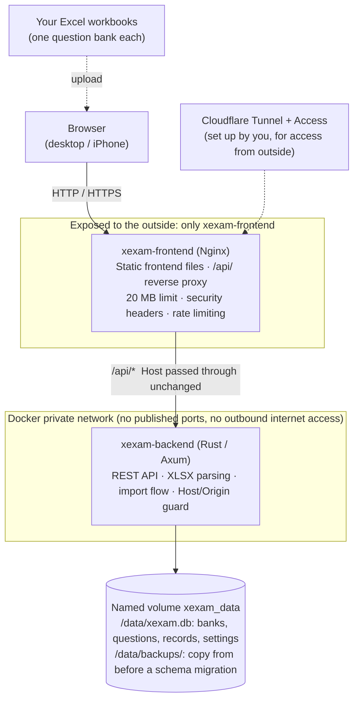

| Container / image | What is inside | Exposed? |
|---|---|---|
| `xexam-frontend` | Nginx + static frontend files (HTML / JS / CSS). Forwards `/api/` to the backend; 20 MB limit, security headers, rate limiting, timeouts | Yes: host `XEXAM_BIND` (default `127.0.0.1:8765`) → container port 8080 |
| `xexam-backend` | A single statically linked Rust executable: REST API, Excel parsing, SQLite reads and writes | **No**: no `ports`, and the network is `internal: true` |

The browser talks to the backend only through the [REST API](docs/en/api.md); the frontend has no database access. **Grading happens in the browser**: for each question the server receives the question id, whether it was correct and (since v0.5) the answer given, which it only stores for the review.

### Data flow A: importing into a question bank (upload → preview → confirm)

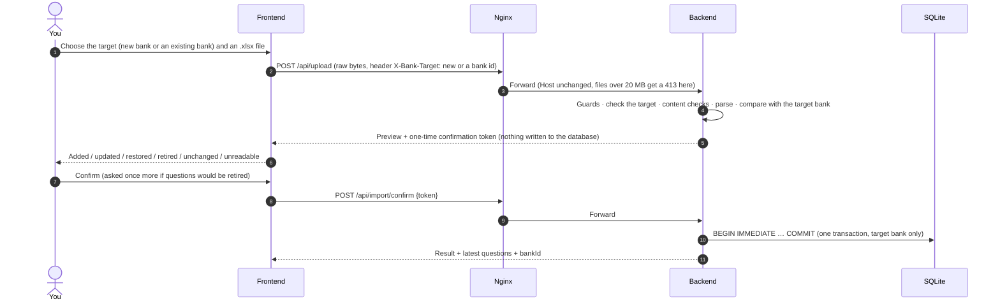

The preview is held only in memory, for 30 minutes, and the confirmation token works once. Leaving the Question banks page with a preview open cancels it (`POST /api/import/cancel`). An upload without `X-Bank-Target` (older clients, the command-line `import`) goes to the bank that holds the data from before v0.5, exactly as in v0.4.

### Data flow B: taking an exam

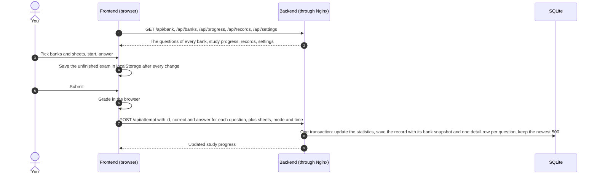

### Database: 8 tables (schema v2)

`questions`, `stats`, `attempts`, `imports` and `meta` come from schema v1, whose statements are unchanged; v0.5 adds `banks`, `attempt_items` and `settings` and three columns (`questions.bank_id`, `attempts.banks`, `imports.bank_id`). See [docs/en/database.md](docs/en/database.md) for every field.

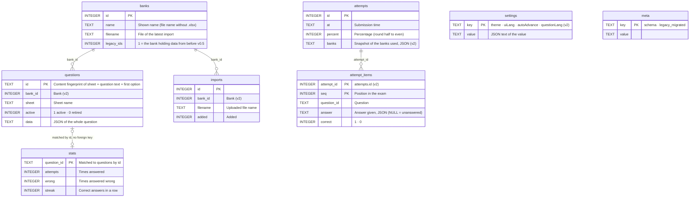

**Question ids.** The questions of the bank that holds the data from before v0.5 keep their old ids. Every other bank stores its questions under ids scoped to the bank, so the same workbook can be imported as two banks without their records mixing.

**Why `stats` is not deleted along with the question:** retiring a question only sets `active` to 0, and the answer history is kept as it is; if the question appears in the Excel file again later, it is restored automatically. Only deleting a bank removes questions.

**How the wrong-answer notebook works:** a question is in the notebook as long as `wrong > 0` and `streak < 2` (fewer than 2 consecutive correct answers); after 2 consecutive correct answers it is moved out automatically.

### How the pages connect

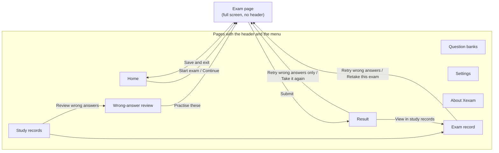

The four main pages (**Home**, **Question banks**, **Study records**, **Settings**) and **About Xexam** can be reached from every page with a header through the menu. Single-choice, multiple-choice and hotspot questions look slightly different, but they all use the same exam page.

---

## Security notes

For the detailed threat model and every line of defense, see [docs/en/security.md](docs/en/security.md). Key points:

- **Only Nginx is exposed.** The backend publishes no port, and its network is `internal: true` (so it cannot reach the internet either).
- By default only requests addressed to the local machine are accepted (the `Host` is checked); when running behind an authenticating reverse proxy such as Cloudflare, put your domain in `XEXAM_ALLOWED_HOSTS`. Write requests also have their `Origin` checked: it must be the same host as `Host` (or be listed in `XEXAM_ALLOWED_ORIGINS`), which prevents a malicious web page from operating the app through your browser. The backend reads only the real `Host` header, never `X-Forwarded-*`.
- **The app does no login itself.** For internet access you must put authentication in front of it (Cloudflare Access); never expose the port directly to the public internet. There are no accounts: the settings apply to everyone who uses this instance.
- The v0.5 routes (banks, records, settings) go through the same guards in the same order as the others. Deleting a bank or records is always a POST with a JSON body, runs in one transaction, and in the page always asks for confirmation; deleting study data along with a bank, or the wrong-answer notebook along with all records, is a separate checkbox that is off by default. Settings accept only known values.
- Uploaded files are checked by **content**: empty files, non-`.xlsx` files, corrupt archives, duplicate archive entries, and files containing an XML entity declaration (DOCTYPE) are rejected, with a maximum of 20 MB; parsing has an overall time limit and a memory cap.
- After an upload, the preview is kept in memory for 30 minutes, and confirming requires a one-time verification code (128-bit random) that is invalidated once used.
- Database writes happen in a single transaction: if anything fails midway, the whole thing is rolled back and no half-written data is left. Before the schema-v2 migration the backend writes a backup copy, and it does not start if it cannot.
- Both containers run as non-root, with `cap_drop: ALL`, `no-new-privileges`, and a read-only root filesystem.
- The images contain no secrets, no database, and no question bank.

---

## Automated build and release

[`.github/workflows/ci.yml`](.github/workflows/ci.yml) is the **only** pipeline. It runs on every push to `main` or `dev`, on every pull request into `main`, and when started by hand from the Actions page:

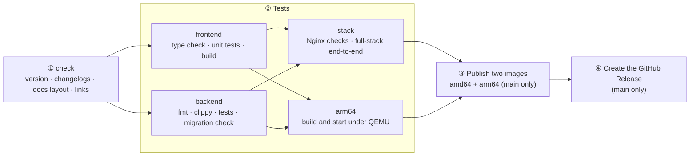

- **Trigger:** a push to `main` (publishes), a push to `dev`, a pull request into `main`, or a manual run from the Actions page. Only `main` publishes; pushes to `dev`, pull requests and manual runs on other branches are only checked and tested, and **never publish**. A push to any other branch does not start the pipeline.
- **Every update must:** change `VERSION` and add an entry for the same version at the very top of the changelog of **all three READMEs** (`README.md`, `README.ja.md`, `README.zh-CN.md`); `backend/Cargo.toml` and `frontend/package.json` must carry the same version. Otherwise step ① fails.
- **Docs check (also step ①):** the seven documents exist in `docs/en`, `docs/ja` and `docs/zh-CN`, `docs/` contains nothing but these three folders, and every relative link in the READMEs and the docs points at a file that exists.
- **Publish only if everything passes:** the two images (`xexam-frontend`, `xexam-backend`) are each published as a multi-architecture image, and the pipeline then checks that the image manifest really contains `amd64` and `arm64` and that the tag points to the digest that was just pushed. If a test fails, `latest` stays on the previous working version.
- **Published tags:** `latest`, `v<VERSION>`, `sha-<commit>`, the same on Docker Hub and on ghcr.io.
- **How the backend image gets arm64:** it is cross-compiled with zig on the build machine instead of compiling Rust under QEMU (which is an order of magnitude slower); only the final, very small alpine stage uses the target architecture.
- **Releases page:** once both images are published and verified, the pipeline automatically creates (or updates) a Release named `v<VERSION>`. Its description is taken from this version's section of the Changelog in this file ([`scripts/release-notes.py`](scripts/release-notes.py)), and a git tag with the same name is created automatically. If the images were not published successfully, there is no Release.
- **Releases and images live in different places:** the images are on **Docker Hub** (`docker.io/yuminspace/xexam-frontend` and `docker.io/yuminspace/xexam-backend`, public; this is what `docker-compose.yml` pulls) and, as a private mirror, under the repository's **Packages** (ghcr.io); the Release is on the **Releases** page and lists the Docker Hub pull commands first. All of them are produced by the same build.

Publishing to Docker Hub needs two repository secrets, `DOCKERHUB_USERNAME` and `DOCKERHUB_TOKEN` (a Docker Hub access token with **Read & Write**), and optionally the repository variable `DOCKERHUB_NAMESPACE`. Without the secrets, or if `docker-compose.yml` does not name the Docker Hub images of that namespace, the publish job stops before it pushes anything. On ghcr.io the images are private (the repository is private): the first time a new image name is published there, add this repository under **Manage Actions access** in the GitHub package settings with the role **Admin**, otherwise the push is rejected (`permission_denied: write_package`).

---

## Development

For the everyday commands for changing code and running tests, see [docs/en/development.md](docs/en/development.md). The most common ones:

```bash
# Backend (Rust 1.99.1; rustup installs it automatically from backend/rust-toolchain.toml)
cd backend && cargo fmt --check && cargo clippy --all-targets -- -D warnings && cargo test --all-targets

# Frontend (Node 24)
cd frontend && npm ci && npm run typecheck && npm test && npm run build

# During development: backend at 127.0.0.1:8765, frontend at http://127.0.0.1:5173 (/api is proxied to the backend)
cd backend && cargo run -- serve --data ../data --no-browser
cd frontend && npm run dev

# Full-stack check (uses Docker, a temporary project name and a temporary volume, does not touch xexam_data)
python -I tests/integration/stack_check.py
```

- The backend has 181 tests and the frontend 44 unit tests. The backend tests run against the committed **legacy snapshot** in `tests/baseline/`: 172 golden responses, 49 parser fixtures and their outputs, and 85 question-id vectors. All of these fixtures are made up; a real question bank is never committed.
- The v0.5 behaviour (schema migration and backup, banks, records, settings, the guards on the new routes) is tested in `backend/tests/v05_banks_records_settings.rs`.
- Every text in the interface comes from `frontend/src/i18n/catalog/*.ts`, in English, Chinese and Japanese; a test fails if a language misses a key, and another one if a backend error message has no translation.
- The **About Xexam** page shows the changelogs of the three READMEs. They are read when the frontend is built (the `xexam-changelog` plugin in `frontend/vite.config.ts`), so a frontend build needs `README.md`, `README.ja.md` and `README.zh-CN.md` in the folder above `frontend/`.
- Opening a database from v0.4 or older with v0.5 migrates it and writes `backups/` next to it. Experiment on a copy.

---

## Directory structure

```
README.md                  This file (English); README.ja.md and README.zh-CN.md are the Japanese and Chinese versions
LICENSE                    MIT license
VERSION                    Version number (kept in sync with the top changelog entry)
docker-compose.yml         Pulls and runs the two images (this is the only file you need)
docker-compose.build.yml   Builds the two images from source and runs them
.env.example               Local configuration template (copy to .env; .env is not committed)
backend/                   Rust backend (Axum + rusqlite)
  src/api/                   Routes, guards (Host / Origin / Content-Type / size), JSON format, score sanitizing
  src/services/              Pending-import slot, parser engine interface, import flow
  src/parser/                .xlsx parsing: ZIP protection, XML, question detection, question id
  src/database/              SQLite storage, schema (v1 verbatim + v2 additions), legacy progress.json migration, timestamps
    store/                     Banks, records, settings, migration from schema v1 to v2 (with the backup copy)
  src/security/ src/config/  Host / Origin checks, size-limited request body reading; environment variables
  tests/                     Unit, golden-response, parser comparison, id-vector, concurrency, v0.5 (banks, records, settings, migration)
  Dockerfile                 Cross-compiles on the build machine (zig); the runtime image is a single statically linked executable
frontend/                  TypeScript + Vite frontend (plain DOM)
  src/main.ts src/router.ts  Entry point; hash routes (#/, #/banks, #/records, #/settings, #/about, #/quiz, #/result, …)
  src/pages/                 home, banks, records, settings, about, quiz, result
  src/components/            Shell (header with the menu button and its dropdown), review (answer cards), common parts
  src/i18n/                  Interface texts in English, Chinese and Japanese (catalog/*.ts), translation of server messages
  src/api/ types/ domain/ state/ utils/ styles/
  vite.config.ts             Build settings; reads the changelogs of the three READMEs for the About page
nginx/                     nginx.conf + Dockerfile (builds the frontend, with the three READMEs -> ships only the static output)
tests/baseline/            Behavior snapshot of the legacy Python version (golden responses, parser fixtures, id vectors, sample database)
tests/integration/         Nginx behavior checks, full-stack end-to-end checks, progress.json migration checks
docs/                      en/ (English), ja/ (Japanese), zh-CN/ (Chinese): architecture, API, database, security, deployment, migration, development,
                           each folder with its own screenshots/; en/openapi.yaml; zh-CN/history/ holds older documents (Chinese only)
scripts/release-notes.py   Generates the GitHub Release notes from the changelog (used by CI, can also be run locally)
.github/workflows/ci.yml   The only pipeline: check -> test -> publish -> Release
```

---

## License

Xexam is released under the [MIT License](LICENSE). Copyright (c) 2026 Yumin-Space.

The license covers the software in this repository. The repository contains no exam questions: the question banks you import are your own files, and you are responsible for making sure that you may use them.

---

## Changelog

Every update must add an entry here, and the **version number must match the `VERSION` file in the repository root** (the automated build checks this and refuses to build on a mismatch). The latest image carries both the `latest` tag and the matching `vX.Y` tag.

The **About Xexam** page of the app shows these entries (they are built into the frontend), so keep them in simple Markdown: paragraphs, `- ` bullets, nested `  - ` bullets, `**bold**` and `` `code` ``. Links are shown as plain text there.

### v0.5.1 — 2026-11-11

**A calmer, simpler look with colour-blind friendly colours, the menu button at the top right, and a Question banks page as compact as Home.**

- **A calmer, simpler look**: the colours now follow the colour-blind friendly light and dark palettes of GitHub's Primer design system ("Light colorblind" / "Dark colorblind"). Correct answers are blue and wrong answers orange instead of green and red. The light theme is a soft grey-white page with white blocks and navy main buttons; the dark theme is near-black. The pages sit on one calm sheet with fewer frames and borders, rounded corners, soft hover backgrounds, notes shown as tinted callouts and a lighter menu with a soft shadow. The new look itself moves nothing and changes no behaviour.
- **Menu on the right**: the three-line menu button is now at the top right of the header; the Xexam logo stays at the top left. The menu opens below the button and works as before.
- **Compact Question banks page**:
  - **Import Excel**: **New bank** and **Update a bank** are two small buttons next to the title (their tooltips explain them); for an update, **Bank to update** appears under them. One hint line ends in a link to the **Excel format guide**, and one row takes the file: **Choose Excel file**, or drop the file anywhere on the panel.
  - **Preview**: the counts are small chips (counts of zero are hidden), each sheet is one line, and a sheet's unreadable rows are folded under it. As before, the confirm and cancel buttons follow right after the counts and the notes, before the sheets.
  - **Your question banks**: one compact row per bank with its name, small **Update** and **Delete** buttons and one line of facts (file, questions, sheets, last update). The sheets are folded under the arrow on the right of the row.
  - **Import history** shows one line per import (the latest 8), and **Excel format and import guide** stays folded until you open it.
  - On touch screens the small buttons keep a tap area of about 44 px; on a phone, a long bank name pushes the buttons onto their own row.
- **Images on Docker Hub**: every release is now also published to Docker Hub as `yuminspace/xexam-frontend` and `yuminspace/xexam-backend` (public, `amd64` and `arm64` under the same tags). `docker-compose.yml` pulls from there, so `docker login` is no longer needed. The same tags stay on `ghcr.io/yumin-space` as a private mirror. If you run v0.5 with the old `docker-compose.yml`, replace it with the new one (the data volume stays). The READMEs now start with the Docker Hub badges.
- The READMEs and the docs describe the new layout, and the screenshots were retaken.

### v0.5 — 2026-11-10

**A new interface with several question banks, study records and settings, in English, Chinese and Japanese. The database moves to schema v2 automatically, after a backup copy is written.**

- **New layout**: every page except the exam has a slim header with a three-line menu button. The button opens a small menu with Home, Question banks, Study records and Settings; it closes again after a choice, a click outside it or Esc. On wide screens the page content is centered (at most 1120 px wide). The exam itself is a focused full-screen page.
- **About page**: the last menu entry, Xexam v0.5 (under a divider), opens it. It shows the version, the server's CPU architecture, the license and what is new in each version: this changelog, in the interface language, with the newest version open and the earlier ones folded.
- **Compact home page**: an unfinished exam is a one-line banner with Continue and Discard. Two small buttons in the top-right corner of the Start an exam panel choose where the questions come from: All and Wrong answers, each with its number of questions (Wrong answers is disabled, with a one-line reason, while there is nothing to review in the selected sheets). Each question bank is one card with its sheets as compact rows inside; the bank's checkbox selects all its sheets, and the sheets can be folded away (with more than two banks they start folded).
- **Random pick**: when the number of questions is smaller than the selection, the questions are now picked at random from the whole selection (before, without shuffling, the first ones in bank order were taken). Shuffle question order only decides whether they are asked in random or bank order.
- **Several question banks**: every imported workbook is its own bank. Import a file as a new bank, or update / replace an existing bank; questions missing from the file are retired only in that bank. The bank list shows each bank's sheets and counts. Deleting a bank asks for confirmation, with an option to also delete that bank's study records.
- **Study records page**: the list of exams with filters (question bank, date range, accuracy); the detail of each exam with your answer to every question, the correct answer and the explanation (for exams taken from v0.5 on); wrong-answer review and practice; retry the wrong answers or retake an exam; delete one record (the wrong-answer notebook is not changed) or all records (with an option to also clear the notebook). Xexam keeps the latest 500 exams (60 before).
- **Settings page**: theme (follow the system / light / dark), interface language (English by default, 中文, 日本語), auto-advance after answering (single choice, and a hotspot question once every item is answered; never multiple choice), reset to defaults. The settings and the question language are stored in the data directory on the server, so they survive restarts, image updates, clearing the browser cache and switching to another browser or device. An unfinished exam is still saved only in the current browser.
- **The whole interface in English, Chinese and Japanese**, including the exam page and the error messages from the server (the backend still sends them in Chinese; the page translates them).
- **Phone friendly**: the Start exam button stays at the bottom of the screen on the home page, lists are more compact, the answer sheet shows the answered count and Submit above the question tiles, and touch targets are at least 44 px.
- **Database schema v2**: new tables `banks`, `attempt_items` and `settings`, new columns `questions.bank_id`, `attempts.banks` and `imports.bank_id`. On the first start of v0.5 the existing database is migrated automatically; before that, a copy is written to `<data dir>/backups/xexam-schema1-<date-time>.db` (if the copy cannot be written, the backend does not start and changes nothing). Existing data becomes one question bank; question ids, the wrong-answer notebook and the score history are kept. Rolling back = stop, restore that copy, run v0.4. Never run v0.4 on a database that has several banks. Steps: [docs/en/migration.md](docs/en/migration.md).
- **New API**: `GET /api/banks`, `POST /api/banks/delete`, `GET /api/records`, `GET /api/record?id=`, `POST /api/records/delete`, `GET` / `POST /api/settings`, `POST /api/settings/reset`, and the optional header `X-Bank-Target` on `POST /api/upload` (without it, an upload behaves exactly as in v0.4). Each question in `GET /api/bank` gains one more key, `bank`. See [docs/en/api.md](docs/en/api.md).
- **Docs split by language**: `docs/en`, `docs/ja` and `docs/zh-CN`; the Chinese-only historical documents moved to `docs/zh-CN/history`. Each language folder has its own screenshots, with the interface in that language. CI checks this layout and every relative link.
- **CI also runs on pushes to the `dev` branch** (checks and tests only, never publishes).
- The Excel examples in the READMEs, the docs and the four-column parser tests were replaced by made-up examples; the legacy test snapshot in `tests/baseline/` is unchanged. In the older changelog entries, only the links (to the new doc folders) and one list of example words were changed.
- **MIT license** added (`LICENSE`).
- Tests: backend 151 → 181 (migration and backup, banks, records, settings, the guards on the new routes), frontend 27 → 44 (interface texts, translation of server messages, the changelog on the About page, random pick).

### v0.4 — 2026-11-10

- **Three-language side-by-side: English / Chinese / Japanese.** Excel gains a new format: column A is English, column B is Chinese, column C is Japanese (the question itself), and column D holds the answer, explanation and mnemonic. Columns A, B and C are the same question in three languages and correspond one to one; the answer is written only once. The language buttons on the quiz page become `英语 / 中文 / 日语` ("English / Chinese / Japanese"), and the wrong-answer review on the result page is also shown in the language you choose.
- **Hotspot options follow the language too**: write the options at the end of each sub-item in that language (Japanese `はい / いいえ`, Chinese `是 / 否` ("yes / no"), English `Yes / No`; the same applies to three-way choices such as the execution layer), and the option buttons switch together with the language. If a column has no options written, that language is still available and the option buttons show the Japanese ones.
- **Hotspot answers are accepted when written with option words from any language** (`調理`, `烹饪`, `Cooking`, and they can be mixed). The options of the three languages correspond one to one by position; a column whose option count does not match does not take part, and nothing is guessed.
- **The old three-column format (A Japanese, B Chinese, C answer) needs no changes and can still be uploaded**, just without English. The program detects the format from the content automatically; in the four-column format the question id still comes from the Japanese text in column C, so the same question has the same id in both formats and learning records are not affected.
- The footer text on the home page now reads: Xexam only provides import, organization and practice of questions and answers; the software itself does not provide or include exam questions, answers or related materials; users must ensure that the sources of the materials they import and use are lawful and that they hold the corresponding usage rights.
- **The README is split into three languages**: `README.md` (English, the default), `README.ja.md` and `README.zh-CN.md`, linked to each other from a language bar at the top; each keeps its own changelog, and the GitHub Release notes come from the English one.
- **The documents in `docs/` come in three languages too**: the seven current ones (architecture, API, database, security, deployment, migration, development) are `X.md` (English), `X.ja.md` (Japanese) and `X.zh-CN.md` (Chinese), with a language bar on top; `openapi.yaml` is in English. The Phase 0 audit and planning documents are historical and stay Chinese-only. CI checks that all three versions exist and that every relative link resolves.
- **New screenshots** taken with the v0.4 interface and a fictional four-column demo bank: the question in English, Chinese and Japanese, with the hotspot option buttons following the language. (The interface itself, buttons and labels, is still in Chinese only.)
- **Language convention**: code comments and the output of programs, tools and CI are in English; the UI and the READMEs use their own language. No code was changed by this (checked mechanically against the previous commit).
- Tests: backend 136 → 151 (four-column format, options and answers in three languages, fallback when they do not match), frontend 19 → 27 (language rules).

### v0.3 — 2026-11-10

**The whole program was rewritten in Rust + TypeScript + Nginx. The database file and schema are unchanged, the API is backward compatible, and the old Python implementation has been removed from the repository.**

- **Backend rewritten in Rust** (Axum 0.8 + Tokio + rusqlite, toolchain pinned to 1.99.1): REST API, XLSX parsing, import (preview without writing to the database → one-time confirmation token → one-transaction write), score and wrong-answer statistics, Host/Origin guard, and the `xexam-backend import / healthcheck / migrate-progress` subcommands. Behavior matches the Python version one to one: all 172 legacy responses were compared item by item with no unexplained differences; the parse output of 49 synthetic workbooks and all 85 question id vectors are identical, so question ids are byte-for-byte the same as in the old version and learning records do not become detached.
- **Frontend rewritten in TypeScript** (strict) + **Vite**, plain DOM, no framework; there are no inline styles, so the CSP can be very strict. The build target is `safari15`, so iPhone needs iOS 15.4 or later.
- **Two images, two containers**: `xexam-frontend` (Nginx + static frontend files, the only one exposed) and `xexam-backend` (Rust, on the `internal` private network with no published port). Non-root, `cap_drop: ALL`, read-only root filesystem; Host passed through unchanged, `X-Forwarded-*` cleared; 20 MB limit, security headers, rate limiting, timeouts; a JSON 502 is returned when the backend is unreachable. Both images ship for `amd64` and `arm64`.
- **Stricter upload checks (intentional differences)**: DOCTYPE and entity declarations are rejected in any encoding / extension; duplicate ZIP entry names are rejected; there are limits on the number of ZIP entries, XML depth / node count / attributes per element, and total cell bytes; parsing has a cooperative timeout (the parser stops by itself when time is up) and at most 2 parses run at the same time; error messages no longer echo the library's exception text; unsupported HTTP methods return 405 (previously 501). See [docs/en/api.md](docs/en/api.md) for the full table of differences.
- **One pipeline** (`.github/workflows/ci.yml`): check version and changelog → four check groups (frontend / backend / Nginx and full stack / arm64) → only if all pass, publish the two images and create the Release.
- **Tests**: 136 backend tests (against the committed legacy snapshot: 172 golden responses, 49 parse fixtures, 85 id vectors), 19 frontend tests; in `tests/integration/`, 38 Nginx checks, 34 full-stack checks and 10 `progress.json` migration checks.
- **Documentation**: architecture, API (including OpenAPI), database, security, deployment, migration and development under `docs/`, plus the pre-migration audit, risks and plan.
- Grading is still done in the browser (the server only receives `{id, correct}`, i.e. the question id and whether it was answered correctly); the reasoning is in [docs/zh-CN/history/migration-plan.md](docs/zh-CN/history/migration-plan.md).
- ⚠️ **Upgrade note**: the old and new containers have the same names and ports and **cannot run at the same time**, so run `docker compose stop` before upgrading; the data volume `xexam_data` is the same one, so no data migration is needed. The old single image `ghcr.io/yumin-space/xexam` is no longer updated (the last version was `v0.2.2`), and `docker-compose.yml` now pulls both `xexam-frontend` and `xexam-backend` at once. For rollback steps see [docs/en/migration.md](docs/en/migration.md).
- **What has not been verified (stated honestly)**: a real Cloudflare Tunnel, a real iPhone, running on real ARM hardware (it was only built and started under QEMU), and a dry run with a copy of your own real database.

### v0.2.2 — 2026-11-10

- Added `tests/baseline/`: the behavior baseline of the old Python version (172 real responses, 50 XLSX fixtures with their parse output, 85 question id vectors, a sample database, security probes, and Host/Origin check and tunnel simulation scripts), against which the later Rust rewrite is compared item by item. The tools no longer hardcode any local path; use `XEXAM_LEGACY_ROOT` to point at the code under test.
- Corrected the statement about the v0.2 Release in the previous changelog.

### v0.2.1 — 2026-11-10

- **A Release is now created automatically on GitHub's Releases page after every successful build** (previously only images were pushed and the Releases page stayed empty): the pipeline gains a 4th job, `release`, which runs after the images have been published and verified; its notes are taken from this version's section of this changelog, and it automatically creates the git tag `v<version>`.
- The v0.2 Release was created manually once (it corresponds to the v0.2 commit `1ee64c8` and is not marked Latest); from v0.2.1 on, the pipeline creates it automatically.
- Added `scripts/release-notes.py`: extracts the changelog of a given version from the README; it can also run locally to preview what the Release page will show.

### v0.2 — 2026-11-10

- **Can be reached from the internet through your own domain** (Cloudflare Tunnel + Cloudflare Access):
  - Allowed domains go into `XEXAM_ALLOWED_HOSTS`; the `Origin` of write requests is now compared by hostname only, so uploads and submitting a quiz are no longer blocked with 403 when accessed through an **HTTPS** domain.
  - When a proxy rewrites `Host`, `XEXAM_ALLOWED_ORIGINS` can be used to allow the public domain separately; when authentication is already in front, `XEXAM_ALLOW_ANY_HOST=1` can be set.
  - When a request is rejected, the message explains which check failed and how to allow it; when the login expires, the page prompts you to refresh and log in again.
- Port binding is now configurable (`XEXAM_BIND`); the default is still localhost only.
- After receiving the stop signal from `docker stop`, the program exits cleanly (previously it waited 10 seconds and was killed), and the database is closed cleanly.
- CI: split into three steps, "check version and changelog → test each of the two architectures → publish" (from v0.2.1 a fourth step is added: create the Release); the smoke test moved into `scripts/smoke-test.sh`, which can also be run directly on a machine with Docker installed; after publishing, the image manifest is verified by digest.
- `/api/info` gains `arch` (the current CPU architecture).
- Fixes after the audit (each one has a corresponding real test):
  - Server: requests rejected early (403/415) have their body read before the reply, so the browser sees the real reason instead of `连不上服务` ("cannot connect to the service"); a rejected request leaves one line in the log (visible with `docker compose logs`); malformed JSON (a number where a list is expected, `Infinity`, over-deep nesting, a non-ASCII confirmation token) returns 400/409 instead of dropping the connection; the `Content-Type` of a POST must really be `application/json`; `XEXAM_ALLOWED_HOSTS` separated by spaces or semicolons is also recognized.
  - Database: if `COMMIT` fails it rolls back instead of leaving the connection stuck in a transaction; a malformed old `progress.json` no longer keeps the program from starting; when the data directory contains only some other `.db` file, the startup log gives a warning (that file is not modified).
  - Pages: when submitting a quiz, the saved progress is cleared only after the score has been submitted successfully; on failure it is kept and a prompt `刷新页面重新登录后再交卷` ("Refresh the page, log in again, then submit") is shown; before starting a new exam, if there is an unsubmitted exam, it asks for confirmation first; the percentage on the result page uses the same rounding as the learning record and no longer differs by 1; the notification bar is no longer covered by the bottom paging bar; long English strings no longer cause a horizontal scrollbar; old Safari without `<dialog>` uses the system confirmation box; holding down a letter key no longer toggles the answer repeatedly.
  - Images and CI: the health check bypasses the proxy and follows `XEXAM_PORT`; `.dockerignore` now applies at any directory level; `.gitignore` gains backup archives and `.env.*`; publishing happens only from `main`, and queued runs on `main` are not cancelled; the in-container paths in the smoke test also work in Git Bash on Windows.
  - This version was really built locally with Docker (amd64) and passed the same smoke test that CI uses: non-root, Host/Origin blocking, data still there after deleting the container, `docker stop` in 1 second. arm64 and publishing still depend on the GitHub Actions results.
- Names unified to **xexam**: environment variables `XEXAM_DATA` / `XEXAM_HOST` / `XEXAM_PORT` / `XEXAM_ALLOWED_HOSTS` / `XEXAM_ALLOWED_ORIGINS` / `XEXAM_ALLOW_ANY_HOST`, database file `xexam.db`, key names saved in the browser `xexam.*`; the docs also no longer hardcode your own Excel file name.
- ⚠️ **When upgrading from v0.1:** the database file name changed, and the new version only reads `xexam.db`. If you already imported a question bank with an earlier version, stop the program first and rename that `.db` file in the data directory to `xexam.db` before starting, otherwise you will see an empty question bank (the old file is not deleted, it is just not read). The key names used for the saved exam and the language choice in the browser also changed, so submit your quiz before upgrading; the language will revert to Japanese. If you set the old environment variable names in a compose file you modified yourself, change them to the `XEXAM_*` names above, otherwise they will be ignored.
- `docker-compose.yml` no longer has `pull_policy: always`: `docker compose up -d` no longer checks online every time; to update, use `docker compose pull && docker compose up -d`.
- `.env` (local configuration) was added to `.gitignore` and `.dockerignore`, so it is not committed and does not end up in the image.

### v0.1 — 2026-11-10

First version.

- Quiz in the browser: single choice, multiple choice and hotspot questions; **scored only after submitting**, and wrong answers show the answer, explanation and mnemonic.
- Japanese / Chinese side-by-side switching; answer sheet; flagging; save and exit, then resume.
- Wrong-answer notebook: a wrongly answered question is removed after 2 consecutive correct answers; score history.
- The question bank and learning records are now stored in **SQLite** (Docker named volume `xexam_data`) and no longer depend on Excel.
- The admin page **uploads Excel to update the question bank**: preview first (added / updated / restored / retired / unreadable), and nothing is written until you confirm; retired questions keep their answer records and are restored automatically when they are uploaded again.
- The old version's `progress.json` is migrated automatically on first start.
- **iPhone** support: touch targets of at least 44 px, safe areas, a fixed bottom paging bar, and it can be added to the home screen.
- The Docker images support both **x86 (amd64) and ARM (arm64)**, built and tested by GitHub Actions.
- ⚠️ The "publish" step of v0.1 did not succeed, so there is **no** `v0.1` tag on `ghcr.io/yumin-space/xexam`; images are published from v0.2 on (`latest` / `v0.2`).
- The app was renamed to **Xexam**.

<!-- Write new versions above this line, format: ### vX.Y — date -->
