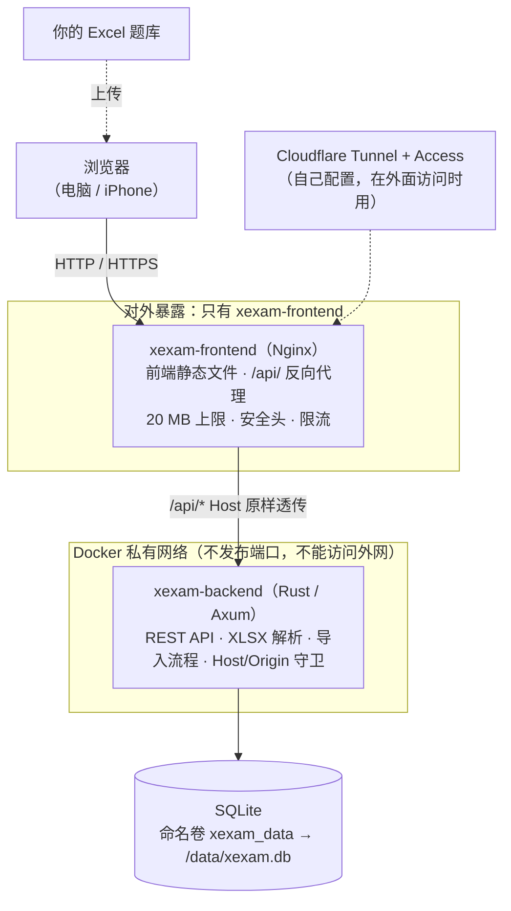
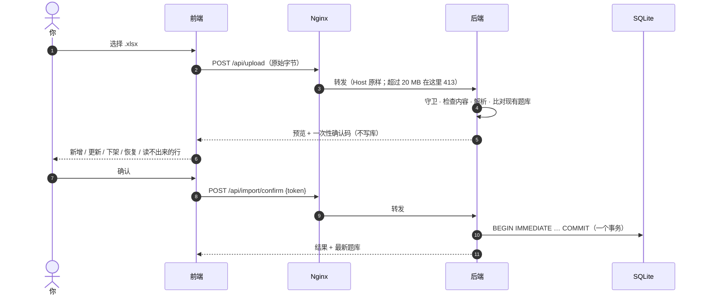
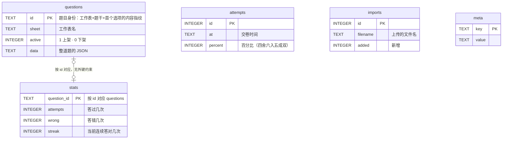
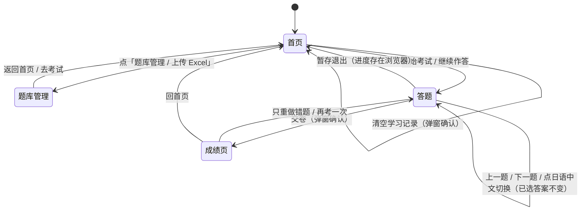
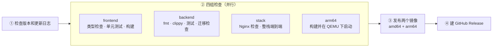

[English](README.md) | [日本語](README.ja.md) | **简体中文**

# Xexam

在浏览器里做题的模拟考程序。题目来自你自己的 Excel，上传一次就存进 SQLite；做完题**交卷后才计分**，并列出每道错题的答案、解析和记忆口诀。手机（iPhone）和电脑都能用。

- **Rust 后端 + TypeScript 前端 + Nginx**，用 Docker Compose 跑两个容器；只有 Nginx 对外，后端在私有网络里。
- 题库、成绩、错题记录都在一个 SQLite 文件里，放在 **Docker 命名卷**中，更新或删除容器都不会丢。
- 英语 / 中文 / 日语随时对照切换（题干、选项、热点题的选项按钮都跟着换）；错题本；成绩历史。
- 仓库里**没有题库**：题库是你自己的 Excel，不会被提交（`.gitignore` 已排除）。

| | |
|---|---|
| 当前版本 | **v0.4**（见 [更新日志](#更新日志)，也可以在仓库的 [Releases](../../releases) 页看） |
| 镜像 | `ghcr.io/yumin-space/xexam-frontend` 和 `ghcr.io/yumin-space/xexam-backend`，标签 `latest` / `v0.3` / `sha-<提交>` |
| CPU 架构 | `linux/amd64`、`linux/arm64`（同一个标签里自动选对的） |
| 端口 | `8765`（默认只绑定本机） |

文档：[架构](docs/architecture.md) · [API](docs/api.md)（[OpenAPI](docs/openapi.yaml)）· [数据库](docs/database.md) · [安全](docs/security.md) · [部署](docs/deployment.md) · [迁移与回滚](docs/migration.md) · [开发](docs/development.md)

---

## 目录

- [截图](#截图)
- [架构](#架构)
- [快速开始（安装部署）](#快速开始安装部署)
- [使用方法](#使用方法)
- [Excel 题库格式](#excel-题库格式)
- [数据、备份和恢复](#数据备份和恢复)
- [让手机访问](#让手机访问)
- [通过 Cloudflare Tunnel 从互联网访问](#通过-cloudflare-tunnel-从互联网访问)
- [安全说明](#安全说明)
- [自动构建与发布](#自动构建与发布)
- [开发](#开发)
- [目录结构](#目录结构)
- [更新日志](#更新日志)

---

## 截图

截图用的是**虚构的演示题库**（5 道日语小题），不是任何真实考试内容。左边是电脑，右边是 iPhone 宽度（390 px）。

### 首页：选范围，开始考试

首页能看到题库有几个工作表、错题本里有几道待巩固的题，以及最近的成绩。

<table>
<tr>
<td width="62%"></td>
<td width="38%"></td>
</tr>
</table>

### 答题：右上角切换英语 / 中文 / 日语，右侧是答题卡

答题时**不显示对错、不显示分数**。答题卡上：实心 = 已答，半实心 = 热点题只答了一部分，空心 = 未答，黄色小方块 = 已标记。iPhone 上「上一题 / 下一题」固定在屏幕底部，长题目不用滑到底才能翻页。

<table>
<tr>
<td width="62%"></td>
<td width="38%"></td>
</tr>
</table>

点「中文」「英语」切换成 Excel 里对应那一列的文字。切换只换文字，已选的答案、选项字母、计时都不变，判分也不变。（下面的截图是旧版界面，只有日语 / 中文两个按钮。）

<table>
<tr>
<td width="62%"></td>
<td width="38%"></td>
</tr>
</table>

### 交卷：先看分数，再看每题对错

<table>
<tr>
<td width="62%"></td>
<td width="38%"></td>
</tr>
</table>

### 错题解析：你的答案、正确答案、解析、记忆口诀

<table>
<tr>
<td width="62%"></td>
<td width="38%"></td>
</tr>
</table>

### 题库管理：上传 Excel，先预览再导入

上传后会先显示「新增几题、更新几题、恢复几题、下架几题、没变化几题、读不出来几题」。确认前不会写入任何东西。

<table>
<tr>
<td width="62%"></td>
<td width="38%"></td>
</tr>
</table>

---

## 架构

下面的图都是 [Mermaid](https://mermaid.js.org/) 写的，GitHub 上直接显示成图。完整说明见 [docs/architecture.md](docs/architecture.md)。

### 谁和谁连着，数据怎么走



| 容器 / 镜像 | 里面是什么 | 对外？ |
|---|---|---|
| `xexam-frontend` | Nginx + 前端静态文件（HTML / JS / CSS）。把 `/api/` 转给后端；20 MB 上限、安全头、限流、超时 | 是：宿主机 `XEXAM_BIND`（默认 `127.0.0.1:8765`）→ 容器 8080 |
| `xexam-backend` | 一个静态链接的 Rust 可执行文件：REST 接口、解析 Excel、读写 SQLite | **否**：没有 `ports`，网络是 `internal: true` |

浏览器只通过 [REST 接口](docs/api.md) 和后端说话；前端里没有数据库访问。**判分在浏览器里**：服务端只收 `{题目 id, 对错}`。

### 数据流 A：更新题库（上传 → 预览 → 确认）



导入规则（这份文件被当成**完整的题库**）：

| 情况 | 结果 |
|---|---|
| 文件里有、库里没有的题 | **新增** |
| 题干相同、其它内容（选项、答案、解析、翻译）改了 | **更新**（答题记录不受影响） |
| 库里有、文件里找不到的题 | **下架**（`active = 0`，答题记录保留，不删除） |
| 以前下架、这次又出现的题 | **恢复上架**，错题本跟着回来 |
| 改了题干的措辞 | 算**一道新题**（旧题下架，记录不会带到新题上） |
| 这份文件里一道可用的题都没有 | 拒绝导入（防止把题库清空） |

### 数据流 B：做一场考试

题库一次取到浏览器 → 在浏览器里答题、交卷时判分 → `POST /api/attempt` 只发 `{id, correct}` 列表 → 后端更新每题统计和成绩历史 → 返回最新学习记录。做到一半的考试存在浏览器里，刷新页面不丢。

### 数据库：5 张表

完整的表结构和字段含义见 [docs/database.md](docs/database.md)。



**为什么 `stats` 不随题目一起删：** 题目下架只是把 `active` 改成 0，答题记录原样保留；以后这道题重新出现在 Excel 里，会自动恢复上架。

**错题本怎么算：** 一道题只要 `wrong > 0` 且 `streak < 2`（连续答对不到 2 次）就在错题本里；连续答对 2 次后自动移出。

### 页面之间怎么走



答题页里单选、多选、热点题三种题型的界面略有不同，但都在同一个「答题」页面里切换。

---

## 快速开始（安装部署）

### 需要什么

- 一台装了 **Docker**（含 Compose v2）的机器：Windows / macOS / Linux 都行，**x86 或 ARM 都行**。
- 一个浏览器。

### 方式 A：直接拉取现成的镜像（推荐）

只需要仓库里的 [`docker-compose.yml`](docker-compose.yml) 这**一个文件**，复制到任意机器的任意文件夹即可，不需要其他代码。

```bash
# 第一次：登录 GitHub 的容器仓库（镜像是私有的，所以要登录一次）
docker login ghcr.io -u Yumin-Space
# 密码处填一个有 read:packages 权限的 GitHub 令牌
# （GitHub → Settings → Developer settings → Personal access tokens）

# 在 docker-compose.yml 所在的文件夹里：
docker compose up -d
```

然后浏览器打开 <http://localhost:8765>，点「题库管理 / 上传 Excel」导入你的 Excel。会一次拉取并启动**两个容器**（`xexam-frontend`、`xexam-backend`）。

| 操作 | 命令 |
|---|---|
| 更新到最新版本 | `docker compose pull && docker compose up -d` |
| 固定在某个版本 | 把 `docker-compose.yml` 里两个镜像的 `:latest` 都改成 `:v0.3`，再 `docker compose up -d` |
| 停止 / 再启动 | `docker compose stop` / `docker compose start` |
| 看日志 | `docker compose logs -f` |
| 看现在是哪个版本、什么架构 | 浏览器打开 <http://localhost:8765/api/info> |

> ⚠️ **不要运行 `docker compose down -v`**：`-v` 会把数据卷 `xexam_data` 一起删掉，题库和学习记录都在里面。

可调的选项都通过 `docker-compose.yml` 旁边的 `.env` 文件设置（模板见 [`.env.example`](.env.example)，不需要改 compose 文件本身）：

| `.env` 里的名字 | 默认 | 作用 |
|---|---|---|
| `XEXAM_BIND` | `127.0.0.1:8765` | 对外监听的地址和端口（Nginx），必须写成 `IP:端口`。默认只有本机能连；`0.0.0.0:8765` = 局域网里别的机器也能连。⚠️ 只写端口号（如 `8766`）= 所有网卡都能连 |
| `XEXAM_ALLOWED_HOSTS` | 空 | 允许用哪些域名 / IP 访问，逗号分隔，例如 `xexam.example.com,192.168.1.20` |
| `XEXAM_ALLOWED_ORIGINS` | 空 | 反向代理把 Host 改写成源站地址时才需要：填你的公网域名 |
| `XEXAM_ALLOW_ANY_HOST` | `0` | 设 `1` = 不再检查 Host（只在前面已经有身份验证时用） |
| `XEXAM_PARSE_TIMEOUT_SECS` | `30` | 解析一份 Excel 的最长时间（秒） |
| `TZ` | `Asia/Tokyo` | 数据库里时间戳用的时区 |

### 方式 B：从源码构建（改代码时用）

需要完整的仓库代码：

```bash
git clone git@github.com:Yumin-Space/xexam.git
cd xexam
docker compose -f docker-compose.build.yml up -d --build
```

第一次构建要几分钟（编译 Rust 和前端）。它和方式 A 用**同一个卷**（`xexam_data`）和同样的容器名，所以数据是同一份、两者**不能同时运行**，切换前先 `docker compose stop`。

### 镜像的版本标签

| 标签 | 含义 | 什么时候用 |
|---|---|---|
| `latest` | 最近一次成功发布的版本 | 想一直用最新版 |
| `v0.3` 等 | 固定的某个版本 | 想锁定版本、需要回退 |
| `sha-xxxxxxx` | 某一次提交 | 排查问题 |

### 从旧版（v0.2.x，Python 单镜像）升级

数据卷 `xexam_data` 是同一个，**数据不用迁移**。但旧版是一个容器、新版是两个，且容器名 / 端口相同，所以：

1. `docker compose stop`（旧版）。
2. 备份数据卷（见下面的「数据、备份和恢复」）——这是习惯，不是因为数据会变。
3. `docker rm xexam`：删掉旧版的容器（**只删容器，不删数据卷**）。旧版的容器叫 `xexam`，新版是 `xexam-frontend` 和 `xexam-backend`；不删的话旧容器还占着 8765 端口，新的会起不来。
4. 换上新的 `docker-compose.yml`，`docker compose pull && docker compose up -d`。
5. 打开 <http://localhost:8765>，核对题数、错题数和成绩历史和升级前一样。

想回到旧版：旧代码在 Git 标签 `python-v0.2`，旧镜像 `ghcr.io/yumin-space/xexam:v0.2.2` 仍然可以拉取，旧版能直接读写新版写过的库。详见 [docs/migration.md](docs/migration.md)。

---

## 使用方法

### 第一次：导入题库

1. 打开页面，题库是空的，点「去上传题库」（或右上角「题库管理 / 上传 Excel」）。
2. 选择你的 Excel（也可以拖进虚线框）。
3. 看**检查结果**：新增几题、哪几题读不出来（会写明工作表、行号和原因）。
4. 没问题就点「确认导入」。

### 以后更新题库

1. 在自己电脑上改 Excel：新增工作表、新增或修改题目都可以。
2. 保存后，把**整份** Excel 再上传一次。
3. 看检查结果，确认导入。规则见上面 [数据流 A](#数据流-a更新题库上传--预览--确认)。

### 考试

1. 首页勾选要考的工作表，选「全部题目」或「错题本」，设置题数，点「开始考试」。
2. 答题过程中**不显示对错、不显示分数**。可以随时跳题、用答题卡看进度、标记不确定的题。
3. 点「交卷」后才计分（答对的百分比），并列出每道错题的：你的答案、正确答案、解析（怎么选）、记忆口诀、中文翻译。
4. 单选、多选要**选对全部**才算对；热点题**每个小项都对**才算这题对。
5. 没做完可以「暂存退出」，下次回到首页「继续作答」（暂存放在浏览器里，换浏览器就没有了）。

### 英语 / 中文 / 日语对照

题目右上角有「英语 / 中文 / 日语」三个按钮，顺序和 Excel 的 A、B、C 三列一样。英语用 **A 列**，中文用 **B 列**，日语用 **C 列**（日语是题目本身，永远可用）。

- 如果某道题的某一列没写，或者它的选项 / 小项数量和日语对不上，这道题的那个按钮会**置灰**（不会显示错位的内容）。
- 热点题的选项按钮也跟着语言走：日语显示 `はい / いいえ`，中文显示 `是 / 否`，英语显示 `Yes / No`（前提是那一列的每个小项末尾写了选项，见下面的「Excel 题库格式」）。没写时，选项按钮显示日语的。
- 你选的语言会记在浏览器里；成绩页的错题解析也用同一种语言显示题目。

### 错题本

答错的题进入错题本，之后**连续 2 次答对**自动移出。首页选「错题本」只练这些题；交卷后也可以点「只重做错题」。

### 键盘（电脑）

`←` `→` 切换题目，`A`–`E` 选答案，`M` 标记。

### 在 iPhone 上使用

- 在 iPhone 的 Safari 里打开服务地址（需要先做 [让手机访问](#让手机访问)）。需要 **iOS 15.4 或更新**（更早的版本没有 `<dialog>`，页面会改用系统自带的确认框，样式略有不同）。
- 点分享按钮 →「添加到主屏幕」，之后像独立应用一样全屏打开，图标是答题卡样式的 Xexam。
- 所有按钮都不小于 44 px，适合手指点；刘海和底部横条的安全区已处理；「上一题 / 下一题」固定在屏幕底部。

---

## Excel 题库格式

每个工作表是一组题，一行一道题。

| 列 | 内容 |
|---|---|
| **A** | **英语**题目（可以不写）。结构和 C 列的日语**完全一一对应**：同一道题、同样的选项字母、同样的小项个数和顺序。热点题第一行写 `HOTSPOT` |
| **B** | **中文**翻译（可以不写）。【中文翻译】标题可有可无；结构同样和 C 列一一对应 |
| **C** | **日语**题目 —— 题目本身。选择题：题干后空一行，选项写成 `A. 内容`，一行一个。热点题：第一行写 `ホットスポット`，小项写成 `1. 内容　はい / いいえ`。题目 id、选项字母、热点题的答案都以这一列为准 |
| **D** | 以 `【答案】` 开头，后面可以接 `【解析·怎么选】` 和 `【记忆口诀】` |

A、B、C 三列是**同一道题的三种语言**：A 列的第 1 项 = B 列的第 1 项 = C 列的第 1 项，选项 A = 选项 A = 选项 A。答案只写一份（D 列），三种语言共用。

**热点题的选项按语言写在各自那一列里**：每个小项末尾用本语言写出选项，三种语言的第 j 个选项是同一个意思。例如同一个小项：

| 列 | 小项的写法 |
|---|---|
| A 英语 | `1. Classify the invoice type using Claude.　Pre-Processing / Model Stage / Post-Processing` |
| B 中文 | `1. 用Claude对发票类型进行分类。　前处理 / 模型阶段 / 后处理` |
| C 日语 | `1. Claudeを用いて請求書の種類を分類する。　前処理 / モデルステージ / 後処理` |

切换语言时，题干、选项和热点题的选项按钮都会换成对应那一列的文字。某一列没有写选项（或个数和日语对不上）时，这道题的这个语言仍然可用，只是选项按钮显示日语的选项。

**旧的三列格式**（A 日语、B 中文、C 答案）仍然可以上传，只是没有英语：程序看内容判断是哪种格式（四列格式的答案在 D 列、C 列是日语），不用改任何设置。

D 列的答案写法：

- 单选 / 多选：`【答案】C` 或 `【答案】C、E`
- 热点题：`【答案】1 是；2 否；3 是`。小项的答案可以写 `是/否`、`はい/いいえ`、`Yes/No`，或者任何一种语言的选项词（比如 `Model Stage`、`モデルステージ`、`模型阶段`、`Apple`），三种语言的选项按位置一一对应，写哪种都认；写了不属于任何一种语言的词，会在检查结果里列出来

一个例子（D 列）：

```
【答案】C、E

【解析·怎么选】先排除……再比较……

【记忆口诀】……
```

读不出来的题**不会被猜**：它们会在检查结果里列出原因（多半是答案列没写 `【答案】…`，或答案字母不在选项里），不会悄悄判错。

---

## 数据、备份和恢复

数据保存在一个 **Docker 命名卷**里，不是你电脑上看得见的文件夹。

- 卷名是 `xexam_data`（项目名 `xexam` + 卷名 `data`），里面只有 `xexam.db`：题库、成绩、错题记录都在这一个文件里。
- 更新镜像、`docker compose down`、删除并重建容器，**数据都还在**。
- ⚠️ **不要运行 `docker compose down -v`**：`-v` 会把卷一起删掉，数据就没了。

### 备份和恢复

先停止程序再操作，数据库更安全。

```powershell
docker compose stop

# 备份：把卷打包成当前文件夹里的 xexam-data.tgz
docker run --rm -v xexam_data:/data -v "${PWD}:/backup" alpine tar czf /backup/xexam-data.tgz -C /data .

docker compose start
```

```powershell
# 恢复（会覆盖卷里的同名文件）
docker compose stop
docker run --rm -v xexam_data:/data -v "${PWD}:/backup" alpine tar xzf /backup/xexam-data.tgz -C /data
docker compose start
```

换电脑：在新电脑上登录 `ghcr.io`，放好 `docker-compose.yml`，先 `docker compose up -d` 建好卷，再按上面的方法恢复备份。备份文件里有你的整个数据库，**不要提交到 Git**（`.gitignore` 已忽略 `*.tgz`）。更多细节（连接设置、验证备份）见 [docs/database.md](docs/database.md)。

### 迁移更早版本的学习记录（`progress.json`）

如果你有更早的版本留下的 `progress.json`，用一个临时容器把它放进卷里，再重启：

```powershell
docker compose stop
docker run --rm -v xexam_data:/data -v "${PWD}:/src:ro" alpine sh -c "cp /src/progress.json /data/progress.json && chown 10001:10001 /data/progress.json"
docker compose start
```

重启时会自动把里面的成绩和错题记录迁移进数据库，**只迁移一次**，日志里会写「已把旧的学习记录迁移进数据库」（`docker compose logs` 能看到）。数据库里已经有学习记录时不会覆盖；文件格式不对时日志里会写明原因，修好文件后重启即可再试。

> 这里没有用 `docker cp`：它默认以 root 身份写入，文件属于 root，而容器里的程序是非 root 用户（uid 10001），可能读不了。

---

## 让手机访问

**这个程序没有登录**，默认只绑定本机（`127.0.0.1`）。想让同一个家庭 Wi-Fi 里的 iPhone 访问，**只在你信任的网络里**这样做，不要在咖啡厅或公司网络里开：

1. 在 `docker-compose.yml` 旁边建 `.env` 文件，写两行：`XEXAM_BIND=0.0.0.0:8765` 和 `XEXAM_ALLOWED_HOSTS=你的电脑的局域网IP`（例如 `192.168.1.20`）。
2. `docker compose up -d`，iPhone 的 Safari 打开 `http://你的电脑IP:8765`。

要在外面（不在家里的 Wi-Fi）用，请看下面的 [通过 Cloudflare Tunnel 从互联网访问](#通过-cloudflare-tunnel-从互联网访问)，不要直接把端口开到互联网上。

---

## 通过 Cloudflare Tunnel 从互联网访问

适用场景：Xexam 跑在家里的局域网里，`cloudflared`（Cloudflare 的隧道客户端）也在局域网里的某台机器上（不一定是同一台），你想用自己的域名在外面访问，并且在 **Cloudflare Access** 里设置身份验证。


### 需要做的三件事

**1. 让局域网里的 cloudflared 连得到容器。** 默认容器只绑定本机（`127.0.0.1`）。在 `docker-compose.yml` 旁边建一个 `.env` 文件：

```ini
# 让局域网里别的机器（cloudflared）能连到这台机器的 8765 端口
XEXAM_BIND=0.0.0.0:8765
# 允许用你的域名访问（可以写多个，逗号分隔）
XEXAM_ALLOWED_HOSTS=xexam.你的域名.com
```

然后 `docker compose up -d`。

> 如果 cloudflared 和 Xexam 在**同一台机器**上，可以不改 `XEXAM_BIND`（保持默认的只绑定本机），隧道的目标写 `http://localhost:8765` 就行。

**2. 在 Cloudflare 里把域名指到 Xexam。** Zero Trust 控制台 → Networks → Tunnels → 你的隧道 → Public Hostname：

| 项目 | 填什么 |
|---|---|
| Subdomain / Domain | `xexam` / `你的域名.com` |
| Service Type | `HTTP`（不是 HTTPS） |
| URL | `运行 Xexam 的主机的局域网IP:8765`，例如 `192.168.1.20:8765` |

**3. 在 Cloudflare Access 里加一条应用策略**，只允许你自己的账号（邮箱）访问这个域名。

### 几种常见情况

| 你的情况 | 怎么配 |
|---|---|
| 隧道把 **Host 原样转成你的域名** | 只需要 `XEXAM_ALLOWED_HOSTS=xexam.你的域名.com`，上面第 1 步就够了 |
| 你在 Cloudflare 里设了 **HTTP Host Header**（`httpHostHeader`），把 Host 改成了 `192.168.1.20:8765` | `XEXAM_ALLOWED_HOSTS=192.168.1.20` 再加 `XEXAM_ALLOWED_ORIGINS=https://xexam.你的域名.com`。浏览器发的 `Origin` 仍是公网域名，要单独放行 |
| 不确定 Host 到底是什么 | 先照上面第 1 步配好再打开页面。如果被拒绝（403），页面上的提示会写出它看到的 `Host`（或 `Origin`）：把那个值加进 `XEXAM_ALLOWED_HOSTS`（或 `XEXAM_ALLOWED_ORIGINS`），`docker compose up -d` 重新创建容器即可 |
| 不想列域名，前面已经有 Access 验证 | `XEXAM_ALLOW_ANY_HOST=1`（不再检查 `Host`；写请求的 `Origin` 检查仍然有效） |

我在本机用**真实的 Chrome + 一个 HTTPS 反向代理**模拟过这两种情况（浏览器上传 Excel → 预览 → 确认导入 → 交卷，全程通过）。**没有**用真正的 Cloudflare 测过。

### 不要忘记的事

- ⚠️ **程序自己没有登录。** 一旦把 `XEXAM_BIND` 设成 `0.0.0.0`，或者设了 `XEXAM_ALLOW_ANY_HOST=1`，**能连到这个端口的人就能看到和修改题库**。所以：
  - 只让 cloudflared 连得到这个端口：路由器上**不要**做端口映射。在 Linux 上，主机防火墙（ufw、firewalld）**拦不住** Docker 发布的端口，要限制来源请在 `DOCKER-USER` 链里加规则，或者把 `XEXAM_BIND` 写成具体的局域网 IP（如 `192.168.1.20:8765`）；最稳的是让 cloudflared 和 Xexam 在同一台机器上，保持默认的 `127.0.0.1`。
  - Cloudflare Access 的策略一定要设好，并且**只允许你自己**。没设策略的域名等于对全世界公开。
- 经过 Cloudflare 访问时，登录会过期。过期后上传或交卷会提示「可能是登录已过期，请刷新页面重新登录」，刷新、重新登录就行。**做到一半的考试存在浏览器里，不会丢**。
- 被拒绝（403）时，页面或 `docker compose logs` 里的提示会写明：看到的 `Host` / `Origin` 是什么，应该把哪个值加进哪个选项。

---

## 安全说明

详细的威胁模型和每一条防线见 [docs/security.md](docs/security.md)。要点：

- **只有 Nginx 对外**。后端没有发布端口，网络是 `internal: true`（也不能访问外网）。
- 默认只接受发给本机的请求（检查 `Host`）；放在 Cloudflare 等有身份验证的反向代理后面时，把你的域名写进 `XEXAM_ALLOWED_HOSTS`。写请求还会检查 `Origin` 必须和 `Host` 是同一个主机（或在 `XEXAM_ALLOWED_ORIGINS` 里），防止恶意网页通过你的浏览器操作它。后端只读真实的 `Host` 头，不读 `X-Forwarded-*`。
- **程序自己不做登录。** 从互联网访问时必须在前面加身份验证（Cloudflare Access），不要把端口直接暴露到公网。
- 上传的文件按**内容**检查：拒绝空文件、非 `.xlsx`、损坏的压缩包、重复的压缩包条目、含 XML 实体声明（DOCTYPE）的文件，最大 20 MB；解析有总时限和内存上限。
- 上传后的预览在内存里保留 30 分钟，确认时需要一次性的校验码（128 位随机），用过就作废。
- 数据库写入在一个事务里：中途出错整体回滚，不会留下半截数据。
- 两个容器都以非 root 运行，`cap_drop: ALL`、`no-new-privileges`、根文件系统只读。
- 镜像里没有机密、没有数据库、没有真实题库。

---

## 自动构建与发布

[`.github/workflows/ci.yml`](.github/workflows/ci.yml) 是**唯一**的流水线。每次你把代码推到 GitHub，自动做：



- **触发：** 推送到 `main`，或在 Actions 页面手动运行；拉取请求和其它分支只检查和测试，**从不发布**。
- **每次更新必须：** 改 `VERSION`，并在本文件「更新日志」最上面写一条同版本的记录，否则第 ① 步会失败。
- **都通过才发布：** 两个镜像（`xexam-frontend`、`xexam-backend`）各发布成一个多架构镜像，并回头检查镜像清单里确实有 `amd64` 和 `arm64`、标签指向刚推送的那个摘要。测试失败时 `latest` 仍是上一个能用的版本。
- **发布的标签：** `latest`、`v<VERSION>`、`sha-<提交>`。
- **后端镜像怎么编 arm64：** 在构建机上用 zig 交叉编译，不在 QEMU 里编 Rust（QEMU 下要慢一个数量级）；只有最后一个很小的 alpine 阶段是目标架构。
- **Releases 页：** 两个镜像都发布并核对成功之后，自动建（或更新）一个叫 `v<VERSION>` 的 Release，说明文字取自本文件「更新日志」里这个版本的那一段（[`scripts/release-notes.py`](scripts/release-notes.py)），并自动打上同名的 git 标签。镜像没发布成功，就不会有这个 Release。
- **Releases 和镜像是两个地方：** 镜像在仓库的 **Packages** 里（ghcr.io），Release 在 **Releases** 页；两者由同一次构建一起产生。

镜像从私有仓库发布，默认也是私有的。第一次发布一个新镜像名时，要在 GitHub 的包设置里把本仓库加进 **Manage Actions access**，角色选 **Admin**，否则推送会被拒绝（`permission_denied: write_package`）。想免登录拉取，到包设置里把它改成公开。

---

## 开发

日常改代码、跑测试用的命令见 [docs/development.md](docs/development.md)。最常用的：

```bash
# 后端（Rust 1.99.1，rustup 会按 backend/rust-toolchain.toml 自动装）
cd backend && cargo fmt --check && cargo clippy --all-targets -- -D warnings && cargo test --all-targets

# 前端（Node 24）
cd frontend && npm ci && npm run typecheck && npm test && npm run build

# 开发时：后端 127.0.0.1:8765，前端 http://127.0.0.1:5173（/api 代理到后端）
cd backend && cargo run -- serve --data ../data --no-browser
cd frontend && npm run dev

# 整栈检查（用 Docker，临时项目名和临时卷，不碰 xexam_data）
python -I tests/integration/stack_check.py
```

后端的测试对着 `tests/baseline/` 里已提交的**旧版快照**：172 份黄金响应、49 个解析夹具及输出、85 条题目 id 向量。这些夹具全是虚构的，真实题库永远不入库。

---

## 目录结构

```
README.md                  本文件（架构、部署、使用、更新日志）
VERSION                    版本号（和更新日志最上面一条保持一致）
docker-compose.yml         拉取两个镜像运行（只需要这一个文件）
docker-compose.build.yml   从源码构建两个镜像并运行
.env.example               本机配置模板（复制成 .env；.env 不提交）
backend/                   Rust 后端（Axum + rusqlite）
  src/api/                   路由、守卫（Host / Origin / Content-Type / 体积）、JSON 格式、成绩清洗
  src/services/              待确认导入的槽位、解析引擎接口
  src/parser/                .xlsx 解析：ZIP 防护、XML、题目识别、题目 id
  src/database/              SQLite 存储、schema、旧 progress.json 迁移、时间戳
  src/security/ src/config/  Host / Origin 判断、限长读取请求体；环境变量
  tests/                     单元、黄金响应、解析对照、id 向量、并发
  Dockerfile                 在构建机上交叉编译（zig），运行镜像是静态链接的单个可执行文件
frontend/                  TypeScript + Vite 前端（原生 DOM）
  src/api/ types/ domain/ state/ pages/ components/ utils/ styles/
nginx/                     nginx.conf + Dockerfile（构建前端 → 只带静态产物）
tests/baseline/            旧版 Python 的行为快照（黄金响应、解析夹具、id 向量、示例库）
tests/integration/         Nginx 行为检查、整栈端到端检查、progress.json 迁移检查
docs/                      架构、API、数据库、安全、部署、迁移、开发，以及迁移前的审计
scripts/release-notes.py   从更新日志生成 GitHub Release 的说明（CI 用，本机也能跑）
.github/workflows/ci.yml   唯一的流水线：检查 → 测试 → 发布 → Release
```

---

## 更新日志

每次更新都要在这里写一条，**版本号和仓库根目录的 `VERSION` 文件一致**（自动构建会检查，不一致就不让构建）。最新的镜像同时有 `latest` 和对应的 `vX.Y` 标签。

### v0.4 — 2026-11-10

- **三种语言对照：英语 / 中文 / 日语。** Excel 新增一个格式：A 列英语、B 列中文、C 列日语（题目本身）、D 列答案·解析·口诀；A、B、C 三列是同一道题的三种语言，一一对应，答案只写一份。答题页的语言按钮变成「英语 / 中文 / 日语」，成绩页的错题解析也用你选的语言显示。
- **热点题的选项也跟着语言走**：每个小项末尾用本语言写选项（日语 `はい / いいえ`，中文 `是 / 否`，英语 `Yes / No`；执行层之类的三选一同理），切换语言时选项按钮一起换。某一列没写选项时，这个语言仍可用，选项按钮显示日语的。
- **热点题的答案用任何一种语言的选项词来写都认**（`モデルステージ`、`模型阶段`、`Model Stage`，也可以混着写）；三种语言的选项按位置一一对应，个数对不上的那一列不参与，不会猜。
- **旧的三列格式（A 日语、B 中文、C 答案）不用改，照样能上传**，只是没有英语。程序看内容自动判断是哪种格式；四列格式里题目 id 仍然来自 C 列的日语，所以同一道题在两种格式里 id 相同，学习记录不受影响。
- 首页页脚的说明文字改为：Xexam 仅提供题目与答案的导入、整理及练习功能，软件本身不提供或收录考试题目、答案及相关资料；用户应确保导入和使用的资料来源合法，并拥有相应使用权限。
- 测试：后端 136 → 151（四列格式、三种语言的选项与答案、对不上时的退回），前端 19 → 27（语言规则）。

### v0.3 — 2026-11-10

**整个程序重写成 Rust + TypeScript + Nginx。数据库文件和 schema 没有变，API 向后兼容；旧的 Python 实现已从仓库里移除。**

- **后端改成 Rust**（Axum 0.8 + Tokio + rusqlite，工具链固定 1.99.1）：REST 接口、XLSX 解析、导入（预览不写库 → 一次性确认码 → 一个事务写入）、成绩与错题统计、Host/Origin 守卫、`xexam-backend import / healthcheck / migrate-progress` 子命令。行为与 Python 版一一对应：172 份旧版响应逐项对照没有未解释的差异；49 个合成工作簿的解析输出、85 条题目 id 向量全部一致，所以题目 id 与旧版逐字节相同、学习记录不会脱钩。
- **前端改成 TypeScript**（strict）+ **Vite**，原生 DOM、没有框架；没有内联样式，所以 CSP 可以很严。构建目标 `safari15`，iPhone 需要 iOS 15.4 以上。
- **两个镜像、两个容器**：`xexam-frontend`（Nginx + 前端静态文件，唯一对外）和 `xexam-backend`（Rust，在 `internal` 私有网络里不发布端口）。非 root、`cap_drop: ALL`、只读根文件系统；Host 原样透传、`X-Forwarded-*` 清空；20 MB 上限、安全头、限流、超时；后端不可达时返回 JSON 502。两个镜像都同时有 `amd64` 和 `arm64`。
- **更严的上传检查（有意的差异）**：任何编码 / 扩展名里的 DOCTYPE 和实体声明都拒绝；重复的 ZIP 条目名拒绝；ZIP 条目数、XML 深度 / 节点数 / 每元素属性数、单元格总字节数有上限；解析有协作式的超时（到了解析器自己停下）且同时最多 2 个；错误文案不再回显库的异常文本；不支持的 HTTP 方法回 405（以前是 501）。完整差异表见 [docs/api.md](docs/api.md)。
- **一个流水线**（`.github/workflows/ci.yml`）：检查版本和更新日志 → 前端 / 后端 / Nginx 与整栈 / arm64 四组检查 → 都通过才发布两个镜像并建 Release。
- **测试**：后端 136 个（对着已提交的旧版快照：172 份黄金响应、49 个解析夹具、85 条 id 向量）、前端 19 个；`tests/integration/` 里 Nginx 38 项、整栈 34 项、`progress.json` 迁移 10 项。
- **文档**：`docs/` 下的架构、API（含 OpenAPI）、数据库、安全、部署、迁移、开发，以及迁移前的审计、风险和计划。
- 判分仍在浏览器里（服务端只收 `{题目 id, 对错}`），理由见 [docs/migration-plan.md](docs/migration-plan.md)。
- ⚠️ **升级注意**：新旧版容器名和端口相同，**不能同时运行**，升级前先 `docker compose stop`；数据卷 `xexam_data` 是同一个，数据不用迁移。旧的单镜像 `ghcr.io/yumin-space/xexam` 不再更新（最后是 `v0.2.2`），`docker-compose.yml` 现在一次拉取 `xexam-frontend` 和 `xexam-backend` 两个。回滚步骤见 [docs/migration.md](docs/migration.md)。
- **没有验证的东西（如实写）**：真正的 Cloudflare 隧道、iPhone 真机、在真正的 ARM 硬件上运行（只在 QEMU 下构建并启动验证过）、用你自己真实数据库的副本演练。

### v0.2.2 — 2026-11-10

- 新增 `tests/baseline/`：旧版 Python 的行为基线（172 份真实响应、50 个 XLSX 夹具及解析输出、85 条题目 id 向量、示例数据库、安全探针、Host/Origin 检查和隧道模拟脚本），后面的 Rust 重写要和它逐项对照。工具里不再写死任何本机路径，可用 `XEXAM_LEGACY_ROOT` 指定被测代码。
- 修正上一版更新日志里关于 v0.2 Release 的说法。

### v0.2.1 — 2026-11-10

- **每次构建成功后自动在 GitHub 的 Releases 页建一个 Release**（以前只推了镜像，Releases 页一直是空的）：流水线新增第 4 个 job `release`，在镜像发布并核对成功之后运行，说明取自本更新日志这个版本的那一段，并自动打 git 标签 `v<版本>`。
- v0.2 的 Release 手动补建了一次（对应 v0.2 的提交 `1ee64c8`，没有标成 Latest）；从 v0.2.1 起由流水线自动建。
- 新增 `scripts/release-notes.py`：从 README 抽出某个版本的更新日志；本机也能运行，用来预览 Release 页会显示什么。

### v0.2 — 2026-11-10

- **可以通过自己的域名从互联网访问**（Cloudflare Tunnel + Cloudflare Access）：
  - 允许的域名放进 `XEXAM_ALLOWED_HOSTS`；写请求的 `Origin` 改成只比较主机名，所以经 **HTTPS** 域名访问时上传、交卷不再被 403 拦下。
  - 代理改写了 `Host` 时，可以用 `XEXAM_ALLOWED_ORIGINS` 单独放行公网域名；前面已有身份验证时可设 `XEXAM_ALLOW_ANY_HOST=1`。
  - 被拒绝时会说明是哪一条没通过、该怎么放行；登录过期时页面会提示刷新重新登录。
- 端口绑定改成可配置（`XEXAM_BIND`），默认仍然只绑定本机。
- 收到 `docker stop` 的停止信号后正常退出（以前要等 10 秒被强杀），数据库干净关闭。
- CI：拆成「检查版本和更新日志 → 两种架构各自测试 → 发布」三步（v0.2.1 起再加第四步：建 Release）；冒烟测试挪进 `scripts/smoke-test.sh`，本机装了 Docker 也能直接跑；发布后按摘要核对镜像清单。
- `/api/info` 增加 `arch`（当前 CPU 架构）。
- 审计后的修复（每一条都有对应的实测）：
  - 服务端：提前拒绝的请求（403/415）先把请求体读掉再回复，浏览器看到的是真正的原因而不是「连不上服务」；被拒绝的请求在日志里留一行（`docker compose logs` 能看到）；畸形的 JSON（数字当列表、`Infinity`、过深嵌套、非 ASCII 的确认码）返回 400/409，而不是让连接断掉；POST 的 `Content-Type` 必须真的是 `application/json`；`XEXAM_ALLOWED_HOSTS` 用空格或分号分隔也能识别。
  - 数据库：`COMMIT` 失败时会回滚，不会让连接一直卡在事务里；格式不对的旧 `progress.json` 不再让程序起不来；数据目录里只有别的 `.db` 文件时，启动日志会提醒（不会改动那个文件）。
  - 页面：交卷时成绩提交成功才清掉暂存，失败会保留并提示「刷新页面重新登录后再交卷」；开始新考试前，如果有没交卷的考试会先确认；成绩页百分比与学习记录用同一种取整，不再差 1；提示条不再被底部翻页栏挡住；长英文串不再撑出横向滚动条；没有 `<dialog>` 的旧 Safari 改用系统确认框；长按字母键不会反复切换答案。
  - 镜像和 CI：健康检查不走代理并跟随 `XEXAM_PORT`；`.dockerignore` 改成任意层级生效；`.gitignore` 加了备份压缩包和 `.env.*`；只从 `main` 发布，`main` 上排队不取消；冒烟测试里容器内路径在 Windows 的 Git Bash 里也能跑。
  - 这版在本机用 Docker 真的构建了镜像（amd64），并用 CI 同一份冒烟测试跑通：非 root、Host/Origin 拦截、删除容器后数据还在、`docker stop` 1 秒。arm64 和发布仍要看 GitHub Actions 的结果。
- 名称统一成 **xexam**：环境变量 `XEXAM_DATA` / `XEXAM_HOST` / `XEXAM_PORT` / `XEXAM_ALLOWED_HOSTS` / `XEXAM_ALLOWED_ORIGINS` / `XEXAM_ALLOW_ANY_HOST`，数据库文件 `xexam.db`，浏览器里保存的键名 `xexam.*`；文档里也不再写死你自己的 Excel 文件名。
- ⚠️ **从 v0.1 升级时注意：** 数据库文件的名字变了，新版只读 `xexam.db`。如果你在更早的版本里已经导入过题库，请先停止程序，把数据目录里那个 `.db` 文件改名为 `xexam.db` 再启动，否则会看到空题库（旧文件不会被删，只是不会被读取）。浏览器里暂存的考试和语言选择用的键名也变了，升级前请先交卷，语言会恢复成日语。在自己改过的 compose 里设置过旧环境变量名的，要改成上面的 `XEXAM_*`，否则会被忽略。
- `docker-compose.yml` 去掉了 `pull_policy: always`：`docker compose up -d` 不再每次联网检查，更新请用 `docker compose pull && docker compose up -d`。
- `.env`（本机配置）加进 `.gitignore` 和 `.dockerignore`，不会被提交，也不会进镜像。

### v0.1 — 2026-11-10

第一个版本。

- 浏览器答题：单选、多选、热点题；**交卷后才计分**，错题显示答案、解析、记忆口诀。
- 日语 / 中文对照切换；答题卡；标记；暂存退出再继续。
- 错题本：答错的题连续答对 2 次后移出；成绩历史。
- 题库和学习记录改存 **SQLite**（Docker 命名卷 `xexam_data`），不再依赖 Excel。
- 管理页**上传 Excel 更新题库**：先预览（新增 / 更新 / 恢复 / 下架 / 读不出来），确认后才写入；下架的题保留答题记录，传回来自动恢复。
- 旧版的 `progress.json` 第一次启动时自动迁移。
- 支持 **iPhone**：触控区域不小于 44 px、安全区、底部固定翻页栏、可添加到主屏幕。
- Docker 镜像同时支持 **x86（amd64）和 ARM（arm64）**，由 GitHub Actions 构建并测试。
- ⚠️ v0.1 的「发布」步骤没有跑成，所以 `ghcr.io/yumin-space/xexam` 上**没有** `v0.1` 标签；镜像从 v0.2 起发布（`latest` / `v0.2`）。
- 应用名改为 **Xexam**。

<!-- 新版本写在这一行的上面，格式：### vX.Y — 日期 -->
