[English](README.md) | [日本語](README.ja.md) | **简体中文**

[![最新版本][badge-release]][link-release]

<div align="center">


[![Docker image][badge-fe]][link-fe] [![Docker stars][badge-fe-stars]][link-fe] [![Docker pulls][badge-fe-pulls]][link-fe]

[![Docker image][badge-be]][link-be] [![Docker stars][badge-be-stars]][link-be] [![Docker pulls][badge-be-pulls]][link-be]

</div>

[badge-release]: https://img.shields.io/docker/v/yuminspace/xexam-frontend?sort=semver&label=release&style=for-the-badge&color=green
[badge-fe]: https://img.shields.io/badge/Docker%20Image-yuminspace%2Fxexam--frontend-blue?style=for-the-badge
[badge-fe-stars]: https://img.shields.io/docker/stars/yuminspace/xexam-frontend?style=for-the-badge
[badge-fe-pulls]: https://img.shields.io/docker/pulls/yuminspace/xexam-frontend?style=for-the-badge
[badge-be]: https://img.shields.io/badge/Docker%20Image-yuminspace%2Fxexam--backend-blue?style=for-the-badge
[badge-be-stars]: https://img.shields.io/docker/stars/yuminspace/xexam-backend?style=for-the-badge
[badge-be-pulls]: https://img.shields.io/docker/pulls/yuminspace/xexam-backend?style=for-the-badge
[link-release]: ../../releases/latest
[link-fe]: https://hub.docker.com/r/yuminspace/xexam-frontend
[link-be]: https://hub.docker.com/r/yuminspace/xexam-backend

# Xexam

Xexam 是一个自己部署、在浏览器里用的模拟考程序。你导入自己的 Excel 题库，用它们做模拟考，再复习答错的题。**交卷后才计分**，然后显示分数；每道错题（也可以看全部题目）都列出你的答案、正确答案、解析和记忆口诀。电脑和手机（iPhone）都能用。

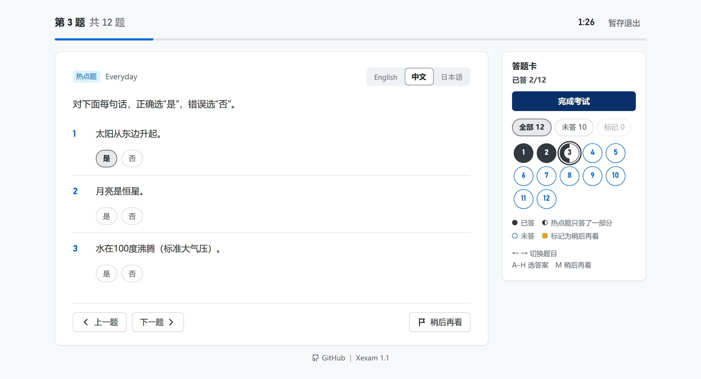

仓库里**没有题目**。Xexam 只提供导入、整理和练习题目的工具；题库是你自己的 Excel，不会被提交（`.gitignore` 已排除）。本页截图里的「General knowledge」和「Kitchen basics」是两个**虚构的演示题库**，不是任何真实考试的内容。截图里是中文界面；英语界面和日语界面的截图在 `docs/en/screenshots/` 和 `docs/ja/screenshots/`。

| | |
|---|---|
| 当前版本 | **v0.5.1**（见 [更新日志](#更新日志)，也可以在仓库的 [Releases](../../releases) 页看；在程序里：菜单 → **Xexam v0.5.1**） |
| 镜像 | 在 Docker Hub 上（公开，不用登录）：`docker.io/yuminspace/xexam-frontend` 和 `docker.io/yuminspace/xexam-backend`，标签 `latest` / `v0.5.1` / `sha-<提交>`（`sha-` 标签用来排查问题）。镜像副本：`ghcr.io/yumin-space/xexam-frontend` 和 `ghcr.io/yumin-space/xexam-backend`（私有，标签相同） |
| CPU 架构 | `linux/amd64`、`linux/arm64`（同一个标签里自动选对的） |
| 端口 | `8765`（默认只绑定本机） |
| 许可证 | [MIT](LICENSE) |

文档：[架构](docs/zh-CN/architecture.md) · [API](docs/zh-CN/api.md)（[OpenAPI](docs/en/openapi.yaml)，英文）· [数据库](docs/zh-CN/database.md) · [安全](docs/zh-CN/security.md) · [部署](docs/zh-CN/deployment.md) · [迁移与回滚](docs/zh-CN/migration.md) · [开发](docs/zh-CN/development.md)

---

## 目录

- [能做什么](#能做什么)
- [快速开始（安装部署）](#快速开始安装部署)
- [配置](#配置)
- [从手机或另一台电脑打开 Xexam](#从手机或另一台电脑打开-xexam)
- [使用方法](#使用方法)
- [Excel 题库格式](#excel-题库格式)
- [导入题库](#导入题库)
- [从 v0.4 升级](#从-v04-升级)
- [数据、备份和恢复](#数据备份和恢复)
- [通过 Cloudflare Tunnel 从互联网访问](#通过-cloudflare-tunnel-从互联网访问)
- [架构](#架构)
- [安全说明](#安全说明)
- [自动构建与发布](#自动构建与发布)
- [开发](#开发)
- [目录结构](#目录结构)
- [许可证](#许可证)
- [更新日志](#更新日志)

---

## 能做什么

- **你自己的题库。** 导入的每一份 Excel 工作簿（`.xlsx`）都是一个独立的题库，里面的每个工作表是一组题，考试时可以挑着考。可以把工作簿导入成新题库，也可以用新版本的文件更新已有的题库。保存之前会先显示预览，告诉你会有哪些变化。
- **模拟考试。** 选题库和工作表，选全部题目还是只考错题本，设定题数（比所选的题少时随机抽题）、要不要打乱顺序。题型有单选、多选和热点题（一组判断句，每一句选一个答案，例如 是 / 否）。答题过程中不显示对错；可以随时跳题、标记想回头再看的题，也可以暂存退出，以后接着考。
- **三种语言。** 整个界面（菜单、按钮和提示，包括答题页和服务器返回的错误提示）有英语、中文、日语三种，在 **界面设置** 里选。如果工作簿里有英语、中文、日语三列，答题页还可以随时切换题目文字，已选的答案不变。
- **成绩和学习记录。** 交卷后先看分数，再逐题看你的答案、正确答案、解析和记忆口诀。每场考试都保存在 **学习记录** 里（最近 500 场），可以筛选、查看每场考试的详情，也有按钮重做错题或重考这一场。
- **错题本。** 答错的题会自动收进错题本，连续答对 2 次后移出。可以复习它们，也可以只练它们。
- **设置存在服务器上。** 主题、界面语言和答完自动跳到下一题都保存在数据目录里，所以每个浏览器、每台设备上都一样，重启和更新镜像后也还在。
- **电脑和手机。** 窄窄的页头上有一个菜单按钮，宽屏上页面居中显示，手机上的触控区域至少 44 px。

---

## 快速开始（安装部署）

### 需要什么

- 一台装了 **Docker**（含 Compose v2）的机器：Windows / macOS / Linux 都行，**x86 或 ARM 都行**。
- 一个浏览器。

### 方式 A：直接拉取现成的镜像（推荐）

只需要仓库里的 [`docker-compose.yml`](docker-compose.yml) 这**一个文件**，不需要其他代码。

**如果你不是仓库的所有者：** 两个镜像在 Docker Hub 上是公开的，拉取它们不需要账号，也不需要 `docker login`。只有仓库是私有的：要用 `curl` 从仓库下载 `docker-compose.yml`（或者 `git clone` 整个仓库），请所有者把你的 GitHub 账号加为这个仓库的协作者（collaborator），然后在 GitHub → **Settings** → **Developer settings** → **Personal access tokens** → **Tokens (classic)** 里创建一个令牌，勾选 `repo` 权限。下面 `curl` 里的 `<你的令牌>` 就填它，`git clone` 要密码时也填它。也可以直接请所有者把这个文件发给你。

**1. 下载 `docker-compose.yml`**，放进一个新文件夹（例如 `xexam`）。最简单的办法：在 GitHub 上打开这个文件，点 **Download raw file**（下载原始文件）按钮。也可以用命令行：

```bash
curl -fLO https://raw.githubusercontent.com/Yumin-Space/xexam/main/docker-compose.yml
```

用 `curl` 时，在 `-fLO` 后面加 `-H "Authorization: token <你的令牌>"`。在 Windows PowerShell 里要写 `curl.exe`（`curl` 在那里是另一个命令的别名）。

**2. 不需要登录。** `docker-compose.yml` 从 Docker Hub 拉取两个镜像（`docker.io/yuminspace/xexam-backend` 和 `docker.io/yuminspace/xexam-frontend`），它们是公开的，所以直接做第 3 步。只有能访问 GitHub 容器仓库上那份私有镜像副本、又想改用它的人（所有者和协作者）才需要：登录一次，然后把 `docker-compose.yml` 里的两行 `image:` 改成 `ghcr.io/yumin-space/xexam-backend:latest` 和 `ghcr.io/yumin-space/xexam-frontend:latest`。

```bash
docker login ghcr.io -u <你的GitHub用户名>
# 只有用 GHCR 镜像副本时才需要。密码处填一个带 read:packages 权限的 GitHub 令牌
# （GitHub → Settings → Developer settings → Personal access tokens → Tokens (classic)）
```

用镜像副本时，账号没有读取权限，或者用的是 fine-grained 令牌而不是 classic 令牌，`docker login` 或下一步会被拒绝（`denied` 或 `unauthorized`）。Docker Hub 不需要这些。

**3. 启动。** 在 `docker-compose.yml` 所在的文件夹里运行：

```bash
docker compose up -d
```

这会从 Docker Hub 拉取两个镜像，并启动**两个容器**（`xexam-frontend`、`xexam-backend`）。然后在同一台机器上用浏览器打开 <http://localhost:8765>。

Docker 装在另一台机器上（服务器、NAS、虚拟机）？见 [从手机或另一台电脑打开 Xexam](#从手机或另一台电脑打开-xexam)。

界面一开始是英语。要换成中文或日语：打开菜单（右上角三条横线的按钮），选 **Settings**，在 **Language** 里选语言（这两处在中文界面里叫 **界面设置** 和 **语言**）。接下来按 [第一场考试](#第一场考试) 导入你的 Excel、开始考试。

> 从 v0.4 升级？请先看 [从 v0.4 升级](#从-v04-升级)：v0.5 第一次启动时会迁移数据库（迁移前会先写一份备份副本）。

| 操作 | 命令 |
|---|---|
| 更新到最新版本 | 先 `docker compose pull`，再 `docker compose up -d`。如果你的 `docker-compose.yml` 里还写着 `ghcr.io`（v0.5.1 之前的文件），先换成新的那份；数据卷不变 |
| 固定在某个版本 | 把 `docker-compose.yml` 里两个镜像的 `:latest` 都改成 `:v0.5.1`，再 `docker compose up -d` |
| 查看状态 | `docker compose ps`（两个容器都应该是 `healthy`） |
| 停止 / 再启动 | `docker compose stop` / `docker compose start` |
| 看日志 | `docker compose logs -f` |
| 看现在是哪个版本、什么架构 | 浏览器打开 <http://localhost:8765/api/info> |

> ⚠️ **不要运行 `docker compose down -v`**：`-v` 会把数据卷 `xexam_data` 一起删掉，题库、学习记录和设置都在里面。

默认设置在一台电脑上直接能用；所有选项见 [配置](#配置)。

### 方式 B：从源码构建（改代码时用）

需要完整的仓库代码：

```bash
git clone https://github.com/Yumin-Space/xexam.git
cd xexam
docker compose -f docker-compose.build.yml up -d --build
```

仓库是私有的时候，`git clone` 会要求你登录 GitHub（命令行提示输入密码时，填一个能读这个仓库的 GitHub 令牌）。

第一次构建要几分钟（编译 Rust 和前端）。它和方式 A 用**同一个卷**（`xexam_data`）和同样的容器名，所以数据是同一份、两者**不能同时运行**，切换前先 `docker compose stop`。

---

## 配置

默认设置在一台电脑上直接能用，不需要配置。要改的时候，在 `docker-compose.yml` 旁边建一个 `.env` 文件（模板见 [`.env.example`](.env.example)，不需要改 compose 文件本身）。改了 `.env` 之后，再运行一次 `docker compose up -d`。

| `.env` 里的名字 | 默认 | 作用 |
|---|---|---|
| `XEXAM_BIND` | `127.0.0.1:8765` | 对外监听的地址和端口（Nginx），必须写成 `IP:端口`。默认只有本机能连；`0.0.0.0:8765` = 局域网里别的机器也能连。⚠️ 只写端口号（如 `8766`）= 所有网卡都能连 |
| `XEXAM_ALLOWED_HOSTS` | 空 | 允许用哪些域名 / IP 访问，用逗号、空格或分号分隔，例如 `xexam.example.com,192.168.1.20` |
| `XEXAM_ALLOWED_ORIGINS` | 空 | 反向代理把 Host 改写成源站地址时才需要：填你的公网域名（带 `https://`） |
| `XEXAM_ALLOW_ANY_HOST` | `0` | 设 `1` = 不再检查 Host（只在前面已经有身份验证时用） |
| `XEXAM_PARSE_TIMEOUT_SECS` | `30` | 解析一份 Excel 的最长时间（秒） |
| `TZ` | `Asia/Tokyo` | 数据库里时间戳用的时区 |

更多说明见 [docs/zh-CN/deployment.md](docs/zh-CN/deployment.md) 第 3 节。

---

## 从手机或另一台电脑打开 Xexam

**这个程序没有登录**，默认只绑定本机（`127.0.0.1`）：只有运行 Docker 的那台机器自己能打开 <http://localhost:8765>。想从别的设备打开，有两种办法。

### 从另一台电脑经 SSH 打开（不用改配置）

Xexam 跑在一台你能用 SSH 登录的服务器、NAS 或虚拟机上时，在你自己的电脑上运行：

```bash
ssh -L 8765:127.0.0.1:8765 用户名@服务器地址
```

这个 SSH 连接开着的时候，在你自己的电脑上用浏览器打开 <http://localhost:8765>。服务器上什么都不用改，也不用开放端口。

### 让局域网里的手机或电脑直接访问

**只在你信任的网络里**这样做（例如家里的 Wi-Fi），不要在咖啡厅或公司网络里开：

1. 查出运行 Docker 的那台机器的局域网 IP（通常是 `192.168.x.x` 或 `10.x.x.x`）：
   - Windows：运行 `ipconfig`，看「IPv4 地址」那一行；
   - macOS：运行 `ipconfig getifaddr en0`；
   - Linux：运行 `hostname -I`，通常是第一个地址。
2. 在 `docker-compose.yml` 旁边建 `.env` 文件，写两行：`XEXAM_BIND=0.0.0.0:8765`，以及 `XEXAM_ALLOWED_HOSTS=` 后面接那个 IP 地址（例如 `XEXAM_ALLOWED_HOSTS=192.168.1.20`）。
3. 运行 `docker compose up -d`，然后在手机（iPhone 用 Safari）或另一台电脑的浏览器里打开这个 IP 地址加端口 8765（例如 `http://192.168.1.20:8765`）。

要在外面（不在家里的 Wi-Fi）用，请看下面的 [通过 Cloudflare Tunnel 从互联网访问](#通过-cloudflare-tunnel-从互联网访问)，不要直接把端口开到互联网上。

---

## 使用方法

### 第一场考试

1. 打开菜单（右上角三条横线的按钮），选 **题库管理**。在 **导入 Excel** 里保持选中 **新建题库**，点 **选择 Excel 文件**，选好你的工作簿（格式见 [Excel 题库格式](#excel-题库格式)）。看完预览后点 **确认新建题库**。
2. 在导入成功的提示里点 **去考试**（或者在菜单里选 **主页**）。**开始考试** 面板里一开始所有工作表都是勾选的：取消不想考的，然后点面板底部那一栏里的 **开始考试**（同一栏里的 **题数** 和 **打乱顺序** 决定出几道题、按什么顺序出）。
3. 答题，然后点 **交卷**。成绩页显示分数，以及每道答错的题的正确答案和解析（**全部题目（n）** 显示所有题目）。
4. 以后想再看这场考试：打开菜单，选 **学习记录**，再点这场考试的时间。

### 页面布局

- 除了考试页，每个页面都有一个窄窄的页头：左上角是 Xexam 标志（点它回到主页），右上角是三条横线的菜单按钮。
- 菜单按钮会打开一个小菜单，里面有 **主页**、**题库管理**、**学习记录** 和 **界面设置**，分隔线下面还有 **Xexam v0.5.1**，点它打开 [关于页面](#关于-xexam)。选好一项、点菜单外面或按 Esc 键，菜单就会关上。
- 在宽屏上，页面内容居中显示，最宽 1120 px。
- 考试本身是一个专注的全屏页面，没有页头。

### 题库管理

在这里导入 Excel，页面和主页一样紧凑。在 **导入 Excel** 里选 **新建题库** 或 **更新已有题库**（标题旁边的两个小按钮，悬停提示里有说明；更新时还要在 **要更新的题库** 里选好题库），然后点 **选择 Excel 文件**，或者把文件拖到这个面板的任意位置；选文件那一行上面的提示，末尾是 **查看 Excel 写法** 链接。**已有的题库** 里每个题库占紧凑的一行（文件、题数、工作表数和最近更新时间，带 **更新** 和 **删除**；工作表收在这一行右边的箭头下面），**导入记录** 每次导入只占一行。页面上的 **Excel 题库的写法和导入说明** 在你打开之前是收起的，它是 [Excel 题库格式](#excel-题库格式) 的简短版。导入的步骤和规则见 [导入题库](#导入题库)。

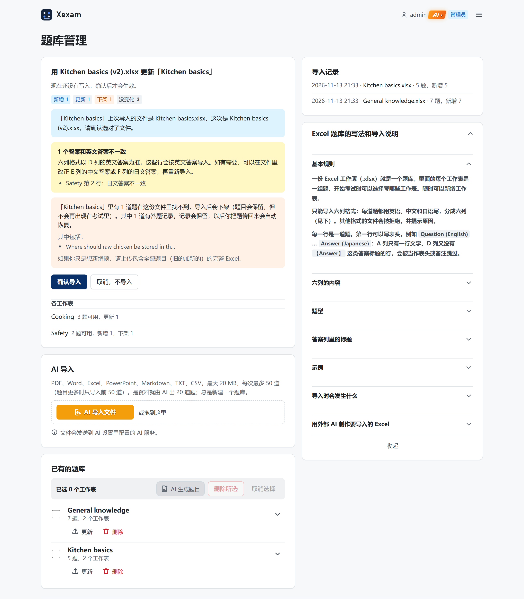

截图是用新版本的文件 `Kitchen basics (v2).xlsx` 更新「Kitchen basics」时的预览，这时还什么都没保存：几个小标签（新增 1、更新 1、下架 1、没变化 3）、文件名和上次导入时不同的提示、一道题将被下架的警告，以及 Cooking 和 Safety 两个工作表。下面是 **已有的题库** 里的两个演示题库；右边是导入记录和收起的写法说明。要下架的题按题目那一列的文字列出（这个演示题库里是 C 列，日语）。

### 主页

第一次导入之前，**开始考试** 面板只显示一段简短的说明和 **去题库管理**。导入之后，主页上有：

- **没交卷的考试**：页面最上面的一条紧凑横幅，显示你用 **暂存退出** 离开的那场考试的题库、已答题数和用时。**继续作答** 从停下的地方接着考；**放弃这场** 把它丢掉。它 **只保存在这个浏览器里**，其他设备上看不到。
- **开始考试**：
  - 在面板右上角选择从哪里出题：**全部**（所选工作表里的所有题）或 **错题本**（只考还需要巩固的题）。两个按钮都显示题数。所选工作表里没有要复习的错题时，**错题本** 不能选，标题下面有一行字说明原因；选了 **错题本** 时，这一行字说明一道题怎样移出错题本（连续答对 2 次）。手机上这两个按钮也留在标题旁边：中文界面里图标、文字和题数都显示，英语和日语界面只显示图标和题数。
  - **考哪些题库和工作表**：每个题库是一张卡片，里面一行一个工作表。
    - **全选** 和 **全部取消** 在这一行标题的右边。
    - 题库的复选框会勾选或取消它的全部工作表，也可以只勾选单个工作表。只勾选了一部分时，复选框显示 −，题库那一行会写例如 **已选 1/2 个工作表**（收起时也显示）。
    - 题库那一行右边的箭头展开或收起它的工作表。最多两个题库时一开始是展开的，超过两个时一开始是收起的；你展开或收起的状态会保留到重新加载页面为止。列表没有自己的滚动框，跟着页面一起滚动。
    - **错题 2** 这样的小标签表示这个题库或工作表里有几道题在错题本里。
  - 面板最下面的一栏：**开始考试**、当前范围的说明（例如 **当前范围共 12 题**），旁边是两个选项 **题数** 和 **打乱顺序**。这个面板在屏幕上时，这一栏固定在屏幕底部。手机上第一行是范围说明和两个选项，第二行是 **开始考试**。
  - **题数** 比当前范围里的题少时，从整个范围里随机抽题，范围说明会变成例如 **当前范围共 12 题，本次随机抽 11 题**。**打乱顺序** 只决定这些题按随机顺序出，还是按题库里的顺序出。
- **最近一场考试**：上一场考试的成绩，带 **查看详情** 和 **全部学习记录**。
- **概况**：有几个题库、几个可用工作表、几道可用题目、错题本里有几道题，带 **复习错题**（错题本里有题时）和 **题库管理**。

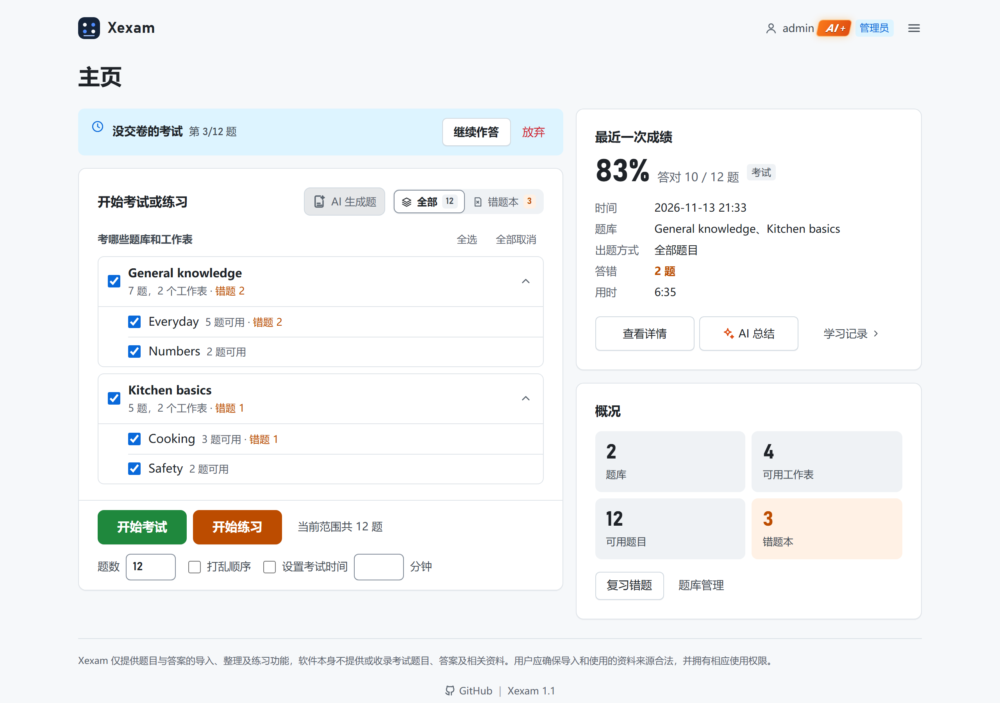

没交卷的考试是最上面的一条横幅；**全部** 和 **错题本** 在 **开始考试** 的右上角；**考哪些题库和工作表** 右边是 **全选** 和 **全部取消**；两个演示题库是两张展开的卡片，里面是各自的工作表；面板最下面一栏是 **开始考试**、**当前范围共 12 题**、**题数** 和 **打乱顺序**；右边是最近一场考试和概况。

### 答题页

本页顶部的截图就是答题页。

- 顶部：例如 **第 4 题 共 12 题**、已用时间，以及 **暂存退出**：保留你的答案和用时，之后可以在同一个浏览器的主页接着考。
- **答题过程中不显示对错，也不显示分数。**
- **英语** / **中文** / **日语** 切换题目文字（四列格式里 Excel 的 A、B、C 列）。切换只换文字：已选的答案、选项字母、计时和判分都不变。热点题的选项按钮也跟着换。某道题没有的语言，或者文字和日语对不上的语言，这道题的那个按钮会置灰。你选的语言会作为设置保存下来，交卷后的回顾也用这种语言显示。
- **上一题** 和 **下一题** 在题目之间移动（最后一题时，**下一题** 变成 **交卷**）。**稍后再看** 标记一道你想回头再看的题。
- **答题卡**：每道题一个小方块。实心 = 已答，半实心 = 热点题只答了一部分，空心 = 未答，黄色小方块 = 标记为稍后再看。点小方块就跳到那道题。小方块下面是 **已答 3 / 12 题** 和 **交卷**。
- **交卷** 前会先确认；没答的题按答错计分。
- 判分：单选、多选要**正好选中全部正确选项**才算对；热点题**每个小项都对**才算这题对。
- 键盘（电脑）：`←` `→` 上一题 / 下一题，`A`–`H` 选答案（选择题），`M` 稍后再看。

### 成绩页

分数、答对和答错的题数，以及一排小方块，每道题一个。**答案与解析** 可以显示 **只看错题（n）** 或 **全部题目（n）**：你的选择、正确答案、解析、记忆口诀、中文翻译（如果有）以及这道题到现在答过几次。按钮：**只重做错题**、**再考一次**、**在学习记录里查看** 和 **回首页**。

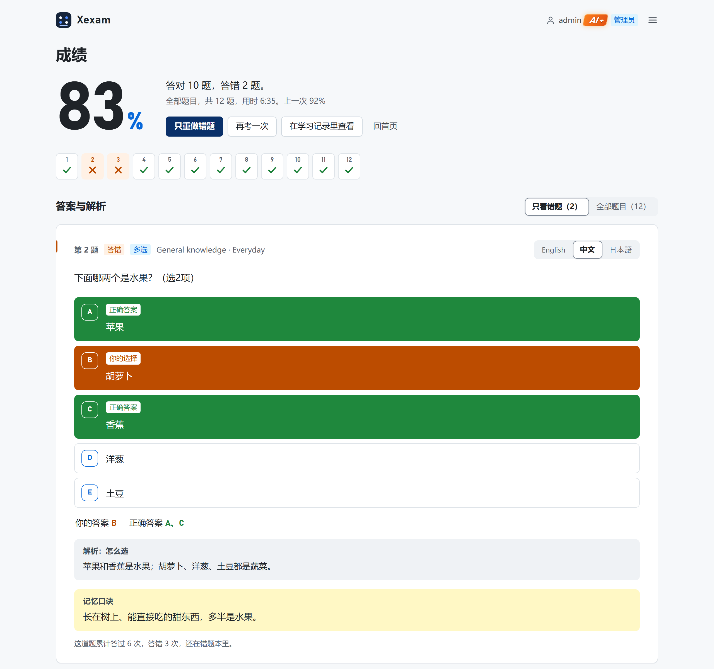

解析和记忆口诀按工作簿里写的原样显示；这个演示题库里它们是中文。

### 学习记录

- **概况**：考试场数、**平均正确率**、**最高正确率**，以及最近几场成绩的小柱状图。
- **筛选**：**题库**、**正确率**（**不限**、**60% 以下**、**60%–79%**、**80% 及以上**），以及用 **开始日期** 和 **结束日期** 指定的日期范围。**清除筛选** 把它们全部恢复。
- **考试列表**：每场考试一行（手机上是一张卡片），显示考试时间、题库、答了几题、用时、答对几题和正确率。点时间打开这场考试；**删除** 删掉这条记录。
- **考试详情**（一场考试）：分数和这场考试的基本信息，下面逐题列出你的答案、正确答案、解析和记忆口诀。**只看错题（n）** / **全部题目（n）** 在只看错题和看全部题之间切换。**重做错题** 只用这场考试里答错的题开始一场考试；**重考这一场** 把同样的题再考一遍；**删除这条记录** 删掉它。v0.5 之前考的场次只有分数，因为 v0.4 没有保存每道题的作答。
- 右上角的 **复习错题** 打开 **错题复习**：列出错题本里的每道题，显示你答过几次，以及还要连续答对几次才会移出。可以只看某一个题库；**练习这些题** 用它们开始一场考试。
- 删除：删除一条记录时，每道题的答题统计会保留，所以错题本不会变。**全部删除** 删掉所有考试记录；勾选 **同时清空错题本和每道题的答题统计**，会把这些也一起清空。每次删除都会先确认，删除后无法恢复。
- Xexam 只保留最近 500 场考试，更早的记录会自动删除。

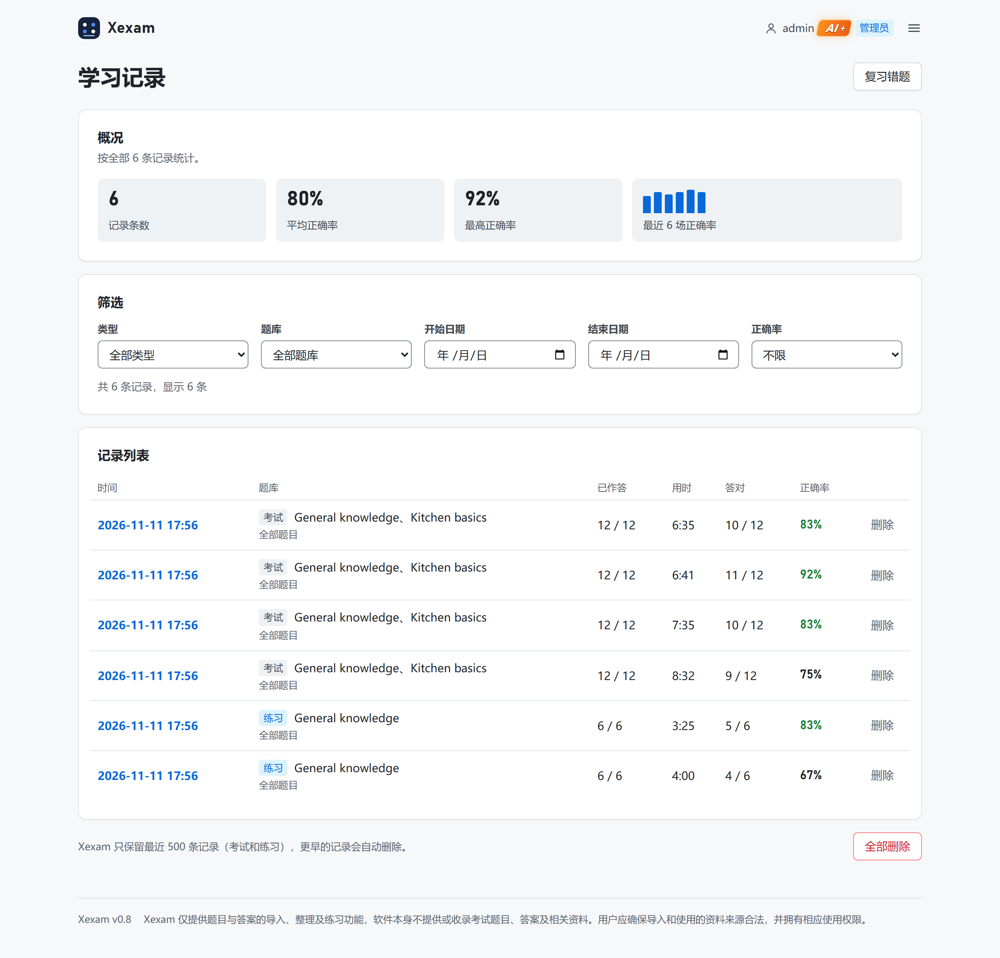

### 错题本

答错的题进入错题本，之后**连续 2 次答对**自动移出。可以在主页使用（**开始考试** 面板右上角的 **错题本**），也可以在 **学习记录** → **复习错题** → **练习这些题**，或者交卷后直接点 **只重做错题**。

### 界面设置

- **外观**（主题）：**跟随系统**（默认；按设备的浅色或深色设置显示）、**浅色** 或 **深色**。
- **语言**（界面语言）：**English**（默认）、**中文** 或 **日本語**。它决定所有地方的菜单、按钮和提示文字，包括答题页和服务器返回的错误提示。题目文字在答题页上有自己的切换按钮。
- **答题** → **答完自动跳到下一题**（默认关闭）：单选题选好答案后，或者热点题的每个小项都选好后，自动打开下一题。多选题永远不会自动跳转。开启时，答题页顶部会显示 **自动下一题：开**。
- **恢复默认设置**：主题、界面语言和答完自动跳到下一题恢复成默认值。题目语言保持不变。

设置保存在 Xexam 服务器上，存在数据目录里的数据库中，和你上次在答题页选的题目语言放在一起。所以重启、更新镜像、清除浏览器缓存、换别的浏览器或设备之后，设置都还在。没有账号：用这个 Xexam 的所有人共用一套设置。只有没交卷的考试留在当前浏览器里。

<table>
<tr>
<td width="50%">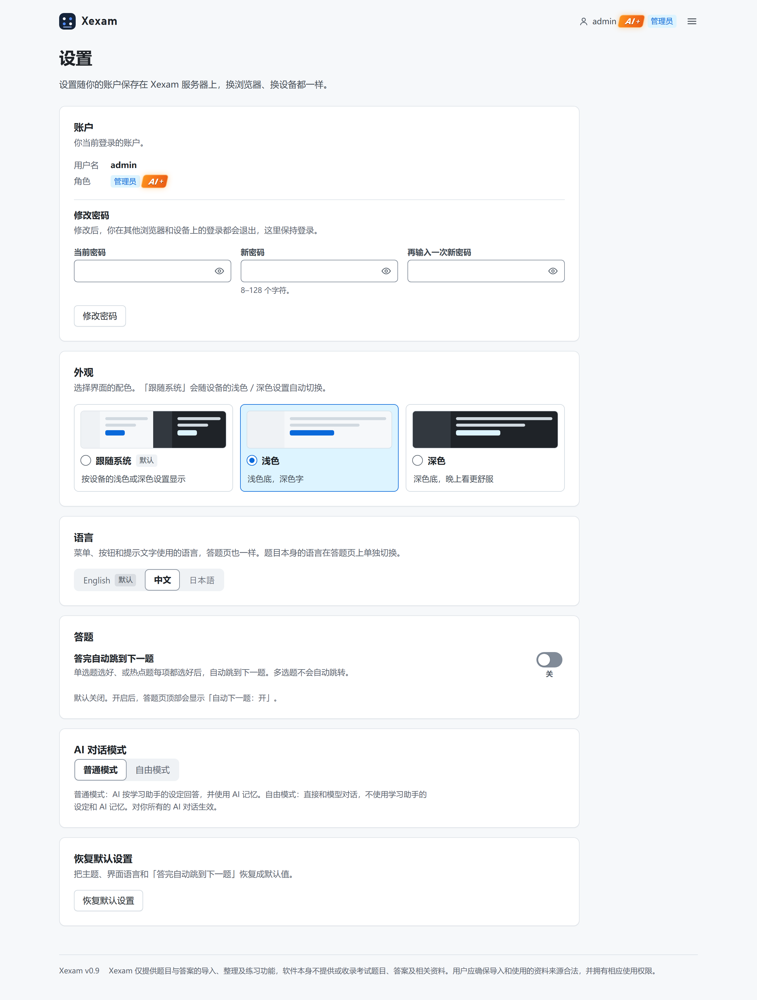</td>
<td width="50%">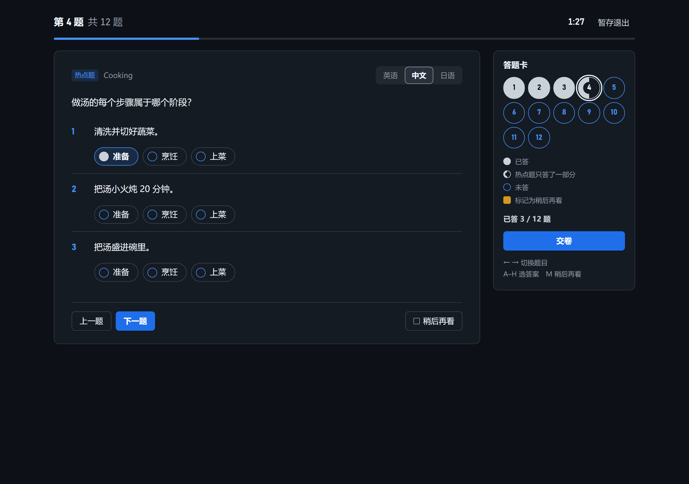</td>
</tr>
<tr>
<td>界面设置：<b>外观</b>、<b>语言</b>、<b>答题</b> 和 <b>恢复默认设置</b>。</td>
<td><b>深色</b> 主题，这里是答题页。</td>
</tr>
</table>

### 关于 Xexam

菜单的最后一项 **Xexam v0.5.1** 会打开 **关于 Xexam**：**版本**、**服务器** 的 CPU 架构、**许可证**，以及 **更新内容**。**更新内容** 就是界面语言那一份 README 的 [更新日志](#更新日志)（中文界面显示的是本文件的更新日志）。最新的版本是展开的；更早的版本折叠在 **更早的版本** 下面。

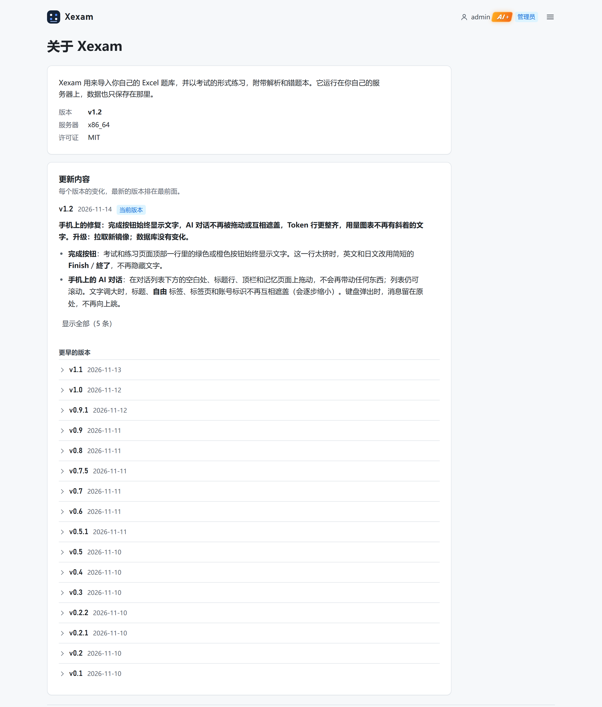

### 在 iPhone 上使用

- 在 iPhone 的 Safari 里打开服务地址（需要先做 [从手机或另一台电脑打开 Xexam](#从手机或另一台电脑打开-xexam)）。需要 **iOS 15.4 或更新**。
- 点分享按钮 → **添加到主屏幕**。之后它像独立应用一样全屏打开，图标是答题卡样式的 Xexam。
- 右上角三条横线的按钮打开和电脑上一样的小菜单。主页上，**全部** 和 **错题本** 留在 **开始考试** 标题旁边（中文界面带文字；英语和日语界面只显示图标和题数），**开始考试** 按钮固定在屏幕底部，它上面一行是当前范围、**题数** 和 **打乱顺序**。答题页上，**上一题**、**下一题** 和 **稍后再看** 固定在底部；答题卡在题目下方，**已答 x / n 题** 和 **交卷** 在小方块上面。学习记录显示成紧凑的卡片。
- 按钮和其他触控区域都不小于 44 px，适合手指点；刘海和底部横条的安全区已处理。

下面是 390 px 宽的 iPhone 上的截图：

<table>
<tr>
<td width="25%">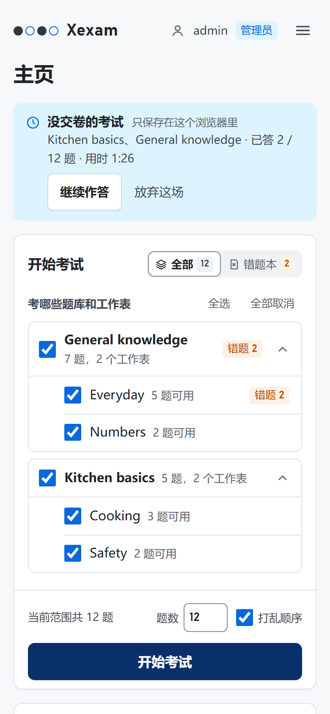</td>
<td width="25%">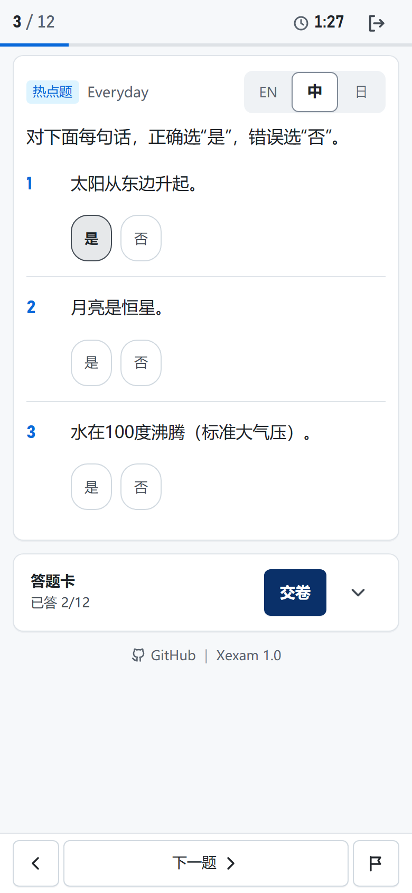</td>
<td width="25%">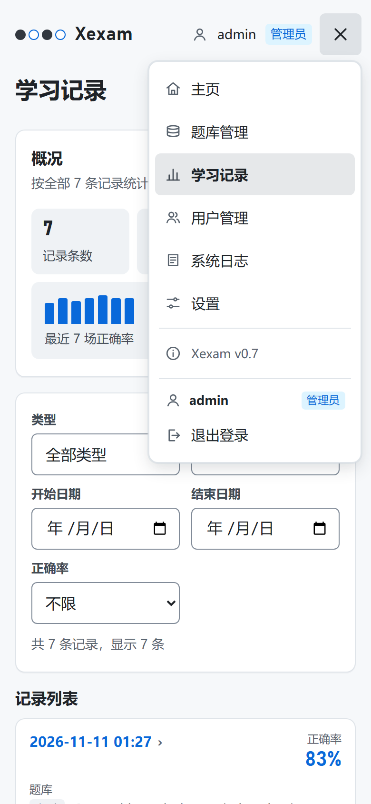</td>
<td width="25%">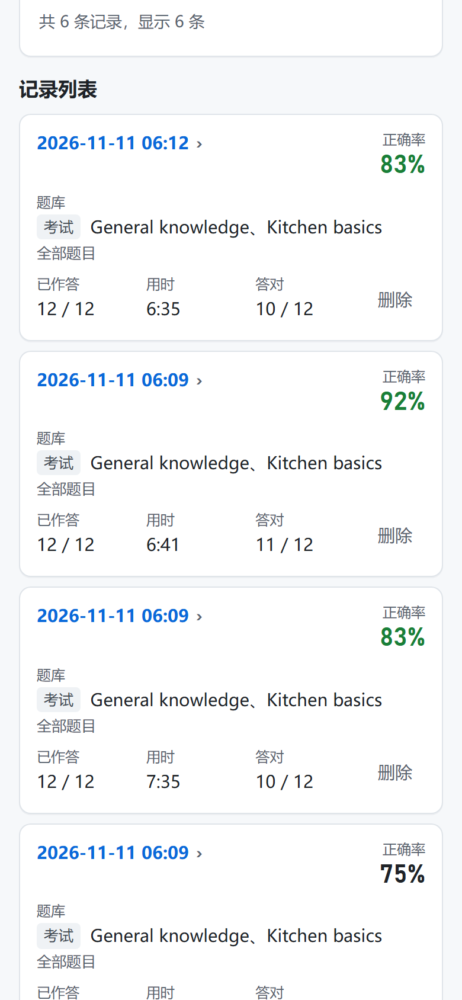</td>
</tr>
<tr>
<td>主页：<b>开始考试</b> 固定在屏幕底部，上面一行是当前范围、<b>题数</b> 和 <b>打乱顺序</b>。</td>
<td>答题：<b>上一题</b>、<b>下一题</b> 和 <b>稍后再看</b> 固定在底部。</td>
<td>点三条横线的按钮打开的菜单（这里是在学习记录页上）。</td>
<td>学习记录：每场考试是一张紧凑的卡片。</td>
</tr>
</table>

---

## Excel 题库格式

一份工作簿（`.xlsx`）就是一个题库。每个工作表是一组题，一行一道题。

### 最简单的写法：三列格式

下面是一道完整的多选题，占工作表里的一行（和 **题库管理** 页上 **Excel 题库的写法和导入说明** 里的示例一样）：

| A | B | C |
|---|---|---|
| 下面哪两个是水果？<br>A. 胡萝卜<br>B. 土豆<br>C. 苹果<br>D. 洋葱<br>E. 香蕉 | （空着） | 【答案】C、E<br>【解析·怎么选】苹果和香蕉是水果，其他都是蔬菜。<br>【记忆口诀】甜的是水果。 |

- **A 列**：题目。
- **B 列**：中文翻译（可以不写）。
- **C 列**：先写答案 `【答案】…`；再写 `【解析·怎么选】` 和解析、`【记忆口诀】` 和口诀（这两段可以不写）。这些标题也可以用日语写，例如 `【正解】`、`【解説】`。

在单元格里换行：Windows 上按 Alt+Enter，Mac 上按 Control+Option+Return。第一行如果是表头（A 列写着 `题目` 或 `Question` 之类），会被跳过。

**题目只有一种语言时**（不管是中文、英语还是日语），就用三列格式：题目写在 A 列，B 列空着，不需要写日语。答题页上不管选哪种题目语言，这些题都显示 A 列的文字（它们的 **英语** 和 **中文** 按钮是灰的）。

**选择题的写法**

- 选项写在题干下面，从 `A.` 开始按字母顺序，一行一个，至少两个：`A. 内容`。
- 答案只有一个字母就是单选题，有多个字母就是多选题：`【答案】C` 或 `【答案】C、E`。

**热点题的写法**（一组判断句，每一句选一个答案）

- A 列的第一行写 `ホットスポット`（也可以写 `HOTSPOT`），下一行开始写题干。
- 每个小项一行，写成 `1. 内容　はい / いいえ`：内容后面空一个**全角空格**（`　`）或一个制表符，再写这个小项的选项，选项之间用 ` / ` 隔开（斜杠两边各一个空格）。选项可以是任何词，例如 `准备 / 烹饪 / 上菜`。
- 答案要写出每个小项的选择：`【答案】1 是；2 否`。每个小项的答案写这个小项的某个选项词；是非题也可以写 `是`/`否`、`はい`/`いいえ` 或 `Yes`/`No`。答案不是这个小项的选项时，这道题会在预览里作为读不出来的题列出，并写明原因。

例如这道热点题（A 列和 C 列，B 列空着；`はい / いいえ` 前面的空白是全角空格）：

```
ホットスポット
判断下面每句话是否正确。
1. 太阳从东方升起。　はい / いいえ
2. 月亮是恒星。　はい / いいえ
```

```
【答案】1 是；2 否
【解析·怎么选】太阳从东方升起；月亮只是反射太阳光，不是恒星。
```

### 四列格式（带英语）

就是把三列格式整体右移一列，英语放在新的 A 列。它是给题目用日语写在 C 列的工作簿用的；Xexam 根据 C 列的日语和 D 列的答案认出这种格式。

| 列 | 内容 |
|---|---|
| **A** | **英语**题目（可以不写）。热点题的英语第一行写 `HOTSPOT`，小项末尾写 `Yes / No` 这样的英语选项 |
| **B** | **中文**翻译（可以不写）。`【中文翻译】` 标题可有可无 |
| **C** | **日语**题目。题目、选项和答案都以这一列为准：题目 id、选项字母、热点题的小项都来自这一列。热点题以 `ホットスポット` 开头 |
| **D** | 答案和解析，写法和三列格式的 C 列一样 |

A、B、C 三列是**同一道题的三种语言**，结构要**完全一一对应**：同一道题、同样的选项字母、同样的小项个数和顺序。A 列的第 1 项 = B 列的第 1 项 = C 列的第 1 项，选项 A = 选项 A = 选项 A。答案只写一份（D 列），三种语言共用。

**热点题的选项按语言写在各自那一列里**：每个小项末尾用本语言写出选项，三种语言的第 j 个选项是同一个意思。例如同一个小项：

| 列 | 小项的写法 |
|---|---|
| A 英语 | `1. Wash and cut the vegetables.　Preparation / Cooking / Serving` |
| B 中文 | `1. 清洗并切好蔬菜。　准备 / 烹饪 / 上菜` |
| C 日语 | `1. 野菜を洗って切る。　下ごしらえ / 調理 / 盛り付け`（意思同上） |

所以一个小项的答案可以用三种语言里任何一种的选项词来写（例如 `Cooking`、`調理` 或 `烹饪`），因为选项按位置一一对应。在答题页上切换语言时，题干、选项和热点题的选项按钮都会换成对应那一列的文字。某一列没有写选项（或个数和日语对不上）时，这道题的这个语言仍然可用，只是选项按钮显示日语的选项。

程序看内容判断是三列格式还是四列格式（四列格式的答案在 D 列、C 列是日语），不用改任何设置。三列格式的工作簿照样可以上传，只是没有英语。

读不出来的题**不会被猜**：它们会在预览里列出原因（多半是答案列没写 `【答案】…`，或答案字母不在选项里），不会悄悄判错。

---

## 导入题库

### 新建题库还是更新

一个题库就是一份导入的 Excel 工作簿。在 **题库管理** → **导入 Excel** 里用标题旁边的两个小按钮选择文件导入到哪里（悬停提示里有说明）：

| 选择 | 会发生什么 |
|---|---|
| **新建题库** | 新建一个题库，以文件名命名（去掉 `.xlsx`；名字已被占用时，加上 ` (2)`、` (3)` ……）。已有的题库不会改动。同一份工作簿可以导入两次，成为两个独立的题库，它们的学习记录不会混在一起 |
| **更新已有题库** | 用这份文件替换你在 **要更新的题库** 里选的那个题库的题目。文件里没有的题**只在这个题库里**下架。题库的名字不变 |

导入一份不同的工作簿时选 **新建题库**；上传已经导入过的工作簿的新版本时选 **更新已有题库**。每次都要上传**整份**工作簿，不要只传新增的题。

### 先预览，再确认

上传后，Xexam 会读取并检查文件，然后显示预览：用几个小标签显示会 **新增**、**更新**、**恢复上架**、**下架** 多少题，**没变化** 和 **读不出来** 的各有多少题（为 0 的不显示）；每个工作表一行，带它的数字；读不出来的每一行的行号和原因，收在所属工作表那一行的下面（例如 **2 题读不出来**）。**你确认之前什么都不会写入**（点 **确认新建题库** 或 **确认导入**；点 **取消，不导入** 就放弃这次导入）。在下面这些情况下，预览还会提醒你：

- 你用来新建题库的文件，和某个已有题库导入时用的文件同名（它会建议改为更新那个题库）；
- 你用来更新题库的文件，名字和上次导入的不一样；
- 会有题目被下架。它会列出其中一些，并在导入前再问你一次。

### 导入规则

这份文件被当成它所导入的那个**题库的完整内容**。其他题库永远不会被改动。

| 情况 | 结果 |
|---|---|
| 文件里有、题库里没有的题 | **新增** |
| 同一道题，但其它内容（其它选项、答案、解析、翻译）改了 | **更新**（答题记录不受影响） |
| 题库里有、文件里找不到的题 | **下架**：题目和答题记录都保留，但不再出现在考试里 |
| 以前下架、这次又出现的题 | **恢复上架**，它在错题本里的记录也跟着回来 |
| 改了工作表名、题干或第一个选项 | 算**一道新题**：旧题下架，新题从没有答题记录开始 |
| 这份文件里一道可用的题都没有 | 拒绝导入（防止把题库清空） |

题目是按工作表名、题干和第一个选项来识别的（空格不影响）。

### 删除题库

题库那一行的 **删除** 会先请你确认（例如 **删除「Kitchen basics」？**）。这个题库的题目（上架的和已下架的）和它的导入记录都会被删除。复选框 **同时删除这个题库的学习记录** 默认不勾选：

- **不勾选**：答题记录和考试记录都保留。在这些记录里，这个题库的题显示为已删除。
- **勾选**：这个题库的题的答题记录，以及没有其他现存题库参与的考试记录，也一起删除。

删除后无法恢复，只有你自己的备份能找回来（见 [数据、备份和恢复](#数据备份和恢复)）。

---

## 从 v0.4 升级

在部署上，v0.5 还是同样的两个镜像、同样的端口、同样的卷，也没有新的环境变量。变的是界面、**数据库 schema**（v1 → v2），以及从 v0.5.1 起镜像的来源：新的 `docker-compose.yml` 从 Docker Hub（`docker.io/yuminspace/…`，公开，不用登录）拉取，不再从 `ghcr.io` 拉取。把你的 `docker-compose.yml` 换成新的那份，或者把里面的两行 `image:` 改成 `docker.io/yuminspace/xexam-backend:latest` 和 `docker.io/yuminspace/xexam-frontend:latest`。项目名和数据卷 `xexam_data` 都不变，所以数据原样保留。

### 升级

下面这些命令在 Linux / macOS 的终端和 Windows PowerShell 里都能用。

```bash
# 1. 备份卷（先停止；备份文件里是你的整个数据库，不要提交它）
docker compose stop
docker run --rm -v xexam_data:/data -v "${PWD}:/backup" alpine tar czf /backup/xexam-data-v04.tgz -C /data .

# 2. 换上新的 docker-compose.yml（Docker Hub 上的镜像）后，拉取 v0.5 并启动（不要用 down -v）
docker compose pull
docker compose up -d

# 3. 查看升级信息和副本的文件名
docker compose logs backend
```

后端**第一次启动**时，在响应任何请求之前：

1. **写一份副本**：把当前的数据库复制到卷里的 `/data/backups/xexam-schema1-<YYYYmmdd-HHMMSS>.db`（不用 Docker 时：数据目录里的 `backups/`）。已有的文件永远不会被覆盖。如果副本写不出来（磁盘满、没有权限），后端会拒绝启动，数据库保持原样；`docker compose logs backend` 里会写明原因。
2. **迁移**数据库，在一个事务里完成。你现有的所有内容变成**一个题库**，以你最近一次导入的文件名命名（去掉 `.xlsx`；如果从来没导入过，就叫 `Question bank`）。**题目 id 不变**，所以错题本、每道题的答题统计和成绩历史都还对应着原来的题。以前的考试记录都保留，归到这个题库下；它们没有每道题的详情，因为 v0.4 没有保存作答。

日志里会有这样一行：`Upgraded the database to schema 2. A copy of the previous version was saved first: /data/backups/xexam-schema1-20261110-140501.db (…)`（意思是：数据库已升级到 schema 2，升级前先保存了旧版本的副本）。以后再启动不会再迁移，也不会多写任何东西。

你还会注意到：

- **界面一开始是英语**（v0.4 是中文）。打开菜单，在 **Settings** → **Language** 里选 **中文**（在中文界面里是 **界面设置** → **语言**）；设一次，所有浏览器和设备都生效。
- 在 **界面设置** 里选定主题之前，主题跟随设备（浅色或深色）。
- 题目语言以前由每个浏览器各自记住。某个浏览器第一次打开 v0.5 时，它的选择会转存到服务器上（前提是服务器上还是默认值，也就是日语）。
- 浏览器里暂存的没交卷的考试会保留，可以继续作答。

升级后检查：<http://localhost:8765/api/info> 显示 `"version": "0.5.1"`，`bankCount` 和升级前一样（虽然叫这个名字，它数的是可用的题目，不是题库）；**题库管理** 里有一个题库，包含你所有的工作表；**学习记录** 里列出你以前的考试；**学习记录** → **复习错题** 里的题数和你原来错题本里的一样。

### 回退到 v0.4

回退就是**恢复迁移前写的那份副本**，然后运行 v0.4 的镜像。迁移之后在 v0.5 里做的所有事情都会丢失（新题库、导入、考试记录、设置）。

```bash
# 1. 停止 v0.5（不要用 down -v）
docker compose stop

# 2. 找到那份副本
docker run --rm -v xexam_data:/data alpine ls -l /data /data/backups

# 3. 把副本放回去，作为 xexam.db（用第 2 步看到的文件名）
docker run --rm -v xexam_data:/data alpine cp /data/backups/xexam-schema1-20261110-140501.db /data/xexam.db

# 4. v0.4 只在私有的 GHCR 镜像副本上（Docker Hub 从 v0.5.1 开始才有）：先 docker login ghcr.io，再把 docker-compose.yml 里
#    两个镜像改成 ghcr.io/yumin-space/xexam-backend:v0.4 和 ghcr.io/yumin-space/xexam-frontend:v0.4，然后启动
docker compose up -d
```

第 3 步也可以换成恢复你升级时自己做的 `.tgz`（见 [备份和恢复](#备份和恢复)）。⚠️ **不要跳过恢复副本、直接在有多个题库的数据库上运行 v0.4**：v0.4 会把所有题库当成一个，它的下一次导入会把其他所有题库的题都下架，而且它会把考试记录删减到 60 条。详见 [docs/zh-CN/migration.md](docs/zh-CN/migration.md) 和 [docs/zh-CN/database.md](docs/zh-CN/database.md) 第 6 节。

### 从更早的版本（v0.2.x，Python 单镜像）升级

数据卷 `xexam_data` 是同一个。但旧版是一个容器、新版是两个，且容器名 / 端口相同，所以：

1. `docker compose stop`（旧版）。
2. 备份数据卷（见 [备份和恢复](#备份和恢复)）。
3. `docker rm xexam`：删掉旧版的容器（**只删容器，不删数据卷**）。旧版的容器叫 `xexam`，新版是 `xexam-frontend` 和 `xexam-backend`；不删的话旧容器还占着 8765 端口，新的会起不来。
4. 换上新的 `docker-compose.yml`，再运行 `docker compose pull` 和 `docker compose up -d`。第一次启动时会把数据库迁移到 schema v2，过程和上面写的完全一样（会在 `backups/` 里留一份副本）。
5. 打开 <http://localhost:8765>，核对题数、错题数和成绩历史和升级前一样。

想回到旧版：旧代码在 Git 标签 `python-v0.2`，旧镜像 `ghcr.io/yumin-space/xexam:v0.2.2` 仍然可以从 GHCR 拉取（私有：先 `docker login ghcr.io`；Docker Hub 上没有它）。启动它之前，先从 `backups/`（或你自己的备份）恢复 schema 1 的副本。详见 [docs/zh-CN/migration.md](docs/zh-CN/migration.md)。

---

## 数据、备份和恢复

数据保存在一个 **Docker 命名卷**里，不是你电脑上看得见的文件夹。

- 卷名是 `xexam_data`（项目名 `xexam` + 卷名 `data`）。里面有 `xexam.db`，升级后还有一个 `backups/` 文件夹，存着 schema 迁移前写的副本。程序永远不会删除这些副本；不再需要时请自己删掉。
- 更新镜像、`docker compose down`、删除并重建容器，**数据都还在**。
- ⚠️ **不要运行 `docker compose down -v`**：`-v` 会把卷一起删掉，数据就没了。

什么存在哪里：

| 位置 | 内容 |
|---|---|
| 卷里的 `xexam.db` | 题库和题目（包括已下架的）、导入记录、每道题的答题统计（错题本）、考试记录和每道题的作答详情，以及设置（主题、界面语言、答完自动跳到下一题、题目语言） |
| 卷里的 `backups/` | schema v2 迁移前写的数据库副本 |
| 你的浏览器（`localStorage`） | 没交卷的考试（题目 id、答案、标记、用时；不含题目文字），以及一份设置的副本（用来显示第一屏） |

### 备份和恢复

先停止程序再操作，数据库更安全。备份卷时 `backups/` 也会一起备份。下面的命令在 Linux / macOS 的终端和 Windows PowerShell 里都能用。

```bash
docker compose stop

# 备份：把卷打包成当前文件夹里的 xexam-data.tgz
docker run --rm -v xexam_data:/data -v "${PWD}:/backup" alpine tar czf /backup/xexam-data.tgz -C /data .

docker compose start
```

```bash
# 恢复（会覆盖卷里的同名文件）
docker compose stop
docker run --rm -v xexam_data:/data -v "${PWD}:/backup" alpine tar xzf /backup/xexam-data.tgz -C /data
docker compose start
```

换电脑：在新电脑上放好新的 `docker-compose.yml`（不用登录，镜像来自 Docker Hub），先 `docker compose up -d` 建好卷，再按上面的方法恢复备份。备份文件里有你的整个数据库，**不要提交到 Git**（`.gitignore` 已忽略 `*.tgz`）。更多细节（连接设置、验证备份）见 [docs/zh-CN/database.md](docs/zh-CN/database.md)。

### 迁移更早版本的学习记录（`progress.json`）

如果你有更早的版本留下的 `progress.json`，用一个临时容器把它放进卷里，再重启（命令在 bash 和 PowerShell 里都能用）：

```bash
docker compose stop
docker run --rm -v xexam_data:/data -v "${PWD}:/src:ro" alpine sh -c "cp /src/progress.json /data/progress.json && chown 10001:10001 /data/progress.json"
docker compose start
```

重启时会自动把里面的成绩和错题记录迁移进数据库，**只迁移一次**，日志里会写 `Migrated the old study records into the database`（意思是：已把旧的学习记录迁移进数据库；`docker compose logs` 能看到）。只有数据库里还没有学习记录时才会迁移，已有的记录永远不会被覆盖。文件格式不对时日志里会写明原因，修好文件后重启即可再试。

> 这里没有用 `docker cp`：它默认以 root 身份写入，文件属于 root，而容器里的程序是非 root 用户（uid 10001），可能读不了。

---

## 通过 Cloudflare Tunnel 从互联网访问

适用场景：Xexam 跑在家里的局域网里，`cloudflared`（Cloudflare 的隧道客户端）也在局域网里的某台机器上（不一定是同一台），你想用自己的域名在外面访问，并且在 **Cloudflare Access** 里设置身份验证。

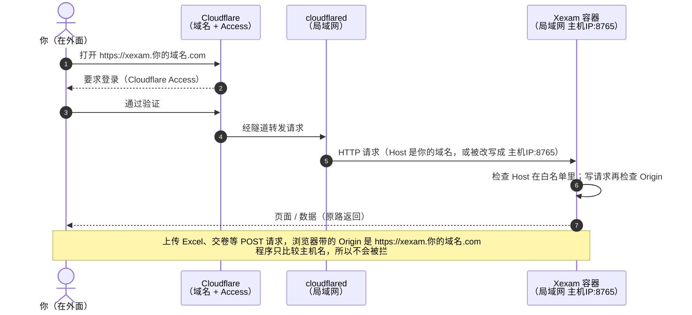

### 需要做的三件事

**1. 让局域网里的 cloudflared 连得到容器。** 默认容器只绑定本机（`127.0.0.1`）。在 `docker-compose.yml` 旁边建一个 `.env` 文件：

```ini
# 让局域网里别的机器（cloudflared）能连到这台机器的 8765 端口
XEXAM_BIND=0.0.0.0:8765
# 允许用你的域名访问（可以写多个，逗号分隔）
XEXAM_ALLOWED_HOSTS=xexam.你的域名.com
```

然后 `docker compose up -d`。

> 如果 cloudflared 和 Xexam 在**同一台机器**上，可以不改 `XEXAM_BIND`（保持默认的只绑定本机），隧道的目标写 `http://localhost:8765` 就行。

**2. 在 Cloudflare 里把域名指到 Xexam。** Zero Trust 控制台 → Networks → Tunnels → 你的隧道 → Public Hostname：

| 项目 | 填什么 |
|---|---|
| Subdomain / Domain | `xexam` / `你的域名.com` |
| Service Type | `HTTP`（不是 HTTPS） |
| URL | `运行 Xexam 的主机的局域网IP:8765`，例如 `192.168.1.20:8765` |

**3. 在 Cloudflare Access 里加一条应用策略**，只允许你自己的账号（邮箱）访问这个域名。

### 几种常见情况

| 你的情况 | 怎么配 |
|---|---|
| 隧道把 **Host 原样转成你的域名** | 只需要 `XEXAM_ALLOWED_HOSTS=xexam.你的域名.com`，上面第 1 步就够了 |
| 你在 Cloudflare 里设了 **HTTP Host Header**（`httpHostHeader`），把 Host 改成了 `192.168.1.20:8765` | `XEXAM_ALLOWED_HOSTS=192.168.1.20` 再加 `XEXAM_ALLOWED_ORIGINS=https://xexam.你的域名.com`。浏览器发的 `Origin` 仍是公网域名，要单独放行 |
| 不确定 Host 到底是什么 | 先照上面第 1 步配好再打开页面。如果被拒绝（403），页面上的提示会写出它看到的 `Host`（或 `Origin`）：把那个值加进 `XEXAM_ALLOWED_HOSTS`（或 `XEXAM_ALLOWED_ORIGINS`），`docker compose up -d` 重新创建容器即可 |
| 不想列域名，前面已经有 Access 验证 | `XEXAM_ALLOW_ANY_HOST=1`（不再检查 `Host`；写请求的 `Origin` 检查仍然有效） |

测试到什么程度：两种 Host 情况下完整的浏览器流程（真实的 Chrome + 一个 HTTPS 反向代理）是在旧的 Python 版上跑通的。对现在的技术栈，`tests/integration/stack_check.py` 和 `nginx_check.py` 在请求头层面检查：Nginx 会原样透传 Host，后面的 Host / Origin 守卫仍然有效。**没有**用真正的 Cloudflare 测过；第一次上线时，请按上面「不确定 Host 到底是什么」那一行做，并看 403 的提示。

### 不要忘记的事

- ⚠️ **程序自己没有登录。** 一旦把 `XEXAM_BIND` 设成 `0.0.0.0`，或者设了 `XEXAM_ALLOW_ANY_HOST=1`，**能连到这个端口的人就能看到和修改你的题库、学习记录和设置**。所以：
  - 只让 cloudflared 连得到这个端口：路由器上**不要**做端口映射。在 Linux 上，主机防火墙（ufw、firewalld）**拦不住** Docker 发布的端口，要限制来源请在 `DOCKER-USER` 链里加规则，或者把 `XEXAM_BIND` 写成具体的局域网 IP（如 `192.168.1.20:8765`）；最稳的是让 cloudflared 和 Xexam 在同一台机器上，保持默认的 `127.0.0.1`。
  - Cloudflare Access 的策略一定要设好，并且**只允许你自己**。没设策略的域名等于对全世界公开。
- 经过 Cloudflare 访问时，登录过一段时间会过期。过期后上传或交卷会失败，提示可能是登录已过期：刷新页面、重新登录就行。**做到一半的考试存在浏览器里，不会丢**。
- 被拒绝（403）时，页面或 `docker compose logs` 里的提示会写明：看到的 `Host` / `Origin` 是什么，应该把哪个值加进哪个选项。

---

## 架构

下面的图都是 [Mermaid](https://mermaid.js.org/) 写的，GitHub 上直接显示成图。完整说明见 [docs/zh-CN/architecture.md](docs/zh-CN/architecture.md)。

### 谁和谁连着

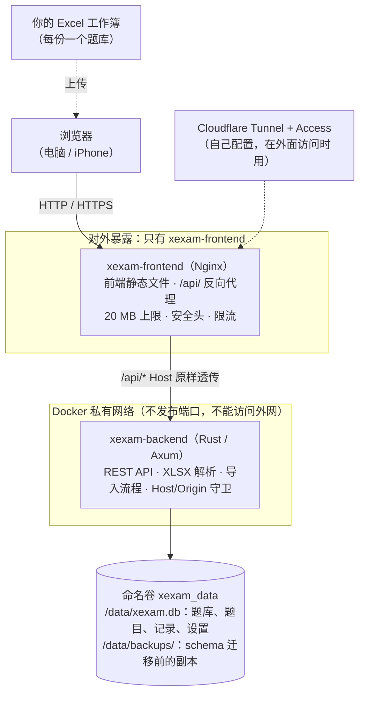

| 容器 / 镜像 | 里面是什么 | 对外？ |
|---|---|---|
| `xexam-frontend` | Nginx + 前端静态文件（HTML / JS / CSS）。把 `/api/` 转给后端；20 MB 上限、安全头、限流、超时 | 是：宿主机 `XEXAM_BIND`（默认 `127.0.0.1:8765`）→ 容器 8080 |
| `xexam-backend` | 一个静态链接的 Rust 可执行文件：REST 接口、解析 Excel、读写 SQLite | **否**：没有 `ports`，网络是 `internal: true` |

浏览器只通过 [REST 接口](docs/zh-CN/api.md) 和后端说话；前端里没有数据库访问。**判分在浏览器里**：对每道题，服务端只收到题目 id、对错，以及（从 v0.5 起）你给出的答案；答案只存下来供回顾用。

### 数据流 A：导入题库（上传 → 预览 → 确认）

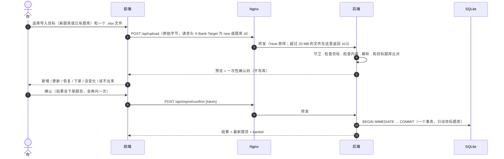

预览只保存在内存里，保留 30 分钟，确认码只能用一次。预览还开着时离开 **题库管理** 页面，会取消这次导入（`POST /api/import/cancel`）。不带 `X-Bank-Target` 的上传（旧的客户端、命令行的 `import`）会导入到存放 v0.5 之前数据的那个题库，和 v0.4 完全一样。

### 数据流 B：做一场考试

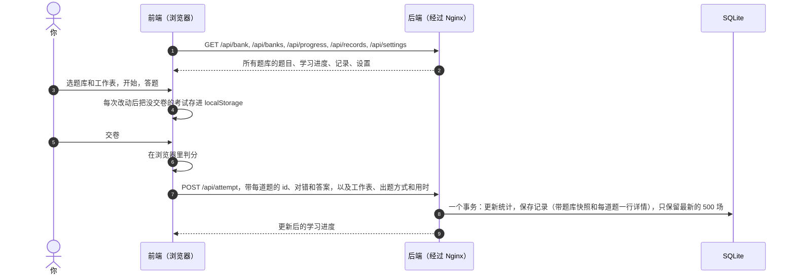

### 数据库：8 张表（schema v2）

`questions`、`stats`、`attempts`、`imports` 和 `meta` 来自 schema v1，它们的建表语句没有变；v0.5 新增了 `banks`、`attempt_items` 和 `settings` 三张表，以及三个列（`questions.bank_id`、`attempts.banks`、`imports.bank_id`）。每个字段的说明见 [docs/zh-CN/database.md](docs/zh-CN/database.md)。

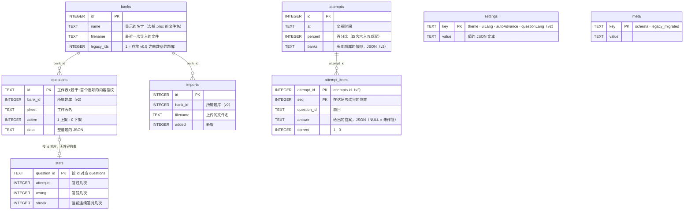

**题目 id。** 存放 v0.5 之前数据的那个题库，题目保留原来的 id。其他题库的题目用限定在本题库内的 id 保存，所以同一份工作簿可以导入成两个题库，它们的学习记录不会混在一起。

**为什么 `stats` 不随题目一起删：** 题目下架只是把 `active` 改成 0，答题记录原样保留；以后这道题重新出现在 Excel 里，会自动恢复上架。只有删除题库才会删除题目。

**错题本怎么算：** 一道题只要 `wrong > 0` 且 `streak < 2`（连续答对不到 2 次）就在错题本里；连续答对 2 次后自动移出。

### 页面之间怎么走

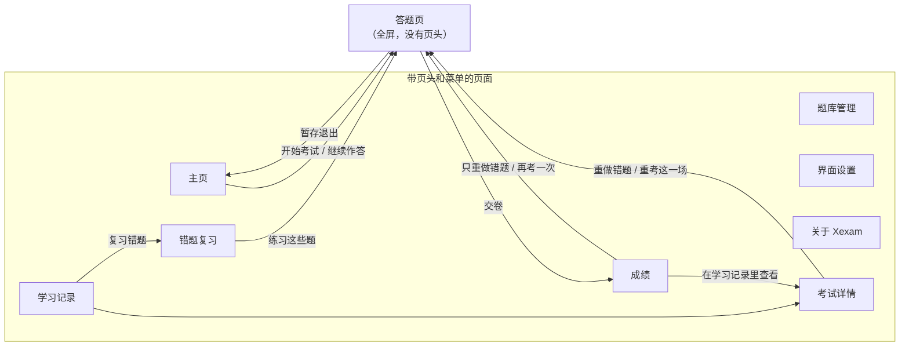

四个主要页面（**主页**、**题库管理**、**学习记录**、**界面设置**）和 **关于 Xexam**，在每个带页头的页面上都可以从菜单打开。单选、多选、热点题三种题型的界面略有不同，但都用同一个答题页。

---

## 安全说明

详细的威胁模型和每一条防线见 [docs/zh-CN/security.md](docs/zh-CN/security.md)。要点：

- **只有 Nginx 对外**。后端没有发布端口，网络是 `internal: true`（也不能访问外网）。
- 默认只接受发给本机的请求（检查 `Host`）；放在 Cloudflare 等有身份验证的反向代理后面时，把你的域名写进 `XEXAM_ALLOWED_HOSTS`。写请求还会检查 `Origin` 必须和 `Host` 是同一个主机（或在 `XEXAM_ALLOWED_ORIGINS` 里），防止恶意网页通过你的浏览器操作它。后端只读真实的 `Host` 头，不读 `X-Forwarded-*`。
- **程序自己不做登录。** 从互联网访问时必须在前面加身份验证（Cloudflare Access），不要把端口直接暴露到公网。没有账号：设置对使用这个实例的所有人都生效。
- v0.5 的新接口（题库、记录、设置）和其他接口一样，按同样的顺序经过同样的守卫。删除题库或记录一律是带 JSON 请求体的 POST，在一个事务里完成，页面上一定会先请你确认；随题库一起删除学习数据、随全部记录一起清空错题本，都是单独的复选框，默认不勾选。设置只接受已知的值。
- 上传的文件按**内容**检查：拒绝空文件、非 `.xlsx`、损坏的压缩包、重复的压缩包条目、含 XML 实体声明（DOCTYPE）的文件，最大 20 MB；解析有总时限和内存上限。
- 上传后的预览在内存里保留 30 分钟，确认时需要一次性的校验码（128 位随机），用过就作废。
- 数据库写入在一个事务里：中途出错整体回滚，不会留下半截数据。迁移到 schema v2 之前，后端会先写一份备份副本，写不出来就不启动。
- 两个容器都以非 root 运行，`cap_drop: ALL`、`no-new-privileges`、根文件系统只读。
- 镜像里没有机密、没有数据库、没有题库。

---

## 自动构建与发布

[`.github/workflows/ci.yml`](.github/workflows/ci.yml) 是**唯一**的流水线。每次推送到 `main` 或 `dev`、每个向 `main` 提的拉取请求（PR），以及在 Actions 页手动运行时，自动做：

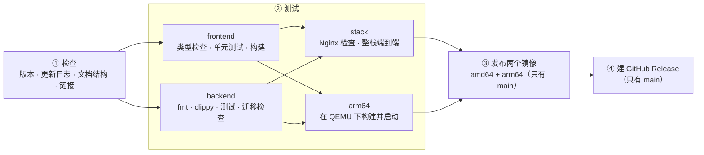

- **触发：** 推送到 `main`（会发布）、推送到 `dev`、向 `main` 提拉取请求，或在 Actions 页面手动运行。只有 `main` 会发布；`dev`、拉取请求和在其他分支上手动运行只检查和测试，**从不发布**。推送到其他分支不会触发流水线。
- **每次更新必须：** 改 `VERSION`，并在**三份 README**（`README.md`、`README.ja.md`、`README.zh-CN.md`）的更新日志最上面各写一条同版本的记录；`backend/Cargo.toml` 和 `frontend/package.json` 也必须是同一个版本号。否则第 ① 步会失败。
- **文档检查（也在第 ① 步）：** 七份文档在 `docs/en`、`docs/ja` 和 `docs/zh-CN` 里都有；`docs/` 下只有这三个文件夹；README 和文档里的每个相对链接都指向存在的文件。
- **都通过才发布：** 两个镜像（`xexam-frontend`、`xexam-backend`）各发布成一个多架构镜像，并回头检查镜像清单里确实有 `amd64` 和 `arm64`、标签指向刚推送的那个摘要。测试失败时 `latest` 仍是上一个能用的版本。
- **发布的标签：** `latest`、`v<VERSION>`、`sha-<提交>`，Docker Hub 和 ghcr.io 上都一样。
- **后端镜像怎么编 arm64：** 在构建机上用 zig 交叉编译，不在 QEMU 里编 Rust（QEMU 下要慢一个数量级）；只有最后一个很小的 alpine 阶段是目标架构。
- **Releases 页：** 两个镜像都发布并核对成功之后，自动建（或更新）一个叫 `v<VERSION>` 的 Release，说明文字取自英语 README（`README.md`）更新日志里这个版本的那一段（[`scripts/release-notes.py`](scripts/release-notes.py)），并自动打上同名的 git 标签。镜像没发布成功，就不会有这个 Release。
- **Releases 和镜像在不同的地方：** 镜像在 **Docker Hub** 上（`docker.io/yuminspace/xexam-frontend` 和 `docker.io/yuminspace/xexam-backend`，公开；`docker-compose.yml` 拉取的就是它们），另有一份私有镜像副本在仓库的 **Packages** 里（ghcr.io）；Release 在 **Releases** 页，里面最先列出从 Docker Hub 拉取的命令。这些都由同一次构建一起产生。

发布到 Docker Hub 需要两个仓库机密（secret）：`DOCKERHUB_USERNAME` 和 `DOCKERHUB_TOKEN`（一个带 **Read & Write** 权限的 Docker Hub 访问令牌），另外可以设置仓库变量 `DOCKERHUB_NAMESPACE`（可选）。没有这两个机密，或者 `docker-compose.yml` 里写的不是这个命名空间下的 Docker Hub 镜像，发布这一步会在推送任何东西之前停下。ghcr.io 上的镜像是私有的（仓库是私有的）：第一次在那里发布一个新镜像名时，要在 GitHub 的包设置里把本仓库加进 **Manage Actions access**，角色选 **Admin**，否则推送会被拒绝（`permission_denied: write_package`）。

---

## 开发

日常改代码、跑测试用的命令见 [docs/zh-CN/development.md](docs/zh-CN/development.md)。最常用的：

```bash
# 后端（Rust 1.99.1，rustup 会按 backend/rust-toolchain.toml 自动装）
cd backend && cargo fmt --check && cargo clippy --all-targets -- -D warnings && cargo test --all-targets

# 前端（Node 24）
cd frontend && npm ci && npm run typecheck && npm test && npm run build

# 开发时：后端 127.0.0.1:8765，前端 http://127.0.0.1:5173（/api 代理到后端）
cd backend && cargo run -- serve --data ../data --no-browser
cd frontend && npm run dev

# 整栈检查（用 Docker，临时项目名和临时卷，不碰 xexam_data）
python -I tests/integration/stack_check.py
```

- 后端有 181 个测试，前端有 44 个单元测试。后端的测试对着 `tests/baseline/` 里已提交的**旧版快照**：172 份黄金响应、49 个解析夹具及输出、85 条题目 id 向量。这些夹具全是虚构的，真实题库永远不入库。
- v0.5 的行为（schema 迁移和备份、题库、记录、设置、新接口上的守卫）在 `backend/tests/v05_banks_records_settings.rs` 里测试。
- 界面上的所有文字都来自 `frontend/src/i18n/catalog/*.ts`，有英语、中文、日语三种；某种语言缺了一个键，测试会失败；某条后端错误提示没有翻译，另一个测试会失败。
- **关于 Xexam** 页面显示三份 README 的更新日志。它们在构建前端时读取（`frontend/vite.config.ts` 里的 `xexam-changelog` 插件），所以构建前端时，`frontend/` 的上一级文件夹里要有 `README.md`、`README.ja.md` 和 `README.zh-CN.md`。
- 用 v0.5 打开 v0.4 或更早版本的数据库，会迁移它，并在旁边写一个 `backups/`。请在副本上做实验。

---

## 目录结构

```
README.md                  英语版说明（默认）；README.ja.md 是日语版，README.zh-CN.md 是中文版（本文件）
LICENSE                    MIT 许可证
VERSION                    版本号（和更新日志最上面一条保持一致）
docker-compose.yml         拉取两个镜像运行（只需要这一个文件）
docker-compose.build.yml   从源码构建两个镜像并运行
.env.example               本机配置模板（复制成 .env；.env 不提交）
backend/                   Rust 后端（Axum + rusqlite）
  src/api/                   路由、守卫（Host / Origin / Content-Type / 体积）、JSON 格式、成绩清洗
  src/services/              待确认导入的槽位、解析引擎接口、导入流程
  src/parser/                .xlsx 解析：ZIP 防护、XML、题目识别、题目 id
  src/database/              SQLite 存储、schema（v1 原文 + v2 新增）、旧 progress.json 迁移、时间戳
    store/                     题库、记录、设置，从 schema v1 到 v2 的迁移（含备份副本）
  src/security/ src/config/  Host / Origin 判断、限长读取请求体；环境变量
  tests/                     单元、黄金响应、解析对照、id 向量、并发、v0.5（题库、记录、设置、迁移）
  Dockerfile                 在构建机上交叉编译（zig），运行镜像是静态链接的单个可执行文件
frontend/                  TypeScript + Vite 前端（原生 DOM）
  src/main.ts src/router.ts  入口；hash 路由（#/、#/banks、#/records、#/settings、#/about、#/quiz、#/result 等）
  src/pages/                 home、banks、records、settings、about、quiz、result
  src/components/            外壳（带菜单按钮和下拉菜单的页头）、回顾（答案卡片）、通用部件
  src/i18n/                  英语、中文、日语的界面文字（catalog/*.ts），服务器提示的翻译
  src/api/ types/ domain/ state/ utils/ styles/
  vite.config.ts             构建设置；为关于页面读取三份 README 的更新日志
nginx/                     nginx.conf + Dockerfile（构建前端，带上三份 README → 只带静态产物）
tests/baseline/            旧版 Python 的行为快照（黄金响应、解析夹具、id 向量、示例库）
tests/integration/         Nginx 行为检查、整栈端到端检查、progress.json 迁移检查
docs/                      en/（英语）、ja/（日语）、zh-CN/（中文）：架构、API、数据库、安全、部署、迁移、开发，
                           每个文件夹有自己的 screenshots/；en/openapi.yaml；zh-CN/history/ 是以前的文档（只有中文）
scripts/release-notes.py   从更新日志生成 GitHub Release 的说明（CI 用，本机也能跑）
.github/workflows/ci.yml   唯一的流水线：检查 → 测试 → 发布 → Release
```

---

## 许可证

Xexam 以 [MIT 许可证](LICENSE) 发布。Copyright (c) 2026 Yumin-Space.

许可证适用于本仓库里的软件。仓库里没有任何考试题目：你导入的题库是你自己的文件，你要自己确认有权使用它们。

---

## 更新日志

每次更新都要在这里写一条，**版本号和仓库根目录的 `VERSION` 文件一致**（自动构建会检查，不一致就不让构建）。最新的镜像同时有 `latest` 和对应的 `vX.Y` 标签。

程序里的 **关于 Xexam** 页面会显示这些记录（它们在构建时打包进前端），所以请只用简单的 Markdown：段落、`- ` 列表、缩进的 `  - ` 子列表、`**粗体**` 和 `` `代码` ``。链接在那里显示成普通文字。

### v0.5.1 — 2026-11-11

**更柔和、更简洁的外观，改用对色盲友好的配色，菜单按钮移到右上角，题库管理页和主页一样紧凑。**

- **更柔和、更简洁的外观**：配色改为参照 GitHub 的 Primer 设计系统里对色盲友好的浅色和深色配色（Light colorblind / Dark colorblind）：答对用蓝色、答错用橙色，不再是绿色和红色；浅色主题是柔和的灰白底配白色区块和藏蓝色的主要按钮，深色主题接近纯黑。页面铺在一整张平静的底上；外框和边线更少，改用圆角，鼠标移上去时显示柔和的背景色，提示改用带浅色底色的色块显示，菜单更轻，带一层柔和的阴影。变的只是外观，位置和用法并没有因此改变。
- **菜单移到右边**：三条横线的菜单按钮现在在页头的右上角；Xexam 标志还在左上角。菜单在按钮下方打开，用法和以前一样。
- **更紧凑的题库管理页**：
  - **导入 Excel**：**新建题库** 和 **更新已有题库** 是标题旁边的两个小按钮（悬停提示里有说明）；选更新时，下面会出现 **要更新的题库**。只有一行提示，末尾是 **查看 Excel 写法** 链接；选文件也只占一行：点 **选择 Excel 文件**，或者把文件拖到这个面板的任意位置。
  - **预览**：各项数字是几个小标签（为 0 的不显示），每个工作表一行，工作表里读不出来的行收在它下面。和以前一样，确认和取消按钮紧跟在数字和提示后面，在各个工作表之前。
  - **已有的题库**：每个题库占紧凑的一行，有名字、**更新** 和 **删除** 两个小按钮，以及一行概况（文件、题数、工作表数、最近更新时间）。工作表收在这一行右边的箭头下面。
  - **导入记录** 每次导入一行（最近 8 次），**Excel 题库的写法和导入说明** 在你打开之前一直是收起的。
  - 在触摸屏上，这些小按钮的点按区域仍有约 44 px；在手机上，题库名字很长时，按钮会换到单独的一行。
- **镜像发布到 Docker Hub**：每个版本现在也发布到 Docker Hub，名字是 `yuminspace/xexam-frontend` 和 `yuminspace/xexam-backend`（公开，同一个标签下有 `amd64` 和 `arm64`）。`docker-compose.yml` 改为从那里拉取，所以不再需要 `docker login`。同样的标签仍保留在 `ghcr.io/yumin-space` 上，作为私有镜像副本。如果你还在用 v0.5 的旧 `docker-compose.yml`，请换成新的（数据卷会保留）。三份 README 现在以 Docker Hub 的徽章开头。
- README 和文档都按新布局改写了，截图也重新截了。

### v0.5 — 2026-11-10

**新界面：可以有多个题库，有学习记录和界面设置，界面有英语、中文、日语三种。数据库会在写好一份备份副本之后自动升级到 schema v2。**

- **新布局**：除了考试页，每个页面都有一个窄窄的页头，上面有三条横线的菜单按钮。点它会打开一个小菜单，里面有主页、题库管理、学习记录和界面设置；选好一项、点菜单外面或按 Esc 键，菜单就会关上。在宽屏上，页面内容居中显示（最宽 1120 px）。考试本身是一个专注的全屏页面。
- **关于页面**：菜单的最后一项 Xexam v0.5（在分隔线下面）会打开它。它显示版本、服务器的 CPU 架构、许可证，以及每个版本的更新内容：也就是这份更新日志，用界面语言显示，最新的版本展开，更早的版本折叠起来。
- **更紧凑的主页**：没交卷的考试是一行横幅，带继续作答和放弃这场。开始考试面板右上角的两个小按钮选择从哪里出题：全部和错题本，各自显示题数（所选工作表里没有要复习的错题时，错题本不能选，并用一行字说明原因）。每个题库是一张卡片，里面一行一个工作表；题库的复选框会勾选它的全部工作表，工作表也可以收起来（题库超过两个时，一开始是收起的）。
- **随机抽题**：题数比所选的题少时，现在会从整个所选范围里随机抽题（以前不打乱顺序时，取的是按题库顺序排在最前面的那些题）。打乱题目顺序只决定这些题按随机顺序出，还是按题库里的顺序出。
- **多个题库**：每份导入的工作簿都是一个独立的题库。可以把文件导入成新题库，也可以更新 / 替换已有的题库；文件里没有的题只在那个题库里下架。题库列表显示每个题库的工作表和题数。删除题库前会先确认，并可以选择同时删除这个题库的学习记录。
- **学习记录页**：考试列表，可以按题库、日期范围、正确率筛选；每场考试的详情，显示每道题你的答案、正确答案和解析（v0.5 起考的场次）；错题复习和练习；重做错题或重考一场；删除一条记录（错题本不变）或全部记录（可以选择同时清空错题本）。Xexam 保留最近 500 场考试（以前是 60 场）。
- **界面设置页**：主题（跟随系统 / 浅色 / 深色）、界面语言（默认 English，另有中文、日本語）、答完自动跳到下一题（单选题，以及每个小项都答完的热点题；多选题永远不会自动跳转）、恢复默认设置。设置和题目语言保存在服务器的数据目录里，所以重启、更新镜像、清除浏览器缓存、换别的浏览器或设备之后都还在。没交卷的考试仍然只保存在当前浏览器里。
- **整个界面都有英语、中文、日语三种**，包括答题页和服务器返回的错误提示（后端仍然用中文发送，由页面翻译）。
- **更适合手机**：主页上的开始考试按钮固定在屏幕底部，列表更紧凑，答题卡把已答题数和交卷按钮放在题目小方块上面，触控区域至少 44 px。
- **数据库 schema v2**：新增 `banks`、`attempt_items`、`settings` 三张表，以及 `questions.bank_id`、`attempts.banks`、`imports.bank_id` 三个列。v0.5 第一次启动时会自动迁移现有的数据库；迁移之前，先把一份副本写到 `<数据目录>/backups/xexam-schema1-<日期时间>.db`（副本写不出来时，后端不会启动，也不会改动任何东西）。现有的数据变成一个题库；题目 id、错题本和成绩历史都保留。回退 = 停止、恢复那份副本、运行 v0.4。不要在有多个题库的数据库上运行 v0.4。步骤见 [docs/zh-CN/migration.md](docs/zh-CN/migration.md)。
- **新接口**：`GET /api/banks`、`POST /api/banks/delete`、`GET /api/records`、`GET /api/record?id=`、`POST /api/records/delete`、`GET` / `POST /api/settings`、`POST /api/settings/reset`，以及 `POST /api/upload` 上可选的请求头 `X-Bank-Target`（不带它时，上传的行为和 v0.4 完全一样）。`GET /api/bank` 里的每道题多了一个键 `bank`。见 [docs/zh-CN/api.md](docs/zh-CN/api.md)。
- **文档按语言分开**：`docs/en`、`docs/ja` 和 `docs/zh-CN`；只有中文的历史文档移到了 `docs/zh-CN/history`。每个语言文件夹都有自己的截图，截图里的界面就是那种语言。CI 会检查这个结构和每一个相对链接。
- **推送到 `dev` 分支时也会跑 CI**（只检查和测试，从不发布）。
- README、文档和四列格式解析测试里的 Excel 示例都换成了虚构的示例；`tests/baseline/` 里的旧版测试快照没有改动。较早的更新日志条目里，只改了链接（指向新的文档文件夹）和一组示例词。
- **新增 MIT 许可证**（`LICENSE`）。
- 测试：后端 151 → 181（迁移和备份、题库、记录、设置、新接口上的守卫），前端 27 → 44（界面文字、服务器提示的翻译、关于页面上的更新日志、随机抽题）。

### v0.4 — 2026-11-10

- **三种语言对照：英语 / 中文 / 日语。** Excel 新增一个格式：A 列英语、B 列中文、C 列日语（题目本身）、D 列答案·解析·口诀；A、B、C 三列是同一道题的三种语言，一一对应，答案只写一份。答题页的语言按钮变成「英语 / 中文 / 日语」，成绩页的错题解析也用你选的语言显示。
- **热点题的选项也跟着语言走**：每个小项末尾用本语言写选项（日语 `はい / いいえ`，中文 `是 / 否`，英语 `Yes / No`；执行层之类的三选一同理），切换语言时选项按钮一起换。某一列没写选项时，这个语言仍可用，选项按钮显示日语的。
- **热点题的答案用任何一种语言的选项词来写都认**（`調理`、`烹饪`、`Cooking`，也可以混着写）；三种语言的选项按位置一一对应，个数对不上的那一列不参与，不会猜。
- **旧的三列格式（A 日语、B 中文、C 答案）不用改，照样能上传**，只是没有英语。程序看内容自动判断是哪种格式；四列格式里题目 id 仍然来自 C 列的日语，所以同一道题在两种格式里 id 相同，学习记录不受影响。
- 首页页脚的说明文字改为：Xexam 仅提供题目与答案的导入、整理及练习功能，软件本身不提供或收录考试题目、答案及相关资料；用户应确保导入和使用的资料来源合法，并拥有相应使用权限。
- **README 拆成三份**：`README.md`（英语，默认）、`README.ja.md`（日语）、`README.zh-CN.md`（中文），页面顶部的语言栏可以互相跳转；各自有自己语言的更新日志，GitHub Release 说明取自英语那份。
- **`docs/` 里的文档也分成三种语言**：现行的七份（架构、API、数据库、安全、部署、迁移、开发）各有 `X.md`（英语）、`X.ja.md`（日语）、`X.zh-CN.md`（中文），顶部有语言栏；`openapi.yaml` 改为英语。Phase 0 的审计和计划文档是历史资料，仍只有中文。CI 会检查三份是否齐全，以及所有相对链接是否都指向存在的文件。
- **换了新截图**：用 v0.4 的界面和虚构的四列演示题库重新截的，同一道题有英语、中文、日语三种显示，热点题的选项按钮也跟着语言走。（界面本身，按钮和标签，仍然只有中文。）
- **语言约定**：代码注释和程序、工具、CI 的输出一律用英语；界面和 README 用各自对应的语言。这次没有改动任何代码（已和上一个提交做过机械比对）。
- 测试：后端 136 → 151（四列格式、三种语言的选项与答案、对不上时的退回），前端 19 → 27（语言规则）。

### v0.3 — 2026-11-10

**整个程序重写成 Rust + TypeScript + Nginx。数据库文件和 schema 没有变，API 向后兼容；旧的 Python 实现已从仓库里移除。**

- **后端改成 Rust**（Axum 0.8 + Tokio + rusqlite，工具链固定 1.99.1）：REST 接口、XLSX 解析、导入（预览不写库 → 一次性确认码 → 一个事务写入）、成绩与错题统计、Host/Origin 守卫、`xexam-backend import / healthcheck / migrate-progress` 子命令。行为与 Python 版一一对应：172 份旧版响应逐项对照没有未解释的差异；49 个合成工作簿的解析输出、85 条题目 id 向量全部一致，所以题目 id 与旧版逐字节相同、学习记录不会脱钩。
- **前端改成 TypeScript**（strict）+ **Vite**，原生 DOM、没有框架；没有内联样式，所以 CSP 可以很严。构建目标 `safari15`，iPhone 需要 iOS 15.4 以上。
- **两个镜像、两个容器**：`xexam-frontend`（Nginx + 前端静态文件，唯一对外）和 `xexam-backend`（Rust，在 `internal` 私有网络里不发布端口）。非 root、`cap_drop: ALL`、只读根文件系统；Host 原样透传、`X-Forwarded-*` 清空；20 MB 上限、安全头、限流、超时；后端不可达时返回 JSON 502。两个镜像都同时有 `amd64` 和 `arm64`。
- **更严的上传检查（有意的差异）**：任何编码 / 扩展名里的 DOCTYPE 和实体声明都拒绝；重复的 ZIP 条目名拒绝；ZIP 条目数、XML 深度 / 节点数 / 每元素属性数、单元格总字节数有上限；解析有协作式的超时（到了解析器自己停下）且同时最多 2 个；错误文案不再回显库的异常文本；不支持的 HTTP 方法回 405（以前是 501）。完整差异表见 [docs/zh-CN/api.md](docs/zh-CN/api.md)。
- **一个流水线**（`.github/workflows/ci.yml`）：检查版本和更新日志 → 前端 / 后端 / Nginx 与整栈 / arm64 四组检查 → 都通过才发布两个镜像并建 Release。
- **测试**：后端 136 个（对着已提交的旧版快照：172 份黄金响应、49 个解析夹具、85 条 id 向量）、前端 19 个；`tests/integration/` 里 Nginx 38 项、整栈 34 项、`progress.json` 迁移 10 项。
- **文档**：`docs/` 下的架构、API（含 OpenAPI）、数据库、安全、部署、迁移、开发，以及迁移前的审计、风险和计划。
- 判分仍在浏览器里（服务端只收 `{题目 id, 对错}`），理由见 [docs/zh-CN/history/migration-plan.md](docs/zh-CN/history/migration-plan.md)。
- ⚠️ **升级注意**：新旧版容器名和端口相同，**不能同时运行**，升级前先 `docker compose stop`；数据卷 `xexam_data` 是同一个，数据不用迁移。旧的单镜像 `ghcr.io/yumin-space/xexam` 不再更新（最后是 `v0.2.2`），`docker-compose.yml` 现在一次拉取 `xexam-frontend` 和 `xexam-backend` 两个。回滚步骤见 [docs/zh-CN/migration.md](docs/zh-CN/migration.md)。
- **没有验证的东西（如实写）**：真正的 Cloudflare 隧道、iPhone 真机、在真正的 ARM 硬件上运行（只在 QEMU 下构建并启动验证过）、用你自己真实数据库的副本演练。

### v0.2.2 — 2026-11-10

- 新增 `tests/baseline/`：旧版 Python 的行为基线（172 份真实响应、50 个 XLSX 夹具及解析输出、85 条题目 id 向量、示例数据库、安全探针、Host/Origin 检查和隧道模拟脚本），后面的 Rust 重写要和它逐项对照。工具里不再写死任何本机路径，可用 `XEXAM_LEGACY_ROOT` 指定被测代码。
- 修正上一版更新日志里关于 v0.2 Release 的说法。

### v0.2.1 — 2026-11-10

- **每次构建成功后自动在 GitHub 的 Releases 页建一个 Release**（以前只推了镜像，Releases 页一直是空的）：流水线新增第 4 个 job `release`，在镜像发布并核对成功之后运行，说明取自本更新日志这个版本的那一段，并自动打 git 标签 `v<版本>`。
- v0.2 的 Release 手动补建了一次（对应 v0.2 的提交 `1ee64c8`，没有标成 Latest）；从 v0.2.1 起由流水线自动建。
- 新增 `scripts/release-notes.py`：从 README 抽出某个版本的更新日志；本机也能运行，用来预览 Release 页会显示什么。

### v0.2 — 2026-11-10

- **可以通过自己的域名从互联网访问**（Cloudflare Tunnel + Cloudflare Access）：
  - 允许的域名放进 `XEXAM_ALLOWED_HOSTS`；写请求的 `Origin` 改成只比较主机名，所以经 **HTTPS** 域名访问时上传、交卷不再被 403 拦下。
  - 代理改写了 `Host` 时，可以用 `XEXAM_ALLOWED_ORIGINS` 单独放行公网域名；前面已有身份验证时可设 `XEXAM_ALLOW_ANY_HOST=1`。
  - 被拒绝时会说明是哪一条没通过、该怎么放行；登录过期时页面会提示刷新重新登录。
- 端口绑定改成可配置（`XEXAM_BIND`），默认仍然只绑定本机。
- 收到 `docker stop` 的停止信号后正常退出（以前要等 10 秒被强杀），数据库干净关闭。
- CI：拆成「检查版本和更新日志 → 两种架构各自测试 → 发布」三步（v0.2.1 起再加第四步：建 Release）；冒烟测试挪进 `scripts/smoke-test.sh`，本机装了 Docker 也能直接跑；发布后按摘要核对镜像清单。
- `/api/info` 增加 `arch`（当前 CPU 架构）。
- 审计后的修复（每一条都有对应的实测）：
  - 服务端：提前拒绝的请求（403/415）先把请求体读掉再回复，浏览器看到的是真正的原因而不是「连不上服务」；被拒绝的请求在日志里留一行（`docker compose logs` 能看到）；畸形的 JSON（数字当列表、`Infinity`、过深嵌套、非 ASCII 的确认码）返回 400/409，而不是让连接断掉；POST 的 `Content-Type` 必须真的是 `application/json`；`XEXAM_ALLOWED_HOSTS` 用空格或分号分隔也能识别。
  - 数据库：`COMMIT` 失败时会回滚，不会让连接一直卡在事务里；格式不对的旧 `progress.json` 不再让程序起不来；数据目录里只有别的 `.db` 文件时，启动日志会提醒（不会改动那个文件）。
  - 页面：交卷时成绩提交成功才清掉暂存，失败会保留并提示「刷新页面重新登录后再交卷」；开始新考试前，如果有没交卷的考试会先确认；成绩页百分比与学习记录用同一种取整，不再差 1；提示条不再被底部翻页栏挡住；长英文串不再撑出横向滚动条；没有 `<dialog>` 的旧 Safari 改用系统确认框；长按字母键不会反复切换答案。
  - 镜像和 CI：健康检查不走代理并跟随 `XEXAM_PORT`；`.dockerignore` 改成任意层级生效；`.gitignore` 加了备份压缩包和 `.env.*`；只从 `main` 发布，`main` 上排队不取消；冒烟测试里容器内路径在 Windows 的 Git Bash 里也能跑。
  - 这版在本机用 Docker 真的构建了镜像（amd64），并用 CI 同一份冒烟测试跑通：非 root、Host/Origin 拦截、删除容器后数据还在、`docker stop` 1 秒。arm64 和发布仍要看 GitHub Actions 的结果。
- 名称统一成 **xexam**：环境变量 `XEXAM_DATA` / `XEXAM_HOST` / `XEXAM_PORT` / `XEXAM_ALLOWED_HOSTS` / `XEXAM_ALLOWED_ORIGINS` / `XEXAM_ALLOW_ANY_HOST`，数据库文件 `xexam.db`，浏览器里保存的键名 `xexam.*`；文档里也不再写死你自己的 Excel 文件名。
- ⚠️ **从 v0.1 升级时注意：** 数据库文件的名字变了，新版只读 `xexam.db`。如果你在更早的版本里已经导入过题库，请先停止程序，把数据目录里那个 `.db` 文件改名为 `xexam.db` 再启动，否则会看到空题库（旧文件不会被删，只是不会被读取）。浏览器里暂存的考试和语言选择用的键名也变了，升级前请先交卷，语言会恢复成日语。在自己改过的 compose 里设置过旧环境变量名的，要改成上面的 `XEXAM_*`，否则会被忽略。
- `docker-compose.yml` 去掉了 `pull_policy: always`：`docker compose up -d` 不再每次联网检查，更新请用 `docker compose pull && docker compose up -d`。
- `.env`（本机配置）加进 `.gitignore` 和 `.dockerignore`，不会被提交，也不会进镜像。

### v0.1 — 2026-11-10

第一个版本。

- 浏览器答题：单选、多选、热点题；**交卷后才计分**，错题显示答案、解析、记忆口诀。
- 日语 / 中文对照切换；答题卡；标记；暂存退出再继续。
- 错题本：答错的题连续答对 2 次后移出；成绩历史。
- 题库和学习记录改存 **SQLite**（Docker 命名卷 `xexam_data`），不再依赖 Excel。
- 管理页**上传 Excel 更新题库**：先预览（新增 / 更新 / 恢复 / 下架 / 读不出来），确认后才写入；下架的题保留答题记录，传回来自动恢复。
- 旧版的 `progress.json` 第一次启动时自动迁移。
- 支持 **iPhone**：触控区域不小于 44 px、安全区、底部固定翻页栏、可添加到主屏幕。
- Docker 镜像同时支持 **x86（amd64）和 ARM（arm64）**，由 GitHub Actions 构建并测试。
- ⚠️ v0.1 的「发布」步骤没有跑成，所以 `ghcr.io/yumin-space/xexam` 上**没有** `v0.1` 标签；镜像从 v0.2 起发布（`latest` / `v0.2`）。
- 应用名改为 **Xexam**。

<!-- 新版本写在这一行的上面，格式：### vX.Y — 日期 -->
