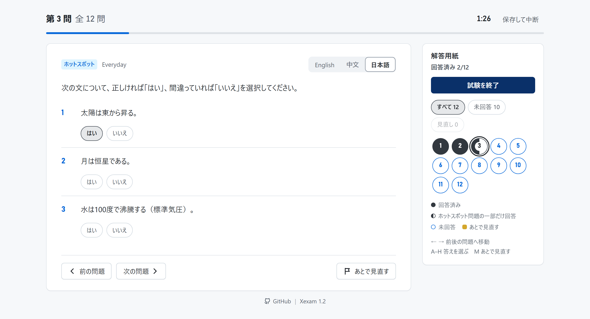

[English](../README.md) | **日本語** | [简体中文](README.zh-CN.md)

<!-- The release badge shows RELEASE_VERSION from VERSION, the last published release. Do not edit it by hand: the release job of .github/workflows/ci.yml writes it (scripts/set-release-version.py) after the images and the GitHub Release are published. GitHub rounds an image's corners only when it has both width and height, so every badge carries its exact size (in px, from shields.io). -->
<p>
  <a href="../../../releases/latest"></a>
</p>

<p align="center">
  
</p>

<p align="center">
  <a href="https://hub.docker.com/r/yuminspace/xexam-frontend"></a>
  <a href="https://hub.docker.com/r/yuminspace/xexam-frontend"></a>
  <a href="https://hub.docker.com/r/yuminspace/xexam-frontend"></a>
</p>
<p align="center">
  <a href="https://hub.docker.com/r/yuminspace/xexam-backend"></a>
  <a href="https://hub.docker.com/r/yuminspace/xexam-backend"></a>
  <a href="https://hub.docker.com/r/yuminspace/xexam-backend"></a>
</p>
<p align="center">
  <a href="https://hub.docker.com/r/yuminspace/xexam-ai-service"></a>
  <a href="https://hub.docker.com/r/yuminspace/xexam-ai-service"></a>
  <a href="https://hub.docker.com/r/yuminspace/xexam-ai-service"></a>
</p>

# Xexam

Xexam は、ブラウザで使うセルフホスト型の問題演習アプリです。ご自身の Excel 問題集をインポートして試験や練習に使い、間違えた問題を復習できます。管理者が AI プロバイダーを接続し、**AI+ 機能** を付与すれば、ユーザーは **AI チャット** で AI モデルに質問できるほか、学習中の AI サポートも使えます：練習中のヒントと解説、結果ページのすべての問題の AI 分析、間違えた問題の AI まとめ。パソコンでもスマートフォン（iPhone）でも使えます。



リポジトリには**問題は含まれていません**。Xexam が提供するのは、問題をインポートし、整理し、練習するための機能だけです。問題集はご自身の Excel ファイルであり、コミットされません（`.gitignore` で除外済み）。スクリーンショットには架空のデモ用問題集を使っており、実際の試験の内容ではありません。

| | |
|---|---|
| 現在のバージョン | **v1.2**（[更新履歴](../docs/ja/changelog.md)、またはリポジトリの [Releases](../../../releases) ページを参照。アプリでは：メニュー → **Xexam v1.2**） |
| イメージ | 3 つ。Docker Hub（公開、ログイン不要）：`docker.io/yuminspace/xexam-frontend`、`docker.io/yuminspace/xexam-backend`、`docker.io/yuminspace/xexam-ai-service`。タグは `latest` / `v1.2` / `sha-<コミット>`（`sha-` のタグは問題の調査用）。ミラー：`ghcr.io/yumin-space/xexam-frontend`、`ghcr.io/yumin-space/xexam-backend`、`ghcr.io/yumin-space/xexam-ai-service`（非公開、タグは同じ） |
| CPU アーキテクチャ | `linux/amd64`、`linux/arm64`（同じタグの中から自動的に適切なものが選ばれます） |
| ポート | `8765`（既定ではローカルマシンのみにバインド） |
| ライセンス | [MIT](../LICENSE) |

---

## 目次

- [できること](#できること)
- [クイックスタート](#クイックスタート)
- [環境設定](#環境設定)
- [アップグレード](#アップグレード)
- [ドキュメント](#ドキュメント)
- [ライセンス](#ライセンス)
- [更新履歴](#更新履歴)

---

## できること

- **試験**：提出するまでは採点されません。提出すると、得点と、間違えた問題（またはすべての問題）ごとに、あなたの回答、正解、解説、覚え方が表示されます。問題の間を自由に移動でき、あとで見直したい問題に印を付けたり、保存して中断し、あとで続けたりできます。
- **練習**：答えるたびにすぐ答え合わせをして、正解と解説を表示します。
- **自分の問題集**：インポートした Excel ブックは、それぞれが独立した問題集になり、ブック内の各ワークシートは、選んで出題できる問題グループになります。ブックは 6 列形式で書きます：問題と答えを英語で、必要なら中国語と日本語でも書きます。保存する前に、インポートで何が変わるかをプレビューで確認できます。
- **3 つの言語**：画面は英語・中国語・日本語で使え、問題、答え、解説はどれも **English**、**中文**、**日本語** に切り替えられます。
- **学習記録と間違いノート**：試験と練習はすべて回答と一緒に残ります。間違えた問題は、2 回続けて正解するまで間違いノートに残ります。
- **1 つの Xexam を複数人で**：全員がログインして使い、学習記録と設定は人ごとに分かれます。どのユーザーがどの問題集を見られるか、誰が問題集をインポートできるか（問題集の管理権限）は管理者が決め、管理者は **システムログ** も確認できます。
- **AI チャット**（任意。管理者が設定するまではオフ）：管理者は **AI 設定** で OpenAI 互換 API、Anthropic、Cloudflare AI Gateway のいずれかを接続し、テストして **AI+ 機能** をオンにし、使ってよいユーザーごとに **ユーザー管理** で **AI+ 機能** を付与します。**AI 設定** では、機能を取り上げずに、ユーザーの **AI+ 機能** を **一時停止** したり **再開** したりできます。回答は書かれるそばから表示され（推論モデルが働いている間は **考え中…** と表示）、ページを閉じても書き続けられます。AI は **設定** で選んだ言語で答えます。チャットは保存され（既定では 90 日後に自動で削除）、**メモリー** には、AI がその後のチャットで参考にする短いメモが残ります。管理者は **設定** の **AI チャットモード** で **フリーモード** を選ぶと、学習アシスタントの指示なしにモデルと直接話せます。管理者は使用量の統計を見られ、AI+ 機能を持つユーザーのチャットとメモを閲覧・削除できます。このことは AI チャットがすべてのユーザーに伝えます。AI は専用のデータベースを持つ専用のコンテナ `ai-service` で動き、プロバイダーのキーは暗号化して保存されます。
- **学習中の AI サポート**（**AI+ 機能** のあるユーザー向け。試験の最中は何も表示されません）：練習では、問題の下の **AI+ パネル** に **AI ヒント**（答えを言わずに解き方を示します）と **AI 解説**（答えとその理由）が表示されます。結果ページと学習記録の詳細ページでは **AI 分析**、学習記録と **ホーム** では間違えた問題の **AI まとめ** があります。回答は **AI チャット** に保存され、AI パネルからは、どのページへも移動しません。ユーザーごとに、AI リクエストの 1 分・1 時間・1 日あたりの上限があり、管理者が設定します。
- **スマートフォンを優先**：どのページも、スマートフォンの幅で横にスクロールせずに使えます。アイコンのボタンは、押し続けると名前が表示されます。タッチ領域は 44 px 以上です。フッターの中央には、プロジェクトへのリンク付きの 1 行があり、問題と回答がいちばん多くの場所を使います。パソコンのページは、広い画面では中央に寄せられます。

各ページの使い方、練習と結果での AI サポート、AI チャットと AI 設定、Excel の形式、インポートの規則：[docs/ja/usage.md](../docs/ja/usage.md)。

---

## クイックスタート

必要なのは、**Docker**（Compose v2 を含む）が入ったマシン（Windows / macOS / Linux のいずれでも、**x86 でも ARM でも**構いません）とブラウザです。

**1. [`docker-compose.yml`](../docker/docker-compose.yml) をダウンロードします**（このリポジトリの `docker/` フォルダにあります）。新しいフォルダ（例：`xexam`）に保存してください。必要なファイルはこれだけです。いちばん簡単なのは、GitHub でこのファイルを開いて **Download raw file** をクリックする方法です。コマンドラインなら次のとおりです。

```bash
curl -fLO https://raw.githubusercontent.com/Yumin-Space/xexam/main/docker/docker-compose.yml
```

リポジトリは非公開です。`curl` でファイルをダウンロードする（または `git clone` する）には、オーナーに頼んで、あなたの GitHub アカウントをコラボレーターに追加してもらい、スコープ `repo` を付けた classic の個人用アクセストークンを作成し（GitHub → **Settings** → **Developer settings** → **Personal access tokens** → **Tokens (classic)**）、`-fLO` の後に `-H "Authorization: token YOUR_TOKEN"` を加えてください。オーナーにファイルを送ってもらうだけでも構いません。Windows PowerShell では、`curl` の代わりに `curl.exe` と入力します。イメージそのものは Docker Hub で公開されているので、pull するのにアカウントも `docker login` も必要ありません。

**2. 起動します。** `docker-compose.yml` があるフォルダで、次を実行します。

```bash
docker compose up -d
```

このコマンドで 3 つのイメージが pull され、**3 つのコンテナ** が起動します：`xexam-frontend`（Nginx、外部から接続できるのはこれだけ）、`xexam-backend`（Rust、インターネットに接続できないプライベートネットワーク内）、`ai-service`（Rust、AI サービス。インターネットに接続できる唯一のコンテナで、接続するのは管理者が設定した AI プロバイダーを呼び出すときだけです）。25 秒ごとにバックエンドへ報告するので、Xexam は AI が使えるかどうかを把握します。`ai-service` がなくても Xexam は動き、AI チャットが使えないだけで、**AI 設定** には ai-service が動いていないと表示されます。

**3. ログインします。** 同じマシンのブラウザで <http://localhost:8765> を開き、ユーザー名 `admin`、パスワード `admin` でログインします。すると、自分のパスワードを設定するよう求められます。すぐに設定してください。それまでは、このページを開ける人なら誰でも既定のパスワードを使えてしまいます。

**4. 問題集をインポートして、試験を受けます。** メニュー（右上の三本線のボタン）を開いて **Question banks** を選び、Excel ブックをインポートしてから、**Home** で試験を始めます：[最初の試験](../docs/ja/usage.md#1-最初の試験) を参照してください。画面は最初は英語で表示されます。**Settings** → **Language** で中国語や日本語に切り替えられます（日本語では、これらは **問題集の管理**、**ホーム**、**設定** → **言語** と表示されます）。

**5. AI チャット（任意）。** AI は設定するまでオフです：メニュー → **AI 設定**（ai-service が接続されているかが表示されます）でプロバイダーを選び、そのアドレスとキーを入力し、一覧からモデルを選んで **テスト** し、**AI+ 機能** をオンにします。管理者はすぐに AI チャットを使えます。ほかのユーザーは、**ユーザー管理** でそのユーザーの **AI+ 機能** をオンにすると使えます（そのスイッチは、ai-service が接続されていて AI+ 機能がオンの間だけ表示されます）。手順は [docs/ja/usage.md の第 17 節](../docs/ja/usage.md#17-ai-設定) にあります。

| 操作 | コマンド |
|---|---|
| 最新バージョンに更新 | `docker compose pull` の後に `docker compose up -d`（先に [アップグレード](#アップグレード) を読んでください） |
| 特定のバージョンに固定 | `docker-compose.yml` 内の 3 つのイメージの `:latest` をすべて `:v1.2` に変更してから、`docker compose up -d` を実行 |
| 状態を確認 | `docker compose ps`（3 つのコンテナがすべて `healthy` になっていれば正常） |
| 停止 / 再起動 | `docker compose stop` / `docker compose start` |
| ログを見る | `docker compose logs -f backend` と `docker compose logs -f ai-service`（管理者はメニューの **システムログ** でも見られます。AI サービスの行も表示されます） |
| 動いているバージョンとアーキテクチャを確認 | ブラウザで <http://localhost:8765/api/info> を開く |

> ⚠️ **`docker compose down -v` は実行しないでください**：`-v` を付けると 2 つのデータボリュームも一緒に削除されます。`xexam_data`（問題集、ユーザー、学習記録、設定）と `xexam_ai_data`（AI 設定、暗号化したキーとそのキーファイル、チャットとメモ）です。

- **スマートフォンや別のパソコンから**、または **Cloudflare Tunnel でインターネットから** 開く：[docs/ja/deployment.md](../docs/ja/deployment.md) の第 4 節。
- **ソースからイメージをビルドする**（コードを変更するとき）：クローンしたリポジトリで `docker compose -f docker/docker-compose.build.yml up -d --build`。[docs/ja/deployment.md](../docs/ja/deployment.md) の第 2 節を参照してください。
- **バックアップ**：Xexam を停止して 2 つのデータボリュームをまとめます。コマンドは [docs/ja/database.md](../docs/ja/database.md) の第 5 節にあります。AI のボリュームには、保存した AI のキーを復号するキーファイルも入っているので、そのバックアップはキーそのものと同じように大切に保管してください。

---

## 環境設定

既定のままなら、何も設定せずに 1 台のパソコンで使えます。変更したいときは、`docker-compose.yml` と同じ場所に `.env` ファイルを作成し（クローンしたリポジトリでは `docker/.env`。テンプレートは [`.env.example`](../docker/.env.example)）、もう一度 `docker compose up -d` を実行してください。compose ファイル自体を編集する必要はありません。

| `.env` の変数名 | 既定 | 役割 |
|---|---|---|
| `XEXAM_BIND` | `127.0.0.1:8765` | 待ち受けるアドレスとポート。`IP:ポート番号` の形式で書きます。既定では本機からのみ接続できます。`0.0.0.0:8765` = ネットワーク内の他のマシンからも接続できます。⚠️ ポート番号だけ（例：`8766`）= すべてのネットワークインターフェースから接続できます |
| `XEXAM_ALLOWED_HOSTS` | 空 | Xexam を開くのに使ってよいドメイン名 / IP。カンマ、スペース、セミコロンのいずれかで区切ります。例：`xexam.example.com,192.168.1.20` |
| `XEXAM_ALLOWED_ORIGINS` | 空 | リバースプロキシが Host をオリジンサーバーのアドレスに書き換える場合にのみ必要です。公開ドメインを `https://` 付きで指定します |
| `XEXAM_ALLOW_ANY_HOST` | `0` | `1` = Host を検査しなくなります（前段にすでに認証がある場合にのみ） |
| `XEXAM_PARSE_TIMEOUT_SECS` | `30` | Excel 1 ファイルの解析にかける最大時間（秒） |
| `XEXAM_SQLITE_JOURNAL` | 未設定（WAL） | `delete` = SQLite の従来の DELETE ジャーナルのまま。データボリュームが特殊なストレージ（ネットワークファイルシステムや、Docker にバインドマウントした Windows のフォルダ）にある場合にだけ使います |
| `XEXAM_COOKIE_SECURE` | 未設定 | `1` = セッションの Cookie に常に `Secure` を付けます。Xexam に常に HTTPS で接続する場合にだけ使います |
| `XEXAM_LOG` | 未設定（`info`） | バックエンドのログのフィルター。例：`debug`。空なら `info` |
| `TZ` | 未設定（ホストのタイムゾーン） | Xexam が表示する日時と、AI の使用量の統計の日付のタイムゾーン。例：`TZ=UTC` |
| `XEXAM_AI_SECRET_KEY` | 未設定（AI ボリューム内のキーファイル） | 保存した AI プロバイダーのキーを暗号化するキー。32 バイトを 16 進数 64 桁か base64 で書きます。例：`openssl rand -base64 32` の出力。設定するとキーを AI ボリュームから切り離せるので、そのボリュームのコピーだけではキーを復号できません。変更したり失ったりすると、AI のキーを **AI 設定** で入力し直す必要があります |
| `XEXAM_INTERNAL_TOKEN` | 未設定（リンクボリューム内のランダムな Token） | バックエンドと AI サービスが共有する Token。compose ファイルは同じ値を両方に渡します。空白を含まない表示可能な ASCII 文字で 32 文字以上。例：`openssl rand -hex 32` の出力。AI サービス自身のバックエンドへの呼び出し（状態の報告など）の認証にも使われます。この規則に合わない値では AI チャットがオフになります：**AI 設定** には ai-service が接続できないと表示され、ログの行がその理由を伝えます |
| `XEXAM_AI_LOG` | 未設定（`info`） | AI サービスのログのフィルター。`XEXAM_LOG` と同じです |
| `XEXAM_AI_SQLITE_JOURNAL` | 未設定（WAL） | `delete` = AI のデータベースを従来の DELETE ジャーナルのままにします。`XEXAM_SQLITE_JOURNAL` と同じです |

compose ファイルがホストの `/etc/localtime` をバックエンドと AI サービスにマウントするので、日時はホストのタイムゾーンに従います。このファイルのないホストや、仮想マシンがたいてい UTC で動いている Docker Desktop（Windows、macOS）では、[docs/ja/deployment.md](../docs/ja/deployment.md) の 3.1 節を読んでください。すべてのオプションの説明は、同じドキュメントの第 3 節にあります。AI プロバイダー、そのアドレス、キー、モデルはここではなく、アプリの **AI 設定** で設定します。

---

## アップグレード

どのアップグレードでも、ポートとボリューム `xexam_data` は同じままです。`docker compose pull` の後に `docker compose up -d`。先にバックアップを取ってください。各バージョンの手順、バックアップコピー、ロールバックは [docs/ja/migration.md](../docs/ja/migration.md) にあります。

---

## ドキュメント

| ドキュメント | 内容 |
|---|---|
| [使い方](../docs/ja/usage.md) | すべてのページ、試験と練習、学習記録、設定、Excel の形式、インポート、ユーザーとログイン、システムログ、AI チャットと AI 設定、iPhone |
| [デプロイ](../docs/ja/deployment.md) | 起動、環境設定、タイムゾーン、スマートフォンと LAN からのアクセス、Cloudflare Tunnel、AI プロバイダー、バックアップ、ヘルスチェック、ログ、復旧 |
| [移行とロールバック](../docs/ja/migration.md) | すべてのアップグレードの方法と、その確認とロールバック |
| [データベース](../docs/ja/database.md) | メインのデータベースと AI のデータベースのテーブル、問題 id、バックアップと復元、スキーマの移行 |
| [セキュリティ](../docs/ja/security.md) | 脅威モデル、Host / Origin ガード、ログインとロック、権限、アップロードの検査、Nginx の制限。AI サービス：本人の確認、暗号化したキー、管理者に見えるもの |
| [アーキテクチャ](../docs/ja/architecture.md) | フロントエンド、Nginx、バックエンド、AI サービスの組み合わせ方、データの境界、ディレクトリ構成、リクエストの流れ |
| [API](../docs/ja/api.md)（[OpenAPI](../docs/en/openapi.yaml)、英語のみ） | すべてのエンドポイント、AI のルートとそのイベントストリーム、呼び出せる人、エラー |
| [開発](../docs/ja/development.md) | ビルドとテスト（バックエンド、AI サービス、フロントエンド）、スクリーンショットとアイコンのツール、CI とリリース |

---

## ライセンス

Xexam は [MIT ライセンス](../LICENSE) で公開されています。Copyright (c) 2026 Yumin-Space.

このライセンスの対象は、このリポジトリ内のソフトウェアです。リポジトリに試験問題は含まれていません。インポートする問題集はご自身のファイルであり、それを使用してよいかどうかの確認はご自身の責任で行ってください。

---

## 更新履歴

バージョンごとの変更点（新しい順）は [docs/ja/changelog.md](../docs/ja/changelog.md) にあります。
