[English](../README.md) | [日本語](README.ja.md) | **简体中文**

<!-- The release badge shows RELEASE_VERSION from VERSION, the last published release. Do not edit it by hand: the release job of .github/workflows/ci.yml writes it (scripts/set-release-version.py) after the images and the GitHub Release are published. GitHub rounds an image's corners only when it has both width and height, so every badge carries its exact size (in px, from shields.io). -->
<p>
  <a href="../../../releases/latest"></a>
</p>

<p align="center">
  
</p>

<p align="center">
  <a href="https://hub.docker.com/r/yuminspace/xexam-frontend"></a>
  <a href="https://hub.docker.com/r/yuminspace/xexam-frontend"></a>
  <a href="https://hub.docker.com/r/yuminspace/xexam-frontend"></a>
</p>
<p align="center">
  <a href="https://hub.docker.com/r/yuminspace/xexam-backend"></a>
  <a href="https://hub.docker.com/r/yuminspace/xexam-backend"></a>
  <a href="https://hub.docker.com/r/yuminspace/xexam-backend"></a>
</p>

# Xexam

Xexam 是一个自己部署、在浏览器里用的刷题程序。你导入自己的 Excel 题库，用它们考试或练习，再复习答错的题。

- **考试**：交卷后才计分。然后显示分数，每道错题（也可以看全部题目）都列出你的答案、正确答案、解析和记忆口诀。
- **练习**：每道题作答后马上核对，显示正确答案和解析。
- **多人共用一个 Xexam**：每个人都登录使用，有自己的学习记录。管理员决定谁能看到哪些题库、谁可以导入题库。

电脑和手机（iPhone）都能用。

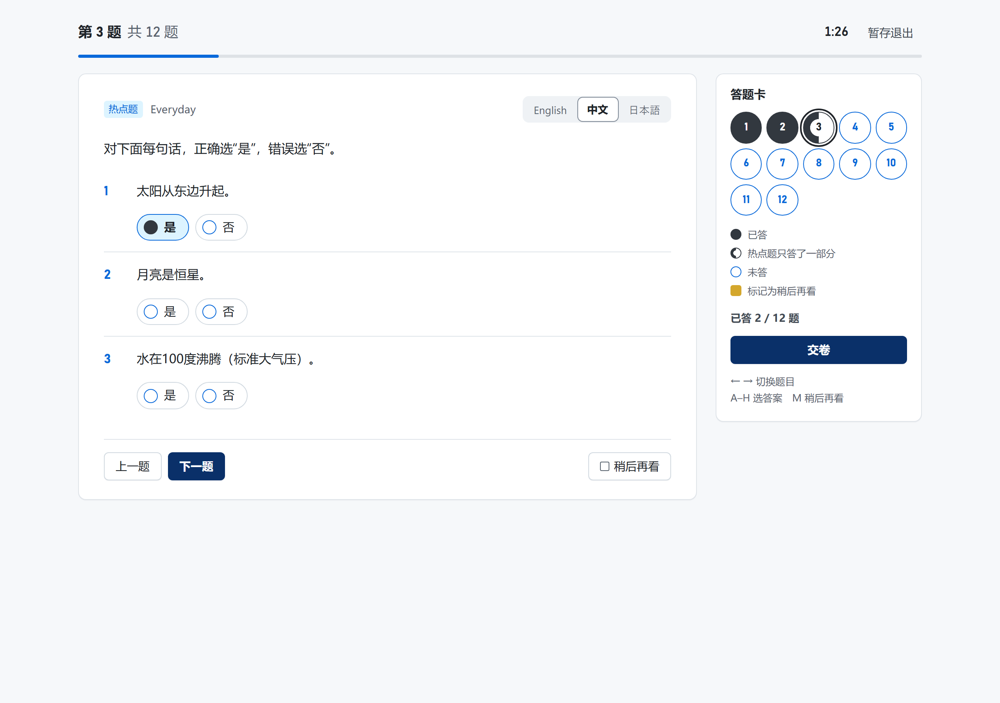

仓库里**没有题目**。Xexam 只提供导入、整理和练习题目的工具；题库是你自己的 Excel，不会被提交（`.gitignore` 已排除）。本页截图里的「General knowledge」和「Kitchen basics」是两个**虚构的演示题库**，不是任何真实考试的内容。两个题库都是六列格式，所以每道题、每个答案和每段解析都有英语、中文和日语三种。截图里是中文界面；英语界面和日语界面的截图在 `docs/en/screenshots/` 和 `docs/ja/screenshots/`。

| | |
|---|---|
| 当前版本 | **v0.7**（见 [更新日志](#更新日志)，也可以在仓库的 [Releases](../../../releases) 页看；在程序里：菜单 → **Xexam v0.7**） |
| 镜像 | 在 Docker Hub 上（公开，不用登录）：`docker.io/yuminspace/xexam-frontend` 和 `docker.io/yuminspace/xexam-backend`，标签 `latest` / `v0.7` / `sha-<提交>`（`sha-` 标签用来排查问题）。镜像副本：`ghcr.io/yumin-space/xexam-frontend` 和 `ghcr.io/yumin-space/xexam-backend`（私有，标签相同） |
| CPU 架构 | `linux/amd64`、`linux/arm64`（同一个标签里自动选对的） |
| 端口 | `8765`（默认只绑定本机） |
| 许可证 | [MIT](../LICENSE) |

文档：[架构](../docs/zh-CN/architecture.md) · [API](../docs/zh-CN/api.md)（[OpenAPI](../docs/en/openapi.yaml)，英文）· [数据库](../docs/zh-CN/database.md) · [安全](../docs/zh-CN/security.md) · [部署](../docs/zh-CN/deployment.md) · [迁移与回滚](../docs/zh-CN/migration.md) · [开发](../docs/zh-CN/development.md)

---

## 目录

- [能做什么](#能做什么)
- [快速开始（安装部署）](#快速开始安装部署)
- [配置](#配置)
- [从手机或另一台电脑打开 Xexam](#从手机或另一台电脑打开-xexam)
- [使用方法](#使用方法)
- [Excel 题库格式](#excel-题库格式)
- [导入题库](#导入题库)
- [升级](#升级)
- [数据、备份和恢复](#数据备份和恢复)
- [通过 Cloudflare Tunnel 从互联网访问](#通过-cloudflare-tunnel-从互联网访问)
- [架构](#架构)
- [安全说明](#安全说明)
- [自动构建与发布](#自动构建与发布)
- [开发](#开发)
- [目录结构](#目录结构)
- [许可证](#许可证)
- [更新日志](#更新日志)

---

## 能做什么

- **你自己的题库。** 导入的每一份 Excel 工作簿（`.xlsx`）都是一个独立的题库，里面的每个工作表是一组题，可以挑着做。可以把工作簿导入成新题库，也可以用新版本的文件更新已有的题库。保存之前会先显示预览，告诉你会有哪些变化。三种格式会自动识别：三列（一种语言）、四列（日语，带英语和中文）和六列（题目、答案和解析都有英语、中文和日语）。
- **考试和练习。** 选题库和工作表，选全部题目还是只做错题本里的题，设定题数（比所选的题少时随机抽题）、要不要打乱顺序。题型有单选、多选和热点题（一组判断句，每一句选一个答案，例如 是 / 否）。
  - **考试**交卷前不显示对错；可以随时跳题、标记想回头再看的题，也可以暂存退出，以后接着考。
  - **练习**每道题作答后马上核对，显示正确答案、解析和记忆口诀。
- **三种语言。** 整个界面（菜单、按钮和提示，包括服务器返回的错误提示）有英语、中文、日语三种，在 **设置** 里选。只要工作簿里有，题目可以随时在 **English**、**中文** 和 **日本語** 之间切换，已选的答案不变。
- **成绩和学习记录。** 考完或练完后先看分数，再逐题看你的答案、正确答案、解析和记忆口诀。所有记录都保存在 **学习记录** 里（你最近的 500 条），标着 **考试** 或 **练习**，可以筛选、查看每条记录的详情，也有按钮重做错题或再来一次。
- **错题本。** 答错的题（考试或练习中）会自动收进错题本，连续答对 2 次后移出。可以复习它们，也可以只练它们。
- **账户和权限。** 每个人都要登录。管理员管理用户和所有题库，并决定每个用户能看到哪些题库。有 **可管理题库** 权限的用户可以导入自己的题库。每个用户有自己的学习记录、错题本和设置。
- **设置存在服务器上。** 主题、界面语言、答完自动跳到下一题和题目语言都随你的账户保存，所以每个浏览器、每台设备上都一样，重启和更新镜像后也还在。
- **系统日志。** 管理员可以在菜单的 **系统日志** 里实时查看后端记录的日志。
- **电脑和手机。** 窄窄的页头上有一个菜单按钮，宽屏上页面居中显示，手机上的触控区域至少 44 px。

---

## 快速开始（安装部署）

### 需要什么

- 一台装了 **Docker**（含 Compose v2）的机器：Windows / macOS / Linux 都行，**x86 或 ARM 都行**。
- 一个浏览器。

### 方式 A：直接拉取现成的镜像（推荐）

只需要仓库 `docker/` 文件夹里的 [`docker-compose.yml`](../docker/docker-compose.yml) 这**一个文件**，不需要其他代码。

**如果你不是仓库的所有者：** 两个镜像在 Docker Hub 上是公开的，拉取它们不需要账号，也不需要 `docker login`。只有仓库是私有的：要用 `curl` 从仓库下载 `docker-compose.yml`（或者 `git clone` 整个仓库），请所有者把你的 GitHub 账号加为这个仓库的协作者（collaborator），然后在 GitHub → **Settings** → **Developer settings** → **Personal access tokens** → **Tokens (classic)** 里创建一个令牌，勾选 `repo` 权限。下面 `curl` 里的 `<你的令牌>` 就填它，`git clone` 要密码时也填它。也可以直接请所有者把这个文件发给你。

**1. 下载 `docker-compose.yml`**，放进一个新文件夹（例如 `xexam`）。最简单的办法：在 GitHub 上打开这个文件，点 **Download raw file**（下载原始文件）按钮。也可以用命令行：

```bash
curl -fLO https://raw.githubusercontent.com/Yumin-Space/xexam/main/docker/docker-compose.yml
```

用 `curl` 时，在 `-fLO` 后面加 `-H "Authorization: token <你的令牌>"`。在 Windows PowerShell 里要写 `curl.exe`（`curl` 在那里是另一个命令的别名）。

**2. 不需要登录。** `docker-compose.yml` 从 Docker Hub 拉取两个镜像（`docker.io/yuminspace/xexam-backend` 和 `docker.io/yuminspace/xexam-frontend`），它们是公开的，所以直接做第 3 步。只有能访问 GitHub 容器仓库上那份私有镜像副本、又想改用它的人（所有者和协作者）才需要：登录一次，然后把 `docker-compose.yml` 里的两行 `image:` 改成 `ghcr.io/yumin-space/xexam-backend:latest` 和 `ghcr.io/yumin-space/xexam-frontend:latest`。

```bash
docker login ghcr.io -u <你的GitHub用户名>
# 只有用 GHCR 镜像副本时才需要。密码处填一个带 read:packages 权限的 GitHub 令牌
# （GitHub → Settings → Developer settings → Personal access tokens → Tokens (classic)）
```

用镜像副本时，账号没有读取权限，或者用的是 fine-grained 令牌而不是 classic 令牌，`docker login` 或下一步会被拒绝（`denied` 或 `unauthorized`）。Docker Hub 不需要这些。

**3. 启动。** 在 `docker-compose.yml` 所在的文件夹里运行：

```bash
docker compose up -d
```

这会从 Docker Hub 拉取两个镜像，并启动**两个容器**（`xexam-frontend`、`xexam-backend`）。然后在同一台机器上用浏览器打开 <http://localhost:8765>。用用户名 `admin`、密码 `admin` 登录，Xexam 会接着要求你设置自己的密码。请马上设置：在那之前，能打开这个页面的人都能用默认密码登录。

Docker 装在另一台机器上（服务器、NAS、虚拟机）？见 [从手机或另一台电脑打开 Xexam](#从手机或另一台电脑打开-xexam)。

界面一开始是英语。要换成中文或日语：打开菜单（右上角三条横线的按钮），选 **Settings**，在 **Language** 里选语言（这两处在中文界面里叫 **设置** 和 **语言**）。接下来按 [第一场考试](#第一场考试) 导入你的 Excel、开始考试。

> 从 v0.6 升级？请先看 [从 v0.6 升级到 v0.7](#从-v06-升级到-v07)：v0.7 第一次启动时会把数据库迁移到 schema v4（迁移前会先写一份备份副本）。从 v0.4 升级？请看 [从 v0.4 升级](#从-v04-升级)。

| 操作 | 命令 |
|---|---|
| 更新到最新版本 | 先 `docker compose pull`，再 `docker compose up -d`。如果你的 `docker-compose.yml` 里还写着 `ghcr.io`（v0.5.1 之前的文件），先换成新的那份；数据卷不变 |
| 固定在某个版本 | 把 `docker-compose.yml` 里两个镜像的 `:latest` 都改成 `:v0.7`，再 `docker compose up -d` |
| 查看状态 | `docker compose ps`（两个容器都应该是 `healthy`） |
| 停止 / 再启动 | `docker compose stop` / `docker compose start` |
| 看日志 | `docker compose logs -f`（管理员也可以在菜单里打开 **系统日志**） |
| 看现在是哪个版本、什么架构 | 浏览器打开 <http://localhost:8765/api/info> |

> ⚠️ **不要运行 `docker compose down -v`**：`-v` 会把数据卷 `xexam_data` 一起删掉，题库、用户、学习记录和设置都在里面。

默认设置在一台电脑上直接能用；所有选项见 [配置](#配置)。

### 方式 B：从源码构建（改代码时用）

需要完整的仓库代码：

```bash
git clone https://github.com/Yumin-Space/xexam.git
cd xexam
docker compose -f docker/docker-compose.build.yml up -d --build
```

仓库是私有的时候，`git clone` 会要求你登录 GitHub（命令行提示输入密码时，填一个能读这个仓库的 GitHub 令牌）。

第一次构建要几分钟（编译 Rust 和前端）。它和方式 A 用**同一个卷**（`xexam_data`）和同样的容器名，所以数据是同一份、两者**不能同时运行**，切换前先 `docker compose stop`。克隆下来的仓库里，compose 文件和 `.env` 都在 `docker/` 里：本说明里的 `docker compose` 命令要在仓库根目录运行，并加上 `-f docker/docker-compose.build.yml`（例如 `docker compose -f docker/docker-compose.build.yml logs -f`）。要更新源码构建的版本，先 `git pull`，再运行一次上面的构建命令。以前克隆的仓库如果在根目录有 `.env`，请把它移到 `docker/.env`，因为 Compose 不会再读根目录的 `.env`。

---

## 配置

默认设置在一台电脑上直接能用，不需要配置。要改的时候，在 `docker-compose.yml` 旁边建一个 `.env` 文件（克隆的仓库里是 `docker/.env`；模板见 [`.env.example`](../docker/.env.example)，不需要改 compose 文件本身）。改了 `.env` 之后，再运行一次 `docker compose up -d`。

| `.env` 里的名字 | 默认 | 作用 |
|---|---|---|
| `XEXAM_BIND` | `127.0.0.1:8765` | 对外监听的地址和端口（Nginx），必须写成 `IP:端口`。默认只有本机能连；`0.0.0.0:8765` = 局域网里别的机器也能连。⚠️ 只写端口号（如 `8766`）= 所有网卡都能连 |
| `XEXAM_ALLOWED_HOSTS` | 空 | 允许用哪些域名 / IP 访问，用逗号、空格或分号分隔，例如 `xexam.example.com,192.168.1.20` |
| `XEXAM_ALLOWED_ORIGINS` | 空 | 反向代理把 Host 改写成源站地址时才需要：填你的公网域名（带 `https://`） |
| `XEXAM_ALLOW_ANY_HOST` | `0` | 设 `1` = 不再检查 Host（只在前面已经有身份验证时用） |
| `XEXAM_PARSE_TIMEOUT_SECS` | `30` | 解析一份 Excel 的最长时间（秒） |
| `XEXAM_SQLITE_JOURNAL` | 空（WAL） | SQLite 的日志模式。空着或写其他任何值 = WAL，这是 v0.7 起的默认值。`delete` = 以前的 DELETE 模式，只在数据卷放在特殊的存储上时用：网络文件系统，或者把 Windows 文件夹绑定挂载进 Docker |

Xexam 显示的时间（学习记录、登录时间、系统日志）跟随宿主机的时区：compose 文件挂载了宿主机的 `/etc/localtime`。想用别的时区，就在 `.env` 里设置，例如 `TZ=UTC`。宿主机上没有 `/etc/localtime` 时，后端容器起不来：从 `docker-compose.yml` 里删掉这个挂载（文件里的注释写明了是哪几行），改为在 `.env` 里设置 `TZ`。在 Docker Desktop（Windows、macOS）上，挂载的不是你电脑上的文件，而是 Docker 自己的虚拟机里的文件，那台虚拟机通常用的是 UTC：请在 `.env` 的 `TZ` 里设置你想用的时区。

更多说明见 [docs/zh-CN/deployment.md](../docs/zh-CN/deployment.md) 第 3 节。

---

## 从手机或另一台电脑打开 Xexam

**从 v0.6 起这个程序有了自己的登录**（见 [用户和登录](#用户和登录)），默认只绑定本机（`127.0.0.1`）：只有运行 Docker 的那台机器自己能打开 <http://localhost:8765>。想从别的设备打开，有两种办法。

### 从另一台电脑经 SSH 打开（不用改配置）

Xexam 跑在一台你能用 SSH 登录的服务器、NAS 或虚拟机上时，在你自己的电脑上运行：

```bash
ssh -L 8765:127.0.0.1:8765 用户名@服务器地址
```

这个 SSH 连接开着的时候，在你自己的电脑上用浏览器打开 <http://localhost:8765>。服务器上什么都不用改，也不用开放端口。

### 让局域网里的手机或电脑直接访问

**只在你信任的网络里**这样做（例如家里的 Wi-Fi），不要在咖啡厅或公司网络里开：

1. 查出运行 Docker 的那台机器的局域网 IP（通常是 `192.168.x.x` 或 `10.x.x.x`）：
   - Windows：运行 `ipconfig`，看「IPv4 地址」那一行；
   - macOS：运行 `ipconfig getifaddr en0`；
   - Linux：运行 `hostname -I`，通常是第一个地址。
2. 在 `docker-compose.yml` 旁边建 `.env` 文件，写两行：`XEXAM_BIND=0.0.0.0:8765`，以及 `XEXAM_ALLOWED_HOSTS=` 后面接那个 IP 地址（例如 `XEXAM_ALLOWED_HOSTS=192.168.1.20`）。
3. 运行 `docker compose up -d`，然后在手机（iPhone 用 Safari）或另一台电脑的浏览器里打开这个 IP 地址加端口 8765（例如 `http://192.168.1.20:8765`）。

要在外面（不在家里的 Wi-Fi）用，请看下面的 [通过 Cloudflare Tunnel 从互联网访问](#通过-cloudflare-tunnel-从互联网访问)，不要直接把端口开到互联网上。

---

## 使用方法

### 第一场考试

1. 打开菜单（右上角三条横线的按钮），选 **题库管理**（管理员和可管理题库的用户才能看到）。在 **导入 Excel** 里保持选中 **新建题库**，点 **选择 Excel 文件**，选好你的工作簿（格式见 [Excel 题库格式](#excel-题库格式)）。看完预览后点 **确认新建题库**。
2. 在导入成功的提示里点 **去考试**（或者在菜单里选 **主页**）。**开始考试或练习** 面板里一开始所有工作表都是勾选的：取消不想考的，然后点面板底部那一栏里的 **开始考试**（同一栏里的 **题数** 和 **打乱顺序** 决定出几道题、按什么顺序出）。旁边的 **开始练习** 则用同样的题开始一次 [练习](#练习)。
3. 答题，然后点 **交卷**。成绩页显示分数，以及每道答错的题的正确答案和解析（**全部题目（n）** 显示所有题目）。
4. 以后想再看这场考试：打开菜单，选 **学习记录**，再点这场考试的时间。

新题库你自己和管理员都能看到。其他用户要在设置了 **所有题库，包括以后导入的** 之后，或者管理员在 [用户管理](#用户和登录) 里为他们勾选了这个题库之后，才能看到。

### 页面布局

- 除了考试和练习，每个页面都有一个窄窄的页头：左上角是 Xexam 标志（点它回到主页）；右上角是你的用户名（管理员带 **管理员** 标签）和三条横线的菜单按钮。
- 菜单里只显示你的角色能用的页面：
  - **主页**、**学习记录** 和 **设置**：所有人都有；
  - **题库管理**：管理员和可管理题库的用户；
  - **用户管理** 和 **系统日志**：只有管理员。
- 分隔线下面是 **Xexam v0.7**，点它打开 [关于页面](#关于-xexam)；再下面是你的用户名和角色（**管理员** 或 **普通用户**，再加上 **可管理题库**），以及 **退出登录**。
- 选好一项、点菜单外面或按 Esc 键，菜单就会关上。
- 在宽屏上，页面内容居中显示，最宽 1120 px。
- 考试和练习是专注的全屏页面，没有页头。

### 题库管理

管理员和可管理题库的用户在这里导入 Excel 工作簿。没有这个权限的用户在菜单里看不到这个页面；直接打开它会显示 **没有权限** 和 **返回主页**。

- **导入 Excel**：选 **新建题库** 或 **更新已有题库**（标题旁边的两个小按钮，悬停提示里有说明；更新时还要在 **要更新的题库** 里选好题库），然后点 **选择 Excel 文件**，或者把文件拖到这个面板的任意位置。提示文字的末尾是 **查看 Excel 写法** 链接。
- **题库列表**，每个题库占紧凑的一行：文件、题数、工作表数和最近更新时间，带 **更新** 和 **删除**。工作表收在这一行右边的箭头下面。
  - **管理员** 看到 **已有的题库**，每个题库都写着是谁导入的（**sam 上传**、**你上传的**），可以更新或删除其中任何一个。
  - **可管理题库的用户** 看到 **你的题库**：只有自己导入的题库，可以更新或删除它们。管理员分配给他学习的题库在主页上。
- **导入记录**：每次导入占一行（管理员看到所有导入，可管理题库的用户看到自己那些题库的导入）。
- **Excel 题库的写法和导入说明** 在你打开之前是收起的，它是 [Excel 题库格式](#excel-题库格式) 的简短版。

导入的步骤和规则见 [导入题库](#导入题库)。

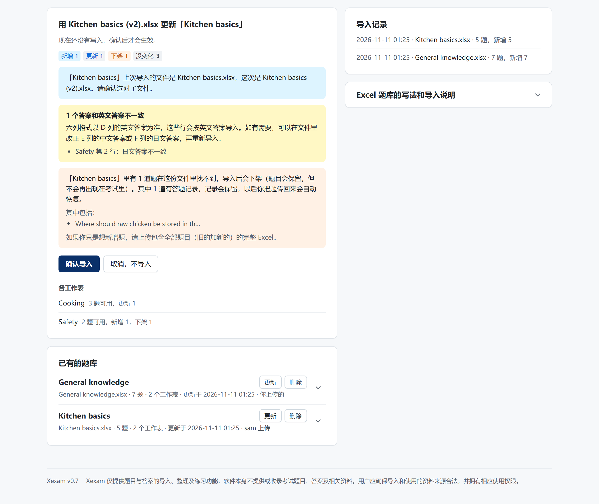

截图是用新版本的文件 `Kitchen basics (v2).xlsx` 更新「Kitchen basics」时的预览，这时还什么都没保存：几个小标签（新增 1、更新 1、下架 1）、将被下架的那道题，以及一条提醒：有一行的日文答案和英文答案不一致（这一行会按英文答案导入）。下面是 **已有的题库** 里的题库列表：「Kitchen basics」是可管理题库的用户 sam 上传的。

### 主页

还没有可以做的题时，**开始考试或练习** 面板只显示一段简短的说明：

- 管理员，或者还没有题库的可管理题库的用户，会看到 **去题库管理**；
- 还没有被分配题库的用户会看到：「管理员还没有给你分配题库。请联系管理员为你开通，开通后题库就会出现在这里。」

之后，主页上有：

- **没交卷的考试** 或 **没做完的练习**：页面最上面的一条紧凑横幅，显示你用 **暂存退出** 离开的那一场：标题旁写着 **只保存在这个浏览器里**，然后是它的题库、已答（练习里是已核对）的题数和用时。**继续作答** 从停下的地方接着做；**放弃** 把它丢掉。其他设备上看不到它。已经暂存了一场时再开始新的，会先问你。
- **开始考试或练习**：
  - 在面板右上角选择从哪里出题：**全部**（所选工作表里的所有题）或 **错题本**（只出还需要巩固的题）。两个按钮都显示题数。所选工作表里没有要复习的错题时，**错题本** 不能选，标题下面有一行字说明原因；选了 **错题本** 时，这一行字说明一道题怎样移出错题本。手机上这两个按钮也留在标题旁边：中文界面里保留简短的文字，英语和日语界面只显示图标和题数。
  - **考哪些题库和工作表**：每个题库是一张卡片，里面一行一个工作表。
    - **全选** 和 **全部取消** 在这一行标题的右边。
    - 题库的复选框会勾选或取消它的全部工作表，也可以只勾选单个工作表。只勾选了一部分时，复选框显示 −，卡片上会写例如 **已选 1/2 个工作表**（收起时也显示）。
    - 题库那一行右边的箭头展开或收起它的工作表。最多两个题库时一开始是展开的，超过两个时一开始是收起的；你的选择会保留到重新加载页面为止。
    - **错题 2** 这样的小标签表示这个题库或工作表里有几道题在错题本里。
  - 面板最下面的一栏：**开始考试** 和 **开始练习**、当前范围（例如 **当前范围共 12 题**，或 **当前范围共 12 题，本次随机抽 11 题**），以及两个选项 **题数** 和 **打乱顺序**。两个按钮用的是同一个范围。这个面板在屏幕上时，这一栏固定在屏幕底部。
  - **题数** 比当前范围里的题少时，从整个范围里随机抽题。**打乱顺序** 只决定这些题按随机顺序出，还是按题库里的顺序出。
- **最近一次成绩**：你最近一次考试或练习的成绩，带 **考试** / **练习** 标签、**查看详情** 和 **全部学习记录**。
- **概况**：有几个题库、几个可用工作表、几道可用题目、错题本里有几道题，带 **复习错题**（错题本里有题时），管理员和可管理题库的用户还有 **题库管理**。

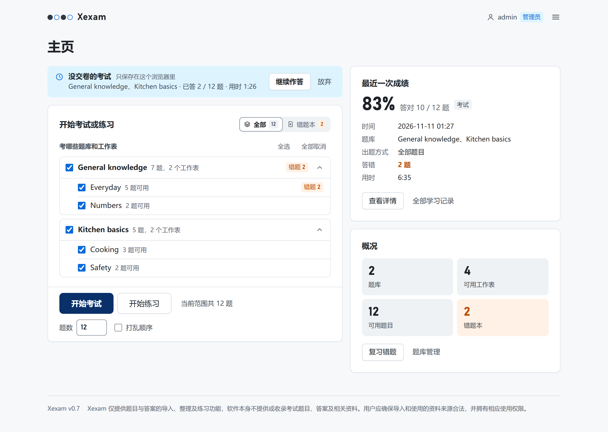

没交卷的考试是最上面的一条横幅；**全部** 和 **错题本** 在 **开始考试或练习** 的右上角；**考哪些题库和工作表** 那一行右边是 **全选** 和 **全部取消**；两个演示题库是两张展开的卡片，里面是各自的工作表；面板最下面一栏是 **开始考试**、**开始练习**、当前范围、**题数** 和 **打乱顺序**；右边是最近一次成绩和概况。

### 答题页

本页顶部的截图就是答题页。

- 顶部：例如 **第 4 题 共 12 题**、已用时间，以及 **暂存退出**：保留你的答案和用时，之后可以在同一个浏览器的主页接着考。
- **答题过程中不显示对错，也不显示分数。**
- **English** / **中文** / **日本語** 切换题目文字。切换只换文字：已选的答案、选项字母、计时和判分都不变。热点题的选项按钮也跟着换。
  - 每道题都有一个一定存在的基准语言：六列格式的题是 **English**，三列和四列格式的题是 **日本語**（三列格式里，不管 A 列是什么语言，这个按钮显示的都是 A 列）。
  - 某道题没有的语言，或者文字和基准语言对不上的语言（选项或小项不同），这道题的那个按钮会置灰；点它会说明原因。
  - 你选的语言会作为设置保存下来，交卷后答案和解析也先用这种语言显示。
- **上一题** 和 **下一题** 在题目之间移动（最后一题时，**下一题** 变成 **交卷**）。**稍后再看** 标记一道你想回头再看的题。
- **答题卡**：每道题一个小方块。实心 = 已答，半实心 = 热点题只答了一部分，空心 = 未答，黄色小方块 = 标记为稍后再看。点小方块就跳到那道题。小方块下面是 **已答 3 / 12 题** 和 **交卷**。
- **交卷** 前会先确认；没答的题按答错计分。
- 判分：单选、多选要**正好选中全部正确选项**才算对；热点题**每个小项都对**才算这题对。
- 键盘（电脑）：`←` `→` 上一题 / 下一题，`A`–`H` 选答案（选择题），`M` 稍后再看。

### 练习

练习和考试用同一个页面，但每道题作答后马上核对。在主页上点 **开始练习** 开始，它就在 **开始考试** 旁边，用的是同样的题库、工作表、**题数** 和 **打乱顺序**。

- **第 4 题 共 12 题** 旁边有一个 **练习** 标签。
- **怎么核对**：
  - 单选题选好选项就马上核对；
  - 多选题和热点题有 **核对答案** 按钮，选了内容之后才能点。热点题答了一个小项就可以核对，没答的小项算错。
- **核对之后**，这道题就锁定了，并显示：
  - **答对了** 或 **答错了**；
  - 和答案与解析里一样标出的选项：正确的选项实心绿色，选错的选项实心红色；
  - 你的答案和正确答案；
  - 解析和记忆口诀，用的是页面上 **English** / **中文** / **日本語** 切换按钮选中的语言。
- 练习里永远不会自动跳到下一题：用 **下一题** 往下走。
- 答题卡把核对过的题填成绿色（答对）或红色（答错），并显示例如 **已核对 4 / 12 题，答对 3 题**。
- **结束练习**（在答题卡下面，最后一题上也有）只在还有题没核对时才会先问你。没核对的题按未作答（答错）计分，即使已经选了答案。
- **暂存退出** 和考试里一样；之后主页上会显示 **没做完的练习** 和已核对的题数。
- 练完后打开 **练习成绩** 页，在 **学习记录** 里保存成一条 **练习** 记录，并和考试一样计入错题本。

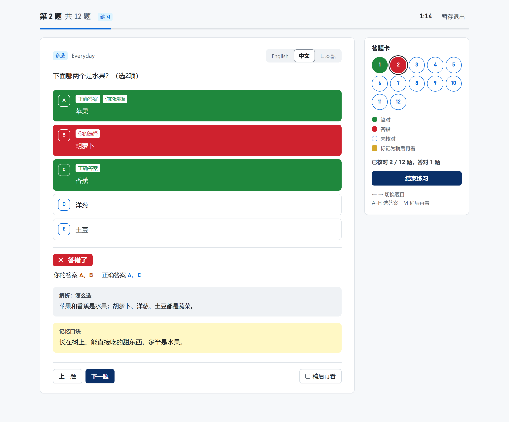

一道多选题点了 **核对答案** 之后：**练习** 标签、判定 **答错了**、选错的选项实心红色、正确的选项实心绿色，下面是解析和记忆口诀。

### 成绩页

分数、答对和答错的题数，以及一排小方块，每道题一个。练习的标题是 **练习成绩**。

**答案与解析** 可以显示 **只看错题（n）** 或 **全部题目（n）**。每道题的卡片上有：

- 你的选择和正确答案：正确的选项实心绿色，选错的选项实心红色，各带 **正确答案** / **你的选择** 标签（热点题的判断句是中性的底色，只给它们的选项上色）；
- 卡片自己的 **English** / **中文** / **日本語** 切换按钮。它一开始是你的题目语言，只改变这一张卡片：题目、选项、解析、记忆口诀和备注。题目没有的语言是灰的；
- 解析和记忆口诀。六列格式的题每种语言各有一份；某种语言没有时，显示另一种语言的。三列和四列格式的题只有一份解析，不管选哪种语言都显示它；
- 这道题到现在答过几次。

如果答题期间有题目（随题库一起）被删除，会有一句提示：分数和保存的记录只包含其余的题。

按钮：**只重做错题**、**再考一次**（练习后是 **再练一次**）、**在学习记录里查看** 和 **回首页**。重做和再来一次都和这次成绩是同一种：考试还是考试，练习还是练习。

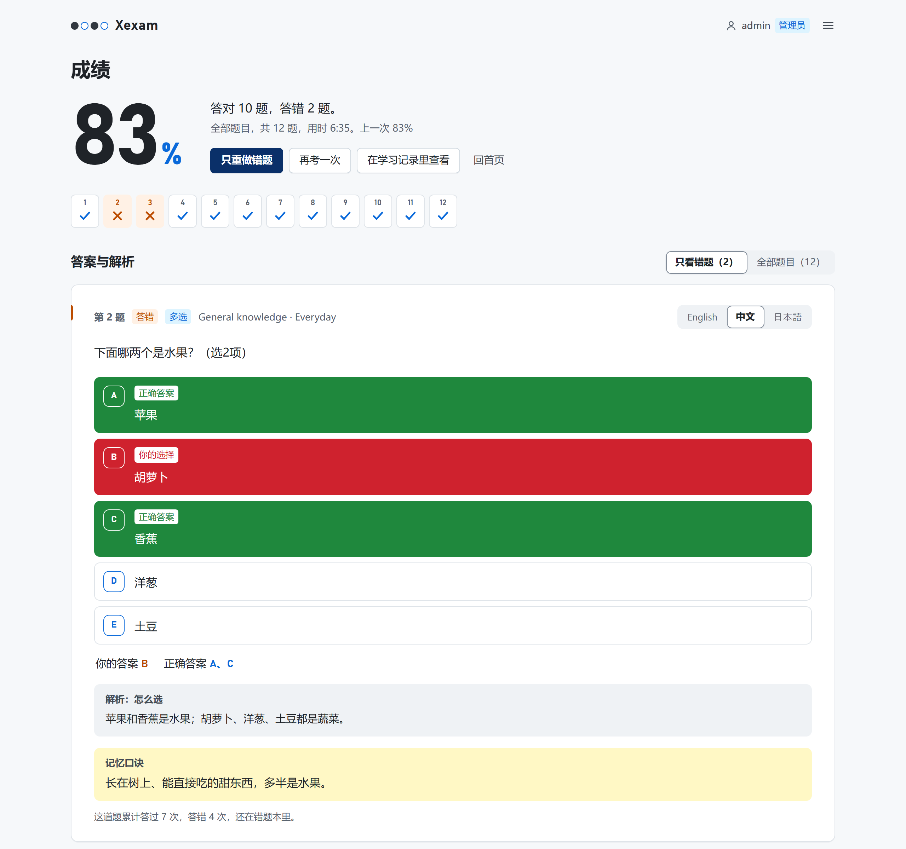

一场答错两题的考试，打开的是 **只看错题**：一道选择题，选错的选项实心红色、正确的选项实心绿色，卡片自己的 **English** / **中文** / **日本語** 切换按钮，以及界面语言的解析和记忆口诀。

### 学习记录

- **概况**：记录的条数（**记录条数**，按类型筛选时是 **考试场数** 或 **练习次数**）、**平均正确率**、**最高正确率**，以及最近几次成绩的小柱状图。
- **筛选**：**类型**（**全部类型**、**考试**、**练习**）、**题库**、用 **开始日期** 和 **结束日期** 指定的日期范围，以及 **正确率**（**不限**、**60% 以下**、**60%–79%**、**80% 及以上**）。**清除筛选** 把它们全部恢复。
- **记录列表**：每场考试或每次练习一行（手机上是一张卡片），带 **考试** / **练习** 标签，显示时间、题库、答了几题、用时、答对几题和正确率。点时间打开这条记录；**删除** 删掉它。
- **考试详情** / **练习详情**（一条记录）：分数和基本信息（含 **类型**），下面逐题列出你的答案、正确答案、解析和记忆口诀，每张卡片有自己的语言切换按钮。**只看错题（n）** / **全部题目（n）** 在只看错题和看全部题之间切换。**重做错题** 用答错的题重新开始；**重考这一场**（**再练一次**）把同样的题再做一遍，两者都和这条记录是同一种；**删除这条记录** 删掉它。v0.5 之前考的场次只有分数，因为 v0.4 没有保存每道题的作答。
- 右上角的 **复习错题** 打开 **错题复习**：列出错题本里的每道题，显示你答过几次，以及还要连续答对几次才会移出。可以只看某一个题库；**练习这些题** 用它们开始一次练习。
- 删除：删除一条记录时，每道题的答题统计会保留，所以错题本不会变。**全部删除** 删掉所有记录（考试和练习）；勾选 **同时清空错题本和每道题的答题统计**，会把这些也一起清空。每次删除都会先确认，删除后无法恢复。
- Xexam 只保留你最近的 500 条记录（考试和练习），更早的记录会自动删除。

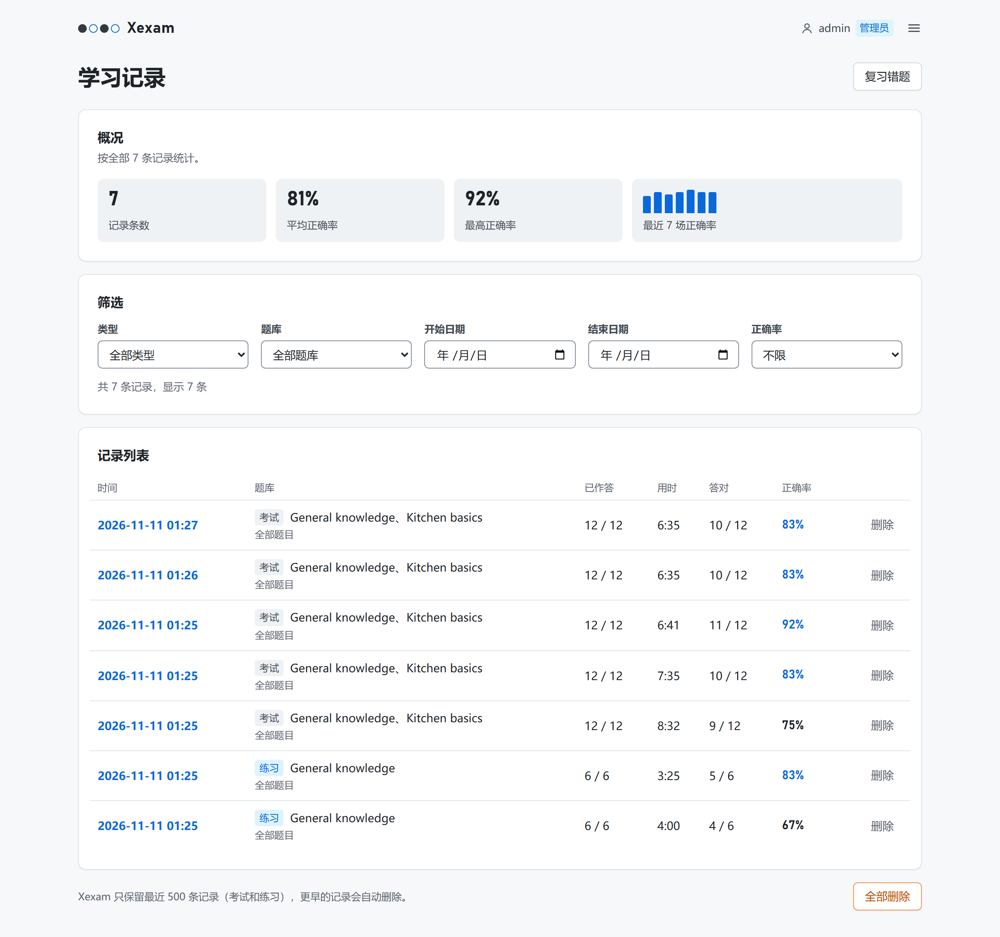

### 错题本

在考试或练习中答错的题进入错题本，之后**连续 2 次答对**（考试或练习都算）就会移出。可以在主页使用（**开始考试或练习** 面板右上角的 **错题本**），也可以在 **学习记录** → **复习错题** → **练习这些题**，或者交卷后直接点 **只重做错题**。

### 设置

- **账户**：你的 **用户名** 和 **角色**（有这个权限时再加 **可管理题库**），以及 **修改密码**。可管理题库的用户还会看到一句说明，写着这个权限允许做什么。
- **外观**（主题）：**跟随系统**（默认；按设备的浅色或深色设置显示）、**浅色** 或 **深色**。
- **语言**（界面语言）：**English**（默认）、**中文** 或 **日本語**。它决定所有地方的菜单、按钮和提示文字，包括答题页和服务器返回的错误提示。题目文字在答题页上有自己的切换按钮。
- **答题** → **答完自动跳到下一题**（默认关闭，只用于考试）：单选题选好答案后，或者热点题的每个小项都选好后，自动打开下一题。多选题永远不会自动跳转。开启时，答题页顶部会显示 **自动下一题：开**。
- **恢复默认设置**：主题、界面语言和答完自动跳到下一题恢复成默认值。题目语言保持不变。

设置属于你的账户，和你上次选的题目语言一起保存在 Xexam 服务器上。所以重启、更新镜像、清除浏览器缓存、换别的浏览器或设备之后，设置都还在；每个用户都有自己的一套。只有没交卷的考试或没做完的练习留在当前浏览器里。

<table>
<tr>
<td width="50%">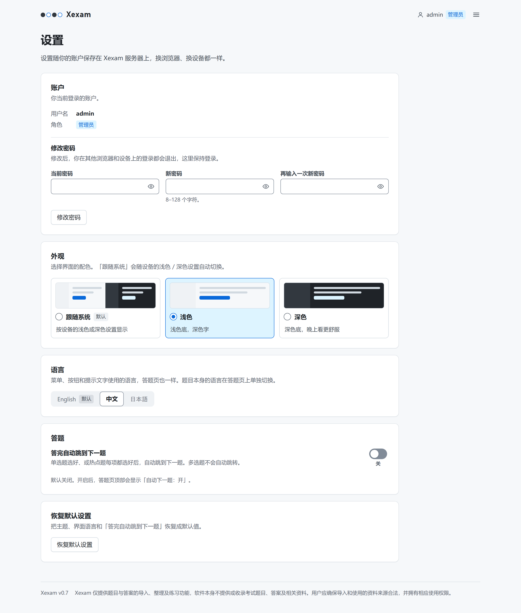</td>
<td width="50%">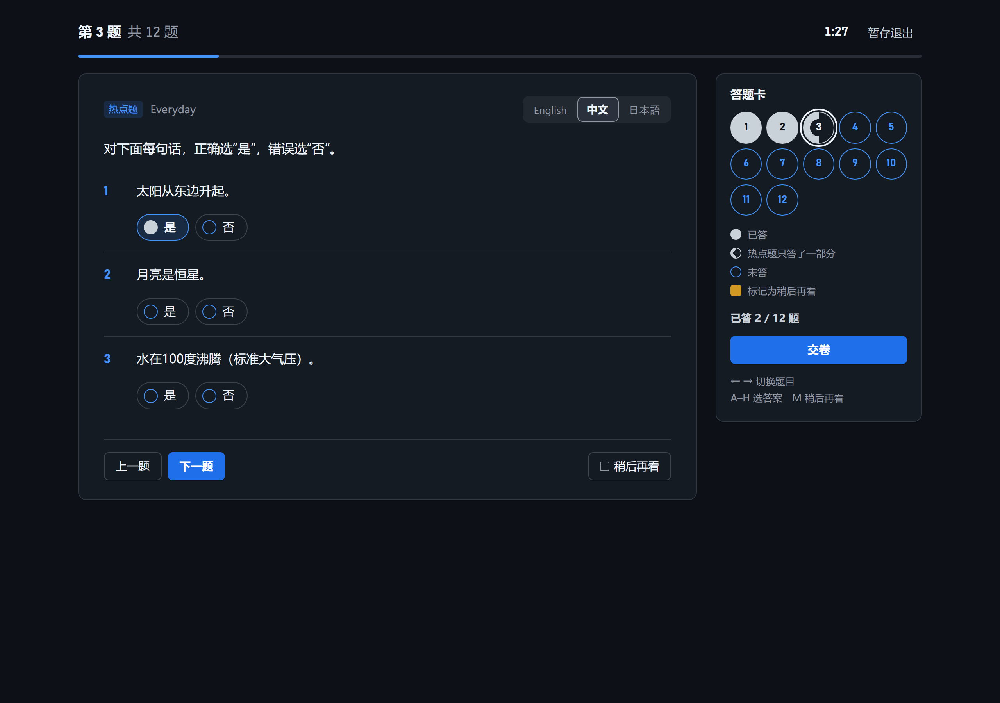</td>
</tr>
<tr>
<td>设置：<b>账户</b>、<b>外观</b>、<b>语言</b> 和 <b>答题</b>。</td>
<td><b>深色</b> 主题，这里是答题页。</td>
</tr>
</table>

### 关于 Xexam

菜单里的版本那一项 **Xexam v0.7** 会打开 **关于 Xexam**：**版本**、**服务器** 的 CPU 架构、**许可证**，以及 **更新内容**。**更新内容** 就是界面语言那一份 README 的 [更新日志](#更新日志)（中文界面显示的是本文件的更新日志）。最新的版本是展开的；更早的版本折叠在 **更早的版本** 下面。

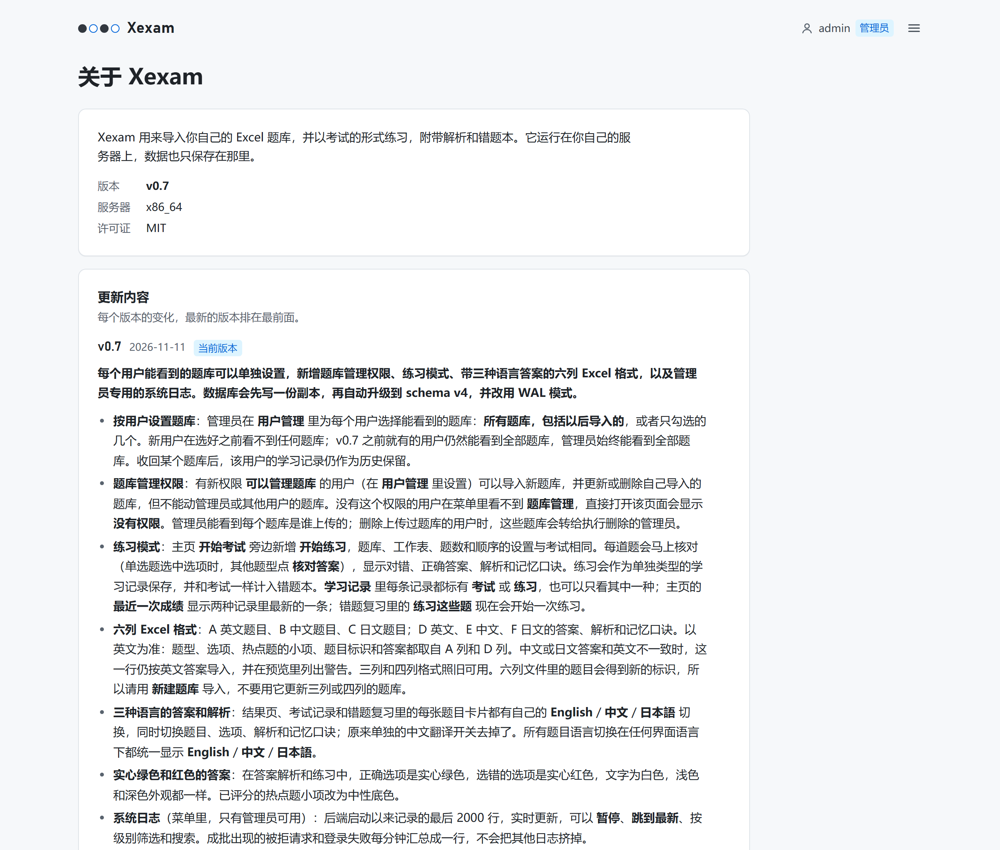

### 用户和登录

从 v0.6 起，所有人都要登录才能使用。账户有三种：

- **管理员**：所有功能，包括所有题库、**用户管理** 和 **系统日志**。
- 带 **可管理题库** 权限的 **普通用户**：可以导入新的题库，并更新或删除自己导入的题库，但不能改动别人的。
- **普通用户**：用管理员分配给他的题库考试和练习。

每个用户有自己的学习记录、错题本、没交卷的考试和设置。

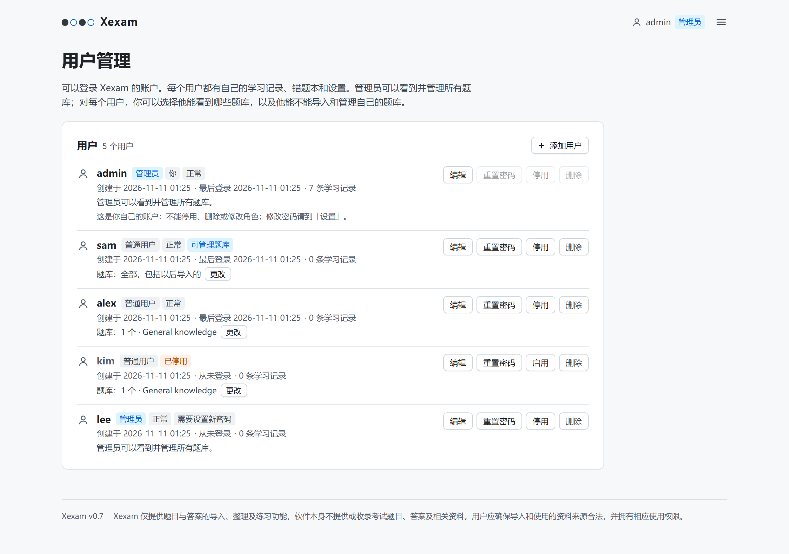

用户管理里有两个管理员（admin 和 lee）、sam（**可管理题库**，所有题库）、alex（一个题库：General knowledge）和 kim（已停用）。

- **第一次启动**（新装，或从 v0.5 或更早的版本升级后第一次启动）：用 `admin` / `admin` 登录（登录页上也有提示），接着设置一个新密码（8–128 个字符）。v0.6 之前的学习记录、错题本和设置都归这个管理员。
- **用户管理**（菜单里，只有管理员可用）：每个用户一行，显示角色、状态（**正常**、**已停用**、**已锁定 · 还剩 …**、**还能试 3 次**、**需要设置新密码**），有权限时再显示 **可管理题库**，以及创建时间、最后登录时间和学习记录的条数（考试和练习）。操作有 **编辑**、**重置密码**、**停用** / **启用**、**删除**，需要时还有 **解锁**。管理员新建或重置过密码的用户，下次登录时要设置自己的密码。不能停用、降级或删除自己，最后一个启用的管理员也不能被移除。页面开着时列表会自己刷新，所以刚开始的锁定也会显示出来。
- **用户能看到哪些题库**：每个用户那一行写着 **题库：全部，包括以后导入的**、**题库：1 个 · General knowledge**，或者还一个都没有；可管理题库的用户自己上传的题库列在下面。**更改** 会打开例如 **alex 能看到的题库**：选 **所有题库，包括以后导入的**，或者勾选单个题库（每个都写着是谁上传的）。修改马上生效，这个用户不会被退出登录。管理员始终能看到所有题库。收回某个题库后，这个用户的学习记录仍作为历史保留。
- **添加用户**：用户名、初始密码、角色、题库清单（默认一个都不勾：选好之前，新用户看不到任何题库）和 **可以管理题库**。新账户创建后即为启用状态。后两项对管理员是灰的，因为管理员本来就能看到和管理一切。**编辑** 可以改用户名、角色、**可以管理题库** 和 **启用账户**。收回 **可以管理题库** 权限后，从这个用户下一次切换页面时开始生效。
- **删除用户** 会同时删除他的学习记录（对话框里写明有几条）、错题本和设置。他导入的题库不会被删除，而是转到你的名下，也就是删除这个用户的那位管理员。
- **密码输错**：一个账户在 15 分钟内输错 5 次密码，它的登录就锁 1 分钟；之后每再错 3 次又锁一次，时间依次是 5 分钟、15 分钟、30 分钟、1 小时和 1 天。锁定属于账户，而不是输入的名字，乱猜别的用户名也消耗不掉它。以前用这个账户登录过的浏览器单独计数，所以别处的乱猜锁不住它们。登录成功、**解锁**、管理员重置密码、重启后端，或者 24 小时内没有再输错，都会重新回到 5 次机会。登录页会显示还要等多久。
  - 在 **用户管理** 里，这一行下面的一句简短说明会写明哪些浏览器被锁定、锁到什么时候、已经连续锁了几次。**解锁** 不再询问，马上重新给 5 次机会；用户还有剩余次数时也能点它。
- **修改密码**：**设置** → **账户** → **修改密码**；你在其他浏览器上的登录会被退出。
- **忘了管理员密码**：`docker compose exec backend xexam-backend reset-password admin` 会打印一个新的临时密码，下次登录时必须改掉。Xexam 运行时也能用。想马上解除锁定，就重启后端：`docker compose restart backend`。

<table>
<tr>
<td width="50%">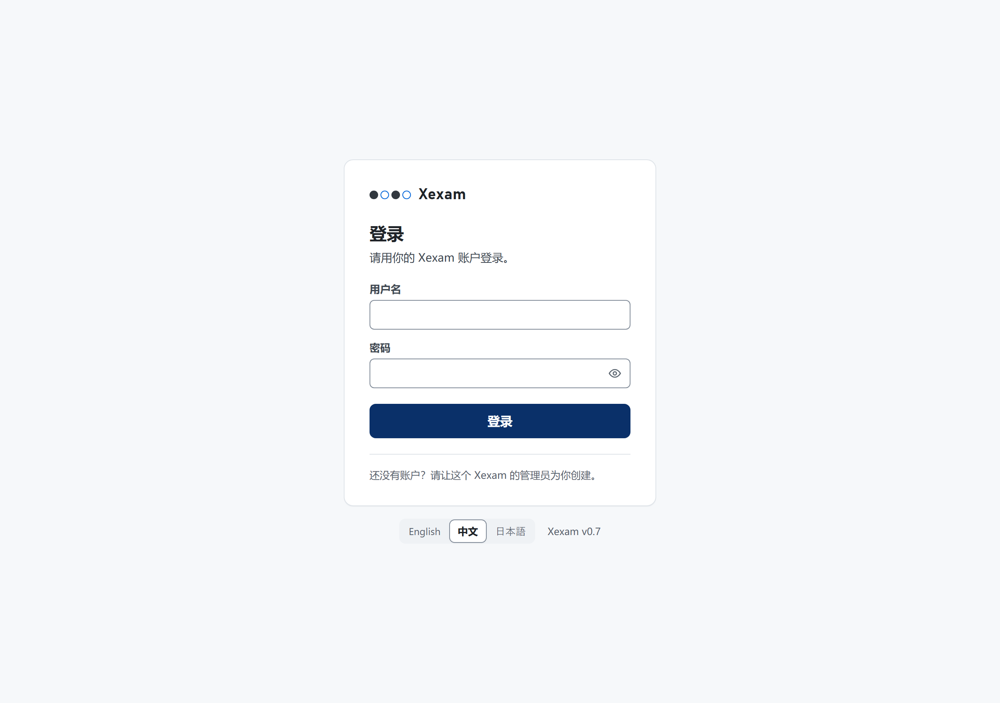</td>
<td width="50%">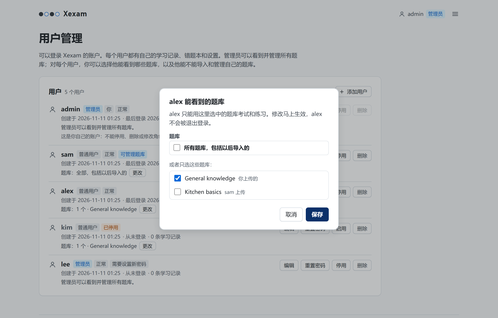</td>
</tr>
<tr>
<td>登录页。</td>
<td><b>alex 能看到的题库</b>：<b>所有题库，包括以后导入的</b>，或者单个题库（每个都写着是谁上传的）；这里只有 General knowledge。</td>
</tr>
</table>

### 系统日志

**系统日志**（菜单里，只有管理员可用；其他人打开会看到 **没有权限**）显示后端自上次启动以来记录的日志，最新的在最下面：启动、登录、对用户的修改、被拒绝的上传和请求等。

- 页面打开时每 1.5 秒读取一次新内容，并跟着新内容往下滚。往上滚可以看前面的，**跳到最新** 带你回到最下面。
- **暂停** 暂时不再读取新的日志；**继续** 重新开始读取。
- **级别** 可以显示 **全部**、只显示 **警告**（和错误），或只显示 **错误**；**搜索日志** 按文字筛选。
- 只保留最后 2000 行，而且只在内存里：重启后列表又是空的。更早的日志请在服务器上运行 `docker compose logs backend`。
- 日志里用 id 指代用户，从不包含密码、会话令牌、Cookie 的值或题目文字。成批出现的被拒绝的请求和失败的登录，每分钟汇总成一行，所以没人能不登录就把其他日志挤出去。

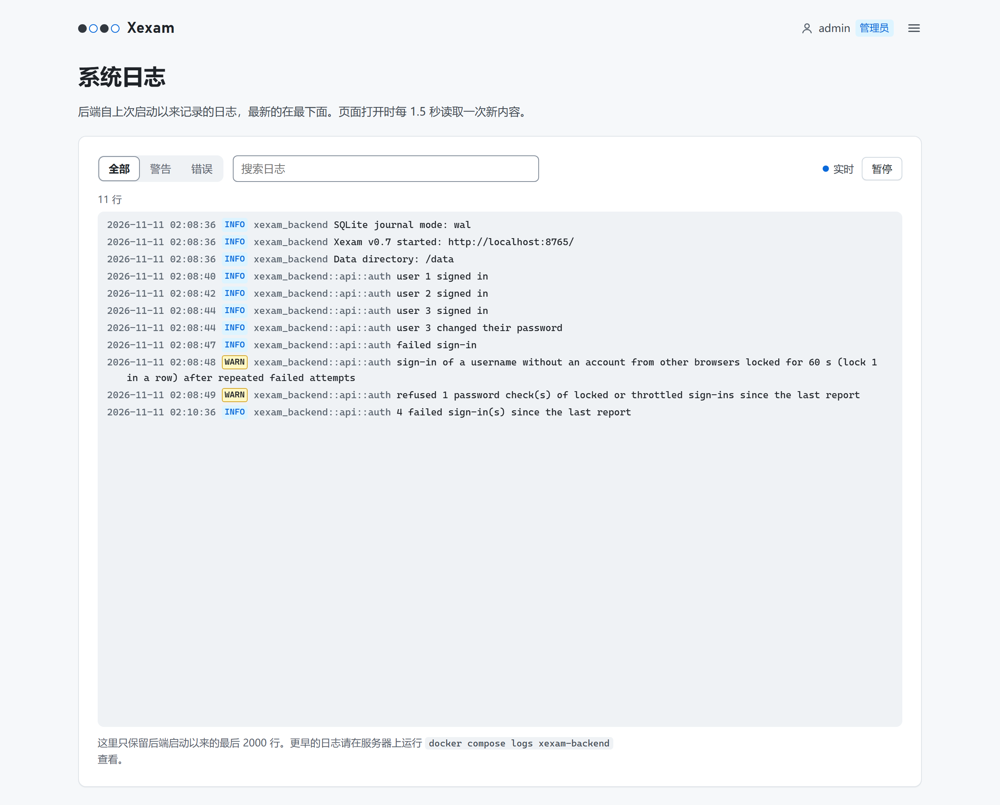

系统日志里是启动、登录、登录失败和一次登录锁定的记录，以及它们的汇总，上面是 **级别** 筛选、搜索框和 **暂停**。

### 在 iPhone 上使用

- 在 iPhone 的 Safari 里打开服务地址（需要先做 [从手机或另一台电脑打开 Xexam](#从手机或另一台电脑打开-xexam)）。需要 **iOS 15.4 或更新**。
- 点分享按钮 → **添加到主屏幕**。之后它像独立应用一样全屏打开，图标是答题卡样式的 Xexam。
- 右上角三条横线的按钮打开和电脑上一样的小菜单。
- 主页上，**全部** 和 **错题本** 留在 **开始考试或练习** 标题旁边（英语和日语界面只显示图标和题数）。屏幕底部那一栏有两行：第一行是当前范围、**题数** 和 **打乱顺序**；第二行是 **开始考试**（较宽的那个）和 **开始练习**。
- 考试和练习页上，**上一题**、**下一题** 和 **稍后再看** 固定在底部；答题卡在题目下方，**已答 x / n 题** 和 **交卷**（或 **结束练习**）在小方块上面。
- 学习记录显示成紧凑的卡片。
- 按钮和其他触控区域都不小于 44 px；刘海和底部横条的安全区已处理。

下面是 390 px 宽的 iPhone 上的截图：

<table>
<tr>
<td width="25%">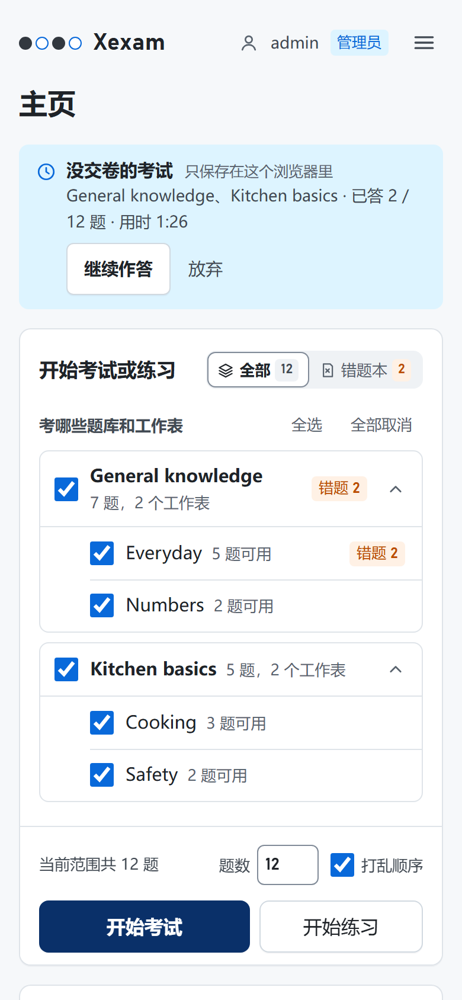</td>
<td width="25%">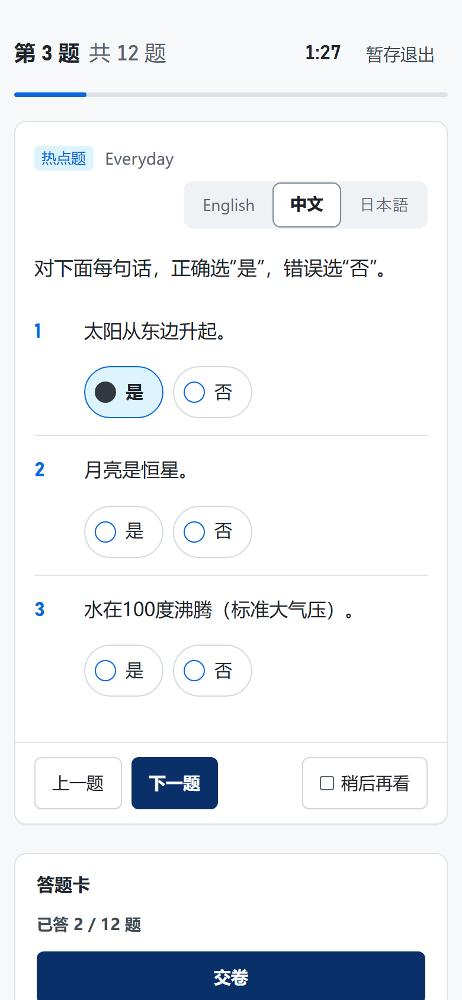</td>
<td width="25%">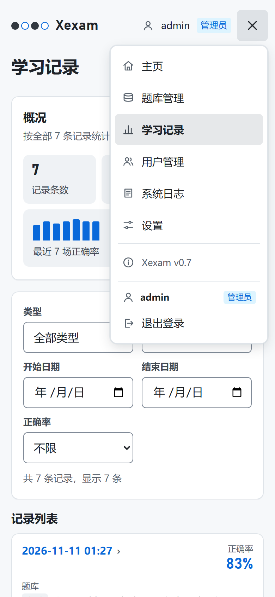</td>
<td width="25%">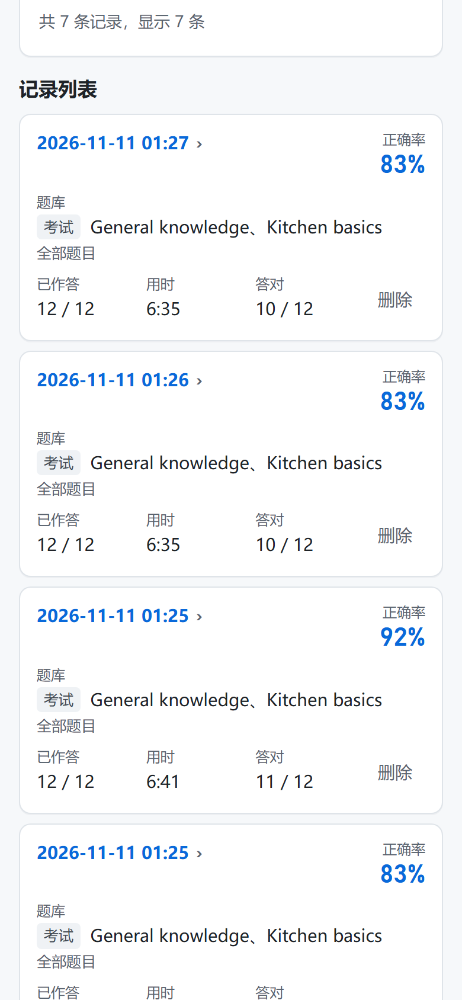</td>
</tr>
<tr>
<td>主页：当前范围、<b>题数</b> 和 <b>打乱顺序</b>，下面是 <b>开始考试</b> 和 <b>开始练习</b>，都在屏幕底部。</td>
<td>考试：<b>上一题</b>、<b>下一题</b> 和 <b>稍后再看</b> 固定在底部。</td>
<td>管理员的菜单，点三条横线的按钮打开。</td>
<td>学习记录：每条记录是一张紧凑的卡片。</td>
</tr>
</table>

---

## Excel 题库格式

一份工作簿（`.xlsx`）就是一个题库。每个工作表是一组题，一行一道题。Xexam 按内容逐个工作表识别三种格式，不用设置任何东西：

| 格式 | 列 | 基准语言 |
|---|---|---|
| [三列](#三列格式最简单) | A 题目，B 中文翻译，C 答案和解析 | A 列的语言（显示在 **日本語** 下） |
| [四列](#四列格式带英语) | A 英语、B 中文、C 日语题目，D 答案和解析 | 日语（C 列） |
| [六列](#六列格式三种语言) | A 英语、B 中文、C 日语题目；D 英语、E 中文、F 日语答案和解析 | 英语（A 列和 D 列） |

基准语言就是读取题目时所依据的那种语言：题型、选项、小项和答案都从它读出来，下次导入时 Xexam 也靠它认出同一道题。

### 三列格式（最简单）

下面是一道完整的多选题，占工作表里的一行（和 **题库管理** 页上 **Excel 题库的写法和导入说明** 里的示例一样）：

| A | B | C |
|---|---|---|
| 下面哪两个是水果？<br>A. 胡萝卜<br>B. 土豆<br>C. 苹果<br>D. 洋葱<br>E. 香蕉 | （空着） | 【答案】C、E<br>【解析·怎么选】苹果和香蕉是水果，其他都是蔬菜。<br>【记忆口诀】甜的是水果。 |

- **A 列**：题目。
- **B 列**：中文翻译（可以不写，没有就空着）。
- **C 列**：先写答案 `【答案】…`；再写 `【解析·怎么选】` 和解析、`【记忆口诀】` 和口诀（这两段可以不写）。在三列和四列格式里，这些标题用这几个中文词，也可以用日语写（`【正解】`、`【解説】`）。英语标题只在六列格式里有效。

在单元格里换行：Windows 上按 Alt+Enter，Mac 上按 Control+Option+Return。第一行如果是表头（A 列写着 `题目` 或 `Question` 之类），会被跳过。

**题目只有一种语言时**（不管是中文、英语还是日语），就用三列格式：题目写在 A 列，B 列空着，不需要写日语。答题页上不管选哪种题目语言，这些题都显示 A 列的文字（它们的 **English** 和 **中文** 按钮是灰的）。

**选择题的写法**

- 选项写在题干下面，从 `A.` 开始按字母顺序，一行一个，至少两个：`A. 内容`。
- 答案只有一个字母就是单选题，有多个字母就是多选题：`【答案】C` 或 `【答案】C、E`。

**热点题的写法**（一组判断句，每一句选一个答案）

- A 列的第一行写 `ホットスポット`（也可以写 `HOTSPOT`），下一行开始写题干。
- 每个小项一行，写成 `1. 内容　はい / いいえ`：内容后面空一个**全角空格**（`　`）或一个制表符，再写这个小项的选项，选项之间用 ` / ` 隔开（斜杠两边各一个空格）。选项可以是任何词，例如 `准备 / 烹饪 / 上菜`。
- 答案要写出每个小项的选择：`【答案】1 是；2 否`。每个小项的答案写这个小项的某个选项词；是非题也可以写 `是`/`否`、`はい`/`いいえ` 或 `Yes`/`No`。答案不是这个小项的选项时，这道题会在预览里作为读不出来的题列出，并写明原因。

例如这道热点题（A 列和 C 列，B 列空着；`はい / いいえ` 前面的空白是全角空格）：

```
ホットスポット
判断下面每句话是否正确。
1. 太阳从东方升起。　はい / いいえ
2. 月亮是恒星。　はい / いいえ
```

```
【答案】1 是；2 否
【解析·怎么选】太阳从东方升起；月亮只是反射太阳光，不是恒星。
```

### 四列格式（带英语）

就是把三列格式整体右移一列，英语放在新的 A 列。它是给题目用日语写在 C 列的工作簿用的；Xexam 根据 C 列的日语和 D 列的答案认出这种格式。

| 列 | 内容 |
|---|---|
| **A** | **英语**题目（可以不写）。热点题的英语第一行写 `HOTSPOT`，小项末尾写 `Yes / No` 这样的英语选项 |
| **B** | **中文**翻译（可以不写）。`【中文翻译】` 标题可有可无 |
| **C** | **日语**题目。题目、选项和答案都以这一列为准：题目 id、选项字母、热点题的小项都来自这一列。热点题以 `ホットスポット` 开头 |
| **D** | 答案和解析，写法和三列格式的 C 列一样 |

A、B、C 三列是**同一道题的三种语言**，结构要**完全一一对应**：同一道题、同样的选项字母、同样的小项个数和顺序。A 列的第 1 项 = B 列的第 1 项 = C 列的第 1 项，选项 A = 选项 A = 选项 A。答案只写一份（D 列），三种语言共用。

**热点题的选项按语言写在各自那一列里**：每个小项末尾用本语言写出选项，三种语言的第 j 个选项是同一个意思。例如同一个小项：

| 列 | 小项的写法 |
|---|---|
| A 英语 | `1. Wash and cut the vegetables.　Preparation / Cooking / Serving` |
| B 中文 | `1. 清洗并切好蔬菜。　准备 / 烹饪 / 上菜` |
| C 日语 | `1. 野菜を洗って切る。　下ごしらえ / 調理 / 盛り付け`（意思同上） |

所以一个小项的答案可以用三种语言里任何一种的选项词来写（例如 `Cooking`、`調理` 或 `烹饪`），因为选项按位置一一对应。在答题页上切换语言时，题干、选项和热点题的选项按钮都会换成对应那一列的文字。某一列没有写选项（或个数和日语对不上）时，这道题的这个语言仍然可用，只是选项按钮显示日语的选项。

解析和记忆口诀（D 列）只有一份，不管选哪种语言都显示它。三列格式的工作簿照样可以上传，只是没有英语。

### 六列格式（三种语言）

题目**和**答案都有三种语言：每种语言有自己的题目列和答案列，所以解析和记忆口诀也可以用英语、中文或日语看。

| 列 | 内容 |
|---|---|
| **A** | **英语**题目。题型、选项和热点题的小项都以这一列为准，题目也按这一列识别 |
| **B** | **中文**题目（可以不写），选项或小项和 A 列一一对应 |
| **C** | **日语**题目（可以不写），选项或小项和 A 列一一对应 |
| **D** | **英语**答案和解析：`【Answer】B`，再写 `【Explanation】` 和 `【Memory aid】`。答案以这一列为准 |
| **E** | **中文**答案和解析（可以不写）：`【答案】B`、`【解析·怎么选】`、`【记忆口诀】` |
| **F** | **日语**答案和解析（可以不写）：`【正解】B`、`【解説】`、`【覚え方】` |

下面是这种格式的一道完整的单选题（和这里所有的示例一样是虚构的，也和 **题库管理** 页上写法说明里的示例相同）：

| 列 | 单元格 |
|---|---|
| A | Which planet is known as the Red Planet?<br>A. Venus<br>B. Mars<br>C. Jupiter<br>D. Saturn |
| B | 哪颗行星被称为“红色星球”？<br>A. 金星<br>B. 火星<br>C. 木星<br>D. 土星 |
| C | 「赤い惑星」と呼ばれる惑星はどれですか。<br>A. 金星<br>B. 火星<br>C. 木星<br>D. 土星 |
| D | 【Answer】B<br>【Explanation】Iron oxide (rust) in the dust on its surface makes Mars look red.<br>【Memory aid】Mars rusts red. |
| E | 【答案】B<br>【解析·怎么选】火星表面的尘土含有氧化铁（铁锈），所以看起来是红色的。<br>【记忆口诀】火星生锈红彤彤。 |
| F | 【正解】B<br>【解説】火星の表面の砂には酸化鉄（さび）が含まれているため、赤く見えます。<br>【覚え方】火星はさびて赤い。 |

**以英语为准。**

- 题型、选项、热点题的小项和题目的身份都来自 A 列，答案来自 D 列。A 列没有英语题目或 D 列没有英语答案的行读不出来；预览里会列出这一行和原因。
- B 列和 C 列必须和 A 列对得上（同样的选项字母、同样的小项个数）。对不上的语言，在答题页上这道题的那个按钮是灰的。
- E 列或 F 列的答案和 D 列意思不同时，这一行仍按英语答案导入，预览里会提醒，例如 **1 个答案和英文答案不一致**，点 **查看是哪几行** 能看到是哪几行。答案按意思比较：同样的字母，或者热点题每个小项选的是同一个选项（`Yes`、`是` 和 `はい` 算一样）。

**标题和答案**

- 每个答案列都可以用三种语言中任意一种的标题：`【Answer】` `【Explanation】` `【Memory aid】`（或 `【Mnemonic】`）；`【答案】` `【解析·怎么选】` `【记忆口诀】`；`【正解】` `【解説】` `【覚え方】`。
- 英语答案用 `, ` 和 `; ` 分隔：`【Answer】B, C`，热点题写成 `【Answer】1 Yes; 2 No`。
- 答案后面括号里的备注不算答案的一部分，会在答案卡片上显示为 **备注**，半角或全角括号都行，例如 `【Answer】C, D (fairly sure)`。

**热点题**

- A 列的第一行写 `HOTSPOT`。第一行以 `HOTSPOT:` 开头也可以：标记会被去掉，这一行剩下的文字仍算题目的一部分。
- 每个小项末尾写它的选项，例如 `1. The sun rises in the east.　Yes / No`。选项前面放一个制表符或全角空格（`　`）。只有一个词的选项也可以跟在普通空格后面（`1. Water is wet. Yes / No`），但由几个词组成的选项（例如 `Main course / Side dish` 这样的类别名称）必须用制表符或全角空格隔开。
- B 列和 C 列用各自的选项写同样的小项，和四列格式一样；每个答案列里都可以用任何一种语言的是 / 否。

**其他要知道的**

- Xexam 根据 E 列或 F 列的答案标题和 C 列的日语题目认出这种格式（一个工作表里至少要有一行带这些内容）。
- 每道题的解析都用题目卡片上或练习页上选中的语言显示。某种语言没有解析时，显示另一种语言的。
- **六列格式的文件请作为新题库导入。** 三列和四列格式按日语题目识别题目，六列格式按英语题目识别。所以用六列格式的文件更新从三列或四列文件导入的题库时，所有题目都会算作新题：旧题全部下架，新题从没有答题记录开始。

### 读不出来的题

读不出来的题**不会被猜**：它们会在预览里列出原因（多半是答案列没写 `【答案】…` 或 `【Answer】…`，或答案字母不在选项里），不会悄悄判错。

---

## 导入题库

### 谁可以导入

- **管理员**：导入新题库，并更新或删除所有题库。
- **可管理题库的用户**（在 [用户管理](#用户和登录) 里设置了 **可以管理题库** 的用户）：导入新题库，这些题库就归他所有；只能更新或删除自己导入的题库。管理员和其他用户的题库他都动不了。
- 其他用户看不到 **题库管理** 页面。

### 新建题库还是更新

一个题库就是一份导入的 Excel 工作簿。在 **题库管理** → **导入 Excel** 里用标题旁边的两个小按钮选择文件导入到哪里（悬停提示里有说明）：

| 选择 | 会发生什么 |
|---|---|
| **新建题库** | 新建一个题库，以文件名命名（去掉 `.xlsx`；名字已被占用时，加上 ` (2)`、` (3)` ……）。已有的题库不会改动。同一份工作簿可以导入两次，成为两个独立的题库，它们的学习记录不会混在一起 |
| **更新已有题库** | 用这份文件替换你在 **要更新的题库** 里选的那个题库的题目（可管理题库的用户只能选自己的题库）。文件里没有的题**只在这个题库里**下架。题库的名字和所有者不变 |

导入一份不同的工作簿时选 **新建题库**；上传已经导入过的工作簿的新版本时选 **更新已有题库**。每次都要上传**整份**工作簿，不要只传新增的题。用六列格式的工作簿替换三列或四列的题库，就等于是另一份工作簿：请作为 **新建题库** 导入（见 [六列格式](#六列格式三种语言)）。

新题库能被这些人看到：导入它的人、管理员，以及设置了 **所有题库，包括以后导入的** 的用户。管理员可以在 **用户管理** 里把它分配给其他用户。

### 先预览，再确认

上传后，Xexam 会读取并检查文件，然后显示预览：用几个小标签显示会 **新增**、**更新**、**恢复上架**、**下架** 多少题，**没变化** 和 **读不出来** 的各有多少题（为 0 的不显示）；每个工作表一行，带它的数字；读不出来的每一行的行号和原因，收在所属工作表那一行的下面（例如 **2 题读不出来**）。**你确认之前什么都不会写入**（点 **确认新建题库** 或 **确认导入**；点 **取消，不导入** 就放弃这次导入）。在下面这些情况下，预览还会提醒你：

- 你用来新建题库的文件，和某个已有题库导入时用的文件同名（它会建议改为更新那个题库）；
- 你用来更新题库的文件，名字和上次导入的不一样；
- 会有题目被下架。它会列出其中一些，并在导入前再问你一次；
- 在六列格式的文件里，某一行的中文或日文答案和英文答案不一致（这一行按英文答案导入）。

每个导入的人都有自己的一份预览，在内存里保留 30 分钟。所有打开着的预览共用一个内存额度：好几个大文件同时在预览时，别人最早的那份预览可能会被丢掉。确认一份已经被丢掉或超过 30 分钟的预览时，会提示它已过期：请重新上传文件。

### 导入规则

这份文件被当成它所导入的那个**题库的完整内容**。其他题库永远不会被改动。

| 情况 | 结果 |
|---|---|
| 文件里有、题库里没有的题 | **新增** |
| 同一道题，但其它内容（其它选项、答案、解析、翻译）改了 | **更新**（答题记录不受影响） |
| 题库里有、文件里找不到的题 | **下架**：题目和答题记录都保留，但不再出现在考试和练习里 |
| 以前下架、这次又出现的题 | **恢复上架**，它在错题本里的记录也跟着回来 |
| 改了工作表名、题干或第一个选项 | 算**一道新题**：旧题下架，新题从没有答题记录开始 |
| 这份文件里一道可用的题都没有 | 拒绝导入（防止把题库清空） |

题目是按工作表名、题干和第一个选项来识别的（空格不影响）。三列和四列格式的题干是日语那一份（三列格式就是 A 列），六列格式的题干是英语那一份。

### 删除题库

题库那一行的 **删除** 会先请你确认（例如 **删除「Kitchen basics」？**）。这个题库的题目（上架的和已下架的）和它的导入记录都会被删除，所有用户的题库里都不会再有它。下面的复选框默认不勾选：

- **不勾选**：答题记录和考试记录都保留。在这些记录里，这个题库的题显示为已删除。
- 管理员**勾选**（**同时删除这个题库的学习记录**）：这个题库的题的答题记录，以及没有其他现存题库参与的记录，也一起删除。
- 可管理题库的用户**勾选**（**同时删除你在这个题库的学习记录**）：只删除你自己的答题记录和记录；其他用户的学习记录始终保留，里面的题显示为已删除。

删除后无法恢复，只有你自己的备份能找回来（见 [数据、备份和恢复](#数据备份和恢复)）。

---

## 升级

每次升级都还是同样的两个镜像、同样的端口、同样的卷 `xexam_data`，所以数据原样保留：先 `docker compose pull`，再 `docker compose up -d`。数据库 schema 有变化时，新版本第一次启动会先写一份备份副本，再在一个事务里迁移数据库。副本写不出来（磁盘满、没有权限）时，后端会拒绝启动，数据库保持原样；`docker compose logs backend` 里会写明原因。

### 从 v0.6 升级到 v0.7

v0.7 把数据库从 schema v3 升级到 **schema v4**，并改用 WAL 模式。它新增了一个可选设置 `XEXAM_SQLITE_JOURNAL`（见 [配置](#配置)）；你的 `.env` 可以保持原样。

把你的 `docker-compose.yml` 换成新的那份（方式 A 第 1 步）：它让时间跟随宿主机的时区（`.env` 里的 `TZ` 仍然优先），并限制容器日志的大小。服务名、端口和卷都不变。

```bash
# 1. 备份卷（先停止；备份文件里是你的整个数据库，不要提交它）
docker compose stop
docker run --rm -v xexam_data:/data -v "${PWD}:/backup" alpine tar czf /backup/xexam-data-v06.tgz -C /data .

# 2. 拉取 v0.7 并启动（不要用 down -v）
docker compose pull
docker compose up -d

# 3. 查看升级信息和副本的文件名
docker compose logs backend
```

后端第一次启动时，在响应任何请求之前：

1. **写一份副本**：把数据库复制到卷里的 `/data/backups/xexam-schema3-<YYYYmmdd-HHMMSS>.db`。
2. **迁移**到 schema v4：
   - 已有的每个用户仍然能看到所有题库（**所有题库，包括以后导入的**）；
   - 已有的每个题库都归第一个管理员账户（通常是 `admin`）；
   - 已有的每条学习记录都变成 **考试** 记录；
   - 还没有人是可管理题库的用户。
3. **改用 WAL 模式。** 后端运行时，`xexam.db` 旁边会出现 `xexam.db-wal` 和 `xexam.db-shm`；正常停止后，所有内容都在 `xexam.db` 里，`xexam.db-wal` 是空的（这两个文件可能还在，但没有害处）。下次备份之前请先看 [备份和恢复](#备份和恢复)。

日志里会有这样一行：`Upgraded the database to schema 4. A copy of the previous version was saved first: /data/backups/xexam-schema3-20261111-090000.db (…)`（意思是：数据库已升级到 schema 4，升级前先保存了旧版本的副本）。

升级之后：

- 决定谁应该 **可以管理题库**，以及新用户应该看到哪些题库：从现在起新添加的用户，在你选好之前看不到任何题库。
- 检查 <http://localhost:8765/api/info> 显示 `"version": "0.7"`，每个用户仍然能看到他的题库，**学习记录** 里以前的考试都带着 **考试** 标签。

**回退到 v0.6** 就是恢复那份副本：

```bash
# 1. 停止 v0.7（不要用 down -v）
docker compose stop

# 2. 找到那份副本
docker run --rm -v xexam_data:/data alpine ls -l /data /data/backups

# 3. 把副本放回去，作为 xexam.db（用第 2 步看到的文件名）
docker run --rm -v xexam_data:/data alpine cp /data/backups/xexam-schema3-20261111-090000.db /data/xexam.db

# 4. 把 docker-compose.yml 里的两个镜像改成 :v0.6，然后启动
docker compose up -d
```

迁移之后在 v0.7 里做的所有事情都会丢失（新题库、导入、记录、用户、设置）。v0.6 打开 WAL 模式的数据库没有问题（它会自己切回以前的模式）。如果在迁移过的数据库上运行过更早的版本，并在那里新建了用户，v0.7 下次启动时会让这些用户看到 **所有题库**。详见 [docs/zh-CN/migration.md](../docs/zh-CN/migration.md) 和 [docs/zh-CN/database.md](../docs/zh-CN/database.md)。

### 从 v0.4 升级

v0.5 改了界面、**数据库 schema**（v1 → v2），从 v0.5.1 起还改了镜像的来源：新的 `docker-compose.yml` 从 Docker Hub（`docker.io/yuminspace/…`，公开，不用登录）拉取，不再从 `ghcr.io` 拉取。把你的 `docker-compose.yml` 换成新的那份，或者把里面的两行 `image:` 改成 `docker.io/yuminspace/xexam-backend:latest` 和 `docker.io/yuminspace/xexam-frontend:latest`。项目名和数据卷 `xexam_data` 都不变，所以数据原样保留。

#### 升级步骤

下面这些命令在 Linux / macOS 的终端和 Windows PowerShell 里都能用。

```bash
# 1. 备份卷（先停止；备份文件里是你的整个数据库，不要提交它）
docker compose stop
docker run --rm -v xexam_data:/data -v "${PWD}:/backup" alpine tar czf /backup/xexam-data-v04.tgz -C /data .

# 2. 换上新的 docker-compose.yml（Docker Hub 上的镜像）后，拉取新版本并启动（不要用 down -v）
docker compose pull
docker compose up -d

# 3. 查看升级信息和副本的文件名
docker compose logs backend
```

后端**第一次启动**时，在响应任何请求之前：

1. **写一份副本**：把当前的数据库复制到卷里的 `/data/backups/xexam-schema1-<YYYYmmdd-HHMMSS>.db`（不用 Docker 时：数据目录里的 `backups/`）。已有的文件永远不会被覆盖。
2. **迁移**数据库，在一个事务里依次完成每一步 schema 升级，直到当前的 schema。你现有的所有内容变成**一个题库**，以你最近一次导入的文件名命名（去掉 `.xlsx`；如果从来没导入过，就叫 `Question bank`）。**题目 id 不变**，所以错题本、每道题的答题统计和成绩历史都还对应着原来的题。以前的考试记录都保留，归到这个题库下；它们没有每道题的详情，因为 v0.4 没有保存作答。从 v0.6 起，这些都归管理员账户 `admin`（第一次登录时改掉密码之前，密码是 `admin`）。

日志里会有这样一行：`Upgraded the database to schema 4. A copy of the previous version was saved first: /data/backups/xexam-schema1-20261110-140501.db (…)`（意思是：数据库已升级到 schema 4，升级前先保存了旧版本的副本）。以后再启动不会再迁移。

你还会注意到：

- **界面一开始是英语**（v0.4 是中文）。打开菜单，在 **Settings** → **Language** 里选 **中文**（在中文界面里是 **设置** → **语言**）；设一次，所有浏览器和设备都生效。
- 在 **设置** 里选定主题之前，主题跟随设备（浅色或深色）。
- 题目语言以前由每个浏览器各自记住。某个浏览器第一次打开新版本时，它的选择会转存到服务器上（前提是服务器上还是默认值，也就是日语）。
- 浏览器里暂存的没交卷的考试会保留，可以继续作答。

升级后检查：<http://localhost:8765/api/info> 显示你安装的版本，`bankCount` 和升级前一样（虽然叫这个名字，它数的是可用的题目，不是题库）；**题库管理** 里有一个题库，包含你所有的工作表；**学习记录** 里列出你以前的考试；**学习记录** → **复习错题** 里的题数和你原来错题本里的一样。

#### 回退到 v0.4

回退就是**恢复迁移前写的那份副本**，然后运行 v0.4 的镜像。迁移之后在新版本里做的所有事情都会丢失（新题库、导入、考试记录、用户、设置）。

```bash
# 1. 停止新版本（不要用 down -v）
docker compose stop

# 2. 找到那份副本
docker run --rm -v xexam_data:/data alpine ls -l /data /data/backups

# 3. 把副本放回去，作为 xexam.db（用第 2 步看到的文件名）
docker run --rm -v xexam_data:/data alpine cp /data/backups/xexam-schema1-20261110-140501.db /data/xexam.db

# 4. v0.4 只在私有的 GHCR 镜像副本上（Docker Hub 从 v0.5.1 开始才有）：先 docker login ghcr.io，再把 docker-compose.yml 里
#    两个镜像改成 ghcr.io/yumin-space/xexam-backend:v0.4 和 ghcr.io/yumin-space/xexam-frontend:v0.4，然后启动
docker compose up -d
```

第 3 步也可以换成恢复你升级时自己做的 `.tgz`（见 [备份和恢复](#备份和恢复)）。⚠️ **不要跳过恢复副本、直接在有多个题库的数据库上运行 v0.4**：v0.4 会把所有题库当成一个，它的下一次导入会把其他所有题库的题都下架，而且它会把考试记录删减到 60 条。详见 [docs/zh-CN/migration.md](../docs/zh-CN/migration.md) 和 [docs/zh-CN/database.md](../docs/zh-CN/database.md) 第 6 节。

### 从更早的版本（v0.2.x，Python 单镜像）升级

数据卷 `xexam_data` 是同一个。但旧版是一个容器、新版是两个，且容器名 / 端口相同，所以：

1. `docker compose stop`（旧版）。
2. 备份数据卷（见 [备份和恢复](#备份和恢复)）。
3. `docker rm xexam`：删掉旧版的容器（**只删容器，不删数据卷**）。旧版的容器叫 `xexam`，新版是 `xexam-frontend` 和 `xexam-backend`；不删的话旧容器还占着 8765 端口，新的会起不来。
4. 换上新的 `docker-compose.yml`，再运行 `docker compose pull` 和 `docker compose up -d`。第一次启动时会把数据库迁移到当前的 schema，过程和上面写的完全一样（会在 `backups/` 里留一份副本）。
5. 打开 <http://localhost:8765>，核对题数、错题数和成绩历史和升级前一样。

想回到旧版：旧代码在 Git 标签 `python-v0.2`，旧镜像 `ghcr.io/yumin-space/xexam:v0.2.2` 仍然可以从 GHCR 拉取（私有：先 `docker login ghcr.io`；Docker Hub 上没有它）。启动它之前，先从 `backups/`（或你自己的备份）恢复 schema 1 的副本。详见 [docs/zh-CN/migration.md](../docs/zh-CN/migration.md)。

---

## 数据、备份和恢复

数据保存在一个 **Docker 命名卷**里，不是你电脑上看得见的文件夹。

- 卷名是 `xexam_data`（项目名 `xexam` + 卷名 `data`）。里面有：
  - 数据库 `xexam.db`；
  - 后端运行时还有 `xexam.db-wal` 和 `xexam.db-shm`：从 v0.7 起数据库以 WAL 模式运行，最新的修改可能还在 `xexam.db-wal` 里。正常停止（`docker compose stop`）时会把它们写进 `xexam.db`，并清空 `xexam.db-wal`；这两个文件可能空着留在旁边，没有害处；
  - 升级后还有一个 `backups/` 文件夹，存着每次 schema 迁移前写的副本。程序永远不会删除这些副本；不再需要时请自己删掉。
- 更新镜像、`docker compose down`、删除并重建容器，**数据都还在**。
- ⚠️ **不要运行 `docker compose down -v`**：`-v` 会把卷一起删掉，数据就没了。
- 数据放在特殊的存储上（网络文件系统，或者用绑定挂载的 Windows 文件夹代替命名卷）时，在 `.env` 里设置 `XEXAM_SQLITE_JOURNAL=delete`，继续用以前的 DELETE 模式，不会有 `-wal` / `-shm` 文件。

什么存在哪里：

| 位置 | 内容 |
|---|---|
| 卷里的 `xexam.db`（运行时还有 `-wal` / `-shm`） | 题库及其所有者和题目（包括已下架的）、导入记录、用户（只存密码哈希）、他们的会话和每个用户能看到哪些题库、每个用户每道题的答题统计（错题本）、学习记录（考试和练习）和每道题的作答详情，以及设置（主题、界面语言、答完自动跳到下一题、题目语言） |
| 卷里的 `backups/` | 每次 schema 迁移前写的数据库副本（`xexam-schema1-…`、`xexam-schema2-…`、`xexam-schema3-…`） |
| 只在后端的内存里 | 系统日志、登录锁定和导入预览；重启后都从空的开始 |
| 你的浏览器（`localStorage`） | 每个用户各一份：没交卷的考试或没做完的练习（题目 id、答案、标记、已核对的题、用时；不含题目文字），以及一份设置的副本（用来显示第一屏） |

### 备份和恢复

**先停止程序**：`docker compose stop` 之后，所有内容都在 `xexam.db` 里（旁边即使留着 `xexam.db-wal`，也是空的），这时复制下来的是完整、一致的一份。备份卷时 `backups/` 也会一起备份。下面的命令在 Linux / macOS 的终端和 Windows PowerShell 里都能用。

```bash
docker compose stop

# 备份：把卷打包成当前文件夹里的 xexam-data.tgz
docker run --rm -v xexam_data:/data -v "${PWD}:/backup" alpine tar czf /backup/xexam-data.tgz -C /data .

docker compose start
```

```bash
# 恢复（会覆盖卷里的同名文件；先删掉残留的 -wal / -shm 文件，
# 免得它们被套用到恢复出来的数据库上）
docker compose stop
docker run --rm -v xexam_data:/data -v "${PWD}:/backup" alpine sh -c "rm -f /data/xexam.db-wal /data/xexam.db-shm && tar xzf /backup/xexam-data.tgz -C /data"
docker compose start
```

**后端运行时复制**也可以，但要小心：把 `xexam.db` **和** `xexam.db-wal`、`xexam.db-shm` 一起复制，或者用 SQLite 本身做一份一致的副本（`VACUUM INTO`，或者 `sqlite3` 命令行工具里的 `.backup`）。只复制 `xexam.db` 可能会漏掉最新的修改。

换电脑：在新电脑上放好新的 `docker-compose.yml`（不用登录，镜像来自 Docker Hub），先 `docker compose up -d` 建好卷，再按上面的方法恢复备份。备份文件里有你的整个数据库，**不要提交到 Git**（`.gitignore` 已忽略 `*.tgz`）。更多细节（连接设置、验证备份）见 [docs/zh-CN/database.md](../docs/zh-CN/database.md)。

### 迁移更早版本的学习记录（`progress.json`）

如果你有更早的版本留下的 `progress.json`，用一个临时容器把它放进卷里，再重启（命令在 bash 和 PowerShell 里都能用）：

```bash
docker compose stop
docker run --rm -v xexam_data:/data -v "${PWD}:/src:ro" alpine sh -c "cp /src/progress.json /data/progress.json && chown 10001:10001 /data/progress.json"
docker compose start
```

重启时会自动把里面的成绩和错题记录迁移进数据库，**只迁移一次**，日志里会写 `Migrated the old study records into the database`（意思是：已把旧的学习记录迁移进数据库；`docker compose logs` 能看到）。只有数据库里还没有学习记录时才会迁移，已有的记录永远不会被覆盖。文件格式不对时日志里会写明原因，修好文件后重启即可再试。

> 这里没有用 `docker cp`：它默认以 root 身份写入，文件属于 root，而容器里的程序是非 root 用户（uid 10001），可能读不了。

---

## 通过 Cloudflare Tunnel 从互联网访问

适用场景：Xexam 跑在家里的局域网里，`cloudflared`（Cloudflare 的隧道客户端）也在局域网里的某台机器上（不一定是同一台），你想用自己的域名在外面访问，并且在 **Cloudflare Access** 里设置身份验证。

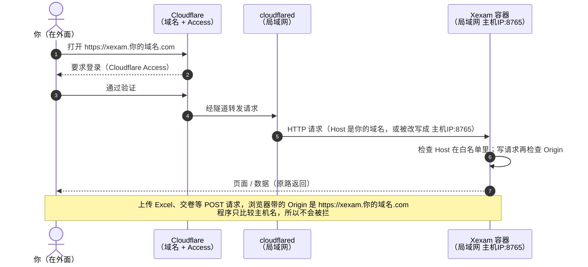

### 需要做的三件事

**1. 让局域网里的 cloudflared 连得到容器。** 默认容器只绑定本机（`127.0.0.1`）。在 `docker-compose.yml` 旁边建一个 `.env` 文件：

```ini
# 让局域网里别的机器（cloudflared）能连到这台机器的 8765 端口
XEXAM_BIND=0.0.0.0:8765
# 允许用你的域名访问（可以写多个，逗号分隔）
XEXAM_ALLOWED_HOSTS=xexam.你的域名.com
```

然后 `docker compose up -d`。

> 如果 cloudflared 和 Xexam 在**同一台机器**上，可以不改 `XEXAM_BIND`（保持默认的只绑定本机），隧道的目标写 `http://localhost:8765` 就行。

**2. 在 Cloudflare 里把域名指到 Xexam。** Zero Trust 控制台 → Networks → Tunnels → 你的隧道 → Public Hostname：

| 项目 | 填什么 |
|---|---|
| Subdomain / Domain | `xexam` / `你的域名.com` |
| Service Type | `HTTP`（不是 HTTPS） |
| URL | `运行 Xexam 的主机的局域网IP:8765`，例如 `192.168.1.20:8765` |

**3. 在 Cloudflare Access 里加一条应用策略**，只允许你自己的账号（邮箱）访问这个域名。

### 几种常见情况

| 你的情况 | 怎么配 |
|---|---|
| 隧道把 **Host 原样转成你的域名** | 只需要 `XEXAM_ALLOWED_HOSTS=xexam.你的域名.com`，上面第 1 步就够了 |
| 你在 Cloudflare 里设了 **HTTP Host Header**（`httpHostHeader`），把 Host 改成了 `192.168.1.20:8765` | `XEXAM_ALLOWED_HOSTS=192.168.1.20` 再加 `XEXAM_ALLOWED_ORIGINS=https://xexam.你的域名.com`。浏览器发的 `Origin` 仍是公网域名，要单独放行 |
| 不确定 Host 到底是什么 | 先照上面第 1 步配好再打开页面。如果被拒绝（403），页面上的提示会写出它看到的 `Host`（或 `Origin`）：把那个值加进 `XEXAM_ALLOWED_HOSTS`（或 `XEXAM_ALLOWED_ORIGINS`），`docker compose up -d` 重新创建容器即可 |
| 不想列域名，前面已经有 Access 验证 | `XEXAM_ALLOW_ANY_HOST=1`（不再检查 `Host`；写请求的 `Origin` 检查仍然有效） |

测试到什么程度：两种 Host 情况下完整的浏览器流程（真实的 Chrome + 一个 HTTPS 反向代理）是在旧的 Python 版上跑通的。对现在的技术栈，`tests/integration/stack_check.py` 和 `nginx_check.py` 在请求头层面检查：Nginx 会原样透传 Host，后面的 Host / Origin 守卫仍然有效。**没有**用真正的 Cloudflare 测过；第一次上线时，请按上面「不确定 Host 到底是什么」那一行做，并看 403 的提示。

### 不要忘记的事

- ⚠️ **Xexam 自己的登录是门上唯一的锁。** 一旦把 `XEXAM_BIND` 设成 `0.0.0.0`，或者设了 `XEXAM_ALLOW_ANY_HOST=1`，**能连到这个端口的人就能打开登录页**，并且可以试密码（锁定会越来越久，能拖慢这种尝试，但弱密码终究是弱密码）。所以：
  - 只让 cloudflared 连得到这个端口：路由器上**不要**做端口映射。在 Linux 上，主机防火墙（ufw、firewalld）**拦不住** Docker 发布的端口，要限制来源请在 `DOCKER-USER` 链里加规则，或者把 `XEXAM_BIND` 写成具体的局域网 IP（如 `192.168.1.20:8765`）；最稳的是让 cloudflared 和 Xexam 在同一台机器上，保持默认的 `127.0.0.1`。
  - Cloudflare Access 的策略一定要设好，并且**只允许应该使用 Xexam 的人**。没设策略的域名等于对全世界公开。
  - 第一次登录时就把默认的 `admin` 密码改掉，并给每个用户设一个他自己的密码。
- Cloudflare Access 的登录过一段时间会过期。过期后上传或交卷会失败，提示可能是登录已过期：刷新页面、重新登录就行。**做到一半的考试或练习存在浏览器里，不会丢**。
- 被拒绝（403）时，页面上的提示会写明：看到的 `Host` / `Origin` 是什么，应该把哪个值加进哪个选项。同样的原因也会出现在 `docker compose logs` 和 **系统日志** 里（成批的拒绝每分钟汇总一次）。

---

## 架构

下面的图都是 [Mermaid](https://mermaid.js.org/) 写的，GitHub 上直接显示成图。完整说明见 [docs/zh-CN/architecture.md](../docs/zh-CN/architecture.md)。

### 谁和谁连着

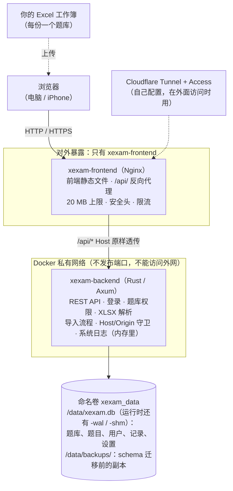

| 容器 / 镜像 | 里面是什么 | 对外？ |
|---|---|---|
| `xexam-frontend` | Nginx + 前端静态文件（HTML / JS / CSS）。把 `/api/` 转给后端；20 MB 上限、安全头、限流、超时 | 是：宿主机 `XEXAM_BIND`（默认 `127.0.0.1:8765`）→ 容器 8080 |
| `xexam-backend` | 一个静态链接的 Rust 可执行文件：REST 接口、登录、解析 Excel、读写 SQLite、系统日志 | **否**：没有 `ports`，网络是 `internal: true` |

浏览器只通过 [REST 接口](../docs/zh-CN/api.md) 和后端说话；前端里没有数据库访问。**判分在浏览器里**，考试和练习都是：对每道题，服务端只收到题目 id、对错，以及（从 v0.5 起）你给出的答案；答案只存下来供回顾用。哪些题计入由服务端决定：只计入这个用户能看到的题库里的题。

### 数据流 A：导入题库（上传 → 预览 → 确认）

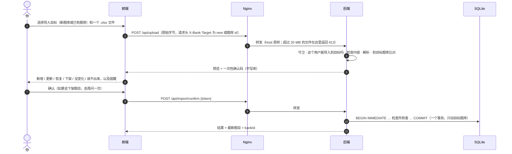

预览只保存在内存里，每个用户一份，保留 30 分钟，确认码只能用一次；所有预览加起来不超过一个内存额度。预览还开着时离开 **题库管理** 页面，会取消这次导入（`POST /api/import/cancel`）。只有管理员和可管理题库的用户能上传；可管理题库的用户只能更新自己的题库，这一点在写入的事务里还会再检查一次。不带 `X-Bank-Target` 的上传（旧的客户端、命令行的 `import`）会导入到存放 v0.5 之前数据的那个题库，和 v0.4 完全一样。

### 数据流 B：考试或练习

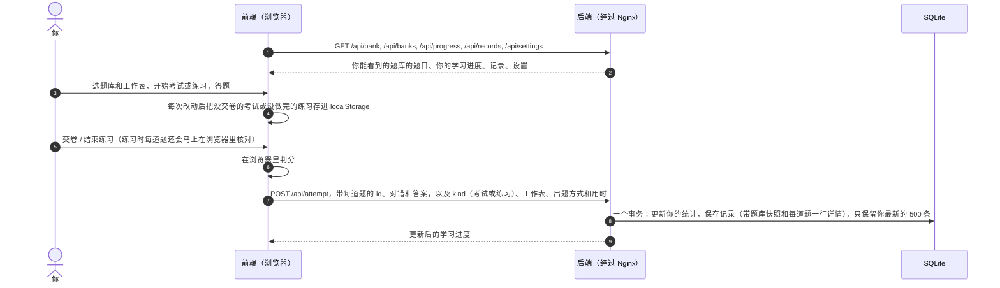

### 数据库：13 张表（schema v4）

图里是正在使用的表。schema v1 建了 `questions`、`stats`、`attempts`、`imports` 和 `meta`；v2（v0.5）新增了 `banks`、`attempt_items` 和 `settings`；v3（v0.6）新增了 `users`、`sessions`、`user_stats` 和 `user_settings`，之后原来的 `stats` 和 `settings` 保留，但不再使用；v4（v0.7）新增了 `user_banks`，以及列 `users.all_banks`、`users.can_manage_banks`、`banks.owner_id` 和 `attempts.kind`。每个字段的说明见 [docs/zh-CN/database.md](../docs/zh-CN/database.md)。

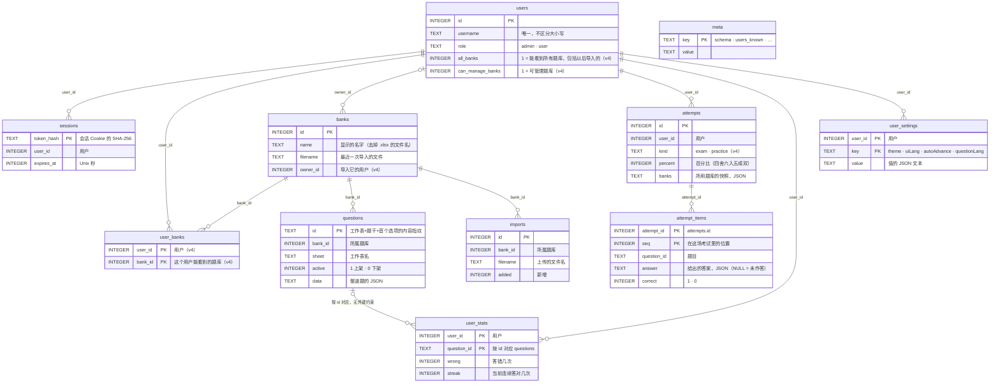

**题目 id。** 存放 v0.5 之前数据的那个题库，题目保留原来的 id。其他题库的题目用限定在本题库内的 id 保存，所以同一份工作簿可以导入成两个题库，它们的学习记录不会混在一起。

**为什么统计不随题目一起删：** 题目下架只是把 `active` 改成 0，答题记录原样保留；以后这道题重新出现在 Excel 里，会自动恢复上架。只有删除题库才会删除题目。

**错题本怎么算：** 对每个用户来说，一道题只要 `wrong > 0` 且 `streak < 2`（连续答对不到 2 次）就在错题本里；连续答对 2 次后自动移出。考试和练习都算。

### 页面之间怎么走

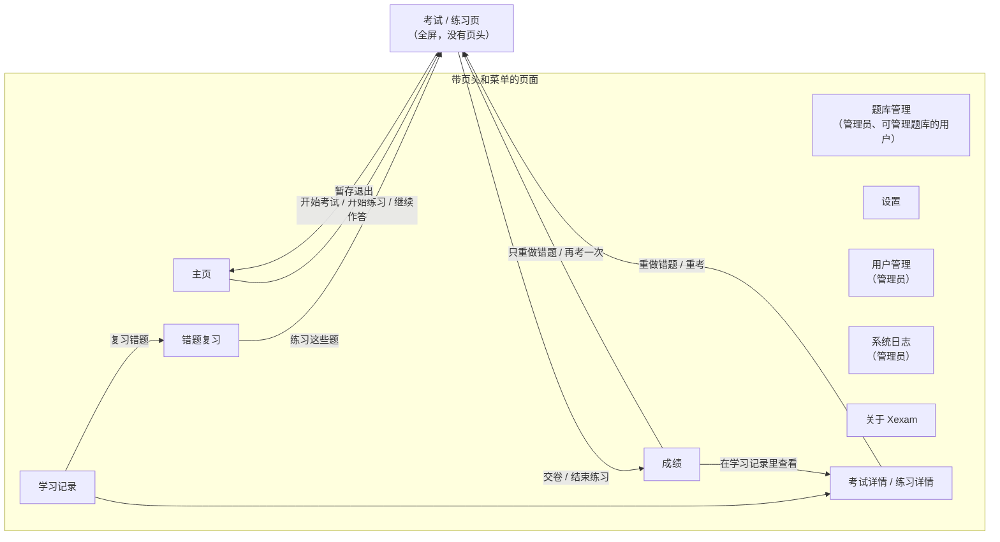

在每个带页头的页面上，都可以从菜单打开 **主页**、**学习记录**、**设置** 和 **关于 Xexam**；有权限的人还能打开 **题库管理**、**用户管理** 和 **系统日志**。没有权限时打开这几个页面会显示 **没有权限**（用户管理会把你送回主页）。单选、多选、热点题三种题型的界面略有不同，但考试和练习都用同一个页面。

---

## 安全说明

详细的威胁模型和每一条防线见 [docs/zh-CN/security.md](../docs/zh-CN/security.md)。要点：

- **只有 Nginx 对外**。后端没有发布端口，网络是 `internal: true`（也不能访问外网）。
- 默认只接受发给本机的请求（检查 `Host`）；放在 Cloudflare 等有身份验证的反向代理后面时，把你的域名写进 `XEXAM_ALLOWED_HOSTS`。写请求还会检查 `Origin` 必须和 `Host` 是同一个主机（或在 `XEXAM_ALLOWED_ORIGINS` 里），防止恶意网页通过你的浏览器操作它。后端只读真实的 `Host` 头，不读 `X-Forwarded-*`。
- **从 v0.6 起需要登录。** 除了 `/api/info` 和登录本身，所有页面和 API 都要先登录。密码用 Argon2id 哈希保存，会话 Cookie 是 `HttpOnly`、`SameSite=Strict`（只有 HTTPS 或设了 `XEXAM_COOKIE_SECURE=1` 时才加 `Secure`，所以家里局域网的纯 HTTP 也能用）。密码输错会锁定这个账户的登录，而且一次比一次久；锁定属于账户，大量编造的用户名也重置不了它（见 [用户和登录](#用户和登录)）。第一次登录时就把默认的 `admin` 密码改掉。要从外网访问，仍然要在前面加身份验证（Cloudflare Access），不要直接把端口暴露到公网。
- **题库权限（从 v0.7 起）**，后端在每个路由上都会检查：
  - 用户只能读取分配给他的题库的题目、题库、统计和记录详情；
  - 只有管理员和可管理题库的用户能导入；可管理题库的用户只能更新或删除自己的题库，这一点在写入的事务里还会再检查一次，对其他题库会得到 403；
  - 只有管理员能看到题库属于谁。
- **系统日志**：只保存在内存里（最后 2000 行），只有管理员能看。日志里用 id 指代用户，从不包含密码、会话令牌、Cookie 的值或题目文字。被拒绝的请求和失败的登录最多每分钟汇总一次，所以没人能不登录就把其他日志挤出去。
- 删除题库、用户或记录一律是带 JSON 请求体的 POST，在一个事务里完成，页面上一定会先请你确认；随题库一起删除学习数据、随全部记录一起清空错题本，都是单独的复选框，默认不勾选。设置只接受已知的值。
- 上传的文件按**内容**检查：拒绝空文件、非 `.xlsx`、损坏的压缩包、重复的压缩包条目、含 XML 实体声明（DOCTYPE）的文件，最大 20 MB；解析有总时限和内存上限。
- 上传后的预览在内存里保留 30 分钟（每个用户一份，全部在一个内存额度之内），确认时需要一次性的校验码（128 位随机），用过就作废。
- 数据库写入在一个事务里：中途出错整体回滚，不会留下半截数据。每次 schema 迁移之前，后端都会先写一份备份副本，写不出来就不启动。WAL 模式下，提交仍然要等数据写到磁盘上（`synchronous=FULL`），所以已经保存的东西停电也不会丢。
- 两个容器都以非 root 运行，`cap_drop: ALL`、`no-new-privileges`、根文件系统只读。
- 镜像里没有机密、没有数据库、没有题库。

---

## 自动构建与发布

[`.github/workflows/ci.yml`](../.github/workflows/ci.yml) 是**唯一**的流水线。每次推送到 `main` 或 `dev`、每个向 `main` 提的拉取请求（PR），以及在 Actions 页手动运行时，自动做：

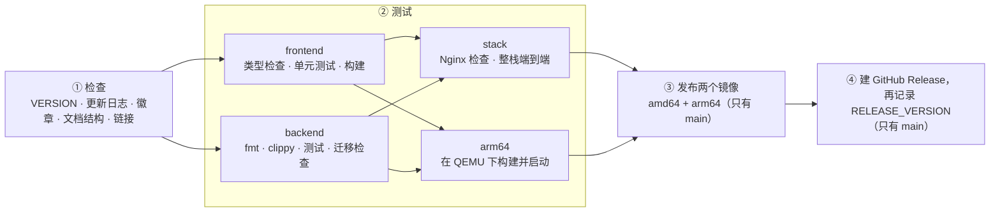

- **触发：** 推送到 `main`（会发布）、推送到 `dev`、向 `main` 提拉取请求，或在 Actions 页面手动运行。只有 `main` 会发布；`dev`、拉取请求和在其他分支上手动运行只检查和测试，**从不发布**。推送到其他分支不会触发流水线。
- **`VERSION` 里的两个版本号：**
  - `CODE_VERSION` 是代码的版本。每次更新都必须把它调高，并在**三份 README**（`README.md`、`README/README.ja.md`、`README/README.zh-CN.md`）的更新日志最上面各写一条同版本的记录；`backend/Cargo.toml` 和 `frontend/package.json` 也必须是同一个版本号。镜像用它来构建和打标签，`/api/info` 报告的也是它。
  - `RELEASE_VERSION` 是最后一个真正发布出去的版本。它**从不手动修改**：由发布任务写入，同时更新 README 顶部的发布徽章。
  - 第 ① 步在这些情况下失败：`VERSION` 里这两行不是各正好一行；更新日志或清单文件和 `CODE_VERSION` 不一致；某个徽章显示的不是 `RELEASE_VERSION`。
- **文档检查（也在第 ① 步）：** 七份文档在 `docs/en`、`docs/ja` 和 `docs/zh-CN` 里都有；`docs/` 下只有这三个文件夹；根目录只有 `README.md`，另外两份 README 在 `README/` 里；compose 文件和 `.env.example` 在 `docker/` 里；README 和文档里的每个相对链接和图片路径都指向存在的文件（指向 Releases 等 GitHub 页面的链接必须正好回到仓库页面）。
- **都通过才发布：** 两个镜像（`xexam-frontend`、`xexam-backend`）各发布成一个多架构镜像，并回头检查镜像清单里确实有 `amd64` 和 `arm64`、标签指向刚推送的那个摘要。测试失败时 `latest` 仍是上一个能用的版本。
- **发布的标签：** `latest`、`v<CODE_VERSION>`、`sha-<提交>`，Docker Hub 和 ghcr.io 上都一样。
- **后端镜像怎么编 arm64：** 在构建机上用 zig 交叉编译，不在 QEMU 里编 Rust（QEMU 下要慢一个数量级）；只有最后一个很小的 alpine 阶段是目标架构。
- **Releases 页：** 两个镜像都发布并核对成功之后，自动建（或更新）一个叫 `v<CODE_VERSION>` 的 Release，说明文字取自英语 README（`README.md`）更新日志里这个版本的那一段（[`scripts/release-notes.py`](../scripts/release-notes.py)），并自动打上同名的 git 标签。镜像没发布成功，就不会有这个 Release。重新运行一次较早的流水线时，它的 Release 不会被标成最新版。
- **记录这次发布：** 发布任务的最后一步运行 [`scripts/set-release-version.py`](../scripts/set-release-version.py)：它设置 `RELEASE_VERSION` 和发布徽章，以 `Record release v… [skip ci]` 提交到 `main`；如果 `dev` 没有自己的新提交，就把 `dev` 快进到同一个提交。它从不把 `RELEASE_VERSION` 往回调。**之后先把 `main` 和 `dev` 都拉取下来**，再做下一次推送；如果任务报告 `dev` 已经有了新的提交，就在下一次合并到 `main` 之前，先把 `main` 合并进 `dev`（在 `dev` 上 `git pull origin main`）。
- **Releases 和镜像在不同的地方：** 镜像在 **Docker Hub** 上（`docker.io/yuminspace/xexam-frontend` 和 `docker.io/yuminspace/xexam-backend`，公开；`docker-compose.yml` 拉取的就是它们），另有一份私有镜像副本在仓库的 **Packages** 里（ghcr.io）；Release 在 **Releases** 页，里面最先列出从 Docker Hub 拉取的命令。这些都由同一次构建一起产生。

发布到 Docker Hub 需要两个仓库机密（secret）：`DOCKERHUB_USERNAME` 和 `DOCKERHUB_TOKEN`（一个带 **Read & Write** 权限的 Docker Hub 访问令牌），另外可以设置仓库变量 `DOCKERHUB_NAMESPACE`（可选）。没有这两个机密，或者 `docker/docker-compose.yml` 里写的不是这个命名空间下的 Docker Hub 镜像，发布这一步会在推送任何东西之前停下。ghcr.io 上的镜像是私有的（仓库是私有的）：第一次在那里发布一个新镜像名时，要在 GitHub 的包设置里把本仓库加进 **Manage Actions access**，角色选 **Admin**，否则推送会被拒绝（`permission_denied: write_package`）。

---

## 开发

日常改代码、跑测试用的命令见 [docs/zh-CN/development.md](../docs/zh-CN/development.md)。最常用的：

```bash
# 后端（Rust 1.99.1，rustup 会按 backend/rust-toolchain.toml 自动装）
cd backend && cargo fmt --check && cargo clippy --all-targets -- -D warnings && cargo test --all-targets

# 前端（Node 24）
cd frontend && npm ci && npm run typecheck && npm test && npm run build

# 开发时：后端 127.0.0.1:8765，前端 http://127.0.0.1:5173（/api 代理到后端）
cd backend && cargo run -- serve --data ../data --no-browser
cd frontend && npm run dev

# 整栈检查（用 Docker，临时项目名和临时卷，不碰 xexam_data）
python -I tests/integration/stack_check.py
```

- 后端有 302 个测试，前端有 119 个单元测试。后端的测试对着 `tests/baseline/` 里已提交的**旧版快照**：172 份黄金响应、49 个解析夹具及输出、85 条题目 id 向量。这些夹具全是虚构的，真实题库永远不入库。
- 每个版本的行为在 `backend/tests/` 里有自己的测试文件：`v05_banks_records_settings.rs`（题库、记录、设置、schema v2 迁移）、`v06_users_and_sign_in.rs`（用户、登录、锁定）、`v065_bank_access_and_practice.rs`（题库权限、可管理题库的用户、练习、schema v4 迁移）、`parser_six_columns.rs`（六列格式）、`v07_wal_and_logs.rs` 和 `v07_log_floods.rs`（WAL 模式、系统日志及其汇总）。
- 界面上的所有文字都来自 `frontend/src/i18n/catalog/*.ts`，有英语、中文、日语三种；某种语言缺了一个键，测试会失败；某条后端错误提示没有翻译，另一个测试会失败。
- **关于 Xexam** 页面显示三份 README 的更新日志。它们在构建前端时读取（`frontend/vite.config.ts` 里的 `xexam-changelog` 插件），所以构建前端时，`frontend/` 的上一级文件夹（仓库根目录）里要有 `README.md`、`README/README.ja.md` 和 `README/README.zh-CN.md`。
- 用现在的后端打开较早版本的数据库，会把它迁移到 schema v4，在旁边写一个 `backups/`，并改用 WAL 模式。请在副本上做实验。

---

## 目录结构

```
README.md                  英语版说明（默认）；日语版和中文版在 README/ 里
README/                    README.ja.md（日语）和 README.zh-CN.md（中文，本文件）
LICENSE                    MIT 许可证
VERSION                    CODE_VERSION（代码的版本，和更新日志最上面一条一致）和 RELEASE_VERSION（最后一次发布）
docker/                    Docker Compose 文件（Dockerfile 仍在 backend/ 和 nginx/ 里）
  docker-compose.yml         拉取两个镜像运行（只需要这一个文件）
  docker-compose.build.yml   从源码构建两个镜像并运行（构建上下文是仓库根目录）
  .env.example               本机配置模板（复制成 docker/.env；.env 不提交）
backend/                   Rust 后端（Axum + rusqlite）
  src/main.rs src/lib.rs     命令行（serve、import、reset-password 等）、启动、平稳关闭
  src/api/                   路由、守卫（Host / Origin / 会话 / Content-Type / 体积）、登录和用户、JSON 格式
  src/auth/                  会话、密码哈希、谁能做什么、逐级加长的登录限制
  src/services/              待确认的导入（每个用户一份，共用内存额度）、解析引擎接口、导入流程
  src/parser/                .xlsx 解析：ZIP 防护、XML、三列 / 四列 / 六列格式、题目 id
  src/database/              SQLite 存储、schema（v1 原文 + v2 / v3 / v4 新增）、journal.rs（WAL 模式）、
                             旧 progress.json 迁移、时间戳
    store/                     题库、记录、设置、用户，schema 迁移（含备份副本）
  src/logs.rs                系统日志：内存里最后 2000 行的缓冲区、成批日志的汇总
  src/security/ src/config/  Host / Origin 判断、限长读取请求体；环境变量
  tests/                     单元、黄金响应、解析对照、id 向量、并发，以及每个版本一个文件
  Dockerfile                 在构建机上交叉编译（zig），运行镜像是静态链接的单个可执行文件
frontend/                  TypeScript + Vite 前端（原生 DOM）
  src/main.ts src/router.ts  入口；hash 路由（#/、#/banks、#/records、#/users、#/logs、#/settings、#/about、#/quiz、#/result 等）
  src/pages/                 home、banks、records、settings、users、logs、about、auth（登录）、forbidden（没有权限）、
                             quiz（考试和练习）、result
  src/components/            外壳（页头、菜单）、回顾（答案卡片）、lang-switch（English / 中文 / 日本語）、通用部件
  src/domain/                带测试的纯规则：判分、练习、语言、记录筛选、导入提醒、日志视图等
  src/i18n/                  英语、中文、日语的界面文字（catalog/*.ts），服务器提示的翻译
  src/api/ state/ types/ utils/ styles/
  vite.config.ts             构建设置；为关于页面读取三份 README 的更新日志
nginx/                     nginx.conf + Dockerfile（构建前端，带上三份 README → 只带静态产物）
tests/baseline/            旧版 Python 的行为快照（黄金响应、解析夹具、id 向量、示例库）
tests/integration/         Nginx 行为检查、整栈端到端检查、迁移和 progress.json 检查
docs/                      en/（英语）、ja/（日语）、zh-CN/（中文）：架构、API、数据库、安全、部署、迁移、开发，
                           每个文件夹有自己的 screenshots/；en/openapi.yaml；zh-CN/history/ 是以前的文档（只有中文）
scripts/release-notes.py   从更新日志生成 GitHub Release 的说明（CI 用，本机也能跑）
scripts/set-release-version.py  记录一次已完成的发布：RELEASE_VERSION 和发布徽章（由发布任务运行）
.github/workflows/ci.yml   唯一的流水线：检查 → 测试 → 发布 → Release
```

---

## 许可证

Xexam 以 [MIT 许可证](../LICENSE) 发布。Copyright (c) 2026 Yumin-Space.

许可证适用于本仓库里的软件。仓库里没有任何考试题目：你导入的题库是你自己的文件，你要自己确认有权使用它们。

---

## 更新日志

每次更新都要在这里写一条，**版本号和仓库根目录 `VERSION` 文件里的 `CODE_VERSION` 一致**（自动构建会检查，不一致就不让构建）。最新的镜像同时有 `latest` 和对应的 `vX.Y` 标签。

程序里的 **关于 Xexam** 页面会显示这些记录（它们在构建时打包进前端），所以请只用简单的 Markdown：段落、`- ` 列表、缩进的 `  - ` 子列表、`**粗体**` 和 `` `代码` ``。链接在那里显示成普通文字。

### v0.7 — 2026-11-11

**每个用户能看到的题库可以单独设置，新增题库管理权限、练习模式、带三种语言答案的六列 Excel 格式，以及管理员专用的系统日志。数据库会先写一份副本，再自动升级到 schema v4，并改用 WAL 模式。**

- **按用户设置题库**：管理员在 **用户管理** 里为每个用户选择能看到的题库：**所有题库，包括以后导入的**，或者只勾选的几个。新用户在选好之前看不到任何题库；v0.7 之前就有的用户仍然能看到全部题库，管理员始终能看到全部题库。收回某个题库后，该用户的学习记录仍作为历史保留。
- **题库管理权限**：有新权限 **可以管理题库** 的用户（在 **用户管理** 里设置）可以导入新题库，并更新或删除自己导入的题库，但不能动管理员或其他用户的题库。没有这个权限的用户在菜单里看不到 **题库管理**，直接打开该页面会显示 **没有权限**。管理员能看到每个题库是谁上传的；删除上传过题库的用户时，这些题库会转给执行删除的管理员。
- **练习模式**：主页 **开始考试** 旁边新增 **开始练习**，题库、工作表、题数和顺序的设置与考试相同。每道题会马上核对（单选题选中选项时，其他题型点 **核对答案**），显示对错、正确答案、解析和记忆口诀。练习会作为单独类型的学习记录保存，并和考试一样计入错题本。**学习记录** 里每条记录都标有 **考试** 或 **练习**，也可以只看其中一种；主页的 **最近一次成绩** 显示两种记录里最新的一条；错题复习里的 **练习这些题** 现在会开始一次练习。
- **六列 Excel 格式**：A 英文题目、B 中文题目、C 日文题目；D 英文、E 中文、F 日文的答案、解析和记忆口诀。以英文为准：题型、选项、热点题的小项、题目标识和答案都取自 A 列和 D 列。中文或日文答案和英文不一致时，这一行仍按英文答案导入，并在预览里列出警告。三列和四列格式照旧可用。六列文件里的题目会得到新的标识，所以请用 **新建题库** 导入，不要用它更新三列或四列的题库。
- **三种语言的答案和解析**：结果页、考试记录和错题复习里的每张题目卡片都有自己的 **English** / **中文** / **日本語** 切换，同时切换题目、选项、解析和记忆口诀；原来单独的中文翻译开关去掉了。所有题目语言切换在任何界面语言下都统一显示 **English** / **中文** / **日本語**。
- **实心绿色和红色的答案**：在答案解析和练习中，正确选项是实心绿色，选错的选项是实心红色，文字为白色，浅色和深色外观都一样。已评分的热点题小项改为中性底色。
- **系统日志**（菜单里，只有管理员可用）：后端启动以来记录的最后 2000 行，实时更新，可以 **暂停**、**跳到最新**、按级别筛选和搜索。成批出现的被拒请求和登录失败每分钟汇总成一行，不会把其他日志挤掉。
- **SQLite WAL 模式**：数据库改用 WAL 模式（仍然是 `synchronous=FULL`，已提交的修改不会丢失），后端正常停止时会做检查点。后端运行时复制备份，要连同 `xexam.db-wal` 和 `xexam.db-shm` 一起复制，或者先停止后端。网络文件系统等特殊存储可以在 `docker/.env` 里设 `XEXAM_SQLITE_JOURNAL=delete`，继续使用原来的模式。
- **时区**：时间戳默认跟随宿主机的时区（compose 文件会挂载宿主机的 `/etc/localtime`）；在 `docker/.env` 里设置 `TZ` 可以覆盖。
- **登录和用户**：密码输错后的锁定按账户记录，猜别的用户名也绕不过去；修改密码后，你在其他地方的登录会被登出；用户还有剩余次数时也会显示 **解锁**，锁定说明显示在该用户那一行下面；用户管理里统计的是每个用户的学习记录（考试和练习）。
- **版本文件**：`VERSION` 现在有两项：`CODE_VERSION`（代码的版本，和这份更新日志一起手动修改）和 `RELEASE_VERSION`（最近一次正式发布的版本）。发布任务在镜像和 GitHub Release 都发布成功之后，才会写入 `RELEASE_VERSION` 并更新 README 顶部的版本徽章。
- **数据库 schema v4**：新增列 `users.all_banks`、`users.can_manage_banks`、`banks.owner_id`、`attempts.kind` 和表 `user_banks`；迁移前会把副本写到 `<数据目录>/backups/xexam-schema3-<日期时间>.db`。
- **新 API**：`GET /api/logs`（只有管理员可用）；`/api/users`、`/api/users/create` 和 `/api/users/update` 新增 `banks` 和 `canManageBanks`；`/api/attempt`、`/api/records` 和 `/api/record` 新增 `kind`（`exam` 或 `practice`）。只有管理员能看到题库的上传者。
- 测试：后端 232 → 302，前端 59 → 119。

### v0.6 — 2026-11-11

**账户和登录：每个用户有自己的学习记录，用户和题库由管理员管理。数据库会先写一份副本，再自动升级到 schema v3。**

- **登录**：一个标准的登录页，和 v0.5.1 一样简洁柔和。第一次启动（新装或升级后）用 `admin` / `admin` 登录，接着会要求你设置自己的密码；在改掉之前，登录页和启动日志都会提醒你。
- **用户和角色**：管理员管理题库和用户；普通用户参加考试，只能看到自己的学习记录、错题本、没交卷的考试和设置。题库由所有用户共用。v0.6 之前的数据归第一个管理员所有。
- **用户管理**（菜单里，只有管理员可用）：添加、编辑、重置密码、停用 / 启用、删除和解锁用户，并显示每个用户的角色、状态（正常、已停用、已锁定）、创建时间、最近登录时间和考试场数。管理员新建或重置过密码的用户，下次登录时要设置自己的密码。
- **页头**：菜单按钮左边显示你的用户名（管理员带 **管理员** 标签）；菜单只列出你的角色能用的页面，最后是 **退出登录**。
- **界面设置**：新增 **账户** 部分，可以 **修改密码**。
- **密码输错**：先有 5 次机会，用完锁 1 分钟；之后每轮 3 次机会，锁定时间依次是 5 分钟、15 分钟、30 分钟、1 小时和 1 天。登录页会显示还要等多久，管理员可以解锁。
- **安全**：密码用 Argon2id 哈希保存；会话 Cookie 是 `HttpOnly`、`SameSite=Strict`（数据库只存它的 SHA-256），有效期 30 天，密码、角色或状态变化时会被登出。纯 HTTP 照样能用（只有 HTTPS 或设了 `XEXAM_COOKIE_SECURE=1` 时才加 `Secure`）。
- **进不了管理员账户时**：`docker compose exec backend xexam-backend reset-password admin` 会打印一个新的临时密码。
- **数据库 schema v3**：新增表 `users`、`sessions`、`user_stats`、`user_settings` 和列 `attempts.user_id`；迁移前会把副本写到 `<数据目录>/backups/xexam-schema2-<日期时间>.db`。
- **新 API**：`/api/auth/state`、`/api/auth/login`、`/api/auth/logout`、`/api/auth/password`、`/api/users`、`/api/users/create`、`/api/users/update`、`/api/users/password`、`/api/users/delete` 和 `/api/users/unlock`；其他路由都要求已登录（`/api/info` 仍然公开）。
- **仓库结构**：日语和中文的 README 移到 `README/`，compose 文件和 `.env.example` 移到 `docker/`（克隆的仓库里 `.env` 现在放在 `docker/.env`）。README 的徽章改成圆角，版本徽章会显示版本号。
- 测试：后端 181 → 232，前端 44 → 59。

### v0.5.1 — 2026-11-11

**更柔和、更简洁的外观，改用对色盲友好的配色，菜单按钮移到右上角，题库管理页和主页一样紧凑。**

- **更柔和、更简洁的外观**：配色改为参照 GitHub 的 Primer 设计系统里对色盲友好的浅色和深色配色（Light colorblind / Dark colorblind）：答对用蓝色、答错用橙色，不再是绿色和红色；浅色主题是柔和的灰白底配白色区块和藏蓝色的主要按钮，深色主题接近纯黑。页面铺在一整张平静的底上；外框和边线更少，改用圆角，鼠标移上去时显示柔和的背景色，提示改用带浅色底色的色块显示，菜单更轻，带一层柔和的阴影。变的只是外观，位置和用法并没有因此改变。
- **菜单移到右边**：三条横线的菜单按钮现在在页头的右上角；Xexam 标志还在左上角。菜单在按钮下方打开，用法和以前一样。
- **更紧凑的题库管理页**：
  - **导入 Excel**：**新建题库** 和 **更新已有题库** 是标题旁边的两个小按钮（悬停提示里有说明）；选更新时，下面会出现 **要更新的题库**。只有一行提示，末尾是 **查看 Excel 写法** 链接；选文件也只占一行：点 **选择 Excel 文件**，或者把文件拖到这个面板的任意位置。
  - **预览**：各项数字是几个小标签（为 0 的不显示），每个工作表一行，工作表里读不出来的行收在它下面。和以前一样，确认和取消按钮紧跟在数字和提示后面，在各个工作表之前。
  - **已有的题库**：每个题库占紧凑的一行，有名字、**更新** 和 **删除** 两个小按钮，以及一行概况（文件、题数、工作表数、最近更新时间）。工作表收在这一行右边的箭头下面。
  - **导入记录** 每次导入一行（最近 8 次），**Excel 题库的写法和导入说明** 在你打开之前一直是收起的。
  - 在触摸屏上，这些小按钮的点按区域仍有约 44 px；在手机上，题库名字很长时，按钮会换到单独的一行。
- **镜像发布到 Docker Hub**：每个版本现在也发布到 Docker Hub，名字是 `yuminspace/xexam-frontend` 和 `yuminspace/xexam-backend`（公开，同一个标签下有 `amd64` 和 `arm64`）。`docker-compose.yml` 改为从那里拉取，所以不再需要 `docker login`。同样的标签仍保留在 `ghcr.io/yumin-space` 上，作为私有镜像副本。如果你还在用 v0.5 的旧 `docker-compose.yml`，请换成新的（数据卷会保留）。三份 README 现在以 Docker Hub 的徽章开头。
- README 和文档都按新布局改写了，截图也重新截了。

### v0.5 — 2026-11-10

**新界面：可以有多个题库，有学习记录和界面设置，界面有英语、中文、日语三种。数据库会在写好一份备份副本之后自动升级到 schema v2。**

- **新布局**：除了考试页，每个页面都有一个窄窄的页头，上面有三条横线的菜单按钮。点它会打开一个小菜单，里面有主页、题库管理、学习记录和界面设置；选好一项、点菜单外面或按 Esc 键，菜单就会关上。在宽屏上，页面内容居中显示（最宽 1120 px）。考试本身是一个专注的全屏页面。
- **关于页面**：菜单的最后一项 Xexam v0.5（在分隔线下面）会打开它。它显示版本、服务器的 CPU 架构、许可证，以及每个版本的更新内容：也就是这份更新日志，用界面语言显示，最新的版本展开，更早的版本折叠起来。
- **更紧凑的主页**：没交卷的考试是一行横幅，带继续作答和放弃这场。开始考试面板右上角的两个小按钮选择从哪里出题：全部和错题本，各自显示题数（所选工作表里没有要复习的错题时，错题本不能选，并用一行字说明原因）。每个题库是一张卡片，里面一行一个工作表；题库的复选框会勾选它的全部工作表，工作表也可以收起来（题库超过两个时，一开始是收起的）。
- **随机抽题**：题数比所选的题少时，现在会从整个所选范围里随机抽题（以前不打乱顺序时，取的是按题库顺序排在最前面的那些题）。打乱题目顺序只决定这些题按随机顺序出，还是按题库里的顺序出。
- **多个题库**：每份导入的工作簿都是一个独立的题库。可以把文件导入成新题库，也可以更新 / 替换已有的题库；文件里没有的题只在那个题库里下架。题库列表显示每个题库的工作表和题数。删除题库前会先确认，并可以选择同时删除这个题库的学习记录。
- **学习记录页**：考试列表，可以按题库、日期范围、正确率筛选；每场考试的详情，显示每道题你的答案、正确答案和解析（v0.5 起考的场次）；错题复习和练习；重做错题或重考一场；删除一条记录（错题本不变）或全部记录（可以选择同时清空错题本）。Xexam 保留最近 500 场考试（以前是 60 场）。
- **界面设置页**：主题（跟随系统 / 浅色 / 深色）、界面语言（默认 English，另有中文、日本語）、答完自动跳到下一题（单选题，以及每个小项都答完的热点题；多选题永远不会自动跳转）、恢复默认设置。设置和题目语言保存在服务器的数据目录里，所以重启、更新镜像、清除浏览器缓存、换别的浏览器或设备之后都还在。没交卷的考试仍然只保存在当前浏览器里。
- **整个界面都有英语、中文、日语三种**，包括答题页和服务器返回的错误提示（后端仍然用中文发送，由页面翻译）。
- **更适合手机**：主页上的开始考试按钮固定在屏幕底部，列表更紧凑，答题卡把已答题数和交卷按钮放在题目小方块上面，触控区域至少 44 px。
- **数据库 schema v2**：新增 `banks`、`attempt_items`、`settings` 三张表，以及 `questions.bank_id`、`attempts.banks`、`imports.bank_id` 三个列。v0.5 第一次启动时会自动迁移现有的数据库；迁移之前，先把一份副本写到 `<数据目录>/backups/xexam-schema1-<日期时间>.db`（副本写不出来时，后端不会启动，也不会改动任何东西）。现有的数据变成一个题库；题目 id、错题本和成绩历史都保留。回退 = 停止、恢复那份副本、运行 v0.4。不要在有多个题库的数据库上运行 v0.4。步骤见 [docs/zh-CN/migration.md](../docs/zh-CN/migration.md)。
- **新接口**：`GET /api/banks`、`POST /api/banks/delete`、`GET /api/records`、`GET /api/record?id=`、`POST /api/records/delete`、`GET` / `POST /api/settings`、`POST /api/settings/reset`，以及 `POST /api/upload` 上可选的请求头 `X-Bank-Target`（不带它时，上传的行为和 v0.4 完全一样）。`GET /api/bank` 里的每道题多了一个键 `bank`。见 [docs/zh-CN/api.md](../docs/zh-CN/api.md)。
- **文档按语言分开**：`docs/en`、`docs/ja` 和 `docs/zh-CN`；只有中文的历史文档移到了 `docs/zh-CN/history`。每个语言文件夹都有自己的截图，截图里的界面就是那种语言。CI 会检查这个结构和每一个相对链接。
- **推送到 `dev` 分支时也会跑 CI**（只检查和测试，从不发布）。
- README、文档和四列格式解析测试里的 Excel 示例都换成了虚构的示例；`tests/baseline/` 里的旧版测试快照没有改动。较早的更新日志条目里，只改了链接（指向新的文档文件夹）和一组示例词。
- **新增 MIT 许可证**（`LICENSE`）。
- 测试：后端 151 → 181（迁移和备份、题库、记录、设置、新接口上的守卫），前端 27 → 44（界面文字、服务器提示的翻译、关于页面上的更新日志、随机抽题）。

### v0.4 — 2026-11-10

- **三种语言对照：英语 / 中文 / 日语。** Excel 新增一个格式：A 列英语、B 列中文、C 列日语（题目本身）、D 列答案·解析·口诀；A、B、C 三列是同一道题的三种语言，一一对应，答案只写一份。答题页的语言按钮变成「英语 / 中文 / 日语」，成绩页的错题解析也用你选的语言显示。
- **热点题的选项也跟着语言走**：每个小项末尾用本语言写选项（日语 `はい / いいえ`，中文 `是 / 否`，英语 `Yes / No`；执行层之类的三选一同理），切换语言时选项按钮一起换。某一列没写选项时，这个语言仍可用，选项按钮显示日语的。
- **热点题的答案用任何一种语言的选项词来写都认**（`調理`、`烹饪`、`Cooking`，也可以混着写）；三种语言的选项按位置一一对应，个数对不上的那一列不参与，不会猜。
- **旧的三列格式（A 日语、B 中文、C 答案）不用改，照样能上传**，只是没有英语。程序看内容自动判断是哪种格式；四列格式里题目 id 仍然来自 C 列的日语，所以同一道题在两种格式里 id 相同，学习记录不受影响。
- 首页页脚的说明文字改为：Xexam 仅提供题目与答案的导入、整理及练习功能，软件本身不提供或收录考试题目、答案及相关资料；用户应确保导入和使用的资料来源合法，并拥有相应使用权限。
- **README 拆成三份**：`README.md`（英语，默认）、`README.ja.md`（日语）、`README.zh-CN.md`（中文），页面顶部的语言栏可以互相跳转；各自有自己语言的更新日志，GitHub Release 说明取自英语那份。
- **`docs/` 里的文档也分成三种语言**：现行的七份（架构、API、数据库、安全、部署、迁移、开发）各有 `X.md`（英语）、`X.ja.md`（日语）、`X.zh-CN.md`（中文），顶部有语言栏；`openapi.yaml` 改为英语。Phase 0 的审计和计划文档是历史资料，仍只有中文。CI 会检查三份是否齐全，以及所有相对链接是否都指向存在的文件。
- **换了新截图**：用 v0.4 的界面和虚构的四列演示题库重新截的，同一道题有英语、中文、日语三种显示，热点题的选项按钮也跟着语言走。（界面本身，按钮和标签，仍然只有中文。）
- **语言约定**：代码注释和程序、工具、CI 的输出一律用英语；界面和 README 用各自对应的语言。这次没有改动任何代码（已和上一个提交做过机械比对）。
- 测试：后端 136 → 151（四列格式、三种语言的选项与答案、对不上时的退回），前端 19 → 27（语言规则）。

### v0.3 — 2026-11-10

**整个程序重写成 Rust + TypeScript + Nginx。数据库文件和 schema 没有变，API 向后兼容；旧的 Python 实现已从仓库里移除。**

- **后端改成 Rust**（Axum 0.8 + Tokio + rusqlite，工具链固定 1.99.1）：REST 接口、XLSX 解析、导入（预览不写库 → 一次性确认码 → 一个事务写入）、成绩与错题统计、Host/Origin 守卫、`xexam-backend import / healthcheck / migrate-progress` 子命令。行为与 Python 版一一对应：172 份旧版响应逐项对照没有未解释的差异；49 个合成工作簿的解析输出、85 条题目 id 向量全部一致，所以题目 id 与旧版逐字节相同、学习记录不会脱钩。
- **前端改成 TypeScript**（strict）+ **Vite**，原生 DOM、没有框架；没有内联样式，所以 CSP 可以很严。构建目标 `safari15`，iPhone 需要 iOS 15.4 以上。
- **两个镜像、两个容器**：`xexam-frontend`（Nginx + 前端静态文件，唯一对外）和 `xexam-backend`（Rust，在 `internal` 私有网络里不发布端口）。非 root、`cap_drop: ALL`、只读根文件系统；Host 原样透传、`X-Forwarded-*` 清空；20 MB 上限、安全头、限流、超时；后端不可达时返回 JSON 502。两个镜像都同时有 `amd64` 和 `arm64`。
- **更严的上传检查（有意的差异）**：任何编码 / 扩展名里的 DOCTYPE 和实体声明都拒绝；重复的 ZIP 条目名拒绝；ZIP 条目数、XML 深度 / 节点数 / 每元素属性数、单元格总字节数有上限；解析有协作式的超时（到了解析器自己停下）且同时最多 2 个；错误文案不再回显库的异常文本；不支持的 HTTP 方法回 405（以前是 501）。完整差异表见 [docs/zh-CN/api.md](../docs/zh-CN/api.md)。
- **一个流水线**（`.github/workflows/ci.yml`）：检查版本和更新日志 → 前端 / 后端 / Nginx 与整栈 / arm64 四组检查 → 都通过才发布两个镜像并建 Release。
- **测试**：后端 136 个（对着已提交的旧版快照：172 份黄金响应、49 个解析夹具、85 条 id 向量）、前端 19 个；`tests/integration/` 里 Nginx 38 项、整栈 34 项、`progress.json` 迁移 10 项。
- **文档**：`docs/` 下的架构、API（含 OpenAPI）、数据库、安全、部署、迁移、开发，以及迁移前的审计、风险和计划。
- 判分仍在浏览器里（服务端只收 `{题目 id, 对错}`），理由见 [docs/zh-CN/history/migration-plan.md](../docs/zh-CN/history/migration-plan.md)。
- ⚠️ **升级注意**：新旧版容器名和端口相同，**不能同时运行**，升级前先 `docker compose stop`；数据卷 `xexam_data` 是同一个，数据不用迁移。旧的单镜像 `ghcr.io/yumin-space/xexam` 不再更新（最后是 `v0.2.2`），`docker-compose.yml` 现在一次拉取 `xexam-frontend` 和 `xexam-backend` 两个。回滚步骤见 [docs/zh-CN/migration.md](../docs/zh-CN/migration.md)。
- **没有验证的东西（如实写）**：真正的 Cloudflare 隧道、iPhone 真机、在真正的 ARM 硬件上运行（只在 QEMU 下构建并启动验证过）、用你自己真实数据库的副本演练。

### v0.2.2 — 2026-11-10

- 新增 `tests/baseline/`：旧版 Python 的行为基线（172 份真实响应、50 个 XLSX 夹具及解析输出、85 条题目 id 向量、示例数据库、安全探针、Host/Origin 检查和隧道模拟脚本），后面的 Rust 重写要和它逐项对照。工具里不再写死任何本机路径，可用 `XEXAM_LEGACY_ROOT` 指定被测代码。
- 修正上一版更新日志里关于 v0.2 Release 的说法。

### v0.2.1 — 2026-11-10

- **每次构建成功后自动在 GitHub 的 Releases 页建一个 Release**（以前只推了镜像，Releases 页一直是空的）：流水线新增第 4 个 job `release`，在镜像发布并核对成功之后运行，说明取自本更新日志这个版本的那一段，并自动打 git 标签 `v<版本>`。
- v0.2 的 Release 手动补建了一次（对应 v0.2 的提交 `1ee64c8`，没有标成 Latest）；从 v0.2.1 起由流水线自动建。
- 新增 `scripts/release-notes.py`：从 README 抽出某个版本的更新日志；本机也能运行，用来预览 Release 页会显示什么。

### v0.2 — 2026-11-10

- **可以通过自己的域名从互联网访问**（Cloudflare Tunnel + Cloudflare Access）：
  - 允许的域名放进 `XEXAM_ALLOWED_HOSTS`；写请求的 `Origin` 改成只比较主机名，所以经 **HTTPS** 域名访问时上传、交卷不再被 403 拦下。
  - 代理改写了 `Host` 时，可以用 `XEXAM_ALLOWED_ORIGINS` 单独放行公网域名；前面已有身份验证时可设 `XEXAM_ALLOW_ANY_HOST=1`。
  - 被拒绝时会说明是哪一条没通过、该怎么放行；登录过期时页面会提示刷新重新登录。
- 端口绑定改成可配置（`XEXAM_BIND`），默认仍然只绑定本机。
- 收到 `docker stop` 的停止信号后正常退出（以前要等 10 秒被强杀），数据库干净关闭。
- CI：拆成「检查版本和更新日志 → 两种架构各自测试 → 发布」三步（v0.2.1 起再加第四步：建 Release）；冒烟测试挪进 `scripts/smoke-test.sh`，本机装了 Docker 也能直接跑；发布后按摘要核对镜像清单。
- `/api/info` 增加 `arch`（当前 CPU 架构）。
- 审计后的修复（每一条都有对应的实测）：
  - 服务端：提前拒绝的请求（403/415）先把请求体读掉再回复，浏览器看到的是真正的原因而不是「连不上服务」；被拒绝的请求在日志里留一行（`docker compose logs` 能看到）；畸形的 JSON（数字当列表、`Infinity`、过深嵌套、非 ASCII 的确认码）返回 400/409，而不是让连接断掉；POST 的 `Content-Type` 必须真的是 `application/json`；`XEXAM_ALLOWED_HOSTS` 用空格或分号分隔也能识别。
  - 数据库：`COMMIT` 失败时会回滚，不会让连接一直卡在事务里；格式不对的旧 `progress.json` 不再让程序起不来；数据目录里只有别的 `.db` 文件时，启动日志会提醒（不会改动那个文件）。
  - 页面：交卷时成绩提交成功才清掉暂存，失败会保留并提示「刷新页面重新登录后再交卷」；开始新考试前，如果有没交卷的考试会先确认；成绩页百分比与学习记录用同一种取整，不再差 1；提示条不再被底部翻页栏挡住；长英文串不再撑出横向滚动条；没有 `<dialog>` 的旧 Safari 改用系统确认框；长按字母键不会反复切换答案。
  - 镜像和 CI：健康检查不走代理并跟随 `XEXAM_PORT`；`.dockerignore` 改成任意层级生效；`.gitignore` 加了备份压缩包和 `.env.*`；只从 `main` 发布，`main` 上排队不取消；冒烟测试里容器内路径在 Windows 的 Git Bash 里也能跑。
  - 这版在本机用 Docker 真的构建了镜像（amd64），并用 CI 同一份冒烟测试跑通：非 root、Host/Origin 拦截、删除容器后数据还在、`docker stop` 1 秒。arm64 和发布仍要看 GitHub Actions 的结果。
- 名称统一成 **xexam**：环境变量 `XEXAM_DATA` / `XEXAM_HOST` / `XEXAM_PORT` / `XEXAM_ALLOWED_HOSTS` / `XEXAM_ALLOWED_ORIGINS` / `XEXAM_ALLOW_ANY_HOST`，数据库文件 `xexam.db`，浏览器里保存的键名 `xexam.*`；文档里也不再写死你自己的 Excel 文件名。
- ⚠️ **从 v0.1 升级时注意：** 数据库文件的名字变了，新版只读 `xexam.db`。如果你在更早的版本里已经导入过题库，请先停止程序，把数据目录里那个 `.db` 文件改名为 `xexam.db` 再启动，否则会看到空题库（旧文件不会被删，只是不会被读取）。浏览器里暂存的考试和语言选择用的键名也变了，升级前请先交卷，语言会恢复成日语。在自己改过的 compose 里设置过旧环境变量名的，要改成上面的 `XEXAM_*`，否则会被忽略。
- `docker-compose.yml` 去掉了 `pull_policy: always`：`docker compose up -d` 不再每次联网检查，更新请用 `docker compose pull && docker compose up -d`。
- `.env`（本机配置）加进 `.gitignore` 和 `.dockerignore`，不会被提交，也不会进镜像。

### v0.1 — 2026-11-10

第一个版本。

- 浏览器答题：单选、多选、热点题；**交卷后才计分**，错题显示答案、解析、记忆口诀。
- 日语 / 中文对照切换；答题卡；标记；暂存退出再继续。
- 错题本：答错的题连续答对 2 次后移出；成绩历史。
- 题库和学习记录改存 **SQLite**（Docker 命名卷 `xexam_data`），不再依赖 Excel。
- 管理页**上传 Excel 更新题库**：先预览（新增 / 更新 / 恢复 / 下架 / 读不出来），确认后才写入；下架的题保留答题记录，传回来自动恢复。
- 旧版的 `progress.json` 第一次启动时自动迁移。
- 支持 **iPhone**：触控区域不小于 44 px、安全区、底部固定翻页栏、可添加到主屏幕。
- Docker 镜像同时支持 **x86（amd64）和 ARM（arm64）**，由 GitHub Actions 构建并测试。
- ⚠️ v0.1 的「发布」步骤没有跑成，所以 `ghcr.io/yumin-space/xexam` 上**没有** `v0.1` 标签；镜像从 v0.2 起发布（`latest` / `v0.2`）。
- 应用名改为 **Xexam**。

<!-- 新版本写在这一行的上面，格式：### vX.Y — 日期 -->
