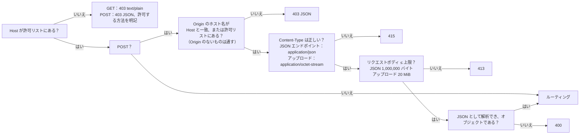

[English](api.md) | **日本語** | [简体中文](api.zh-CN.md)

# API の説明

> 機械可読版は [openapi.yaml](openapi.yaml) です。本書は人が読むためのもので、各エンドポイントの役割、ガードがどのようにリクエストを弾くか、旧 Python 版とどこが違うかを説明します。
> 本書が記述するのは**実際の挙動**です。旧版のあらゆるケースをゴールデンレスポンス（`tests/baseline/golden/`、172 件）として記録し、新しい Rust バックエンドはそれらと一件ずつ比較されます。

## 1. 概要

ブラウザはこの REST API だけを通じてバックエンドとやり取りします。フロントエンドにはデータベースへのアクセスも、インポートが可能かどうかを判断するロジックもありません。

| メソッド | パス | 役割 | DB に書き込む？ |
|---|---|---|---|
| GET | `/api/info` | バージョン、CPU アーキテクチャ、プログラムを終了できるか、問題数 | いいえ |
| GET | `/api/bank` | 問題バンク（有効な問題のみ） | いいえ |
| GET | `/api/progress` | 学習記録 | いいえ |
| GET | `/api/imports` | 直近 12 回のインポート記録 | いいえ |
| POST | `/api/upload` | .xlsx をアップロードし、**プレビュー**と一回限りの確認コードを得る | **いいえ**（メモリ上に一時保存されるだけ） |
| POST | `/api/import/confirm` | インポートを確定する | **はい**（1 つのトランザクション） |
| POST | `/api/import/cancel` | 確認待ちのインポートを取り消す | いいえ |
| POST | `/api/attempt` | 1 回分の試験の成績を記録する | はい |
| POST | `/api/reset` | 学習記録を消去する | はい |
| POST | `/api/shutdown` | プログラムを終了する（ローカルマシンで実行しているときのみ使用可能。Docker では常に 403） | いいえ |

`HEAD` は対応する `GET` と同じですが、本文（ボディ）がありません。

## 2. すべてのレスポンスに共通する事項

- `Cache-Control: no-store`、`X-Content-Type-Options: nosniff`。
- JSON は UTF-8 で、日本語や中国語は `\uXXXX` にエスケープされません。区切り文字は `", "` と `": "`（コロンの後にスペースあり）で、キーの順序は固定です。**これは取り決めの一部です**。スモークテストが `grep '"bankCount": 0'` を実行します。
- エラーは `{"error": "<ユーザーにそのまま表示できる中国語の理由>"}` の形式です。バックエンドは、例外名、ファイルパス、SQLite のエラーをレスポンスに含めません。詳細はログにのみ出力されます。

## 3. ガード（すべてのリクエストが最初に通る）

順序は固定なので、同じ不正なリクエストには常に同じ答えが返ります。



- **Host**：デフォルトでは `localhost`、`127.0.0.1`、`::1` のみを受け付けます。別のアドレスやドメイン名でアクセスする場合は、それを環境変数 `XEXAM_ALLOWED_HOSTS` に書き込みます（カンマ、スペース、またはセミコロン区切り）。`XEXAM_ALLOW_ANY_HOST=1` は Host を検査しないことを意味します（前段にすでに認証がある場合、たとえば Cloudflare Access のときにだけ使います）。
- **Origin**（書き込みリクエストのみ検査）：比較するのは**ホスト名**だけ（プロトコルとポートは比較しません）なので、HTTPS のドメイン名経由でアクセスしても誤って弾かれません。`Origin` のないリクエストは通します（コマンドラインツールはブラウザ内のクロスサイトリクエストではないためです）。プロキシが Host をオリジンサーバーのアドレスに書き換える場合は、公開ドメイン名を `XEXAM_ALLOWED_ORIGINS` に書き込みます。
- バックエンドは**実際の `Host` ヘッダーだけを読み**、`X-Forwarded-*` は一切読みません。Nginx もそれらを転送しません。
- 拒否されたリクエストはログに 1 行残り、レスポンスには「あなたの Host は何か、どの値をどのオプションに追加すべきか」が明記されます。

## 4. エンドポイントの詳細

### `GET /api/info`
```json
{"version": "0.4", "arch": "x86_64", "canShutdown": false, "bankCount": 5}
```
`bankCount` は有効な問題の数です。バージョン番号は `VERSION` ファイルに由来します。

### `GET /api/bank`
`file` / `mtime` は直近のインポートのファイル名と日時です。`questions` には有効な問題のみが含まれます。`sheets` には、各ワークシートの利用可能数と無効化済みの数が入ります。問題のフィールドは [openapi.yaml](openapi.yaml) の `Question` を参照してください。
4 列形式の問題（A 英語、B 中国語、C 日本語、D 答え）には、キー `english`（A 列の原文）と `en`（日本語の構造に合わせて分割した英語）が追加で付きます。この 2 つは `zh` と `explanation` の間に入ります。英語のない問題（3 列形式の問題はすべて含む）にはこの 2 つのキーは**現れない**ので、旧形式のファイルの出力は以前とバイト単位で同一です。`zh` / `en` のホットスポット問題には `choices` が 1 つ追加されます。各小項目について、その言語で書かれた選択肢です。`stem`、`options`、`items`、`answer` は常に C 列の日本語に由来します。

### `GET /api/progress`
`questions` は問題ごとの累計統計（何回解いたか、何回正解したか、何回間違えたか、現在何回連続で正解しているか）です。`history` は直近 60 回分で、`masterStreak` は誤答ノートから外れるまでに必要な連続正解回数（2）です。

### `POST /api/upload`
リクエストボディは .xlsx の生のバイト列です。サーバーは次の処理を行います。

1. ファイルの**内容**だけで .xlsx かどうかを判断します（マジックナンバー + ZIP 構造 + ワークブックがある + DOCTYPE / エンティティ宣言がない + 展開後のサイズに上限がある）。空のファイル、旧形式の `.xls`、破損したファイル、拡張子を書き換えたファイルには、それぞれ専用の中国語の説明が付きます。
2. 解析してプレビューを生成し、解析結果をメモリ上の**唯一の確認待ちスロット**に入れます（再度アップロードすると置き換えられます）。有効期間は 30 分です。
3. **データベースには書き込みません。**

プレビュー（`added / updated / unchanged / restored / removed / skipped / usable`、ワークシートごとの明細、読み取れなかった行とその理由）と、一回限りの確認コード `token` を返します。

### `POST /api/import/confirm`
リクエストボディは `{"token": "…"}` です。

- 確認コードは 128 ビットの乱数（22 文字）で、**一度しか使えません**。誤った確認コードでは確認待ちの内容は消費されません。期限切れのものは取り出せません。ASCII 以外の確認コードは「無効」として扱われます（409）。
- インポートは**1 つのトランザクション**の中で完了します。すべて成功するか、問題バンクに一切変更が加わらないかのどちらかです。
- このファイルに利用可能な問題が 1 問もない場合は 400 を返し、インポートしません（問題バンクが空になるのを防ぐためです）。

インポートのルール（ファイルは**完全な問題バンク**として扱われます）：新しく現れた問題は追加、変更された問題は更新、DB にあってファイルに見つからない問題は**無効化**（学習記録は保持）、無効化された問題が再び現れると自動的に復元されます。

### `POST /api/import/cancel`
確認待ちの内容を破棄します。確認コードは不要です。

### `POST /api/attempt`
リクエストボディは `{"results": [{"id": "…", "correct": true}], "sheets": ["…"], "mode": "all", "seconds": 123}` です。

サーバーが受け取るのは「問題 id + 正誤」だけで、何を選んだかは受け取らず、保存もしません。サニタイズのルール：`results` はリストでなければならず、最大 2000 件。`mode` が `all / weak / retry` のいずれでもない場合は `all` として扱います。`seconds` は 0 から 604800 の範囲に収め、異常値は 0 として扱います。**サーバーは `correct` を信頼し、id が問題バンクにあるかどうかも検査しません**。採点はブラウザ内で行われます（[security.ja.md](security.ja.md) を参照）。

`percent` は**偶数丸め（銀行丸め）**（Python の `round`）を使います。1/8 正解は 12 であり、13 ではありません。

### `POST /api/reset`
成績履歴と問題ごとの統計を消去します。問題バンクには手を付けません。

### `POST /api/shutdown`
`--allow-shutdown` を付けて起動した場合（Windows では `start.bat` をダブルクリック）にのみ使用できます。Docker では常に 403 になるので、`docker compose stop` を使います。

## 5. 旧版との違い

以下は、新しい Rust バックエンドと旧 Python v0.2 とで**意図的に異なる**点です。どの項目も `tests/baseline/golden/allowed_differences_rust.json` と `allowed_probe_differences_rust.json` に登録されており、登録されていない差異があるとテストが失敗します。

| 違い | 旧版 | 新版 | 理由 |
|---|---|---|---|
| サポートされないメソッド（PUT / DELETE / OPTIONS…） | 501 + 標準ライブラリの HTML ページ | 405 + `Allow: GET, HEAD, POST` | 標準的な動作 |
| 静的ファイル | バックエンド自身が配信 | バックエンドは配信しない（404）。Nginx が配信 | フロントエンドとバックエンドの分離 |
| 不正な `Content-Length`（数字以外、負数、重複） | 0 として扱う、または 413 | 400 を返し、接続を閉じる | HTTP 層がハンドラーに入る前に拒否する。ブラウザと Nginx はこのようなリクエストを送らない |
| `Content-Type: Application/JSON`（大文字小文字） | 415 | 受け付ける | MIME タイプは大文字小文字を区別しない |
| `Content-Type: text/plain;application/json` | 受け付ける | 415 | 本当に `application/json` でなければならない（v0.2 の Python 側も同様に修正した） |
| チャンク転送によるアップロード | 空のファイルとして扱う（400） | ストリーミングでバイト数を数え、20 MiB を超えると 413 を返す | `Content-Length` を信用しない |
| DOCTYPE / エンティティ宣言 | 小文字の `.xml` / `.rels` の ASCII バイトだけを走査。UTF-16、`.dat`、`.XML` は検査をすり抜けて展開される | どの拡張子、どのエンコーディングでも拒否する。XML パーサ層もあらゆる DOCTYPE を拒否する | セキュリティ強化 |
| 重複した ZIP エントリ名 | 最後のものを使う | 拒否する（破損扱い） | 検査と読み取りで異なる内容が見えるのを避けるため |
| ZIP エントリ数 | 無制限 | 最大 10,000 | リソース上限 |
| XML ノード数 / 深さ | 無制限 | 100 万 / 64 階層 | リソース上限 |
| エラーメッセージ内のライブラリ例外テキスト | Python / expat の原文が付く | 固定の中国語メッセージで、前置きの部分は変わらない | 内部の詳細を漏らさないため |
| `Server` レスポンスヘッダー | `Xexam/<バージョン> Python/<バージョン>` | なし | バージョンを漏らさないため |
| `//api/info`（二重スラッシュ） | 標準ライブラリによって畳み込まれ 200 になる | 404 | フロントエンドはこのようなパスを送らない |
| 巨大なリクエストヘッダー（70,000 バイト） | 431 | 先に Nginx が拒否する | Nginx のヘッダーバッファの上限 |
| `seconds` が文字列のとき | `int()` はあらゆる Unicode 数字（全角 `７７`、アラビア・インド数字）を受け付け、長すぎる数字列には別途 4300 桁の制限がある | ASCII 数字のみ認め、それ以外は 0 として扱う | ページは数字しか送らない。どちらも学習記録の意味には影響しない |
| `--data` / `XEXAM_DATA` を指定せずにそのまま実行 | データディレクトリはプログラムのディレクトリ配下の `data` | データディレクトリは**カレントディレクトリ**配下の `data` | Docker を使わないローカル実行にのみ影響します。`--data` を明示的に指定してください |
| サブコマンドをオプションの後ろに書く（`--data /d import x.xlsx`） | 該当なし（旧版は `--import`） | サブコマンドは最初の引数でなければならず、そうでないと `serve` として扱われる（旧来の書き方 `--import x.xlsx` は引き続き使える） | 引数の解析がより単純になるため |

## 6. 呼び出し例

```bash
# バージョンと問題数を確認する
curl -s http://localhost:8765/api/info

# アップロード（プレビューが得られるだけで、DB には書き込まない）
curl -s -X POST http://localhost:8765/api/upload \
  -H 'Content-Type: application/octet-stream' -H 'X-Filename: demo.xlsx' \
  --data-binary @tests/baseline/fixtures/demo.xlsx

# インポートを確定する（前のステップで返された token を入れる）
curl -s -X POST http://localhost:8765/api/import/confirm \
  -H 'Content-Type: application/json' -d '{"token": "…"}'
```

> Nginx 経由でアクセスする場合、`curl` がデフォルトで付ける `Host: localhost:8765` は許可リストに入っています。別のドメイン名でアクセスする前に、まず `XEXAM_ALLOWED_HOSTS` を設定してください。
