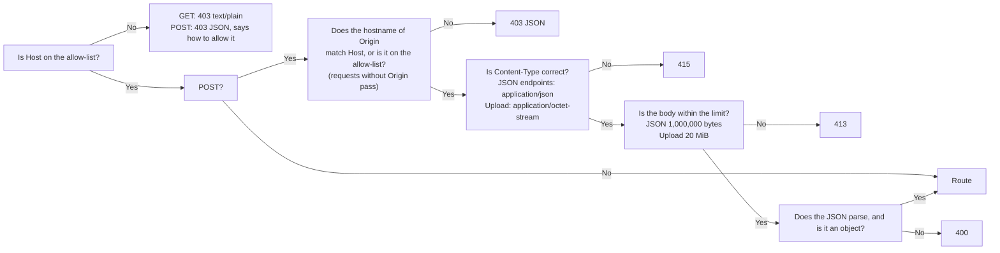

**English** | [日本語](api.ja.md) | [简体中文](api.zh-CN.md)

# API reference

> The machine-readable version is [openapi.yaml](openapi.yaml). This document is for humans: what each endpoint does, how the guards block requests, and where the behavior differs from the old Python version.
> It describes the **actual behavior**: every case of the old version was captured as golden responses (`tests/baseline/golden/`, 172 of them), and the new Rust backend is compared against them one by one.

## 1. Overview

The browser talks to the backend only through this set of REST endpoints. The frontend has no database access and no logic for deciding whether an import is allowed.

| Method | Path | Purpose | Writes to the database? |
|---|---|---|---|
| GET | `/api/info` | Version, CPU architecture, whether the program can be shut down, question count | No |
| GET | `/api/bank` | The question bank (active questions only) | No |
| GET | `/api/progress` | Study records | No |
| GET | `/api/imports` | The last 12 import records | No |
| POST | `/api/upload` | Upload an .xlsx file and get a **preview** and a one-time confirmation code | **No** (staged in memory only) |
| POST | `/api/import/confirm` | Confirm the import | **Yes** (one transaction) |
| POST | `/api/import/cancel` | Cancel the pending import | No |
| POST | `/api/attempt` | Record the result of one exam | Yes |
| POST | `/api/reset` | Clear the study records | Yes |
| POST | `/api/shutdown` | Shut down the program (available only when running on the local machine; always 403 in Docker) | No |

`HEAD` behaves like the corresponding `GET`, just without a body.

## 2. What every response has in common

- `Cache-Control: no-store` and `X-Content-Type-Options: nosniff`.
- JSON is UTF-8, and Japanese and Chinese characters are not escaped as `\uXXXX`. The separators are `", "` and `": "` (a space after the colon), and the key order is fixed. **This is part of the contract**: the smoke test runs `grep '"bankCount": 0'`.
- Errors look like `{"error": "<reason in Chinese that can be shown to the user as is>"}`. The backend never puts exception names, file paths or SQLite error messages in a response; the details go to the log only.

## 3. Guards (every request goes through them first)

The order is fixed, so the same bad request always gets the same answer:



- **Host**: by default only `localhost`, `127.0.0.1` and `::1` are accepted. To access the app through another address or domain name, put it in the environment variable `XEXAM_ALLOWED_HOSTS` (separated by commas, spaces or semicolons). `XEXAM_ALLOW_ANY_HOST=1` turns off the Host check (use it only when authentication is already in front of the app, for example Cloudflare Access).
- **Origin** (checked only on write requests): only the **hostname** is compared (not the scheme or the port), so access through an HTTPS domain is not blocked by mistake. Requests without an `Origin` header pass (command-line tools are not cross-site requests from a browser). When a proxy rewrites Host to the origin server's address, put the public domain in `XEXAM_ALLOWED_ORIGINS`.
- The backend **reads only the real `Host` header** and never reads `X-Forwarded-*`. Nginx does not forward them either.
- A rejected request leaves one line in the log, and the response states which Host you sent and which value to add to which option.

## 4. Endpoint details

### `GET /api/info`
```json
{"version": "0.4", "arch": "x86_64", "canShutdown": false, "bankCount": 5}
```
`bankCount` is the number of active questions. The version number comes from the `VERSION` file.

### `GET /api/bank`
`file` / `mtime` are the file name and time of the most recent import; `questions` contains only active questions; in `sheets`, each sheet has a count of usable questions and a count of deactivated ones. For the fields of a question, see `Question` in [openapi.yaml](openapi.yaml).
A question in the four-column format (A English, B Chinese, C Japanese, D answer) has two extra keys, `english` (the original text of column A) and `en` (the English split up following the Japanese structure), placed between `zh` and `explanation`. A question without English (including every question in the three-column format) **does not have** these two keys, so the output for old files is byte-for-byte the same as before. A hotspot question in `zh` / `en` has one more key, `choices`: the options for each sub-item, written in that language. `stem`, `options`, `items` and `answer` always come from the Japanese in column C.

### `GET /api/progress`
`questions` holds the cumulative statistics for each question (how many times it was answered, how many correct, how many wrong, and the current streak of correct answers); `history` holds the last 60 exams; `masterStreak` is how many consecutive correct answers move a question out of the wrong-answer notebook (2).

### `POST /api/upload`
The request body is the raw bytes of the .xlsx file. The server:

1. Decides whether it is an .xlsx by **content** alone (magic number + ZIP structure + a workbook is present + no DOCTYPE / entity declarations + the uncompressed size has an upper limit). An empty file, an old `.xls`, a corrupted file and a file with a changed extension each get their own explanation in Chinese.
2. Parses it, builds the preview, and puts the parse result into the **single pending slot** in memory (uploading again replaces it), valid for 30 minutes.
3. **Does not write to the database.**

It returns the preview (`added / updated / unchanged / restored / removed / skipped / usable`, the details for each sheet, and the rows that could not be read, with the reasons) and a one-time confirmation code, `token`.

### `POST /api/import/confirm`
The request body is `{"token": "…"}`.

- The confirmation code is a 128-bit random number (22 characters) and **can be used only once**. A wrong confirmation code does not consume the pending content; an expired one cannot be retrieved; a non-ASCII confirmation code is treated as "invalid" (409).
- The import completes in **one transaction**: either everything succeeds, or the question bank is left unchanged.
- If this file contains no usable question at all → 400, and nothing is imported (this prevents wiping out the question bank).

Import rules (the file is treated as the **complete question bank**): questions that appear for the first time are added; questions that were changed are updated; questions that exist in the database but cannot be found in the file are **deactivated** (their study records are kept); a deactivated question that appears again is restored automatically.

### `POST /api/import/cancel`
Discards the pending content. No confirmation code is needed.

### `POST /api/attempt`
The request body is `{"results": [{"id": "…", "correct": true}], "sheets": ["…"], "mode": "all", "seconds": 123}`.

The server accepts only "question id + correct or not" and neither receives nor stores what you chose. Sanitizing rules: `results` must be a list with at most 2000 items; if `mode` is not `all / weak / retry` it is treated as `all`; `seconds` is clamped to the range 0 to 604800, and an abnormal value is treated as 0. **The server trusts `correct` and does not check whether the id is in the question bank either**; grading happens in the browser (see [security.md](security.md)).

`percent` uses **round-half-to-even** (Python's `round`): 1 correct out of 8 is 12, not 13.

### `POST /api/reset`
Clears the score history and the per-question statistics; the question bank is untouched.

### `POST /api/shutdown`
Available only when started with `--allow-shutdown` (on Windows, by double-clicking `start.bat`). Always 403 in Docker; use `docker compose stop` there.

## 5. Differences from the old version

The table below lists where the new Rust backend **intentionally differs** from the old Python v0.2. Every item is registered in `tests/baseline/golden/allowed_differences_rust.json` and `allowed_probe_differences_rust.json`; a difference that is not registered makes the tests fail.

| Difference | Old version | New version | Reason |
|---|---|---|---|
| Unsupported methods (PUT / DELETE / OPTIONS…) | 501 + the standard library's HTML page | 405 + `Allow: GET, HEAD, POST` | Standard behavior |
| Static files | Served by the backend itself | Not served by the backend (404); served by Nginx | Frontend and backend are separated |
| Malformed `Content-Length` (non-numeric, negative, duplicated) | Treated as 0, or 413 | 400, connection closed | The HTTP layer rejects it before it reaches the handler; browsers and Nginx never send such a request |
| `Content-Type: Application/JSON` (different case) | 415 | Accepted | MIME types are case-insensitive |
| `Content-Type: text/plain;application/json` | Accepted | 415 | It must really be `application/json` (the Python v0.2 was changed too) |
| Chunked upload | Treated as an empty file (400) | Counted as a stream; over 20 MiB returns 413 | `Content-Length` is not trusted |
| DOCTYPE / entity declarations | Scanned only the ASCII bytes of lowercase `.xml` / `.rels`; UTF-16, `.dat` and `.XML` could get around it and be expanded | Rejected for any extension and any encoding, and the XML parsing layer also rejects any DOCTYPE | Security hardening |
| Duplicate ZIP entry names | The last one is used | Rejected (corrupted) | So that the check and the read cannot see different content |
| Number of ZIP entries | Unlimited | At most 10,000 | Resource limit |
| Number of XML nodes / depth | Unlimited | 1 million (100 × 10,000) / 64 levels | Resource limit |
| Library exception text in error messages | Contained the original Python / expat text | Fixed Chinese text, the prefix unchanged | Does not leak internal details |
| `Server` response header | `Xexam/<version> Python/<version>` | None | Does not leak the version |
| `//api/info` (double slash) | Collapsed by the standard library into a 200 | 404 | The frontend never sends such a path |
| Oversized request headers (70,000 bytes) | 431 | Rejected by Nginx first | Nginx's header buffer limit |
| `seconds` is a string | `int()` accepts any Unicode digits (full-width `７７`, Arabic-Indic digits), and an overlong digit string hits a separate 4300-digit limit | Only ASCII digits are recognized; anything else is treated as 0 | The page only ever sends numbers; neither affects the meaning of the study records |
| Run directly without `--data` / `XEXAM_DATA` | The data directory is `data` under the program directory | The data directory is `data` under the **current working directory** | Affects only local runs without Docker; please specify `--data` explicitly |
| Subcommand placed after the options (`--data /d import x.xlsx`) | Not applicable (the old version used `--import`) | The subcommand must be the first argument, otherwise it is treated as `serve` (the old form `--import x.xlsx` still works) | Simpler argument parsing |

## 6. Examples

```bash
# Check the version and the question count
curl -s http://localhost:8765/api/info

# Upload (you only get a preview; nothing is written to the database)
curl -s -X POST http://localhost:8765/api/upload \
  -H 'Content-Type: application/octet-stream' -H 'X-Filename: demo.xlsx' \
  --data-binary @tests/baseline/fixtures/demo.xlsx

# Confirm the import (fill in the token returned by the previous step)
curl -s -X POST http://localhost:8765/api/import/confirm \
  -H 'Content-Type: application/json' -d '{"token": "…"}'
```

> When you go through Nginx, the `Host: localhost:8765` that `curl` sends by default is on the allow-list. Before accessing the app through another domain, set `XEXAM_ALLOWED_HOSTS` first.
