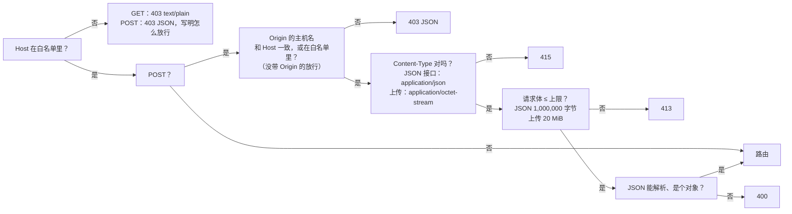

# API 说明

> 机器可读的版本是 [openapi.yaml](openapi.yaml)。本文是给人读的：每个接口做什么、守卫怎么拦、哪里和旧的 Python 版不一样。
> 本文描述的是**真实行为**：旧版的每一种情况都抓成了黄金响应（`tests/baseline/golden/`，172 份），新的 Rust 后端对它们逐项比较。

## 1. 总览

浏览器只通过这组 REST 接口和后端说话，前端里没有数据库访问，也没有判断导入能不能做的逻辑。

| 方法 | 路径 | 作用 | 写库？ |
|---|---|---|---|
| GET | `/api/info` | 版本、CPU 架构、能否关闭程序、题数 | 否 |
| GET | `/api/bank` | 题库（只含上架的题） | 否 |
| GET | `/api/progress` | 学习记录 | 否 |
| GET | `/api/imports` | 最近 12 次导入记录 | 否 |
| POST | `/api/upload` | 上传 .xlsx，得到**预览**和一次性确认码 | **否**（只暂存在内存里） |
| POST | `/api/import/confirm` | 确认导入 | **是**（一个事务） |
| POST | `/api/import/cancel` | 取消待确认的导入 | 否 |
| POST | `/api/attempt` | 记录一场考试的成绩 | 是 |
| POST | `/api/reset` | 清空学习记录 | 是 |
| POST | `/api/shutdown` | 关闭程序（只有本机运行时可用，Docker 里恒 403） | 否 |

`HEAD` 与对应的 `GET` 一样，只是没有正文。

## 2. 所有响应共有的

- `Cache-Control: no-store`、`X-Content-Type-Options: nosniff`。
- JSON 是 UTF-8，日文和中文不转义成 `\uXXXX`；分隔符是 `", "` 和 `": "`（冒号后有空格）；键的顺序固定。**这是约定的一部分**：冒烟测试会 `grep '"bankCount": 0'`。
- 错误是 `{"error": "<可以直接显示给用户的中文原因>"}`。后端不会把异常名、文件路径、SQLite 报错放进响应；细节只进日志。

## 3. 守卫（每个请求先过）

顺序是固定的，所以同一个坏请求总是得到同一个答案：



- **Host**：默认只接受 `localhost`、`127.0.0.1`、`::1`。用别的地址或域名访问时，把它写进环境变量 `XEXAM_ALLOWED_HOSTS`（逗号、空格或分号分隔）。`XEXAM_ALLOW_ANY_HOST=1` 表示不检查 Host（只在前面已经有身份验证，比如 Cloudflare Access 时用）。
- **Origin**（只查写请求）：只比较**主机名**（不比协议和端口），所以经 HTTPS 域名访问也不会被误拦。没带 `Origin` 的请求放行（命令行工具不是浏览器里的跨站请求）。代理把 Host 改写成源站地址时，把公网域名写进 `XEXAM_ALLOWED_ORIGINS`。
- 后端**只读真实的 `Host` 头**，从不读 `X-Forwarded-*`。Nginx 也不转发它们。
- 被拒绝的请求会在日志里留一行，并且响应里写明「你的 Host 是什么、该把哪个值加进哪个选项」。

## 4. 接口细节

### `GET /api/info`
```json
{"version": "0.3", "arch": "x86_64", "canShutdown": false, "bankCount": 5}
```
`bankCount` 是上架的题数。版本号来自 `VERSION` 文件。

### `GET /api/bank`
`file` / `mtime` 是最近一次导入的文件名和时间；`questions` 只含上架的题；`sheets` 里每个工作表有可用数和已下架数。题目的字段见 [openapi.yaml](openapi.yaml) 的 `Question`。

### `GET /api/progress`
`questions` 是每道题的累计统计（答过几次、对几次、错几次、当前连续答对几次）；`history` 是最近 60 场；`masterStreak` 是错题连续答对几次后移出错题本（2）。

### `POST /api/upload`
请求体是 .xlsx 的原始字节。服务端：

1. 只看**内容**判断是不是 .xlsx（魔数 + ZIP 结构 + 有工作簿 + 没有 DOCTYPE / 实体声明 + 解压后大小有上限）。空文件、旧版 `.xls`、损坏的文件、改了扩展名的文件，各有自己的中文说明。
2. 解析，生成预览，把解析结果放进内存里**唯一的待确认槽位**（再次上传会替换它），30 分钟有效。
3. **不写数据库。**

返回预览（`added / updated / unchanged / restored / removed / skipped / usable`、每个工作表的明细、读不出来的行和原因）和一次性确认码 `token`。

### `POST /api/import/confirm`
请求体 `{"token": "…"}`。

- 确认码是 128 位随机数（22 个字符），**只能用一次**；错的确认码不会消耗待确认的内容；过期的取不出来；非 ASCII 的确认码按「无效」处理（409）。
- 导入在**一个事务**里完成：要么全部成功，要么题库没有任何改动。
- 这份文件里一道可用的题都没有 → 400，不导入（防止把题库清空）。

导入规则（文件被当成**完整的题库**）：新出现的题新增；改过的题更新；库里有而文件里找不到的题**下架**（学习记录保留）；下架的题再出现会自动恢复。

### `POST /api/import/cancel`
丢弃待确认的内容，不需要确认码。

### `POST /api/attempt`
请求体 `{"results": [{"id": "…", "correct": true}], "sheets": ["…"], "mode": "all", "seconds": 123}`。

服务端只收「题目 id + 对错」，不收也不存你选了什么。清洗规则：`results` 必须是列表，最多 2000 项；`mode` 不是 `all / weak / retry` 时按 `all`；`seconds` 夹在 0 到 604800，异常值按 0。**服务端信任 `correct`，也不检查 id 是否在题库里**——判分发生在浏览器里（见 [security.md](security.md)）。

`percent` 用**四舍六入五成双**（Python 的 `round`）：1/8 答对是 12，不是 13。

### `POST /api/reset`
清空成绩历史和每题统计；题库不动。

### `POST /api/shutdown`
只有带 `--allow-shutdown` 启动（Windows 上双击 `start.bat`）时可用。Docker 里恒 403，用 `docker compose stop`。

## 5. 与旧版的差异

下面是新的 Rust 后端与旧的 Python v0.2 **有意不同**的地方。每一条都登记在 `tests/baseline/golden/allowed_differences_rust.json` 和 `allowed_probe_differences_rust.json` 里，没有登记的差异会让测试失败。

| 差异 | 旧版 | 新版 | 原因 |
|---|---|---|---|
| 不支持的方法（PUT / DELETE / OPTIONS…） | 501 + 标准库的 HTML 页 | 405 + `Allow: GET, HEAD, POST` | 标准行为 |
| 静态文件 | 后端自己提供 | 后端不提供（404），由 Nginx 提供 | 前后端分离 |
| 畸形 `Content-Length`（非数字、负数、重复） | 按 0 处理或 413 | 400，关闭连接 | HTTP 层在进处理器前就拒绝；浏览器和 Nginx 不会发出这种请求 |
| `Content-Type: Application/JSON`（大小写） | 415 | 接受 | MIME 类型不区分大小写 |
| `Content-Type: text/plain;application/json` | 接受 | 415 | 必须真的是 `application/json`（v0.2 的 Python 也改了） |
| 分块上传 | 当作空文件（400） | 流式计数，超 20 MiB 回 413 | 不信任 `Content-Length` |
| DOCTYPE / 实体声明 | 只扫小写 `.xml` / `.rels` 的 ASCII 字节；UTF-16、`.dat`、`.XML` 能绕过并被展开 | 任何扩展名、任何编码都拒绝，XML 解析层也拒绝任何 DOCTYPE | 安全加固 |
| 重复的 ZIP 条目名 | 用最后一份 | 拒绝（损坏） | 避免检查和读取看到不同内容 |
| ZIP 条目数 | 不限 | 最多 10,000 | 资源上限 |
| XML 节点数 / 深度 | 不限 | 100 万 / 64 层 | 资源上限 |
| 错误文案里的库异常文本 | 带 Python / expat 的原文 | 固定中文，前缀不变 | 不泄露内部细节 |
| `Server` 响应头 | `Xexam/<版本> Python/<版本>` | 没有 | 不泄露版本 |
| `//api/info`（双斜杠） | 被标准库折叠成 200 | 404 | 前端不会发出这种路径 |
| 超大请求头（70,000 字节） | 431 | 由 Nginx 先拒绝 | Nginx 的头缓冲上限 |

## 6. 调用示例

```bash
# 看版本和题数
curl -s http://localhost:8765/api/info

# 上传（只得到预览，不写库）
curl -s -X POST http://localhost:8765/api/upload \
  -H 'Content-Type: application/octet-stream' -H 'X-Filename: demo.xlsx' \
  --data-binary @tests/baseline/fixtures/demo.xlsx

# 确认导入（把上一步返回的 token 填进来）
curl -s -X POST http://localhost:8765/api/import/confirm \
  -H 'Content-Type: application/json' -d '{"token": "…"}'
```

> 经 Nginx 访问时，`curl` 默认带的 `Host: localhost:8765` 在白名单里。用别的域名访问前，先设置 `XEXAM_ALLOWED_HOSTS`。
