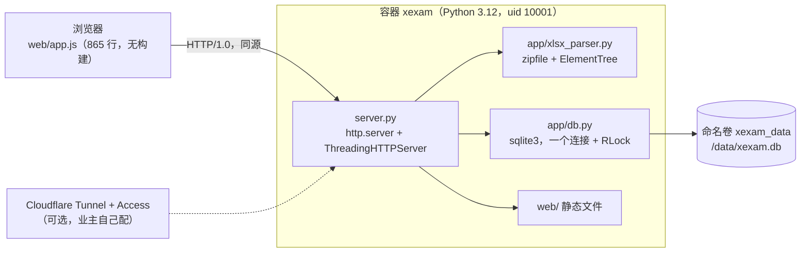

# 架构审计（Phase 0）：现状

> **历史文档。** 对旧的 Python 实现（v0.2）的审计，写于重写之前。目前有效的说明在 [architecture.md](architecture.md)、[api.md](api.md)、[database.md](database.md)、[security.md](security.md)、[deployment.md](deployment.md)、[migration.md](migration.md)、[development.md](development.md)。

> 范围：**只读**审计 Xexam v0.2 的 Python 实现。本文是现状快照；目标架构和迁移步骤见 [migration-plan.md](migration-plan.md)，风险见 [risk-assessment.md](risk-assessment.md)，测试见 [test-strategy.md](test-strategy.md)。
> 每个维度的详细证据（带 `文件:行号`）在 [`docs/audit/`](audit/) 下的附录里，本文只给结论和指路。
> 被审计的代码是 v0.2（提交 `1ee64c8`，标签 `python-v0.2`）。审计之后只做过一件会改变行为的事：修了审计里确认的缺陷（见 §8），旧→新响应的差异记录在 `tests/baseline/golden/allowed_differences_v02.json`。

## 1. 方法

- 通读 `server.py`、`app/db.py`、`app/xlsx_parser.py`、`web/app.js`、`web/style.css`、`Dockerfile`、两个 compose 文件、CI 工作流、`scripts/smoke-test.sh`、README。
- 真实启动旧服务器，对每个端点、每种状态抓了 **172** 份响应（`tests/baseline/golden/`）。
- 用 **50** 个合成 XLSX 夹具逐个跑旧解析器，保存输出（`tests/baseline/parser_golden/`）。
- 对 **85** 个断言验证了题目 id 的算法（`tests/baseline/golden/id_vectors.json`）。
- 没有读业主的 `data/` 和 `progress.json`；两份私人工作簿只统计过结构（不含题目文字），统计结果不放进仓库。

## 2. 当前架构

要点（证据：[audit/api-contract.md](audit/api-contract.md) §1–3，[audit/security.md](audit/security.md) §1）：

- **一个进程做所有事**：静态文件、API、XLSX 解析、SQLite、Host/Origin 守卫。
- **线路层**：HTTP/1.0、每个响应后关闭连接、不记访问日志。JSON 用 Python 默认格式（键后有空格，`ensure_ascii=False`），键的顺序固定。
- **没有登录**。信任模型 = 默认只绑定 `127.0.0.1` + Host 白名单 + 写请求的 Origin 检查。从互联网访问时，认证靠业主在 Cloudflare Access 里设置。
- **状态**：数据库在命名卷；"待确认导入"只存在内存里的一个槽位；浏览器里用 `localStorage` 存暂停的考试和语言。

## 3. 功能清单

| 功能 | 谁负责 | 位置 | 关键程度 |
|---|---|---|---|
| 上传 XLSX → 预览 → 确认/取消导入 | 服务端 | `server.py:316-359`，`db.py:157-226` | **最关键**（数据入口） |
| 解析题目（单选、多选、热点题；日语 + 中文翻译；答案/解析/口诀） | 服务端 | `xlsx_parser.py` | **最关键** |
| 题目 id（学习记录的键） | 服务端 | `xlsx_parser.py:245` | **最关键**：一旦变了，学习记录就对不上题 |
| 出题范围、抽题、打乱 | 浏览器 | `app.js` `pool()` `shuffle()` | 中 |
| 判分（交卷后才计分） | **浏览器** | `app.js` `grade()` | **关键**：服务端只存 `{id, correct}` |
| 错题本规则（答错进、连续答对 2 次出） | 浏览器 + 服务端统计 | `app.js` `inNotebook()`，`db.py record_attempt` | 关键 |
| 成绩历史（最近 60 场） | 服务端 | `db.py` | 中 |
| 日语/中文切换（翻译结构对不上就置灰） | 浏览器 + 解析器 | `app.js`，`xlsx_parser.py parse_translation` | 关键（不能显示错位内容） |
| 暂存退出、继续作答 | 浏览器 | `localStorage` | 中 |
| 旧 `progress.json` 迁移 | 服务端 | `server.py open_store`，`db.py` | 低（一次性） |
| `--import` 命令行导入 | 服务端 | `server.py main` | 低 |
| `/api/shutdown`（只在本机运行时可用） | 服务端 | `server.py` | 低 |

## 4. 当前 API 契约（摘要）

完整字段、状态码、守卫顺序见 [audit/api-contract.md](audit/api-contract.md)，黄金响应在 `tests/baseline/golden/`。

| 方法 | 路径 | 作用 | 备注 |
|---|---|---|---|
| GET | `/api/info` | 版本、架构、能否关闭、题数 | `bankCount` 供冒烟测试用 |
| GET | `/api/bank` | 全部题目 | 约 79–159 KB |
| GET | `/api/progress` | 学习记录 | |
| GET | `/api/imports` | 最近 12 次导入 | |
| POST | `/api/upload` | 上传 XLSX（`application/octet-stream`，头 `X-Filename`） | 返回预览 + 一次性确认码 |
| POST | `/api/import/confirm` | 确认导入（`{token}`） | 只有它会写题库 |
| POST | `/api/import/cancel` | 取消 | 不需要确认码 |
| POST | `/api/attempt` | 交卷成绩（`{results, sheets, mode, seconds}`） | 信任 `correct` |
| POST | `/api/reset` | 清空学习记录 | |
| POST | `/api/shutdown` | 关闭程序 | Docker 里恒 403 |

规格的列表里**没有** `/api/shutdown`，也没有 `HEAD`；现有代码都有，迁移要保留。

**守卫顺序（POST）**：Host → Origin → 路径 / Content-Type → 大小 → JSON 解析 → 路由。GET 没有 Origin 检查。

## 5. 数据库

详见 [audit/database.md](audit/database.md)。要点：

- 文件 `xexam.db`（规格里写的是旧名字；代码、CI、文档全是 `xexam.db`）。
- 5 张表：`questions`、`stats`、`attempts`、`imports`、`meta`，外加 `sqlite_sequence`；一个索引；**没有外键、CHECK、触发器**，虽然连接上设了 `foreign_keys=ON`。
- `journal_mode=DELETE`、`synchronous=FULL`、`busy_timeout=5000`。**不是 WAL**（Docker Desktop 挂载 Windows 目录时 WAL 不可靠）。
- 事务：`BEGIN IMMEDIATE`，一个进程级 `RLock` + 一个共享连接。
- 时间戳：本地时间字符串 `%Y-%m-%d %H:%M`，无时区。容器里靠 `TZ=Asia/Tokyo`。
- `questions.data` 是一整道题的 JSON；`stats`/`attempts` 的键是题目 id。

**题目 id**：`sha1(工作表 + "\n" + 去空白题干[:300] + "|" + 去空白首选项[:200])` 的前 12 个十六进制字符；重复的加 `-2`、`-3`。这里的"去空白"是 Python 的 `\s`（29 个码点，含 U+001C–U+001F），比 Rust 的 `char::is_whitespace`（25 个）多。**没有任何 Unicode 规范化**——业主两份真实工作簿里大部分题含全角 ASCII，所以不能为了"更干净"加规范化。

## 6. 安全控制

完整清单（规则 / 位置 / 怎么测 / 迁移去向）见 [audit/security.md](audit/security.md) §2。摘要：

| 控制 | 现状 | 迁移后 |
|---|---|---|
| Host 白名单（默认本机；`XEXAM_ALLOWED_HOSTS`、`XEXAM_ALLOW_ANY_HOST`） | 有 | **留在 Rust 后端**，同时 Nginx 挡掉未知 Host |
| 写请求 Origin 检查（只比主机名；`XEXAM_ALLOWED_ORIGINS`） | 有 | 留在后端 |
| 上传：魔数、ZIP、解压大小、实体检查、20 MB | 有，**实体检查可被 UTF-16 / 非 `.xml` 扩展名绕过** | 重写；Rust 里在 XML 事件层拒绝任何 DOCTYPE |
| 待确认导入：128 位随机令牌、常量时间比较、一次性、30 分钟 | 有 | 复刻；非 ASCII 令牌改成 409 |
| 导入在一个事务里 | 有 | 复刻 |
| SQL 参数化 | 有（唯一的字符串格式化只拼 `?` 占位符） | 复刻 |
| `nosniff`、`no-store` | 有 | 保留；Nginx 另加 CSP 等 |
| CORS、速率限制、认证、解析超时、访问日志 | **没有** | 见 [migration-plan.md](migration-plan.md) 的默认值 |
| 非 root 运行（uid 10001） | 有 | 保留 |

**代理之后会变的事**（[audit/security.md](audit/security.md) §5）：Nginx 默认发给后端的 `Host` 是 `$proxy_host`（如 `backend:8765`），会让所有请求被 403。必须设 `proxy_set_header Host $host`，且不要把 `X-Forwarded-*` 当作信任来源（旧代码根本不读它们）。

## 7. 依赖

| 层 | 依赖 |
|---|---|
| 运行时 | Python 3.12 标准库，**零第三方包** |
| 前端 | 原生 JS，**无构建、无框架**；`web/` 里 5 个文件（`index.html`、`app.js`、`style.css`、`icon.svg`、`apple-touch-icon.png`） |
| 镜像 | `python:3.12-slim`，120 MB，`linux/amd64` + `linux/arm64` |
| CI | `actions/checkout@v7`、`docker/setup-qemu-action@v4`、`setup-buildx-action@v4`、`login-action@v4`、`metadata-action@v6`、`build-push-action@v7` |

## 8. 已知缺陷和技术债

下面是读代码并实测得到的，带 ✅ 的已经在 v0.2 里修掉；其余**保留在旧实现里**，迁移时是否改由 [migration-plan.md](migration-plan.md) 的决策表决定。

| 问题 | 严重度 | 状态 |
|---|---|---|
| 提前 403/415 时不读请求体，大文件上传的连接被重置，浏览器只看到"连不上服务" | 中 | ✅ |
| 畸形 JSON（`results` 不是列表、`seconds=Infinity`、过深嵌套、非 ASCII 确认码）让服务器直接断开连接 | 低 | ✅ |
| `COMMIT` 失败不回滚，连接一直卡在事务里 | 中 | ✅ |
| 格式不对的旧 `progress.json` 让程序起不来 | 中 | ✅ |
| 交卷先清暂存再提交，提交失败就丢了答案 | 中 | ✅ |
| 开始新考试会静默覆盖暂存的考试 | 中 | ✅ |
| 成绩页与学习记录的百分比取整不同（JS `Math.round` vs Python 银行家舍入） | 低 | ✅ |
| 实体检查只扫小写 `.xml`/`.rels` 且只认 ASCII，UTF-16 的 DOCTYPE 能绕过并被展开 | **中（安全）** | 保留 |
| 错误信息回显 Python 异常名、SQLite 文本 | 低 | 保留 |
| 解析器无行数/单元格/深度上限；单个 XML 成员最多 100 MiB 整个读进内存 | 中 | 保留 |
| `HINT_RE` 在长串空格上灾难性回溯（500 个空格 4 秒，1000 个 54 秒），期间所有请求被卡住 | 中 | 保留 |
| ZIP 大小检查只看声明值；伪造头不会绕过（CPython 会截断并校验 CRC），但实际分配不受限 | 低 | 保留 |
| `/api/attempt` 接受不存在的题目 id、重复 id 算两次 | 低 | 保留 |
| 题目 id 的重复后缀 `-2` 依赖行序，调换重复题的行会把学习记录换到另一题上 | 低 | 保留（文档说明） |
| 同一个待确认槽位：两个标签页互相覆盖；取消不需要令牌 | 低 | 保留 |
| 没有读超时：半截请求会永久占一个线程；`docker stop` 可能被拖到 10 秒 | 低 | 保留 |

## 9. 什么可以复用，什么必须重写

**原样复用**
- `web/style.css`、`web/icon.svg`、`web/apple-touch-icon.png`、HTML 骨架：界面不变。
- 数据库 **schema 和 `xexam.db` 文件**：Rust 直接读写，不迁移。
- `tests/baseline/`：这就是对照的标准。
- `scripts/`、`.github/workflows` 的结构（扩成两个镜像）。

**必须重写**
- `server.py` → Rust（Axum）。
- `app/db.py` → Rust（rusqlite）。
- `app/xlsx_parser.py` → Rust（zip + quick-xml）：**这是最大风险**，因为题目 id 和翻译判断都依赖它的细节。
- `web/app.js` → TypeScript（Vite），保持 DOM 和 CSS 类名不变。

**业务逻辑里必须逐字保留的**
1. 题目 id 的算法（§5）。
2. 预览不写库；确认才在**一个事务**里写；令牌一次性、30 分钟。
3. 下架而不是删除：缺失的题 `active=0`，学习记录保留；再出现自动恢复。
4. 错题本规则（答错进；连续答对 2 次出）与"成绩历史只留最近 60 场"。
5. 翻译结构对不上时 `zh=None`，前端置灰中文按钮，**不显示错位内容**。
6. 判分规则（多选要选对全部；热点题每个小项都对）。
7. `percent` 的取整：Python 银行家舍入（`1/8 → 12`），Rust 的 `f64::round` 会给 13。
8. 所有面向用户的中文错误文案（前端直接显示它们）。

## 10. 附录索引

| 附录 | 内容 |
|---|---|
| [audit/api-contract.md](audit/api-contract.md) | 每个端点的请求/响应/状态码/守卫顺序，172 份黄金响应的说明 |
| [audit/database.md](audit/database.md) | 完整 schema、28 条 SQL、事务、题目 id 算法、85 个测试向量 |
| [audit/xlsx-parser.md](audit/xlsx-parser.md) | 解析器逐层行为、全部"读不出来"文案、Python→Rust 对等审计、50 个夹具 |
| [audit/security.md](audit/security.md) | 控制项清单、340 项探针实测、Nginx 之后的 Host/Origin 分析 |
| [audit/frontend.md](audit/frontend.md) | 全局状态、函数清单、网络调用、`localStorage` 载荷、TypeScript 迁移要点 |
| [audit/rust-stack.md](audit/rust-stack.md) | 依赖版本核查（含安全公告）、`Cargo.toml` 草案、模块布局、12 个待验证的小实验 |
| [audit/spec-gap-and-decisions.md](audit/spec-gap-and-decisions.md) | 规格与现实的 9 个冲突、14 个歧义、29 行决策表 |

> 附录是各分析师在审计当时写的原始记录，行号对应审计时的代码；如与本文冲突，以本文和 `tests/baseline/` 里的实测为准。
