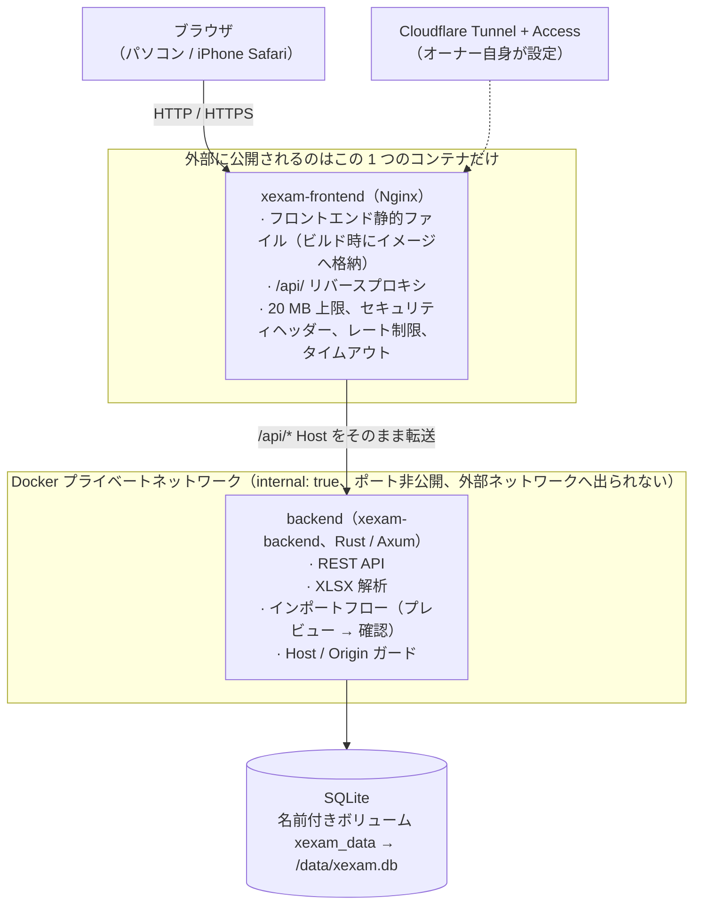
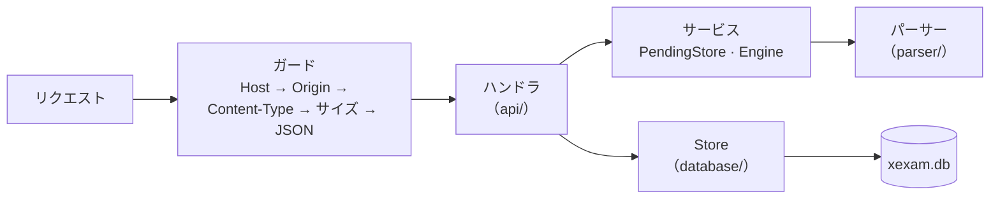
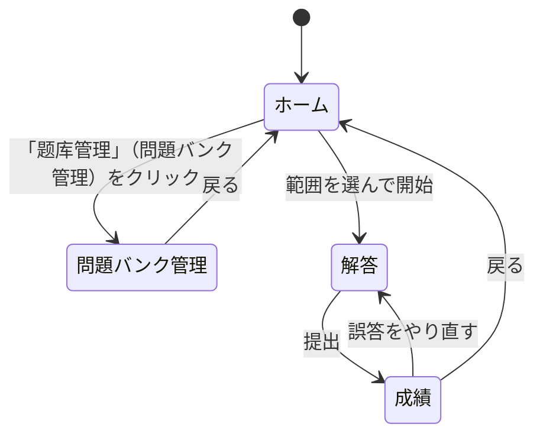
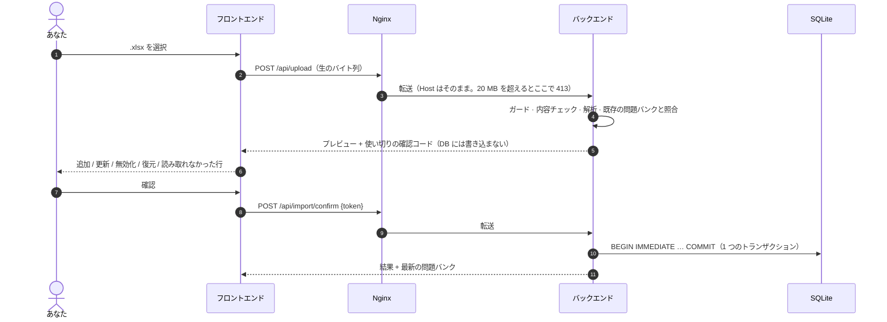

[English](architecture.md) | **日本語** | [简体中文](architecture.zh-CN.md)

# アーキテクチャ（v0.3）

> 現状の監査（Python 版）は [architecture-audit.md](architecture-audit.md)、移行の決定事項とデフォルト値は [migration-plan.md](migration-plan.md) にあります。
> 本書では**新しい**構成、つまり Nginx + Rust バックエンド + SQLite、そして TypeScript で書かれたフロントエンドを説明します。

## 1. 全体像



- **ポートを公開するのは Nginx だけです**（`XEXAM_BIND`、デフォルトは `127.0.0.1:8765` → コンテナ内の `8080`）。
- バックエンドのネットワークは `internal: true` です。`ports` がなく、ホストからも外部からも接続できず、バックエンド自身も外部ネットワークにアクセスできません。
- データベースを読み書きできるのはバックエンドだけです。Nginx のコンテナには、データベースもソースコードも Node も入っていません。
- ブラウザとバックエンドの間は REST だけです（[api.ja.md](api.ja.md) を参照）。フロントエンドにはデータベースへのアクセスも、「このインポートは実行してよいか」といった判断もありません。

## 2. ディレクトリ構成

```
frontend/     TypeScript 5.9（strict）+ Vite、素の DOM、フレームワークなし
  src/api/      型付きの fetch ラッパー（client / bank / import / progress）
  src/types/    API の型（docs/openapi.yaml に対応）
  src/domain/   純粋関数：採点、誤答ルール、パーセンテージ（単体テストあり）
  src/state/    アプリの状態（単一の store）、アクション、sessionStorage 内の試験進捗
  src/pages/    ホーム / 問題バンク管理 / 解答 / 成績
  src/components/ src/utils/ src/styles/
backend/      Rust（Axum 0.8 + Tokio + rusqlite）、ツールチェーンは 1.99.1 に固定
  src/api/      ルーティング、ガード（Host / Origin / Content-Type / サイズ）、JSON 形式、成績データのサニタイズ
  src/services/ 確認待ちインポートのスロット（PendingStore）、パースエンジンのインターフェース
  src/parser/   .xlsx のパース：ZIP 対策、XML、問題の判別、問題 id
  src/database/ SQLite ストレージ、schema、旧 progress.json の移行、タイムスタンプ
  src/security/ Host / Origin の判定、サイズ制限付きのリクエストボディ読み取り
  src/config/   環境変数
  tests/        単体、ゴールデンレスポンス、パース突き合わせ、id ベクタ、並行処理
nginx/        nginx.conf + Dockerfile（フロントエンドをビルド → 静的な成果物だけを同梱）
tests/        baseline/（旧版のゴールデンレスポンスとツール）· integration/（nginx、スタック全体、ロールバック演習）
docs/         このディレクトリ
```

## 3. バックエンド



主な設計（理由は [audit/rust-stack.md](audit/rust-stack.md) を参照）：

| 問題 | 対応 |
|---|---|
| rusqlite は同期的 | 接続を 1 つだけ `Arc<Mutex<Connection>>` の後ろに置き、データベース呼び出しは `spawn_blocking` の中で実行します。ロックは `.await` をまたぎません。旧版の「1 つの接続 + RLock」と 1 対 1 で対応します |
| リクエストボディの上限 | 自前のストリーミング読み取り：読みながら実際のバイト数を数え、20 MiB を超えたらただちに 413 を返します。**`Content-Length` は信用しません**（チャンク転送のアップロードも同様） |
| 解析でサービスが止まってしまわないか | 解析はブロッキングスレッドで行い、協調的なデッドラインがあります（`XEXAM_PARSE_TIMEOUT_SECS`、デフォルト 30 秒。時間になるとパーサー自身が停止します）。同時に実行できる解析は最大 2 つです。ZIP のエントリ数、展開後のサイズ、XML の深さ / ノード数 / 要素あたりの属性数、セルの総数と総バイト数にはいずれも上限があり、共有文字列は 1 つだけ保持します |
| インポートの原子性 | プレビューはメモリ上の**唯一のスロット**にだけ置き、データベースには書きません。確認時に `BEGIN IMMEDIATE … COMMIT` を実行し、失敗したら全体をロールバックします。確認コードは使い切りで、128 ビットのランダム値、定数時間で比較され、同時に確認しても成功するのは 1 つだけです |
| コミットが中断された場合 | インポートのコミットは独立したタスクで、クライアントが切断しても最後まで実行されます。`docker stop` は最大 15 秒待ち、バックエンドは 8 秒以内に正常終了します |
| ログ | `tracing`、色なし。**確認コードもドキュメントの内容も記録しません** |
| エラー | `{"error": "<中国語の理由>"}` に統一します。ライブラリの例外、ファイルパス、SQLite のエラーはログにだけ出力し、レスポンスには含めません |

バックエンドのコマンドライン：

```
xexam-backend [serve] [--data DIR] [--host ADDR] [--port N] [--allow-shutdown] [--no-browser]
xexam-backend healthcheck [--port N]          コンテナのセルフチェック（Host: 127.0.0.1 付き。許可リストの影響を受けない）
xexam-backend import <問題バンク.xlsx> [--data DIR]  コマンドラインでのインポート（旧版の --import）
xexam-backend migrate-progress [progress.json] 以前のバージョンの progress.json をデータベースへ移行
```

## 4. フロントエンド

フレームワークは使わず、素の DOM を使います。状態は小さな store 1 つで、ページは関数です。`render()` が状態に基づいて再描画します。



- **採点はブラウザ内で行います**（仕様ではサーバー側を推奨していましたが、ここは意図的な逸脱です。理由は [migration-plan.md](migration-plan.md) の Q3 を参照）。サーバーが受け取るのは `{問題 id, 正誤}` だけです。ルールは純粋関数 `src/domain/grading.ts` に切り出してあり、単体テストがあります。
- 解答途中の試験は `sessionStorage` に保存されるので、ページを再読み込みしても失われません。ログインが期限切れになった場合（Cloudflare Access）は、アップロードや提出の際に、再読み込みして再ログインするよう案内が表示されます。
- スタイルはインラインではありません：`style-src 'self'` なので、CSP をとても厳しくできます。
- ビルドターゲットは `es2020` / `safari15` です。iPhone は iOS 15.4 以上が必要です。

## 5. データフロー

### 問題バンクの更新（アップロード → プレビュー → 確認）



### 試験を受ける

問題バンクを一度にブラウザへ取得 → ブラウザ内で解答し、提出時に採点 → `POST /api/attempt` は `{id, correct}` のリストだけを送信 → バックエンドが問題ごとの統計と成績履歴を更新 → 最新の学習記録を返す。

## 6. ビルドとイメージ

| イメージ | ビルド | 実行時の内容 |
|---|---|---|
| `xexam-frontend` | `node:24-alpine` でフロントエンドをコンパイル → `nginxinc/nginx-unprivileged:1.27-alpine` | nginx.conf + 静的ファイル、非 root の uid、8080 で待ち受け |
| `xexam-backend` | `rust:1-alpine`（musl、静的リンク）→ `alpine:3.21` + tzdata | 実行ファイル 1 つ + `/VERSION`、uid 10001、ルートファイルシステムは読み取り専用 |

どちらのサービスも：`cap_drop: ALL`、`no-new-privileges`、`read_only: true`、`tmpfs: /tmp`。

## 7. 旧版との対応

| 旧（Python） | 新 |
|---|---|
| `server.py` | `backend/src/api/` + `main.rs` |
| `app/db.py` | `backend/src/database/` |
| `app/xlsx_parser.py` | `backend/src/parser/` |
| `web/app.js` / `style.css` / `index.html` | `frontend/src/` |
| コンテナ内の 1 プロセス | nginx + backend の 2 コンテナ |
| `docker-compose.yml`（イメージを pull） | `docker-compose.yml`（`xexam-frontend` と `xexam-backend` の 2 つのイメージを pull）；`docker-compose.build.yml`（ソースからビルド） |

旧 Python 実装はリポジトリから削除しましたが、失われたわけではありません。Git タグ `python-v0.2` が最後のバージョンを指しており、旧イメージ `ghcr.io/yumin-space/xexam:v0.2.2` も引き続き pull できます。ロールバックについては [migration.ja.md](migration.ja.md) を参照してください。
