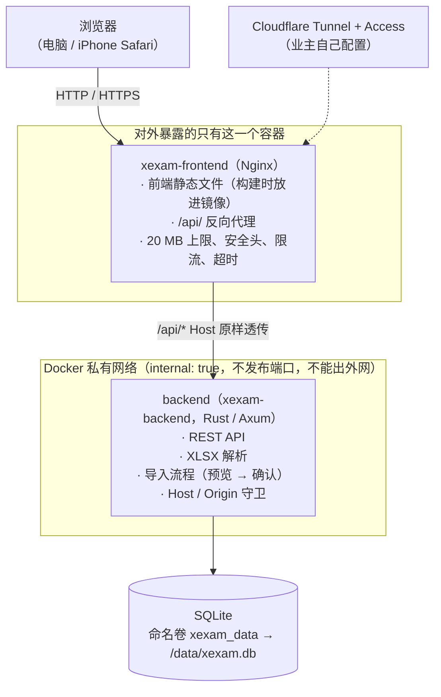
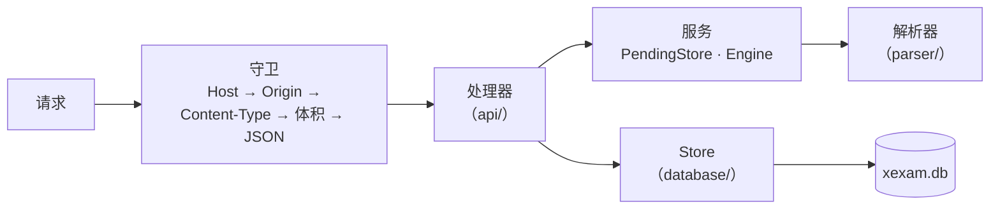
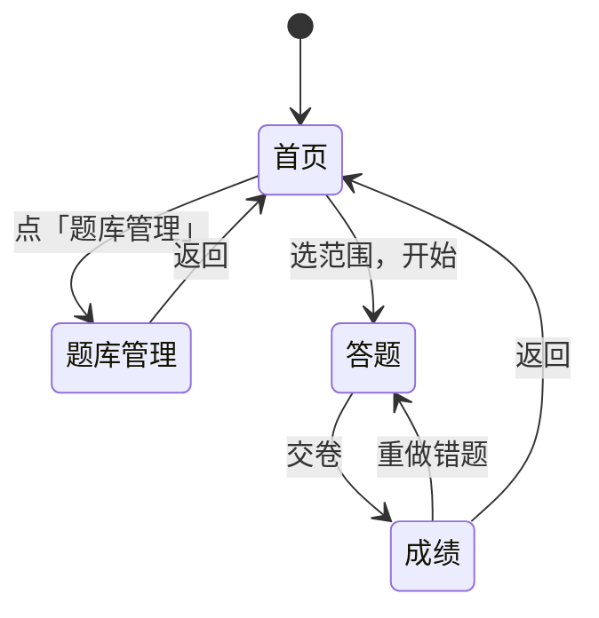
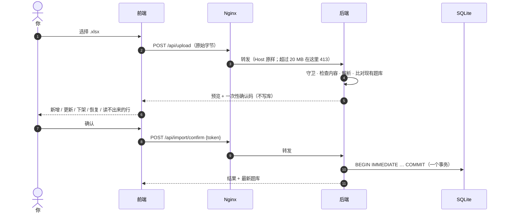

# 架构（v0.3）

> 现状的审计（Python 版）在 [architecture-audit.md](architecture-audit.md)，迁移的决策和默认值在 [migration-plan.md](migration-plan.md)。
> 本文描述**新的**结构：Nginx + Rust 后端 + SQLite，前端是 TypeScript。

## 1. 总览



- **只有 Nginx 发布端口**（`XEXAM_BIND`，默认 `127.0.0.1:8765` → 容器内 `8080`）。
- 后端所在的网络是 `internal: true`：没有 `ports`，宿主机和外部都连不到它，它自己也访问不了外网。
- 数据库只有后端能读写；Nginx 容器里没有数据库、没有源码、没有 Node。
- 浏览器和后端之间只有 REST（见 [api.md](api.md)）。前端里没有数据库访问，也没有「这份导入能不能做」之类的判断。

## 2. 目录

```
frontend/     TypeScript 5.9（strict）+ Vite，原生 DOM，没有框架
  src/api/      带类型的 fetch 封装（client / bank / import / progress）
  src/types/    API 的类型（与 docs/openapi.yaml 对应）
  src/domain/   纯函数：判分、错题规则、百分比（有单元测试）
  src/state/    应用状态（单个 store）、动作、sessionStorage 里的考试进度
  src/pages/    首页 / 题库管理 / 答题 / 成绩
  src/components/ src/utils/ src/styles/
backend/      Rust（Axum 0.8 + Tokio + rusqlite），工具链固定 1.99.1
  src/api/      路由、守卫（Host / Origin / Content-Type / 体积）、JSON 格式化、成绩清洗
  src/services/ 导入的待确认槽位（PendingStore）、解析引擎接口
  src/parser/   .xlsx 解析：ZIP 防护、XML、题目识别、题目 id
  src/database/ SQLite 存储、schema、旧 progress.json 迁移、时间戳
  src/security/ Host / Origin 判断、限长读取请求体
  src/config/   环境变量
  tests/        单元、黄金响应、解析差分、id 向量、并发
nginx/        nginx.conf + Dockerfile（构建前端 → 只带静态产物）
tests/        baseline/（旧版黄金响应和工具）· integration/（nginx、整栈、回滚演练）
docs/         本目录
```

## 3. 后端



关键设计（原因见 [audit/rust-stack.md](audit/rust-stack.md)）：

| 问题 | 做法 |
|---|---|
| rusqlite 是同步的 | 一个连接放在 `Arc<Mutex<Connection>>` 后面，数据库调用在 `spawn_blocking` 里跑，锁不跨 `.await`。与旧版「一个连接 + RLock」一一对应 |
| 请求体上限 | 自写流式读取：边读边数真实字节，超过 20 MiB 立即 413，**不信任 `Content-Length`**（分块上传也一样） |
| 解析会不会拖死服务 | 解析在阻塞线程里做，有协作式的截止时间（`XEXAM_PARSE_TIMEOUT_SECS`，默认 30 秒；到了解析器自己停下），同时最多 2 个解析；ZIP 条目数、解压后大小、XML 深度 / 节点数 / 每元素属性数、单元格总数和总字节数都有上限；共享字符串只存一份 |
| 导入的原子性 | 预览只放进内存里的**唯一槽位**，不写库；确认时 `BEGIN IMMEDIATE … COMMIT`，失败整体回滚；确认码一次性、128 位随机、常量时间比较，并发确认只有一个能成功 |
| 提交被打断 | 导入提交是独立任务，客户端断开了也会跑完；`docker stop` 最多等 15 秒，后端 8 秒内优雅退出 |
| 日志 | `tracing`，不带颜色；**不记确认码、不记文档内容** |
| 错误 | 统一成 `{"error": "<中文原因>"}`；库异常、文件路径、SQLite 报错只进日志，不进响应 |

后端的命令行：

```
xexam-backend [serve] [--data DIR] [--host ADDR] [--port N] [--allow-shutdown] [--no-browser]
xexam-backend healthcheck [--port N]          容器自检（带 Host: 127.0.0.1，不受白名单影响）
xexam-backend import <题库.xlsx> [--data DIR]  命令行导入（旧版的 --import）
xexam-backend migrate-progress [progress.json] 把更早版本的 progress.json 迁进数据库
```

## 4. 前端

没有框架，用原生 DOM。状态是一个小 store，页面是函数：`render()` 根据状态重画。



- **判分在浏览器里**（规格建议放服务端，这里是有意的偏离，理由见 [migration-plan.md](migration-plan.md) 的 Q3）：服务端只收 `{题目 id, 对错}`。规则抽成纯函数 `src/domain/grading.ts`，有单元测试。
- 做到一半的考试存在 `sessionStorage`，刷新页面不丢；登录过期（Cloudflare Access）时上传或交卷会提示刷新重新登录。
- 样式没有内联：`style-src 'self'`，所以 CSP 可以很严。
- 构建目标 `es2020` / `safari15`；iPhone 需要 iOS 15.4 以上。

## 5. 数据流

### 更新题库（上传 → 预览 → 确认）



### 做一场考试

题库一次取到浏览器 → 在浏览器里答题、交卷时判分 → `POST /api/attempt` 只发 `{id, correct}` 列表 → 后端更新每题统计和成绩历史 → 返回最新学习记录。

## 6. 构建和镜像

| 镜像 | 构建 | 运行时内容 |
|---|---|---|
| `xexam-frontend` | `node:24-alpine` 编译前端 → `nginxinc/nginx-unprivileged:1.27-alpine` | nginx.conf + 静态文件；uid 非 root；监听 8080 |
| `xexam-backend` | `rust:1-alpine`（musl，静态链接）→ `alpine:3.21` + tzdata | 一个可执行文件 + `/VERSION`；uid 10001；根文件系统只读 |

两个服务都：`cap_drop: ALL`、`no-new-privileges`、`read_only: true`、`tmpfs: /tmp`。

## 7. 和旧版的对应

| 旧（Python） | 新 |
|---|---|
| `server.py` | `backend/src/api/` + `main.rs` |
| `app/db.py` | `backend/src/database/` |
| `app/xlsx_parser.py` | `backend/src/parser/` |
| `web/app.js` / `style.css` / `index.html` | `frontend/src/` |
| 容器里一个进程 | nginx + backend 两个容器 |
| `docker-compose.yml`（拉取镜像） | `docker-compose.yml`（拉取 `xexam-frontend` 和 `xexam-backend` 两个镜像）；`docker-compose.build.yml`（从源码构建） |

旧的 Python 实现已从仓库移除，但没有丢：Git 标签 `python-v0.2` 指向它的最后一个版本，旧镜像 `ghcr.io/yumin-space/xexam:v0.2.2` 仍可拉取。回滚见 [migration.md](migration.md)。
