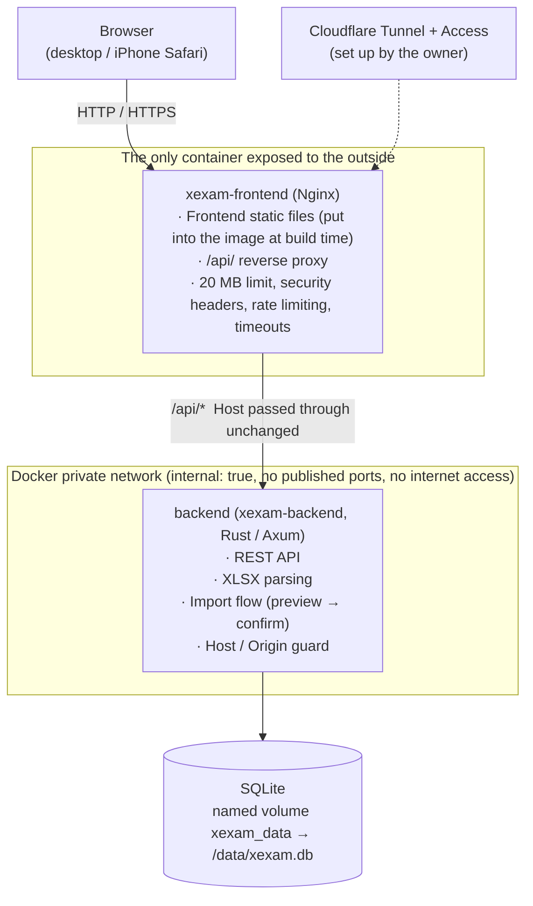
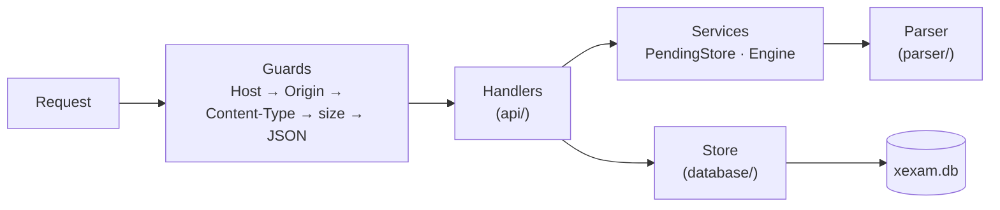
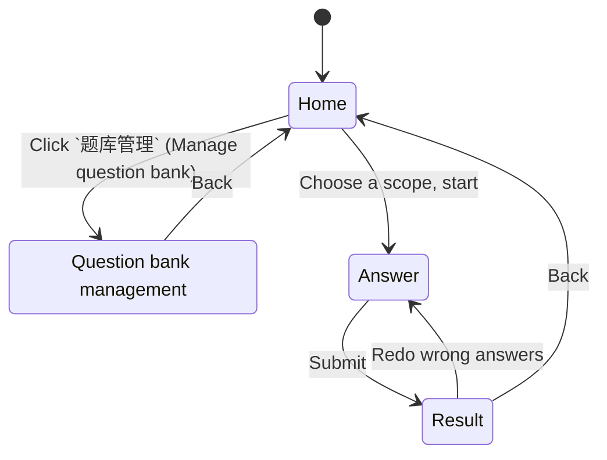

**English** | [日本語](architecture.ja.md) | [简体中文](architecture.zh-CN.md)

# Architecture (v0.3)

> The audit of the current state (the Python version) is in [architecture-audit.md](architecture-audit.md); the migration decisions and defaults are in [migration-plan.md](migration-plan.md).
> This document describes the **new** structure: Nginx + a Rust backend + SQLite, with a TypeScript frontend.

## 1. Overview



- **Only Nginx publishes a port** (`XEXAM_BIND`, default `127.0.0.1:8765` → `8080` inside the container).
- The network the backend sits on is `internal: true`: there are no `ports`, neither the host nor the outside can reach it, and it cannot reach the internet itself.
- Only the backend can read or write the database; the Nginx container has no database, no source code, and no Node.
- Between the browser and the backend there is only REST (see [api.md](api.md)). The frontend has no database access, and it makes no judgments such as "can this import be done".

## 2. Directory layout

```
frontend/     TypeScript 5.9 (strict) + Vite, plain DOM, no framework
  src/api/      typed fetch wrappers (client / bank / import / progress)
  src/types/    API types (matching docs/openapi.yaml)
  src/domain/   pure functions: grading, wrong-answer rules, percentages (unit-tested)
  src/state/    app state (a single store), actions, exam progress in sessionStorage
  src/pages/    home / question bank management / answering / results
  src/components/ src/utils/ src/styles/
backend/      Rust (Axum 0.8 + Tokio + rusqlite), toolchain pinned to 1.99.1
  src/api/      routes, guards (Host / Origin / Content-Type / size), JSON formatting, score sanitizing
  src/services/ pending-confirmation slot for imports (PendingStore), parser engine interface
  src/parser/   .xlsx parsing: ZIP protection, XML, question recognition, question id
  src/database/ SQLite storage, schema, legacy progress.json migration, timestamps
  src/security/ Host / Origin checks, size-limited request body reading
  src/config/   environment variables
  tests/        unit, golden-response, parser comparison, id-vector, concurrency
nginx/        nginx.conf + Dockerfile (builds the frontend → ships only the static output)
tests/        baseline/ (golden responses and tools of the old version) · integration/ (nginx, full stack, rollback drill)
docs/         this directory
```

## 3. Backend



Key design decisions (the reasoning is in [audit/rust-stack.md](audit/rust-stack.md)):

| Problem | Approach |
|---|---|
| rusqlite is synchronous | One connection sits behind `Arc<Mutex<Connection>>`; database calls run inside `spawn_blocking`, and the lock is never held across an `.await`. This maps one to one onto the old version's "one connection + RLock" |
| Request body limit | A hand-written streaming reader: it counts the real bytes as it reads and returns 413 the moment 20 MiB is exceeded, **without trusting `Content-Length`** (the same applies to chunked uploads) |
| Can parsing stall the service? | Parsing runs on a blocking thread with a cooperative deadline (`XEXAM_PARSE_TIMEOUT_SECS`, 30 seconds by default; when it expires, the parser stops by itself), and at most 2 parses run at a time; there are limits on the number of ZIP entries, the size after decompression, XML depth / node count / attributes per element, and the total number of cells and total bytes; shared strings are stored only once |
| Import atomicity | The preview is held only in a **single in-memory slot** and is never written to the database; confirmation runs `BEGIN IMMEDIATE … COMMIT` and rolls back as a whole on failure; the confirmation code is single-use, 128 bits of randomness, and compared in constant time; if several confirmations arrive at once, only one can succeed |
| A commit being interrupted | The import commit is a separate task and runs to completion even if the client disconnects; `docker stop` waits at most 15 seconds, and the backend shuts down gracefully within 8 seconds |
| Logs | `tracing`, without colors; **the confirmation code and the document content are never logged** |
| Errors | Always `{"error": "<reason, in Chinese>"}`; database exceptions, file paths and SQLite errors go only to the log, never into the response |

The backend command line:

```
xexam-backend [serve] [--data DIR] [--host ADDR] [--port N] [--allow-shutdown] [--no-browser]
xexam-backend healthcheck [--port N]          container self-check (sends Host: 127.0.0.1, so the allowlist does not affect it)
xexam-backend import <question-bank.xlsx> [--data DIR]  command-line import (the old --import)
xexam-backend migrate-progress [progress.json] migrate the progress.json of an earlier version into the database
```

## 4. Frontend

No framework; plain DOM. The state is a small store and each page is a function: `render()` redraws from the state.



- **Grading happens in the browser** (the spec recommends doing it server-side; this is a deliberate deviation, with the reasoning in Q3 of [migration-plan.md](migration-plan.md)): the server receives only `{question id, correct}`. The rules are extracted into the pure functions in `src/domain/grading.ts`, which has unit tests.
- An exam in progress is kept in `sessionStorage`, so refreshing the page does not lose it; when the login expires (Cloudflare Access), uploading or submitting prompts you to refresh and log in again.
- No inline styles: `style-src 'self'`, so the CSP can be very strict.
- Build targets are `es2020` / `safari15`; iPhone needs iOS 15.4 or later.

## 5. Data flow

### Updating the question bank (upload → preview → confirm)

```mermaid
sequenceDiagram
    autonumber
    actor 你 as You
    participant 前端 as Frontend
    participant N as Nginx
    participant 后端 as Backend
    participant 库 as SQLite
    你->>前端: Choose an .xlsx file
    前端->>N: POST /api/upload (raw bytes)
    N->>后端: Forward (Host unchanged; anything over 20 MB gets a 413 here)
    后端->>后端: Guards · content checks · parse · compare with the current question bank
    后端-->>前端: Preview + one-time confirmation code (nothing written to the database)
    前端-->>你: Added / updated / deactivated / restored / unreadable rows
    你->>前端: Confirm
    前端->>N: POST /api/import/confirm {token}
    N->>后端: Forward
    后端->>库: BEGIN IMMEDIATE … COMMIT (a single transaction)
    后端-->>前端: Result + latest question bank
```

### Taking an exam

The question bank is fetched into the browser in one go → questions are answered in the browser and graded when you submit → `POST /api/attempt` sends only a list of `{id, correct}` → the backend updates the per-question statistics and the score history → it returns the latest study record.

## 6. Build and images

| Image | Build | Runtime contents |
|---|---|---|
| `xexam-frontend` | `node:24-alpine` compiles the frontend → `nginxinc/nginx-unprivileged:1.27-alpine` | nginx.conf + static files; non-root uid; listens on 8080 |
| `xexam-backend` | `rust:1-alpine` (musl, statically linked) → `alpine:3.21` + tzdata | A single executable + `/VERSION`; uid 10001; read-only root filesystem |

Both services use `cap_drop: ALL`, `no-new-privileges`, `read_only: true` and `tmpfs: /tmp`.

## 7. Mapping to the old version

| Old (Python) | New |
|---|---|
| `server.py` | `backend/src/api/` + `main.rs` |
| `app/db.py` | `backend/src/database/` |
| `app/xlsx_parser.py` | `backend/src/parser/` |
| `web/app.js` / `style.css` / `index.html` | `frontend/src/` |
| One process in one container | Two containers: nginx + backend |
| `docker-compose.yml` (pulls the image) | `docker-compose.yml` (pulls the two images `xexam-frontend` and `xexam-backend`); `docker-compose.build.yml` (builds from source) |

The old Python implementation has been removed from the repository, but it is not lost: the Git tag `python-v0.2` points to its last version, and the old image `ghcr.io/yumin-space/xexam:v0.2.2` can still be pulled. For rollback, see [migration.md](migration.md).
