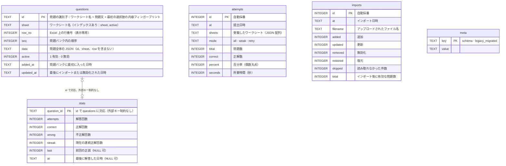

[English](database.md) | **日本語** | [简体中文](database.zh-CN.md)

# データベース

> データベースは SQLite で、**ファイルは `xexam.db` の 1 つだけ**です。新しい Rust バックエンドは旧 Python 版のデータベースをそのまま引き継いでおり、**schema は 1 文字も変更していません**。
> 根拠：[audit/database.md](audit/database.md)。突き合わせテスト：`backend/tests/db_golden.rs`（旧 Python 実装で作成した `tests/baseline/fixtures/sample.db` と、コミット済みのスナップショットを使用）。

## 1. ファイルの場所

| 実行方法 | 場所 |
|---|---|
| Docker（推奨） | 名前付きボリューム `xexam_data`。コンテナの `/data` にマウントされ、ファイルは `/data/xexam.db` です。コンテナを更新・削除しても失われません |
| Docker を使わない場合 | データディレクトリ（デフォルトは `./data`、または `XEXAM_DATA`）の下の `xexam.db` |

ボリュームの実際の名前は `<プロジェクト名>_<ボリューム名>` = `xexam_data` で、`docker volume ls` で確認できます。**`docker compose down -v` は実行しないでください**。`-v` を付けるとボリュームも一緒に削除されます。

## 2. 接続設定

| 設定 | 値 | 理由 |
|---|---|---|
| `journal_mode` | `DELETE` | WAL は使いません。WAL は共有メモリファイルを必要としますが、Docker Desktop が Windows のフォルダをコンテナにマウントする場合は信頼できないためです |
| `synchronous` | `FULL` | 利用者は 1 人で、速度は問題になりません。データの安全のほうが重要です |
| `foreign_keys` | `ON` | （schema には実際には外部キーがありません。旧版との一貫性のために設定しています） |
| `busy_timeout` | 5000 ms | 他の接続にロックされているとき、最大 5 秒待ちます |
| トランザクション | `BEGIN IMMEDIATE … COMMIT`、失敗時は `ROLLBACK`（`COMMIT` に失敗した場合もロールバック） | すべて成功するか、何も変わらないかのどちらかです |

バックエンドの接続は**1 つだけ**で、ミューテックスの内側に置かれています。データベース呼び出しは専用のスレッド（`spawn_blocking`）で実行されるため、Tokio の実行スレッドをブロックせず、ロックも `.await` をまたぎません。これは旧版の「1 つの接続 + RLock」とそのまま対応しています。

## 3. テーブル



テーブル作成文は `backend/src/database/schema.rs` に一字一句そのまま保存されており、旧版 `app/db.py` の `SCHEMA` と同じです。`CREATE TABLE IF NOT EXISTS` なので、既存のデータベースの**内容は変更されません**（開いて閉じてもファイルのバイト列は変わらないことをテスト済みです）。

## 4. 学習記録の運命を左右する細部

### 4.1 問題 id
`stats` と誤答ノートは、どちらも問題 id をキーにしています。id は次のとおりです。

```
sha1( ワークシート名 + "\n" + 空白除去(問題文)[:300] + "|" + 空白除去(最初の選択肢または最初の小項目)[:200] )  の先頭 12 桁の 16 進数
```

- 「空白除去」の「空白」は Python の `\s`（29 コードポイント。U+001C–U+001F と、U+3000 の全角スペースを含みます）で、**空白を除去してから切り詰め**ます。切り詰めは**コードポイント**単位です。Rust の `char::is_whitespace` は 25 個しかないため、バックエンド側でこの 29 コードポイントの判定を自前で実装しています。
- **Unicode 正規化は一切行いません**（NFKC も行いません）。オーナーの実際の問題バンクでは大半の問題に全角 ASCII が含まれており、正規化するとすべての id が変わってしまうためです。
- 同じワークブック内で重複する id には、順に `-2`、`-3`……が付きます。これは**行の並び順に依存します**。完全に同じ内容の 2 つの問題の行を入れ替えると、学習記録がもう一方の問題に移ります。これは旧版の挙動であり、そのまま維持し、ここに明記しています。
- 問題文の言い回しを変更した場合 = 新しい問題として扱われます（古い問題は無効化され、古い問題の記録は新しい問題に引き継がれません）。選択肢、答え、解説、翻訳だけを変更した場合は「更新」となり、記録には影響しません。
- 85 件のアサーション（`tests/baseline/golden/id_vectors.json`）によって、Rust と Python の id がバイト単位で同一であることが保証されています。

### 4.2 削除せずに無効化する
インポート時、データベースにはあるのにファイルに見つからない問題は `active = 0` になり、`stats` はそのまま保持されます。後でその問題を再びアップロードすると、自動的に有効に復元され、誤答ノートにも戻ります。

### 4.3 誤答ノート
`wrong > 0` かつ `streak < 2` の問題は誤答ノートに入ります。連続で 2 回正解すると外れます。

### 4.4 成績履歴
`attempts` には直近 60 回分だけを残します（提出のたびに、それより古いものを削除します）。

### 4.5 タイムスタンプ
ローカル時刻の文字列で、形式は `%Y-%m-%d %H:%M` です。**タイムゾーンの表記はなく**、分単位までです。コンテナ内では環境変数 `TZ`（デフォルトは `Asia/Tokyo`）で決まります。イメージにはタイムゾーンのデータベースが含まれています。含まれていないと `TZ` が黙って無効になり、時刻が UTC になってしまいます。

## 5. バックアップと復元

先にプログラムを停止してから操作すると、データベースがより安全です。

```bash
docker compose stop

# バックアップ：ボリュームを現在のフォルダ内の xexam-data.tgz にまとめる（中身はデータベース全体。.gitignore で無視されるので、コミットしないこと）
docker run --rm -v xexam_data:/data -v "$PWD:/backup" alpine tar czf /backup/xexam-data.tgz -C /data .

docker compose start
```

**バックアップの検証**（コピーに対して行い、原本では決して試さないでください）：

```bash
mkdir work && tar xzf xexam-data.tgz -C work
sqlite3 work/xexam.db "PRAGMA integrity_check"      # ok と出力されること
```

復元：

```bash
docker compose stop
docker run --rm -v xexam_data:/data -v "$PWD:/backup" alpine tar xzf /backup/xexam-data.tgz -C /data
docker compose start
```

## 6. 新旧の実装を行き来する

2 つの実装は**同じファイル、同じ schema**を使っているため、互いに読み書きできます。

- 旧 Python が書き込んだデータベースは、Rust がそのまま使えます。
- Rust が書き込んだデータベースは、旧 Python でも読み書きできます（`journal_mode` は引き続き `delete` で、`-wal` / `-shm` ファイルはなく、`user_version` は引き続き 0 で、新しいテーブルや列もありません）。

当初は合成データを使って、この往復を一通り実際に確かめました（旧 Python でデータベースを作成 → Rust で読み書き → 旧 Python で読み戻し。原本の sha256 は前後で変わらず、`PRAGMA integrity_check` も通りました）。旧 Python のコードを削除した後は、この保証を 2 つのテストが引き続き守っています。`sample.db`（旧実装が書き出したデータベース）を新しいバックエンドで開き、読み取り、閉じた後でも、ファイルは 1 バイトも変わりません。新しいバックエンドが作成した空のデータベースは、`sqlite_master` が旧実装の作成したものと一字一句同じです。実際にロールバックするには、旧イメージ（`ghcr.io/yumin-space/xexam:v0.2.2`）で同じボリュームをそのまま開くだけです。

## 7. 旧 `progress.json`

さらに古いバージョンでは、成績を `progress.json` に保存していました。旧 Python 版と同じく、**起動のたびに**データディレクトリにそのファイルがあるかを確認します。ファイルがあり、かつデータベースにまだ学習記録がなく、移行も行われていない場合に、それをデータベースへ移行します。データベース内の `legacy_migrated` マークによって移行は一度だけになり、すでに学習記録がある場合は上書きされません。
そのため、「まず一度起動してデータボリュームを作成する → `progress.json` をボリュームに置く → 再起動する」という手順が有効です。形式が正しくないファイルは無視され、ログに理由が書かれ、手動で `xexam-backend migrate-progress` を実行できることも案内されます。プログラムが起動できなくなることはありません。
（`tests/integration/migrate_check.py` が、合成データでこれらのケースを検証しています。）

> ⚠️ v0.1 からアップグレードする場合：データベースファイルの名前が変わり、新しいバージョンは `xexam.db` だけを読み込みます。データディレクトリに別の `.db` ファイルがあって `xexam.db` がない場合は、起動ログでお知らせします。そのファイルを `xexam.db` に名前変更してから起動してください（古いファイルは削除も読み取りもされません）。
