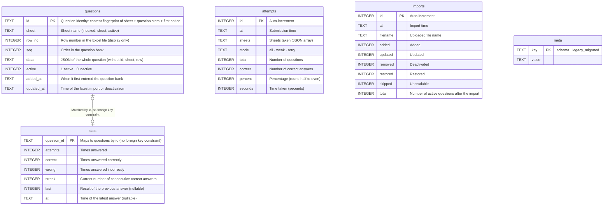

**English** | [日本語](database.ja.md) | [简体中文](database.zh-CN.md)

# Database

> The database is SQLite, **a single file, `xexam.db`**. The new Rust backend reuses the old Python version's database, and **not a single character of the schema was changed**.
> Evidence: [audit/database.md](audit/database.md); golden tests: `backend/tests/db_golden.rs` (run against `tests/baseline/fixtures/sample.db`, built by the old Python implementation, and the committed snapshots).

## 1. Where the file lives

| How you run it | Location |
|---|---|
| Docker (recommended) | Named volume `xexam_data`, mounted at `/data` in the container; the file is `/data/xexam.db`. Updating or deleting the container does not lose it |
| Without Docker | `xexam.db` in the data directory (default `./data`, or `XEXAM_DATA`) |

The volume's real name is `<project name>_<volume name>` = `xexam_data`, and `docker volume ls` shows it. **Do not run `docker compose down -v`**: `-v` deletes the volume along with the containers.

## 2. Connection settings

| Setting | Value | Why |
|---|---|---|
| `journal_mode` | `DELETE` | No WAL: WAL needs a shared-memory file, which is unreliable when Docker Desktop mounts a Windows folder into a container |
| `synchronous` | `FULL` | Single-user, so speed is not a concern and data safety matters more |
| `foreign_keys` | `ON` | (The schema actually has no foreign keys; kept the same as the old version) |
| `busy_timeout` | 5000 ms | When another connection holds a lock, wait up to 5 seconds |
| Transactions | `BEGIN IMMEDIATE … COMMIT`, `ROLLBACK` on failure (a failed `COMMIT` is also rolled back) | Either everything succeeds or nothing changes |

The backend has only **one connection**, kept behind a mutex. Database calls run on a dedicated thread (`spawn_blocking`), so they do not block Tokio's executor threads, and the lock is never held across an `.await`. This corresponds one to one with the old version's "one connection + RLock".

## 3. Tables



The table-creation statements are stored verbatim in `backend/src/database/schema.rs` and are identical to `SCHEMA` in the old version's `app/db.py`. They use `CREATE TABLE IF NOT EXISTS`, so an existing database is **left unchanged** (opening and closing it leaves the file bytes unchanged; this is tested).

## 4. Details that decide the fate of your study records

### 4.1 Question id
`stats` and the wrong-answer notebook are both keyed by question id. The id is:

```
sha1( sheet_name + "\n" + strip_whitespace(question_stem)[:300] + "|" + strip_whitespace(first_option_or_first_sub_item)[:200] )  first 12 hex digits
```

- "Strip whitespace" means Python's `\s` (29 code points, including U+001C–U+001F and the full-width space U+3000). **Whitespace is stripped first, then the text is truncated**, and truncation is by **code point**. Rust's `char::is_whitespace` covers only 25, so the backend implements its own check for these 29 code points.
- **No Unicode normalization at all** (no NFKC). Most questions in the project owner's real question bank contain full-width ASCII, and normalization would change every id.
- Duplicate ids within the same workbook get `-2`, `-3`, ... appended in turn, **depending on row order**: if you swap the rows of two identical questions, the study records move to the other question. This is the old version's behavior; it is kept and documented here.
- Changing the wording of the question stem = a new question (the old one is deactivated, and its records do not carry over to the new one); changing only the options, the answer, the explanation or the translation is an "update", and the records are not affected.
- 85 assertions (`tests/baseline/golden/id_vectors.json`) guarantee that the ids from Rust and Python are byte-for-byte identical.

### 4.2 Deactivate instead of delete
During an import, a question that is in the database but cannot be found in the file gets `active = 0`, and its `stats` are kept as they are. If you upload that question again later, it is restored to active automatically, and its wrong-answer notebook entry comes back with it.

### 4.3 Wrong-answer notebook
A question is in the wrong-answer notebook when `wrong > 0` and `streak < 2`; it is moved out after 2 consecutive correct answers.

### 4.4 Score history
`attempts` keeps only the latest 60 sessions (older ones are deleted after each submission).

### 4.5 Timestamps
Local-time strings in the format `%Y-%m-%d %H:%M`, **with no time zone marker**, accurate to the minute. Inside the container the time zone comes from the `TZ` environment variable (default `Asia/Tokyo`). The image ships a time zone database; without it, `TZ` would silently have no effect and times would become UTC.

## 5. Backup and restore

Stop the program before you start; it is safer for the database.

```bash
docker compose stop

# Back up: pack the volume into xexam-data.tgz in the current directory (it holds the whole database; it is ignored by .gitignore, do not commit it)
docker run --rm -v xexam_data:/data -v "$PWD:/backup" alpine tar czf /backup/xexam-data.tgz -C /data .

docker compose start
```

**Verify the backup** (on a copy; never experiment on the original):

```bash
mkdir work && tar xzf xexam-data.tgz -C work
sqlite3 work/xexam.db "PRAGMA integrity_check"      # must print ok
```

Restore:

```bash
docker compose stop
docker run --rm -v xexam_data:/data -v "$PWD:/backup" alpine tar xzf /backup/xexam-data.tgz -C /data
docker compose start
```

## 6. Switching back and forth between the old and new implementations

Both implementations use **the same file and the same schema**, so each can read and write the other's database:

- A database written by the old Python version can be used by Rust directly.
- A database written by Rust can still be read and written by the old Python version (`journal_mode` is still `delete`, there are no `-wal` / `-shm` files, `user_version` is still 0, and there are no new tables or columns).

This round trip was originally rehearsed with synthetic data (old Python creates the database → Rust reads and writes → old Python reads it back; the original's sha256 was unchanged before and after, and `PRAGMA integrity_check` passed). Since the old Python code was removed, two tests keep this guarantee in place: `sample.db` (a database written by the old implementation) is byte-for-byte unchanged after the new backend opens, reads and closes it; and for an empty database created by the new backend, `sqlite_master` is identical, character for character, to the one created by the old implementation. To actually roll back, open the same volume directly with the old image (`ghcr.io/yumin-space/xexam:v0.2.2`).

## 7. The old `progress.json`

Earlier versions kept scores in `progress.json`. As in the old Python version, **on every startup** the app checks whether the data directory contains it: if it does, and the database has no study records yet and has not been migrated before, it is migrated into the database. The `legacy_migrated` flag in the database guarantees it is migrated only once, and existing study records are never overwritten.
So "start once to create the data volume → put `progress.json` into the volume → restart" works. A file in the wrong format is ignored; the log states the reason and suggests running `xexam-backend migrate-progress` by hand, and the program still starts.
(`tests/integration/migrate_check.py` checks these cases with synthetic data.)

> ⚠️ When upgrading from v0.1: the database file name changed, and the new version only reads `xexam.db`. If the data directory has another `.db` file but no `xexam.db`, the startup log will warn you; rename that file to `xexam.db` and start again (the old file is neither deleted nor read).
