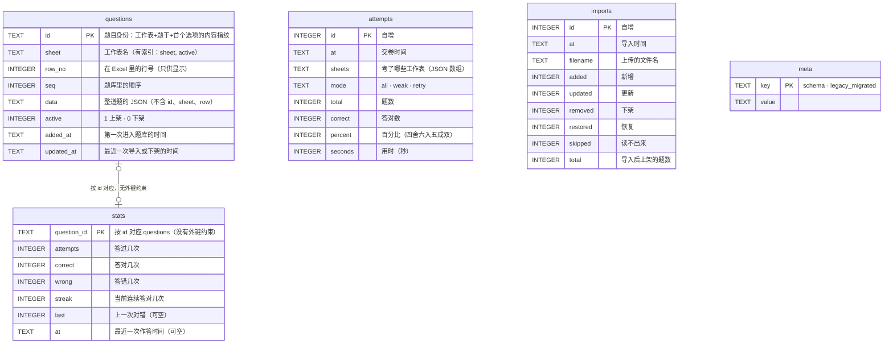

# 数据库

> 数据库是 SQLite，**只有一个文件 `xexam.db`**。新的 Rust 后端沿用旧 Python 版的库，**schema 一个字都没改**。
> 证据：[audit/database.md](audit/database.md)；跨实现的往返测试：`tests/integration/rollback_check.py` 与 `backend/tests/db_golden.rs`。

## 1. 文件在哪里

| 运行方式 | 位置 |
|---|---|
| Docker（推荐） | 命名卷 `xexam_data`，挂在容器的 `/data`，文件是 `/data/xexam.db`。更新或删除容器都不会丢 |
| 不用 Docker | 数据目录（默认 `./data`，或 `XEXAM_DATA`）下的 `xexam.db` |

卷的真实名字是 `<项目名>_<卷名>` = `xexam_data`，`docker volume ls` 能看到。**不要运行 `docker compose down -v`**，`-v` 会把卷一起删掉。

## 2. 连接设置

| 设置 | 值 | 为什么 |
|---|---|---|
| `journal_mode` | `DELETE` | 不用 WAL：WAL 要用共享内存文件，Docker Desktop 把 Windows 文件夹挂进容器时不可靠 |
| `synchronous` | `FULL` | 单人使用，速度不是问题，数据安全更重要 |
| `foreign_keys` | `ON` | （schema 里其实没有外键；保持与旧版一致） |
| `busy_timeout` | 5000 ms | 被别的连接锁住时最多等 5 秒 |
| 事务 | `BEGIN IMMEDIATE … COMMIT`，失败 `ROLLBACK`（`COMMIT` 失败也回滚） | 要么全成功，要么什么都不变 |

后端里只有**一个连接**，放在一把互斥锁后面；数据库调用在专门的线程里跑（`spawn_blocking`），不会阻塞 Tokio 的执行线程，锁也不跨 `.await`。这和旧版的「一个连接 + RLock」一一对应。

## 3. 表



建表语句逐字保存在 `backend/src/database/schema.rs`，和旧版 `app/db.py` 的 `SCHEMA` 相同；`CREATE TABLE IF NOT EXISTS`，所以对已有的库**不改动内容**（打开再关闭，文件字节不变，已测试）。

## 4. 这些细节决定了学习记录的命运

### 4.1 题目 id
`stats` 和错题本都以题目 id 为键。id 是：

```
sha1( 工作表名 + "\n" + 去空白(题干)[:300] + "|" + 去空白(首个选项或首个小项)[:200] )  的前 12 位十六进制
```

- 「去空白」是 Python 的 `\s`（29 个码点，包括 U+001C–U+001F、U+3000 全角空格），**先去空白再截断**，按**码点**截断。Rust 的 `char::is_whitespace` 只有 25 个，所以后端自己实现了这 29 个码点的判断。
- **没有任何 Unicode 规范化**（不做 NFKC）。业主的真实题库里大部分题含全角 ASCII，规范化会让所有 id 都变。
- 同一个工作簿里重复的 id 依次加 `-2`、`-3`……，**取决于行的先后**：调换两道完全相同的题的行，学习记录会换到另一题上。这是旧版的行为，保留，并写在这里。
- 改了题干的措辞 = 一道新题（旧题下架，旧题的记录不会带到新题上）；只改选项、答案、解析、翻译是「更新」，记录不受影响。
- 85 条断言（`tests/baseline/golden/id_vectors.json`）保证 Rust 与 Python 的 id 逐字节相同。

### 4.2 下架而不是删除
导入时，库里有而文件里找不到的题 `active = 0`，`stats` 原样保留。以后再把这道题传回来，会自动恢复上架，错题本也跟着回来。

### 4.3 错题本
一道题 `wrong > 0` 且 `streak < 2` 就在错题本里；连续答对 2 次后移出。

### 4.4 成绩历史
`attempts` 只留最近 60 场（每次交卷后删掉更早的）。

### 4.5 时间戳
本地时间字符串，格式 `%Y-%m-%d %H:%M`，**没有时区标记**，精确到分钟。容器里靠环境变量 `TZ`（默认 `Asia/Tokyo`）。镜像里带了时区库，否则 `TZ` 会静默失效、时间变成 UTC。

## 5. 备份与恢复

先停止程序再操作，数据库更安全。

```bash
docker compose stop

# 备份：把卷打包成当前目录下的 xexam-data.tgz（里面是整个数据库；已被 .gitignore 忽略，不要提交）
docker run --rm -v xexam_data:/data -v "$PWD:/backup" alpine tar czf /backup/xexam-data.tgz -C /data .

docker compose start
```

**验证备份**（在副本上，永远不要对原件做实验）：

```bash
mkdir work && tar xzf xexam-data.tgz -C work
sqlite3 work/xexam.db "PRAGMA integrity_check"      # 必须输出 ok
```

恢复：

```bash
docker compose stop
docker run --rm -v xexam_data:/data -v "$PWD:/backup" alpine tar xzf /backup/xexam-data.tgz -C /data
docker compose start
```

## 6. 在新旧实现之间来回切换

两个实现用的是**同一个文件、同一份 schema**，所以可以互相读写：

- 旧 Python 写过的库，Rust 直接用。
- Rust 写过的库，旧 Python 也能读写（`journal_mode` 仍是 `delete`，没有 `-wal` / `-shm` 文件，`user_version` 仍是 0，没有新表新列）。

`tests/integration/rollback_check.py` 用合成数据把这个往返演练了一遍（19 项，包括「原件的 sha256 在整个过程前后没有变化」）。回滚步骤见 [migration.md](migration.md)。

## 7. 旧的 `progress.json`

更早的版本把成绩放在 `progress.json` 里。**只有在数据目录里没有任何数据库文件时**，第一次启动才会把它迁移进数据库（只迁一次，不会覆盖已有的记录）。格式不对的文件会被忽略并给出说明，不会让程序起不来。

> ⚠️ 从 v0.1 升级时：数据库文件的名字变了，新版只读 `xexam.db`。如果数据目录里有别的 `.db` 文件而没有 `xexam.db`，启动日志会提醒你；把那个文件改名成 `xexam.db` 再启动即可（旧文件不会被删，也不会被读取）。
