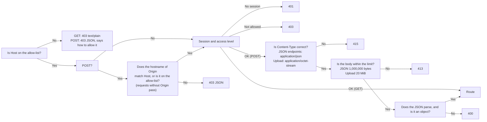

**English** | [日本語](../ja/api.md) | [简体中文](../zh-CN/api.md)

# API reference

> The machine-readable version is [openapi.yaml](openapi.yaml). This document is for humans: what each endpoint does, who may call it, how the guards block requests, and where the behavior differs from the old Python version.
> It describes the **actual behavior**: every case of the old version was captured as golden responses (`tests/baseline/golden/`, 172 of them), and the new Rust backend is compared against them one by one.

## 1. Overview

The browser talks to the backend only through this set of REST endpoints. The frontend has no database access and no logic for deciding whether an import is allowed or what a user may see: the backend decides both, from the signed-in user.

Every route has one access level (the route table `ROUTES` in `backend/src/api/auth.rs`):

| Access | Who may call it |
|---|---|
| **Public** | Anyone, without signing in |
| **Signed in** | Any signed-in user |
| **Bank manager** | Administrators, and plain users with the **Bank manager** permission *(v0.7)* |
| **Admin** | Administrators only |

| Method | Path | Access | Purpose | Writes to the database? |
|---|---|---|---|---|
| GET | `/api/info` | Public | Version, CPU architecture, whether the program can be shut down | No |
| GET | `/api/auth/state` | Public | Who is signed in, and the library stamp *(v0.6)* | No |
| POST | `/api/auth/login` | Public | Sign in *(v0.6)* | Yes (a new session) |
| POST | `/api/auth/logout` | Signed in | Sign out *(v0.6)* | Yes (the session is deleted) |
| POST | `/api/auth/password` | Signed in | Change your own password *(v0.6)* | Yes |
| GET | `/api/bank` | Signed in | The questions of every bank the user may see (active questions only) | No |
| GET | `/api/banks` | Signed in | The question banks the user may see, with their sheets and counts *(v0.5)* | No |
| GET | `/api/progress` | Signed in | The user's study records | No |
| GET | `/api/records` | Signed in | Every kept study record of the user, newest first *(v0.5)* | No |
| GET | `/api/record?id=<int>` | Signed in | One study record with its per-question detail *(v0.5)* | No |
| GET | `/api/settings` | Signed in | The user's interface settings *(v0.5)* | No |
| POST | `/api/attempt` | Signed in | Record the result of one exam or practice | Yes |
| POST | `/api/records/delete` | Signed in | Delete one of your study records, or all of them *(v0.5)* | Yes |
| POST | `/api/reset` | Signed in | Clear your study records | Yes |
| POST | `/api/settings` | Signed in | Change your interface settings *(v0.5)* | Yes |
| POST | `/api/settings/reset` | Signed in | Restore your default interface settings *(v0.5)* | Yes |
| GET | `/api/imports` | Bank manager | The last 12 import records (a bank manager: of their own banks) | No |
| POST | `/api/upload` | Bank manager | Upload an .xlsx file and get a **preview** and a one-time confirmation code; optional header `X-Bank-Target` *(v0.5)* | **No** (staged in memory only) |
| POST | `/api/import/confirm` | Bank manager | Confirm the import | **Yes** (one transaction) |
| POST | `/api/import/cancel` | Bank manager | Cancel your pending import | No |
| POST | `/api/banks/delete` | Bank manager | Delete a question bank (optionally with its study data) *(v0.5)* | Yes |
| GET | `/api/users` | Admin | Every account, with its permissions and sign-in lock *(v0.6)* | No |
| POST | `/api/users/create` | Admin | Add a user *(v0.6)* | Yes |
| POST | `/api/users/update` | Admin | Rename, change the role, disable or enable a user, set their banks and permission *(v0.6)* | Yes |
| POST | `/api/users/password` | Admin | Give another user a new initial password *(v0.6)* | Yes |
| POST | `/api/users/delete` | Admin | Delete a user and their study data *(v0.6)* | Yes |
| POST | `/api/users/unlock` | Admin | Clear a user's sign-in lock *(v0.6)* | No (memory only) |
| GET | `/api/logs` | Admin | The recent lines of the system log *(v0.7)* | No |
| POST | `/api/shutdown` | Admin | Shut down the program (available only when running on the local machine; always 403 in Docker) | No |

`HEAD` behaves like the corresponding `GET`, just without a body. Every endpoint goes through exactly the same guards (section 3).

## 2. What every response has in common

- `Cache-Control: no-store` and `X-Content-Type-Options: nosniff`, and no `Server` header.
- JSON is UTF-8, and Japanese and Chinese characters are not escaped as `\uXXXX`. The separators are `", "` and `": "` (a space after the colon), and the key order is fixed (the order shown in this document and in [openapi.yaml](openapi.yaml)). **This is part of the contract**: the golden tests (`backend/tests/api_golden.rs`) compare the JSON byte for byte with the responses of the old version.
- Errors look like `{"error": "<reason>"}`. The reason is a Chinese sentence that can be shown to the user as is (the frontend translates it into the interface language); section 4 lists every one of them with its English meaning. Only the low-level answers of the request layer keep the short English text of the old version: `bad content type` (415), `too large` (413), `bad json` (400), `not found` (404) and `method not allowed` (405). The 429 answer of a sign-in lock adds one key, `retryAfter`.
- The backend never puts exception names, file paths or SQLite error messages in a response; the details go to the log only.

## 3. Guards (every request goes through them first)

The order is fixed, so the same bad request always gets the same answer:



- **Host**: by default only `localhost`, `127.0.0.1` and `::1` are accepted. To access the app through another address or domain name, put it in the environment variable `XEXAM_ALLOWED_HOSTS` (separated by commas, spaces or semicolons). `XEXAM_ALLOW_ANY_HOST=1` turns off the Host check (use it only when authentication is already in front of the app, for example Cloudflare Access).
- **Origin** (checked only on write requests): only the **hostname** is compared (not the scheme or the port), so access through an HTTPS domain is not blocked by mistake. Requests without an `Origin` header pass (command-line tools are not cross-site requests from a browser). When a proxy rewrites Host to the origin server's address, put the public domain in `XEXAM_ALLOWED_ORIGINS`.
- The backend **reads only the real `Host` header** and never reads `X-Forwarded-*`. Nginx does not forward them either.
- Other methods (PUT, DELETE, OPTIONS, …) go through the Host check too (403 JSON), then get **405** with `Allow: GET, HEAD, POST`.
- The response to a rejected request states which Host or Origin you sent and which value to add to which option. **The log** *(v0.7)*: the first rejection after a quiet minute gets its own line (`rejected GET /api/bank: Host "…" is not in the allowed list`); the ones that follow are summed up at most once a minute (`rejected N request(s) by the Host / Origin check since the last report; the last one: …`), also when no further request comes. The log text is always English; the 403 body keeps its Chinese text. Anyone who can reach the server can cause these rejections without signing in, so one line each could push every other line out of the system log (`GET /api/logs`).

### Session and access level *(v0.6)*

The session check runs right after the Host (and, for a POST, the Origin) check, **before any of the request body is read**:

| Situation | Answer |
|---|---|
| A **Public** route | Passes. `GET /api/auth/state` reads the session if there is one; the others never look at it |
| No valid session (no `xexam_session` cookie, an unknown or expired one, or the account was disabled) | **401** `请先登录。` ("Please sign in first.") |
| The account must choose a new password | **403** `请先设置新密码。` ("Please choose a new password first.") on every route except the public ones (`GET /api/info`, `GET /api/auth/state`, `POST /api/auth/login`) and `POST /api/auth/password` and `POST /api/auth/logout` |
| An **Admin** route, called by a plain user | **403** `只有管理员可以进行这个操作。` ("Only an administrator can do this.") |
| A **Bank manager** route, called by a plain user without the permission *(v0.7)* | **403** `你没有管理题库的权限，请联系管理员。` ("You do not have permission to manage question banks. Ask an administrator.") |

- A path that is not in the route table needs a session too: without one it gets 401, with one 404 (GET: `text/plain` `not found`; POST: `{"error": "not found"}` after the Content-Type, size and JSON checks).
- The session is read from the `xexam_session` cookie only. The role and the **Bank manager** permission are read from the database with the session on every request, so a change by an administrator applies to the user's very next request.
- Sessions last 30 days and slide: a request refreshes the session at most once an hour and re-sends the cookie. The refresh happens only on requests whose scheme is known: with `XEXAM_COOKIE_SECURE=1`, or when the request carries an `Origin` header (every browser POST does). That way a refresh never drops `Secure` from a cookie issued over HTTPS.
- Records, the wrong-answer notebook, progress and settings always belong to the signed-in user: their id comes from the session, never from the request. Another user's record answers exactly like a record that does not exist.

### What each user sees and manages *(v0.7)*

- **Administrators** see and manage every question bank.
- A **plain user** sees exactly the banks an administrator chose for them (`banks` in `GET /api/users`, a list of ids, possibly empty). With `newBanks` (**Include banks imported later**) every bank created later is added to that list when it is created; existing banks are never added by it. A plain user with the **Bank manager** permission also sees the banks they imported themselves (only while they hold the permission: without it they see their own banks only when those are among the chosen ones).
- A **bank manager** imports new banks (they become the owner) and updates or deletes only the banks they own. Updating or deleting a bank of an administrator or of another user answers **403** `这个题库不是你上传的，只能更新或删除你自己上传的题库。` ("You did not upload this question bank. You can only update or delete question banks you uploaded yourself."); the check runs inside the write transaction, so nothing is written.

For a user who does not see every bank, every route follows the same rule:

| Route | What they get |
|---|---|
| `GET /api/bank` | Only the questions and sheets of their banks; `file` / `mtime` are those of the latest import into one of their banks |
| `GET /api/banks` | Only their banks; `studied` and `records` count their own study data |
| `GET /api/progress` | `questions` holds the statistics of questions of their banks only (the wrong-answer notebook and its review follow it); `history` is unchanged |
| `POST /api/attempt` | A question of a bank they cannot see is treated exactly like a deleted one: it is not counted and comes back in `notCounted` |
| `GET /api/records` | Every one of their records stays as history, with the bank names saved in it |
| `GET /api/record` | A question of a bank they cannot see has `"question": null`, like a deleted question (no question text) |
| `GET /api/auth/state` | `library` follows only their banks and their access |
| `GET /api/info` | The same for everyone: only the version, the architecture and `canShutdown` (the route is public and serves the container health check) |

## 4. Endpoint details

### `GET /api/info`
```json
{"version": "0.7.5", "arch": "x86_64", "canShutdown": false}
```
Public. The version number is `CODE_VERSION` from the `VERSION` file (or `XEXAM_VERSION`); `arch` is the CPU architecture of the server; `canShutdown` is `true` only when the program was started with `--allow-shutdown`. *(v0.7.5)* The key `bankCount` (the number of active questions in the whole library) is gone: the route is public, and signed-in pages count the questions they may see from `GET /api/bank` and `GET /api/banks`. The route still reads the database, so it answers 500 when the database cannot be read, and the container health check (which asks this route) reports the backend as unhealthy.

### `GET /api/auth/state` *(v0.6)*
Public. Signed out (no cookie, or a session that is not valid any more):

```json
{"user": null, "defaultAdmin": "admin"}
```

`defaultAdmin` is the username of an enabled administrator that still has the default password `admin` (the lowest id first), or `null`. The sign-in page uses it to tell the owner how to sign in the first time, with the account's real name (it may have been renamed). Changing or resetting that password, or disabling, demoting or deleting the account ends it.

Signed in (also while the account must choose a new password):

```json
{"user": {"id": 1, "username": "admin", "role": "admin", "mustChangePassword": false, "canManageBanks": true}, "library": "3f0c9a7d5e21b4c88a9d0e6f17b2c453"}
```

- `role` is `admin` or `user`. `canManageBanks` *(v0.7)* is `true` for every administrator, and for a plain user with the **Bank manager** permission.
- `library` is an opaque stamp of the question banks the user may see: 32 hexadecimal digits, a digest that publishes none of the numbers it is made of. It changes whenever one of those banks is imported, replaced or deleted (also by the `import` command, from another process), and *(v0.7)* whenever the banks the user may see or manage change (an administrator assigned banks or changed the permission, a bank changed owner). Open pages compare it and re-read the banks when it changes. For a user limited to some banks, the stamp is made only of those banks: it neither reveals nor follows the size, the question count or the update times of the banks they cannot see.

### `POST /api/auth/login` *(v0.6)*
Public. Body: `{"username": "…", "password": "…"}` (both strings, otherwise **400** `请求的格式不对。`). The username is trimmed and compared ignoring case.

- **200** `{"user": {…}}` (the same object as in `GET /api/auth/state`) with two cookies:
  - `xexam_session=<43 characters>; HttpOnly; SameSite=Strict; Path=/; Max-Age=2592000` (30 days). Every sign-in gets a new random token; the database stores only its SHA-256. A user has at most 20 sessions; a new sign-in beyond that ends the sessions that would expire first.
  - `xexam_device=<43 characters>; HttpOnly; SameSite=Strict; Path=/api/auth; Max-Age=34560000` (400 days): marks a browser where this account signed in before. It is a keyed hash of the account's current password hash, so a new password retires it; nothing is stored for it.
  - Both get `Secure` only when the request's `Origin` is `https://…` or `XEXAM_COOKIE_SECURE=1`, so sign-in works over plain HTTP on a LAN.
- **401** `用户名或密码不对。` ("The username or password is not correct.") for a wrong password, an unknown username and a disabled account alike, after the same amount of work, so the answer never says whether a username exists.
- **429** `{"error": "登录失败次数太多，请稍后再试。", "retryAfter": <seconds>}` ("Too many failed attempts. Please try again later.") with a `Retry-After` header, while the sign-in is locked. During a lock every attempt gets 429, even with the right password, and 429 answers do not count as failures.

The lock escalates in rounds: 5 failures within 15 minutes lock the sign-in for 1 minute; after that every round allows 3 failures and locks for 5 minutes, 15 minutes, 30 minutes, 1 hour, then 1 day. The state belongs to the account (its user id, so a rename keeps it); a name without an account gets the same rounds. Attempts from a browser that carries the account's `xexam_device` cookie are counted apart from all other browsers, so somebody guessing a username cannot lock its owner out of the browsers they used before. A successful sign-in, an administrator's password reset or **Unlock**, a restart of the backend, or 24 quiet hours start the account over. Details and the reasons: [security.md](security.md).

### `POST /api/auth/logout` *(v0.6)*
Signed in (also while a new password is required). Body `{}` or empty. Deletes this session and answers `{"ok": true}` with an expired cookie (`xexam_session=; HttpOnly; SameSite=Strict; Path=/; Max-Age=0`).

### `POST /api/auth/password` *(v0.6)*
Signed in (also while a new password is required). Body: `{"current": "…", "password": "…"}`. `current` is required unless the account must choose a new password (then the session proves who it is).

- **200** `{"user": {…}}` with `mustChangePassword: false`. Every session of the account ends, this one included: this browser gets a **new** `xexam_session` cookie (and the `xexam_device` cookie of the new password), so the account's other browsers are signed out and a copied cookie stops working.
- **400** `请求的格式不对。` when `password` (or a required `current`) is missing or not a string; `密码需要 8–128 个字符。` ("The password needs 8 to 128 characters."); `新密码不能和原来的一样。` ("The new password must be different from the old one.").
- **403** `当前密码不对。` ("The current password is not correct."). Wrong current passwords are counted in the same sign-in buckets as failed sign-ins, so the lock (**429**, as above) applies here too.
- **401** `请先登录。` when the account was disabled or deleted, or its password was changed or reset elsewhere while the request ran (nothing is written).

### `GET /api/users` *(v0.6)*
Admin. Every account, ordered by id:

```json
{"users": [{"id": 2, "username": "cook", "role": "user", "disabled": false, "createdAt": "2026-11-10 14:00", "lastLoginAt": "2026-11-10 15:02", "mustChangePassword": false, "records": 12, "banks": [1, 3], "newBanks": true, "canManageBanks": true, "ownedBanks": [3], "lock": null}]}
```

- `createdAt` / `lastLoginAt` are local times `YYYY-MM-DD HH:MM`; `lastLoginAt` is `null` before the first sign-in.
- `records` is the number of the user's study records (exams and practice).
- `banks` *(v0.7)*: the ids of the banks the user sees, ascending (only banks that still exist; `[]` = none). It is always a list: `"all"` is only a shorthand for writing (below).
- `newBanks` *(v0.7)*: **Include banks imported later**. `true`: every bank created from now on (an import as a new bank by anyone, or the command-line `import`) is added to `banks` in the same transaction. It never adds an existing bank.
- `canManageBanks` *(v0.7)* is the stored **Bank manager** permission. `banks`, `newBanks` and `canManageBanks` are kept across role changes but matter only while the account is a plain user: administrators see and manage every bank.
- `ownedBanks` *(v0.7)*: the ids of the banks the user imported as new banks (they own them), ascending.
- `lock`: the in-memory sign-in state of the account. `null` while it is in the first round and not locked; otherwise:

```json
{"until": "2026-11-10 15:20:07", "retryAfter": 298, "round": 2, "triesLeft": 0, "knownBrowser": false, "otherUntil": null, "otherRetryAfter": 0}
```

| Key | Meaning |
|---|---|
| `until` | Local time `YYYY-MM-DD HH:MM:SS` when the running lock ends; `null` when not locked |
| `retryAfter` | Seconds until then; `0` when not locked |
| `round` | While locked: the round that ended in this lock (1 = the first, one-minute lock). Otherwise: the round in progress (2 or more) |
| `triesLeft` | Failures left in the round in progress before the next lock (`0` while locked) |
| `knownBrowser` | `true`: the state shown counts sign-ins from browsers where the user signed in before; `false`: from every other browser. When both are tracked, the one that holds the user back more is shown |
| `otherUntil` / `otherRetryAfter` | Set only when the other browsers are locked at the same time, so the account is locked in every browser: the end of that second lock and its seconds (`null` / `0` otherwise) |

### `POST /api/users/create` *(v0.6)*
Admin. Body: `{"username": "…", "password": "…", "role": "admin" | "user", "banks": "all" | [<bank id>, …], "newBanks": <bool>, "canManageBanks": <bool>}`. *(v0.7)* `banks` defaults to `[]` (the new user sees no bank until an administrator chooses some), `newBanks` to `false` and `canManageBanks` to `false`. `"banks": "all"` is a shorthand: every bank that exists now and, unless `newBanks` is given, `newBanks: true`. Duplicate ids are ignored. The new account is enabled and must choose a new password at its first sign-in. Answer: `{"users": [...]}` as in `GET /api/users`.

Usernames have 1–40 characters (ASCII letters, digits and `. _ - @`, surrounding spaces removed) and are unique ignoring case; passwords have 8–128 characters.

| Answer | When |
|---|---|
| **400** `用户名不对：1–40 个字符，只能用字母、数字和 . _ - @。` ("The username is not valid …") | `username` missing, not a string, or breaking the rule |
| **400** `密码需要 8–128 个字符。` | `password` too short or too long |
| **400** `请求的格式不对。` | `password` missing or not a string; `role` missing or not `admin` / `user`; `banks` neither `"all"` nor a list of integers; `newBanks` or `canManageBanks` not a boolean |
| **400** `选择的题库中有不存在的（可能已被删除），请刷新页面后再试。` ("One of the chosen question banks does not exist …") *(v0.7)* | An id in `banks` is not an existing bank (or not a positive integer); nothing is created |
| **409** `这个用户名已经有人用了。` ("This username is already taken.") | Another account has that name (ignoring case) |

### `POST /api/users/update` *(v0.6)*
Admin. Body: `{"id": <int>, "username"?, "role"?, "disabled"?, "banks"?, "newBanks"?, "canManageBanks"?}`; a key that is left out stays unchanged. Answer: `{"users": [...]}`.

- Disabling an account or changing its role ends its sessions. A rename, a change of `banks`, `newBanks` or `canManageBanks` keeps them; the change applies at the user's next request.
- `banks` replaces the chosen banks (a list of ids, `[]` = no bank; or `"all"`, every bank that exists now, which also sets `newBanks: true` unless `newBanks` is given). `newBanks` alone changes only the flag: unticking it keeps the banks the user has.
- **400**: as for create (`username`, `role`, `banks`, `newBanks`, `canManageBanks`; `disabled` not a boolean → `请求的格式不对。`; `id` missing or not an integer (a boolean is not) → `请求的格式不对。`).
- **404** `这个用户不存在（可能已被删除），请刷新页面后再试。` ("This user does not exist …").
- **409** `不能对自己的账户做这个操作。` ("You cannot do this to your own account.") when you disable yourself or change your own role; `至少要保留一个启用的管理员。` ("At least one enabled administrator must remain.") when the change would leave no enabled administrator; `这个用户名已经有人用了。`.

Every check runs in the same transaction as the write, so two requests can never both pass it.

### `POST /api/users/password` *(v0.6)*
Admin. Body: `{"id": <int>, "password": "…"}`. Gives another user a new initial password: they must choose a new one at their next sign-in, their sessions end, their `xexam_device` cookies stop matching, and their sign-in lock is cleared. Your own password goes through `POST /api/auth/password` (here: **409** `不能对自己的账户做这个操作。`). Other errors: 400 (password rule, malformed body), 404 (unknown user).

### `POST /api/users/delete` *(v0.6)*
Admin. Body: `{"id": <int>}`. Deletes the account with its sessions, study records (with their detail), wrong-answer statistics, settings and chosen banks. *(v0.7)* The question banks the user owned are not deleted: they now belong to the administrator who deleted the user. **409** for yourself and for the last enabled administrator; **404** for an unknown id.

### `POST /api/users/unlock` *(v0.6)*
Admin. Body: `{"id": <int>}`. Clears the account's sign-in state completely, for every browser (back to round 1, 5 tries), whether a lock is running or the account is only past round 1. It works by user id, so it works after a rename, and also for your own account. **404** for an unknown id. Answer: `{"users": [...]}`.

### `GET /api/bank`
Signed in. `file` / `mtime` are the file name and time of the most recent import (of a bank the user may see); `questions` contains only active questions, of every bank the user may see, grouped by bank id (ascending) and in each bank's order; in `sheets`, each sheet name has a count of usable questions and a count of deactivated ones (sheets with the same name in different banks are counted together; `GET /api/banks` has the per-bank numbers). For the fields of a question, see `Question` in [openapi.yaml](openapi.yaml).
Since v0.5 every question ends with one more key, `"bank": <bank id>` (after `row`).

The key order of a question is `kind, tag, stem, options, items, answer, translation, zh, [english, en,] [lang, ja,] explanation, mnemonic, note, [explain,] id, sheet, row, bank`. The keys in brackets appear only for the layouts that have them, so the output for older files is byte-for-byte the same as before. Since v0.7 only the six-column layout can be imported and the questions of the older layouts are retired at every start, so `GET /api/bank` normally holds six-column questions only; the older forms still appear in `GET /api/record`, for the retired questions of earlier records:

- **Three-column layout** (A question, B Chinese, C answer): none of them.
- **Four-column layout** (A English, B Chinese, C Japanese, D answer): `english` (the original text of column A) and `en` (the English split up following the Japanese structure). `stem`, `options`, `items` and `answer` come from the Japanese in column C.
- **Six-column layout** *(v0.7)* (A English, B Chinese, C Japanese question; D English, E Chinese, F Japanese answer and explanation): English is authoritative, so `stem`, `options`, `items` and `answer` are the English ones and `"lang": "en"` says so; `zh` (column B) and `ja` (column C) are the other two languages split up along the English structure (`null` / missing when they do not line up); `explain` holds the explanation, memory aid and answer note of each language: `{"en": {"explanation", "mnemonic", "note"}, "zh": {…}, "ja": {…}}`, a language without any of the three left out. `explanation` / `mnemonic` / `note` stay for older clients (the Chinese text when there is one, else the Japanese, else the English). A hotspot question's `tag` is `HOTSPOT` (`ホットスポット` in the older layouts).

A hotspot question in `zh` / `en` / `ja` has one more key, `choices`: the options for each sub-item, written in that language.

### `GET /api/banks` *(v0.5)*
Signed in. A question bank is one imported workbook. The banks the user may see, ordered by `id`:

```json
{"banks": [{"id": 1, "name": "Kitchen basics", "filename": "Kitchen basics.xlsx", "legacy": true, "createdAt": "2026-11-10 14:00", "updatedAt": "2026-11-10 15:00", "total": 5, "inactive": 0, "sheets": [{"name": "Cooking", "usable": 3, "inactive": 0}, {"name": "Safety", "usable": 2, "inactive": 0}], "studied": 4, "records": 3, "ownerId": 1, "owner": "admin", "manageable": true}]}
```

- `name` is the file name without `.xlsx` when the bank was created (` (2)`, ` (3)`, … are appended when another bank already has that name); updating the bank changes `filename` and `updatedAt`, never `name`.
- `legacy`: the bank that holds the data from before v0.5, and the target of uploads without `X-Bank-Target`. Its question ids are the plain question ids of section 4.1 of [database.md](database.md); every other bank uses bank-scoped ids, so the same workbook can be imported as two independent banks.
- `total` = active questions, `inactive` = deactivated ones; `sheets` follows the bank's question order and also lists sheets whose questions are all deactivated (`usable` 0).
- `studied` = how many of the bank's questions (active or not) have statistics; `records` = how many study records name this bank. For an administrator they count every user's data (what a deletion with study data removes); for everyone else *(v0.7)* only their own.
- `ownerId` / `owner` *(v0.7)*: the id and username of the user who imported the bank as a new bank (banks from before v0.7 belong to the first administrator). Only administrators get both; any other user gets `ownerId` only for their own banks (`null` otherwise) and `owner` always `null`, so the bank list never names other accounts.
- `manageable` *(v0.7)*: whether this user may update and delete the bank (administrators: always; bank managers: their own banks; others: never).

### `GET /api/progress`
Signed in. `questions` holds the user's cumulative statistics for each question (how many times it was answered, how many correct, how many wrong, and the current streak of correct answers), limited to the banks they may see; `history` holds their last 60 study records (the database keeps 500, see `GET /api/records`), each ending with `kind` *(v0.7)*; `masterStreak` is how many consecutive correct answers move a question out of the wrong-answer notebook (2).

```json
{"version": 1, "questions": {"1a2b3c4d5e6f": {"attempts": 3, "correct": 2, "wrong": 1, "streak": 2, "last": true, "at": "2026-11-10 15:10"}}, "history": [{"at": "2026-11-10 15:10", "sheets": ["Cooking"], "mode": "all", "total": 5, "correct": 4, "percent": 80, "seconds": 130, "kind": "exam"}], "masterStreak": 2}
```

### `GET /api/imports`
Bank manager. `{"imports": [{"id", "at", "filename", "added", "updated", "removed", "restored", "skipped", "total"}, …]}`, the newest 12 first. An administrator gets every import; a bank manager *(v0.7)* only the imports into the banks they own.

### `POST /api/upload`
Bank manager. The request body is the raw bytes of the .xlsx file; the optional header `X-Filename` carries the percent-encoded file name. The server:

1. Decides whether it is an .xlsx by **content** alone (magic number + ZIP structure + a workbook is present + no DOCTYPE / entity declarations + the uncompressed size has an upper limit). An empty file, an old `.xls`, a corrupted file and a file with a changed extension each get their own explanation in Chinese.
2. Parses it. *(v0.7)* When the parser reads any question of the old three- or four-column layout, the upload is refused with **400** `只能导入六列格式（A–C 列：英文、中文、日文题目；D–F 列：英文、中文、日文答案）。这个文件是旧的三列或四列格式，请改成六列格式后再导入。` ("Only the six-column layout can be imported (columns A–C: the question in English, Chinese and Japanese; columns D–F: the answer in English, Chinese and Japanese). This file uses the old three- or four-column layout. Rewrite it in the six-column layout and import it again."), for a new bank and for an update alike; nothing is staged and the pending slot is untouched. The log gets an English line with the file name.
3. Builds the preview and puts the parse result into **the uploader's own pending slot** in memory (uploading again replaces it; other users' slots are never touched), valid for 30 minutes.
4. **Does not write to the database.**

It returns the preview (`added / updated / unchanged / restored / removed / skipped / usable`, the details for each sheet, and the rows that could not be read, with the reasons) and a one-time confirmation code, `token`:

```json
{"sheets": [{"name": "Cooking", "total": 3, "usable": 3, "skipped": [], "added": 3, "updated": 0, "removed": 0, "restored": 0, "skippedMore": 0, "skippedCount": 0}], "added": 3, "updated": 0, "unchanged": 0, "restored": 0, "removed": 0, "skipped": 0, "usable": 3, "removed_samples": [], "removed_stats": 0, "filename": "Kitchen basics.xlsx", "token": "…"}
```

Each sheet lists at most 30 unreadable rows (`skipped`, each `{"row", "reason"}`); `skippedMore` says how many more there are and `skippedCount` how many in all.

**Warnings** *(v0.7)*: a row whose Chinese (E) or Japanese (F) answer differs from the English answer (D) is still imported, with the English answer, and is listed as a warning. Only then do the keys appear, so a preview without warnings has exactly the keys of earlier versions: a sheet with warnings gets `warnings` (at most 30 `{"row", "reason"}`, right after `restored`) and, at its end, `warningsMore` and `warningsCount`; the preview gets a total `warnings` count after `removed_stats`. The reasons are `E 列的中文答案和 D 列的英文答案不一致（已按英文答案导入）` ("The Chinese answer in column E differs from the English answer in column D (imported with the English answer)") and the same for the Japanese answer in column F.

**Target bank** *(v0.5)*: the optional header `X-Bank-Target` says which bank the file goes to. The preview has the same keys in every case; it is computed against the target bank only.

| `X-Bank-Target` | Meaning |
|---|---|
| absent | Exactly the v0.4 behavior, against the legacy bank (created at confirm if it does not exist yet) |
| `new` (surrounding spaces ignored, any case) | A new bank is created at confirm, owned by the uploader; the preview shows every usable question as `added` |
| a bank id, `^[0-9]{1,18}$` (surrounding spaces ignored) | Update (replace) that bank; an unknown id → **404** `这个题库不存在（可能已被删除），请刷新页面后再试。` |
| anything else | **400** `上传目标不对，请刷新页面后再试。` ("The upload target is not valid …") |

The header is read after the guards and the size limit, and before the file is parsed. A bank manager may update only a bank they own *(v0.7)*: an existing bank of somebody else (also the legacy bank, for an upload without the header) → **403** `这个题库不是你上传的，只能更新或删除你自己上传的题库。`, before the file is parsed. A rejected upload does not touch the pending slot.

**Memory budget** *(v0.7)*: every administrator and bank manager has a slot, and one parsed workbook near the parser's limits holds more than 100 MB, so all staged previews together share a budget of 128 MiB (estimated from their content). Staging a new upload first drops expired previews, then the oldest previews of other users while the total is above the budget. The newest upload is always kept. A user whose preview was dropped gets **409** at confirm, exactly as after the 30 minutes.

Other answers: **413** `文件太大了（最大 20 MB）。…` ("The file is too large (20 MB at most) …"); **400** with the reason the file was rejected (not an .xlsx, damaged, too large once decompressed, parsing took too long, an old layout, …).

### `POST /api/import/confirm`
Bank manager. The request body is `{"token": "…"}`.

- The confirmation code is a 128-bit random number (22 characters) and **can be used only once**. It confirms only the caller's own pending upload: a wrong code, another user's code or a non-ASCII code is treated as "invalid" and does not consume the pending content; an expired (or dropped) preview cannot be retrieved. All of them → **409** `这次上传的预览已经过期或已被处理，请重新上传。` ("The preview of this upload has expired or has already been handled. Please upload the file again.").
- The import completes in **one transaction**: either everything succeeds, or the question bank is left unchanged (**500** `写入数据库失败，题库没有任何改动。`, "Writing to the database failed. The question bank was not changed.").
- If this file contains no usable question at all → **400** `这份文件里没有读到任何可用的题，没有导入。` ("No usable questions were found in this file, so nothing was imported.").
- *(v0.7)* A staged workbook with a question of the old three- or four-column layout is refused here too (**400**, the same message as at the upload), before anything is written.

Import rules (the file is treated as the **complete content of its target bank**): questions that appear for the first time are added; questions that were changed are updated; questions of that bank that cannot be found in the file are **deactivated** (their study records are kept); a deactivated question that appears again is restored automatically. Other banks are never touched.

Response: `{"result": <same shape as the preview, without filename / token>, "bank": <GET /api/bank, as the user sees it>}`. Only when the upload carried `X-Bank-Target`, a third key follows: `"bankId": <id of the created / updated bank>` (so the v0.4 response stays byte-for-byte the same). If the target bank was deleted after the preview → **404** `这个题库不存在（可能已被删除），请刷新页面后再试。`; if it now belongs to somebody else (a deleted user's banks moved to an administrator) → **403** `这个题库不是你上传的，只能更新或删除你自己上传的题库。`. In both cases nothing is written and the confirmation code is used up.

### `POST /api/import/cancel`
Bank manager. Discards the caller's own pending upload (other users' uploads stay). No confirmation code is needed. Answer: `{"ok": true}`.

### `POST /api/banks/delete` *(v0.5)*
Bank manager. Request body: `{"id": <int>, "withRecords": <bool, default false>}`. In one transaction it deletes the bank's questions (active and deactivated), its import history, the users' access to it and the bank itself. With `withRecords: true` it also deletes the bank's study data: the statistics (wrong-answer notebook) of those questions, their per-question detail, and every study record that drew from this bank and from no bank that still exists (usually: only from this bank; a record that also used a bank deleted earlier goes too, instead of staying behind as an empty record). Without it, study records and statistics stay; their detail shows the questions as deleted.

- An administrator deletes any bank, and `withRecords` removes the study data of **every** user.
- A bank manager *(v0.7)* deletes only the banks they own (**403** `这个题库不是你上传的，只能更新或删除你自己上传的题库。` otherwise, nothing written), and `withRecords` removes only **their own** study data; other users' records stay, and their questions show as deleted.

Every pending upload that targets this bank (an upload for that id, or an upload without `X-Bank-Target` when this is the legacy bank), of any user, is discarded.

Response: `{"banks": [...], "bank": <GET /api/bank>, "progress": <GET /api/progress>}`, all three as the caller sees them. `id` missing or not an integer (a boolean is not an integer), or `withRecords` present but not a boolean → **400** `请求的格式不对。`; unknown id → **404** `这个题库不存在（可能已被删除），请刷新页面后再试。`.

### `POST /api/attempt`
Signed in. The request body is `{"results": [{"id": "…", "correct": true, "answer": ["B"]}], "sheets": ["…"], "mode": "all", "seconds": 123, "kind": "exam"}`.

Sanitizing rules: `results` must be a list (otherwise **400** `成绩的格式不对`, "The exam result is not in the expected format.") and only its first 2000 items are read; each item needs a string `id` (cut to 64 characters) and a boolean `correct`, other items are dropped; when none is left → **400** `没有成绩可保存` ("There is no result to save."). `sheets` keeps at most 50 strings (each cut to 80 characters); if `mode` is not `all / weak / retry` it is treated as `all`; `seconds` is clamped to the range 0 to 604800, and an abnormal value is treated as 0. **The server trusts `correct`**; grading happens in the browser (see [security.md](security.md)).

*(v0.7)* `kind` is `"exam"` (the default, also when it is missing or `null`) or `"practice"`; any other value → **400** `成绩的格式不对`. Both kinds update the statistics (the wrong-answer notebook) the same way and count toward the same 500 kept records; they differ only in how the pages show them.

*(v0.5)* Each result may carry an optional `answer`, stored only so the record can be reviewed later: a JSON array of at most 64 elements, each a string of at most 8 characters, an integer 0–999, or `null` (`["C"]`, `["A", "D"]`, `[0, 1, null]`). Anything else is stored as "no answer"; the result itself is still accepted. The server stores one detail row per counted result, plus a snapshot of the banks the questions came from, and keeps the user's newest **500** records (older ones are deleted together with their detail).

**Only questions that exist are counted** *(v0.7)*. A result whose question is gone (its bank was deleted during the exam, or the id is made up), or belongs to a bank the user may not see, is left out of the statistics, the detail, `total` / `correct` / `percent` and the bank snapshot. Deactivated questions (left out of a later import) still exist and are counted. Then:

- Some results were left out: the record is saved with the rest, its `sheets` lists only the sheets (in the order sent) that a counted question belongs to, and the answer ends with `"notCounted": [<the ids left out>]`.
- None is left: nothing is saved, **409** `这场考试的题目已经被删除，成绩没有保存。` ("The questions of this exam have been deleted, so the result was not saved.").

The answer is the user's `GET /api/progress` (plus `notCounted` when some results were left out; `GET /api/progress` itself never has it).

`percent` uses **round-half-to-even** (Python's `round`): 1 correct out of 8 is 12, not 13.

### `GET /api/records` *(v0.5)*
Signed in. `{"records": [RecordSummary, …], "retention": 500}`, the user's records, newest first, where a RecordSummary is

```json
{"id": 7, "at": "2026-11-10 15:10", "banks": [{"id": 1, "name": "Kitchen basics", "deleted": false}], "sheets": ["Cooking"], "mode": "all", "total": 5, "correct": 4, "percent": 80, "seconds": 130, "answered": 5, "detail": true, "kind": "exam"}
```

`banks` is the snapshot taken when the record was saved, with the bank's current name while it exists (`deleted: true` once it is gone). `detail` says whether per-question detail exists (exams saved before v0.5 have none); `answered` is the number of detail rows with an answer, or `null` without detail. `kind` *(v0.7)* is `exam` or `practice` (records from before v0.7 are exams).

### `GET /api/record?id=<int>` *(v0.5)*
Signed in. `{"record": RecordSummary, "items": [{"seq": 0, "questionId": "…", "answer": ["C"], "correct": true, "question": {…}}]}`. `answer` is the stored array or `null`; `question` is the question exactly as in `GET /api/bank` plus a trailing `"active": <bool>` (deactivated questions are included), or `null` when the question no longer exists or *(v0.7)* belongs to a bank the user may not see (its text is not sent).
`id` must be exactly one query parameter of 1–18 ASCII digits (percent-encoding is decoded) → otherwise **400** `请求的格式不对。`; unknown id, or another user's record → **404** `这条考试记录不存在（可能已被删除），请刷新页面后再试。` ("This exam record does not exist …").

### `POST /api/records/delete` *(v0.5)*
Signed in. Request body: either `{"id": <int>}` (delete that record and its detail; the per-question statistics, i.e. the wrong-answer notebook, are **not** changed) or `{"all": true, "withStats": <bool, default false>}` (delete every record of the user and its detail; `withStats: true` also empties their statistics, which equals `POST /api/reset`). Only the caller's own records are ever deleted.
Response: `{"records": [...], "retention": 500, "progress": <GET /api/progress>}`. Any other body (no `id` and no `all`, both, `all` not `true`, `withStats` with `id`, wrong types) → **400** `请求的格式不对。`; unknown id → **404** `这条考试记录不存在（可能已被删除），请刷新页面后再试。`.

### `POST /api/reset`
Signed in. Clears the caller's study records (with their per-question detail) and their per-question statistics; the question banks and other users are untouched. Answer: their (now empty) `GET /api/progress`.

### `GET /api/settings` / `POST /api/settings` / `POST /api/settings/reset` *(v0.5)*
Signed in. Settings are stored in the database per user (they survive container restarts and updates, clearing the browser cache and switching browsers):

```json
{"theme": "system", "uiLang": "en", "autoAdvance": false, "questionLang": "ja"}
```

| Key | Values | Default |
|---|---|---|
| `theme` | `system` · `light` · `dark` | `system` |
| `uiLang` | `en` · `zh` · `ja` | `en` |
| `autoAdvance` | `true` · `false` | `false` |
| `questionLang` | `ja` · `zh` · `en` | `ja` |

`GET` returns the defaults merged with the stored values (a stored value that is not valid is ignored). `POST /api/settings` takes any subset of these keys and returns the full settings; unknown keys are ignored; a known key with an invalid value → **400** `设置的值不对。` ("A setting has an invalid value.") and nothing is written. `POST /api/settings/reset` (body `{}` or empty) restores `theme`, `uiLang` and `autoAdvance` to their defaults, keeps `questionLang`, and returns the full settings.

### `GET /api/logs` *(v0.7)*
Admin. The system log the **System log** page shows: the most recent 2000 lines the backend logged since it started, kept in memory only (empty again after a restart; nothing is written to the database). They are the lines `docker compose logs backend` shows (behind the same `XEXAM_LOG` filter), plus the startup and shutdown status lines. Log lines name users by their username (`user "admin" updated user "alex"`), never by id and never a typed name that has no account, and they never contain a password, a token, a cookie value or question text.

Query parameters, both optional:

- `after=<seq>`: return only the lines after this sequence number (1–19 ASCII digits).
- `boot=<id>`: the `boot` of the answer the client last read (1–64 characters of `A-Z a-z 0-9 _ -`).

```json
{"lines": [{"seq": 41, "time": "2026-11-10 15:10:02", "level": "info", "target": "xexam_backend::api::auth", "message": "user \"admin\" signed in"}], "last": 41, "dropped": false, "boot": "Xq3v9T0bLm2k"}
```

- `lines`: oldest first. `seq` grows by one per line, starting at 1 in each backend process; `time` is local time with seconds; `level` is `error`, `warn`, `info`, `debug` or `trace`; `target` is the module that logged it; `message` is the text followed by its fields (cut after 4000 characters).
- `last`: the sequence number of the newest line (0 before anything was logged), the `after` of the next poll.
- `dropped`: `true` when lines newer than `after` (without `after`: line 1 onward) were already pushed out of the buffer before they could be returned.
- `boot`: a random id of this backend process, the `boot` of the next poll.
- Without `after`, every kept line is returned. The sequence numbers start again at 1 after a restart, so an `after` larger than `last`, or a `boot` that is not this process's id, is answered like no `after`: every kept line.
- `after` or `boot` malformed, empty or given twice → **400** `请求的格式不对。`. Other parameters are ignored.

Lines that anyone can cause without signing in (rejected requests, failed sign-ins, locks of usernames without an account) are summed up at most once a minute (section 3), so they cannot push the other lines out.

### `POST /api/shutdown`
Admin. Available only when started with `--allow-shutdown` (on Windows, by double-clicking `start.bat`); otherwise **403** `在 Docker 里请用 docker compose stop 停止容器。` ("When Xexam runs in Docker, stop the containers with docker compose stop."). Always 403 in Docker; use `docker compose stop` there.

### Error messages
Like every backend message they are Chinese and stable (the frontend translates them). The ones every route can give are in section 3; the upload and parser messages (why a file was rejected, why a row is unreadable) are in `frontend/src/i18n/server-messages.ts` with their translations.

| Status | Message | Meaning | When |
|---|---|---|---|
| 400 | `请求的格式不对。` | The request is not in the expected format. | A malformed body or query of a v0.5+ endpoint |
| 400 | `上传目标不对，请刷新页面后再试。` | The upload target is not valid. Reload the page and try again. | A malformed `X-Bank-Target` |
| 400 | `设置的值不对。` | A setting has an invalid value. | `POST /api/settings` |
| 400 | `成绩的格式不对` | The exam result is not in the expected format. | `POST /api/attempt`: `results` not a list, or a bad `kind` |
| 400 | `没有成绩可保存` | There is no result to save. | `POST /api/attempt`: no valid result |
| 400 | `用户名不对：1–40 个字符，只能用字母、数字和 . _ - @。` | The username is not valid: it needs 1–40 characters, using only letters, digits and . _ - @. | Users: create, update |
| 400 | `密码需要 8–128 个字符。` | The password needs 8 to 128 characters. | Password routes, create |
| 400 | `新密码不能和原来的一样。` | The new password must be different from the old one. | `POST /api/auth/password` |
| 400 | `选择的题库中有不存在的（可能已被删除），请刷新页面后再试。` | One of the chosen question banks does not exist (it may have been deleted). Refresh the page and try again. | Users: create, update *(v0.7)* |
| 400 | `这份文件里没有读到任何可用的题，没有导入。` | No usable questions were found in this file, so nothing was imported. | Confirm |
| 400 | `只能导入六列格式（A–C 列：英文、中文、日文题目；D–F 列：英文、中文、日文答案）。这个文件是旧的三列或四列格式，请改成六列格式后再导入。` | Only the six-column layout can be imported (columns A–C: the question in English, Chinese and Japanese; columns D–F: the answer in English, Chinese and Japanese). This file uses the old three- or four-column layout. Rewrite it in the six-column layout and import it again. | Upload, confirm *(v0.7)* |
| 401 | `请先登录。` | Please sign in first. | No valid session |
| 401 | `用户名或密码不对。` | The username or password is not correct. | Sign-in |
| 403 | `请先设置新密码。` | Please choose a new password first. | The account must choose a new password |
| 403 | `只有管理员可以进行这个操作。` | Only an administrator can do this. | Admin routes |
| 403 | `你没有管理题库的权限，请联系管理员。` | You do not have permission to manage question banks. Ask an administrator. | Bank manager routes *(v0.7)* |
| 403 | `这个题库不是你上传的，只能更新或删除你自己上传的题库。` | You did not upload this question bank. You can only update or delete question banks you uploaded yourself. | Upload, confirm, bank delete *(v0.7)* |
| 403 | `当前密码不对。` | The current password is not correct. | `POST /api/auth/password` |
| 404 | `这个题库不存在（可能已被删除），请刷新页面后再试。` | This question bank does not exist (it may have been deleted). Reload the page and try again. | `X-Bank-Target`, confirm, bank delete |
| 404 | `这条考试记录不存在（可能已被删除），请刷新页面后再试。` | This exam record does not exist (it may have been deleted). Reload the page and try again. | `/api/record`, `/api/records/delete` |
| 404 | `这个用户不存在（可能已被删除），请刷新页面后再试。` | This user does not exist (it may have been deleted). Reload the page and try again. | Users routes |
| 409 | `这次上传的预览已经过期或已被处理，请重新上传。` | The preview of this upload has expired or has already been handled. Please upload the file again. | Confirm |
| 409 | `这场考试的题目已经被删除，成绩没有保存。` | The questions of this exam have been deleted, so the result was not saved. | `POST /api/attempt` *(v0.7)* |
| 409 | `这个用户名已经有人用了。` | This username is already taken. | Users: create, update |
| 409 | `不能对自己的账户做这个操作。` | You cannot do this to your own account. | Users: update, password, delete |
| 409 | `至少要保留一个启用的管理员。` | At least one enabled administrator must remain. | Users: update, delete |
| 429 | `登录失败次数太多，请稍后再试。` | Too many failed attempts. Please try again later. | Sign-in, password change (with `retryAfter`) |
| 500 | `写入数据库失败，题库没有任何改动。` | Writing to the database failed. The question bank was not changed. | Confirm |
| 500 | `服务器内部出错，请稍后再试。` | An internal server error occurred. Please try again later. | Any route |

## 5. Differences from the old version

The table below lists where the new Rust backend **intentionally differs** from the old Python v0.2. Every item is registered in `tests/baseline/golden/allowed_differences_rust.json` and `allowed_probe_differences_rust.json`; a difference that is not registered makes the tests fail.

| Difference | Old version | New version | Reason |
|---|---|---|---|
| Unsupported methods (PUT / DELETE / OPTIONS…) | 501 + the standard library's HTML page | 405 + `Allow: GET, HEAD, POST` | Standard behavior |
| Static files | Served by the backend itself | Not served by the backend (404); served by Nginx | Frontend and backend are separated |
| Malformed `Content-Length` (non-numeric, negative, duplicated) | Treated as 0, or 413 | 400, connection closed | The HTTP layer rejects it before it reaches the handler; browsers and Nginx never send such a request |
| `Content-Type: Application/JSON` (different case) | 415 | Accepted | MIME types are case-insensitive |
| `Content-Type: text/plain;application/json` | Accepted | 415 | It must really be `application/json` (the Python v0.2 was changed too) |
| Chunked upload | Treated as an empty file (400) | Counted as a stream; over 20 MiB returns 413 | `Content-Length` is not trusted |
| DOCTYPE / entity declarations | Scanned only the ASCII bytes of lowercase `.xml` / `.rels`; UTF-16, `.dat` and `.XML` could get around it and be expanded | Rejected for any extension and any encoding, and the XML parsing layer also rejects any DOCTYPE | Security hardening |
| Duplicate ZIP entry names | The last one is used | Rejected (corrupted) | So that the check and the read cannot see different content |
| Number of ZIP entries | Unlimited | At most 10,000 | Resource limit |
| Number of XML nodes / depth | Unlimited | 1 million (100 × 10,000) / 64 levels | Resource limit |
| Library exception text in error messages | Contained the original Python / expat text | Fixed Chinese text, the prefix unchanged | Does not leak internal details |
| `Server` response header | `Xexam/<version> Python/<version>` | None | Does not leak the version |
| `//api/info` (double slash) | Collapsed by the standard library into a 200 | 404 | The frontend never sends such a path |
| Oversized request headers (70,000 bytes) | 431 | Rejected by Nginx first | Nginx's header buffer limit |
| `seconds` is a string | `int()` accepts any Unicode digits (full-width `７７`, Arabic-Indic digits), and an overlong digit string hits a separate 4300-digit limit | Only ASCII digits are recognized; anything else is treated as 0 | The page only ever sends numbers; neither affects the meaning of the study records |
| Run directly without `--data` / `XEXAM_DATA` | The data directory is `data` under the program directory | The data directory is `data` under the **current working directory** | Affects only local runs without Docker; please specify `--data` explicitly |
| Subcommand placed after the options (`--data /d import x.xlsx`) | Not applicable (the old version used `--import`) | The subcommand must be the first argument, otherwise it is treated as `serve` (the old form `--import x.xlsx` still works) | Simpler argument parsing |

Since v0.6 the golden tests run signed in as the default administrator (the test helpers start the session), so they still compare the same requests and responses as before sign-in existed. Since v0.7 they also run with a test-only setting that lets the API stage the old version's three-column imports (`OldLayouts::AllowForTests`, a field of the API state that only test code sets; no environment variable, flag or setting can turn it on, and production always refuses those layouts). Since v0.7.5 the captures of `GET /api/info` are compared without `bankCount`, the one key the new answer leaves out.

### Changes in v0.5 (relative to v0.4)

Everything an older client sends keeps working, with the same answers, except:

| Change | v0.4 | v0.5 |
|---|---|---|
| Questions in `GET /api/bank` (and in `bank` of the confirm / delete responses) | … `"row": 3}` | … `"row": 3, "bank": 1}` |
| Exam records kept in the database | 60 | 500 (`/api/progress` still returns 60) |
| Database schema | v1 | v2, migrated automatically at the first start (see [database.md](database.md)) |

### Changes in v0.6 (relative to v0.5)

| Change | v0.5 | v0.6 |
|---|---|---|
| Every route except `GET /api/info`, `GET /api/auth/state` and `POST /api/auth/login` | Open to anyone past the Host / Origin guard | Needs a signed-in session (401 otherwise); see section 3 |
| Study records, statistics, settings | One shared set | One set per user |
| Bank management, `POST /api/shutdown` | Anyone | Administrators only |
| New routes | | `/api/auth/*` and `/api/users*` |
| Database schema | v2 | v3 (users and sessions) |

### Changes in v0.7 (relative to v0.6)

| Change | v0.6 | v0.7 |
|---|---|---|
| Upload, confirm, cancel, import history, bank delete | Administrators only | **Bank manager** routes: administrators, and users with the permission (who manage only their own banks) |
| What a plain user sees | Every bank | Every bank, or the banks an administrator chose (plus their own as a bank manager); applied on every route (section 3) |
| Pending uploads | One for the whole server | One per uploader, sharing a memory budget of 128 MiB |
| `GET /api/auth/state` | `user` without `canManageBanks`; `defaultAdmin` a boolean; `library` readable counters | `user.canManageBanks`; `defaultAdmin` a username or `null`; `library` an opaque 32-hex digest |
| `GET /api/users` | | `banks`, `newBanks`, `canManageBanks`, `ownedBanks`; `lock` gains `knownBrowser`, `otherUntil`, `otherRetryAfter` |
| `POST /api/users/create`, `POST /api/users/update` | | `banks` (`"all"` or a list of ids), `newBanks`, `canManageBanks` |
| `GET /api/banks` | | `ownerId`, `owner`, `manageable` |
| `POST /api/attempt` | Every result counted | `kind`; only existing, visible questions counted (`notCounted`, 409 when none is left) |
| `GET /api/records`, `GET /api/record`, `GET /api/progress` history | | `kind` as the last key |
| Upload, confirm | The three- and four-column layouts | Only the six-column layout; the older layouts → 400 |
| Upload preview | | `warnings` |
| New route | | `GET /api/logs` |
| Database schema | v3 | v4 (bank access, bank owners, record kind), see [database.md](database.md) |

### Changes in v0.7.5 (relative to v0.7)

| Change | v0.7 | v0.7.5 |
|---|---|---|
| `GET /api/info` | `{"version", "arch", "canShutdown", "bankCount"}` | `{"version", "arch", "canShutdown"}`: `bankCount` is gone |
| Nginx rate limit of `/api/` | 10 requests per second, burst 30 | 30 requests per second, burst 120 (per client address; uploads unchanged) |

## 6. Examples

```bash
# Check the version and the architecture (public)
curl -s http://localhost:8765/api/info

# Sign in and keep the session cookie in a file (use your own username and password)
curl -s -c cookies.txt -X POST http://localhost:8765/api/auth/login \
  -H 'Content-Type: application/json' -d '{"username": "admin", "password": "…"}'

# Who am I?
curl -s -b cookies.txt http://localhost:8765/api/auth/state

# Upload a six-column workbook as a new bank (you only get a preview; nothing is written to the database)
curl -s -b cookies.txt -X POST http://localhost:8765/api/upload \
  -H 'Content-Type: application/octet-stream' -H 'X-Filename: my-bank.xlsx' -H 'X-Bank-Target: new' \
  --data-binary @my-bank.xlsx

# Confirm the import (fill in the token returned by the previous step; the response ends with "bankId")
curl -s -b cookies.txt -X POST http://localhost:8765/api/import/confirm \
  -H 'Content-Type: application/json' -d '{"token": "…"}'

# Update bank 1 with a newer version of its workbook (then confirm as above)
curl -s -b cookies.txt -X POST http://localhost:8765/api/upload \
  -H 'Content-Type: application/octet-stream' -H 'X-Filename: my-bank.xlsx' -H 'X-Bank-Target: 1' \
  --data-binary @my-bank.xlsx

# List the banks, then delete bank 2 together with its study data
curl -s -b cookies.txt http://localhost:8765/api/banks
curl -s -b cookies.txt -X POST http://localhost:8765/api/banks/delete \
  -H 'Content-Type: application/json' -d '{"id": 2, "withRecords": true}'

# Add a bank manager who sees bank 1 and every bank imported later (they must choose a new password at the first sign-in)
curl -s -b cookies.txt -X POST http://localhost:8765/api/users/create \
  -H 'Content-Type: application/json' \
  -d '{"username": "cook", "password": "initial-pass-1", "role": "user", "banks": [1], "newBanks": true, "canManageBanks": true}'

# Switch the interface to dark mode and Japanese
curl -s -b cookies.txt -X POST http://localhost:8765/api/settings \
  -H 'Content-Type: application/json' -d '{"theme": "dark", "uiLang": "ja"}'

# Read the system log, then only the lines after the last one you saw
curl -s -b cookies.txt http://localhost:8765/api/logs
curl -s -b cookies.txt 'http://localhost:8765/api/logs?after=41&boot=Xq3v9T0bLm2k'
```

> When you go through Nginx, the `Host: localhost:8765` that `curl` sends by default is on the allow-list. Before accessing the app through another domain, set `XEXAM_ALLOWED_HOSTS` first. `curl` sends no `Origin`, so the Origin check lets it through; `cookies.txt` holds a valid session, so keep it private and delete it when you are done.
