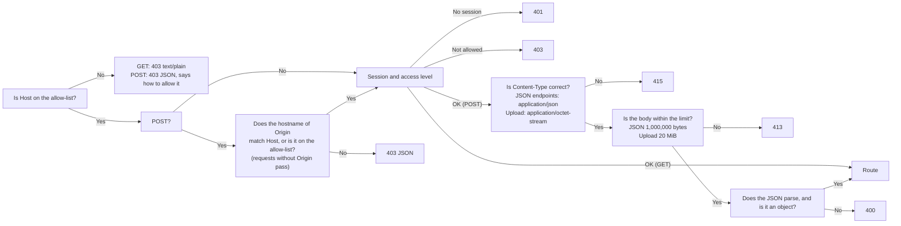

**English** | [日本語](../ja/api.md) | [简体中文](../zh-CN/api.md)

# API reference

> The machine-readable version is [openapi.yaml](openapi.yaml). This document is for humans: what each endpoint does, who may call it, how the guards block requests, and where the behavior differs from the old Python version. Since v0.8 it also covers the AI routes `/api/ai/*`, answered by the separate ai-service container (section 5), and the internal routes between the backend and ai-service (section 6). Since v0.9 it also covers the study routes of the AI+ feature (`/api/ai/study/*` and `/api/ai/summary/*`: hints, explanations and summaries in practice, on the result pages and in Study records, section 5.5), the two attempt fields that tie a record to its session, and three more internal routes that let ai-service read one question or one record.
> It describes the **actual behavior**: every case of the old version was captured as golden responses (`tests/baseline/golden/`, 172 of them), and the new Rust backend is compared against them one by one.

## 1. Overview

The browser talks to the backend only through this set of REST endpoints. The frontend has no database access and no logic for deciding whether an import is allowed or what a user may see: the backend decides both, from the signed-in user.

Every route has one access level (the route table `ROUTES` in `backend/src/api/auth.rs`):

| Access | Who may call it |
|---|---|
| **Public** | Anyone, without signing in |
| **Signed in** | Any signed-in user |
| **Bank manager** | Administrators, and plain users with the **Bank manager** permission *(v0.7)* |
| **Admin** | Administrators only |

| Method | Path | Access | Purpose | Writes to the database? |
|---|---|---|---|---|
| GET | `/api/info` | Public | Version, CPU architecture, whether the program can be shut down | No |
| GET | `/api/auth/state` | Public | Who is signed in, and the library stamp *(v0.6)* | No |
| POST | `/api/auth/login` | Public | Sign in *(v0.6)* | Yes (a new session) |
| POST | `/api/auth/logout` | Signed in | Sign out *(v0.6)* | Yes (the session is deleted) |
| POST | `/api/auth/password` | Signed in | Change your own password *(v0.6)* | Yes |
| GET | `/api/bank` | Signed in | The questions of every bank the user may see (active questions only) | No |
| GET | `/api/banks` | Signed in | The question banks the user may see, with their sheets and counts *(v0.5)* | No |
| GET | `/api/progress` | Signed in | The user's study records | No |
| GET | `/api/records` | Signed in | Every kept study record of the user, newest first *(v0.5)* | No |
| GET | `/api/record?id=<int>` | Signed in | One study record with its per-question detail *(v0.5)* | No |
| GET | `/api/settings` | Signed in | The user's interface settings *(v0.5)* | No |
| POST | `/api/attempt` | Signed in | Record the result of one exam or practice | Yes |
| POST | `/api/records/delete` | Signed in | Delete one of your study records, or all of them *(v0.5)* | Yes |
| POST | `/api/reset` | Signed in | Clear your study records | Yes |
| POST | `/api/settings` | Signed in | Change your interface settings *(v0.5)* | Yes |
| POST | `/api/settings/reset` | Signed in | Restore your default interface settings *(v0.5)* | Yes |
| GET | `/api/imports` | Bank manager | The last 12 import records (a bank manager: of their own banks) | No |
| POST | `/api/upload` | Bank manager | Upload an .xlsx file and get a **preview** and a one-time confirmation code; optional header `X-Bank-Target` *(v0.5)* | **No** (staged in memory only) |
| POST | `/api/import/confirm` | Bank manager | Confirm the import | **Yes** (one transaction) |
| POST | `/api/import/cancel` | Bank manager | Cancel your pending import | No |
| POST | `/api/banks/delete` | Bank manager | Delete a question bank (optionally with its study data) *(v0.5)* | Yes |
| GET | `/api/users` | Admin | Every account, with its permissions and sign-in lock *(v0.6)* | No |
| POST | `/api/users/create` | Admin | Add a user *(v0.6)* | Yes |
| POST | `/api/users/update` | Admin | Rename, change the role, disable or enable a user, set their banks and permission *(v0.6)* | Yes |
| POST | `/api/users/password` | Admin | Give another user a new initial password *(v0.6)* | Yes |
| POST | `/api/users/delete` | Admin | Delete a user and their study data *(v0.6)* | Yes |
| POST | `/api/users/unlock` | Admin | Clear a user's sign-in lock *(v0.6)* | No (memory only) |
| GET | `/api/logs` | Admin | The recent lines of the system log *(v0.7)* | No |
| POST | `/api/shutdown` | Admin | Shut down the program (available only when running on the local machine; always 403 in Docker) | No |

`HEAD` behaves like the corresponding `GET`, just without a body. Every endpoint goes through exactly the same guards (section 3).

*(v0.8)* Everything under `/api/ai/` (AI Chat, Memory, AI settings) is answered by ai-service, after Nginx had the backend check the request: section 5. Its answers are JSON with a stable `code` and, for `send` and `retry`, a stream of server-sent events. `/internal/*` is not reachable through Nginx (section 6).

*(v0.9)* Four more routes under `/api/ai/` serve the AI+ feature in practice, on result pages and in Study records (section 5.5). `POST /api/attempt` takes two optional keys that say which session a record belongs to, and answers with the new record's id; `GET /api/record` returns them again. The main database is now **schema 6** and the AI database **schema 3**; the upgrade of each writes a backup first (section 7, "Changes in v0.9").

## 2. What every response has in common

- `Cache-Control: no-store` and `X-Content-Type-Options: nosniff`, and no `Server` header.
- JSON is UTF-8, and Japanese and Chinese characters are not escaped as `\uXXXX`. The separators are `", "` and `": "` (a space after the colon), and the key order is fixed (the order shown in this document and in [openapi.yaml](openapi.yaml)). **This is part of the contract**: the golden tests (`backend/tests/api_golden.rs`) compare the JSON byte for byte with the responses of the old version.
- Errors look like `{"error": "<reason>"}`. The reason is a Chinese sentence that can be shown to the user as is (the frontend translates it into the interface language); section 4 lists every one of them with its English meaning. Only the low-level answers of the request layer keep the short English text of the old version: `bad content type` (415), `too large` (413), `bad json` (400), `not found` (404) and `method not allowed` (405). The 429 answer of a sign-in lock adds one key, `retryAfter`.
- The backend never puts exception names, file paths or SQLite error messages in a response; the details go to the log only.

## 3. Guards (every request goes through them first)

The order is fixed, so the same bad request always gets the same answer:



- **Host**: by default only `localhost`, `127.0.0.1` and `::1` are accepted. To access the app through another address or domain name, put it in the environment variable `XEXAM_ALLOWED_HOSTS` (separated by commas, spaces or semicolons). `XEXAM_ALLOW_ANY_HOST=1` turns off the Host check (use it only when authentication is already in front of the app, for example Cloudflare Access).
- **Origin** (checked only on write requests): only the **hostname** is compared (not the scheme or the port), so access through an HTTPS domain is not blocked by mistake. Requests without an `Origin` header pass (command-line tools are not cross-site requests from a browser). When a proxy rewrites Host to the origin server's address, put the public domain in `XEXAM_ALLOWED_ORIGINS`.
- The backend **reads only the real `Host` header** and never reads `X-Forwarded-*`. Nginx does not forward them either.
- Other methods (PUT, DELETE, OPTIONS, …) go through the Host check too (403 JSON), then get **405** with `Allow: GET, HEAD, POST`.
- The response to a rejected request states which Host or Origin you sent and which value to add to which option. **The log** *(v0.7)*: the first rejection after a quiet minute gets its own line (`rejected GET /api/bank: Host "…" is not in the allowed list`); the ones that follow are summed up at most once a minute (`rejected N request(s) by the Host / Origin check since the last report; the last one: …`), also when no further request comes. The log text is always English; the 403 body keeps its Chinese text. Anyone who can reach the server can cause these rejections without signing in, so one line each could push every other line out of the system log (`GET /api/logs`).

### Session and access level *(v0.6)*

The session check runs right after the Host (and, for a POST, the Origin) check, **before any of the request body is read**:

| Situation | Answer |
|---|---|
| A **Public** route | Passes. `GET /api/auth/state` reads the session if there is one; the others never look at it |
| No valid session (no `xexam_session` cookie, an unknown or expired one, or the account was disabled) | **401** `请先登录。` ("Please sign in first.") |
| The account must choose a new password | **403** `请先设置新密码。` ("Please choose a new password first.") on every route except the public ones (`GET /api/info`, `GET /api/auth/state`, `POST /api/auth/login`) and `POST /api/auth/password` and `POST /api/auth/logout` |
| An **Admin** route, called by a plain user | **403** `只有管理员可以进行这个操作。` ("Only an administrator can do this.") |
| A **Bank manager** route, called by a plain user without the permission *(v0.7)* | **403** `你没有管理题库的权限，请联系管理员。` ("You do not have permission to manage question banks. Ask an administrator.") |

- A path that is not in the route table needs a session too: without one it gets 401, with one 404 (GET: `text/plain` `not found`; POST: `{"error": "not found"}` after the Content-Type, size and JSON checks).
- The session is read from the `xexam_session` cookie only. The role and the **Bank manager** permission are read from the database with the session on every request, so a change by an administrator applies to the user's very next request.
- Sessions last 30 days and slide: a request refreshes the session at most once an hour and re-sends the cookie. The refresh happens only on requests whose scheme is known: with `XEXAM_COOKIE_SECURE=1`, or when the request carries an `Origin` header (every browser POST does). That way a refresh never drops `Secure` from a cookie issued over HTTPS.
- Records, the wrong-answer notebook, progress and settings always belong to the signed-in user: their id comes from the session, never from the request. Another user's record answers exactly like a record that does not exist.

### What each user sees and manages *(v0.7)*

- **Administrators** see and manage every question bank.
- A **plain user** sees exactly the banks an administrator chose for them (`banks` in `GET /api/users`, a list of ids, possibly empty). With `newBanks` (**Include banks imported later**) every bank created later is added to that list when it is created; existing banks are never added by it. A plain user with the **Bank manager** permission also sees the banks they imported themselves (only while they hold the permission: without it they see their own banks only when those are among the chosen ones).
- A **bank manager** imports new banks (they become the owner) and updates or deletes only the banks they own. Updating or deleting a bank of an administrator or of another user answers **403** `这个题库不是你上传的，只能更新或删除你自己上传的题库。` ("You did not upload this question bank. You can only update or delete question banks you uploaded yourself."); the check runs inside the write transaction, so nothing is written.

For a user who does not see every bank, every route follows the same rule:

| Route | What they get |
|---|---|
| `GET /api/bank` | Only the questions and sheets of their banks; `file` / `mtime` are those of the latest import into one of their banks |
| `GET /api/banks` | Only their banks; `studied` and `records` count their own study data |
| `GET /api/progress` | `questions` holds the statistics of questions of their banks only (the wrong-answer notebook and its review follow it); `history` is unchanged |
| `POST /api/attempt` | A question of a bank they cannot see is treated exactly like a deleted one: it is not counted and comes back in `notCounted` |
| `GET /api/records` | Every one of their records stays as history, with the bank names saved in it |
| `GET /api/record` | A question of a bank they cannot see has `"question": null`, like a deleted question (no question text) |
| `GET /api/auth/state` | `library` follows only their banks and their access |
| `GET /api/info` | The same for everyone: only the version, the architecture and `canShutdown` (the route is public and serves the container health check) |

## 4. Endpoint details

### `GET /api/info`
```json
{"version": "0.9", "arch": "x86_64", "canShutdown": false}
```
Public. The version number is `CODE_VERSION` from the `VERSION` file (or `XEXAM_VERSION`); `arch` is the CPU architecture of the server; `canShutdown` is `true` only when the program was started with `--allow-shutdown`. *(v0.7.5)* The key `bankCount` (the number of active questions in the whole library) is gone: the route is public, and signed-in pages count the questions they may see from `GET /api/bank` and `GET /api/banks`. The route still reads the database, so it answers 500 when the database cannot be read, and the container health check (which asks this route) reports the backend as unhealthy.

### `GET /api/auth/state` *(v0.6)*
Public. Signed out (no cookie, or a session that is not valid any more):

```json
{"user": null, "defaultAdmin": "admin"}
```

`defaultAdmin` is the username of an enabled administrator that still has the default password `admin` (the lowest id first), or `null`. The sign-in page uses it to tell the owner how to sign in the first time, with the account's real name (it may have been renamed). Changing or resetting that password, or disabling, demoting or deleting the account ends it.

Signed in (also while the account must choose a new password):

```json
{"user": {"id": 1, "username": "admin", "role": "admin", "mustChangePassword": false, "canManageBanks": true, "aiAllowed": true}, "library": "3f0c9a7d5e21b4c88a9d0e6f17b2c453", "aiAvailable": true, "aiService": {"connected": true, "stopped": false, "lastSeen": 1789900000, "version": "0.9", "enabled": true, "link": true}}
```

- `role` is `admin` or `user`. `canManageBanks` *(v0.7)* is `true` for every administrator, and for a plain user with the **Bank manager** permission. `aiAllowed` *(v0.8)* is `true` for every administrator, and for a plain user with **AI+**; whether the user can use AI right now is in `GET /api/ai/status`. The same `user` object is in the answers of sign-in and of the password change.
- `library` is an opaque stamp of the question banks the user may see: 32 hexadecimal digits, a digest that publishes none of the numbers it is made of. It changes whenever one of those banks is imported, replaced or deleted (also by the `import` command, from another process), and *(v0.7)* whenever the banks the user may see or manage change (an administrator assigned banks or changed the permission, a bank changed owner). Open pages compare it and re-read the banks when it changes. For a user limited to some banks, the stamp is made only of those banks: it neither reveals nor follows the size, the question count or the update times of the banks they cannot see.

- `aiAvailable` *(v0.8, round 2)* is `true` while AI+ is available: ai-service has reported to the backend less than 60 seconds ago (and did not say it was stopping) **and** its **AI+ feature** switch in AI settings is on. It is the same for every signed-in user. The User management page uses it to decide whether to show the AI+ switches, and the backend uses it to refuse them (`POST /api/users/update` and `create`, below).
- `aiService` *(v0.8, round 2)* is in the answer for **administrators only** (a plain user's answer has no such key). It is what the backend knows about ai-service, from its last report (the backend never calls ai-service; ai-service reports every 25 seconds, at once after a change, and once when it stops: section 6, `POST /internal/ai/heartbeat`). The report is kept in memory, so after a backend restart `lastSeen` is `null` until the next report arrives (within 25 seconds).

| Key | Meaning |
|---|---|
| `connected` | `true`: a report is less than 60 seconds old and it is not a stopping report |
| `stopped` | `true`: the last report said ai-service is shutting down (whatever its age) |
| `lastSeen` | Unix seconds of the last accepted report since the backend started; `null` when there is none |
| `version` | The version in the last report, or `null` |
| `enabled` | The AI+ feature switch as the last report says, while `connected`; `false` when not connected |
| `link` | `true` when the backend has an internal token loaded (the AI link is on) |

### `POST /api/auth/login` *(v0.6)*
Public. Body: `{"username": "…", "password": "…"}` (both strings, otherwise **400** `请求的格式不对。`). The username is trimmed and compared ignoring case.

- **200** `{"user": {…}}` (the same object as in `GET /api/auth/state`) with two cookies:
  - `xexam_session=<43 characters>; HttpOnly; SameSite=Strict; Path=/; Max-Age=2592000` (30 days). Every sign-in gets a new random token; the database stores only its SHA-256. A user has at most 20 sessions; a new sign-in beyond that ends the sessions that would expire first.
  - `xexam_device=<43 characters>; HttpOnly; SameSite=Strict; Path=/api/auth; Max-Age=34560000` (400 days): marks a browser where this account signed in before. It is a keyed hash of the account's current password hash, so a new password retires it; nothing is stored for it.
  - Both get `Secure` only when the request's `Origin` is `https://…` or `XEXAM_COOKIE_SECURE=1`, so sign-in works over plain HTTP on a LAN.
- **401** `用户名或密码不对。` ("The username or password is not correct.") for a wrong password, an unknown username and a disabled account alike, after the same amount of work, so the answer never says whether a username exists.
- **429** `{"error": "登录失败次数太多，请稍后再试。", "retryAfter": <seconds>}` ("Too many failed attempts. Please try again later.") with a `Retry-After` header, while the sign-in is locked. During a lock every attempt gets 429, even with the right password, and 429 answers do not count as failures.

The lock escalates in rounds: 5 failures within 15 minutes lock the sign-in for 1 minute; after that every round allows 3 failures and locks for 5 minutes, 15 minutes, 30 minutes, 1 hour, then 1 day. The state belongs to the account (its user id, so a rename keeps it); a name without an account gets the same rounds. Attempts from a browser that carries the account's `xexam_device` cookie are counted apart from all other browsers, so somebody guessing a username cannot lock its owner out of the browsers they used before. A successful sign-in, an administrator's password reset or **Unlock**, a restart of the backend, or 24 quiet hours start the account over. Details and the reasons: [security.md](security.md).

### `POST /api/auth/logout` *(v0.6)*
Signed in (also while a new password is required). Body `{}` or empty. Deletes this session and answers `{"ok": true}` with an expired cookie (`xexam_session=; HttpOnly; SameSite=Strict; Path=/; Max-Age=0`).

### `POST /api/auth/password` *(v0.6)*
Signed in (also while a new password is required). Body: `{"current": "…", "password": "…"}`. `current` is required unless the account must choose a new password (then the session proves who it is).

- **200** `{"user": {…}}` with `mustChangePassword: false`. Every session of the account ends, this one included: this browser gets a **new** `xexam_session` cookie (and the `xexam_device` cookie of the new password), so the account's other browsers are signed out and a copied cookie stops working.
- **400** `请求的格式不对。` when `password` (or a required `current`) is missing or not a string; `密码需要 8–128 个字符。` ("The password needs 8 to 128 characters."); `新密码不能和原来的一样。` ("The new password must be different from the old one.").
- **403** `当前密码不对。` ("The current password is not correct."). Wrong current passwords are counted in the same sign-in buckets as failed sign-ins, so the lock (**429**, as above) applies here too.
- **401** `请先登录。` when the account was disabled or deleted, or its password was changed or reset elsewhere while the request ran (nothing is written).

### `GET /api/users` *(v0.6)*
Admin. Every account, ordered by id:

```json
{"users": [{"id": 2, "username": "cook", "role": "user", "disabled": false, "createdAt": "2026-11-10 14:00", "lastLoginAt": "2026-11-10 15:02", "mustChangePassword": false, "records": 12, "banks": [1, 3], "newBanks": true, "canManageBanks": true, "ai": true, "ownedBanks": [3], "lock": null, "aiSuspended": false}], "aiAvailable": true}
```

- `createdAt` / `lastLoginAt` are local times `YYYY-MM-DD HH:MM`; `lastLoginAt` is `null` before the first sign-in.
- `records` is the number of the user's study records (exams and practice).
- `banks` *(v0.7)*: the ids of the banks the user sees, ascending (only banks that still exist; `[]` = none). It is always a list: `"all"` is only a shorthand for writing (below).
- `newBanks` *(v0.7)*: **Include banks imported later**. `true`: every bank created from now on (an import as a new bank by anyone, or the command-line `import`) is added to `banks` in the same transaction. It never adds an existing bank.
- `canManageBanks` *(v0.7)* is the stored **Bank manager** permission. `banks`, `newBanks` and `canManageBanks` are kept across role changes but matter only while the account is a plain user: administrators see and manage every bank.
- `ai` *(v0.8)*: the stored **AI+ feature** switch of the user. It matters only for plain users (administrators may always use AI while it is on) and only while the AI+ feature is on in AI settings. It is kept when AI+ is not available.
- `aiSuspended` *(v0.8, round 2)*, after `lock`: `true` when an administrator paused the user's **AI+ feature** in AI settings (section 5, `suspend`; the screens say Pause / Paused, the JSON keeps the name `suspended`). It comes from ai-service's last report, so it is `false` for everybody while the backend has no report (for example right after a restart) and always `false` for administrators, who cannot be suspended. It is separate from `ai`: a pause does not change the stored switch.
- `aiAvailable` *(v0.8, round 2)*, a top-level key next to `users`: the same value as in `GET /api/auth/state`. **Every answer that returns the user list** has it (`create`, `update`, `password`, `delete`, `unlock` too).
- `ownedBanks` *(v0.7)*: the ids of the banks the user imported as new banks (they own them), ascending.
- `lock`: the in-memory sign-in state of the account. `null` while it is in the first round and not locked; otherwise:

```json
{"until": "2026-11-10 15:20:07", "retryAfter": 298, "round": 2, "triesLeft": 0, "knownBrowser": false, "otherUntil": null, "otherRetryAfter": 0}
```

| Key | Meaning |
|---|---|
| `until` | Local time `YYYY-MM-DD HH:MM:SS` when the running lock ends; `null` when not locked |
| `retryAfter` | Seconds until then; `0` when not locked |
| `round` | While locked: the round that ended in this lock (1 = the first, one-minute lock). Otherwise: the round in progress (2 or more) |
| `triesLeft` | Failures left in the round in progress before the next lock (`0` while locked) |
| `knownBrowser` | `true`: the state shown counts sign-ins from browsers where the user signed in before; `false`: from every other browser. When both are tracked, the one that holds the user back more is shown |
| `otherUntil` / `otherRetryAfter` | Set only when the other browsers are locked at the same time, so the account is locked in every browser: the end of that second lock and its seconds (`null` / `0` otherwise) |

### `POST /api/users/create` *(v0.6)*
Admin. Body: `{"username": "…", "password": "…", "role": "admin" | "user", "banks": "all" | [<bank id>, …], "newBanks": <bool>, "canManageBanks": <bool>, "ai": <bool>}`. *(v0.7)* `banks` defaults to `[]` (the new user sees no bank until an administrator chooses some), `newBanks` to `false` and `canManageBanks` to `false`; *(v0.8)* `ai` (**AI+**) to `false`. Creating a user with `ai: true` also logs `user "<admin>" turned AI+ on for user "<name>"`; *(v0.8, round 2)* while AI+ is not available (see `aiAvailable` above) it is refused with **409** `ai.serviceOff` and the user is not created. `ai: false` or no `ai` works as always. `"banks": "all"` is a shorthand: every bank that exists now and, unless `newBanks` is given, `newBanks: true`. Duplicate ids are ignored. The new account is enabled and must choose a new password at its first sign-in. Answer: `{"users": [...]}` as in `GET /api/users`.

Usernames have 1–40 characters (ASCII letters, digits and `. _ - @`, surrounding spaces removed) and are unique ignoring case; passwords have 8–128 characters.

| Answer | When |
|---|---|
| **400** `用户名不对：1–40 个字符，只能用字母、数字和 . _ - @。` ("The username is not valid …") | `username` missing, not a string, or breaking the rule |
| **400** `密码需要 8–128 个字符。` | `password` too short or too long |
| **400** `请求的格式不对。` | `password` missing or not a string; `role` missing or not `admin` / `user`; `banks` neither `"all"` nor a list of integers; `newBanks`, `canManageBanks` or `ai` not a boolean |
| **400** `选择的题库中有不存在的（可能已被删除），请刷新页面后再试。` ("One of the chosen question banks does not exist …") *(v0.7)* | An id in `banks` is not an existing bank (or not a positive integer); nothing is created |
| **409** `这个用户名已经有人用了。` ("This username is already taken.") | Another account has that name (ignoring case) |
| **409** `{"error": "请先在 AI 设置里开启 AI+ 功能。", "code": "ai.serviceOff"}` ("Turn on the AI+ feature in AI settings first.") *(v0.8, round 2)* | `ai: true` while AI+ is not available. It is checked after the body was validated (a malformed `ai` is still 400) and before anything is written or the password is hashed |

### `POST /api/users/update` *(v0.6)*
Admin. Body: `{"id": <int>, "username"?, "role"?, "disabled"?, "banks"?, "newBanks"?, "canManageBanks"?, "ai"?}`; a key that is left out stays unchanged. Answer: `{"users": [...]}`.

- Disabling an account or changing its role ends its sessions. A rename, a change of `banks`, `newBanks`, `canManageBanks` or `ai` keeps them; the change applies at the user's next request.
- `ai` *(v0.8)* switches the **AI+ feature** of the user on or off. It applies to the next AI request at once (the backend checks every AI request), and an answer being written for the user stops within about 2 seconds when it is switched off; the user's AI chats and memories are kept. A change is logged as `user "<admin>" turned AI+ on for user "<name>"` (or `off`).
- *(v0.8, round 2)* While AI+ is not available (ai-service not connected, or the AI+ feature off in AI settings), **any request with an `ai` key is refused as a whole** with **409** `{"error": "请先在 AI 设置里开启 AI+ 功能。", "code": "ai.serviceOff"}`: `true` or `false`, equal to the stored value or not, alone or together with other fields. Nothing is written and nothing is logged. A request without `ai` is not affected. This is the only error of the backend's own routes that carries a `code`. The stored switches of all users are kept while AI+ is unavailable and are in force again once it is.
- `banks` replaces the chosen banks (a list of ids, `[]` = no bank; or `"all"`, every bank that exists now, which also sets `newBanks: true` unless `newBanks` is given). `newBanks` alone changes only the flag: unticking it keeps the banks the user has.
- **400**: as for create (`username`, `role`, `banks`, `newBanks`, `canManageBanks`, `ai`; `disabled` not a boolean → `请求的格式不对。`; `id` missing or not an integer (a boolean is not) → `请求的格式不对。`).
- **404** `这个用户不存在（可能已被删除），请刷新页面后再试。` ("This user does not exist …").
- **409** `不能对自己的账户做这个操作。` ("You cannot do this to your own account.") when you disable yourself or change your own role; `至少要保留一个启用的管理员。` ("At least one enabled administrator must remain.") when the change would leave no enabled administrator; `这个用户名已经有人用了。`.

Every check runs in the same transaction as the write, so two requests can never both pass it.

### `POST /api/users/password` *(v0.6)*
Admin. Body: `{"id": <int>, "password": "…"}`. Gives another user a new initial password: they must choose a new one at their next sign-in, their sessions end, their `xexam_device` cookies stop matching, and their sign-in lock is cleared. Your own password goes through `POST /api/auth/password` (here: **409** `不能对自己的账户做这个操作。`). Other errors: 400 (password rule, malformed body), 404 (unknown user).

### `POST /api/users/delete` *(v0.6)*
Admin. Body: `{"id": <int>}`. Deletes the account with its sessions, study records (with their detail), wrong-answer statistics, settings and chosen banks. *(v0.7)* The question banks the user owned are not deleted: they now belong to the administrator who deleted the user. *(v0.8)* The user can no longer reach the AI routes at once; ai-service removes their AI chats and memories at its next reconcile (within 10 minutes, or when an administrator opens the AI users list). **409** for yourself and for the last enabled administrator; **404** for an unknown id.

### `POST /api/users/unlock` *(v0.6)*
Admin. Body: `{"id": <int>}`. Clears the account's sign-in state completely, for every browser (back to round 1, 5 tries), whether a lock is running or the account is only past round 1. It works by user id, so it works after a rename, and also for your own account. **404** for an unknown id. Answer: `{"users": [...]}`.

### `GET /api/bank`
Signed in. `file` / `mtime` are the file name and time of the most recent import (of a bank the user may see); `questions` contains only active questions, of every bank the user may see, grouped by bank id (ascending) and in each bank's order; in `sheets`, each sheet name has a count of usable questions and a count of deactivated ones (sheets with the same name in different banks are counted together; `GET /api/banks` has the per-bank numbers). For the fields of a question, see `Question` in [openapi.yaml](openapi.yaml).
Since v0.5 every question ends with one more key, `"bank": <bank id>` (after `row`).

The key order of a question is `kind, tag, stem, options, items, answer, translation, zh, [english, en,] [lang, ja,] explanation, mnemonic, note, [explain,] id, sheet, row, bank`. The keys in brackets appear only for the layouts that have them, so the output for older files is byte-for-byte the same as before. Since v0.7 only the six-column layout can be imported and the questions of the older layouts are retired at every start, so `GET /api/bank` normally holds six-column questions only; the older forms still appear in `GET /api/record`, for the retired questions of earlier records:

- **Three-column layout** (A question, B Chinese, C answer): none of them.
- **Four-column layout** (A English, B Chinese, C Japanese, D answer): `english` (the original text of column A) and `en` (the English split up following the Japanese structure). `stem`, `options`, `items` and `answer` come from the Japanese in column C.
- **Six-column layout** *(v0.7)* (A English, B Chinese, C Japanese question; D English, E Chinese, F Japanese answer and explanation): English is authoritative, so `stem`, `options`, `items` and `answer` are the English ones and `"lang": "en"` says so; `zh` (column B) and `ja` (column C) are the other two languages split up along the English structure (`null` / missing when they do not line up); `explain` holds the explanation, memory aid and answer note of each language: `{"en": {"explanation", "mnemonic", "note"}, "zh": {…}, "ja": {…}}`, a language without any of the three left out. `explanation` / `mnemonic` / `note` stay for older clients (the Chinese text when there is one, else the Japanese, else the English). A hotspot question's `tag` is `HOTSPOT` (`ホットスポット` in the older layouts).

A hotspot question in `zh` / `en` / `ja` has one more key, `choices`: the options for each sub-item, written in that language.

### `GET /api/banks` *(v0.5)*
Signed in. A question bank is one imported workbook. The banks the user may see, ordered by `id`:

```json
{"banks": [{"id": 1, "name": "Kitchen basics", "filename": "Kitchen basics.xlsx", "legacy": true, "createdAt": "2026-11-10 14:00", "updatedAt": "2026-11-10 15:00", "total": 5, "inactive": 0, "sheets": [{"name": "Cooking", "usable": 3, "inactive": 0}, {"name": "Safety", "usable": 2, "inactive": 0}], "studied": 4, "records": 3, "ownerId": 1, "owner": "admin", "manageable": true}]}
```

- `name` is the file name without `.xlsx` when the bank was created (` (2)`, ` (3)`, … are appended when another bank already has that name); updating the bank changes `filename` and `updatedAt`, never `name`.
- `legacy`: the bank that holds the data from before v0.5, and the target of uploads without `X-Bank-Target`. Its question ids are the plain question ids of section 4.1 of [database.md](database.md); every other bank uses bank-scoped ids, so the same workbook can be imported as two independent banks.
- `total` = active questions, `inactive` = deactivated ones; `sheets` follows the bank's question order and also lists sheets whose questions are all deactivated (`usable` 0).
- `studied` = how many of the bank's questions (active or not) have statistics; `records` = how many study records name this bank. For an administrator they count every user's data (what a deletion with study data removes); for everyone else *(v0.7)* only their own.
- `ownerId` / `owner` *(v0.7)*: the id and username of the user who imported the bank as a new bank (banks from before v0.7 belong to the first administrator). Only administrators get both; any other user gets `ownerId` only for their own banks (`null` otherwise) and `owner` always `null`, so the bank list never names other accounts.
- `manageable` *(v0.7)*: whether this user may update and delete the bank (administrators: always; bank managers: their own banks; others: never).

### `GET /api/progress`
Signed in. `questions` holds the user's cumulative statistics for each question (how many times it was answered, how many correct, how many wrong, and the current streak of correct answers), limited to the banks they may see; `history` holds their last 60 study records (the database keeps 500, see `GET /api/records`), each ending with `kind` *(v0.7)*; `masterStreak` is how many consecutive correct answers move a question out of the wrong-answer notebook (2).

```json
{"version": 1, "questions": {"1a2b3c4d5e6f": {"attempts": 3, "correct": 2, "wrong": 1, "streak": 2, "last": true, "at": "2026-11-10 15:10"}}, "history": [{"at": "2026-11-10 15:10", "sheets": ["Cooking"], "mode": "all", "total": 5, "correct": 4, "percent": 80, "seconds": 130, "kind": "exam"}], "masterStreak": 2}
```

### `GET /api/imports`
Bank manager. `{"imports": [{"id", "at", "filename", "added", "updated", "removed", "restored", "skipped", "total"}, …]}`, the newest 12 first. An administrator gets every import; a bank manager *(v0.7)* only the imports into the banks they own.

### `POST /api/upload`
Bank manager. The request body is the raw bytes of the .xlsx file; the optional header `X-Filename` carries the percent-encoded file name. The server:

1. Decides whether it is an .xlsx by **content** alone (magic number + ZIP structure + a workbook is present + no DOCTYPE / entity declarations + the uncompressed size has an upper limit). An empty file, an old `.xls`, a corrupted file and a file with a changed extension each get their own explanation in Chinese.
2. Parses it. *(v0.7)* When the parser reads any question of the old three- or four-column layout, the upload is refused with **400** `只能导入六列格式（A–C 列：英文、中文、日文题目；D–F 列：英文、中文、日文答案）。这个文件是旧的三列或四列格式，请改成六列格式后再导入。` ("Only the six-column layout can be imported (columns A–C: the question in English, Chinese and Japanese; columns D–F: the answer in English, Chinese and Japanese). This file uses the old three- or four-column layout. Rewrite it in the six-column layout and import it again."), for a new bank and for an update alike; nothing is staged and the pending slot is untouched. The log gets an English line with the file name.
3. Builds the preview and puts the parse result into **the uploader's own pending slot** in memory (uploading again replaces it; other users' slots are never touched), valid for 30 minutes.
4. **Does not write to the database.**

It returns the preview (`added / updated / unchanged / restored / removed / skipped / usable`, the details for each sheet, and the rows that could not be read, with the reasons) and a one-time confirmation code, `token`:

```json
{"sheets": [{"name": "Cooking", "total": 3, "usable": 3, "skipped": [], "added": 3, "updated": 0, "removed": 0, "restored": 0, "skippedMore": 0, "skippedCount": 0}], "added": 3, "updated": 0, "unchanged": 0, "restored": 0, "removed": 0, "skipped": 0, "usable": 3, "removed_samples": [], "removed_stats": 0, "filename": "Kitchen basics.xlsx", "token": "…"}
```

Each sheet lists at most 30 unreadable rows (`skipped`, each `{"row", "reason"}`); `skippedMore` says how many more there are and `skippedCount` how many in all.

**Warnings** *(v0.7)*: a row whose Chinese (E) or Japanese (F) answer differs from the English answer (D) is still imported, with the English answer, and is listed as a warning. Only then do the keys appear, so a preview without warnings has exactly the keys of earlier versions: a sheet with warnings gets `warnings` (at most 30 `{"row", "reason"}`, right after `restored`) and, at its end, `warningsMore` and `warningsCount`; the preview gets a total `warnings` count after `removed_stats`. The reasons are `E 列的中文答案和 D 列的英文答案不一致（已按英文答案导入）` ("The Chinese answer in column E differs from the English answer in column D (imported with the English answer)") and the same for the Japanese answer in column F.

**Target bank** *(v0.5)*: the optional header `X-Bank-Target` says which bank the file goes to. The preview has the same keys in every case; it is computed against the target bank only.

| `X-Bank-Target` | Meaning |
|---|---|
| absent | Exactly the v0.4 behavior, against the legacy bank (created at confirm if it does not exist yet) |
| `new` (surrounding spaces ignored, any case) | A new bank is created at confirm, owned by the uploader; the preview shows every usable question as `added` |
| a bank id, `^[0-9]{1,18}$` (surrounding spaces ignored) | Update (replace) that bank; an unknown id → **404** `这个题库不存在（可能已被删除），请刷新页面后再试。` |
| anything else | **400** `上传目标不对，请刷新页面后再试。` ("The upload target is not valid …") |

The header is read after the guards and the size limit, and before the file is parsed. A bank manager may update only a bank they own *(v0.7)*: an existing bank of somebody else (also the legacy bank, for an upload without the header) → **403** `这个题库不是你上传的，只能更新或删除你自己上传的题库。`, before the file is parsed. A rejected upload does not touch the pending slot.

**Memory budget** *(v0.7)*: every administrator and bank manager has a slot, and one parsed workbook near the parser's limits holds more than 100 MB, so all staged previews together share a budget of 128 MiB (estimated from their content). Staging a new upload first drops expired previews, then the oldest previews of other users while the total is above the budget. The newest upload is always kept. A user whose preview was dropped gets **409** at confirm, exactly as after the 30 minutes.

Other answers: **413** `文件太大了（最大 20 MB）。…` ("The file is too large (20 MB at most) …"); **400** with the reason the file was rejected (not an .xlsx, damaged, too large once decompressed, parsing took too long, an old layout, …).

### `POST /api/import/confirm`
Bank manager. The request body is `{"token": "…"}`.

- The confirmation code is a 128-bit random number (22 characters) and **can be used only once**. It confirms only the caller's own pending upload: a wrong code, another user's code or a non-ASCII code is treated as "invalid" and does not consume the pending content; an expired (or dropped) preview cannot be retrieved. All of them → **409** `这次上传的预览已经过期或已被处理，请重新上传。` ("The preview of this upload has expired or has already been handled. Please upload the file again.").
- The import completes in **one transaction**: either everything succeeds, or the question bank is left unchanged (**500** `写入数据库失败，题库没有任何改动。`, "Writing to the database failed. The question bank was not changed.").
- If this file contains no usable question at all → **400** `这份文件里没有读到任何可用的题，没有导入。` ("No usable questions were found in this file, so nothing was imported.").
- *(v0.7)* A staged workbook with a question of the old three- or four-column layout is refused here too (**400**, the same message as at the upload), before anything is written.

Import rules (the file is treated as the **complete content of its target bank**): questions that appear for the first time are added; questions that were changed are updated; questions of that bank that cannot be found in the file are **deactivated** (their study records are kept); a deactivated question that appears again is restored automatically. Other banks are never touched.

Response: `{"result": <same shape as the preview, without filename / token>, "bank": <GET /api/bank, as the user sees it>}`. Only when the upload carried `X-Bank-Target`, a third key follows: `"bankId": <id of the created / updated bank>` (so the v0.4 response stays byte-for-byte the same). If the target bank was deleted after the preview → **404** `这个题库不存在（可能已被删除），请刷新页面后再试。`; if it now belongs to somebody else (a deleted user's banks moved to an administrator) → **403** `这个题库不是你上传的，只能更新或删除你自己上传的题库。`. In both cases nothing is written and the confirmation code is used up.

### `POST /api/import/cancel`
Bank manager. Discards the caller's own pending upload (other users' uploads stay). No confirmation code is needed. Answer: `{"ok": true}`.

### `POST /api/banks/delete` *(v0.5)*
Bank manager. Request body: `{"id": <int>, "withRecords": <bool, default false>}`. In one transaction it deletes the bank's questions (active and deactivated), its import history, the users' access to it and the bank itself. With `withRecords: true` it also deletes the bank's study data: the statistics (wrong-answer notebook) of those questions, their per-question detail, and every study record that drew from this bank and from no bank that still exists (usually: only from this bank; a record that also used a bank deleted earlier goes too, instead of staying behind as an empty record). Without it, study records and statistics stay; their detail shows the questions as deleted.

- An administrator deletes any bank, and `withRecords` removes the study data of **every** user.
- A bank manager *(v0.7)* deletes only the banks they own (**403** `这个题库不是你上传的，只能更新或删除你自己上传的题库。` otherwise, nothing written), and `withRecords` removes only **their own** study data; other users' records stay, and their questions show as deleted.

Every pending upload that targets this bank (an upload for that id, or an upload without `X-Bank-Target` when this is the legacy bank), of any user, is discarded.

Response: `{"banks": [...], "bank": <GET /api/bank>, "progress": <GET /api/progress>}`, all three as the caller sees them. `id` missing or not an integer (a boolean is not an integer), or `withRecords` present but not a boolean → **400** `请求的格式不对。`; unknown id → **404** `这个题库不存在（可能已被删除），请刷新页面后再试。`.

### `POST /api/attempt`
Signed in. The request body is `{"results": [{"id": "…", "correct": true, "answer": ["B"]}], "sheets": ["…"], "mode": "all", "seconds": 123, "kind": "exam"}`.

Sanitizing rules: `results` must be a list (otherwise **400** `成绩的格式不对`, "The exam result is not in the expected format.") and only its first 2000 items are read; each item needs a string `id` (cut to 64 characters) and a boolean `correct`, other items are dropped; when none is left → **400** `没有成绩可保存` ("There is no result to save."). `sheets` keeps at most 50 strings (each cut to 80 characters); if `mode` is not `all / weak / retry` it is treated as `all`; `seconds` is clamped to the range 0 to 604800, and an abnormal value is treated as 0. **The server trusts `correct`**; grading happens in the browser (see [security.md](security.md)).

*(v0.7)* `kind` is `"exam"` (the default, also when it is missing or `null`) or `"practice"`; any other value → **400** `成绩的格式不对`. Both kinds update the statistics (the wrong-answer notebook) the same way and count toward the same 500 kept records; they differ only in how the pages show them.

*(v0.5)* Each result may carry an optional `answer`, stored only so the record can be reviewed later: a JSON array of at most 64 elements, each a string of at most 8 characters, an integer 0–999, or `null` (`["C"]`, `["A", "D"]`, `[0, 1, null]`). Anything else is stored as "no answer"; the result itself is still accepted. The server stores one detail row per counted result, plus a snapshot of the banks the questions came from, and keeps the user's newest **500** records (older ones are deleted together with their detail).

*(v0.9)* The body may also carry `"key"` and `"startedAt"`, which say which practice or exam session the record was saved from, so that the AI+ feature can keep that session's answers in one chat (section 5.5). `key` is a string of exactly 32 lower-case hexadecimal digits (the browser makes a new one for every session); `startedAt` is an integer from 1 to 4102444800 (unix seconds, when the session started). **Each is judged on its own**: a missing or invalid one (wrong length, upper-case or non-hex characters, a number sent as a string, a fraction, `null`, a value out of range) is stored as `NULL`, and the request is never refused because of it, so older clients keep working. The key is not unique and the main database never looks a record up by it; records saved before v0.9, or without a valid `key`, have none.

**Only questions that exist are counted** *(v0.7)*. A result whose question is gone (its bank was deleted during the exam, or the id is made up), or belongs to a bank the user may not see, is left out of the statistics, the detail, `total` / `correct` / `percent` and the bank snapshot. Deactivated questions (left out of a later import) still exist and are counted. Then:

- Some results were left out: the record is saved with the rest, its `sheets` lists only the sheets (in the order sent) that a counted question belongs to, and the answer ends with `"notCounted": [<the ids left out>]`.
- None is left: nothing is saved, **409** `这场考试的题目已经被删除，成绩没有保存。` ("The questions of this exam have been deleted, so the result was not saved.").

The answer is the user's `GET /api/progress` (plus `notCounted` when some results were left out; `GET /api/progress` itself never has it). *(v0.9)* It ends with `"recordId"`, always last: the id of the record that was just saved (the `id` that `GET /api/records` lists), so the browser no longer has to guess it.

`percent` uses **round-half-to-even** (Python's `round`): 1 correct out of 8 is 12, not 13.

### `GET /api/records` *(v0.5)*
Signed in. `{"records": [RecordSummary, …], "retention": 500}`, the user's records, newest first, where a RecordSummary is

```json
{"id": 7, "at": "2026-11-10 15:10", "banks": [{"id": 1, "name": "Kitchen basics", "deleted": false}], "sheets": ["Cooking"], "mode": "all", "total": 5, "correct": 4, "percent": 80, "seconds": 130, "answered": 5, "detail": true, "kind": "exam"}
```

`banks` is the snapshot taken when the record was saved, with the bank's current name while it exists (`deleted: true` once it is gone). `detail` says whether per-question detail exists (exams saved before v0.5 have none); `answered` is the number of detail rows with an answer, or `null` without detail. `kind` *(v0.7)* is `exam` or `practice` (records from before v0.7 are exams).

### `GET /api/record?id=<int>` *(v0.5)*
Signed in. `{"record": RecordSummary, "items": [{"seq": 0, "questionId": "…", "answer": ["C"], "correct": true, "question": {…}}]}`. `answer` is the stored array or `null`; `question` is the question exactly as in `GET /api/bank` plus a trailing `"active": <bool>` (deactivated questions are included), or `null` when the question no longer exists or *(v0.7)* belongs to a bank the user may not see (its text is not sent).
*(v0.9)* The `record` of this route, and only of this route (`GET /api/records` and the other answers that list records are unchanged), ends with `"sessionKey"` (the stored session key, or `null`) and `"startedAt"` (unix seconds, or `null`): the Study records page uses them to find the AI chat of the record.
`id` must be exactly one query parameter of 1–18 ASCII digits (percent-encoding is decoded) → otherwise **400** `请求的格式不对。`; unknown id, or another user's record → **404** `这条考试记录不存在（可能已被删除），请刷新页面后再试。` ("This exam record does not exist …").

### `POST /api/records/delete` *(v0.5)*
Signed in. Request body: either `{"id": <int>}` (delete that record and its detail; the per-question statistics, i.e. the wrong-answer notebook, are **not** changed) or `{"all": true, "withStats": <bool, default false>}` (delete every record of the user and its detail; `withStats: true` also empties their statistics, which equals `POST /api/reset`). Only the caller's own records are ever deleted.
Response: `{"records": [...], "retention": 500, "progress": <GET /api/progress>}`. Any other body (no `id` and no `all`, both, `all` not `true`, `withStats` with `id`, wrong types) → **400** `请求的格式不对。`; unknown id → **404** `这条考试记录不存在（可能已被删除），请刷新页面后再试。`.

### `POST /api/reset`
Signed in. Clears the caller's study records (with their per-question detail) and their per-question statistics; the question banks and other users are untouched. Answer: their (now empty) `GET /api/progress`.

### `GET /api/settings` / `POST /api/settings` / `POST /api/settings/reset` *(v0.5)*
Signed in. Settings are stored in the database per user (they survive container restarts and updates, clearing the browser cache and switching browsers):

```json
{"theme": "system", "uiLang": "en", "autoAdvance": false, "questionLang": "ja"}
```

| Key | Values | Default |
|---|---|---|
| `theme` | `system` · `light` · `dark` | `system` |
| `uiLang` | `en` · `zh` · `ja` | `en` |
| `autoAdvance` | `true` · `false` | `false` |
| `questionLang` | `ja` · `zh` · `en` | `ja` |

`GET` returns the defaults merged with the stored values (a stored value that is not valid is ignored). `POST /api/settings` takes any subset of these keys and returns the full settings; unknown keys are ignored; a known key with an invalid value → **400** `设置的值不对。` ("A setting has an invalid value.") and nothing is written. `POST /api/settings/reset` (body `{}` or empty) restores `theme`, `uiLang` and `autoAdvance` to their defaults, keeps `questionLang`, and returns the full settings.

### `GET /api/logs` *(v0.7)*
Admin. The system log the **System log** page shows: the most recent 2000 lines the backend logged since it started, kept in memory only (empty again after a restart; nothing is written to the database). They are the lines `docker compose logs backend` shows (behind the same `XEXAM_LOG` filter), plus the startup and shutdown status lines, *(v0.8)* plus the lines ai-service sends (`target` `xexam_ai_service`, the message starting with `AI: `; they are not in `docker compose logs backend`). Log lines name users by their username (`user "admin" updated user "alex"`), never by id and never a typed name that has no account, and they never contain a password, a token, a cookie value or question text.

Query parameters, both optional:

- `after=<seq>`: return only the lines after this sequence number (1–19 ASCII digits).
- `boot=<id>`: the `boot` of the answer the client last read (1–64 characters of `A-Z a-z 0-9 _ -`).

```json
{"lines": [{"seq": 41, "time": "2026-11-10 15:10:02", "level": "info", "target": "xexam_backend::api::auth", "message": "user \"admin\" signed in"}], "last": 41, "dropped": false, "boot": "Xq3v9T0bLm2k"}
```

- `lines`: oldest first. `seq` grows by one per line, starting at 1 in each backend process; `time` is local time with seconds; `level` is `error`, `warn`, `info`, `debug` or `trace`; `target` is the module that logged it; `message` is the text followed by its fields (cut after 4000 characters).
- `last`: the sequence number of the newest line (0 before anything was logged), the `after` of the next poll.
- `dropped`: `true` when lines newer than `after` (without `after`: line 1 onward) were already pushed out of the buffer before they could be returned.
- `boot`: a random id of this backend process, the `boot` of the next poll.
- Without `after`, every kept line is returned. The sequence numbers start again at 1 after a restart, so an `after` larger than `last`, or a `boot` that is not this process's id, is answered like no `after`: every kept line.
- `after` or `boot` malformed, empty or given twice → **400** `请求的格式不对。`. Other parameters are ignored.

Lines that anyone can cause without signing in (rejected requests, failed sign-ins, locks of usernames without an account) are summed up at most once a minute (section 3), so they cannot push the other lines out.

### `POST /api/shutdown`
Admin. Available only when started with `--allow-shutdown` (on Windows, by double-clicking `start.bat`); otherwise **403** `在 Docker 里请用 docker compose stop 停止容器。` ("When Xexam runs in Docker, stop the containers with docker compose stop."). Always 403 in Docker; use `docker compose stop` there.

### Error messages
Like every backend message they are Chinese and stable (the frontend translates them). The ones every route can give are in section 3; the upload and parser messages (why a file was rejected, why a row is unreadable) are in `frontend/src/i18n/server-messages.ts` with their translations.

| Status | Message | Meaning | When |
|---|---|---|---|
| 400 | `请求的格式不对。` | The request is not in the expected format. | A malformed body or query of a v0.5+ endpoint |
| 400 | `上传目标不对，请刷新页面后再试。` | The upload target is not valid. Reload the page and try again. | A malformed `X-Bank-Target` |
| 400 | `设置的值不对。` | A setting has an invalid value. | `POST /api/settings` |
| 400 | `成绩的格式不对` | The exam result is not in the expected format. | `POST /api/attempt`: `results` not a list, or a bad `kind` |
| 400 | `没有成绩可保存` | There is no result to save. | `POST /api/attempt`: no valid result |
| 400 | `用户名不对：1–40 个字符，只能用字母、数字和 . _ - @。` | The username is not valid: it needs 1–40 characters, using only letters, digits and . _ - @. | Users: create, update |
| 400 | `密码需要 8–128 个字符。` | The password needs 8 to 128 characters. | Password routes, create |
| 400 | `新密码不能和原来的一样。` | The new password must be different from the old one. | `POST /api/auth/password` |
| 400 | `选择的题库中有不存在的（可能已被删除），请刷新页面后再试。` | One of the chosen question banks does not exist (it may have been deleted). Refresh the page and try again. | Users: create, update *(v0.7)* |
| 400 | `这份文件里没有读到任何可用的题，没有导入。` | No usable questions were found in this file, so nothing was imported. | Confirm |
| 400 | `只能导入六列格式（A–C 列：英文、中文、日文题目；D–F 列：英文、中文、日文答案）。这个文件是旧的三列或四列格式，请改成六列格式后再导入。` | Only the six-column layout can be imported (columns A–C: the question in English, Chinese and Japanese; columns D–F: the answer in English, Chinese and Japanese). This file uses the old three- or four-column layout. Rewrite it in the six-column layout and import it again. | Upload, confirm *(v0.7)* |
| 401 | `请先登录。` | Please sign in first. | No valid session |
| 401 | `用户名或密码不对。` | The username or password is not correct. | Sign-in |
| 403 | `请先设置新密码。` | Please choose a new password first. | The account must choose a new password |
| 403 | `只有管理员可以进行这个操作。` | Only an administrator can do this. | Admin routes |
| 403 | `你没有管理题库的权限，请联系管理员。` | You do not have permission to manage question banks. Ask an administrator. | Bank manager routes *(v0.7)* |
| 403 | `这个题库不是你上传的，只能更新或删除你自己上传的题库。` | You did not upload this question bank. You can only update or delete question banks you uploaded yourself. | Upload, confirm, bank delete *(v0.7)* |
| 403 | `当前密码不对。` | The current password is not correct. | `POST /api/auth/password` |
| 404 | `这个题库不存在（可能已被删除），请刷新页面后再试。` | This question bank does not exist (it may have been deleted). Reload the page and try again. | `X-Bank-Target`, confirm, bank delete |
| 404 | `这条考试记录不存在（可能已被删除），请刷新页面后再试。` | This exam record does not exist (it may have been deleted). Reload the page and try again. | `/api/record`, `/api/records/delete` |
| 404 | `这个用户不存在（可能已被删除），请刷新页面后再试。` | This user does not exist (it may have been deleted). Reload the page and try again. | Users routes |
| 409 | `这次上传的预览已经过期或已被处理，请重新上传。` | The preview of this upload has expired or has already been handled. Please upload the file again. | Confirm |
| 409 | `这场考试的题目已经被删除，成绩没有保存。` | The questions of this exam have been deleted, so the result was not saved. | `POST /api/attempt` *(v0.7)* |
| 409 | `这个用户名已经有人用了。` | This username is already taken. | Users: create, update |
| 409 | `不能对自己的账户做这个操作。` | You cannot do this to your own account. | Users: update, password, delete |
| 409 | `至少要保留一个启用的管理员。` | At least one enabled administrator must remain. | Users: update, delete |
| 409 | `请先在 AI 设置里开启 AI+ 功能。` (with `"code": "ai.serviceOff"`) | Turn on the AI+ feature in AI settings first. | Users: update with `ai`, create with `ai: true`, while AI+ is not available *(v0.8)* |
| 429 | `登录失败次数太多，请稍后再试。` | Too many failed attempts. Please try again later. | Sign-in, password change (with `retryAfter`) |
| 500 | `写入数据库失败，题库没有任何改动。` | Writing to the database failed. The question bank was not changed. | Confirm |
| 500 | `服务器内部出错，请稍后再试。` | An internal server error occurred. Please try again later. | Any route |

## 5. AI routes (`/api/ai/*`, v0.8)

The routes under `/api/ai/` are answered by ai-service (the `ai-service` container, image `xexam-ai-service`), not by the backend. Nginx sends every such request first to the backend's auth step (section 6) and passes it on only when the backend allows it, without the browser's cookies and with the backend's signed identity statement (`X-Xexam-Identity`) instead. A client therefore calls them exactly like the other routes: same origin, with the session cookie; it cannot set the identity itself (Nginx always overwrites the header).

### 5.1 Common rules

- **Methods**: GET and POST only. Nginx answers any other method with 403; ai-service itself with 405 and `Allow: GET, POST`. An unknown path under `/api/ai/` is 404 `ai.notFound`. `HEAD` is not supported.
- **Refused by the auth step** (answered by Nginx, ai-service never sees the request):

  | Status | `code` | When |
  |---|---|---|
  | 401 | `auth.signin` | No valid session. The `error` text is the backend's `请先登录。`. The auth step takes exactly one `xexam_session` cookie, written plainly: a second one (in any letter case), an empty, quoted or padded one is refused like no session |
  | 403 | `auth.password` | The account must choose a new password first (`请先设置新密码。`) |
  | 403 | `auth.guard` | The Host, or for a method other than GET, the Origin is not allowed (the same guard as section 3) |
  | 503 | `ai.backendDown` | The backend could not answer, or the AI link is off (no internal token) |
  | 502 | `ai.unavailable` | ai-service is absent, stopped or does not answer |
  | 413 | `ai.badRequest` | The body is over 256 KiB |
  | 429 | (not JSON) | Nginx's rate limit: 30 requests a second per address (burst 120); `send`, `retry`, `study/ask` and `summary/ask` also 20 starts a minute per session (burst 10) |

  The frontend treats any 5xx without JSON on `/api/ai/*` as `ai.unavailable`.
- **POST** needs `Content-Type: application/json` (optionally `; charset=utf-8`; otherwise 415 `ai.badRequest`); the body must be a JSON object (an empty body counts as `{}`), at most 128 KiB (413 `ai.badRequest`). **Keys that a route does not list are refused** (400 `ai.badRequest`), and so is a value of the wrong type. Ids, in bodies and query strings, are positive integers.
- **Answers**: JSON (`Content-Type: application/json; charset=utf-8`, `Cache-Control: no-store`, `X-Content-Type-Options: nosniff`), **compact** (no spaces after `:` and `,`, unlike the backend's answers) with the keys in the order shown here. Parse it; do not compare bytes.
- **Errors**: `{"error": "<Chinese text>", "code": "<code>"}`, plus `"field": "apiKey" | "gatewayKey"` for the key errors and `"limit": <n>` for the errors that name a number (`ai.tooLong`, `ai.messageLimit`, `ai.chatLimit`, `ai.memoryLimit`, `ai.memoryTooLong`), and `"field": "<key>"` for `ai.limitRange`. *(v0.9)* A 409 `ai.busy` of the study routes (5.5) ends with `"running"`. The codes are stable; the frontend translates by code, never by the text. A provider's own error text is never passed on.
- **Access levels**, from the identity statement:

  | Level | Who | Otherwise |
  |---|---|---|
  | **Signed** | Any signed-in user | (refused by the auth step) |
  | **AI user** | The **AI+ feature** is on (enabled, tested with the current settings, keys readable) **and** ai-service is connected to the backend **and** the user may use AI (an administrator, or AI+ on) **and** the user is not paused (never the case for an administrator) | Checked in this order: 403 `ai.disabled` when the AI+ feature is off; 503 `ai.backendDown` while the backend has not accepted a report of ai-service for 60 seconds (below); 403 `ai.notAllowed` without AI+; 403 `ai.suspended` when an administrator paused the user |
  | **Admin** | `role = admin`, also while AI is off | 403 `ai.adminOnly` |

  Reading and deleting your own chats and memories needs only **Signed**, so it keeps working when AI+ is switched off, paused or not available. Writing needs **AI user**.
- **Two states** *(v0.8, round 2)*: the **AI+ feature** of a user is the stored switch in User management (`ai`); **Pause / Resume** in AI settings (`suspend`, `resume`, below; the JSON and the codes keep the word *suspended*) is a second, separate state. A user can use AI only while the switch is on, the user is not paused and AI+ is available. A pause is kept in ai-service's own database; it survives switching the user's AI+ feature off and on, and only **Resume** clears it.
- **ai-service applies the 60-second rule to itself**: it must report to the backend (section 6, `heartbeat`), and while its last report was not accepted within the last 60 seconds, `GET /api/ai/status` says `enabled: false` and the **AI user** routes answer 503 `ai.backendDown`. The **Signed** and **Admin** routes keep working.
- **Scope**: every user route takes the user id from the identity statement, never from the request, and every query of chats, messages and memories filters by it. A chat or memory of another user answers exactly like one that does not exist (404 `ai.notFound`). Only `/api/ai/admin/*` reads or deletes other users' data, and every such view and clear is written to the System log.

### 5.2 Routes

| Method | Path | Access | Body / query | 200 answer |
|---|---|---|---|---|
| GET | `/api/ai/status` | Signed | | `Status` |
| GET | `/api/ai/chats` | Signed | | `{"chats": [ChatSummary]}`, newest `updatedAt` first |
| GET | `/api/ai/chat` | Signed | `?id=<chat id>` | `{"chat": ChatSummary, "messages": [Message]}` |
| POST | `/api/ai/send` | AI user | `{"chatId": <id> \| null, "text": "…", "lang"?: "en" \| "zh" \| "ja", "free"?: <ignored>}` | **event stream** (5.3) |
| POST | `/api/ai/retry` | AI user | `{"chatId": <id>, "lang"?: "en" \| "zh" \| "ja"}` | **event stream** (5.3) |
| POST | `/api/ai/free` | Admin | `{"free": <bool>}` | `{"free": <bool>}` (the administrator's free mode, below) |
| POST | `/api/ai/stop` | Signed | `{}` or `{"chatId": <id>}` | `{"ok": true, "stopped": <bool>}` |
| POST | `/api/ai/chats/delete` | Signed | `{"id": <id>}` or `{"all": true}` | `{"deleted": <n>}` |
| POST | `/api/ai/study/ask` | AI user | `StudyAsk` (5.5): `kind` `hint` or `explain`, the session and the question | **event stream** (5.3, 5.5) *(v0.9)* |
| GET | `/api/ai/study/saved` | Signed | `?mode=&key=` or `&record=&source=&question=&kind=` (5.5) | `Saved` of `StudyAnswer` *(v0.9)* |
| POST | `/api/ai/summary/ask` | AI user | `{"recordId": <id>, "lang"?: "en" \| "zh" \| "ja"}` | **event stream** (5.3, 5.5) *(v0.9)* |
| GET | `/api/ai/summary/saved` | Signed | `?record=<id>&at=<12 digits>` (5.5) | `Saved` of `SummaryAnswer` *(v0.9)* |
| GET | `/api/ai/memories` | Signed | | `{"memories": [Memory], "limit": 50, "maxChars": 300}` (the current limits) |
| POST | `/api/ai/memories/add` | AI user | `{"content": "…", "source"?: "manual" \| "chat"}` | `{"memory": Memory}` |
| POST | `/api/ai/memories/update` | AI user | `{"id": <id>, "content": "…"}` | `{"memory": Memory}` |
| POST | `/api/ai/memories/delete` | Signed | `{"id": <id>}` or `{"all": true}` | `{"deleted": <n>}` |
| POST | `/api/ai/memories/suggest` | AI user | `{"messageId": <id of one of your user messages>, "lang"?: "en" \| "zh" \| "ja"}` | `{"suggestion": "…"}` (nothing is saved) |
| GET | `/api/ai/admin/settings` | Admin | | `Settings` |
| POST | `/api/ai/admin/settings` | Admin | `SettingsUpdate` | `Settings` + `"switchedOff": <bool>` |
| POST | `/api/ai/admin/models` | Admin | `{}` | `{"models": ["…"], "listed": <bool>}` |
| POST | `/api/ai/admin/verify` | Admin | `{}` | `Verify` |
| POST | `/api/ai/admin/enable` | Admin | `{"enabled": <bool>}` | `Settings` |
| POST | `/api/ai/admin/suspend` | Admin | `{"userId": <id>}` | `{"user": AdminUserRow}`, **audited** |
| POST | `/api/ai/admin/resume` | Admin | `{"userId": <id>}` | `{"user": AdminUserRow}`, **audited** |
| GET | `/api/ai/admin/usage` | Admin | `?days=7` (default), `30`, `90` or `365` | `Usage` |
| GET | `/api/ai/admin/users` | Admin | | `{"users": [AdminUserRow]}` |
| GET | `/api/ai/admin/user` | Admin | `?id=<user id>` | `{"user": AdminUserRow, "chats": [ChatSummary], "memories": [Memory]}`, **audited** |
| GET | `/api/ai/admin/chat` | Admin | `?user=<user id>&id=<chat id>` | `{"chat": ChatSummary, "messages": [Message]}`, **audited**; the chat must belong to that user (else 404 and no audit line) |
| POST | `/api/ai/admin/clear` | Admin | `{"userId": <id>, "what": "chat", "chatId": <id>}`, or `{"userId": <id>, "what": "chats" \| "memories"}` | `{"deleted": <n>}`, **audited** |
| GET | `/api/ai/admin/limits` | Admin | | `{"limits": {…}, "defaults": {…}, "ranges": {"<key>": [min, max], …}}` |
| POST | `/api/ai/admin/limits` | Admin | any of the seven limit keys, integers | the same as GET |

`GET /healthz` of ai-service (`{"ok":true,"version":"0.9","arch":"x86_64"}`, no identity needed) is used by its container health check; Nginx has no location for it, so it is not reachable from outside.

**Shapes** (keys in this order):

```text
Status        {"enabled": bool,          // AI+ is available: the AI+ feature is on (enabled, tested with the current settings,
                                         // keys readable) AND ai-service's report was accepted by the backend < 60 s ago
               "allowed": bool,          // you may chat now: enabled and (administrator or AI+) and not paused
               "suspended": bool,        // an administrator paused you (always false for administrators)
               "hasData": bool,          // you have at least one chat or memory
               "running": {"chatId": n, "messageId": n} | null,   // your answer being written (the latest one)
               "retentionDays": n, "memoryLimit": n, "memoryMaxChars": n, "maxMessageChars": n,
               "messageChars": n, "memoryChars": n,               // the current safety limits (see limits below)
               "keyProblem": bool,       // administrators only: the saved keys cannot be used (false for others)
               "configured": bool,       // administrators only: a model and the needed keys are saved (false for others)
               "freeMode": bool}         // administrators only: your free mode is on (false for others), see POST /api/ai/free
ChatSummary   {"id": n, "title": str, "createdAt": n, "updatedAt": n, "messageCount": n, "running": bool,   // a chat has no mode
               "kind": "chat"|"practice"|"exam"|"summary",   // v0.9: AI Chat, or the study chat of a practice, an exam, a record summary
               "recordId": n|null}                          // v0.9: the main-app record of a study chat (display only), else null
Message       {"id": n, "role": "user"|"assistant", "content": str, "status": "streaming"|"done"|"stopped"|"error",
               "error": code|null, "truncated": bool, "model": str|null, "createdAt": n,
               "free": bool,            // the mode this message was written (or answered) in: true = free mode
               // v0.9 (an AI Chat message has kind "chat" and null in the other six)
               "kind": "chat"|"hint"|"explain"|"summary", "questionId": str|null, "questionNo": n|null,
               "source": "practice"|"result"|null, "lang": "en"|"zh-CN"|"ja"|null,
               "recordId": n|null,     // the chat's record, only for source "result" and kind "summary"
               "sample": StudySample|null}   // summaries only
Memory        {"id": n, "content": str, "source": "manual"|"chat", "createdAt": n, "updatedAt": n}
Settings      {"provider": "openai"|"anthropic"|"gateway", "baseUrl": str, "format": "openai"|"anthropic",
               "gatewayAuth": "bearer"|"x-api-key"|"cf-aig-authorization", "model": str, "manualModel": bool,
               "enabled": bool, "verified": bool, "verifiedAt": n|null, "retentionDays": n,
               "keys": {"apiKey": KeyInfo, "gatewayKey": KeyInfo},
               "keyProblem": null|"mismatch"|"invalidEnv"|"invalidFile", "updatedAt": n, "updatedBy": str,   // updatedBy: "" until the first save
               "defaults": {"openai": "https://api.openai.com/v1", "anthropic": "https://api.anthropic.com"}}
KeyInfo       {"set": bool, "hint": str, "unreadable": bool}        // hint = "…" + the last 4 characters, "" for keys under 12
SettingsUpdate{"provider"?, "baseUrl"?, "format"?, "gatewayAuth"?,  // every key optional: absent = keep
               "apiKey"?: str|null, "gatewayKey"?: str|null,        // a string replaces the key, null removes it
               "model"?: str, "manualModel"?: bool, "retentionDays"?: n}
Verify        {"ok": bool, "code": str|null, "httpStatus": n|null, "latencyMs": n, "model": str,
               "verifiedAt": n|null, "enabled": bool, "switchedOff": bool}
Usage         {"days": n, "from": "YYYY-MM-DD", "to": "YYYY-MM-DD", "unit": "day"|"month",
               "totals": {"calls", "tokensIn", "tokensOut", "errors", "tokensCached"},
               "byUser": [{"userId": n|null, "username": str|null, "calls", "tokensIn", "tokensOut", "errors", "lastAt", "tokensCached"}],
               "byModel": [{"model": str, "calls", "tokensIn", "tokensOut", "errors", "tokensCached"}],
               "byPeriod": [{"period": "YYYY-MM-DD"|"YYYY-MM", "calls", "tokensIn", "tokensOut", "errors", "tokensCached"}],
               "byPurpose": [{"purpose": "chat"|"hint"|"explain"|"summary", "calls", "tokensIn", "tokensOut", "errors", "tokensCached"}]}   // v0.9
AdminUserRow  {"id": n, "username": str, "role": "admin"|"user", "ai": bool, "aiAllowed": bool, "disabled": bool,
               "exists": bool, "suspended": bool,   // suspended: the user is paused (never true for administrators)
               "chats": n, "messages": n, "memories": n, "lastUsedAt": n|null,
               "tokensIn": n, "tokensOut": n}
StudySample   {"used": n, "usable": n, "wrong": n}   // v0.9, a summary: wrong answers sent / wrong answers whose question is still there / wrong answers in the record
StudyAnswer   {"messageId": n, "kind": "hint"|"explain", "questionId": str, "questionNo": n, "source": "practice"|"result",
               "status": "streaming"|"done"|"stopped"|"error", "error": code|null, "truncated": bool, "content": str,
               "lang": "en"|"zh-CN"|"ja", "model": str|null, "createdAt": n, "finishedAt": n|null}   // v0.9
SummaryAnswer {"messageId": n, "recordId": n|null, "status", "error", "truncated", "content", "lang", "model", "createdAt", "finishedAt",
               "sample": StudySample|null}   // v0.9; after recordId the same keys as StudyAnswer, without kind, question and source
Saved         {"chatId": n|null, "latest": StudyAnswer|SummaryAnswer|null, "lastGood": StudyAnswer|SummaryAnswer|null}   // v0.9
RunningInfo   {"chatId": n, "messageId": n, "chatKind": str, "kind": str, "questionId": str|null, "questionNo": n|null,
               "source": str|null, "recordId": n|null}   // v0.9: the answer being written, in a 409 ai.busy of the study routes
```

Times are unix seconds. Notes per route:

- **`lang`** *(v0.8, round 2)* on `send`, `retry` and `memories/suggest` is the language of the Settings page: `"en"`, `"zh"` or `"ja"` (`"zh-CN"` is accepted as `zh`). The study assistant is told to always answer in that language, unless the user asks for another one in that message; a memory suggestion is written in it. A missing `lang` means English (ai-service does not know the user's settings, so the frontend always sends it). A value that is present but anything else (another string, a number, `null`, `""`) is 400 `ai.badRequest` and nothing is saved or sent to the provider. Every request uses its own `lang`, so one chat can change language between messages; a retry uses the `lang` of the retry request.
- **`send`**: `text` is trimmed and needs 1 to `messageChars` characters (16 000 by default; 400 `ai.badRequest` when empty, 400 `ai.tooLong` with `limit` when longer). `chatId: null` (or no key) starts a new chat, titled with the start of the text (at most 60 characters); a new chat beyond `chatsPerUser` is 409 `ai.chatLimit`, a chat that would pass `messagesPerChat` 409 `ai.messageLimit`. The **mode** of the answer is not part of the request: it is the administrator's free mode at that moment (next note). A `free` key in the body is still accepted, but **ignored** whatever its value (no error, no effect); a chat has no mode, and `ChatSummary` has no `free`. The history sent to the provider is the chat's earlier finished or stopped messages with text, newest first, up to `max(24000, messageChars + 8000)` characters, then in chronological order, whatever mode each message was written in (see **Prompt and history**).
- **Free mode** is a state of the **administrator**, not of a chat. `POST /api/ai/free` with `{"free": true}` or `{"free": false}` turns it on or off and answers `{"free": <bool>}`. The body must hold exactly the key `free` as a boolean (anything else is 400 `ai.badRequest`); the route is Admin-only (403 `ai.adminOnly` for others) and works while AI is off; repeating it is harmless. The state is stored per user in ai-service's own database (`users.free_mode`), so it survives reloads, other browsers and restarts, and `GET /api/ai/status` reports it as `freeMode` (always `false` for a plain user, whatever is stored: a demoted administrator is answered normally, and the stored flag applies again if the user becomes an administrator again). While it is **on**, every `send` and `retry` of that administrator, in any chat, old or new, is answered in free mode: the system prompt is only the reply-language line (no study-assistant instructions, no date, no memories; the memories are not even read). While it is **off**, every message is answered normally. A change applies from the **next** message; an answer that is already being written keeps the mode it started in. **Every message records its mode** (`Message.free`, and `start.free` in the event stream): a question and its answer have the mode that was in force when the question was sent, and a retry uses the mode at the time of the retry (and records it on the question too). Free mode lifts only Xexam's own study-assistant role, never the provider's own safety rules. AI Chat has no switch and no divider for it: the choice is made in **Settings**, in the section 「AI 对话模式」 (Normal / Free; only administrators who can use AI see it), and AI Chat shows a green 「自由模式」 tag beside its title while the mode is on.
- **Prompt and history.** A normal answer's system prompt is the study-assistant text with today's date, then the user's memories (newest-updated first, whole notes only, at most 4000 characters), then the reply-language line last. The static part comes first and the per-request parts last, so the start of every request is identical between requests. When the history sent contains messages written in the **other** mode than the current one (right after a switch), **one short mode line** follows the language line: `Current mode: normal (Xexam study assistant); earlier turns may be free mode.` or `Current mode: free (general assistant, not the study-assistant role); earlier turns may be normal mode.` Without such messages there is no mode line, and a free-mode prompt is the language line alone. **Old messages are shortened** before they are sent: the newest 4 messages of the history are sent in full, older answers are cut to their first 800 characters followed by `…(shortened)`, older questions to their first 2000 characters followed by `…`. The cut depends only on the message and its age, so a message always gives the same text; the history budget counts the shortened length. Stored messages are never changed.
- **Prompt caching.** In the **Anthropic** format the system prompt is sent as one text block with a `cache_control` (`ephemeral`) breakpoint, and the last message of the history (the one before the new question) gets a second one, so a conversation re-uses its cached start. In the **OpenAI** format nothing is added: providers that cache automatically do so by themselves. What the provider reports as served from its cache (`cache_read_input_tokens`, or `prompt_tokens_details.cached_tokens`) is stored with the call and shown as `tokensCached` in `admin/usage`; it is a part of `tokensIn`, not an addition to it, and a provider that reports nothing counts 0. Caching changes what the provider charges, never an answer.
- **`retry`**: the chat's last message must be an answer that failed or was stopped, after a user message; it is written again in place (the same message id, no new user message). Otherwise 409 `ai.notRetryable`. *(v0.9)* A study answer (a hint, an explanation or a summary: a message whose `kind` is not `chat`) is never retried this way, even when it failed or was stopped: 409 `ai.notRetryable`. It is asked again through its own route (5.5), which keeps its own prompt and its answer check.
- **Study chats in AI Chat** *(v0.9)*: the chats of 5.5 are ordinary chats for `chats`, `chat`, `chats/delete` and the administrator's views. A user who may use AI can also `send` into one (a follow-up question): that message is a plain `chat` message, so it is answered like any AI Chat message (with the history of the chat, the memories and the free mode), and its `start` event has `chatKind` `practice`, `exam` or `summary`. `memories/suggest` takes only messages of kind `chat`: a message of a study chat gives 404.
- **One running answer per user** by default (`perUserRunning`, up to 4, never two in one chat): another `send`, `retry` or `memories/suggest` gives 409 `ai.busy`. Beyond `globalRunning` model calls at once on the whole server: 503 `ai.serverBusy`. Both are refused before anything is saved.
- **`stop`**: with `{}` it stops every answer of yours being written, with `{"chatId": …}` only the one of that chat; it waits up to 5 seconds until they are saved. `stopped: false` when nothing was running. The answer ends with the event `stopped` and keeps its text. *(v0.9)* Hints, explanations and summaries are stopped the same way (`{"chatId"}` of their study chat, or `{}`).
- **`chats/delete`** stops an answer being written in the chat(s) first, then deletes them at once with their messages. `{"id": …}` of a chat that is not yours: 404.
- **`memories/add`, `memories/update`**: the text's whitespace is collapsed to single spaces; 1 to `memoryChars` characters (300 by default; 400 `ai.memoryTooLong` with `limit`); more than `memoriesPerUser` notes: 409 `ai.memoryLimit` with `limit`. `source` defaults to `manual`.
- **`memories/suggest`** asks the model to turn one of your messages (its first 2000 characters) into a short note and returns it; it saves nothing (save it with `memories/add`, `source: "chat"`). An answer message, or a message of someone else: 404. An empty suggestion: 502 `ai.up.protocol`.
- **`admin/settings` POST** validates in this order: provider, `baseUrl` (an absolute `http://` or `https://` address of at most 300 characters, without user, query or `#`; 400 `ai.badUrl`; for the Anthropic format a trailing `/v1` is removed), format and auth scheme, the keys (1–400 printable ASCII characters without spaces; 400 `ai.badKey` with `field`), **key re-entry** (when the provider or the origin of the address changes, every saved key must be sent again as a string or `null`; 400 `ai.keyReenter` with `field`, nothing saved), the header clash (gateway scheme `bearer` with the OpenAI format, or `x-api-key` with the Anthropic format, while a provider key is set; 400 `ai.headerClash`), the model (at most 200 characters of `A–Z a–z 0–9 . _ : / @ + -`), `retentionDays` 1–3650 (400 `ai.badRetention`). The needed keys are checked by `models` and `verify`, not here. A change of the provider, address, format, auth scheme, model or a key clears the passed test and switches AI off (`switchedOff: true` when it was on; every answer being written stops with `ai.disabled`). Saving only `retentionDays` changes none of those and switches nothing off. `updatedBy` is `""` on a fresh install until the first save, whatever that save changed; the AI settings page does not treat a fresh install's factory values (OpenAI-compatible, its default address, no key) as a saved connection, so its connection chip stays *Connection not set* after a retention-only save. When the provider changes to `gateway` without a `format`, the format is taken from the last part of the address (`…/anthropic` → `anthropic`, else `openai`).
- **`admin/models`** lists the models with the **saved** settings (400 `ai.keyMissing` with `field` when a needed key is missing). OpenAI format: `data[].id` sorted; Anthropic format: in the provider's order. A provider that does not list models (404, 405, 501, an empty or unreadable list) gives `{"models": [], "listed": false}`: enter the model by hand. Key, connection, quota or time-out problems give 502 / 504 with their `ai.up.*` code. The result is kept for 10 minutes.
- **`admin/verify`** sends one streaming request with the saved settings and model (400 `ai.modelMissing` / `ai.keyMissing`, 409 `ai.keyProblem` first), the same way a chat does, with the prompt "Reply with the single word OK." and the message "Test". Success needs an answer with text, or a normal end with token counts. If the provider refuses the request (`ai.up.badRequest`), it tries once more without `stream_options` (OpenAI format) or with `max_tokens` 4096 instead of 8192 (Anthropic format) and keeps that setting when it works. A failure answers 200 with `ok: false`, the `ai.up.*` code and the provider's HTTP status: a code that points at the settings (`auth`, `quota`, `notFound`, `badRequest`, `protocol`, `refused`) clears the passed test and switches AI off; a temporary one (`rateLimit`, `overloaded`, `server`, `timeout`, `connect`) changes nothing. Each try may take up to 2 minutes; Nginx waits up to 300 seconds for this route.
- **`admin/enable`** `{"enabled": true}` needs a passed test of the current settings (409 `ai.notVerified`) and readable keys (409 `ai.keyProblem`); `false` stops every answer being written (`ai.disabled`). This is the **AI+ feature** switch of the whole installation (AI settings shows it with the chips *AI+ feature on* / *off*). Before it answers, ai-service reports the new state to the backend, so `aiAvailable` follows at once. `settings` (when it switches AI off), `verify` (when it switches AI off), `suspend` and `resume` do the same.
- **`admin/suspend`** and **`admin/resume`** *(v0.8, round 2)* **pause** and **resume** the AI+ feature of one plain user (AI settings shows them as the buttons **Pause** / **Resume** and the status **Paused**; the route names, the `suspended` key and the code `ai.suspended` keep the older word). Body: `{"userId": <id>}` and nothing else (400 `ai.badRequest`). The answer is `{"user": AdminUserRow}` with the new `suspended`. The user is looked up through the backend (503 `ai.backendDown` when it cannot answer; 404 `ai.notFound` when the user does not exist); an administrator cannot be paused: 409 `ai.adminAlways`. A user whose AI+ feature is off can also be paused through the API (the AI settings page lists only users who have the feature). A **pause** stops a running answer or memory suggestion of the user at once (the text so far is kept; the stream ends with the `error` event `ai.suspended`), and from then on the user's AI user routes answer 403 `ai.suspended`; reading and deleting their chats and memories stay possible, and the user stays listed with their data. The page asks for no confirmation. Both routes are safe to repeat: the flag and its audit line are written in one transaction, and a repeat that changes nothing answers 200 without a new line. **Audited**: the System log lines are `AI function turned off for user "<name>" by admin "<admin>"` (pause) and `AI function turned on for user "<name>" by admin "<admin>"` (resume), with the prefix `AI: `; these English log lines kept their wording. The flag is kept in ai-service's own database (schema 2, [database.md](database.md)); columns that a schema 2 file lacks (from an earlier build of this version) are added automatically at the next start.
- **`admin/usage`**: per day for 7 and 30 days, per month for 90 and 365; `byPeriod` lists every period of the range, zeros included, oldest first; tokens a provider did not report count 0. `tokensCached` is the part of `tokensIn` that the provider served from its prompt cache (see **Prompt caching**); the Usage tab of AI settings shows it as the **Cached** column (缓存命中 / キャッシュ). Calls recorded before it existed count 0. `byUser` is sorted by calls; deleted users are one row with `userId: null`. In `byModel`, the calls that listed models have `model: ""`. *(v0.9)* `byPurpose` follows `byPeriod` and splits the **chat calls** (not the model-listing calls) of the same range into exactly four rows, always in this order and with zeros kept: `chat` (AI Chat, and every call recorded before v0.9), `hint`, `explain`, `summary`; the Usage tab of AI settings shows it as the table "By feature".
- **`admin/users`** first reconciles with the backend (the AI data of deleted users is removed), then lists **the users who have the AI+ feature**: every administrator and every user with AI+ on (paused ones included, with `suspended: true`), sorted by username; tokens are all-time sums. *(Round 2)* A user whose AI+ feature was switched off is no longer listed, even when they still have AI data; that data is kept (they can read and delete it, retention applies, and `admin/user` still shows it, audited). `exists` is therefore always `true` here (the key is kept so the shape stays the same).
- **`admin/user`** reconciles too, and answers 404 only when the user no longer exists in the main app (a user without AI data gets empty lists). **The view is audited**: the line `user "<admin>" viewed the AI chats and memories of user "<name>"` (and for `admin/chat` `… viewed an AI chat of user "<name>" (<n> messages)`) is delivered to the System log before the data is returned; if the backend cannot take it, the answer is 503 `ai.backendDown` and no data.
- **`admin/clear`**: `what: "chat"` needs `chatId`; `chats` and `memories` must not have one (400). A running answer in the cleared chat(s) is stopped first. The audit line (`cleared one AI chat of user …`, `cleared all <n> AI chats of user …`, `cleared all <n> AI memories of user …`) is written in the same transaction as the delete and delivered until the backend takes it.
- **`admin/limits`**: the keys `perUserRunning` (1–4, default 1), `globalRunning` (1–64, 16), `chatsPerUser` (10–100000, 1000), `messagesPerChat` (20–5000, 400), `memoriesPerUser` (1–1000, 50), `memoryChars` (50–2000, 300), `messageChars` (1000–32000, 16000). POST takes any subset; a value out of range or not an integer is 400 `ai.limitRange` with `field`, an unknown key 400 `ai.badRequest`, and then nothing is saved. A change applies at once (running calls are never cancelled), never switches AI off, and never deletes or shortens existing data. It is logged: `AI limits changed by admin "<name>": chatsPerUser 1000 -> 2000`. *(v0.9)* Study chats count like every other chat: each one is one of the `chatsPerUser`, and every hint, explanation or summary adds two messages to its chat, so the default `messagesPerChat` of 400 allows 200 asks per practice session or exam.

### 5.3 The event stream of `send` and `retry`

A failure **before** the answer starts is an ordinary JSON error (403 `ai.disabled` / `ai.notAllowed` / `ai.suspended` / `ai.adminOnly`, 400 `ai.tooLong` / `ai.badRequest`, 404 `ai.notFound`, 409 `ai.busy` / `ai.messageLimit` / `ai.chatLimit` / `ai.keyProblem` / `ai.notRetryable`, 503 `ai.backendDown` / `ai.serverBusy`). Otherwise the answer is `200` with `Content-Type: text/event-stream; charset=utf-8`, `Cache-Control: no-store`, `X-Accel-Buffering: no` and no `Content-Length`. The stream starts as soon as your message (or, for a retry, the reset answer) is saved, so a provider failure arrives as an `error` event, not as an HTTP error.

Each event is `event: <name>`, `data: <one line of JSON>` and a blank line:

| Event | `data` | When |
|---|---|---|
| `start` | `{"chatId": n, "chatTitle": str, "userMessageId": n, "assistantMessageId": n, "model": str, "newChat": bool, "retry": bool, "free": bool, "chatKind": str}` | first, always; `free` is the mode this answer is written in (the administrator's free mode at that moment); *(v0.9)* `chatKind` is the kind of the chat (`chat` for a new one). The study routes send more keys (5.5) |
| `thinking` | `{}` | *(round 2)* at most once, and only before the first `delta`: the model started to send its reasoning (OpenAI `reasoning_content` / `reasoning`, Anthropic thinking blocks; *(v0.9)* also a `<think>…</think>` block at the very start of an OpenAI-format answer, which some servers send as text). The reasoning itself is never stored, sent to the browser or logged |
| `delta` | `{"text": str}` | the next piece of the answer, in order |
| `done` | `{"status": "done", "tokensIn": n\|null, "tokensOut": n\|null, "truncated": bool}` | the answer is complete (`truncated`: the model stopped at its length limit) |
| `stopped` | `{"status": "stopped"}` | **Stop**, or ai-service is shutting down |
| `error` | `{"status": "error", "code": str, "error": "<Chinese text>"}`; *(v0.9)* with `"withdraw": true` added when a hint is withheld (`ai.hintLeak`, 5.5) | a provider failure, access lost (`ai.notAllowed`, `ai.backendDown`), the user paused (`ai.suspended`, text `管理员已暂停你的 AI+ 功能。`), the AI+ feature switched off (`ai.disabled`, text `AI+ 功能暂时不可用。`), the chat deleted (`ai.notFound`); the text so far is kept |

```text
event: start
data: {"chatId":12,"chatTitle":"How do I plan a week of revision?","userMessageId":41,"assistantMessageId":42,"model":"demo-chat-small","newChat":true,"retry":false,"free":false,"chatKind":"chat"}

event: thinking
data: {}

event: delta
data: {"text":"Start with "}

: keep-alive

event: done
data: {"status":"done","tokensIn":38,"tokensOut":112,"truncated":false}
```

- A comment line `: keep-alive` comes every 15 seconds while nothing else was sent. Exactly one of `done`, `stopped` or `error` ends the stream; then the server closes it.
- **The answer does not depend on the connection.** If the client goes away, ai-service keeps writing the answer and saves its text at most every 2 seconds and at the end. `GET /api/ai/status` (`running`) and `GET /api/ai/chat` (the message with `status: "streaming"` and the text so far, `running: true` in the chat) show it; read the chat every 2 seconds until it has finished. A message left `streaming` by a crash is marked `error` with `ai.interrupted` at the next start.
- While it writes, ai-service checks your session every 2 seconds; when it ended, or AI+ was switched off, the stream ends with `error` `ai.notAllowed`; when an administrator paused you, with `error` `ai.suspended` (at once, not only at the next check).
- Reasoning does not count towards the 100 000-character limit below, but it resets the 120-second idle timer. `thinking` is only a signal that the model is working; a client that never saw it loses nothing. A re-attached answer (read through `GET /api/ai/chat`) has no thinking state.
- Time limits towards the provider: connect 10 s, the first byte 120 s, 120 s without data, 10 minutes in all (`ai.up.timeout`); an answer over 100 000 characters is cut (`ai.up.tooLong`).

### 5.4 Error codes

The `error` texts are ai-service's (Chinese; `ai.serviceOff` is the backend's); the English meanings are those of the page.

| Code | HTTP | Meaning |
|---|---|---|
| `ai.unavailable` | 502 (Nginx) | ai-service is not reachable right now (not running). The screens show plain users "AI is not available right now…" and name `ai-service` only to administrators. |
| `ai.backendDown` | 503 | AI is not available right now (the main service cannot be reached; also: an invalid identity, the AI link off; text `AI 暂时无法使用，请稍后再试或联系管理员。`, the same as for `ai.unavailable` in the screens, so a user never learns of the container). *(Round 2)* Also from the AI user routes of ai-service while the backend has not accepted its report for 60 seconds. |
| `ai.serverBusy` | 503 | AI is busy right now (all `globalRunning` places taken; text `AI 现在太忙，请稍后再试。`). |
| `ai.internal` | 500 | AI had an internal error (text `AI 内部出错了，请稍后再试。`). |
| `ai.disabled` | 403 | The AI+ feature is not available right now (switched off; text `AI+ 功能暂时不可用。`). |
| `ai.notAllowed` | 403 | Your account does not have the AI+ feature (text `你的账号没有开通 AI+ 功能。`). |
| `ai.suspended` | 403 | *(Round 2)* An administrator paused your AI+ feature (text `管理员已暂停你的 AI+ 功能。`). Also the code of a running answer that the pause stopped. |
| `ai.adminAlways` | 409 | *(Round 2)* Administrators always have AI and cannot be paused (text `管理员始终可以使用 AI，不能暂停。`). |
| `ai.serviceOff` | 409 | *(Round 2)* Produced by the **backend**, not ai-service: turn on the AI+ feature in AI settings first (text `请先在 AI 设置里开启 AI+ 功能。`). See `POST /api/users/update`. |
| `ai.adminOnly` | 403 | Only administrators can do this (also: `POST /api/ai/free` from a non-administrator). |
| `ai.notFound` | 404 | It no longer exists (or it is not yours). |
| `ai.busy` | 409 | An answer is still being written. *(v0.9)* On the study routes the answer also ends with `"running"`: a `RunningInfo` of the answer being written (`null` when it cannot be found), so the page can say which one it is. |
| `ai.tooLong` | 400 | The message is too long (`limit`). |
| `ai.messageLimit` | 409 | The chat has reached `messagesPerChat` (`limit`): start a new chat. |
| `ai.chatLimit` | 409 | You have `chatsPerUser` chats (`limit`): delete some. |
| `ai.notRetryable` | 409 | This answer cannot be retried. *(v0.9)* Also every hint, explanation and summary; the text is unchanged. |
| `ai.hintLeak` | (stream) | *(v0.9)* The hint would have given the answer away and was withheld (text `这个提示透露了答案，已被隐藏。请重新生成。`; with `withdraw: true`). |
| `ai.noWrong` | 409 | *(v0.9)* The record has no wrong answer to summarise (text `这次没有答错的题（未作答的题不计入 AI 总结）。`). |
| `ai.noUsable` | 409 | *(v0.9)* Every wrong answer of the record belongs to a question that is deleted or no longer visible to the user (text `这些答错的题已经不可用（题库已删除或没有访问权限），无法总结。`). |
| `ai.noDetail` | 409 | *(v0.9)* The record has no per-question detail (saved before v0.5; text `这条记录没有逐题记录，无法总结。`). |
| `ai.badRequest` | 400 / 405 / 413 / 415 | The request was not valid. |
| `ai.memoryLimit` | 409 | The memory is full (`limit`). |
| `ai.memoryTooLong` | 400 | A memory has too many characters (`limit`). |
| `ai.notVerified` | 409 | Save the settings and pass a test before enabling AI. |
| `ai.keyProblem` | 409 | The saved keys cannot be decrypted; enter them again. |
| `ai.badUrl` | 400 | Not a full `http://` or `https://` address (or with a user, query or `#`). |
| `ai.badKey` | 400 | A key must be 1–400 visible characters without spaces (`field`). |
| `ai.headerClash` | 400 | The gateway key and the provider key would use the same header (`field: apiKey`). |
| `ai.keyMissing` | 400 | Enter this key first (`field`). |
| `ai.keyReenter` | 400 | The address or provider changed: enter this key again (`field`). |
| `ai.modelMissing` | 400 | Choose a model first. |
| `ai.badRetention` | 400 | Retention must be 1 to 3650 days. |
| `ai.limitRange` | 400 | A limit is not an integer in its range (`field`). |
| `ai.interrupted` | (stored) | The service restarted while the answer was being written. |
| `ai.up.auth` | 502 | The AI provider rejected the key. |
| `ai.up.quota` | 502 | The AI account has no credit or quota left. |
| `ai.up.notFound` | 502 | The AI provider does not know this model or address. |
| `ai.up.rateLimit` | 502 | The AI provider is busy (rate limit). |
| `ai.up.overloaded` | 502 | The AI provider is overloaded. |
| `ai.up.server` | 502 | The AI provider had an internal error. |
| `ai.up.badRequest` | 502 | The AI provider refused the request. |
| `ai.up.timeout` | 504 | The AI provider did not answer in time. |
| `ai.up.connect` | 502 | Could not connect to the AI provider. |
| `ai.up.protocol` | 502 | The provider's answer could not be read (also a redirect, or an Anthropic stream that ends without `message_stop`). |
| `ai.up.refused` | 502 | The AI declined to answer. |
| `ai.up.tooLong` | (stream) | The answer became too long and was cut off. |

How a provider's answer maps to the `ai.up.*` codes: the error type or code in its body first (also an error that arrives inside a stream after a 200, as some gateways send it; a numeric code there is read like an HTTP status), else the HTTP status: 401 / 403 `auth`; 402 `quota`; 404 `notFound`; 429 `rateLimit`; 503 / 529 `overloaded`; other 5xx `server`; other 4xx `badRequest`; 3xx and unreadable answers `protocol`; a refusal or content filter without any text `refused`. In the usage statistics the code is stored without `ai.up.`.

### 5.5 Study routes (v0.9)

These four routes serve the AI+ feature in practice, on the result pages and in Study records. `study/ask` and `summary/ask` are **AI user** routes and answer like `send` (5.3: the same event stream, the same Nginx start limit, stopped with `POST /api/ai/stop`). `study/saved` and `summary/saved` need only **Signed**, so a user whose AI+ feature is off, paused or not available can still read what was saved earlier. The question and the record never come from the browser: ai-service reads them from the backend with the caller's own session (section 6), so a user can only ask about questions of banks they may see and about their own records. An invalid body is refused (400 `ai.badRequest`) before the access check.

**Study chats.** Every answer is saved in a chat of its own kind. These chats are listed with the others (`ChatSummary.kind`, `ChatSummary.recordId`):

| `kind` | One chat for | Stored `title` | `recordId` |
|---|---|---|---|
| `chat` | AI Chat (`send`) | the start of the first message | `null` |
| `practice` | each practice session (its `key`) | `YYYY-MM-DD HH:MM`, the start of the session | the record, once an answer was asked from its result page |
| `exam` | each exam session (its `key`) | `YYYY-MM-DD HH:MM`, the start of the session | the record |
| `summary` | each record | the record's `at` | the record |

The stored title is only the time; the screens add a localised suffix by kind (`-练习` / `-考试` / `-AI总结` in Chinese, `-Practice` / `-Exam` / `-AI summary` in English, `-練習` / `-試験` / `-AIまとめ` in Japanese). The time is the start of the session in the time zone of the ai-service container, taken from the record's `startedAt`, else the request's `startedAt`, else the record's `at` as it is; a start time more than 5 minutes in the future or more than 400 days in the past counts as now. `recordId` is for display only (ids can be reused after a restore): it is set once, when an answer is asked for a saved record, and never used to look a chat up. Chats are found by their kind and session key; an ask that names a record **and** a `key` must match the key the record was saved with, else 404 `ai.notFound`. A record saved without a session key (every record from before v0.9) gets one chat of its own, of the record's kind, titled with the record's time, the first time AI is used on it.

Study chats follow the normal rules of every chat: the user can read and delete them while AI+ is off, they count toward `chatsPerUser` and `messagesPerChat` (and `chats/delete`, retention, `admin/user`, `admin/chat` and `admin/clear` treat them like any chat), and the administrator's views are audited in the same way. A study answer uses no memories, no earlier messages of the chat and never the free mode: the prompt is the instructions of that feature plus exactly one user turn, and `Message.free` is `false`.

#### `POST /api/ai/study/ask`

Body (keys other than these are 400 `ai.badRequest`; `null` counts as absent for the optional ones):

| Key | Value | |
|---|---|---|
| `kind` | `"hint"` or `"explain"` | required |
| `mode` | `"practice"` or `"exam"` | required: the kind of the session |
| `source` | `"practice"` or `"result"` | required: where it is asked (the practice page, or a result page / record detail) |
| `questionId` | string, `^[0-9A-Za-z_-]{1,64}$` | required |
| `no` | integer 1 to 100000 | required: the question number the user sees |
| `qlang` | `"en"`, `"zh"` or `"ja"` | required: the language the question is shown in |
| `key` | 32 lower-case hexadecimal digits | the session key (the `key` of `POST /api/attempt`) |
| `startedAt` | integer, at least 1 | unix seconds, when the session started |
| `recordId` | positive integer | the saved record, for a result page |
| `lang` | `"en"`, `"zh"` (`"zh-CN"` too) or `"ja"` | the reply language; missing = the user's Settings language as the backend knows it |

Allowed combinations: a hint is only for `mode` `practice` with `source` `practice`; `source` `practice` needs `mode` `practice` and no `recordId`; `mode` `exam` needs `source` `result` and a `recordId`; without a `recordId` both `key` and `startedAt` are needed.

In this order: validation, then the access checks of `send` (403 `ai.disabled` / `ai.notAllowed` / `ai.suspended`, 503 `ai.backendDown`, 409 `ai.keyProblem`); then the question from the backend (503 `ai.backendDown` when the backend cannot be reached or its answer cannot be read; 403 `ai.notAllowed` when the backend says the session is gone or the user has no AI+ feature; 404 `ai.notFound` for a question that does not exist, belongs to a bank the user may not see, or is not in the named record); then the chat; then the places: 409 `ai.busy` with `running`, 409 `ai.chatLimit` / `ai.messageLimit` (`limit`) before anything is saved. After that the answer streams.

What the model gets: a **hint** gets the question without its answer key (never the right answer, its explanation or its notes); an **explanation** gets the question, the answer key and the stored explanation, and on a result page (`source` `result`) also what the user answered, or that the question was left unanswered. The question is shown in `qlang` where it has that translation. The stored user message is the question text without any answer part, cut to 4000 characters.

The stream is that of 5.3. The `start` event carries more keys:

```text
event: start
data: {"chatId":12,"chatTitle":"2026-11-12 09:30","userMessageId":41,"assistantMessageId":42,"model":"demo-chat-small","newChat":true,"retry":false,"free":false,"chatKind":"practice","kind":"hint","questionId":"a1b2c3d4e5f6","questionNo":3,"source":"practice","recordId":null,"sample":null,"lang":"en"}
```

`recordId` is the record only when `source` is `result` (otherwise `null`); `sample` is always `null`; `lang` is the language of the reply (`en`, `zh-CN` or `ja`). A hint that reaches 6000 characters is cut there and ends with `done` and `truncated: true`.

**A hint never gives the answer away.** ai-service checks the text of a hint while it is written against the answer key and releases text only when it is known not to name it. If the check finds that the hint does, the answer ends with the event `error` `ai.hintLeak` and `"withdraw": true`: a client must remove the hint text it has already shown. Nothing of that hint is saved (the message has status `error`, error `ai.hintLeak` and empty `content`), the call is counted as an error in the usage, and ai-service writes at most one line a minute to the System log (`AI hint withheld because it gave the answer away (user "<name>")`, then `<n> more AI hints were withheld since the last report`) that never contains any text. Asking again (a new request, not `retry`) gives a new hint. The check is a safety net of word lists and rules, not a guarantee. Explanations and summaries are not checked: they are meant to name the answer.

#### `GET /api/ai/study/saved`

Query, raw values (no percent-encoding is needed for any of them), each name at most once, unknown names ignored: `mode` (`practice` or `exam`), exactly one of `key` (32 lower-case hexadecimal digits) or `record` (a positive id), `source` (`practice` or `result`), `question` (a question id as above) and `kind` (`hint` or `explain`). The same combinations as for `ask` apply (a hint only with `practice` and `practice`; `source` `practice` needs `mode` `practice` and a `key`; `mode` `exam` needs `source` `result`; `record` needs `source` `result`); anything else is 400 `ai.badRequest`.

Answer: `Saved` of `StudyAnswer`. `latest` is the newest answer of that question in that place, whatever its status (`streaming` while it is being written, with the text so far; read again every 2 seconds until it ends); `lastGood` is the newest answer with `status` `done` and some text, and is filled **only when `latest` is not `done`** (otherwise `null`), so a failed or withheld retry still shows the last good answer. A practice answer and a result-page answer to the same question are kept apart (`source`). Nothing found: `{"chatId": null or the chat's id, "latest": null, "lastGood": null}`.

With `record`, ai-service finds the chat through the record's identity, which it asks the backend for (`record-info`, section 6) and keeps in memory for at most 10 minutes (up to 1000 records); a record that is not the user's, or whose kind is not `mode`, gives the empty answer above, and 503 `ai.backendDown` when the backend cannot answer. Reading needs no AI+ feature, so the answer comes also while AI is off.

#### `POST /api/ai/summary/ask`

Body `{"recordId": <positive id>, "lang"?: "en" | "zh" | "ja"}` and nothing else. The summary looks at the questions the user answered wrong in that record: ai-service asks the backend for **at most 70** of them, chosen at random (without repeats) and kept in record order, with their question and answer side; together at most 120 000 characters of question and answer text (longer texts are cut to a fair share). Questions left unanswered are not counted. Refusals: 403 `ai.notAllowed` (session gone, or no AI+), 404 `ai.notFound` (not the user's record), 409 `ai.noDetail` (the record has no per-question detail), 409 `ai.noWrong` (no answered-wrong question), 409 `ai.noUsable` (every wrong answer's question is deleted or no longer visible), plus the errors of `send`. The chat is the record's `summary` chat (one per record, titled with the record's `at`); asking again adds a new summary to it. The `start` event has `chatKind` `summary`, `kind` `summary`, `questionId`, `questionNo` and `source` `null`, `recordId` the record, `sample` a `StudySample`, and `lang`. The stored user message is the machine line `[AI summary] <at> <kind> <used>/<usable>/<wrong>`; the screens show a label instead of it.

`sample`: `used` is the number of wrong answers sent to the model (at most 70), `usable` the wrong answers whose question still exists and is visible, `wrong` the wrong answers in the record. The screens tell the user "based on `used` of `wrong` wrong answers" when not all were used.

#### `GET /api/ai/summary/saved`

Query `record=<positive id>&at=<12 digits>`: `at` is the record's `at` without punctuation (`2026-11-10 15:10` is `202611101510`); anything else is 400 `ai.badRequest`. Answer: `Saved` of `SummaryAnswer`, with the same `latest` / `lastGood` rule. It does not call the backend and needs no AI+ feature. The chat is found by the record id **and** its time, so a record deleted and replaced by one with the same id is not mistaken for it.

#### Busy answers

An answer is being written for the user (one at a time by default, `perUserRunning`), or the chat already has one: 409 `ai.busy` as for `send`, now with `"running"` last: a `RunningInfo` (which chat, which message, which kind of answer and for which question or record), or `null` when it cannot be found. The page uses it to name the running answer and to offer to stop it (`POST /api/ai/stop` with its `chatId`) and ask again. ai-service never stops it by itself.

#### Logs and privacy

Question text, hints, explanations, summaries, answers, chat titles, session keys and record times are never written to the backend's or ai-service's log, and Nginx's access log records the path without the query string, so the `key` and `at` of the saved routes do not reach it. If an answer of the backend cannot be read, ai-service logs at most one line a minute (`AI link: an answer of <path> could not be read`) and fails only that request with 503 `ai.backendDown`; a 404 from a data route does not change the AI link's state.

## 6. Internal routes (`/internal/*`, v0.8)

These routes are the link between the backend and ai-service. They are **not reachable through Nginx** (there is no location for `/internal/`, so a request from outside gets 404) and are documented here only to explain the design. The backend answers them before the Host guard and without the session layer.

| Method | Path | Caller | Authentication |
|---|---|---|---|
| GET | `/internal/ai/auth` | Nginx `auth_request` (and the vite dev / preview server) | the browser's session cookie |
| POST | `/internal/ai/introspect` | ai-service | `X-Xexam-Internal-Token` |
| POST | `/internal/ai/users` | ai-service | `X-Xexam-Internal-Token` |
| POST | `/internal/ai/log` | ai-service | `X-Xexam-Internal-Token` |
| POST | `/internal/ai/heartbeat` | ai-service *(round 2)* | `X-Xexam-Internal-Token` |
| POST | `/internal/ai/question` | ai-service *(v0.9)* | `X-Xexam-Internal-Token` |
| POST | `/internal/ai/record` | ai-service *(v0.9)* | `X-Xexam-Internal-Token` |
| POST | `/internal/ai/record-info` | ai-service *(v0.9)* | `X-Xexam-Internal-Token` |

Anything else under `/internal/`, a wrong method, or a token route with a missing or wrong token (or while no token is loaded) answers 404 `text/plain` `not found`, exactly like an unknown path, so the routes are not revealed; refused tokens are logged at most about once a minute. The token routes need `Content-Type: application/json` and a JSON object; their answers are the backend's usual JSON.

- **`GET /internal/ai/auth`** reads Host, Origin and method only from `X-Original-Host`, `X-Original-Origin` and `X-Original-Method` (set by Nginx), and the session from exactly one plain `xexam_session` cookie. It never refreshes the session. Answers: 204 with `X-Xexam-Identity` and `Cache-Control: no-store` (allowed); 401 `{"error": "请先登录。", "code": "auth.signin"}` with `X-Xexam-Deny: signin`; 403 with `X-Xexam-Deny: password` (`auth.password`) or `guard` (`auth.guard`, the guard's own message); 503 without a body when the AI link is off; 500 when the database fails.
- **The identity statement** in `X-Xexam-Identity`: `base64url(payload) + "." + base64url(HMAC-SHA-256(internal token, "xexam-identity-v1." + base64url(payload)))`, without padding. The payload is compact JSON in this order: `{"v":1,"id":<users.id>,"stamp":"<users.uid>","username":"…","role":"admin"|"user","aiAllowed":<bool>,"sid":"<the session's token hash, 64 hex>","exp":<now + 60>}`. ai-service checks the signature, `now ≤ exp ≤ now + 120` and every field (unknown fields refused); it never logs the statement.
- **`POST /internal/ai/introspect`** `{"sid": "<64 hex>", "id": <user id>}` → `{"ok": true, "user": {"id", "stamp", "username", "role", "aiAllowed"}}`, or `{"ok": false}` when the session is gone, belongs to another user or must change its password. Used every 2 seconds while an answer is written. A `sid` that is not 64 lower-case hex digits: 400.
- **`POST /internal/ai/users`** `{"ids": [<id>, …], "holders": <bool>}` (both optional; at most 10 000 ids; ai-service sends at most 3000 per call) → `{"users": [{"id", "stamp", "username", "role", "disabled", "ai", "aiAllowed"}]}`: every requested user that exists, plus, with `holders: true`, every administrator and every user with AI+; unique, ordered by id. A missing id means the user was deleted.
- **`POST /internal/ai/log`** `{"lines": [{"level": "INFO" | "WARN" | "ERROR", "message": "…"}]}` → `{"ok": true}`: at most 50 lines; a message over 2000 characters is cut (ending with `…`), control characters are removed; each line goes into the System log with the target `xexam_ai_service` and the prefix `AI: `. One invalid line (another level, a missing message, more than 50 lines) refuses the whole batch with 400. The body may be up to about 590 KiB (a full batch even with escaped characters); the other token routes accept 64 KiB.
- **`POST /internal/ai/heartbeat`** *(v0.8, round 2)* `{"version": "0.9", "enabled": <bool>, "suspended": [<id>, …], "stopping": <bool>}` → `{"ok": true}`. ai-service's report of its own state; it is how the backend knows whether AI+ is available, and the only way it learns of ai-service at all (the backend never calls ai-service). All four keys are required and no other key is allowed. `version` is a version string (`0-9 A-Z a-z . + -`, at most 20 characters), `enabled` is the AI+ feature switch as ai-service uses it (on, tested with the current settings, keys readable), `suspended` lists at most 3000 ids of users who are paused (positive integers, duplicates ignored), `stopping` is `true` only in the last report ai-service sends while it shuts down. Anything else is 400 and the stored report stays as it was. A good report replaces the last one. It follows the rules of the other token routes (token, `Content-Type: application/json`, at most 64 KiB, 404 for a wrong token, method or path), and neither accepted nor invalid reports write a log line.
  - **When ai-service reports**: when it starts (once the token is readable), at once after an administrator enables or disables the AI+ feature, changes settings that switch it off, runs a test that switches it off, pauses or resumes a user (the answer of that request waits for the report), every 25 seconds, 5 seconds after a failed report, and once with `stopping: true` when it shuts down (limited to 2 seconds). Reports are sent one at a time, so an old state can never overtake a new one. ai-service's own log shows the link: `AI link: connected to the main service` is written **once** per connection (at the first accepted report, and again only after a loss), and `AI link: lost the main service` once when a connection that was up fails; further failures and successes in between write nothing. Both lines are in the System log with the prefix `AI: `.
  - **What the backend does with it**: it keeps only the last report, in memory. ai-service counts as **connected** while that report is younger than 60 seconds and is not a stopping report; **AI+ is available** while it is connected and `enabled`. The backend shows this in `aiAvailable` and `aiService` (`GET /api/auth/state`), uses `suspended` for `aiSuspended` (`GET /api/users`) and refuses the AI+ switches of users while AI+ is not available (`ai.serviceOff`). After a backend restart there is no report until the next one arrives (at most 25 seconds). Seen from outside, `/internal/ai/heartbeat` is 404 (and `/api/internal/ai/heartbeat` is 404 for a signed-in user, 401 before signing in).
- **The three data routes** *(v0.9)* `question`, `record` and `record-info` let ai-service read one question or one record for the study routes (5.5). It never opens the main database and never sees a question the user could not see. They follow the rules of the other token routes (token, `Content-Type: application/json`, a JSON object of at most 64 KiB, 404 `not found` for a wrong token, method or path) and read only: nothing is written and nothing is logged. A body is checked key by key: an unknown or missing key, a wrong type or an out-of-range value is 400 `请求的格式不对。`. Every other answer is **HTTP 200**, also a refusal, because ai-service reads a 404 from `/internal/` as "the token was refused". Keys are camelCase.
  - **Session binding**: `sid` (64 lower-case hex digits) must be a live session of the user `id` that is not waiting for a password change, else `{"ok": false, "reason": "session"}`. The session is not refreshed. A user without the AI+ feature (administrators always have it) gets `{"ok": false, "reason": "notAllowed"}` from `question` and `record`; `record-info` only names the caller's own record and never answers `notAllowed`, so the saved answers stay readable when AI is off. A question that does not exist, a question of a bank the user may not see, a record that is not the user's, a record of another kind or without that question: one answer for all of them, `{"ok": false, "reason": "notFound"}`.
  - **`POST /internal/ai/question`** `{"sid", "id", "questionId": "<^[0-9A-Za-z_-]{1,64}$>", "qlang": "en"|"zh"|"ja", "elang": "en"|"zh"|"ja", "record"?: {"id": <n>, "kind": "practice"|"exam"} | null}` → `{"ok": true, "uiLang": "en"|"zh"|"ja", "question": StudyQuestion, "solution": Solution, "item": {"seq": n, "answer": [str|n|null] | null, "correct": bool} | null, "record": {"id", "at", "kind", "key": str|null, "startedAt": n|null} | null}`. `item` and `record` are filled only when `record` was sent (the lowest `seq` when the question is in the record twice; `answer` is `null` when it was left unanswered; an entry that does not fit the question as it is now is `null`). `uiLang` is the user's Settings language. A deactivated question is found too (`active: false`).
  - **`POST /internal/ai/record`** `{"sid", "id", "recordId", "max": 1..70, "elang"}` → `{"ok": true, "uiLang", "record": {"id", "at", "kind", "mode", "total", "correct", "answered": n|null, "detail": bool, "key": str|null, "startedAt": n|null}, "wrong": n, "usable": n, "items": [{"seq": n, "answer": [str|n|null], "question": StudyQuestion, "solution": Solution}], "budgetCut": bool}`. `wrong` counts the items answered wrong; `usable` those of them whose question still exists and is visible; `items` holds at most `max` of the usable ones, chosen at random without repeats and returned in `seq` order, with shorter caps than the single-question route and together at most 120 000 characters of text (`budgetCut` says whether that cut anything). A record without detail gives `detail: false`, `wrong: 0`, `usable: 0` and no items.
  - **`POST /internal/ai/record-info`** `{"sid", "id", "recordId"}` → `{"ok": true, "uiLang", "record": {"id", "at", "kind", "key": str|null, "startedAt": n|null}}`, or `reason` `session` / `notFound`.
  - `StudyQuestion` is `{"id": str, "kind": "single"|"multi"|"hotspot", "lang": "en"|"zh"|"ja", "stem": str, "options": [{"key": "A".."H", "text": str}], "items": [{"text": str, "choices": [str]}], "active": bool, "cut": bool}` (`options` for single and multiple choice, `items` for hotspot questions; `lang` is the language the text is really in, which is the base language when the question has no translation into `qlang`; `cut` says a text or a count was cut to the caps). It never holds the answer key or the explanation. `Solution` is `{"answer": [str] | [n], "explanation": str, "mnemonic": str, "note": str, "explainLang": "en"|"zh"|"ja"|"", "keyTexts": [str]}`: the answer key (letters, or one chosen index per hotspot item), the explanation in the preferred language when it has text, else in another language it has (`explainLang` names it, `""` for a question without per-language explanations), and `keyTexts` the text of the correct option(s) in every language the question has. On the record route `mnemonic` and `note` are `""` and `keyTexts` is `[]`. Every text is cut to a cap that includes the final `…`.

## 7. Differences from the old version

The table below lists where the new Rust backend **intentionally differs** from the old Python v0.2. Every item is registered in `tests/baseline/golden/allowed_differences_rust.json` and `allowed_probe_differences_rust.json`; a difference that is not registered makes the tests fail.

| Difference | Old version | New version | Reason |
|---|---|---|---|
| Unsupported methods (PUT / DELETE / OPTIONS…) | 501 + the standard library's HTML page | 405 + `Allow: GET, HEAD, POST` | Standard behavior |
| Static files | Served by the backend itself | Not served by the backend (404); served by Nginx | Frontend and backend are separated |
| Malformed `Content-Length` (non-numeric, negative, duplicated) | Treated as 0, or 413 | 400, connection closed | The HTTP layer rejects it before it reaches the handler; browsers and Nginx never send such a request |
| `Content-Type: Application/JSON` (different case) | 415 | Accepted | MIME types are case-insensitive |
| `Content-Type: text/plain;application/json` | Accepted | 415 | It must really be `application/json` (the Python v0.2 was changed too) |
| Chunked upload | Treated as an empty file (400) | Counted as a stream; over 20 MiB returns 413 | `Content-Length` is not trusted |
| DOCTYPE / entity declarations | Scanned only the ASCII bytes of lowercase `.xml` / `.rels`; UTF-16, `.dat` and `.XML` could get around it and be expanded | Rejected for any extension and any encoding, and the XML parsing layer also rejects any DOCTYPE | Security hardening |
| Duplicate ZIP entry names | The last one is used | Rejected (corrupted) | So that the check and the read cannot see different content |
| Number of ZIP entries | Unlimited | At most 10,000 | Resource limit |
| Number of XML nodes / depth | Unlimited | 1 million (100 × 10,000) / 64 levels | Resource limit |
| Library exception text in error messages | Contained the original Python / expat text | Fixed Chinese text, the prefix unchanged | Does not leak internal details |
| `Server` response header | `Xexam/<version> Python/<version>` | None | Does not leak the version |
| `//api/info` (double slash) | Collapsed by the standard library into a 200 | 404 | The frontend never sends such a path |
| Oversized request headers (70,000 bytes) | 431 | Rejected by Nginx first | Nginx's header buffer limit |
| `seconds` is a string | `int()` accepts any Unicode digits (full-width `７７`, Arabic-Indic digits), and an overlong digit string hits a separate 4300-digit limit | Only ASCII digits are recognized; anything else is treated as 0 | The page only ever sends numbers; neither affects the meaning of the study records |
| Run directly without `--data` / `XEXAM_DATA` | The data directory is `data` under the program directory | The data directory is `data` under the **current working directory** | Affects only local runs without Docker; please specify `--data` explicitly |
| Subcommand placed after the options (`--data /d import x.xlsx`) | Not applicable (the old version used `--import`) | The subcommand must be the first argument, otherwise it is treated as `serve` (the old form `--import x.xlsx` still works) | Simpler argument parsing |

Since v0.6 the golden tests run signed in as the default administrator (the test helpers start the session), so they still compare the same requests and responses as before sign-in existed. Since v0.7 they also run with a test-only setting that lets the API stage the old version's three-column imports (`OldLayouts::AllowForTests`, a field of the API state that only test code sets; no environment variable, flag or setting can turn it on, and production always refuses those layouts). Since v0.7.5 the captures of `GET /api/info` are compared without `bankCount`, the one key the new answer leaves out.

### Changes in v0.5 (relative to v0.4)

Everything an older client sends keeps working, with the same answers, except:

| Change | v0.4 | v0.5 |
|---|---|---|
| Questions in `GET /api/bank` (and in `bank` of the confirm / delete responses) | … `"row": 3}` | … `"row": 3, "bank": 1}` |
| Exam records kept in the database | 60 | 500 (`/api/progress` still returns 60) |
| Database schema | v1 | v2, migrated automatically at the first start (see [database.md](database.md)) |

### Changes in v0.6 (relative to v0.5)

| Change | v0.5 | v0.6 |
|---|---|---|
| Every route except `GET /api/info`, `GET /api/auth/state` and `POST /api/auth/login` | Open to anyone past the Host / Origin guard | Needs a signed-in session (401 otherwise); see section 3 |
| Study records, statistics, settings | One shared set | One set per user |
| Bank management, `POST /api/shutdown` | Anyone | Administrators only |
| New routes | | `/api/auth/*` and `/api/users*` |
| Database schema | v2 | v3 (users and sessions) |

### Changes in v0.7 (relative to v0.6)

| Change | v0.6 | v0.7 |
|---|---|---|
| Upload, confirm, cancel, import history, bank delete | Administrators only | **Bank manager** routes: administrators, and users with the permission (who manage only their own banks) |
| What a plain user sees | Every bank | Every bank, or the banks an administrator chose (plus their own as a bank manager); applied on every route (section 3) |
| Pending uploads | One for the whole server | One per uploader, sharing a memory budget of 128 MiB |
| `GET /api/auth/state` | `user` without `canManageBanks`; `defaultAdmin` a boolean; `library` readable counters | `user.canManageBanks`; `defaultAdmin` a username or `null`; `library` an opaque 32-hex digest |
| `GET /api/users` | | `banks`, `newBanks`, `canManageBanks`, `ownedBanks`; `lock` gains `knownBrowser`, `otherUntil`, `otherRetryAfter` |
| `POST /api/users/create`, `POST /api/users/update` | | `banks` (`"all"` or a list of ids), `newBanks`, `canManageBanks` |
| `GET /api/banks` | | `ownerId`, `owner`, `manageable` |
| `POST /api/attempt` | Every result counted | `kind`; only existing, visible questions counted (`notCounted`, 409 when none is left) |
| `GET /api/records`, `GET /api/record`, `GET /api/progress` history | | `kind` as the last key |
| Upload, confirm | The three- and four-column layouts | Only the six-column layout; the older layouts → 400 |
| Upload preview | | `warnings` |
| New route | | `GET /api/logs` |
| Database schema | v3 | v4 (bank access, bank owners, record kind), see [database.md](database.md) |

### Changes in v0.7.5 (relative to v0.7)

| Change | v0.7 | v0.7.5 |
|---|---|---|
| `GET /api/info` | `{"version", "arch", "canShutdown", "bankCount"}` | `{"version", "arch", "canShutdown"}`: `bankCount` is gone |
| Nginx rate limit of `/api/` | 10 requests per second, burst 30 | 30 requests per second, burst 120 (per client address; uploads unchanged) |

### Changes in v0.8 (relative to v0.7.5)

Everything else answers as in v0.7.5.

| Change | v0.7.5 | v0.8 |
|---|---|---|
| `GET /api/auth/state`, `POST /api/auth/login`, `POST /api/auth/password` | `user` ends with `canManageBanks` | `user.aiAllowed` after `canManageBanks` |
| `GET /api/users` (and the answers of the users routes) | | `ai` (the AI+ switch) after `canManageBanks`, before `ownedBanks` |
| `POST /api/users/create`, `POST /api/users/update` | | optional `ai` (boolean) |
| New routes | | `/api/ai/*` (section 5), answered by ai-service; `send` and `retry` answer with an event stream. Round 2 adds `suspend` and `resume` (Pause / Resume on the screens), `lang` on `send` / `retry` / `suggest`, `POST /api/ai/free` and `freeMode` in `Status` (the administrator's free mode; `free` in `start` and in every `Message`; no `free` on `ChatSummary` or `send`, which ignores it), the `thinking` event, `suspended` in `Status` and `AdminUserRow`, and `tokensCached` in `Usage` (prompt caching) |
| `GET /api/auth/state` (signed in) | | `aiAvailable` after `library`; administrators also `aiService` (`connected`, `stopped`, `lastSeen`, `version`, `enabled`, `link`) |
| `GET /api/users` (and every answer that returns the list) | | top-level `aiAvailable` after `users`; every row `aiSuspended` after `lock` |
| `POST /api/users/update`, `POST /api/users/create` | | 409 `ai.serviceOff` for an `ai` key (`ai: true` for create) while AI+ is not available |
| New internal route | | `POST /internal/ai/heartbeat` (section 6) |
| `GET /api/logs` | | also ai-service's lines (`target` `xexam_ai_service`, prefix `AI: `) |
| Database schema | v4 | v5 (`users.ai_enabled`, `users.uid`), see [database.md](database.md) |
| Nginx | `/api/` only | also `/api/ai/` (the auth step first; 256 KiB bodies; streaming without buffering for `send` / `retry`); `/internal/` is 404 from outside |

### Changes in v0.9 (relative to v0.8)

Everything else answers as in v0.8. Older clients keep working: every new key is added at the end of an object or is optional.

| Change | v0.8 | v0.9 |
|---|---|---|
| `POST /api/attempt` | no session fields; the answer ends with the progress keys (and `notCounted`) | optional `key` and `startedAt` (each judged on its own, invalid = stored as `NULL`); the answer ends with `recordId` |
| `GET /api/record?id=` | `record` has the list keys | `record` also ends with `sessionKey` and `startedAt` (`GET /api/records` is unchanged) |
| New routes | | `POST /api/ai/study/ask`, `GET /api/ai/study/saved`, `POST /api/ai/summary/ask`, `GET /api/ai/summary/saved` (5.5) |
| `ChatSummary` | `running` is the last key | `kind` and `recordId` after `running` |
| `Message` | `free` is the last key | seven more keys after `free`: `kind`, `questionId`, `questionNo`, `source`, `lang`, `recordId`, `sample` |
| `start` event of `send` and `retry` | ends with `free` | `chatKind` after `free`; the study routes add `kind`, `questionId`, `questionNo`, `source`, `recordId`, `sample`, `lang` |
| `error` event | `status`, `code`, `error` | a withheld hint adds `withdraw: true` |
| `POST /api/ai/retry` | refuses a chat whose last answer is not a failed or stopped one | also refuses every study answer (409 `ai.notRetryable`, text unchanged) |
| 409 `ai.busy` | no extra key | on the study routes `running` is added last |
| `GET /api/ai/admin/usage` | ends with `byPeriod` | `byPurpose` after `byPeriod` (four rows: `chat`, `hint`, `explain`, `summary`) |
| New codes | | `ai.hintLeak`, `ai.noWrong`, `ai.noUsable`, `ai.noDetail` |
| New internal routes | | `POST /internal/ai/question`, `POST /internal/ai/record`, `POST /internal/ai/record-info` (section 6) |
| Nginx | `send` and `retry` stream without buffering, 20 starts a minute per session | `study/ask` and `summary/ask` do the same; the access log records the path without the query string |
| ai-service `heartbeat` and `/healthz` | version `0.8` | version `0.9` |
| Retention of AI chats | the old chats were deleted in one transaction | in batches of 20 chats with a short pause between them, so that one sweep cannot hold up other writes for long |
| Main database schema | v5 | **v6**: `attempts.session_key` (text) and `attempts.started_at` (integer), both `NULL` for every older record, no index, no constraint. The upgrade (from v5, or from an older schema in one go) first writes a backup `backups/xexam-schema<N>-<YYYYmmdd-HHMMSS>.db` (`<N>` is the schema the file had, so `xexam-schema5-…` for a v0.8 database) next to the database file and logs `Upgraded the database to schema 6. A copy of the previous version was saved first: …`. If the backup fails nothing is changed. A schema 6 file is not changed again when it is opened. See [database.md](database.md) |
| AI database schema | v2 | **v3**: `chats.kind`, `chats.ref`, `chats.record_id`; `messages.kind`, `question_id`, `question_no`, `source`, `lang`, `sample_used`, `sample_usable`, `sample_wrong`; `usage.purpose` (12 columns) and the indexes `idx_chats_ref` (unique per user, kind and ref), `idx_messages_study` and `idx_messages_streaming`. Existing chats and messages become kind `chat`, existing usage rows have no purpose (they count as `chat`). The upgrade (from schema 1 or 2) first writes a backup `backups/xexam-ai-schema<N>-<YYYYMMDD-HHMMSS>.db` next to the AI database and logs `Upgraded the AI database to schema 3. A copy of the previous version was saved first: …`; if the backup fails the file is left as it was and ai-service does not start. A v0.8 ai-service refuses a schema 3 file and asks for a backup to be restored; see [migration.md](migration.md) |

## 8. Examples

```bash
# Check the version and the architecture (public)
curl -s http://localhost:8765/api/info

# Sign in and keep the session cookie in a file (use your own username and password)
curl -s -c cookies.txt -X POST http://localhost:8765/api/auth/login \
  -H 'Content-Type: application/json' -d '{"username": "admin", "password": "…"}'

# Who am I?
curl -s -b cookies.txt http://localhost:8765/api/auth/state

# Upload a six-column workbook as a new bank (you only get a preview; nothing is written to the database)
curl -s -b cookies.txt -X POST http://localhost:8765/api/upload \
  -H 'Content-Type: application/octet-stream' -H 'X-Filename: my-bank.xlsx' -H 'X-Bank-Target: new' \
  --data-binary @my-bank.xlsx

# Confirm the import (fill in the token returned by the previous step; the response ends with "bankId")
curl -s -b cookies.txt -X POST http://localhost:8765/api/import/confirm \
  -H 'Content-Type: application/json' -d '{"token": "…"}'

# Update bank 1 with a newer version of its workbook (then confirm as above)
curl -s -b cookies.txt -X POST http://localhost:8765/api/upload \
  -H 'Content-Type: application/octet-stream' -H 'X-Filename: my-bank.xlsx' -H 'X-Bank-Target: 1' \
  --data-binary @my-bank.xlsx

# List the banks, then delete bank 2 together with its study data
curl -s -b cookies.txt http://localhost:8765/api/banks
curl -s -b cookies.txt -X POST http://localhost:8765/api/banks/delete \
  -H 'Content-Type: application/json' -d '{"id": 2, "withRecords": true}'

# Add a bank manager who sees bank 1 and every bank imported later (they must choose a new password at the first sign-in)
curl -s -b cookies.txt -X POST http://localhost:8765/api/users/create \
  -H 'Content-Type: application/json' \
  -d '{"username": "cook", "password": "initial-pass-1", "role": "user", "banks": [1], "newBanks": true, "canManageBanks": true}'

# Switch the interface to dark mode and Japanese
curl -s -b cookies.txt -X POST http://localhost:8765/api/settings \
  -H 'Content-Type: application/json' -d '{"theme": "dark", "uiLang": "ja"}'

# Read the system log, then only the lines after the last one you saw
curl -s -b cookies.txt http://localhost:8765/api/logs
curl -s -b cookies.txt 'http://localhost:8765/api/logs?after=41&boot=Xq3v9T0bLm2k'

# AI (v0.8): is it on, and may I use it? (administrators: is ai-service connected?)
curl -s -b cookies.txt http://localhost:8765/api/ai/status
curl -s -b cookies.txt http://localhost:8765/api/auth/state

# Ask in a new chat and watch the answer arrive (-N: print each event as it comes)
curl -s -N -b cookies.txt -X POST http://localhost:8765/api/ai/send -H 'Content-Type: application/json' -d '{"chatId": null, "text": "How do I plan a week of revision?", "lang": "en"}'

# As an administrator: connect an OpenAI-compatible provider (a made-up key here), list the models, save one, test, enable
curl -s -b cookies.txt -X POST http://localhost:8765/api/ai/admin/settings -H 'Content-Type: application/json' -d '{"provider": "openai", "baseUrl": "https://api.openai.com/v1", "apiKey": "sk-demo-not-a-real-key"}'
curl -s -b cookies.txt -X POST http://localhost:8765/api/ai/admin/models -H 'Content-Type: application/json' -d '{}'
curl -s -b cookies.txt -X POST http://localhost:8765/api/ai/admin/settings -H 'Content-Type: application/json' -d '{"model": "demo-chat-small"}'
curl -s -b cookies.txt -X POST http://localhost:8765/api/ai/admin/verify -H 'Content-Type: application/json' -d '{}'
curl -s -b cookies.txt -X POST http://localhost:8765/api/ai/admin/enable -H 'Content-Type: application/json' -d '{"enabled": true}'

# Turn the AI+ feature on for user 2 (409 ai.serviceOff while AI+ is not available)
curl -s -b cookies.txt -X POST http://localhost:8765/api/users/update -H 'Content-Type: application/json' -d '{"id": 2, "ai": true}'

# Pause and resume user 2 (the Pause / Resume buttons in AI settings do the same)
curl -s -b cookies.txt -X POST http://localhost:8765/api/ai/admin/suspend -H 'Content-Type: application/json' -d '{"userId": 2}'
curl -s -b cookies.txt -X POST http://localhost:8765/api/ai/admin/resume -H 'Content-Type: application/json' -d '{"userId": 2}'

# Save a practice result tied to its session (v0.9; key = 32 lower-case hex digits made up by the client, startedAt = unix seconds; the answer ends with "recordId")
curl -s -b cookies.txt -X POST http://localhost:8765/api/attempt -H 'Content-Type: application/json' -d '{"kind": "practice", "key": "0123456789abcdef0123456789abcdef", "startedAt": 1789900000, "results": [{"id": "a1b2c3d4e5f6", "correct": false, "answer": ["B"]}]}'

# AI hint for a question of that practice (v0.9), then read what was saved
curl -s -N -b cookies.txt -X POST http://localhost:8765/api/ai/study/ask -H 'Content-Type: application/json' -d '{"kind": "hint", "mode": "practice", "source": "practice", "key": "0123456789abcdef0123456789abcdef", "startedAt": 1789900000, "questionId": "a1b2c3d4e5f6", "no": 3, "qlang": "en", "lang": "en"}'
curl -s -b cookies.txt 'http://localhost:8765/api/ai/study/saved?mode=practice&key=0123456789abcdef0123456789abcdef&source=practice&question=a1b2c3d4e5f6&kind=hint'

# AI explanation of a question on the result page of record 7, and the AI summary of that record (v0.9)
curl -s -N -b cookies.txt -X POST http://localhost:8765/api/ai/study/ask -H 'Content-Type: application/json' -d '{"kind": "explain", "mode": "practice", "source": "result", "recordId": 7, "questionId": "a1b2c3d4e5f6", "no": 3, "qlang": "en"}'
curl -s -N -b cookies.txt -X POST http://localhost:8765/api/ai/summary/ask -H 'Content-Type: application/json' -d '{"recordId": 7, "lang": "en"}'
curl -s -b cookies.txt 'http://localhost:8765/api/ai/summary/saved?record=7&at=202611101510'

# Turn your own free mode on, then off again (administrators only; applies from the next message in any chat)
curl -s -b cookies.txt -X POST http://localhost:8765/api/ai/free -H 'Content-Type: application/json' -d '{"free": true}'
curl -s -b cookies.txt -X POST http://localhost:8765/api/ai/free -H 'Content-Type: application/json' -d '{"free": false}'
```

> When you go through Nginx, the `Host: localhost:8765` that `curl` sends by default is on the allow-list. Before accessing the app through another domain, set `XEXAM_ALLOWED_HOSTS` first. `curl` sends no `Origin`, so the Origin check lets it through (also in the auth step of the AI routes); `cookies.txt` holds a valid session, so keep it private and delete it when you are done.
