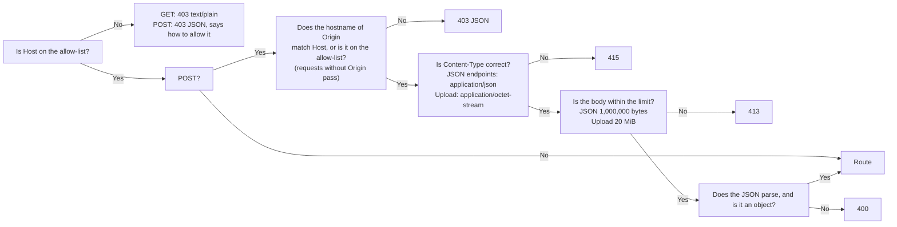

**English** | [日本語](../ja/api.md) | [简体中文](../zh-CN/api.md)

# API reference

> The machine-readable version is [openapi.yaml](openapi.yaml). This document is for humans: what each endpoint does, how the guards block requests, and where the behavior differs from the old Python version.
> It describes the **actual behavior**: every case of the old version was captured as golden responses (`tests/baseline/golden/`, 172 of them), and the new Rust backend is compared against them one by one.

## 1. Overview

The browser talks to the backend only through this set of REST endpoints. The frontend has no database access and no logic for deciding whether an import is allowed.

| Method | Path | Purpose | Writes to the database? |
|---|---|---|---|
| GET | `/api/info` | Version, CPU architecture, whether the program can be shut down, question count | No |
| GET | `/api/bank` | The questions of every bank (active questions only) | No |
| GET | `/api/banks` | The question banks (one per imported workbook) with their sheets and counts *(v0.5)* | No |
| GET | `/api/progress` | Study records | No |
| GET | `/api/imports` | The last 12 import records | No |
| GET | `/api/records` | Every kept exam record, newest first *(v0.5)* | No |
| GET | `/api/record?id=<int>` | One exam record with its per-question detail *(v0.5)* | No |
| GET | `/api/settings` | Interface settings *(v0.5)* | No |
| POST | `/api/upload` | Upload an .xlsx file and get a **preview** and a one-time confirmation code; optional header `X-Bank-Target` *(v0.5)* | **No** (staged in memory only) |
| POST | `/api/import/confirm` | Confirm the import | **Yes** (one transaction) |
| POST | `/api/import/cancel` | Cancel the pending import | No |
| POST | `/api/banks/delete` | Delete a question bank (optionally with its study data) *(v0.5)* | Yes |
| POST | `/api/attempt` | Record the result of one exam (optionally with the answers given) | Yes |
| POST | `/api/records/delete` | Delete one exam record, or all of them *(v0.5)* | Yes |
| POST | `/api/reset` | Clear the study records | Yes |
| POST | `/api/settings` | Change interface settings *(v0.5)* | Yes |
| POST | `/api/settings/reset` | Restore the default interface settings *(v0.5)* | Yes |
| POST | `/api/shutdown` | Shut down the program (available only when running on the local machine; always 403 in Docker) | No |

`HEAD` behaves like the corresponding `GET`, just without a body. The v0.5 endpoints go through exactly the same guards (section 3) as the others.

## 2. What every response has in common

- `Cache-Control: no-store` and `X-Content-Type-Options: nosniff`.
- JSON is UTF-8, and Japanese and Chinese characters are not escaped as `\uXXXX`. The separators are `", "` and `": "` (a space after the colon), and the key order is fixed. **This is part of the contract**: the smoke test runs `grep '"bankCount": 0'`.
- Errors look like `{"error": "<reason in Chinese that can be shown to the user as is>"}`. The backend never puts exception names, file paths or SQLite error messages in a response; the details go to the log only.

## 3. Guards (every request goes through them first)

The order is fixed, so the same bad request always gets the same answer:



- **Host**: by default only `localhost`, `127.0.0.1` and `::1` are accepted. To access the app through another address or domain name, put it in the environment variable `XEXAM_ALLOWED_HOSTS` (separated by commas, spaces or semicolons). `XEXAM_ALLOW_ANY_HOST=1` turns off the Host check (use it only when authentication is already in front of the app, for example Cloudflare Access).
- **Origin** (checked only on write requests): only the **hostname** is compared (not the scheme or the port), so access through an HTTPS domain is not blocked by mistake. Requests without an `Origin` header pass (command-line tools are not cross-site requests from a browser). When a proxy rewrites Host to the origin server's address, put the public domain in `XEXAM_ALLOWED_ORIGINS`.
- The backend **reads only the real `Host` header** and never reads `X-Forwarded-*`. Nginx does not forward them either.
- A rejected request leaves one line in the log, and the response states which Host you sent and which value to add to which option.

## 4. Endpoint details

### `GET /api/info`
```json
{"version": "0.6", "arch": "x86_64", "canShutdown": false, "bankCount": 5}
```
`bankCount` is the number of active questions. The version number comes from the `VERSION` file.

### `GET /api/bank`
`file` / `mtime` are the file name and time of the most recent import (of any bank); `questions` contains only active questions, of every bank, grouped by bank id (ascending) and in each bank's order; in `sheets`, each sheet name has a count of usable questions and a count of deactivated ones (sheets with the same name in different banks are counted together; `GET /api/banks` has the per-bank numbers). For the fields of a question, see `Question` in [openapi.yaml](openapi.yaml).
Since v0.5 every question ends with one more key, `"bank": <bank id>` (after `row`); nothing else changed.
A question in the four-column format (A English, B Chinese, C Japanese, D answer) has two extra keys, `english` (the original text of column A) and `en` (the English split up following the Japanese structure), placed between `zh` and `explanation`. A question without English (including every question in the three-column format) **does not have** these two keys, so the output for old files is byte-for-byte the same as before. A hotspot question in `zh` / `en` has one more key, `choices`: the options for each sub-item, written in that language. `stem`, `options`, `items` and `answer` always come from the Japanese in column C.

### `GET /api/banks` *(v0.5)*
A question bank is one imported workbook. Ordered by `id`:

```json
{"banks": [{"id": 1, "name": "Kitchen basics", "filename": "Kitchen basics.xlsx", "legacy": true, "createdAt": "2026-11-10 14:00", "updatedAt": "2026-11-10 15:00", "total": 5, "inactive": 0, "sheets": [{"name": "Cooking", "usable": 3, "inactive": 0}, {"name": "Safety", "usable": 2, "inactive": 0}], "studied": 4, "records": 3}]}
```

- `name` is the file name without `.xlsx` when the bank was created (` (2)`, ` (3)`, … are appended when another bank already has that name); updating the bank changes `filename` and `updatedAt`, never `name`.
- `legacy`: the bank that holds the data from before v0.5, and the target of uploads without `X-Bank-Target`. Its question ids are the plain question ids of section 4.1 of [database.md](database.md); every other bank uses bank-scoped ids, so the same workbook can be imported as two independent banks.
- `total` = active questions, `inactive` = deactivated ones; `sheets` follows the bank's question order and also lists sheets whose questions are all deactivated (`usable` 0).
- `studied` = how many of the bank's questions (active or not) have statistics; `records` = how many exam records name this bank.

### `GET /api/progress`
`questions` holds the cumulative statistics for each question (how many times it was answered, how many correct, how many wrong, and the current streak of correct answers); `history` holds the last 60 exams (unchanged in v0.5, although the database now keeps 500, see `GET /api/records`); `masterStreak` is how many consecutive correct answers move a question out of the wrong-answer notebook (2).

### `POST /api/upload`
The request body is the raw bytes of the .xlsx file. The server:

1. Decides whether it is an .xlsx by **content** alone (magic number + ZIP structure + a workbook is present + no DOCTYPE / entity declarations + the uncompressed size has an upper limit). An empty file, an old `.xls`, a corrupted file and a file with a changed extension each get their own explanation in Chinese.
2. Parses it, builds the preview, and puts the parse result into the **single pending slot** in memory (uploading again replaces it), valid for 30 minutes.
3. **Does not write to the database.**

It returns the preview (`added / updated / unchanged / restored / removed / skipped / usable`, the details for each sheet, and the rows that could not be read, with the reasons) and a one-time confirmation code, `token`.

**Target bank** *(v0.5)*: the optional header `X-Bank-Target` says which bank the file goes to. The preview has the same keys in every case; it is computed against the target bank only.

| `X-Bank-Target` | Meaning |
|---|---|
| absent | Exactly the v0.4 behavior, against the legacy bank (created at confirm if it does not exist yet) |
| `new` (surrounding spaces ignored, any case) | A new bank is created at confirm; the preview shows every usable question as `added` |
| a bank id, `^[0-9]{1,18}$` (surrounding spaces ignored) | Update (replace) that bank; an unknown id → **404** `这个题库不存在（可能已被删除），请刷新页面后再试。` |
| anything else | **400** `上传目标不对，请刷新页面后再试。` |

The header is read after the guards and the size limit, and before the file is parsed. A rejected upload does not touch the pending slot.

### `POST /api/import/confirm`
The request body is `{"token": "…"}`.

- The confirmation code is a 128-bit random number (22 characters) and **can be used only once**. A wrong confirmation code does not consume the pending content; an expired one cannot be retrieved; a non-ASCII confirmation code is treated as "invalid" (409).
- The import completes in **one transaction**: either everything succeeds, or the question bank is left unchanged.
- If this file contains no usable question at all → 400, and nothing is imported (this prevents wiping out the question bank).

Import rules (the file is treated as the **complete content of its target bank**): questions that appear for the first time are added; questions that were changed are updated; questions of that bank that cannot be found in the file are **deactivated** (their study records are kept); a deactivated question that appears again is restored automatically. Other banks are never touched.

Response: `{"result": <same shape as the preview, without filename / token>, "bank": <GET /api/bank>}`. Only when the upload carried `X-Bank-Target`, a third key follows: `"bankId": <id of the created / updated bank>` (so the v0.4 response stays byte-for-byte the same). If the target bank was deleted after the preview → **404** `这个题库不存在（可能已被删除），请刷新页面后再试。`, nothing is written, and the confirmation code is used up.

### `POST /api/banks/delete` *(v0.5)*
Request body: `{"id": <int>, "withRecords": <bool, default false>}`. In one transaction it deletes the bank's questions (active and deactivated), its import history and the bank itself. With `withRecords: true` it also deletes the bank's study data: the statistics (wrong-answer notebook) of those questions, their per-question exam detail, and every exam record that drew from this bank and from no bank that still exists (usually: only from this bank; an exam that also used a bank deleted earlier goes too, instead of staying behind as an empty record). Without it, exam records and statistics stay; their detail shows the questions as deleted.
If the pending upload targets this bank (an upload for that id, or an upload without `X-Bank-Target` when this is the legacy bank), it is discarded.

Response: `{"banks": [...], "bank": <GET /api/bank>, "progress": <GET /api/progress>}`. `id` missing or not an integer (a boolean is not an integer), or `withRecords` present but not a boolean → **400** `请求的格式不对。`; unknown id → **404** `这个题库不存在（可能已被删除），请刷新页面后再试。`.

### `POST /api/import/cancel`
Discards the pending content. No confirmation code is needed.

### `POST /api/attempt`
The request body is `{"results": [{"id": "…", "correct": true, "answer": ["B"]}], "sheets": ["…"], "mode": "all", "seconds": 123}`.

Sanitizing rules: `results` must be a list with at most 2000 items; if `mode` is not `all / weak / retry` it is treated as `all`; `seconds` is clamped to the range 0 to 604800, and an abnormal value is treated as 0. **The server trusts `correct` and does not check whether the id is in the question bank either**; grading happens in the browser (see [security.md](security.md)).

*(v0.5)* Each result may carry an optional `answer`, stored only so the exam can be reviewed later: a JSON array of at most 64 elements, each a string of at most 8 characters, an integer 0–999, or `null` (`["C"]`, `["A", "D"]`, `[0, 1, null]`). Anything else is stored as "no answer"; the result itself is still accepted. The server stores one detail row per kept result, plus a snapshot of the banks the questions came from, and keeps the newest **500** exams (older ones are deleted together with their detail). The response is unchanged.

`percent` uses **round-half-to-even** (Python's `round`): 1 correct out of 8 is 12, not 13.

### `GET /api/records` *(v0.5)*
`{"records": [RecordSummary, …], "retention": 500}`, newest first, where a RecordSummary is

```json
{"id": 7, "at": "2026-11-10 15:10", "banks": [{"id": 1, "name": "Kitchen basics", "deleted": false}], "sheets": ["Cooking"], "mode": "all", "total": 5, "correct": 4, "percent": 80, "seconds": 130, "answered": 5, "detail": true}
```

`banks` is the snapshot taken when the exam was saved, with the bank's current name while it exists (`deleted: true` once it is gone). `detail` says whether per-question detail exists (exams saved before v0.5 have none); `answered` is the number of detail rows with an answer, or `null` without detail.

### `GET /api/record?id=<int>` *(v0.5)*
`{"record": RecordSummary, "items": [{"seq": 0, "questionId": "…", "answer": ["C"], "correct": true, "question": {…}}]}`. `answer` is the stored array or `null`; `question` is the question exactly as in `GET /api/bank` plus a trailing `"active": <bool>` (deactivated questions are included), or `null` when the question no longer exists.
`id` must be exactly one query parameter of 1–18 ASCII digits (percent-encoding is decoded) → otherwise **400** `请求的格式不对。`; unknown id → **404** `这条考试记录不存在（可能已被删除），请刷新页面后再试。`.

### `POST /api/records/delete` *(v0.5)*
Request body: either `{"id": <int>}` (delete that exam record and its detail; the per-question statistics, i.e. the wrong-answer notebook, are **not** changed) or `{"all": true, "withStats": <bool, default false>}` (delete every exam record and its detail; `withStats: true` also empties the statistics, which equals `POST /api/reset`).
Response: `{"records": [...], "retention": 500, "progress": <GET /api/progress>}`. Any other body (no `id` and no `all`, both, `all` not `true`, `withStats` with `id`, wrong types) → **400** `请求的格式不对。`; unknown id → **404** `这条考试记录不存在（可能已被删除），请刷新页面后再试。`.

### `POST /api/reset`
Clears the score history (with its per-question detail) and the per-question statistics; the question bank is untouched.

### `GET /api/settings` / `POST /api/settings` / `POST /api/settings/reset` *(v0.5)*
Settings are stored in the database (they survive container restarts and updates, clearing the browser cache and switching browsers):

```json
{"theme": "system", "uiLang": "en", "autoAdvance": false, "questionLang": "ja"}
```

| Key | Values | Default |
|---|---|---|
| `theme` | `system` · `light` · `dark` | `system` |
| `uiLang` | `en` · `zh` · `ja` | `en` |
| `autoAdvance` | `true` · `false` | `false` |
| `questionLang` | `ja` · `zh` · `en` | `ja` |

`GET` returns the defaults merged with the stored values (a stored value that is not valid is ignored). `POST /api/settings` takes any subset of these keys and returns the full settings; unknown keys are ignored; a known key with an invalid value → **400** `设置的值不对。` and nothing is written. `POST /api/settings/reset` (body `{}` or empty) restores `theme`, `uiLang` and `autoAdvance` to their defaults, keeps `questionLang`, and returns the full settings.

### Error messages added in v0.5
Like every backend message they are Chinese and stable (the frontend translates them):

| Message | When |
|---|---|
| `这个题库不存在（可能已被删除），请刷新页面后再试。` | 404: unknown bank id (`X-Bank-Target`, confirm, `/api/banks/delete`) |
| `这条考试记录不存在（可能已被删除），请刷新页面后再试。` | 404: unknown exam record (`/api/record`, `/api/records/delete`) |
| `上传目标不对，请刷新页面后再试。` | 400: malformed `X-Bank-Target` |
| `请求的格式不对。` | 400: malformed body / query of a v0.5 endpoint |
| `设置的值不对。` | 400: invalid setting value |

### `POST /api/shutdown`
Available only when started with `--allow-shutdown` (on Windows, by double-clicking `start.bat`). Always 403 in Docker; use `docker compose stop` there.

## 5. Differences from the old version

The table below lists where the new Rust backend **intentionally differs** from the old Python v0.2. Every item is registered in `tests/baseline/golden/allowed_differences_rust.json` and `allowed_probe_differences_rust.json`; a difference that is not registered makes the tests fail.

| Difference | Old version | New version | Reason |
|---|---|---|---|
| Unsupported methods (PUT / DELETE / OPTIONS…) | 501 + the standard library's HTML page | 405 + `Allow: GET, HEAD, POST` | Standard behavior |
| Static files | Served by the backend itself | Not served by the backend (404); served by Nginx | Frontend and backend are separated |
| Malformed `Content-Length` (non-numeric, negative, duplicated) | Treated as 0, or 413 | 400, connection closed | The HTTP layer rejects it before it reaches the handler; browsers and Nginx never send such a request |
| `Content-Type: Application/JSON` (different case) | 415 | Accepted | MIME types are case-insensitive |
| `Content-Type: text/plain;application/json` | Accepted | 415 | It must really be `application/json` (the Python v0.2 was changed too) |
| Chunked upload | Treated as an empty file (400) | Counted as a stream; over 20 MiB returns 413 | `Content-Length` is not trusted |
| DOCTYPE / entity declarations | Scanned only the ASCII bytes of lowercase `.xml` / `.rels`; UTF-16, `.dat` and `.XML` could get around it and be expanded | Rejected for any extension and any encoding, and the XML parsing layer also rejects any DOCTYPE | Security hardening |
| Duplicate ZIP entry names | The last one is used | Rejected (corrupted) | So that the check and the read cannot see different content |
| Number of ZIP entries | Unlimited | At most 10,000 | Resource limit |
| Number of XML nodes / depth | Unlimited | 1 million (100 × 10,000) / 64 levels | Resource limit |
| Library exception text in error messages | Contained the original Python / expat text | Fixed Chinese text, the prefix unchanged | Does not leak internal details |
| `Server` response header | `Xexam/<version> Python/<version>` | None | Does not leak the version |
| `//api/info` (double slash) | Collapsed by the standard library into a 200 | 404 | The frontend never sends such a path |
| Oversized request headers (70,000 bytes) | 431 | Rejected by Nginx first | Nginx's header buffer limit |
| `seconds` is a string | `int()` accepts any Unicode digits (full-width `７７`, Arabic-Indic digits), and an overlong digit string hits a separate 4300-digit limit | Only ASCII digits are recognized; anything else is treated as 0 | The page only ever sends numbers; neither affects the meaning of the study records |
| Run directly without `--data` / `XEXAM_DATA` | The data directory is `data` under the program directory | The data directory is `data` under the **current working directory** | Affects only local runs without Docker; please specify `--data` explicitly |
| Subcommand placed after the options (`--data /d import x.xlsx`) | Not applicable (the old version used `--import`) | The subcommand must be the first argument, otherwise it is treated as `serve` (the old form `--import x.xlsx` still works) | Simpler argument parsing |

### Changes in v0.5 (relative to v0.4)

Everything an older client sends keeps working, with the same answers, except:

| Change | v0.4 | v0.5 |
|---|---|---|
| Questions in `GET /api/bank` (and in `bank` of the confirm / delete responses) | … `"row": 3}` | … `"row": 3, "bank": 1}` |
| Exam records kept in the database | 60 | 500 (`/api/progress` still returns 60) |
| Database schema | v1 | v2, migrated automatically at the first start (see [database.md](database.md)) |

## 6. Examples

```bash
# Check the version and the question count
curl -s http://localhost:8765/api/info

# Upload (you only get a preview; nothing is written to the database)
curl -s -X POST http://localhost:8765/api/upload \
  -H 'Content-Type: application/octet-stream' -H 'X-Filename: demo.xlsx' \
  --data-binary @tests/baseline/fixtures/demo.xlsx

# Confirm the import (fill in the token returned by the previous step)
curl -s -X POST http://localhost:8765/api/import/confirm \
  -H 'Content-Type: application/json' -d '{"token": "…"}'

# Import the same file as a new, separate bank (then confirm as above; the response ends with "bankId")
curl -s -X POST http://localhost:8765/api/upload \
  -H 'Content-Type: application/octet-stream' -H 'X-Filename: demo.xlsx' -H 'X-Bank-Target: new' \
  --data-binary @tests/baseline/fixtures/demo.xlsx

# List the banks, then delete bank 2 together with its study data
curl -s http://localhost:8765/api/banks
curl -s -X POST http://localhost:8765/api/banks/delete \
  -H 'Content-Type: application/json' -d '{"id": 2, "withRecords": true}'

# Switch the interface to dark mode and Japanese
curl -s -X POST http://localhost:8765/api/settings \
  -H 'Content-Type: application/json' -d '{"theme": "dark", "uiLang": "ja"}'
```

> When you go through Nginx, the `Host: localhost:8765` that `curl` sends by default is on the allow-list. Before accessing the app through another domain, set `XEXAM_ALLOWED_HOSTS` first.

## Sign-in and users (v0.6)

Every route needs a signed-in account (cookie `xexam_session`) except `GET /api/info`, `GET /api/auth/state` and `POST /api/auth/login`. Without a valid session the answer is **401** `请先登录。`; while the account must choose a new password, every route except `GET /api/auth/state`, `POST /api/auth/password` and `POST /api/auth/logout` answers **403** `请先设置新密码。`; admin routes answer **403** `只有管理员可以进行这个操作。` to other users. Error bodies keep the shape `{"error": "<message>"}`.

| Route | Body | Answer |
|---|---|---|
| `GET /api/auth/state` | | `{"user": {"id", "username", "role", "mustChangePassword"} \| null}`; signed out it adds `"defaultAdmin": true` while an enabled administrator still has the default password; signed in it adds `"library"` (changes when a bank is imported or deleted) |
| `POST /api/auth/login` | `{"username", "password"}` | `{"user": {...}}` and the session cookie (`HttpOnly; SameSite=Strict; Path=/; Max-Age=2592000`, `Secure` only for an `https://` Origin or `XEXAM_COOKIE_SECURE=1`) plus a known-browser cookie `xexam_device` (`Path=/api/auth`). Wrong or disabled: 401 `用户名或密码不对。`. Locked: **429** `登录失败次数太多，请稍后再试。` with `"retryAfter": <seconds>` and a `Retry-After` header |
| `POST /api/auth/logout` | `{}` | `{"ok": true}` and an expired cookie |
| `POST /api/auth/password` | `{"current"?, "password"}` | `{"user": {...}}`; `current` is required unless the account must choose a new password; signs out the account's other sessions |
| `GET /api/users` (admin) | | `{"users": [{"id", "username", "role", "disabled", "createdAt", "lastLoginAt", "mustChangePassword", "records", "lock"}]}`; `lock` is `null` or `{"until", "retryAfter", "round", "triesLeft"}` |
| `POST /api/users/create` (admin) | `{"username", "password", "role"}` | `{"users": [...]}`; the new user must choose a new password at the first sign-in |
| `POST /api/users/update` (admin) | `{"id", "username"?, "role"?, "disabled"?}` | `{"users": [...]}` |
| `POST /api/users/password` (admin) | `{"id", "password"}` | `{"users": [...]}`; signs the user out, sets the forced change and clears their sign-in lock |
| `POST /api/users/delete` (admin) | `{"id"}` | `{"users": [...]}`; also deletes their sessions, exams, wrong-answer notebook and settings |
| `POST /api/users/unlock` (admin) | `{"id"}` | `{"users": [...]}`; clears the sign-in lock of that user (back to 5 tries) |

Rules: usernames 1–40 characters (letters, digits, `. _ - @`, unique ignoring case), passwords 8–128 characters. You cannot disable, demote or delete yourself (409 `不能对自己的账户做这个操作。`), and the last enabled administrator stays (409 `至少要保留一个启用的管理员。`). Records, progress, the wrong-answer notebook and settings routes work on the signed-in user's own rows only.
