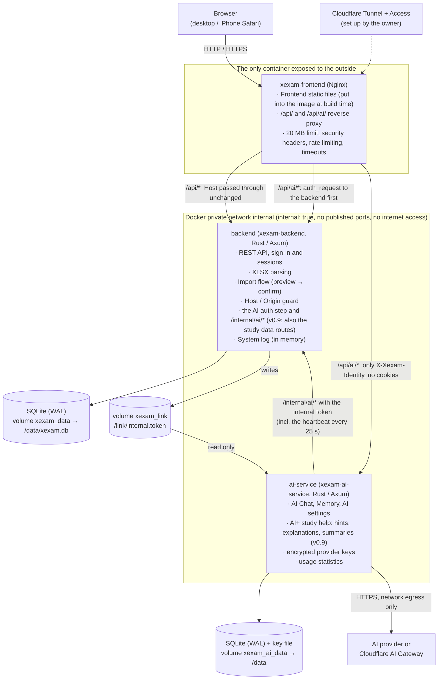
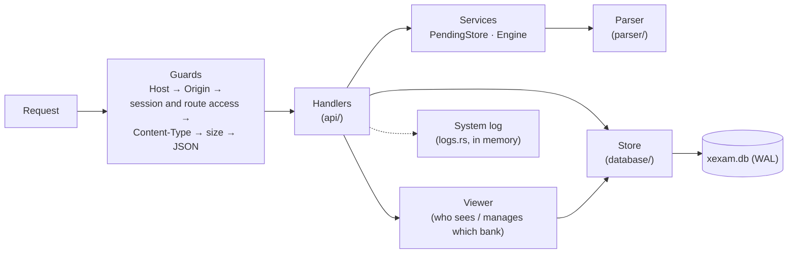
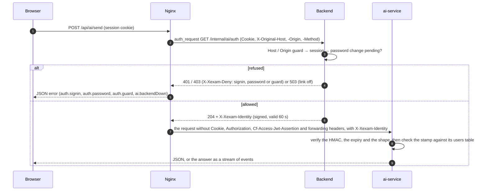
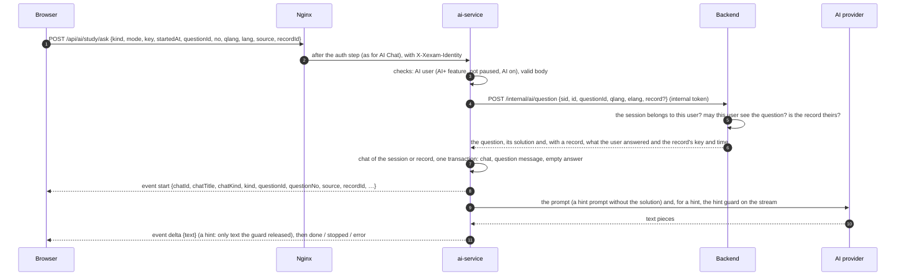
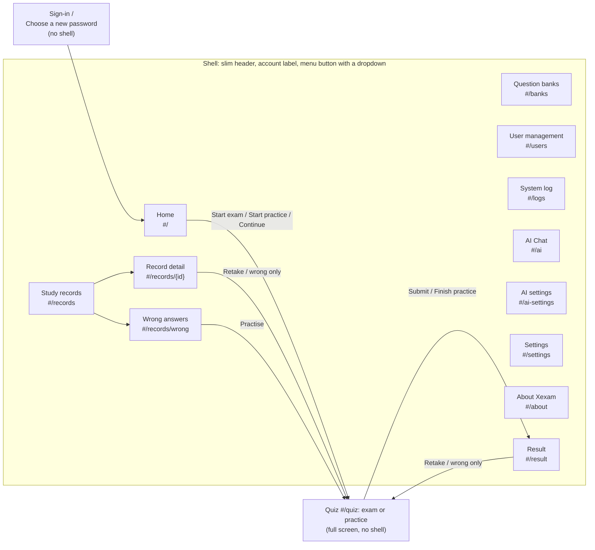
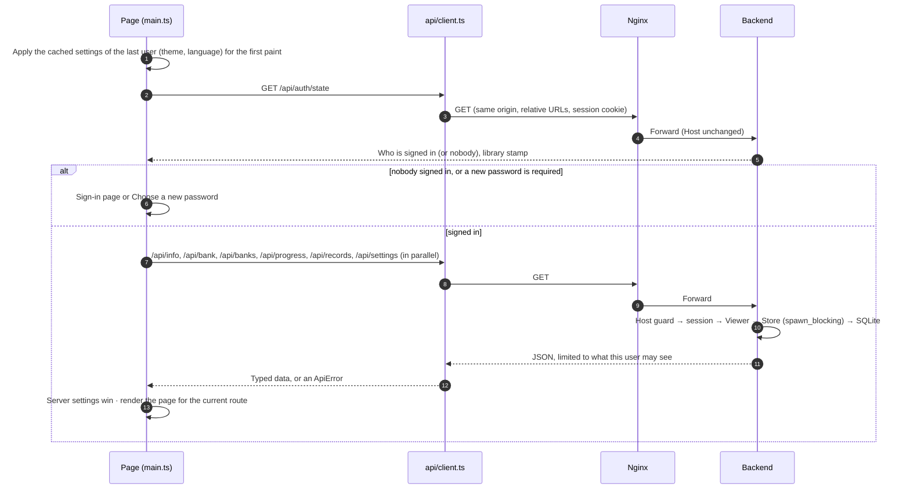
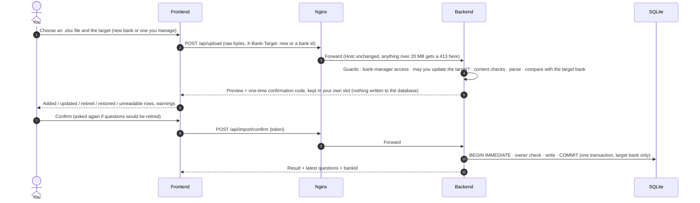
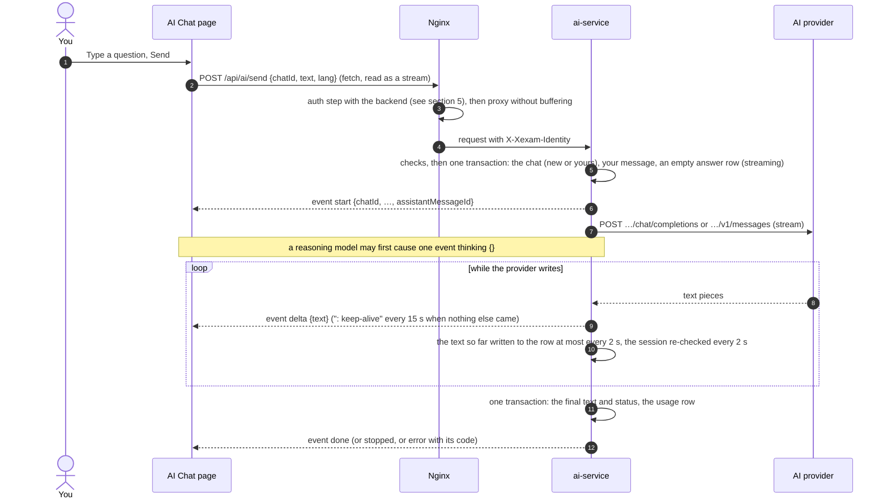

**English** | [日本語](../ja/architecture.md) | [简体中文](../zh-CN/architecture.md)

# Architecture (v1.1)

> How Xexam is built: Nginx in front, a Rust backend behind it, a separate Rust service, ai-service, next to it (v0.8; v0.9 adds the AI+ study features to it; v1.0 adds the per-user AI request caps and the answer and memory lengths in characters), SQLite for storage (one database per service), and a TypeScript frontend without a framework. v1.0 also rebuilds the interface for phones first (section 6).
> Background from the switch away from the old Python version (Chinese only): the audit of the old code is in [architecture-audit.md](../zh-CN/history/architecture-audit.md), the decisions and defaults are in [migration-plan.md](../zh-CN/history/migration-plan.md).

## 1. Overview



- **Only Nginx publishes a port** (`XEXAM_BIND`, default `127.0.0.1:8765` → `8080` inside the container).
- The network the backend sits on is `internal: true`: there are no `ports`, neither the host nor the outside can reach it, and it cannot reach the internet itself. ai-service is on that network too and, as the only container, also on the network `egress`, which gives it outbound internet access to reach the AI provider. It publishes no port either.
- Each database is read and written only by its own service: `xexam.db` by the backend, `xexam-ai.db` by ai-service (the data boundary, section 5). The Nginx container has no database, no source code and no Node.
- **Limits, from the outside in**: Nginx limits each client address and each AI session (section 9 of [security.md](security.md)); ai-service then limits the running answers per user and the model calls at once for the whole instance, and since v1.0 the per-user request caps (5 a minute, 20 an hour, 100 a day, administrators included; section 5). These limits protect the server and the provider bill; they are not access control.
- The browser talks to the backend only through REST (see [api.md](api.md)). Every route except `/api/info`, `/api/auth/state` and signing in needs a session. The frontend has no database access and makes no decisions such as "can this import be done" or "may this user see this bank": the backend decides, the frontend only shows.
- Everything the main app keeps lives in the backend's data directory (`/data` in Docker): the database `xexam.db` (users, questions, study records, settings), while the backend runs its `xexam.db-wal` and `xexam.db-shm` files, and, after an upgrade, the folder `backups/` with the copy written before the schema migration. Everything of AI lives in ai-service's own data directory (`/data` in its container, the volume `xexam_ai_data`): `xexam-ai.db` with its `-wal` / `-shm` files and the key file `secret.key`.

## 2. Directory layout

```
frontend/       TypeScript 5.9 (strict) + Vite, plain DOM, no framework
  vite.config.ts  build settings, the /api and /api/ai/ proxies for development, the xexamAiAuth plugin (the auth step of AI
                  requests, like Nginx), the xexam-changelog plugin (reads the three changelogs in docs/)
  src/main.ts     entry point: first paint from the cached settings, sign-in check, maps the route to a page
  src/router.ts   hash routes (#/, #/banks, #/users, #/logs, #/ai, #/ai-settings, #/records, #/records/<id>, #/records/wrong,
                  #/settings, #/about, #/quiz, #/result)
  src/api/        typed fetch wrappers: client (errors become ApiError with code and field; retries of Nginx's 429, time limits;
                  postStream for the AI answers), ai, auth, bank, import, logs, progress, settings, users
  src/types/      API types (matching docs/en/openapi.yaml), the type of the build-time changelog module
  src/domain/     pure functions with unit tests: grading and random pick, practice checking, saved results (notCounted),
                  question language, records filter, lock notes and waits, import warnings, system log buffer, changelog parsing,
                  the event-stream parser (sse), the AI chat state (ai-chat), the safe Markdown subset of answers (ai-markdown),
                  memory requests (ai-memory), the AI settings form rules (ai-settings), and the AI+ study features (v0.9: ai-plus,
                  who sees which control and in which state; ai-study, the state of one answer; ai-run, the engine that asks, stops
                  and polls; ai-spec, the request builders; v1.0: ai-panel, the AI+ panel's state and its saved-chat note)
  src/i18n/       t() / tn(), catalog/<area>.ts (UI text in en / zh / ja), server-messages.ts, errors.ts
  src/state/      shared state (store), actions (loading, sign-in, navigation), bank access rules, AI status (ai), settings
                  (preferences, settings-cache), the saved exam or practice (session-storage), browser storage keys
  src/components/ shell (header, menu), review (answer cards), lang-switch (English / 中文 / 日本語), kind-tag (Exam / Practice),
                  fields (form fields of the sign-in and user pages), ai-badge (AI+), ai-render (answers), ai-plus-controls (every v0.9
                  study control of every page), ai-summary (the summary window), ai-study-ui, tooltip,
                  mini-switch, mini-icons, common
  src/pages/      auth (sign-in, new password), home, banks, users, logs, ai (AI Chat), ai-settings, forbidden ("Not allowed"),
                  records, settings, about, quiz, result
  src/styles/     main.css (colour tokens, light / dark, safe areas, dialogs, toasts) + shell.css (top bar, menu, footer) and
                  icon-button.css (icon buttons, tap-and-hold labels) + one CSS file per page area
  src/utils/      DOM builder, dialogs, toasts, formatting, clipboard, media.ts (the PHONE media query, PHONE_MQ)
backend/        Rust (Axum 0.8 + Tokio + rusqlite), toolchain pinned to 1.99.1
  src/main.rs     command line, start-up (database, log, reminders), graceful shutdown with the WAL checkpoint
  src/api/        dispatch and guards (Host / Origin / session / Content-Type / size), routes, sign-in and user routes (auth.rs,
                  with the AI auth step), the route table with each route's access, JSON formatting, attempt sanitizing,
                  internal.rs (v0.8: the internal token, the identity statement and the /internal/ai/* routes), internal_study.rs
                  (v0.9: the three study data routes)
  src/auth/       passwords (Argon2id), session tokens and cookies, the known-browser cookie, the login throttle (throttle.rs)
  src/services/   per-user pending imports (PendingStore) with a shared memory budget, parser engine interface, import flow
  src/parser/     .xlsx parsing: ZIP protection, XML, question recognition (the six-column layout; the 3- and 4-column layouts
                  only to tell them apart and refuse them), question id
  src/database/   schema (v1 verbatim + v2 to v6 additions), journal mode (journal.rs), Store, legacy progress.json, timestamps
    store/          banks (viewers, owners), records, settings, users (accounts, sessions, AI+), study (v0.9: what the AI service may
                    read of one question or record), migrate (v1 → v6, backups, fix-ups)
  src/models/     shared types: questions, import targets, Viewer and BankScope
  src/logs.rs     the System log: ring buffer, tracing layer, BurstLog
  src/security/   Host / Origin checks, size-limited request body reading, tokens
  src/config/     environment variables, the VERSION file
  tests/          unit, golden-response, parser comparison (3-, 4- and six-column), id-vector, one file per version
                  (v05_…, v06_…, v065_…, v07_…, v08_ai_link, v09_ai_study)
ai-service/     the AI service (v0.8): Rust (Axum 0.8 + Tokio + rusqlite + reqwest with rustls), its own Cargo.lock, no unsafe
  src/main.rs     command line (serve, healthcheck, --help), start-up, background tasks, graceful shutdown (and the last "stopping" report)
  src/app.rs      the shared state: settings snapshot, key state, limits, running answers, the link to the backend, the heartbeat
  src/api/        dispatch (mod.rs: method → path → identity → Content-Type → body → access), user routes, admin routes, study.rs
                  (v0.9: the study routes)
  src/chat.rs     the generation task of an answer: the gate, the per-user registry, cancelling, saving, the 2-second re-check
  src/provider/   OpenAI-compatible and Anthropic adapters (gateway in either format), the event-stream parser, error mapping
  src/store/      the AI database: schema v3, settings / secrets / limits rows, users / chats / messages / memories (study chats
                  and their saved answers included), usage statistics (by purpose) and the audit outbox
  src/study/      v0.9: the hint, explanation and summary prompts, the hint guard (guard/), the chat titles, the strict types of the
                  backend's data routes (wire.rs) and the record-identity cache (cache.rs)
  src/identity.rs, link.rs  the identity statement; the internal token and the calls to /internal/ai/* (including the heartbeat)
  src/secret.rs, settings.rs  key encryption and the key file; providers, the URL policy, the fingerprint, settings updates
  src/limits.rs, prompt.rs, retention.rs, logs.rs, codes.rs, config.rs  safety limits (incl. the answer and memory lengths and the
                  character-to-tokens conversion); system prompt and history; retention, reconcile and outbox; logging and
                  forwarding; error codes and their texts; environment
  src/quota.rs    v1.0: the per-user request caps (per minute and hour rolling, per day from 0:00 in the server's time zone)
  tests/          streaming, settings and keys, identity and access, admin data, logs without secrets, proxy environment; v0.9: the
                  store (v09_store), the guard (study_guard), the prompts (study_prompts) and the study routes (study_api)
nginx/          nginx.conf + Dockerfile (builds the frontend, with the three changelogs → ships only the static output)
docker/         docker-compose.yml (pulls the three images), docker-compose.build.yml (builds them; context: the repository root), .env.example
scripts/        release-notes.py (Release notes from docs/en/changelog.md), set-release-version.py (RELEASE_VERSION and the README badge)
tools/          screenshots/: retakes the README and docs screenshots from a throw-away instance; icons/: makes the app icons;
                phone-walk/ (v1.0): walks the phone layout of a throw-away stack at the phone sizes (see development.md)
VERSION         CODE_VERSION (the version of the code) and RELEASE_VERSION (the last published release)
README.md       the English README (it links to the changelog in docs/en/); README/ holds README.ja.md and README.zh-CN.md
LICENSE         MIT license
tests/          baseline/ (golden responses and fixtures of the old version) · integration/ (nginx, full stack, progress.json migration,
                ai_stub.py: a made-up AI provider for the checks and the screenshots)
docs/           en/ (English, the source) · ja/ · zh-CN/ (with history/: older documents, Chinese only); each with its own
                screenshots/ and changelog.md; en/openapi.yaml
```

## 3. Data model (v0.9)

The full table reference is in [database.md](database.md). The ideas behind it:

### Users and sessions

- **Users** have a role: **administrator** or plain user. A plain user can also have the **Bank manager** permission. A new or upgraded database starts with the administrator `admin` / `admin`, who must choose a new password at the first sign-in.
- **Sessions** live in the database (only the SHA-256 of the cookie value is stored), so a restart does not sign anyone out. Sign-in locks after wrong passwords live in memory only (see [security.md](security.md)).
- **Everything personal belongs to one user**: study records, the wrong-answer notebook (per-question statistics) and the settings. Every route reads and writes them for the signed-in user; the user id always comes from the session, never from the request.
- **Question banks are shared**, but who sees which bank is decided per user (next sections).
- **AI+ feature** (`users.ai_enabled`, v0.8, the **AI+ feature** line in User management) is the per-user grant that gives a plain user the AI+ feature; administrators always have it. It is only one of two per-user states: the **pause** (**Pause** / **Resume**, in AI settings) lives in the AI database (section 8 of [database.md](database.md)) and never changes this one. Each user also has an identity stamp (`users.uid`, 32 random hex digits set once at creation), which the AI service stores next to the user id to notice an id that now belongs to another account.

### Question banks

- **A question bank is one imported workbook.** The `banks` table has one row per bank. An upload goes either to a new bank or to an existing one (`X-Bank-Target` header, see [api.md](api.md)).
- **An import replaces the content of its target bank only.** Questions of that bank that are missing from the file are retired; questions of other banks are never touched.
- **The legacy bank.** Data from before v0.5 becomes one bank (`legacy_ids = 1`). Its question ids are the plain ids the parser computes, unchanged, so the statistics, the wrong-answer notebook and the exam history from before stay linked. Uploads without `X-Bank-Target` go to this bank: older clients and the command-line `import`.
- **Bank-scoped ids.** Every other bank stores its questions under `sha1("xexam-bank:{bank_id}\n{parser id}")`, first 12 hex digits. The same workbook can therefore be imported twice as two independent banks, and their ids and study data never mix. Bank ids are never reused.
- **Owners.** Every bank has an owner: the user who imported it as a new bank. Banks from before v0.7, and banks created without a signed-in user (the command-line `import`), belong to the first administrator. When a user is deleted, the banks they own move to the administrator who deletes them.
- **One layout.** Since v0.7 only the six-column layout can be imported (A–C the question in English, Chinese and Japanese, D–F the answers and explanations). English is authoritative: the question type, the options, the identity and the answer key come from A and D, and the question stores the explanation of each language (`lang`, `ja`, `explain`, see section 4.7 of [database.md](database.md)). The parser still recognises the 3- and 4-column layouts of earlier versions, so that the upload, the import confirm and the command-line `import` can refuse them (`services::check_layout`, 400) before anything is staged or written. Questions imported from them earlier are retired at every start (`Store::retire_old_layout_questions`, section 4.2 of [database.md](database.md)); the banks and their study data stay.
- Deleting a bank removes its questions, its import history, who may see it and the bank itself. Its study data is removed only on request (`withRecords`, an unchecked box in the confirm dialog): an administrator removes it for every user, a bank manager only their own.

### Who sees and manages which bank: Viewer and BankScope

Every request that reads bank data or writes into a bank builds a **`Viewer`** from the signed-in user, read from the database at that moment (so a change by an administrator applies to the very next request, without signing anyone out):

| | `admin` | `can_manage` | `scope` (a `BankScope`) |
|---|---|---|---|
| Administrator | yes | yes, every bank | `All` |
| Plain user | no | the permission | `Only(their user_banks rows, plus the banks they own while they are a bank manager)` |

A plain user's `user_banks` rows are the existing banks an administrator ticked for them. **Include banks imported later** (`users.new_banks`) is not part of the viewer: it only adds a row for each new bank, in the transaction that creates the bank.

- **Reading**: the `*_as` methods of the store take the viewer or its `BankScope`. A user limited to some banks gets only those banks in `/api/bank` and `/api/banks`, only their questions' statistics in `/api/progress`, and in a record's detail the questions of other banks are left out like deleted ones. In `/api/banks` the studied and records numbers are the viewer's own for everyone except administrators, and only administrators see who owns a bank.
- **Writing**: `Viewer::manages(owner)` is true for administrators, and for a bank manager only for the banks they own. An import into an existing bank and a bank delete check it **inside the write transaction**, so an owner change that happens meanwhile (a deleted user's banks moving to an administrator) cannot slip in between the check and the write; a refusal writes nothing (403 `MSG_NOT_BANK_OWNER`). The upload route checks the target once more before it parses, so a refused upload costs no parse time.
- **Exams**: when a plain user submits, questions outside their scope are treated exactly like questions that no longer exist: not counted, nothing written for them, their ids returned in `notCounted`.
- **Refreshing open pages**: `GET /api/auth/state` carries a **library stamp**, an opaque digest. For administrators it follows the whole library; for a plain user it follows only their banks and their access, so it neither reveals nor follows banks they cannot see. The page compares it at every page change and when the tab comes back into view, and reads the banks again when it changed.

### Study records: exams and practice

- `attempts` has one row per submitted exam or practice session, with its owner (`user_id`), its kind (`exam` or `practice`), a snapshot of the banks it drew from (id and name at the time) and, since v0.9, the key and start time of the session it came from (`session_key`, `started_at`; NULL for older records), which tie it to the AI chat of that session. Each user keeps their newest **500** records; `/api/progress` returns the newest 60.
- `attempt_items` has one row per question of a record: the question id, the answer given (as the page sent it, after cleaning; no value = unanswered) and whether it was correct. Records saved before v0.5 have no such rows.
- A practice session counts in the wrong-answer notebook exactly like an exam.
- The record detail (`GET /api/record`, which also returns `sessionKey` and `startedAt`) puts the detail rows next to the questions as they are stored **now**, retired ones included. A question that was deleted with its bank, or that belongs to a bank the user can no longer see, shows a note instead of its text.
- Deleting one record leaves the statistics (wrong-answer notebook) alone. Deleting all records can also clear them.

### Settings

- `user_settings` holds each user's theme, interface language, auto-advance and question language. Because they are in the data directory, they survive container updates, a cleared browser cache, other browsers and other devices.
- The browser keeps a copy per user in `localStorage` (`xexam.u<id>.settings.v1`) only to paint the first frame in the right theme and language. The server value wins as soon as it has loaded.

### AI data (in the AI service's own database)

- `xexam-ai.db` holds the AI settings and the encrypted provider keys, the safety limits (since v1.0 also the three per-user request caps and the answer length; the memory length is one of the limits too), the users the AI service has seen (id, stamp, last known name), their chats with the messages, their memory notes, one usage row per model call (never any content), and the audit lines not yet delivered. The table reference is section 8 of [database.md](database.md).
- Since v0.9 the chats also hold the answers of the AI+ study features: one chat per practice session, per exam and per record summary, each with its saved hints, explanations or summaries (the question texts as they were sent and the AI answers are copied into this database; section 8.2 of [database.md](database.md)). They are ordinary chats for the user, the administrator views, the quotas and retention. The study screens never open these chats: the AI+ panel and the summary window only show the note **Saved in AI Chat** (the English wording; the same in each language), with the chat's name in a tip (v1.0).
- Chats are deleted automatically a number of days after their last message (90 by default, set in AI settings); memories stay until they are deleted. When a user is deleted in the main app, the AI service's reconcile removes their AI data and keeps their usage rows without the user. A user whose AI+ feature is not granted disappears from the AI settings list, but their data stays until it is deleted or retention removes it.

### What stays in the browser

- The exam or practice in progress (`xexam.u<id>.session.v1` in `localStorage`, one per user on that browser): question ids, answers, flags, position, time used, the kind, for a practice which questions were checked and, since v0.9, the random key and the start time of the session (kept through resume, sent with the save). No question text.
- The id of the user who signed in last (`xexam.lastUser.v1`), so their cached settings can paint the first frame.
- The known-browser cookie `xexam_device` (see [security.md](security.md)) and the session cookie `xexam_session`, both `HttpOnly`.
- Whether the menu is open is not stored: it lives in memory only, and the menu closes on every page change.
- AI keys typed into AI settings stay only in the page's memory until they are saved, and are cleared after saving, on a page change and at sign-out. Chats and memories are never stored in the browser; the AI+ panel and the summary window keep the answers they showed in memory only, forgotten at sign-out and on a reload.

## 4. Backend



All routes go through one dispatch function, so the guard order is the same for every request. (The only exception are the paths under `/internal/`, the link with the AI service: dispatch hands them to `api/internal.rs` before the Host guard and without the session layer; the auth step then runs the guard itself on the `X-Original-*` headers, see section 5.) The session check runs right after the Host (and, for POST, Origin) check and before any body is read, against one route table that names each route's access: **public**, **signed in**, **bank manager** (administrators and bank managers: upload, import confirm / cancel, import history, bank delete) or **administrator** (users, the System log, shutdown). A path that is not in the table needs a session too. Key design decisions (the early reasoning is in [audit/rust-stack.md](../zh-CN/history/audit/rust-stack.md)):

| Problem | Approach |
|---|---|
| rusqlite is synchronous | One connection sits behind `Arc<Mutex<Connection>>`; database calls run inside `spawn_blocking`, and the lock is never held across an `.await`. This maps one to one onto the old version's "one connection + RLock" |
| Journal mode | WAL with `synchronous=FULL` since v0.7 (`database/journal.rs`); `XEXAM_SQLITE_JOURNAL=delete` keeps the old rollback journal. A mode SQLite refuses is logged as a warning, never an error. The mode in effect is logged once at start-up; a graceful shutdown runs `wal_checkpoint(TRUNCATE)`. See section 2.1 of [database.md](database.md) |
| Request body limit | A hand-written streaming reader: it counts the real bytes as it reads and returns 413 the moment 20 MiB is exceeded, **without trusting `Content-Length`** (the same applies to chunked uploads) |
| Can parsing stall the service? | Parsing runs on a blocking thread with a cooperative deadline (`XEXAM_PARSE_TIMEOUT_SECS`, 30 seconds by default; when it expires, the parser stops by itself), and at most 2 parses run at a time; there are limits on the number of ZIP entries, the size after decompression, XML depth / node count / attributes per element, and the total number of cells and total bytes; shared strings are stored only once |
| Pending imports | A preview is held in memory only and never written to the database. **Each uploading user has their own slot** (keyed by user id): one bank manager's upload never replaces, confirms or cancels another user's preview. All slots together share a memory budget of **128 MiB** (estimated from the parsed questions): staging an upload drops the oldest previews of other users while the total is above it, and their confirm then says the preview expired, as after the 30-minute limit. The newest upload is always kept |
| Import atomicity | Confirmation runs `BEGIN IMMEDIATE … COMMIT` and rolls back as a whole on failure; the owner check is part of that transaction; the confirmation code is single-use, 128 bits of randomness, and compared in constant time; if several confirmations arrive at once, only one can succeed |
| A commit being interrupted | The import commit is a separate task and runs to completion even if the client disconnects; `docker stop` waits at most 15 seconds, and the backend shuts down gracefully within 8 seconds |
| Schema upgrade | When the backend opens a database of an older schema that holds data, it first writes a copy with `VACUUM INTO` to `backups/` next to `xexam.db`, then migrates in one transaction, and only then switches to WAL. If the copy cannot be written, it does not start. Opening an up-to-date database writes nothing (see section 6 of [database.md](database.md)) |
| Deleting data | Bank, record and user deletes run in one transaction each. Deleting a bank also drops a pending upload that targets it |
| Passwords | Argon2id in `spawn_blocking`, at most 2 at a time; the login throttle answers before any hashing. See [security.md](security.md) |
| Logs | `tracing`, without colours, filtered by `XEXAM_LOG` (default `info`, also when it is empty; an invalid value falls back to `info` with one warning); users are named by their username, never by id; **passwords, session tokens, cookie values, confirmation codes, the internal token, identity statements and question text are never logged** (since v0.9 the study data routes write nothing at all). See below |
| Errors | Always `{"error": "<reason, in Chinese>"}`; database exceptions, file paths and SQLite errors go only to the log, never into the response. The frontend translates the messages it knows (section 6) |

### The System log

- `main.rs` installs one `tracing` subscriber with **one filter** (`XEXAM_LOG`, default `info`) and two outputs: stderr, which is what `docker compose logs backend` shows, and the `BufferLayer` of `logs.rs`. The plain status lines that `main.rs` prints to stdout at start-up and shutdown are added to the buffer as well; the new password printed by `reset-password` is not (that command runs in its own process anyway).
- The buffer is a **ring of the last 2000 lines**, in memory only: it is empty again after a restart, and nothing is written to the database. Each line has a sequence number (1 for the first line of the process), the local time with seconds, the level, the target (module) and the message with its fields; a message is cut after 4000 characters.
- `GET /api/logs?after=<seq>&boot=<id>` (administrators only) returns the lines after `after`, the newest sequence number (`last`), whether lines between `after` and the oldest kept line were dropped (`dropped`), and `boot`, a random id of the backend process. The sequence numbers start again at 1 after a restart, so a client that sends a `boot` from before the restart gets every kept line.
- **Lines of the AI service** arrive through `POST /internal/ai/log` (at most 50 per call, each cut at 2000 characters, control characters removed) and are added to the same buffer with the target `xexam_ai_service` and the prefix `AI: `. They are not printed to the backend's stderr; the ai-service container prints its own.
- **BurstLog.** Lines that anyone who can reach the server can cause without signing in go through a `BurstLog`: requests rejected by the Host / Origin check, failed sign-ins, and locks of usernames without an account. The first event after a quiet minute is logged at once; the ones that follow are counted and summed up in one line at most once a minute, either by the next event or by a server timer that runs every minute, so the end of a burst is logged within about a minute even when nothing follows. Refused (429) sign-ins are summed up the same way by the login throttle. A flood of such requests therefore cannot push the other lines out of the 2000.

### The version

The backend reports its version in `/api/info`. It reads, in this order: `XEXAM_VERSION` (when valid); `CODE_VERSION` in the file named by `XEXAM_VERSION_FILE` (`/VERSION` in the image, a copy of the repository's `VERSION`); the version compiled into the binary. `RELEASE_VERSION` in the same file is ignored here. A file with `CODE_VERSION` twice gives no version from the file; a file without any `KEY=VALUE` line is read in the old one-line format.

### The command line

```
xexam-backend [serve] [--data DIR] [--host ADDR] [--port N] [--allow-shutdown] [--no-browser]
xexam-backend healthcheck [--port N]          container self-check (sends Host: 127.0.0.1, so the allowlist does not affect it)
xexam-backend import <question-bank.xlsx> [--data DIR]  command-line import of a six-column workbook into the legacy bank (the old --import also works)
xexam-backend migrate-progress [progress.json] [--data DIR]  migrate the progress.json of an earlier version into the database
xexam-backend reset-password <username> [--data DIR]  new random password (printed once), must be changed at the next sign-in
```

Every command that opens the database (`serve`, `import`, `migrate-progress`, `reset-password`) runs the schema upgrade first, asks for the journal mode of `XEXAM_SQLITE_JOURNAL` and retires the questions of the old layouts. They can run while the server runs (in Docker: `docker compose exec backend xexam-backend …`). Only `serve` loads or creates the internal token (`XEXAM_INTERNAL_TOKEN`, else `<link dir>/internal.token`; the link dir is `XEXAM_LINK_DIR`, else `link` inside the data directory, `/link` in the image); the other commands never touch it.

## 5. The AI service (v0.8, study features v0.9)

AI Chat, AI Memory and the AI settings are answered by a third container, `ai-service` (image `xexam-ai-service`): a separate Rust program (`ai-service/`, Axum + Tokio + rusqlite, like the backend) with its own SQLite database. The backend gained no HTTP client, no TLS and no AI code; it keeps its "no internet" guarantee and only answers a few small internal routes for ai-service: the auth step for Nginx and seven token routes (four since v0.8, and since v0.9 three that give the study features the questions and records they need).

### The data boundary

The owner's rule, which the code and the compose files follow:

- **No SQLite file is ever opened by both containers.** `xexam_data` (with `xexam.db`) is mounted only by the backend, `xexam_ai_data` (with `xexam-ai.db` and the key file `secret.key`) only by `ai-service`. The frontend mounts no volume.
- **ai-service reaches main-app data only through the backend's API**: the token routes `/internal/ai/introspect`, `/internal/ai/users`, `/internal/ai/log` and `/internal/ai/heartbeat` (who a session belongs to, which users exist and who has the AI+ feature, its lines for the System log, its own state) and, since v0.9, `/internal/ai/question`, `/internal/ai/record` and `/internal/ai/record-info`. Those three hand over **one question the caller may see, or the caller's own record, only when asked with the caller's live session**: the backend binds the session to the user and answers nothing for another user's session, a question of a bank the user may not see, or a record that is not the caller's (one identical "not found" answer for all of them). It still never reads question banks, records or settings by itself, and it never gets more than the three projections (section "AI+ study help" below).
- **The backend reaches AI data only through ai-service's API**, and in v0.8 it never does: it does not call ai-service at all. The heartbeat goes the other way (ai-service tells the backend, see below); what the backend knows about AI is the last report it received, kept in memory only.
- **Each database is migrated only by its own service**: the backend migrates `xexam.db` (schema v6, unchanged in v1.0), ai-service creates and opens `xexam-ai.db` (schema v4 since v1.0, see section 8 of [database.md](database.md)).
- **The only shared volume, `xexam_link`, holds one file, `internal.token`**, never a database. The backend writes it; ai-service mounts it read only.

So a backup of `xexam_data` holds no AI secrets and no chats, and a backup of `xexam_ai_data` holds no question banks, passwords or study records.

### Who is asking: the auth step and the identity statement



- **The auth step** (`GET /internal/ai/auth`, `backend/src/api/internal.rs` and `api::auth::introspect`) runs the same Host / Origin guard and session checks as every `/api/*` request, but reads Host, Origin and method only from the `X-Original-*` headers that Nginx sets, never refreshes the session, and takes the session cookie more strictly than the other routes: exactly one `xexam_session` cookie, written plainly (the per-session limit of Nginx is keyed on the same cookie).
- **The identity statement** (`X-Xexam-Identity`) is `base64url(payload) "." base64url(HMAC-SHA-256(token, "xexam-identity-v1." + base64url(payload)))`, where the payload is compact JSON `{"v":1,"id","stamp","username","role","aiAllowed","sid","exp"}`: the user's id, their identity stamp (`users.uid`), name and role, whether they may use AI (administrator, or AI+ on), the session's token hash and an expiry 60 seconds ahead. It is never logged. The AI service accepts no other source of identity: it never reads cookies, `Authorization` or forwarding headers, and Nginx overwrites any `X-Xexam-Identity` a client sends.
- **The internal token** signs the statement and authenticates ai-service's calls to the seven token routes (header `X-Xexam-Internal-Token`, compared in constant time). It is `XEXAM_INTERNAL_TOKEN` when set (the same value for both services), else the file `<link dir>/internal.token`, which `xexam-backend serve` creates when it is missing (43 characters, 32 random bytes; mode 0600). A token route with a missing or wrong token answers 404, exactly like an unknown path.
- **The vite dev / preview server** does the same through a small plugin in `frontend/vite.config.ts` (`xexamAiAuth`): it asks the backend's auth step, removes the credentials and sets the statement, so development, the screenshot tool and production share one trust model.
- **Re-check during an answer**: every 2 seconds while it writes an answer, ai-service asks `POST /internal/ai/introspect` whether the session still exists, belongs to the same user (same stamp) and still has the AI+ feature, and reads its own database for a pause. If the access is gone the answer stops with `ai.notAllowed`, if the user was paused with `ai.suspended` (the code keeps its name); after 3 failed checks in a row (the backend unreachable) it stops with `ai.backendDown`.
- **A reused user id** (the main database restored from a backup, or a new main volume) is noticed by its different stamp, on the first request or the next reconcile: the old AI data of that id is deleted before anything is served.

### The heartbeat: how the backend knows ai-service is there

The backend never calls ai-service, so it learns that it is running from ai-service itself: `POST /internal/ai/heartbeat` (a token route, so it answers 404 without the internal token and is not reachable through Nginx) with the compact JSON `{"version","enabled","suspended","stopping"}`: the version, whether the AI+ feature is on in AI settings, the ids of the users whose AI+ feature is paused (the key is still `suspended`; at most 3000) and whether this is the last report before a shutdown. The backend answers `{"ok":true}`.

- **When**: at start, at once after a change (an administrator enabling, disabling, verifying or changing the settings, Pause, Resume, a key problem found, a user's data removed; the administrator handlers wait for the report before they answer), every 25 seconds, 5 seconds after a failed one, and once with `stopping: true` when ai-service shuts down (limited to 2 seconds). One report is in flight at a time, and heartbeats write no log lines.
- **What the backend does with it**: it keeps only the last report, in memory (nothing is stored; after a backend restart it is empty until the next report, at most 25 seconds later). ai-service counts as **connected** while that report is younger than 60 seconds and is not a stopping report. The AI+ feature is **available** when it is connected and `enabled`. `GET /api/auth/state` carries `aiAvailable` for every signed-in user and `aiService` for administrators; `/api/users*` answers carry `aiAvailable` and each row's `aiSuspended` (a paused user; see [api.md](api.md)).
- **What availability changes**: while the AI+ feature is not available, the backend refuses to switch a user's AI+ feature on or off (409 `ai.serviceOff`, nothing changes) and the frontend hides those switches in User management; the stored switches are kept.
- **ai-service applies the same 60-second rule to itself**: without an accepted report, its user routes answer 503 `ai.backendDown` and its status says `enabled: false`. Reading and deleting your own chats and memories and all administrator routes keep working.
- **Why not the other way round**: a backend that polled ai-service would need an HTTP client and a route into AI data, which the data boundary rules out.

### AI+ study help (v0.9)

For accounts with the AI+ feature, four things ask the AI about study material, next to AI Chat: the **AI hint** and the **AI explanation** (practice), the **AI analysis** (every question of a practice or exam result, and of a record's detail page; it is the explanation of a result) and the **AI summary** of the wrong answers of a record (Study records and Home). Nothing of this exists on the exam page while an exam runs. Every answer is saved in a chat of its session or record, so it appears in AI Chat (section 8.2 of [database.md](database.md)).



- **The browser sends ids, never question text.** The body has the question id, the number the page shows, the question language, the reply language (`lang`, the Settings language: `en`, `zh-CN` or `ja`, `zh` is accepted), the session key and start time for a practice, and the record id for a result or detail page. ai-service reads the question from the backend with the caller's session id from the identity statement, so a crafted body cannot name another user's question or record. The question comes back in the language asked for, with its option letters, and next to it the solution (answer key, explanation, memory aid, note, the text of the correct option), all with length caps. It never contains the raw translation columns, the sheet, the row, bank ids or names, owners, user names or statistics.
- **The hint never receives the answer.** `hint_prompt` takes a question only: its signature has no solution parameter (a `compile_fail` test pins it), and the prompt tells the model never to say or imply which option is right. The solution reaches the **hint guard** only (below). The explanation prompt gets the solution, and the result-page one also gets what the user answered in that record (or says the question was not answered). Question and answer texts are given between tags as data, and the prompt says that text inside is not an instruction; the reply-language line has no "unless the user asks" tail, because these prompts have no free-text user turn.
- **The hint guard** (`study/guard/`) filters the hint while it streams. It holds back the newest part of the text (64 to 600 characters, depending on the question), scans windows of the normalised text for phrasings that name the answer (option letters and numbers with a verdict word, ordinals such as "the first option", hotspot statements called true or false, the text of the correct option when it is not in the stem or a wrong option) and releases only text that passed, so what is sent, stored and counted is only released text. When a rule fires, nothing of the hint is kept: the answer is stored as an error with the code `ai.hintLeak`, the stream ends with an `error` event that has `withdraw: true` (the page removes what it showed), and one log line, at most once a minute, says that a hint was withheld (`AI hint withheld because it gave the answer away (user "…")`, then a count of further ones), without any content. A hint longer than 6000 characters ends as `done` with `truncated`. The guard is **a best-effort filter, not a proof**: it works with word lists and rules, and its tests show phrasings it does not catch; the protection that does not depend on it is that the hint prompt never contains the answer. A `<think>…</think>` span at the very start of the content stream (servers without a reasoning parser) is treated like reasoning text and dropped before the guard sees it. Any other `<think>`, `</think>`, `<thinking>` or `</thinking>` in a hint (a span later in the text or a lone tag, in any letter case, also when the tag arrives split across stream pieces) is reasoning that reached the text, so the guard withholds the hint (`ai.hintLeak`). Explanations, analyses and summaries are not checked.
- **Which chat.** With a record (a result page, a record's detail page) the chat comes from the backend's record, not from the browser: the record's session key gives the chat of that session (so the detail page shares the practice's or exam's chat and its saved answers); a record saved without a key (before v0.9) gets a chat of its own named by `r<id>@<record time>` with the record's kind. If the browser also sent a key and it differs from the record's, the answer is 404 `ai.notFound`. Without a record (the practice page) the chat is the session key's. The title is the time of the session start in the container's time zone (the record's time when nothing else is known). Two first asks of one session at the same moment end up in one chat (`idx_chats_ref`).
- **One answer at a time.** A user has one running answer by default (the safety limit); a second ask while one runs is refused with 409 `ai.busy`, and the error carries `running`, which answer it is (chat id, message id, chat kind, kind, question id and number, source, record id), so the page can say which one and offer **Stop it and write this one**. That button stops the named chat and asks again once; nothing is ever stopped automatically, and Stop never sends an empty `stop`.
- **Saved lookups.** `GET /api/ai/study/saved` (mode, `key` or `record`, source, question, kind) and `GET /api/ai/summary/saved` (record id and the 12 digits of the record time) answer `{chatId, latest, lastGood}`: the newest answer of any status, and the newest good one when that is not it. They need only a valid identity, not the AI+ feature, so saved answers stay readable. With `record=`, the identity of the record comes from a small cache keyed by user id, user stamp and record id (1000 entries, 10 minutes, a "not found" never cached), else from `POST /internal/ai/record-info`; the page polls these routes every 2 seconds while an answer is written that it has no stream for.
- **The summary.** `POST /api/ai/summary/ask` takes a record id: the backend returns the caller's own record with at most 70 of the questions answered **wrong** (a uniform random sample without replacement, in record order; unanswered questions are not counted) and at most 120 000 characters of question and answer text in all (it shortens each item proportionally and says so). The record's chat is `summary`, one per record; it keeps its answers when the record or its questions are deleted. Refusals: 409 `ai.noDetail` (a record from before v0.5 has no per-question detail), `ai.noWrong`, `ai.noUsable` (the questions are gone or not visible any more).
- **A failure of the data routes is one failed request, not a lost link.** `Link::data_call` treats a 404 or an answer it cannot read as that request failing (503 `ai.backendDown`) and never marks the link disconnected, so an ai-service image newer than the backend cannot switch AI off for everybody. Strict types (`deny_unknown_fields`) read every answer.
- **Never logged anywhere**: question text, hints, explanations, summaries, answers, chat titles, session keys and record times (the Nginx access log keeps the path without its query string, since the saved routes carry the key and the record time in the query).

### Inside the AI service

| Problem | Approach |
|---|---|
| Routing | One `dispatch` fallback like the backend's (GET and POST only, 405 otherwise, an unknown path 404 `ai.notFound`), only a panic layer, no body-limit, timeout or compression layer that could cut or buffer a stream. Bodies are read by hand (at most 128 KiB, a JSON object, unknown keys refused) |
| Access | **Signed** (any valid statement: status, reading and deleting your own chats and memories, Stop, and since v0.9 the two saved-answer lookups), **AI user** (the AI+ feature on in AI settings, ai-service connected to the backend, `aiAllowed` and not paused: sending, retrying, writing memories, and since v0.9 asking for a hint, an explanation or a summary), **Admin** (`role = admin`, also while AI is off). Every user route takes the user id from the statement only, and a foreign id answers like a missing one (404) |
| Streaming and detaching | Each answer runs in its own task, independent of the HTTP response: a closed browser does not stop it. The task writes the text to the database at most every 2 seconds and once at the end, in short transactions (the database lock is never held across an `.await`). The page re-attaches by reading `GET /api/ai/chat` every 2 seconds while the answer runs |
| Stopping | Stop, deleting the chat, an administrator's clear, the AI+ feature switched off, access lost, Pause and shutdown each cancel the task; the text so far is kept and exactly one usage row is written. A delete waits for the task's last write before it deletes |
| Concurrency | The safety limits of AI settings: running answers per user (1 by default, never two in one chat; a study ask counts like an AI Chat answer and is refused with 409 `ai.busy` while another runs) and model calls at once for the whole instance (16 by default, a semaphore resized at run time). They live in the AI database's `limits` table |
| Per-user request caps (v1.0) | Every model call of a signed-in user (AI Chat send and retry, AI hint, explanation, analysis and summary, regenerate, memory suggestion) is counted against 5 calls a minute, 20 an hour (both rolling) and 100 a day (the day starts at 0:00 in the server's time zone). Administrators are counted too. The count reads the user's `usage` rows of kinds chat and memory plus the calls still running in memory, so there is no counter table to keep in step. The administrator's connection Test and model list are not counted. A refusal is 429 `ai.callLimit` with `Retry-After` (for the day cap, `retryAt` is the next 0:00). The caps are the safety limits of AI settings (section 3 of [database.md](database.md), `calls_per_minute`, `calls_per_hour`, `calls_per_day`) |
| Answer and memory length (v1.0; tokens since v1.1) | The answer length (**Tokens per answer**, default 3000 tokens, up to 250000) becomes the provider's `max_tokens` unchanged for every counted call; the provider's own limit still applies. The memory length (**Tokens per memory**, default 1000) is an estimate of tokens: ASCII letters count about 1/4 token, other characters 3/2. A user message is always limited to a fixed 16000 characters, which is not an admin setting |
| Providers | OpenAI-compatible (`/chat/completions`), Anthropic (`/v1/messages`) and Cloudflare AI Gateway in either format; a hand-written event-stream parser (reasoning text, also an inline `<think>` span at the start, is recognised only to send one `thinking` event and is never stored or logged); time limits per phase; upstream errors mapped to fixed codes (`ai.up.*`), never echoing the provider's text. A regenerate or retry appends a numbered note to the last user turn of the provider request (never stored or shown; a study regenerate is numbered from the answers already stored, an AI Chat retry from a count kept in memory) and Cloudflare AI Gateway also gets `cf-aig-skip-cache: true`, so a caching gateway does not hand back its cached answer (v0.9.1) |
| Free mode | A state of the **administrator**, not of a chat: `users.free_mode`, set in Settings under **AI chat mode** (Normal / Free; `POST /api/ai/free`, administrators only, reported as `freeMode` in `GET /api/ai/status`). While it is on, every send and retry in any chat, old or new, uses the free prompt (only the reply-language line: no study-assistant instructions, no date, no memories); a `free` sent in a request body is ignored. Chats have no mode and AI Chat has no switch or divider, only a green **Free mode** tag beside its title while the mode is on. Free mode lifts only Xexam's own role, never the provider's rules |
| Prompt and history | The system prompt is built so that its start is identical between requests (static text, the date, the memories, then the language line last). Every message records its mode (`messages.free`), the **whole** history goes to the model in both modes, and only after a switch, when the history sent holds messages of the other mode, one short mode line follows the language line ("Current mode: normal … earlier turns may be free mode." or the free counterpart). The newest 4 history messages are sent in full; older answers are cut to 800 characters (then `…(shortened)`) and older questions to 2000, always at the same place, so the same message gives the same text on every request. The length budget (the message length limit plus 8000 characters, at least 24 000) counts the shortened text and drops the oldest first |
| Prompt caching | Anthropic format: a `cache_control` breakpoint on the system block and on the last history message (the one before the new question); OpenAI format: automatic on the provider's side, nothing is sent for it. The cached input tokens the provider reports are stored in `usage.tokens_cached` and shown as **Cached** in Usage |
| Outbound HTTP | `reqwest` with rustls, the ring provider and the Mozilla roots compiled in (no OpenSSL, aws-lc or native-tls, checked in CI); no proxy, no redirects, HTTP/1.1 |
| Keys | XChaCha20-Poly1305 with a key from `XEXAM_AI_SECRET_KEY` or the key file; a decrypted key lives only while one request to the provider is built (section 11 of [security.md](security.md)) |
| Enabled | The AI+ feature is on only while the stored switch is on, a test passed with the current settings (a fingerprint of provider, address, format, auth scheme, model, key revisions and the encryption key id) and the keys can be decrypted. Saving a change to any of those switches it off, for everyone, until an administrator tests and turns it on again |
| Logs | `tracing` to stderr (`docker compose logs ai-service`) with the filter `XEXAM_AI_LOG`; the lines of the service itself are also sent in batches to the backend's System log (`AI: …`). The link writes `AI link: connected to the main service` once per connection (again only after `AI link: lost the main service`), so a long outage is one pair of lines, not one per retry. Audit lines (an administrator viewing or clearing a user's AI data) are sent at once, or kept in the `audit_outbox` table until the backend takes them; they are never dropped |
| Background work | Chat retention (60 seconds after start, then every hour; since v0.9 in batches of 20 chats with a short pause, on a blocking thread), the reconcile with the backend (at start, then every 10 minutes: the AI data of deleted users is removed), the audit outbox (every 30 seconds) and a WAL checkpoint after deletes (at most one every 10 seconds) |
| Shutdown | On SIGTERM every running answer ends with `stopped` and is saved within 8 seconds; compose waits up to 15 |

The command line: `xexam-ai-service [serve]` starts the service (the default), `xexam-ai-service healthcheck` asks its own `GET /healthz` on 127.0.0.1 (the image's health check), `xexam-ai-service --help` lists the environment variables. `GET /healthz` answers `{"ok":true,"version":…,"arch":…}` without any identity; Nginx has no location for it, so it is reachable only inside the Docker network.

When `ai-service` is absent, stopped or unhealthy, Nginx answers `/api/ai/*` with a JSON 502 (`ai.unavailable`), the frontend hides AI Chat, AI settings opens and shows a status panel that names the cause (not running, stopped, not connected, waiting for the first report), the AI+ feature switches in User management disappear, and everything else works as before. With an old compose file that has no `ai-service` the app works the same way. The frontend container does not depend on it in the compose file.

### Generated banks and file import (v1.1)

Both flows keep the two databases apart. The **backend** owns the main database (banks, questions, records); **ai-service** owns the AI database (jobs, calls, usage). Neither service writes the other's file.

- **Generation** (`POST /api/ai/gen/start`): the browser asks ai-service. The backend answers the source questions and wrong answers the user may see (`/internal/ai/gen/source`, `/internal/ai/gen/seeds`). ai-service plans the batches, calls the provider, checks every question, and runs at most one job per user; a job never takes the last free place of the global gate. When the goal is reached it calls `/internal/ai/gen/create`, and the backend writes the bank and its one sheet in one transaction.
- **Import** (`POST /api/ai/import/upload`, then `/api/ai/import/confirm`): the raw file goes through Nginx (the same sign-in, a 20 MB body limit on this path only) to ai-service, which keeps it in memory. The text is extracted by a short-lived child process of the same binary, then the AI either recognises the questions in the text (in segments, two or three at a time) or turns the material into 20 questions. The browser shows a preview. On confirm, ai-service asks the backend (`/internal/ai/import/check`) whether the user may still create the bank, and the backend writes it. No file is written to disk at any step.


## 6. Frontend

No framework; plain DOM. Shared state is one typed object (`src/state/store.ts`). Every render rebuilds the current page from the state; the quiz page also has small "refreshers" that update the answer sheet and progress without a full redraw.

### Shell, routes and pages



- **Sign-in** (`src/pages/auth.ts`): at start-up the app asks `GET /api/auth/state` first. Nobody signed in → the sign-in page; an account that must choose a new password → the **Choose a new password** page. Both replace the whole app (no shell, no route). While an administrator still has the default password, the sign-in page names that account in a hint. On every page change and when the tab comes back into view the app asks again, so a session that ended elsewhere shows the sign-in page at the next click, and a changed permission or library stamp applies without signing out.
- **Router** (`src/router.ts`): hash routes, so no server-side fallback is needed and a reload stays on the same page. `navigate(route)` in `src/state/actions.ts` changes the route. Leaving the quiz in any way saves the answers. `#/quiz` without an exam or practice goes home (or continues the saved one); `#/result` without a result goes to the records. `#/users` for anyone but an administrator goes home; `#/banks` without the bank-manager permission, and `#/logs` and `#/ai-settings` for anyone but an administrator show the **Not allowed** page (`src/pages/forbidden.ts`) with **Back to Home**. `#/ai` waits for the first AI status answer, then shows AI Chat (in full, or read only for a user who still has chats or memories), an AI Chat page that says why a user without data cannot use it (paused, the AI+ feature off, or not granted), the "not available" page when the AI service cannot be reached, or **Not allowed**. `#/ai/<id>` is that chat and `#/ai/new` a new chat that is not sent yet: the address follows the open chat, so a reload (or a link) opens the same one.
- **Shell** (`src/components/shell.ts`): every page except the quiz and the sign-in pages gets a slim header with the Xexam logo (a link to Home) at the top left, the account label and a three-line menu button at the top right. The menu lists **Home**, **Question banks** (administrators and bank managers), **Study records**, **AI Chat** (whoever may use AI or still has AI data, while the AI service answers), **User management**, **AI settings** and **System log** (administrators), **Settings**, then, under a divider, the version entry (for example **Xexam v0.7.5**), which opens the About page, and at the bottom who is signed in (with **Administrator** or **Bank manager**, and the **AI+** badge) and **Sign out**. The entry of the current page is highlighted; the record detail, the wrong-answer review and the result count as Study records. The menu closes after a choice, a click outside it or Escape; it works the same on every screen width. The page content is centered and at most 1120 px wide.
- **Footer** (v1.0, `src/components/github-line.ts`, `src/domain/github-links.ts`, styles in `shell.css`): every page ends with one small centred footer. Under the disclaimer line it shows **GitHub | Xexam \<version\>**: the two links go to the repository and to its releases page (new tab), and the version is the running `CODE_VERSION` from `/api/info`, never a number written into the code. On a page with a pinned bottom bar (practice, exam, Home's start bar) the footer sits below the content, so the bar never covers it; on AI Chat's full-height screen it sits at the bottom of the conversation list, never inside a conversation. The old left-aligned version line of the footer is gone.
- **Phone-first layout** (v1.0): one media query, `PHONE` (`max-width: 600px`, or a landscape phone with a height of 500 px or less), defined once in `src/utils/media.ts` as `PHONE_MQ` and repeated verbatim in each stylesheet. Under it the top bar hides on scroll and returns on the way up, every control is an icon with a 44 px touch area and a tap-and-hold label (`src/components/icon-button.ts`, `src/domain/hold-tip.ts`), and the content takes the space. Script focus on a title or another non-interactive element draws no focus ring; real controls keep it.
- **Pages** (`src/pages/`): `home` (start or continue an exam or a practice), `banks` (import, update, inspect and delete banks, format help), `users` (accounts, roles, bank access, AI+, locks), `logs` (the System log), `ai` (AI Chat and Memory), `ai-settings` (administrators), `records` (record list with filters, record detail, wrong-answer review), `settings`, `about`, `quiz`, `result`, `auth`, `forbidden`. Pages never import each other; they call the functions in `src/state/actions.ts`. Page-local UI state (filters, an open upload preview) lives in the page module itself. The review cards shared by the result page, the record detail and the wrong-answer review are in `src/components/review.ts`.
- **Home** (`src/pages/home.ts`): an unfinished exam or practice is a compact banner at the top (**Unfinished practice** for a practice; **Saved in this browser only**; banks · answered or checked · time) with **Continue** and **Discard**. The **Start an exam or practice** panel has the "questions from" choice as two small buttons in its top-right corner: **All** and **Wrong answers**, each with its number. The **Banks and sheets** heading has **Select all** and **Clear** on its right. Each question bank is one card with its sheets as compact rows inside, folded or unfolded with the arrow on its row. The bar pinned to the bottom of the screen while the panel is in view holds **Start exam**, **Start practice**, the scope text and the two options **Count** and **Shuffle**; on phones the scope and the options take the first row, and the two buttons share the second, **Start exam** the wider primary one. The side card **Latest result** shows the newest record of either kind with its tag. A plain user who has not been given any bank gets a note to ask an administrator instead (a bank manager gets a link to Question banks). When the banks have no active questions (every question retired, for example from an older Excel layout), administrators and bank managers get a note with the link to Question banks, other users a note to ask an administrator.
- **Question banks** (`src/pages/banks.ts`): administrators see **All question banks**, each with **uploaded by <name>**; a bank manager sees only **Your question banks** (the banks they imported) and can update or delete only those. **Import Excel** has **New bank** / **Update a bank** as two small pills next to its title, a hint line with a link that unfolds the **Excel format guide**, and one file row (**Import Excel file**, or drop the file anywhere on the panel). The preview shows its counts as chips (zero counts hidden), its notes and warnings (six-column rows whose Chinese or Japanese answer differs from the English one), then the confirm and cancel buttons, and after them one line per sheet with its unreadable rows folded under it. **Import history** shows the latest 8 imports of the banks the user manages.
- **User management** (`src/pages/users.ts`, administrators only): one row per account with its role, status, sign-in state, study record count, question banks (**Question banks: all, including ones imported later** when every bank is ticked and later ones are included, else the chosen banks or none yet, with or without the later ones, and **Change** to choose them; the rules are in `src/state/bank-access.ts`) and, for plain users, the **AI+ feature** switch (`.mini-switch`, no confirmation) with a **Paused** chip beside it while the user is paused. The AI+ feature line, and the box of **Add user**, are drawn only while `aiAvailable` (from every `/api/users*` answer) is true, and a short note under the page lead says why they are hidden otherwise; the server refuses the change otherwise (409 `ai.serviceOff`), and a page that was stale shows that refusal as a toast and reads the list again. The bank checklist of **Change** and of **Add user** has one tools row on top (**Manage banks**, **Select all**, **Deselect all**) and **Include banks imported later** as the first entry of the list; the explanations are tooltips (`src/components/tooltip.ts`, shown on hover and keyboard focus, never on a mouse click), and each option has a small icon (`src/components/mini-icons.ts`). **Select all** and **Deselect all** change only the banks; **Change** sends only what changed. The row has the actions **Edit**, **Reset password**, **Disable** / **Enable**, **Unlock** (shown while the user's sign-in is locked, or after a lock while fewer tries are left than at the start) and delete. The list is read again when the window comes back into view and every 30 seconds while the page is visible, unless a form or dialog is open.
- **System log** (`src/pages/logs.ts`, administrators only): reads `GET /api/logs` every 0.5 seconds while the page is open, visible and not paused, one request at a time, and keeps the same 2000 lines at most (`src/domain/logs.ts`). After failed reads it waits twice as long each time, 1, 2, 4 and 8 seconds, at most 10; a read that has not finished after 10 seconds is aborted and counts as failed (`LOG_READ_TIMEOUT_MS` in `src/api/logs.ts`). New lines are added at the bottom and followed while the list is scrolled to the end; scrolling up stops following and shows **Jump to latest**. **Pause** / **Resume**, a level filter (**All** / **Warnings** / **Errors**) and a search only change what is shown. A gap where lines were dropped is marked.
- **Practice** (the quiz page with `kind = practice`, rules in `src/domain/practice.ts`; the AI+ controls are described below): the bar of every question always has **Check answer** and **Next** as two separate buttons in fixed places (v1.0; neither swaps for the other). **Check answer** is usable once anything is chosen and greyed after the check; a single-choice question is still checked as soon as an option is picked. **Next** is always usable, and on the last question it becomes **Finish practice** in the same place. A checked question is locked and shows Correct or Wrong, the options marked, the correct answer, the explanation and the memory aid. Auto-advance never applies. **Finish practice** asks only when questions are unchecked; an unchecked question counts as not answered. The result is submitted with `"kind": "practice"`; the result page says **Practice result**, and taking it again starts a practice.
- **Random pick**: `pickQuestions()` in `src/domain/grading.ts`. When **Count** is smaller than the scope, the questions are picked at random from the whole scope, each with the same chance. **Shuffle** only decides whether they are then asked in random order or in bank order.
- **Question languages** (`src/components/lang-switch.ts`): the quiz and practice page and every answers-and-explanations card have the same switch, always labelled **English** / **中文** / **日本語** whatever the interface language, each button with its own `lang` attribute. A language the question does not have stays tappable and says why in a toast. Each card starts at the question-language setting and switches only itself. A six-column question shows each language's own explanation; when a language lacks one, another language's text is shown (Chinese, then Japanese, then English).
- **About page** (`src/pages/about.ts`, `#/about`): the version and the server's CPU architecture (from `/api/info`), the license (MIT) and **What’s new**: the changelog in the interface language (`docs/en/changelog.md`, `docs/zh-CN/changelog.md` or `docs/ja/changelog.md`). The newest version is open, the earlier ones are folded under **Earlier versions**, and the entry of the version the server runs is tagged **This version**. The changelogs are not fetched at run time: the `xexam-changelog` plugin in `frontend/vite.config.ts` reads the three changelogs when the frontend is built, parses their `### vX.Y — date` entries with `src/domain/changelog.ts` and provides them as the module `virtual:changelog`. The page loads that module as a separate file only when it is opened. It shows paragraphs, `- ` bullets with one nested level, `**bold**` and `` `code` ``; links to files in the repository are shown as plain text.
- **Settings** (`src/state/preferences.ts`): applies the theme (`<html data-theme>`) and the language (`<html lang>`). A change is applied at once, then saved with `POST /api/settings`; if saving fails, the previous settings come back and a message is shown. Settings also has the account part (change your own password), which shows the reason line of a dark AI+ badge, and, for administrators only while the AI+ feature is on, the section **AI chat mode** (**Normal** / **Free**, `POST /api/ai/free`; the state comes from the server, so it survives reloads and other devices). On a touch screen the dark AI+ badge shows its reason when tapped; a tap elsewhere or Esc closes it.
- **AI status** (`src/state/ai.ts`): `loading`, `unavailable` or `ready` with the answer of `GET /api/ai/status` (including `suspended` and, for administrators, `freeMode`). It is read after sign-in, at most every 60 seconds during the session checks, and at once after an administrator's AI change; a failure (network, 502, 503, no JSON) just means `unavailable`, without an error page. It decides the menu entry, the badge and the AI Chat mode. The badge itself is one pure function, `badgeState()` in `src/domain/badge-state.ts` (none / dark with the reason suspended or unavailable / bright), used by the header, User management and AI settings.
- **AI Chat** (`src/pages/ai.ts`): draws itself in place like the System log page; the composer element is kept across redraws, so typed text and the caret survive. `postStream()` in `src/api/client.ts` sends `POST /api/ai/send` or `/retry` (always with `lang`, the Settings language) with `fetch` and feeds the body to the event parser of `src/domain/sse.ts`; the reducer of `src/domain/ai-chat.ts` applies `start` / `thinking` / `delta` / `done` / `stopped` / `error` (`thinking` shows "Thinking…" until the first text). While an administrator's free mode is on, a green **Free mode** tag sits beside the title; there is no switch and no mode divider in AI Chat (the choice is in Settings, `src/pages/settings.ts`, section **AI chat mode**, shown only to administrators while the AI+ feature is on). A user who has no access to a chat but has chats or memories sees AI Chat read only, with the same reason text as the dark badge. The message box is a keyboard-focusable region; Retry puts the focus back in the message field. After a read error, when the tab comes back and when the page opens while an answer runs, it reads the chat every 2 seconds until the answer has finished. Answers are rendered by `src/domain/ai-markdown.ts` and `src/components/ai-render.ts` with text nodes only, never `innerHTML`.
- **AI settings** (`src/pages/ai-settings.ts`): it always opens: it reads `aiService` from `GET /api/auth/state` and, while ai-service is not connected, shows a status panel with the cause (`serviceCause()`, checked again every 10 seconds) instead of the settings. When connected (v1.0) it is still one page, with four category tabs under the status line: **AI+ function** (the AI+ switch with test and enable, the connection and the model; likely non-chat models are listed last with a tag, never hidden), **AI+ users** (the users with AI+, with **Pause** / **Resume** without a confirmation, and the read-only viewer dialog, where administrators can only **Delete**), **AI usage** (usage tables with CSS bars, and the conversations view) and **AI safety** (chat retention, the per-user request caps and the answer and memory lengths, and the server-protection limits). The tab is kept in the address (`#/ai-settings?tab=…`), so a reload keeps it. A fifth tab for AI question-bank generation is planned for v1.1 and is not shown in v1.0. The status line has one chip each for the connection, the model, the test and the AI+ feature; on a fresh install the connection chip reads **Connection not set** (the factory OpenAI-compatible address without a key is not a saved connection, and saving only the retention does not make it one). Test and enable shows whether the AI+ feature is on, and saving the connection or the model while it is on asks first and then turns it off for everyone (a passed test does not turn it back on). Below 900 px the two token columns of the users table are hidden and below 560 px each user is a small card. Its form rules (fields per provider, the key re-entry and header clash checks that mirror the AI service, dirty detection) are pure functions in `src/domain/ai-settings.ts`.
- **AI+ study controls** (v0.9, panel from v1.0: `src/components/ai-plus-controls.ts`, `ai-panel.ts`, `ai-summary.ts`; the rules in `src/domain/ai-plus.ts`, `ai-study.ts`, `ai-run.ts`, `ai-spec.ts`, `ai-panel.ts`): one component builds every control of every page, so every page shows, greys, explains and opens them the same way. `aiPlusView()` (built on the badge state) decides: without the AI+ feature **nothing is built**, and the page is exactly the v0.8 one; with the feature but AI not usable now (paused, AI off or ai-service unreachable, or the status still loading) the controls are greyed, with the **Unavailable** tag (**无法使用**, **使用不可**) and the reason in a tooltip or, on a tap, a toast; a control can also be greyed for its own reason without the tag (a record without per-question detail, a record without wrong answers, an exam result that was not saved). Where they are (v1.0): the practice page has the bar's **AI hint** and **AI explanation** buttons, which open one **AI+ panel** right under the question card (collapsed when the page opens; a chevron opens and closes it; it holds the answer with its own footer: copy, regenerate, stop); every card of the result pages and of a record's detail page has its own AI+ bar under the answer line (**AI analysis**, as the card's own button); Study records (**AI summary** as the first column; on narrow screens inside each card) and Home (**AI summary** of the latest record). The v0.9 bulb and book icons and the popover are gone. The exam page, while an exam runs, has none. Nothing in the panel or the summary window navigates away: a practice or an exam is never left for AI Chat (the answer is saved there, and the panel shows the note **Saved in AI Chat** with a tip naming the chat). The summary opens in a large modal dialog with **Regenerate**. Opening shows the saved answer at once (read from `GET /api/ai/study/saved`), and only when nothing is saved does it ask; a regeneration that fails, is stopped or is withheld keeps the previous good answer under a note. The engine (`ai-run.ts`) never ties a generation to a window (closing does not stop it; **Stop** stops that chat only), re-reads a saved answer the user may have deleted (a deleted chat is not offered as saved), polls every 2 seconds when it lost the stream, applies the busy flow, and turns the errors into text with `studyErrorText` (Nginx's own 429 says to wait, the configured limits are shown). A reasoning model shows **Thinking…** first. Replies are in the Settings language. The pure parts have unit tests; the DOM parts are covered by the screenshot tool and the gate's browser walk.

### Interface language

- **UI catalogs** (`src/i18n/catalog/<area>.ts`): one file per area (`common`, `home`, `banks`, `records`, `settings`, `quiz`, `result`, `about`, `auth`, `users`, `logs`, `ai`, and since v0.9 `aiplus`). Each file holds the same keys in English, Chinese and Japanese. TypeScript and `catalog.test.ts` make sure no language misses a key. Code asks for a text with `t('area.key', params)`, or `tn(key, n)` for counts. The chosen language applies everywhere, the quiz page and the sign-in pages included.
- **Server messages** (`src/i18n/server-messages.ts`): backend error messages stay Chinese (they are part of the tested API). The frontend translates the ones it knows, whole strings and patterns with values, into English or Japanese; Chinese is shown unchanged, and unknown text is shown as it is. `server-messages.test.ts` reads the backend source and fails when a backend message has no translation.
- **Errors** (`src/i18n/errors.ts`): `errorText(e)` turns any error into text in the current language. Network errors and "the response is not JSON" (often an expired Cloudflare Access login) get their own hint to reload and sign in again; Nginx's own 429 (kind `tooMany`) says to wait a few seconds, without that hint. Errors of the AI service carry a stable `code` (`ai.*`, `auth.*`) and are translated by that code (keys `ai.err.*`); their numbers (`limit`) are filled in. A non-JSON 5xx on `/api/ai/*` counts as `ai.unavailable`.

### Other rules

- **Grading happens in the browser** (the spec recommended doing it on the server; this is a deliberate deviation, with the reasoning in Q3 of [migration-plan.md](../zh-CN/history/migration-plan.md)). The rules are pure functions in `src/domain/grading.ts`, with unit tests. The server receives `{question id, correct}` and the answer given, which it only stores for later review.
- Auto-advance (a setting, off by default, exams only): after a single-choice pick, or when the last open item of a hotspot question gets a choice, the quiz moves to the next question after about 350 ms. Never for multiple choice, never past the last question, never on deselect, never in a practice.
- No inline styles in the HTML: the CSP has `style-src 'self'`. The few computed sizes (progress bar, score bars) are set through the CSSOM, which the CSP allows.
- Build targets are `es2020` / `safari15`; iPhone needs iOS 15.4 or later.

## 7. Request flow

### Loading the app



If any of these requests fails, the app shows one error page with a reload button and the reason, translated; when Nginx's rate limit refused it, the page is titled **Too many requests** and says to wait a few seconds. A 401 at any later request shows the sign-in page.

**Nginx's 429.** Nginx limits `/api/` to 30 requests per second per client address, with a burst of 120 (section 9 of [security.md](security.md)); behind a tunnel all users share one address. Its 429 is not JSON, which tells it apart from the sign-in lock (a JSON 429 with `retryAfter`). `src/api/client.ts` retries a GET or HEAD refused that way, three tries in all (it waits `Retry-After` when given, at most 10 seconds, else 1 second, then 2); other methods are never retried. A request still refused fails with the kind `tooMany`.

### Updating a question bank (upload → preview → confirm)



Leaving the Question banks page with a preview still open cancels it (`POST /api/import/cancel`).

### Taking an exam or a practice

The questions of every bank the user may see are fetched into the browser in one go. You answer in the browser; the exam or practice in progress is saved in `localStorage` after every change. On submit (or **Finish practice**) the page grades the answers and sends `POST /api/attempt` with `{id, correct, answer}` for each question plus the sheets, the mode, the time, the kind and, since v0.9, the session `key` and `startedAt`. In one transaction the backend leaves out the questions that no longer exist or that the user may not see, updates the user's per-question statistics, saves the record with its bank snapshot and one detail row per counted question, and prunes the user's records to the newest 500. It returns the study progress, `notCounted` when questions were left out and, since v0.9, `recordId`, the new record's id, as its last key (the result page uses it to ask the AI about that record without guessing which one is newest); the page then reloads the record list so the result page can link to the new record.

### Asking the AI (send → stream → saved)



If the browser goes away (tab closed, phone locked, a dropped connection), only the arrow to the page breaks: the AI service keeps writing and saving the answer. The page finds it again with `GET /api/ai/status` (`running`) and `GET /api/ai/chat` and reads the chat every 2 seconds until it has finished. A failure before the stream starts (not allowed, busy, too long, AI off) is an ordinary JSON error; a provider failure after the start arrives as the event `error`, with the text so far kept. The format of the events is in section 5 of [api.md](api.md).

### Errors

The backend answers an error with `{"error": "<Chinese message>"}`. `api/client.ts` turns it into an `ApiError`; `errorText()` passes the message to the server-message table, which returns it in the current UI language (or unchanged if unknown). The AI service adds a stable `code` (and for some errors `field` or `limit`), by which the frontend translates.

## 8. Build and images

| Image | Build | Runtime contents |
|---|---|---|
| `xexam-frontend` | `node:24-alpine` compiles the frontend; the three changelogs (`docs/<lang>/changelog.md`) are copied into this build stage for the About page → `nginxinc/nginx-unprivileged:1.27-alpine` | nginx.conf + static files; non-root uid; listens on 8080 |
| `xexam-backend` | `rust:1.99.1-slim-bookworm` on the build machine's own architecture, cross-compiled with zig to a static musl binary → `alpine:3.21` + tzdata (with a UTC `/etc/localtime` as fallback) | A single executable + `/VERSION` (read for `CODE_VERSION`); uid 10001; read-only root filesystem; `/data` and `/link` |
| `xexam-ai-service` (v0.8) | `ai-service/Dockerfile`: the same build as the backend (zig, musl, reusing `backend/zigcc-aarch64.sh` and `backend/build-release.sh`); TLS is rustls + ring with the Mozilla roots compiled in, so no CA bundle and no cmake / nasm / go are needed → `alpine:3.21` + tzdata | A single executable + `/VERSION`; uid 10001; `/data` (mode 0700) and `/link`; health check `xexam-ai-service healthcheck` |

For the About page, `nginx/Dockerfile` copies `docs/en/changelog.md`, `docs/ja/changelog.md` and `docs/zh-CN/changelog.md` to the folder above the frontend sources, in the same layout as the repository (`COPY docs/en/changelog.md /docs/en/`, and the same for `ja` and `zh-CN`), where `vite.config.ts` reads them. That is why `.dockerignore`, which keeps `docs/` and the READMEs out of the build context, lets exactly these three files back in (`!docs/en/changelog.md`, and the same for `ja` and `zh-CN`). The final image holds only the built static files, not the changelogs.

All three services use `cap_drop: ALL`, `no-new-privileges`, `read_only: true` and `tmpfs: /tmp`, and keep at most three container log files of 10 MB. The backend can write only `/data` (the data volume), `/link` (the link volume) and `/tmp`; ai-service only its own `/data` and `/tmp` (it mounts `/link` read only). Both mount the host's `/etc/localtime` read only, so their timestamps follow the host's time zone (on Docker Desktop, the zone of Docker's own virtual machine, usually UTC). Networks: `public` (Nginx's published port), `internal` (`internal: true`: Nginx, the backend and the AI service) and `egress` (ai-service only).

## 9. Mapping to the old version

| Old (Python) | New |
|---|---|
| `server.py` | `backend/src/api/` + `main.rs` |
| `app/db.py` | `backend/src/database/` |
| `app/xlsx_parser.py` | `backend/src/parser/` |
| `web/app.js` / `style.css` / `index.html` | `frontend/src/` |
| One process in one container | Two containers: nginx + backend; since v0.8 a third one, ai-service |
| `docker-compose.yml` (pulls the image) | `docker/docker-compose.yml` (pulls the images `xexam-frontend`, `xexam-backend` and, since v0.8, `xexam-ai-service`); `docker/docker-compose.build.yml` (builds from source) |

The old Python implementation has been removed from the repository, but it is not lost: the Git tag `python-v0.2` points to its last version, and the old image `ghcr.io/yumin-space/xexam:v0.2.2` can still be pulled from GHCR (private: `docker login ghcr.io` first; it is not on Docker Hub). For rollback, see [migration.md](migration.md).
