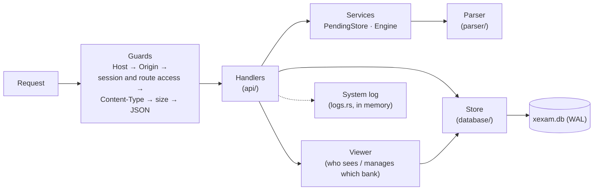
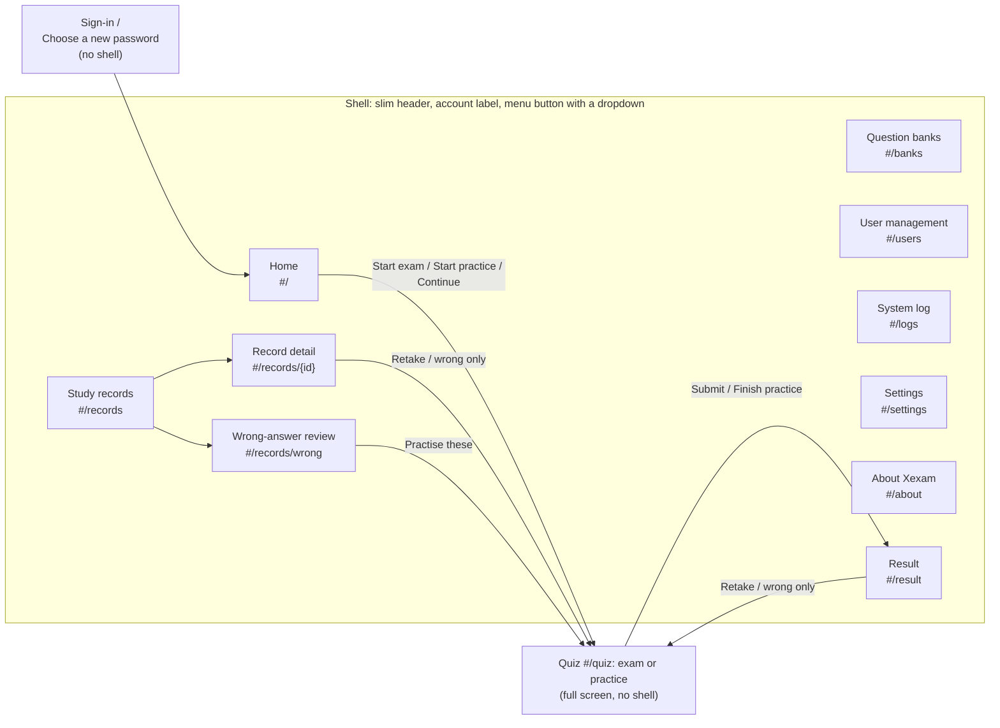
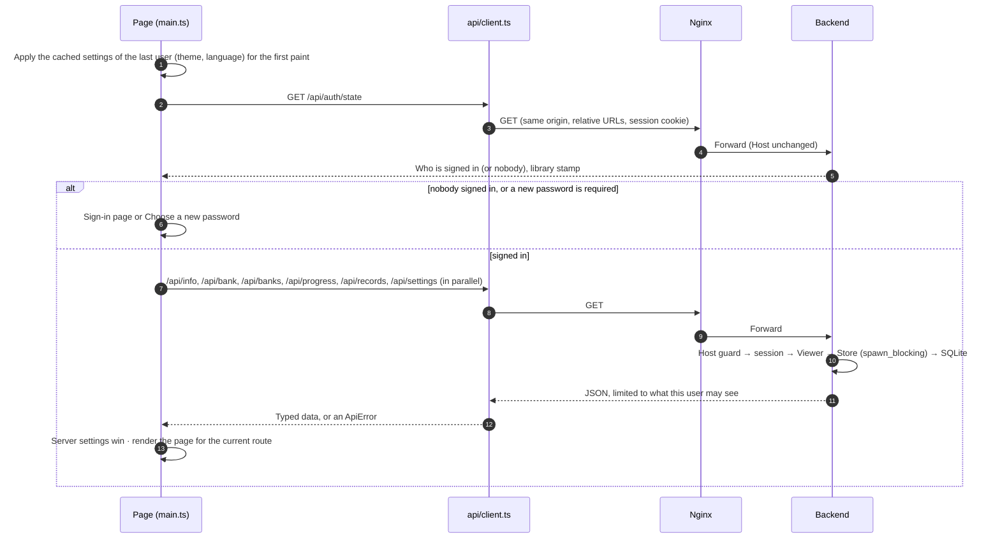
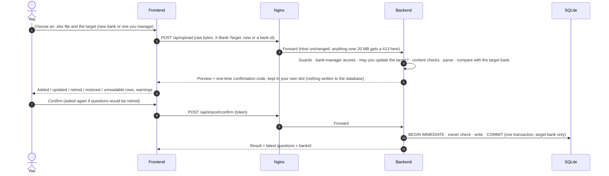

**English** | [日本語](../ja/architecture.md) | [简体中文](../zh-CN/architecture.md)

# Architecture (v0.7.5)

> How Xexam is built: Nginx in front, a Rust backend behind it, SQLite for storage, and a TypeScript frontend without a framework.
> Background from the switch away from the old Python version (Chinese only): the audit of the old code is in [architecture-audit.md](../zh-CN/history/architecture-audit.md), the decisions and defaults are in [migration-plan.md](../zh-CN/history/migration-plan.md).

## 1. Overview


- **Only Nginx publishes a port** (`XEXAM_BIND`, default `127.0.0.1:8765` → `8080` inside the container).
- The network the backend sits on is `internal: true`: there are no `ports`, neither the host nor the outside can reach it, and it cannot reach the internet itself.
- Only the backend reads or writes the database. The Nginx container has no database, no source code and no Node.
- The browser talks to the backend only through REST (see [api.md](api.md)). Every route except `/api/info`, `/api/auth/state` and signing in needs a session. The frontend has no database access and makes no decisions such as "can this import be done" or "may this user see this bank": the backend decides, the frontend only shows.
- Everything the app keeps lives in the data directory (`/data` in Docker): the database `xexam.db` (users, questions, study records, settings), while the backend runs its `xexam.db-wal` and `xexam.db-shm` files, and, after an upgrade, the folder `backups/` with the copy written before the schema migration.

## 2. Directory layout

```
frontend/       TypeScript 5.9 (strict) + Vite, plain DOM, no framework
  vite.config.ts  build settings, the /api proxy for development, the xexam-changelog plugin (reads the three READMEs)
  src/main.ts     entry point: first paint from the cached settings, sign-in check, maps the route to a page
  src/router.ts   hash routes (#/, #/banks, #/users, #/logs, #/records, #/records/<id>, #/records/wrong, #/settings, #/about, #/quiz, #/result)
  src/api/        typed fetch wrappers: client (errors become ApiError; retries of Nginx's 429, time limits), auth, bank, import,
                  logs, progress, settings, users
  src/types/      API types (matching docs/en/openapi.yaml), the type of the build-time changelog module
  src/domain/     pure functions with unit tests: grading and random pick, practice checking, saved results (notCounted),
                  question language, records filter, lock notes and waits, import warnings, system log buffer, changelog parsing
  src/i18n/       t() / tn(), catalog/<area>.ts (UI text in en / zh / ja), server-messages.ts, errors.ts
  src/state/      shared state (store), actions (loading, sign-in, navigation), bank access rules, settings (preferences,
                  settings-cache), the saved exam or practice (session-storage), browser storage keys
  src/components/ shell (header, menu), review (answer cards), lang-switch (English / 中文 / 日本語), kind-tag (Exam / Practice),
                  fields (form fields of the sign-in and user pages), common
  src/pages/      auth (sign-in, new password), home, banks, users, logs, forbidden ("Not allowed"), records, settings, about, quiz, result
  src/styles/     main.css (colour tokens, light / dark, shell) + one CSS file per page area
  src/utils/      DOM builder, dialogs, toasts, formatting
backend/        Rust (Axum 0.8 + Tokio + rusqlite), toolchain pinned to 1.99.1
  src/main.rs     command line, start-up (database, log, reminders), graceful shutdown with the WAL checkpoint
  src/api/        dispatch and guards (Host / Origin / session / Content-Type / size), routes, sign-in and user routes (auth.rs),
                  the route table with each route's access, JSON formatting, attempt sanitizing
  src/auth/       passwords (Argon2id), session tokens and cookies, the known-browser cookie, the login throttle (throttle.rs)
  src/services/   per-user pending imports (PendingStore) with a shared memory budget, parser engine interface, import flow
  src/parser/     .xlsx parsing: ZIP protection, XML, question recognition (the six-column layout; the 3- and 4-column layouts
                  only to tell them apart and refuse them), question id
  src/database/   schema (v1 verbatim + v2, v3, v4 additions), journal mode (journal.rs), Store, legacy progress.json, timestamps
    store/          banks (viewers, owners), records, settings, users (accounts, sessions), migrate (v1 → v4, backups, fix-ups)
  src/models/     shared types: questions, import targets, Viewer and BankScope
  src/logs.rs     the System log: ring buffer, tracing layer, BurstLog
  src/security/   Host / Origin checks, size-limited request body reading, tokens
  src/config/     environment variables, the VERSION file
  tests/          unit, golden-response, parser comparison (3-, 4- and six-column), id-vector, one file per version
                  (v05_…, v06_…, v065_…, v07_…)
nginx/          nginx.conf + Dockerfile (builds the frontend, with the three READMEs → ships only the static output)
docker/         docker-compose.yml (pulls the two images), docker-compose.build.yml (builds them; context: the repository root), .env.example
scripts/        release-notes.py (Release notes from the changelog), set-release-version.py (RELEASE_VERSION and the README badge)
tools/          screenshots/: retakes the README and docs screenshots from a throw-away instance (see development.md)
VERSION         CODE_VERSION (the version of the code) and RELEASE_VERSION (the last published release)
README.md       the English README with the changelog; README/ holds README.ja.md and README.zh-CN.md
LICENSE         MIT license
tests/          baseline/ (golden responses and fixtures of the old version) · integration/ (nginx, full stack, progress.json migration)
docs/           en/ (English, the source) · ja/ · zh-CN/ (with history/: older documents, Chinese only); each with its own
                screenshots/; en/openapi.yaml
```

## 3. Data model (v0.7)

The full table reference is in [database.md](database.md). The ideas behind it:

### Users and sessions

- **Users** have a role: **administrator** or plain user. A plain user can also have the **Bank manager** permission. A new or upgraded database starts with the administrator `admin` / `admin`, who must choose a new password at the first sign-in.
- **Sessions** live in the database (only the SHA-256 of the cookie value is stored), so a restart does not sign anyone out. Sign-in locks after wrong passwords live in memory only (see [security.md](security.md)).
- **Everything personal belongs to one user**: study records, the wrong-answer notebook (per-question statistics) and the settings. Every route reads and writes them for the signed-in user; the user id always comes from the session, never from the request.
- **Question banks are shared**, but who sees which bank is decided per user (next sections).

### Question banks

- **A question bank is one imported workbook.** The `banks` table has one row per bank. An upload goes either to a new bank or to an existing one (`X-Bank-Target` header, see [api.md](api.md)).
- **An import replaces the content of its target bank only.** Questions of that bank that are missing from the file are retired; questions of other banks are never touched.
- **The legacy bank.** Data from before v0.5 becomes one bank (`legacy_ids = 1`). Its question ids are the plain ids the parser computes, unchanged, so the statistics, the wrong-answer notebook and the exam history from before stay linked. Uploads without `X-Bank-Target` go to this bank: older clients and the command-line `import`.
- **Bank-scoped ids.** Every other bank stores its questions under `sha1("xexam-bank:{bank_id}\n{parser id}")`, first 12 hex digits. The same workbook can therefore be imported twice as two independent banks, and their ids and study data never mix. Bank ids are never reused.
- **Owners.** Every bank has an owner: the user who imported it as a new bank. Banks from before v0.7, and banks created without a signed-in user (the command-line `import`), belong to the first administrator. When a user is deleted, the banks they own move to the administrator who deletes them.
- **One layout.** Since v0.7 only the six-column layout can be imported (A–C the question in English, Chinese and Japanese, D–F the answers and explanations). English is authoritative: the question type, the options, the identity and the answer key come from A and D, and the question stores the explanation of each language (`lang`, `ja`, `explain`, see section 4.7 of [database.md](database.md)). The parser still recognises the 3- and 4-column layouts of earlier versions, so that the upload, the import confirm and the command-line `import` can refuse them (`services::check_layout`, 400) before anything is staged or written. Questions imported from them earlier are retired at every start (`Store::retire_old_layout_questions`, section 4.2 of [database.md](database.md)); the banks and their study data stay.
- Deleting a bank removes its questions, its import history, who may see it and the bank itself. Its study data is removed only on request (`withRecords`, an unchecked box in the confirm dialog): an administrator removes it for every user, a bank manager only their own.

### Who sees and manages which bank: Viewer and BankScope

Every request that reads bank data or writes into a bank builds a **`Viewer`** from the signed-in user, read from the database at that moment (so a change by an administrator applies to the very next request, without signing anyone out):

| | `admin` | `can_manage` | `scope` (a `BankScope`) |
|---|---|---|---|
| Administrator | yes | yes, every bank | `All` |
| Plain user | no | the permission | `Only(their user_banks rows, plus the banks they own while they are a bank manager)` |

A plain user's `user_banks` rows are the existing banks an administrator ticked for them. **Include banks imported later** (`users.new_banks`) is not part of the viewer: it only adds a row for each new bank, in the transaction that creates the bank.

- **Reading**: the `*_as` methods of the store take the viewer or its `BankScope`. A user limited to some banks gets only those banks in `/api/bank` and `/api/banks`, only their questions' statistics in `/api/progress`, and in a record's detail the questions of other banks are left out like deleted ones. In `/api/banks` the studied and records numbers are the viewer's own for everyone except administrators, and only administrators see who owns a bank.
- **Writing**: `Viewer::manages(owner)` is true for administrators, and for a bank manager only for the banks they own. An import into an existing bank and a bank delete check it **inside the write transaction**, so an owner change that happens meanwhile (a deleted user's banks moving to an administrator) cannot slip in between the check and the write; a refusal writes nothing (403 `MSG_NOT_BANK_OWNER`). The upload route checks the target once more before it parses, so a refused upload costs no parse time.
- **Exams**: when a plain user submits, questions outside their scope are treated exactly like questions that no longer exist: not counted, nothing written for them, their ids returned in `notCounted`.
- **Refreshing open pages**: `GET /api/auth/state` carries a **library stamp**, an opaque digest. For administrators it follows the whole library; for a plain user it follows only their banks and their access, so it neither reveals nor follows banks they cannot see. The page compares it at every page change and when the tab comes back into view, and reads the banks again when it changed.

### Study records: exams and practice

- `attempts` has one row per submitted exam or practice session, with its owner (`user_id`), its kind (`exam` or `practice`) and a snapshot of the banks it drew from (id and name at the time). Each user keeps their newest **500** records; `/api/progress` returns the newest 60.
- `attempt_items` has one row per question of a record: the question id, the answer given (as the page sent it, after cleaning; no value = unanswered) and whether it was correct. Records saved before v0.5 have no such rows.
- A practice session counts in the wrong-answer notebook exactly like an exam.
- The record detail (`GET /api/record`) puts the detail rows next to the questions as they are stored **now**, retired ones included. A question that was deleted with its bank, or that belongs to a bank the user can no longer see, shows a note instead of its text.
- Deleting one record leaves the statistics (wrong-answer notebook) alone. Deleting all records can also clear them.

### Settings

- `user_settings` holds each user's theme, interface language, auto-advance and question language. Because they are in the data directory, they survive container updates, a cleared browser cache, other browsers and other devices.
- The browser keeps a copy per user in `localStorage` (`xexam.u<id>.settings.v1`) only to paint the first frame in the right theme and language. The server value wins as soon as it has loaded.

### What stays in the browser

- The exam or practice in progress (`xexam.u<id>.session.v1` in `localStorage`, one per user on that browser): question ids, answers, flags, position, time used, the kind and, for a practice, which questions were checked. No question text.
- The id of the user who signed in last (`xexam.lastUser.v1`), so their cached settings can paint the first frame.
- The known-browser cookie `xexam_device` (see [security.md](security.md)) and the session cookie `xexam_session`, both `HttpOnly`.
- Whether the menu is open is not stored: it lives in memory only, and the menu closes on every page change.

## 4. Backend



All routes go through one dispatch function, so the guard order is the same for every request. The session check runs right after the Host (and, for POST, Origin) check and before any body is read, against one route table that names each route's access: **public**, **signed in**, **bank manager** (administrators and bank managers: upload, import confirm / cancel, import history, bank delete) or **administrator** (users, the System log, shutdown). A path that is not in the table needs a session too. Key design decisions (the early reasoning is in [audit/rust-stack.md](../zh-CN/history/audit/rust-stack.md)):

| Problem | Approach |
|---|---|
| rusqlite is synchronous | One connection sits behind `Arc<Mutex<Connection>>`; database calls run inside `spawn_blocking`, and the lock is never held across an `.await`. This maps one to one onto the old version's "one connection + RLock" |
| Journal mode | WAL with `synchronous=FULL` since v0.7 (`database/journal.rs`); `XEXAM_SQLITE_JOURNAL=delete` keeps the old rollback journal. A mode SQLite refuses is logged as a warning, never an error. The mode in effect is logged once at start-up; a graceful shutdown runs `wal_checkpoint(TRUNCATE)`. See section 2.1 of [database.md](database.md) |
| Request body limit | A hand-written streaming reader: it counts the real bytes as it reads and returns 413 the moment 20 MiB is exceeded, **without trusting `Content-Length`** (the same applies to chunked uploads) |
| Can parsing stall the service? | Parsing runs on a blocking thread with a cooperative deadline (`XEXAM_PARSE_TIMEOUT_SECS`, 30 seconds by default; when it expires, the parser stops by itself), and at most 2 parses run at a time; there are limits on the number of ZIP entries, the size after decompression, XML depth / node count / attributes per element, and the total number of cells and total bytes; shared strings are stored only once |
| Pending imports | A preview is held in memory only and never written to the database. **Each uploading user has their own slot** (keyed by user id): one bank manager's upload never replaces, confirms or cancels another user's preview. All slots together share a memory budget of **128 MiB** (estimated from the parsed questions): staging an upload drops the oldest previews of other users while the total is above it, and their confirm then says the preview expired, as after the 30-minute limit. The newest upload is always kept |
| Import atomicity | Confirmation runs `BEGIN IMMEDIATE … COMMIT` and rolls back as a whole on failure; the owner check is part of that transaction; the confirmation code is single-use, 128 bits of randomness, and compared in constant time; if several confirmations arrive at once, only one can succeed |
| A commit being interrupted | The import commit is a separate task and runs to completion even if the client disconnects; `docker stop` waits at most 15 seconds, and the backend shuts down gracefully within 8 seconds |
| Schema upgrade | When the backend opens a database of an older schema that holds data, it first writes a copy with `VACUUM INTO` to `backups/` next to `xexam.db`, then migrates in one transaction, and only then switches to WAL. If the copy cannot be written, it does not start. Opening an up-to-date database writes nothing (see section 6 of [database.md](database.md)) |
| Deleting data | Bank, record and user deletes run in one transaction each. Deleting a bank also drops a pending upload that targets it |
| Passwords | Argon2id in `spawn_blocking`, at most 2 at a time; the login throttle answers before any hashing. See [security.md](security.md) |
| Logs | `tracing`, without colours, filtered by `XEXAM_LOG` (default `info`, also when it is empty; an invalid value falls back to `info` with one warning); users are named by their username, never by id; **passwords, session tokens, cookie values, confirmation codes and question text are never logged**. See below |
| Errors | Always `{"error": "<reason, in Chinese>"}`; database exceptions, file paths and SQLite errors go only to the log, never into the response. The frontend translates the messages it knows (section 5) |

### The System log

- `main.rs` installs one `tracing` subscriber with **one filter** (`XEXAM_LOG`, default `info`) and two outputs: stderr, which is what `docker compose logs backend` shows, and the `BufferLayer` of `logs.rs`. The plain status lines that `main.rs` prints to stdout at start-up and shutdown are added to the buffer as well; the new password printed by `reset-password` is not (that command runs in its own process anyway).
- The buffer is a **ring of the last 2000 lines**, in memory only: it is empty again after a restart, and nothing is written to the database. Each line has a sequence number (1 for the first line of the process), the local time with seconds, the level, the target (module) and the message with its fields; a message is cut after 4000 characters.
- `GET /api/logs?after=<seq>&boot=<id>` (administrators only) returns the lines after `after`, the newest sequence number (`last`), whether lines between `after` and the oldest kept line were dropped (`dropped`), and `boot`, a random id of the backend process. The sequence numbers start again at 1 after a restart, so a client that sends a `boot` from before the restart gets every kept line.
- **BurstLog.** Lines that anyone who can reach the server can cause without signing in go through a `BurstLog`: requests rejected by the Host / Origin check, failed sign-ins, and locks of usernames without an account. The first event after a quiet minute is logged at once; the ones that follow are counted and summed up in one line at most once a minute, either by the next event or by a server timer that runs every minute, so the end of a burst is logged within about a minute even when nothing follows. Refused (429) sign-ins are summed up the same way by the login throttle. A flood of such requests therefore cannot push the other lines out of the 2000.

### The version

The backend reports its version in `/api/info`. It reads, in this order: `XEXAM_VERSION` (when valid); `CODE_VERSION` in the file named by `XEXAM_VERSION_FILE` (`/VERSION` in the image, a copy of the repository's `VERSION`); the version compiled into the binary. `RELEASE_VERSION` in the same file is ignored here. A file with `CODE_VERSION` twice gives no version from the file; a file without any `KEY=VALUE` line is read in the old one-line format.

### The command line

```
xexam-backend [serve] [--data DIR] [--host ADDR] [--port N] [--allow-shutdown] [--no-browser]
xexam-backend healthcheck [--port N]          container self-check (sends Host: 127.0.0.1, so the allowlist does not affect it)
xexam-backend import <question-bank.xlsx> [--data DIR]  command-line import of a six-column workbook into the legacy bank (the old --import also works)
xexam-backend migrate-progress [progress.json] [--data DIR]  migrate the progress.json of an earlier version into the database
xexam-backend reset-password <username> [--data DIR]  new random password (printed once), must be changed at the next sign-in
```

Every command that opens the database (`serve`, `import`, `migrate-progress`, `reset-password`) runs the schema upgrade first, asks for the journal mode of `XEXAM_SQLITE_JOURNAL` and retires the questions of the old layouts. They can run while the server runs (in Docker: `docker compose exec backend xexam-backend …`).

## 5. Frontend

No framework; plain DOM. Shared state is one typed object (`src/state/store.ts`). Every render rebuilds the current page from the state; the quiz page also has small "refreshers" that update the answer sheet and progress without a full redraw.

### Shell, routes and pages



- **Sign-in** (`src/pages/auth.ts`): at start-up the app asks `GET /api/auth/state` first. Nobody signed in → the sign-in page; an account that must choose a new password → the **Choose a new password** page. Both replace the whole app (no shell, no route). While an administrator still has the default password, the sign-in page names that account in a hint. On every page change and when the tab comes back into view the app asks again, so a session that ended elsewhere shows the sign-in page at the next click, and a changed permission or library stamp applies without signing out.
- **Router** (`src/router.ts`): hash routes, so no server-side fallback is needed and a reload stays on the same page. `navigate(route)` in `src/state/actions.ts` changes the route. Leaving the quiz in any way saves the answers. `#/quiz` without an exam or practice goes home (or continues the saved one); `#/result` without a result goes to the records. `#/users` for anyone but an administrator goes home; `#/banks` without the bank-manager permission and `#/logs` for anyone but an administrator show the **Not allowed** page (`src/pages/forbidden.ts`) with **Back to Home**.
- **Shell** (`src/components/shell.ts`): every page except the quiz and the sign-in pages gets a slim header with the Xexam logo (a link to Home) at the top left, the account label and a three-line menu button at the top right. The menu lists **Home**, **Question banks** (administrators and bank managers), **Study records**, **User management** and **System log** (administrators), **Settings**, then, under a divider, the version entry (for example **Xexam v0.7.5**), which opens the About page, and at the bottom who is signed in (with **Administrator** or **Bank manager**) and **Sign out**. The entry of the current page is highlighted; the record detail, the wrong-answer review and the result count as Study records. The menu closes after a choice, a click outside it or Escape; it works the same on every screen width. The page content is centered and at most 1120 px wide.
- **Pages** (`src/pages/`): `home` (start or continue an exam or a practice), `banks` (import, update, inspect and delete banks, format help), `users` (accounts, roles, bank access, locks), `logs` (the System log), `records` (record list with filters, record detail, wrong-answer review), `settings`, `about`, `quiz`, `result`, `auth`, `forbidden`. Pages never import each other; they call the functions in `src/state/actions.ts`. Page-local UI state (filters, an open upload preview) lives in the page module itself. The review cards shared by the result page, the record detail and the wrong-answer review are in `src/components/review.ts`.
- **Home** (`src/pages/home.ts`): an unfinished exam or practice is a compact banner at the top (**Unfinished practice** for a practice; **Saved in this browser only**; banks · answered or checked · time) with **Continue** and **Discard**. The **Start an exam or practice** panel has the "questions from" choice as two small buttons in its top-right corner: **All** and **Wrong answers**, each with its number. The **Banks and sheets** heading has **Select all** and **Clear** on its right. Each question bank is one card with its sheets as compact rows inside, folded or unfolded with the arrow on its row. The bar pinned to the bottom of the screen while the panel is in view holds **Start exam**, **Start practice**, the scope text and the two options **Count** and **Shuffle**; on phones the scope and the options take the first row, and the two buttons share the second, **Start exam** the wider primary one. The side card **Latest result** shows the newest record of either kind with its tag. A plain user who has not been given any bank gets a note to ask an administrator instead (a bank manager gets a link to Question banks). When the banks have no active questions (every question retired, for example from an older Excel layout), administrators and bank managers get a note with the link to Question banks, other users a note to ask an administrator.
- **Question banks** (`src/pages/banks.ts`): administrators see **All question banks**, each with **uploaded by <name>**; a bank manager sees only **Your question banks** (the banks they imported) and can update or delete only those. **Import Excel** has **New bank** / **Update a bank** as two small pills next to its title, a hint line with a link that unfolds the **Excel format guide**, and one file row (**Choose Excel file**, or drop the file anywhere on the panel). The preview shows its counts as chips (zero counts hidden), its notes and warnings (six-column rows whose Chinese or Japanese answer differs from the English one), then the confirm and cancel buttons, and after them one line per sheet with its unreadable rows folded under it. **Import history** shows the latest 8 imports of the banks the user manages.
- **User management** (`src/pages/users.ts`, administrators only): one row per account with its role, status, sign-in state, study record count and question banks (**Question banks: all, including ones imported later** when every bank is ticked and later ones are included, else the chosen banks or none yet, with or without the later ones, and **Change** to choose them; the rules are in `src/state/bank-access.ts`). The checklist of **Change** and of **Add user** has **Include banks imported later** and **Select all** on its first line; the two are independent, and **Select all** only ticks or unticks the listed banks. The row has the actions **Edit**, **Reset password**, **Disable** / **Enable**, **Unlock** (shown while the user's sign-in is locked, or after a lock while fewer tries are left than at the start) and delete. The list is read again when the window comes back into view and every 30 seconds while the page is visible, unless a form or dialog is open.
- **System log** (`src/pages/logs.ts`, administrators only): reads `GET /api/logs` every 0.5 seconds while the page is open, visible and not paused, one request at a time, and keeps the same 2000 lines at most (`src/domain/logs.ts`). After failed reads it waits twice as long each time, 1, 2, 4 and 8 seconds, at most 10; a read that has not finished after 10 seconds is aborted and counts as failed (`LOG_READ_TIMEOUT_MS` in `src/api/logs.ts`). New lines are added at the bottom and followed while the list is scrolled to the end; scrolling up stops following and shows **Jump to latest**. **Pause** / **Resume**, a level filter (**All** / **Warnings** / **Errors**) and a search only change what is shown. A gap where lines were dropped is marked.
- **Practice** (the quiz page with `kind = practice`, rules in `src/domain/practice.ts`): a single-choice question is checked as soon as an option is picked; multiple-choice and hotspot questions have **Check answer**, usable once anything is chosen. A checked question is locked and shows Correct or Wrong, the options marked, the correct answer, the explanation and the memory aid. Auto-advance never applies. **Finish practice** asks only when questions are unchecked; an unchecked question counts as not answered. The result is submitted with `"kind": "practice"`; the result page says **Practice result**, and taking it again starts a practice.
- **Random pick**: `pickQuestions()` in `src/domain/grading.ts`. When **Count** is smaller than the scope, the questions are picked at random from the whole scope, each with the same chance. **Shuffle** only decides whether they are then asked in random order or in bank order.
- **Question languages** (`src/components/lang-switch.ts`): the quiz and practice page and every answers-and-explanations card have the same switch, always labelled **English** / **中文** / **日本語** whatever the interface language, each button with its own `lang` attribute. A language the question does not have stays tappable and says why in a toast. Each card starts at the question-language setting and switches only itself. A six-column question shows each language's own explanation; when a language lacks one, another language's text is shown (Chinese, then Japanese, then English).
- **About page** (`src/pages/about.ts`, `#/about`): the version and the server's CPU architecture (from `/api/info`), the license (MIT) and **What’s new**: the changelog of the README in the interface language (`README.md`, `README/README.zh-CN.md` or `README/README.ja.md`). The newest version is open, the earlier ones are folded under **Earlier versions**, and the entry of the version the server runs is tagged **This version**. The changelogs are not fetched at run time: the `xexam-changelog` plugin in `frontend/vite.config.ts` reads the three READMEs when the frontend is built, parses their `### vX.Y — date` entries with `src/domain/changelog.ts` and provides them as the module `virtual:changelog`. The page loads that module as a separate file only when it is opened. It shows paragraphs, `- ` bullets with one nested level, `**bold**` and `` `code` ``; links to files in the repository are shown as plain text.
- **Settings** (`src/state/preferences.ts`): applies the theme (`<html data-theme>`) and the language (`<html lang>`). A change is applied at once, then saved with `POST /api/settings`; if saving fails, the previous settings come back and a message is shown. Settings also has the account part (change your own password).

### Interface language

- **UI catalogs** (`src/i18n/catalog/<area>.ts`): one file per area (`common`, `home`, `banks`, `records`, `settings`, `quiz`, `result`, `about`, `auth`, `users`, `logs`). Each file holds the same keys in English, Chinese and Japanese. TypeScript and `catalog.test.ts` make sure no language misses a key. Code asks for a text with `t('area.key', params)`, or `tn(key, n)` for counts. The chosen language applies everywhere, the quiz page and the sign-in pages included.
- **Server messages** (`src/i18n/server-messages.ts`): backend error messages stay Chinese (they are part of the tested API). The frontend translates the ones it knows, whole strings and patterns with values, into English or Japanese; Chinese is shown unchanged, and unknown text is shown as it is. `server-messages.test.ts` reads the backend source and fails when a backend message has no translation.
- **Errors** (`src/i18n/errors.ts`): `errorText(e)` turns any error into text in the current language. Network errors and "the response is not JSON" (often an expired Cloudflare Access login) get their own hint to reload and sign in again; Nginx's own 429 (kind `tooMany`) says to wait a few seconds, without that hint.

### Other rules

- **Grading happens in the browser** (the spec recommended doing it on the server; this is a deliberate deviation, with the reasoning in Q3 of [migration-plan.md](../zh-CN/history/migration-plan.md)). The rules are pure functions in `src/domain/grading.ts`, with unit tests. The server receives `{question id, correct}` and the answer given, which it only stores for later review.
- Auto-advance (a setting, off by default, exams only): after a single-choice pick, or when the last open item of a hotspot question gets a choice, the quiz moves to the next question after about 350 ms. Never for multiple choice, never past the last question, never on deselect, never in a practice.
- No inline styles in the HTML: the CSP has `style-src 'self'`. The few computed sizes (progress bar, score bars) are set through the CSSOM, which the CSP allows.
- Build targets are `es2020` / `safari15`; iPhone needs iOS 15.4 or later.

## 6. Request flow

### Loading the app



If any of these requests fails, the app shows one error page with a reload button and the reason, translated; when Nginx's rate limit refused it, the page is titled **Too many requests** and says to wait a few seconds. A 401 at any later request shows the sign-in page.

**Nginx's 429.** Nginx limits `/api/` to 30 requests per second per client address, with a burst of 120 (section 9 of [security.md](security.md)); behind a tunnel all users share one address. Its 429 is not JSON, which tells it apart from the sign-in lock (a JSON 429 with `retryAfter`). `src/api/client.ts` retries a GET or HEAD refused that way, three tries in all (it waits `Retry-After` when given, at most 10 seconds, else 1 second, then 2); other methods are never retried. A request still refused fails with the kind `tooMany`.

### Updating a question bank (upload → preview → confirm)



Leaving the Question banks page with a preview still open cancels it (`POST /api/import/cancel`).

### Taking an exam or a practice

The questions of every bank the user may see are fetched into the browser in one go. You answer in the browser; the exam or practice in progress is saved in `localStorage` after every change. On submit (or **Finish practice**) the page grades the answers and sends `POST /api/attempt` with `{id, correct, answer}` for each question plus the sheets, the mode, the time and the kind. In one transaction the backend leaves out the questions that no longer exist or that the user may not see, updates the user's per-question statistics, saves the record with its bank snapshot and one detail row per counted question, and prunes the user's records to the newest 500. It returns the study progress (and `notCounted` when questions were left out); the page then reloads the record list so the result page can link to the new record.

### Errors

The backend answers an error with `{"error": "<Chinese message>"}`. `api/client.ts` turns it into an `ApiError`; `errorText()` passes the message to the server-message table, which returns it in the current UI language (or unchanged if unknown).

## 7. Build and images

| Image | Build | Runtime contents |
|---|---|---|
| `xexam-frontend` | `node:24-alpine` compiles the frontend; the three READMEs are copied into this build stage for the changelog of the About page → `nginxinc/nginx-unprivileged:1.27-alpine` | nginx.conf + static files; non-root uid; listens on 8080 |
| `xexam-backend` | `rust:1.99.1-slim-bookworm` on the build machine's own architecture, cross-compiled with zig to a static musl binary → `alpine:3.21` + tzdata (with a UTC `/etc/localtime` as fallback) | A single executable + `/VERSION` (read for `CODE_VERSION`); uid 10001; read-only root filesystem |

For the changelog of the About page, `nginx/Dockerfile` copies `README.md`, `README/README.ja.md` and `README/README.zh-CN.md` to the folder above the frontend sources, in the same layout as the repository (`COPY README.md /` and `COPY README/README.ja.md README/README.zh-CN.md /README/`), where `vite.config.ts` reads them. That is why `.dockerignore` keeps the three READMEs (`README.md` and `README/`) in the build context (it still excludes `docs/` and the rest). The final image holds only the built static files, not the READMEs.

Both services use `cap_drop: ALL`, `no-new-privileges`, `read_only: true` and `tmpfs: /tmp`, and keep at most three container log files of 10 MB. The backend can write only `/data` (the data volume) and `/tmp`; it mounts the host's `/etc/localtime` read only, so its timestamps follow the host's time zone (on Docker Desktop, the zone of Docker's own virtual machine, usually UTC).

## 8. Mapping to the old version

| Old (Python) | New |
|---|---|
| `server.py` | `backend/src/api/` + `main.rs` |
| `app/db.py` | `backend/src/database/` |
| `app/xlsx_parser.py` | `backend/src/parser/` |
| `web/app.js` / `style.css` / `index.html` | `frontend/src/` |
| One process in one container | Two containers: nginx + backend |
| `docker-compose.yml` (pulls the image) | `docker/docker-compose.yml` (pulls the two images `xexam-frontend` and `xexam-backend`); `docker/docker-compose.build.yml` (builds from source) |

The old Python implementation has been removed from the repository, but it is not lost: the Git tag `python-v0.2` points to its last version, and the old image `ghcr.io/yumin-space/xexam:v0.2.2` can still be pulled from GHCR (private: `docker login ghcr.io` first; it is not on Docker Hub). For rollback, see [migration.md](migration.md).
