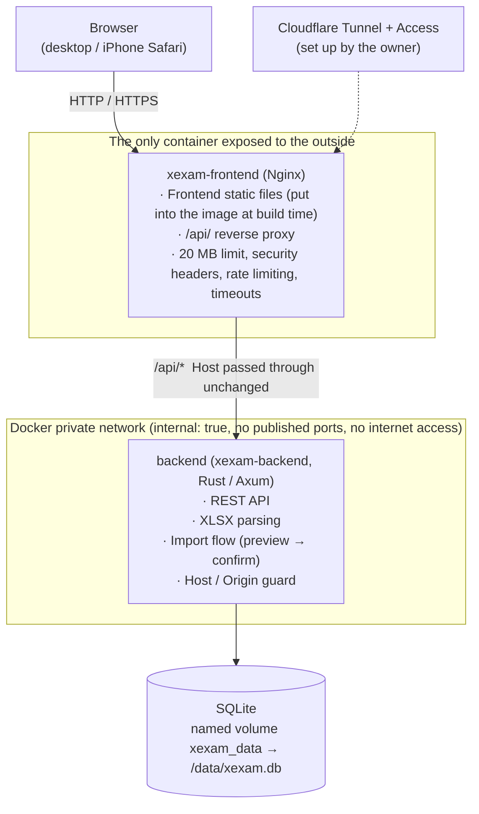
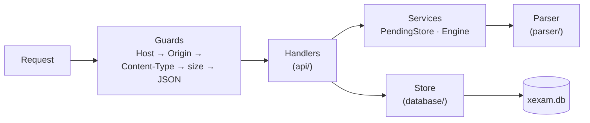
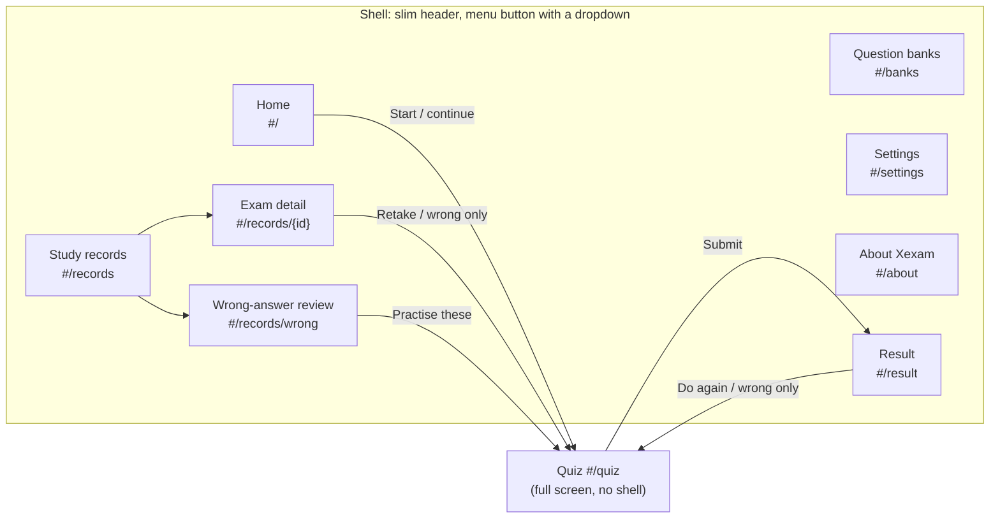
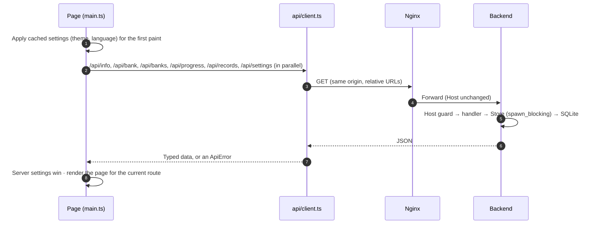
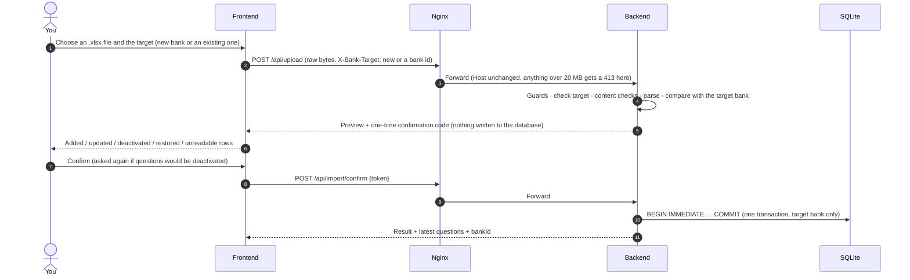

**English** | [日本語](../ja/architecture.md) | [简体中文](../zh-CN/architecture.md)

# Architecture (v0.5)

> How Xexam is built: Nginx in front, a Rust backend behind it, SQLite for storage, and a TypeScript frontend without a framework.
> Background from the switch away from the old Python version (Chinese only): the audit of the old code is in [architecture-audit.md](../zh-CN/history/architecture-audit.md), the decisions and defaults are in [migration-plan.md](../zh-CN/history/migration-plan.md).

## 1. Overview



- **Only Nginx publishes a port** (`XEXAM_BIND`, default `127.0.0.1:8765` → `8080` inside the container).
- The network the backend sits on is `internal: true`: there are no `ports`, neither the host nor the outside can reach it, and it cannot reach the internet itself.
- Only the backend reads or writes the database. The Nginx container has no database, no source code and no Node.
- The browser talks to the backend only through REST (see [api.md](api.md)). The frontend has no database access and makes no decisions such as "can this import be done".
- Everything the app keeps lives in the data directory (`/data` in Docker): the database `xexam.db` (questions, study records, settings) and, after an upgrade, the folder `backups/` with the copy written before the schema migration.

## 2. Directory layout

```
frontend/       TypeScript 5.9 (strict) + Vite, plain DOM, no framework
  vite.config.ts  build settings, the /api proxy for development, the xexam-changelog plugin (reads the three READMEs)
  src/main.ts     entry point: first paint from the cached settings, maps the route to a page, starts loading
  src/router.ts   hash routes (#/, #/banks, #/records, #/records/<id>, #/records/wrong, #/settings, #/about, #/quiz, #/result)
  src/api/        typed fetch wrappers: client (errors become ApiError), bank, import, progress, settings
  src/types/      API types (matching docs/en/openapi.yaml), the type of the build-time changelog module
  src/domain/     pure functions: grading, random pick, wrong-answer rule, percentages, question language, changelog parsing (unit-tested)
  src/i18n/       t() / tn(), catalog/<area>.ts (UI text in en / zh / ja), server-messages.ts, errors.ts
  src/state/      shared state (store), actions, settings (preferences, settings-cache), the saved exam (session-storage)
  src/components/ shell (header with the menu button and its dropdown), review (answer review cards), common
  src/pages/      home, banks, records, settings, about, quiz, result
  src/styles/     main.css (colour tokens, light / dark, shell) + one CSS file per page area
  src/utils/      DOM builder, dialogs, toasts, formatting
backend/        Rust (Axum 0.8 + Tokio + rusqlite), toolchain pinned to 1.99.1
  src/api/        routes, guards (Host / Origin / Content-Type / size), JSON formatting, attempt sanitizing
  src/services/   pending-confirmation slot for imports (PendingStore), parser engine interface, import flow
  src/parser/     .xlsx parsing: ZIP protection, XML, question recognition, question id
  src/database/   schema (v1 verbatim + v2 additions), Store, legacy progress.json migration, timestamps
    store/          banks, records, settings, migrate (schema v1 → v2 with backup)
  src/security/   Host / Origin checks, size-limited request body reading
  src/config/     environment variables
  tests/          unit, golden-response, parser comparison, id-vector, v0.5 (banks, records, settings, migration)
nginx/          nginx.conf + Dockerfile (builds the frontend, with the three READMEs → ships only the static output)
docker/         docker-compose.yml (pulls the two images), docker-compose.build.yml (builds them; context: the repository root), .env.example
README.md       the English README with the changelog; README/ holds README.ja.md and README.zh-CN.md
tests/          baseline/ (golden responses and fixtures of the old version) · integration/ (nginx, full stack, progress.json migration)
docs/           en/ (English, the source) · ja/ · zh-CN/ (with history/: older documents, Chinese only)
```

## 3. Data model (v0.5)

The full table reference is in [database.md](database.md). The ideas behind it:

### Question banks

- **A question bank is one imported workbook.** The `banks` table has one row per bank. An upload goes either to a new bank or to an existing one (`X-Bank-Target` header, see [api.md](api.md)).
- **An import replaces the content of its target bank only.** Questions of that bank that are missing from the file are deactivated; questions of other banks are never touched.
- **The legacy bank.** Data from before v0.5 becomes one bank (`legacy_ids = 1`). Its question ids are the plain ids the parser computes, unchanged, so the statistics, the wrong-answer notebook and the exam history from before stay linked. Uploads without `X-Bank-Target` go to this bank: older clients and the command-line `import`.
- **Bank-scoped ids.** Every other bank stores its questions under `sha1("xexam-bank:{bank_id}\n{parser id}")`, first 12 hex digits. The same workbook can therefore be imported twice as two independent banks, and their ids and study data never mix. Bank ids are never reused.
- Per-question statistics (`stats`) are keyed by question id, so they belong to a bank through the id.
- Deleting a bank removes its questions, its import history and the bank itself. Its study data is removed only on request (`withRecords`, an unchecked box in the confirm dialog): the statistics and per-question detail of its questions, and the exam records that drew from this bank and from no bank that still exists.

### Exam records

- `attempts` has one row per submitted exam. Since v0.5 it also holds a snapshot of the banks the exam drew from (id and name at the time). The database keeps the newest **500** exams; `/api/progress` still returns the newest 60.
- `attempt_items` (new in v0.5) has one row per question of an exam: the question id, the answer given (as the page sent it, after cleaning; no value = unanswered) and whether it was correct. Exams saved before v0.5 have no such rows.
- The record detail (`GET /api/record`) puts these rows next to the questions as they are stored **now**, deactivated ones included. A question that was deleted with its bank shows a note saying so.
- Deleting one record leaves the statistics (wrong-answer notebook) alone. Deleting all records can also clear them.

### Settings

- The `settings` table, in the same `xexam.db`, holds the theme, the interface language, auto-advance and the question language. Because they are in the data directory, they survive container updates, a cleared browser cache, other browsers and other devices. There are no accounts: one set of settings for everyone who uses this instance.
- The browser keeps a copy in `localStorage` (`xexam.settings.v1`) only to paint the first frame in the right theme and language. The server value wins as soon as it has loaded.
- Up to v0.4 the question language lived only in the browser (`xexam.lang.v1`). On the first v0.5 page load it is moved to the server once, if the server still has the default.

### What stays in the browser

- The exam in progress (`xexam.session.v1` in `localStorage`): question ids, answers, flags, position and time used. No question text. Unchanged since v0.4.
- Whether the menu is open is not stored: it lives in memory only, and the menu closes on every page change.

## 4. Backend



All routes, the v0.5 ones included, go through one dispatch function, so the guard order is the same for every request. Key design decisions (the reasoning is in [audit/rust-stack.md](../zh-CN/history/audit/rust-stack.md)):

| Problem | Approach |
|---|---|
| rusqlite is synchronous | One connection sits behind `Arc<Mutex<Connection>>`; database calls run inside `spawn_blocking`, and the lock is never held across an `.await`. This maps one to one onto the old version's "one connection + RLock" |
| Request body limit | A hand-written streaming reader: it counts the real bytes as it reads and returns 413 the moment 20 MiB is exceeded, **without trusting `Content-Length`** (the same applies to chunked uploads) |
| Can parsing stall the service? | Parsing runs on a blocking thread with a cooperative deadline (`XEXAM_PARSE_TIMEOUT_SECS`, 30 seconds by default; when it expires, the parser stops by itself), and at most 2 parses run at a time; there are limits on the number of ZIP entries, the size after decompression, XML depth / node count / attributes per element, and the total number of cells and total bytes; shared strings are stored only once |
| Import atomicity | The preview is held only in a **single in-memory slot** and is never written to the database; confirmation runs `BEGIN IMMEDIATE … COMMIT` and rolls back as a whole on failure; the confirmation code is single-use, 128 bits of randomness, and compared in constant time; if several confirmations arrive at once, only one can succeed |
| A commit being interrupted | The import commit is a separate task and runs to completion even if the client disconnects; `docker stop` waits at most 15 seconds, and the backend shuts down gracefully within 8 seconds |
| Schema upgrade | When the backend opens a schema-1 database that holds data, it first writes a copy with `VACUUM INTO` to `backups/` next to `xexam.db`, then migrates in one transaction. If the copy cannot be written, it does not start. Opening an up-to-date database writes nothing (see [database.md](database.md) section 6) |
| Deleting data | Bank and record deletes run in one transaction each. Deleting a bank also drops a pending upload that targets it |
| Logs | `tracing`, without colours; **the confirmation code and the document content are never logged** |
| Errors | Always `{"error": "<reason, in Chinese>"}`; database exceptions, file paths and SQLite errors go only to the log, never into the response. The frontend translates the messages it knows (section 5) |

The backend command line:

```
xexam-backend [serve] [--data DIR] [--host ADDR] [--port N] [--allow-shutdown] [--no-browser]
xexam-backend healthcheck [--port N]          container self-check (sends Host: 127.0.0.1, so the allowlist does not affect it)
xexam-backend import <question-bank.xlsx> [--data DIR]  command-line import into the legacy bank (the old --import also works)
xexam-backend migrate-progress [progress.json] [--data DIR]  migrate the progress.json of an earlier version into the database
```

Every command that opens the database (`serve`, `import`, `migrate-progress`) runs the schema upgrade first.

## 5. Frontend

No framework; plain DOM. Shared state is one typed object (`src/state/store.ts`). Every render rebuilds the current page from the state; the quiz page also has small "refreshers" that update the answer sheet and progress without a full redraw.

### Shell, routes and pages



- **Router** (`src/router.ts`): hash routes, so no server-side fallback is needed and a reload stays on the same page. `navigate(route)` in `src/state/actions.ts` changes the route. Leaving the quiz in any way saves the answers. `#/quiz` without an exam goes home (or continues the saved exam); `#/result` without a result goes to the records.
- **Shell** (`src/components/shell.ts`): every page except the quiz gets a slim header with the Xexam logo (a link to Home) at the top left and a three-line menu button at the top right. The button opens a small dropdown menu with the four main entries (Home, Question banks, Study records, Settings) and, under a divider, **Xexam v0.6**, which opens the About page. The entry of the current page is highlighted; the exam detail, the wrong-answer review and the result count as Study records. The menu closes after a choice, a click outside it or Escape; it works the same on every screen width. The page content is centered and at most 1120 px wide. The quiz is a focused full-screen view without the shell.
- **Pages** (`src/pages/`): `home` (start or continue an exam), `banks` (import, update, inspect and delete banks, format help), `records` (exam list with filters, exam detail, wrong-answer review), `settings`, `about`, `quiz`, `result`. Pages never import each other; they call the functions in `src/state/actions.ts`. Page-local UI state (filters, an open upload preview) lives in the page module itself. The review cards shared by the result page, the exam detail and the wrong-answer review are in `src/components/review.ts`.
- **Home** (`src/pages/home.ts`): an unfinished exam is a compact banner at the top (title, **Saved in this browser only**, then banks · answered · time) with **Continue** and **Discard**. The **Start an exam** panel has the "questions from" choice as two small buttons in its top-right corner: **All**, with the number of questions in the selected sheets, and **Wrong answers**, with the number to review there; on phones the English and Japanese interfaces show only the icon and the number, Chinese keeps its short words. One line under the title says why **Wrong answers** is disabled while the selected sheets have nothing to review, or, while it is chosen, how a question leaves the notebook. The **Banks and sheets** heading has **Select all** and **Clear** on its right. Each question bank is one card with its sheets as compact rows inside; the bank's checkbox selects or clears all its sheets and, while only some are selected, shows − and **1 of 2 sheets selected** (also while the bank is folded). The arrow on the right of a bank's row folds or unfolds its sheets: unfolded by default with at most two banks; a choice is kept until the page is reloaded. There is no scroll box inside the panel (nested scrolling fights the page on phones). The bar pinned to the bottom of the screen while the panel is in view holds **Start exam**, the scope text and the two options **Count** (its field's accessible name and its tooltip are the full "Number of questions") and **Shuffle** (tooltip "Shuffle question order"); on phones the scope and the options take the first row and **Start exam** the second.
- **Question banks** (`src/pages/banks.ts`): laid out as compactly as Home. **Import Excel** has **New bank** / **Update a bank** as two small pills next to its title (radio buttons; the explanation is their tooltip and description), with **Bank to update** under them for an update; one hint line with a link that unfolds the **Excel format guide**; and one file row (**Choose Excel file**, or drop the file anywhere on the panel). Switching the target only updates those nodes, so keyboard focus stays put. The preview shows its counts as chips (zero counts hidden), its notes and warnings, then the confirm and cancel buttons, and after them one line per sheet with its unreadable rows folded under it. **Your question banks** is one row per bank: name, small **Update** / **Delete** buttons, one line of facts, and the sheets folded under a chevron. **Import history** shows the latest 8 imports, one line each; the format guide is a `<details>` folded by default.
- **Random pick**: `pickQuestions()` in `src/domain/grading.ts`. When **Count** is smaller than the scope, the questions are picked at random from the whole scope, each with the same chance. **Shuffle** only decides whether they are then asked in random order or in bank order.
- **About page** (`src/pages/about.ts`, `#/about`): the version and the server's CPU architecture (from `/api/info`), the license (MIT) and **What’s new**: the changelog of the README in the interface language (`README.md`, `README/README.zh-CN.md` or `README/README.ja.md`). The newest version is open, the earlier ones are folded under **Earlier versions**, and the entry of the version the server runs is tagged **This version**. The changelogs are not fetched at run time: the `xexam-changelog` plugin in `frontend/vite.config.ts` reads the three READMEs when the frontend is built, parses their `### vX.Y — date` entries with `src/domain/changelog.ts` and provides them as the module `virtual:changelog`. The page loads that module as a separate file only when it is opened. It shows paragraphs, `- ` bullets with one nested level, `**bold**` and `` `code` ``; links to files in the repository are shown as plain text.
- **Settings** (`src/state/preferences.ts`): applies the theme (`<html data-theme>`) and the language (`<html lang>`). A change is applied at once, then saved with `POST /api/settings`; if saving fails, the previous settings come back and a message is shown.

### Interface language

- **UI catalogs** (`src/i18n/catalog/<area>.ts`): one file per area (`common`, `home`, `banks`, `records`, `settings`, `quiz`, `result`, `about`). Each file holds the same keys in English, Chinese and Japanese. TypeScript and `catalog.test.ts` make sure no language misses a key. Code asks for a text with `t('area.key', params)`, or `tn(key, n)` for counts. The chosen language applies everywhere, the quiz page included.
- **Server messages** (`src/i18n/server-messages.ts`): backend error messages stay Chinese (they are part of the tested API). The frontend translates the ones it knows, whole strings and patterns with values, into English or Japanese; Chinese is shown unchanged, and unknown text is shown as it is. `server-messages.test.ts` reads the backend source and fails when a backend message has no translation.
- **Errors** (`src/i18n/errors.ts`): `errorText(e)` turns any error into text in the current language. Network errors and "the response is not JSON" (often an expired Cloudflare Access login) get their own hint to reload and sign in again.

### Other rules

- **Grading happens in the browser** (the spec recommended doing it on the server; this is a deliberate deviation, with the reasoning in Q3 of [migration-plan.md](../zh-CN/history/migration-plan.md)). The rules are pure functions in `src/domain/grading.ts`, with unit tests. The server receives `{question id, correct}` and, since v0.5, the answer given, which it only stores for later review.
- Auto-advance (a setting, off by default): after a single-choice pick, or when the last open item of a hotspot question gets a choice, the quiz moves to the next question after about 350 ms. Never for multiple choice, never past the last question, never on deselect.
- No inline styles in the HTML: the CSP has `style-src 'self'`. The few computed sizes (progress bar, score bars) are set through the CSSOM, which the CSP allows.
- Build targets are `es2020` / `safari15`; iPhone needs iOS 15.4 or later.

## 6. Request flow

### Loading the app



If any of these requests fails, the app shows one error page with a reload button and the reason, translated.

### Updating a question bank (upload → preview → confirm)



Leaving the Question banks page with a preview still open cancels it (`POST /api/import/cancel`).

### Taking an exam

The questions of all banks are fetched into the browser in one go. You answer in the browser; the exam in progress is saved in `localStorage` after every change. On submit, the page grades the answers and sends `POST /api/attempt` with `{id, correct, answer}` for each question plus the sheets, the mode and the time. In one transaction the backend updates the per-question statistics, saves the exam with its bank snapshot and one detail row per question, and prunes to the newest 500 exams. It returns the study progress; the page then reloads the record list so the result page can link to the new record.

### Errors

The backend answers an error with `{"error": "<Chinese message>"}`. `api/client.ts` turns it into an `ApiError`; `errorText()` passes the message to the server-message table, which returns it in the current UI language (or unchanged if unknown).

## 7. Build and images

| Image | Build | Runtime contents |
|---|---|---|
| `xexam-frontend` | `node:24-alpine` compiles the frontend; the three READMEs are copied into this build stage for the changelog of the About page → `nginxinc/nginx-unprivileged:1.27-alpine` | nginx.conf + static files; non-root uid; listens on 8080 |
| `xexam-backend` | `rust:1.99.1-slim-bookworm` on the build machine's own architecture, cross-compiled with zig to a static musl binary → `alpine:3.21` + tzdata | A single executable + `/VERSION`; uid 10001; read-only root filesystem |

For the changelog of the About page, `nginx/Dockerfile` copies `README.md`, `README/README.ja.md` and `README/README.zh-CN.md` to the folder above the frontend sources, in the same layout as the repository (`COPY README.md /` and `COPY README/README.ja.md README/README.zh-CN.md /README/`), where `vite.config.ts` reads them. That is why `.dockerignore` keeps the three READMEs (`README.md` and `README/`) in the build context (it still excludes `docs/` and the rest). The final image holds only the built static files, not the READMEs.

Both services use `cap_drop: ALL`, `no-new-privileges`, `read_only: true` and `tmpfs: /tmp`. The backend can write only `/data` (the data volume) and `/tmp`.

## 8. Mapping to the old version

| Old (Python) | New |
|---|---|
| `server.py` | `backend/src/api/` + `main.rs` |
| `app/db.py` | `backend/src/database/` |
| `app/xlsx_parser.py` | `backend/src/parser/` |
| `web/app.js` / `style.css` / `index.html` | `frontend/src/` |
| One process in one container | Two containers: nginx + backend |
| `docker-compose.yml` (pulls the image) | `docker/docker-compose.yml` (pulls the two images `xexam-frontend` and `xexam-backend`); `docker/docker-compose.build.yml` (builds from source) |

The old Python implementation has been removed from the repository, but it is not lost: the Git tag `python-v0.2` points to its last version, and the old image `ghcr.io/yumin-space/xexam:v0.2.2` can still be pulled from GHCR (private: `docker login ghcr.io` first; it is not on Docker Hub). For rollback, see [migration.md](migration.md).
