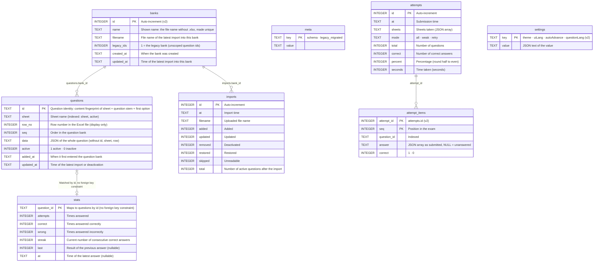

**English** | [日本語](../ja/database.md) | [简体中文](../zh-CN/database.md)

# Database

> The database is SQLite, **a single file, `xexam.db`**. The Rust backend reuses the old Python version's database: the original table definitions (schema v1) are kept **character for character**, and v0.5 adds **schema v2** on top of them, purely additively (new tables and new columns; nothing is rebuilt or rewritten). An existing database is migrated automatically at the first start of v0.5, after a backup copy is written (section 6).
> Evidence: [audit/database.md](../zh-CN/history/audit/database.md); golden tests: `backend/tests/db_golden.rs` (run against `tests/baseline/fixtures/sample.db`, built by the old Python implementation, and the committed snapshots) and `backend/tests/v05_banks_records_settings.rs` (migration, backup, banks, records, settings).

## 1. Where the file lives

| How you run it | Location |
|---|---|
| Docker (recommended) | Named volume `xexam_data`, mounted at `/data` in the container; the file is `/data/xexam.db`. Updating or deleting the container does not lose it |
| Without Docker | `xexam.db` in the data directory (default `./data`, or `XEXAM_DATA`) |

The volume's real name is `<project name>_<volume name>` = `xexam_data`, and `docker volume ls` shows it. **Do not run `docker compose down -v`**: `-v` deletes the volume along with the containers.

Next to the database, the subfolder `backups/` receives the copy written before a schema migration (section 6), e.g. `/data/backups/xexam-schema1-20261110-140501.db`. The program never deletes these files; remove them yourself once you no longer need them.

## 2. Connection settings

| Setting | Value | Why |
|---|---|---|
| `journal_mode` | `DELETE` | No WAL: WAL needs a shared-memory file, which is unreliable when Docker Desktop mounts a Windows folder into a container |
| `synchronous` | `FULL` | Single-user, so speed is not a concern and data safety matters more |
| `foreign_keys` | `ON` | (The schema actually has no foreign keys; kept the same as the old version) |
| `busy_timeout` | 5000 ms | When another connection holds a lock, wait up to 5 seconds |
| Transactions | `BEGIN IMMEDIATE … COMMIT`, `ROLLBACK` on failure (a failed `COMMIT` is also rolled back) | Either everything succeeds or nothing changes |

The backend has only **one connection**, kept behind a mutex. Database calls run on a dedicated thread (`spawn_blocking`), so they do not block Tokio's executor threads, and the lock is never held across an `.await`. This corresponds one to one with the old version's "one connection + RLock".

## 3. Tables



Schema v2 adds three columns to the v1 tables: `questions.bank_id INTEGER` (NULL only for rows written by an older binary, see section 6), `attempts.banks TEXT NOT NULL DEFAULT '[]'` (JSON snapshot of the banks an exam drew from, `[{"id": 1, "name": "…"}]`) and `imports.bank_id INTEGER`; plus the indexes `idx_questions_bank (bank_id, active)` and `idx_attempt_items_question (question_id)`. There are still no foreign key constraints.

The v1 table-creation statements are stored verbatim in `backend/src/database/schema.rs` (`SCHEMA`), identical to `SCHEMA` in the old version's `app/db.py`, and are still executed first on every start; the v2 additions are next to them (`MIGRATE_V2_TABLES`, `V2_COLUMNS`, `MIGRATE_V2_INDEXES`). Everything uses `IF NOT EXISTS` or is checked first, so opening an up-to-date database **leaves the file bytes unchanged** (tested). Because SQLite records `ALTER TABLE … ADD COLUMN` by appending the column to the stored `CREATE TABLE` text, the `sqlite_master` text of `questions`, `attempts` and `imports` is the v1 text plus `, bank_id INTEGER` (or `, banks TEXT NOT NULL DEFAULT '[]'`); a new database and a migrated one have exactly the same schema (tested).

## 4. Details that decide the fate of your study records

### 4.1 Question id
`stats` and the wrong-answer notebook are both keyed by question id. The id is:

```
sha1( sheet_name + "\n" + strip_whitespace(question_stem)[:300] + "|" + strip_whitespace(first_option_or_first_sub_item)[:200] )  first 12 hex digits
```

- "Strip whitespace" means Python's `\s` (29 code points, including U+001C–U+001F and the full-width space U+3000). **Whitespace is stripped first, then the text is truncated**, and truncation is by **code point**. Rust's `char::is_whitespace` covers only 25, so the backend implements its own check for these 29 code points.
- **No Unicode normalization at all** (no NFKC). Most questions in the project owner's real question bank contain full-width ASCII, and normalization would change every id.
- Duplicate ids within the same workbook get `-2`, `-3`, ... appended in turn, **depending on row order**: if you swap the rows of two identical questions, the study records move to the other question. This is the old version's behavior; it is kept and documented here.
- Changing the wording of the question stem = a new question (the old one is deactivated, and its records do not carry over to the new one); changing only the options, the answer, the explanation or the translation is an "update", and the records are not affected.
- 85 assertions (`tests/baseline/golden/id_vectors.json`) guarantee that the ids from Rust and Python are byte-for-byte identical.
- **Banks (v0.5)**: the id above is what the questions of the **legacy bank** (all data from before v0.5, and uploads without `X-Bank-Target`) are stored under, so existing statistics, the wrong-answer notebook and history stay linked. Every other bank stores **bank-scoped ids**: `sha1("xexam-bank:" + bank_id + "\n" + id)`, first 12 hex digits. That is why the same workbook can be imported as two independent banks without their records mixing. Bank ids are never reused (`AUTOINCREMENT`), so neither are scoped ids.

### 4.2 Deactivate instead of delete
During an import, a question of the **target bank** that cannot be found in the file gets `active = 0`, and its `stats` are kept as they are. If you upload that question into the same bank again later, it is restored to active automatically, and its wrong-answer notebook entry comes back with it. Questions of other banks are never touched by an import.

Deleting a bank (`POST /api/banks/delete`) is the only way questions leave the database: its questions (active and deactivated), its `imports` rows and its `banks` row are deleted in one transaction. With `withRecords` the `stats` and `attempt_items` rows of those questions go too, and so does every `attempts` row whose `banks` snapshot names that bank and no bank that still exists (with its remaining detail). Without it, `stats`, `attempts` and `attempt_items` stay as they are.

### 4.3 Wrong-answer notebook
A question is in the wrong-answer notebook when `wrong > 0` and `streak < 2`; it is moved out after 2 consecutive correct answers.

### 4.4 Score history
`attempts` keeps the latest **500** sessions (`RECORD_RETENTION`; it was 60 before v0.5); after each submission older ones are deleted together with their `attempt_items`. `GET /api/progress` still returns only the latest 60 in `history`.
Since v0.5 each new session also stores one `attempt_items` row per question (the answer given, if the page sent it, and whether it was correct) and the `banks` snapshot; sessions saved earlier have no detail. Deleting one session (`POST /api/records/delete`) removes it and its detail but leaves `stats` alone; deleting all of them can also empty `stats` (`withStats`), which equals `POST /api/reset`.

### 4.5 Settings
`settings` holds one row per changed setting; `value` is the JSON text of the value (`"dark"`, `true`). Missing rows mean the default (`theme` `system`, `uiLang` `en`, `autoAdvance` false, `questionLang` `ja`); a stored value that is not valid is ignored. The browser keeps a copy only to paint the first frame; the database is the source of truth, so settings survive container updates, a cleared browser cache and other browsers.

### 4.6 Timestamps
Local-time strings in the format `%Y-%m-%d %H:%M`, **with no time zone marker**, accurate to the minute. Inside the container the time zone comes from the `TZ` environment variable (default `Asia/Tokyo`). The image ships a time zone database; without it, `TZ` would silently have no effect and times would become UTC.

## 5. Backup and restore

Stop the program before you start; it is safer for the database.

```bash
docker compose stop

# Back up: pack the volume into xexam-data.tgz in the current directory (it holds the whole database; it is ignored by .gitignore, do not commit it)
docker run --rm -v xexam_data:/data -v "$PWD:/backup" alpine tar czf /backup/xexam-data.tgz -C /data .

docker compose start
```

**Verify the backup** (on a copy; never experiment on the original):

```bash
mkdir work && tar xzf xexam-data.tgz -C work
sqlite3 work/xexam.db "PRAGMA integrity_check"      # must print ok
```

Restore:

```bash
docker compose stop
docker run --rm -v xexam_data:/data -v "$PWD:/backup" alpine tar xzf /backup/xexam-data.tgz -C /data
docker compose start
```

## 6. Schema v2 migration (v0.5) and going back

### 6.1 What happens at the first start of v0.5

`meta.schema` says which schema a database has (`1` up to v0.4, `2` from v0.5). When v0.5 opens a database whose `meta.schema` is missing or `1`:

1. **Backup.** If the database contains any data, a consistent copy is written with SQLite's `VACUUM INTO` to `backups/xexam-schema1-<YYYYmmdd-HHMMSS>.db` next to `xexam.db` (an existing file is never overwritten; `-2`, `-3`, … are appended instead). The copy is an ordinary schema-1 database. **If the copy cannot be written** (disk full, no permission), the program refuses to start and changes nothing; the log says why.
2. **Migration**, in **one** `BEGIN IMMEDIATE` transaction: create `banks`, `attempt_items`, `settings` and the new indexes, add the three columns, then, if there are questions, create the **legacy bank** and attach everything to it: `name` = file name of the latest import without `.xlsx` (`Question bank` if there is no import), `filename` = that file name, `created_at` = the earliest `questions.added_at`, `updated_at` = the time of the latest import (or of the latest question change if there is no import); every question and import row gets its `bank_id`, and every exam record gets that bank as its `banks` snapshot. Question ids, statistics, exam records and import history are not changed. Finally `meta.schema` becomes `2`.

A brand-new database goes through the same steps (without a backup, and without a legacy bank), so new and migrated databases have the same structure. The log prints where the backup went.

On every later start the backend only checks (read-only) whether some question has no `bank_id`, which happens only if an older binary wrote to the file after a rollback (see below). Such questions, and import rows without a bank, are attached to the legacy bank (created if needed). When there is nothing to fix, **nothing is written** and the file bytes stay the same (tested).

### 6.2 Going back to v0.4 (or older)

A v2 file can still be opened by v0.4 and by the old Python version: the new columns are nullable or have defaults, `journal_mode` is still `delete` and `user_version` is still 0. **But do not keep using an older version once you have more than one question bank**: it treats the whole database as one bank, so its next import would deactivate the questions of every other bank, and it ignores the new tables. It also prunes exam records back to 60.

**To roll back, restore the backup instead**: stop the program, replace `xexam.db` with the file from `backups/` (rename it to `xexam.db`), start the old version. Changes made with v0.5 after the migration are not in that copy.

If an older version did write to a v2 file anyway, v0.5 attaches the questions it added to the legacy bank at the next start. Exam records it saved have no detail and an empty bank snapshot; detail rows of exams it pruned remain in `attempt_items` as unused rows (they are never shown).

### 6.3 Compatibility with the old Python implementation

Up to v0.4 both implementations used **the same file and the same schema**. This round trip was originally rehearsed with synthetic data (old Python creates the database → Rust reads and writes → old Python reads it back; the original's sha256 was unchanged before and after, and `PRAGMA integrity_check` passed). Since the old Python code was removed, tests keep the remaining guarantees in place: `sample.db` (a database written by the old implementation) migrates to schema v2 keeping every question id, statistic, exam record and import, its backup still reports schema 1 with exactly the original rows, and the migrated file is byte-for-byte unchanged by any later open, read and close; and the `sqlite_master` of a new database is the old implementation's text plus the v2 additions. To actually roll back to the Python version, restore the backup (6.2) and open it with the old image (`ghcr.io/yumin-space/xexam:v0.2.2`).

## 7. The old `progress.json`

Earlier versions kept scores in `progress.json`. As in the old Python version, **on every startup** the app checks whether the data directory contains it: if it does, and the database has no study records yet and has not been migrated before, it is migrated into the database. The `legacy_migrated` flag in the database guarantees it is migrated only once, and existing study records are never overwritten.
So "start once to create the data volume → put `progress.json` into the volume → restart" works. A file in the wrong format is ignored; the log states the reason and suggests running `xexam-backend migrate-progress` by hand, and the program still starts.
(`tests/integration/migrate_check.py` checks these cases with synthetic data.)

> ⚠️ When upgrading from v0.1: the database file name changed, and the new version only reads `xexam.db`. If the data directory has another `.db` file but no `xexam.db`, the startup log will warn you; rename that file to `xexam.db` and start again (the old file is neither deleted nor read).
