**English** | [日本語](../ja/database.md) | [简体中文](../zh-CN/database.md)

# Database

> The database is SQLite, **a single file, `xexam.db`**. The Rust backend reuses the old Python version's database: the original table definitions (schema v1) are kept **character for character**, and every later schema only adds to them (new tables and new columns; nothing is rebuilt or rewritten): **schema v2** (v0.5: question banks, exam detail, settings), **schema v3** (v0.6: users and sign-in) and **schema v4** (v0.7: question banks per user, bank owners, practice records). An existing database is migrated automatically at the first start of a newer version, after a backup copy is written (section 6). Since v0.7 the database runs in **WAL mode** (section 2).
> Evidence: [audit/database.md](../zh-CN/history/audit/database.md); golden tests: `backend/tests/db_golden.rs` (run against `tests/baseline/fixtures/sample.db`, built by the old Python implementation, and the committed snapshots). The migrations and their backups are tested in `backend/tests/v05_banks_records_settings.rs` (v2), `v06_users_and_sign_in.rs` (v3), `v065_bank_access_and_practice.rs` (v4), `v07_bank_access_and_layouts.rs` (the bank access of v4, the conversion of pre-release databases, the retirement of old-layout questions) and `v07_wal_and_logs.rs` (WAL mode).

## 1. Where the file lives

| How you run it | Location |
|---|---|
| Docker (recommended) | Named volume `xexam_data`, mounted at `/data` in the container; the file is `/data/xexam.db`. Updating or deleting the container does not lose it |
| Without Docker | `xexam.db` in the data directory (default `./data`, or `XEXAM_DATA`, or `--data`) |

The volume's real name is `<project name>_<volume name>` = `xexam_data`, and `docker volume ls` shows it. **Do not run `docker compose down -v`**: `-v` deletes the volume along with the containers.

Other files next to the database:

- **`xexam.db-wal` and `xexam.db-shm`** exist while the backend runs (WAL mode, section 2). The `-wal` file holds the latest committed changes until SQLite copies them into `xexam.db`. When the backend stops normally everything is copied into `xexam.db` and `xexam.db-wal` is emptied; the two files may stay, empty and harmless. They belong to the database: never delete them while the backend runs, and copy them together with `xexam.db` (section 5).
- **`backups/`** receives the copy written before a schema migration (section 6), for example `/data/backups/xexam-schema3-20261111-140501.db`. The program never deletes these files; remove them yourself once you no longer need them.

What is kept where:

| Where | What |
|---|---|
| `xexam.db` in the volume (with `-wal` / `-shm` while running) | The question banks with their owners and questions (retired ones included), the import history, the users (password hashes only), their sessions and which banks each user sees, each user's per-question statistics (wrong-answer notebook), study records (exams and practice) with their per-question detail, and settings (theme, interface language, auto-advance, question language) |
| `backups/` in the volume | The copies of the database written before each schema migration (`xexam-schema1-…` up to `xexam-schema4-…`) |
| Memory of the backend only | The System log, the sign-in locks and the import previews; all of them start empty after a restart |
| The browser (`localStorage`) | Per user: the unfinished exam or practice (question ids, answers, marks, checked questions, time used; no question text) and a copy of the settings to paint the first screen |

## 2. Connection settings

| Setting | Value | Why |
|---|---|---|
| `journal_mode` | `WAL` (since v0.7); `DELETE` with `XEXAM_SQLITE_JOURNAL=delete` | A commit writes only to the `-wal` file, and a reader (for example a command-line tool started next to the server) does not block the writer. See 2.1 |
| `synchronous` | `FULL` | Each commit waits until it is on disk (in WAL mode: one fsync of the `-wal` file), so nothing committed is lost on a power failure |
| `foreign_keys` | `ON` | (The schema actually has no foreign keys; kept the same as the old version) |
| `busy_timeout` | 5000 ms | When another connection holds a lock, wait up to 5 seconds |
| Automatic checkpoint | SQLite's default (every 1000 pages) | Keeps the `-wal` file small while the backend runs |
| Transactions | `BEGIN IMMEDIATE … COMMIT`, `ROLLBACK` on failure (a failed `COMMIT` is also rolled back) | Either everything succeeds or nothing changes |

The backend has only **one connection**, kept behind a mutex. Database calls run on a dedicated thread (`spawn_blocking`), so they do not block Tokio's executor threads, and the lock is never held across an `.await`. This corresponds one to one with the old version's "one connection + RLock".

### 2.1 WAL mode (v0.7)

- **Persistent.** The journal mode is stored in the header of `xexam.db`. The backend asks for it every time it opens the database (the server and the command-line commands alike), and only **after** a successful migration: if an open fails, for example because the pre-migration backup cannot be written, an older database file is left exactly as it was.
- **The opt-out.** `XEXAM_SQLITE_JOURNAL=delete` (in `docker/.env`, or in the environment without Docker) keeps the rollback journal of v0.6 and older. Use it only when the data directory is on storage where WAL's shared-memory file `xexam.db-shm` is unreliable: a network filesystem, or a Windows folder bind-mounted into Docker Desktop. Any other value, or no value, means WAL. The next start without the variable switches back to WAL.
- **When SQLite refuses.** The backend never fails to start because of the journal mode. If SQLite cannot switch to WAL (another process holds the database in a way that prevents it, or the filesystem does not support it), the log has a warning such as `SQLite did not switch the journal mode to wal; continuing in mode delete`, and the backend continues in the mode SQLite reports.
- **The startup line.** Each start logs the mode in effect once: `SQLite journal mode: wal`, or `SQLite journal mode: delete (XEXAM_SQLITE_JOURNAL=delete)`.
- **At shutdown.** On a normal stop (`docker compose stop`, Ctrl+C) the backend runs `PRAGMA wal_checkpoint(TRUNCATE)`: everything in `xexam.db-wal` is copied into `xexam.db` and the `-wal` file is emptied. Closing the last connection can then also remove `-wal` and `-shm`, but they may stay (for example on Windows), empty and harmless. The log says `WAL checkpoint at shutdown: everything is in xexam.db, the -wal file is empty`. If another process still has the database open at that moment (for example a command-line command), the checkpoint cannot finish; the log says so in a warning, and SQLite completes it later.
- **Command-line commands while the server runs.** `reset-password`, `import` and `migrate-progress` open the same file from another process. In the same container (`docker compose exec backend …`) or on the same machine this is safe in WAL mode too.
- **Older versions.** Xexam v0.6 and older ask for `DELETE` when they open the database, so they switch a WAL database back by themselves. A rollback needs no extra step for the journal mode (section 6.7).

## 3. Tables

```mermaid
erDiagram
    questions {
        TEXT id PK "Question identity (section 4.1)"
        TEXT sheet "Sheet name (indexed: sheet, active)"
        INTEGER row_no "Row number in the Excel file (display only)"
        INTEGER seq "Order in the question bank"
        TEXT data "JSON of the whole question (section 4.7)"
        INTEGER active "1 active · 0 retired"
        TEXT added_at "When it first entered the question bank"
        TEXT updated_at "Time of the latest import or retirement"
        INTEGER bank_id "banks.id (v2)"
    }
    banks {
        INTEGER id PK "Auto-increment, never reused (v2)"
        TEXT name "Shown name: the file name without .xlsx"
        TEXT filename "File name of the latest import into this bank"
        INTEGER legacy_ids "1 = the legacy bank (unscoped question ids)"
        TEXT created_at "When the bank was created"
        TEXT updated_at "Time of the latest import into this bank"
        INTEGER owner_id "users.id of the user who imported it as a new bank (v4)"
    }
    imports {
        INTEGER id PK "Auto-increment"
        TEXT at "Import time"
        TEXT filename "Uploaded file name"
        INTEGER added "Added"
        INTEGER updated "Updated"
        INTEGER removed "Retired"
        INTEGER restored "Restored"
        INTEGER skipped "Unreadable"
        INTEGER total "Active questions after the import"
        INTEGER bank_id "banks.id (v2)"
    }
    users {
        INTEGER id PK "Auto-increment, never reused (v3)"
        TEXT username "Unique, ignoring case"
        TEXT password_hash "Argon2id, PHC string"
        TEXT role "admin · user"
        INTEGER disabled "1 = cannot sign in"
        TEXT created_at "Local time"
        TEXT last_login_at "Local time, nullable"
        TEXT password_changed_at "Local time"
        INTEGER must_change_password "1 = must choose a new password first"
        INTEGER new_banks "1 = gets every bank created later (v4)"
        INTEGER can_manage_banks "1 = bank manager (v4)"
    }
    sessions {
        TEXT token_hash PK "SHA-256 of the cookie value (v3)"
        INTEGER user_id "users.id (indexed)"
        TEXT created_at "Local time"
        INTEGER last_seen_at "Unix seconds"
        INTEGER expires_at "Unix seconds"
    }
    user_banks {
        INTEGER user_id PK "users.id (v4)"
        INTEGER bank_id PK "banks.id (indexed)"
    }
    attempts {
        INTEGER id PK "Auto-increment"
        TEXT at "Submission time"
        TEXT sheets "Sheets taken (JSON array)"
        TEXT mode "all · weak · retry"
        INTEGER total "Number of questions"
        INTEGER correct "Number of correct answers"
        INTEGER percent "Percentage (round half to even)"
        INTEGER seconds "Time taken (seconds)"
        TEXT banks "JSON snapshot of the banks (v2)"
        INTEGER user_id "users.id (v3, indexed)"
        TEXT kind "exam · practice (v4)"
    }
    attempt_items {
        INTEGER attempt_id PK "attempts.id (v2)"
        INTEGER seq PK "Position in the exam"
        TEXT question_id "Indexed"
        TEXT answer "JSON array as submitted, NULL = unanswered"
        INTEGER correct "1 · 0"
    }
    user_stats {
        INTEGER user_id PK "users.id (v3)"
        TEXT question_id PK "questions.id (no constraint)"
        INTEGER attempts "Times answered"
        INTEGER correct "Times answered correctly"
        INTEGER wrong "Times answered incorrectly"
        INTEGER streak "Current run of correct answers"
        INTEGER last "Result of the previous answer, nullable"
        TEXT at "Time of the latest answer, nullable"
    }
    user_settings {
        INTEGER user_id PK "users.id (v3)"
        TEXT key PK "theme · uiLang · autoAdvance · questionLang"
        TEXT value "JSON text of the value"
    }
    meta {
        TEXT key PK "schema · legacy_migrated · users_known · banks_known"
        TEXT value
    }
    banks ||--o{ questions : "questions.bank_id"
    banks ||--o{ imports : "imports.bank_id"
    users |o--o{ banks : "banks.owner_id"
    users ||--o{ user_banks : "user_banks.user_id"
    banks ||--o{ user_banks : "user_banks.bank_id"
    users ||--o{ sessions : "sessions.user_id"
    users ||--o{ attempts : "attempts.user_id"
    attempts ||--o{ attempt_items : "attempt_id"
    users ||--o{ user_stats : "user_stats.user_id"
    users ||--o{ user_settings : "user_settings.user_id"
```



Thirteen tables, still **without foreign key constraints**: the links are kept by the code, and every delete removes the rows that belong to it in the same transaction. Two tables of earlier schemas are not shown: `stats` (the per-question statistics of v0.5 and older) and `settings` (the settings of v0.5). At the v3 migration their rows were copied to the first administrator (`user_stats`, `user_settings`); they are kept, unused, so that a rollback stays "restore the backup".

What each schema added:

- **v1** (the old Python version, kept verbatim): `meta`, `questions`, `attempts`, `stats`, `imports`.
- **v2** (v0.5): the tables `banks`, `attempt_items` and `settings`; the columns `questions.bank_id INTEGER` (NULL only for rows written by an older binary, see 6.6), `attempts.banks TEXT NOT NULL DEFAULT '[]'` (JSON snapshot of the banks an exam drew from, `[{"id": 1, "name": "…"}]`) and `imports.bank_id INTEGER`; the indexes `idx_questions_bank (bank_id, active)` and `idx_attempt_items_question (question_id)`.
- **v3** (v0.6): the tables `users`, `sessions`, `user_stats` and `user_settings`; the column `attempts.user_id INTEGER`; the indexes `idx_sessions_user` and `idx_attempts_user`.
- **v4** (v0.7): the table `user_banks`; the columns `users.new_banks INTEGER NOT NULL DEFAULT 0`, `users.can_manage_banks INTEGER NOT NULL DEFAULT 0`, `banks.owner_id INTEGER` and `attempts.kind TEXT NOT NULL DEFAULT 'exam' CHECK (kind IN ('exam', 'practice'))`; the indexes `idx_user_banks_bank (bank_id)` and `idx_banks_owner (owner_id)`; the `meta` keys `users_known` and `banks_known` (section 6.6). The six-column workbook layout of v0.7 needed no column: its per-language texts live in `questions.data` (section 4.7). Pre-release builds of v0.7 had `users.all_banks` instead of `users.new_banks`; such a database is converted when it is opened (section 6.5).

The v1 table-creation statements are stored verbatim in `backend/src/database/schema.rs` (`SCHEMA`), identical to `SCHEMA` in the old version's `app/db.py`, and are still executed first on every start; the later additions are next to them (`MIGRATE_V2_TABLES`, `V2_COLUMNS`, … `MIGRATE_V4_INDEXES`). Everything uses `IF NOT EXISTS` or is checked first, so opening an up-to-date database **writes nothing** (tested: the database file together with its `-wal` file stays byte for byte the same). Because SQLite records `ALTER TABLE … ADD COLUMN` by appending the column to the stored `CREATE TABLE` text, the `sqlite_master` text of `questions`, `attempts` and `imports` is the v1 text plus the added columns; a new database and a migrated one have exactly the same schema (tested in `db_golden.rs`).

## 4. Details that decide the fate of your study records

### 4.1 Question id
The statistics (`user_stats`) and the wrong-answer notebook are both keyed by question id. The id is:

```
sha1( sheet_name + "\n" + strip_whitespace(question_stem)[:300] + "|" + strip_whitespace(first_option_or_first_sub_item)[:200] )  first 12 hex digits
```

- The stem and the first option are those of the question's **base text**: the English question (column A) in the six-column layout, the only one that can be imported since v0.7. The three- and four-column layouts of earlier versions used the Japanese question; their questions are retired (section 4.2), and updating such a bank with a six-column file gives every question a new id: they are added as new questions, without statistics, and the old ones stay retired.
- "Strip whitespace" means Python's `\s` (29 code points, including U+001C–U+001F and the full-width space U+3000). **Whitespace is stripped first, then the text is truncated**, and truncation is by **code point**. Rust's `char::is_whitespace` covers only 25, so the backend implements its own check for these 29 code points.
- **No Unicode normalization at all** (no NFKC). Many real question banks contain full-width ASCII, and normalization would change every id.
- Duplicate ids within the same workbook get `-2`, `-3`, ... appended in turn, **depending on row order**: if you swap the rows of two identical questions, the study records move to the other question. This is the old version's behavior; it is kept and documented here.
- Changing the wording of the question stem = a new question (the old one is retired, and its records do not carry over to the new one); changing only the options, the answer, the explanation or the translations is an "update", and the records are not affected.
- 85 assertions (`tests/baseline/golden/id_vectors.json`) guarantee that the ids from Rust and Python are byte-for-byte identical.
- **Banks (v0.5)**: the id above is what the questions of the **legacy bank** (all data from before v0.5, and uploads without `X-Bank-Target`) are stored under, so existing statistics, the wrong-answer notebook and history stay linked. Every other bank stores **bank-scoped ids**: `sha1("xexam-bank:" + bank_id + "\n" + id)`, first 12 hex digits. That is why the same workbook can be imported as two independent banks without their records mixing. Bank ids are never reused (`AUTOINCREMENT`), so neither are scoped ids.

### 4.2 Retire instead of delete
During an import, a question of the **target bank** that cannot be found in the file gets `active = 0`, and its statistics are kept as they are. If you upload that question into the same bank again later, it is restored to active automatically, and its wrong-answer notebook entry comes back with it. Questions of other banks are never touched by an import.

**Old layouts (v0.7).** Every start of the backend, and of the command-line commands that open the database, retires every active question that is not of the six-column layout (its `data` has no `"lang": "en"`, section 4.7), after the migrations and fix-ups of section 6: `active = 0`, `updated_at` = now, and a `seq` after the bank's other questions (their order kept), exactly as an import retires a question that left its file. Banks, the import history, `user_stats`, `attempts` and `attempt_items` stay; a bank left without active questions stays too, so it can be updated with a six-column file or deleted. It runs in one transaction and logs one warning per bank (`retired 12 questions of bank "Kitchen basics": they use the old 3- / 4-column layout; import the six-column version of the workbook`); when there is nothing to retire, nothing is written. Such questions are never restored by an import, because a three- or four-column file cannot be imported.

Deleting a bank (`POST /api/banks/delete`) is the only way questions leave the database. In one transaction it deletes the bank's questions (active and retired), its `imports` rows, its `user_banks` rows (who may see it) and its `banks` row. With `withRecords` the study data of those questions goes too: their `user_stats` and `attempt_items` rows, and every `attempts` row whose `banks` snapshot names that bank and no bank that still exists (with its remaining detail). An administrator deletes the study data of **every** user this way; a bank manager deleting their own bank deletes only **their own** study data of it, and other users' records stay (their questions then show as deleted). Without `withRecords`, `user_stats`, `attempts` and `attempt_items` stay as they are.

### 4.3 Wrong-answer notebook
Each user has their own notebook in `user_stats`. A question is in it when `wrong > 0` and `streak < 2`; it is moved out after 2 consecutive correct answers. Exams and practice sessions update it in the same way. A user limited to some banks (section 4.8) sees the statistics of those banks' questions only.

### 4.4 Study records
Each user's study records are rows of `attempts` with their `user_id`; `kind` says whether a record is an `exam` or a `practice` session (every record from before v0.7 is an exam, the column default). Each user keeps their latest **500** records (`RECORD_RETENTION`; it was 60 before v0.5); after each submission that user's older ones are deleted together with their `attempt_items`. `GET /api/progress` returns only the latest 60 in `history`.

- Since v0.5 each new record stores one `attempt_items` row per question (the answer given, if the page sent it, and whether it was correct) and the `banks` snapshot; records saved earlier have no detail.
- Only questions that still exist, and that the user may see, are counted (v0.7): a result for a question whose bank was deleted during the exam, or that belongs to a bank outside the user's scope, writes no statistics and no detail row, and is left out of `total`, `correct` and `percent`. `sheets` then lists only the sheets that a counted question belongs to. When no question is left, nothing is saved.
- Deleting one record (`POST /api/records/delete`) removes it and its detail but leaves the statistics alone; deleting all of them can also empty the user's statistics (`withStats`), which equals `POST /api/reset`.

### 4.5 Settings
`user_settings` holds one row per user and changed setting; `value` is the JSON text of the value (`"dark"`, `true`). Missing rows mean the default (`theme` `system`, `uiLang` `en`, `autoAdvance` false, `questionLang` `ja`); a stored value that is not valid is ignored. The browser keeps a copy only to paint the first frame; the database is the source of truth, so settings survive container updates, a cleared browser cache and other browsers.

### 4.6 Timestamps
Local-time strings in the format `%Y-%m-%d %H:%M`, **with no time zone marker**, accurate to the minute (the `sessions` table also keeps two Unix times). Inside the container the time zone is the host's by default (`docker/docker-compose.yml` mounts the host's `/etc/localtime`, read only); a `TZ` set in `docker/.env` overrides it, for example `TZ=UTC`, and without either the image falls back to UTC. On Docker Desktop (Windows, macOS) the mounted file is the one of Docker's own virtual machine, usually UTC, so set `TZ` there. The image ships a time zone database, so `TZ` can name any zone. Changing the zone later does not rewrite stored times: they keep the zone they were written in.

### 4.7 The question JSON (`questions.data`)
`data` is the whole question as JSON, without `id`, `sheet` and `row` (they have their own columns). Its main keys: `kind` (`single`, `multi`, `hotspot`), `stem`, `options`, `items`, `answer`, `translation`, `zh` (the Chinese text, split along the base question), `explanation`, `mnemonic` and `note`. A 4-column question also has `english` and `en` (the English text).

A **six-column** question (v0.7) has three more keys, and no `english` / `en`, because its base text is English already:

- `"lang": "en"`: the language of the base text (`stem`, `options`, `items`). Questions of the 3- and 4-column layouts have no `lang` key: their base text is Japanese.
- `"ja"`: the Japanese question (column C), split along the English one, same shape as `zh`. Missing when column C does not line up with the English question (the exam page then greys out the **日本語** button).
- `"explain"`: the explanation, memory aid and note of each language, `{"en": {"explanation", "mnemonic", "note"}, "zh": {…}, "ja": {…}}`. A language whose answer column has none of the three is left out.

For clients that know only one explanation, `explanation`, `mnemonic` and `note` of a six-column question hold the Chinese text when column E has one, else the Japanese (F), else the English (D). Questions of the 3- and 4-column layouts, which stay in the database as retired questions, keep exactly the JSON of earlier versions (no new keys); the parser still reads those layouts (that is how an import tells them apart and refuses them), and the parser golden tests check its output byte for byte.

### 4.8 Who sees which bank (v0.7)
- **Administrators** see and manage every bank.
- **Plain users** see exactly the banks listed for them in `user_banks` (the existing banks an administrator ticked). `users.new_banks = 1` (**Include banks imported later**) only adds rows: whenever a bank is created (an import as a new bank, by anyone, or the command-line `import` creating the legacy bank), every user with the flag gets a row for it in the same transaction. It never adds an existing bank, and unticking a bank removes only that row. A new user starts with no row and the flag off. Every user that existed at the v4 migration got a row for every existing bank and the flag, so nobody lost a bank at the upgrade.
- **Bank managers** (`users.can_manage_banks = 1`) also see the banks they own (`banks.owner_id`) while they have the permission, and may update and delete only those. A bank imported as a new bank belongs to the user who imported it; banks from before v0.7, and banks created without a signed-in user (the command-line `import`), belong to the first administrator.
- Deleting a user deletes their sessions, study records (with their detail), statistics, settings and `user_banks` rows; the banks they own move to the administrator who deletes them.

## 5. Backup and restore

**Stop the backend before you copy the database.** In WAL mode the latest changes can sit in `xexam.db-wal` while the backend runs, so a copy of `xexam.db` alone can miss them; after a normal stop everything is in `xexam.db`, and a `-wal` file left next to it is empty.

```bash
docker compose stop

# Back up: pack the volume into xexam-data.tgz in the current directory (it holds the whole database; it is ignored by .gitignore, do not commit it)
docker run --rm -v xexam_data:/data -v "$PWD:/backup" alpine tar czf /backup/xexam-data.tgz -C /data .

docker compose start
```

If you cannot stop it, copy `xexam.db`, `xexam.db-wal` and `xexam.db-shm` together, in one go, and check the copy as below; only all three files together hold every committed change. A copy taken while a write is in progress can still be inconsistent, so a copy of the stopped volume is the one to rely on. A consistent copy of a running database can also be made with SQLite itself: `VACUUM INTO`, or `.backup` in the `sqlite3` command-line tool.

**Verify the backup** (on a copy; never experiment on the original):

```bash
mkdir work && tar xzf xexam-data.tgz -C work
sqlite3 work/xexam.db "PRAGMA integrity_check"      # must print ok
```

**Restore.** Remove any leftover `-wal` and `-shm` files before you put the backup in place: they belong to the database you are replacing, and SQLite must not apply them to the restored one. After a normal stop they are empty or gone, so the `rm` removes nothing that matters.

```bash
docker compose stop
docker run --rm -v xexam_data:/data -v "$PWD:/backup" alpine sh -c 'rm -f /data/xexam.db-wal /data/xexam.db-shm && tar xzf /backup/xexam-data.tgz -C /data'
docker compose start
```

The files in `backups/` are part of the volume, so a volume backup includes them.

**Moving to another computer**: put the new `docker-compose.yml` in place on the new machine, run `docker compose up -d` once to create the volume, then restore the backup there as above. The backup file holds your whole database (password hashes included), so keep it private and do not commit it (`.gitignore` ignores `*.tgz`).

## 6. Schema migrations and going back

`meta.schema` says which schema a database has (`1` up to v0.4, `2` in v0.5, `3` in v0.6, `4` since v0.7). When a version opens a database with an older schema, it brings it up to its own schema in one go:

1. **Backup.** If the database contains any data, a consistent copy is written with SQLite's `VACUUM INTO` to `backups/xexam-schema<N>-<YYYYmmdd-HHMMSS>.db` next to `xexam.db`, where `<N>` is the schema the file had before this start (an existing file is never overwritten; `-2`, `-3`, … are appended instead). There is always **one** backup, also when several steps follow. The copy is one self-contained file in the old schema; changes that were still in the `-wal` file are in it too. **If the copy cannot be written** (disk full, no permission), the program refuses to start and changes nothing; the log says why.
2. **Migration**, in **one** `BEGIN IMMEDIATE` transaction: every step from the old schema to the current one (6.1, 6.4, 6.5), then `meta.schema` is set.
3. **Journal mode.** Only after that does the backend switch the file to WAL (section 2.1).

The log names the copy: `Upgraded the database to schema 4. A copy of the previous version was saved first: /data/backups/xexam-schema3-….db (restore it if you ever go back to an older version).` A brand-new database goes through the same steps (without a backup, and without a legacy bank), so new and migrated databases have the same structure.

### 6.1 Schema v2 (v0.5)

When v0.5 or later opens a database whose `meta.schema` is missing or `1`, the backup is named `xexam-schema1-<YYYYmmdd-HHMMSS>.db` (an ordinary schema-1 database). The v2 step creates `banks`, `attempt_items`, `settings` and the new indexes, adds the three columns, then, if there are questions, creates the **legacy bank** and attaches everything to it: `name` = file name of the latest import without `.xlsx` (`Question bank` if there is no import), `filename` = that file name, `created_at` = the earliest `questions.added_at`, `updated_at` = the time of the latest import (or of the latest question change if there is no import); every question and import row gets its `bank_id`, and every exam record gets that bank as its `banks` snapshot. Question ids, statistics, exam records and import history are not changed.

### 6.2 Going back to v0.4 (or older)

A v2 file can still be opened by v0.4 and by the old Python version: the new columns are nullable or have defaults, and `user_version` is still 0. **But do not keep using an older version once you have more than one question bank**: it treats the whole database as one bank, so its next import would retire the questions of every other bank, and it ignores the new tables. It also prunes exam records back to 60. A database of schema v3 or later also has users that v0.4 knows nothing about.

**To roll back, restore the backup instead**: stop the program, replace `xexam.db` with the `xexam-schema1-…` file from `backups/` (rename it to `xexam.db`, and remove any `xexam.db-wal` / `xexam.db-shm` next to it), start the old version. Changes made with the newer version after the migration are not in that copy.

If an older version did write to the file anyway, the next start of v0.5 or later attaches the questions it added to the legacy bank (6.6). Exam records it saved have no detail and an empty bank snapshot; detail rows of exams it pruned remain in `attempt_items` as unused rows (they are never shown).

### 6.3 Compatibility with the old Python implementation

Up to v0.4 both implementations used **the same file and the same schema**. This round trip was originally rehearsed with synthetic data (old Python creates the database → Rust reads and writes → old Python reads it back; the original's sha256 was unchanged before and after, and `PRAGMA integrity_check` passed). Since the old Python code was removed, tests keep the remaining guarantees in place: `sample.db` (a database written by the old implementation) migrates to the current schema keeping every question id, statistic, exam record and import, its backup still reports schema 1 with exactly the original rows, and the migrated file is byte-for-byte unchanged by any later open, read and close; and the `sqlite_master` of a new database is the old implementation's text plus the later additions. To actually roll back to the Python version, restore the schema-1 backup (6.2) and open it with the old image (`ghcr.io/yumin-space/xexam:v0.2.2`, only on the private GHCR, so `docker login ghcr.io` first).

### 6.4 Schema v3 (v0.6)

From `meta.schema` `2` (backup `xexam-schema2-<YYYYmmdd-HHMMSS>.db`), or from `1` in the same transaction as 6.1. The v3 step creates `users`, `sessions`, `user_stats` and `user_settings` and adds `attempts.user_id`. If there are no users yet, it creates the default administrator `admin` with the password `admin` (which must be changed at the first sign-in) and gives it the existing data: every exam record without a user, a copy of every `stats` row in `user_stats` and of every `settings` row in `user_settings`. The old `stats` and `settings` tables stay, unused.

### 6.5 Schema v4 (v0.7)

From `meta.schema` `3` (backup `xexam-schema3-<YYYYmmdd-HHMMSS>.db`), or from `1` or `2` in the same transaction as the steps before. The v4 step:

- creates `user_banks` and its index, and adds `users.new_banks`, `users.can_manage_banks`, `banks.owner_id` and `attempts.kind`;
- gives **every user that exists** a `user_banks` row for every existing bank and `new_banks = 1`, so everyone keeps seeing every bank, also the ones imported later;
- leaves `can_manage_banks = 0` for everyone (administrators manage banks anyway);
- gives every bank to the **first administrator**: the enabled administrator with the lowest id (a disabled one only when no administrator is enabled);
- needs no backfill for `attempts.kind`: its default `exam` is what every older record is;
- writes `meta.users_known` and `meta.banks_known` (see 6.6) and sets `meta.schema` to `4`.

After it, the start continues with the checks of 6.6, the switch to WAL (section 2.1) and the retirement of the old-layout questions (section 4.2): a database of v0.6 or older holds only questions of the three- and four-column layouts, so all of them are retired.

**Pre-release v4.** Builds of v0.7 made before its release stored `users.all_banks` (1 = every bank, including later ones) instead of `users.new_banks`. A database stamped `4` that still has that column is converted when it is opened, after a backup `backups/xexam-schema4-<YYYYmmdd-HHMMSS>.db`, in one transaction: a user with `all_banks = 1` gets a row for every existing bank and `new_banks = 1`; a user with `all_banks = 0` keeps their rows, with `new_banks = 0`; then the column `all_banks` is dropped and `meta.banks_known` is written. `meta.users_known` is left as the pre-release build wrote it, so a user that an older version created in between (above that mark) gets every bank and `new_banks = 1` from the check of 6.6 that runs next, like the users of the upgrade. The log says `Converted the question bank access of a database written by a v0.7 pre-release to the released format.`, with the name of the copy.

### 6.6 Checks on every start

On every start, after any migration, the backend checks (read-only) for rows that only an older binary can have left behind after a rollback, and fixes them in one transaction each. When there is nothing to fix, **nothing is written**. Older versions know neither `user_banks` nor `users.new_banks`, and every user saw every bank there.

- **Banks created by an older version**: `meta.banks_known` holds the highest bank id this version knows; it is written by the v4 migration and whenever this version creates a bank (bank ids are never reused). Every user with `new_banks = 1` gets a row for each bank above it, as if this version had created the bank; then the mark moves. This check runs first, so a bank that the next check creates cannot hide them.
- **Questions without a bank** (`bank_id` NULL), and import rows without a bank while there is a legacy bank: attached to the legacy bank, which is created if needed.
- **No user at all**: the default administrator `admin` / `admin` is created again. **Exam records without a user**: given to the first administrator.
- **Banks without a valid owner** (NULL, or a user that no longer exists): given to the first administrator.
- **`user_banks` rows** of a user or a bank that no longer exists: deleted.
- **Users created by an older version**: `meta.users_known` holds the highest user id this version knows; it is written by the v4 migration and whenever this version creates a user (user ids are never reused). A user above it was created by an older version after a rollback, without any `user_banks` row; such users get a row for every existing bank and `new_banks = 1`, like the users of the upgrade, and the mark moves.
- Without a mark (a database first opened by a build that did not write it), such banks and users cannot be told apart, so only the mark is written.

Then the questions of the old layouts are retired (section 4.2).

### 6.7 Going back to v0.6

**Restore the backup**: stop the backend, replace `xexam.db` with `backups/xexam-schema3-….db` (rename it to `xexam.db`, and remove any `xexam.db-wal` / `xexam.db-shm` next to it), then start v0.6. Everything done with v0.7 or later after the migration is not in that copy. The exact commands are in section 2.6 of [migration.md](migration.md).

v0.6 can also open the schema-4 file itself: it ignores the new table and columns and switches the file back to the `DELETE` journal. Keep that for emergencies, because v0.6 does not know the rules of v0.7: every user sees every bank again, only administrators can import or delete banks, practice records look like exams, and it knows nothing of six-column questions. When you start the new version again afterwards, 6.6 repairs what v0.6 left: banks it imported get an owner and reach the users with `new_banks = 1`, users it created get every bank and `new_banks = 1`, and the questions it imported are retired (section 4.2).

## 7. The old `progress.json`

Earlier versions kept scores in `progress.json`. As in the old Python version, **on every startup** the app checks whether the data directory contains it: if it does, and the database has no study records yet and has not been migrated before, it is migrated into the database (into the records of the first administrator). The `legacy_migrated` flag in `meta` guarantees it is migrated only once, and existing study records are never overwritten.
So "start once to create the data volume → put `progress.json` into the volume → restart" works. A file in the wrong format is ignored; the log states the reason and suggests running `xexam-backend migrate-progress` by hand, and the program still starts.
(`tests/integration/migrate_check.py` checks these cases with synthetic data, in WAL mode and with `XEXAM_SQLITE_JOURNAL=delete`.)

In Docker, copy the file into the volume with a temporary container (the commands work in bash and in PowerShell):

```bash
docker compose stop
docker run --rm -v xexam_data:/data -v "${PWD}:/src:ro" alpine sh -c "cp /src/progress.json /data/progress.json && chown 10001:10001 /data/progress.json"
docker compose start
```

`docker cp` is not used here: it writes as root by default, and the backend in the container runs as uid 10001 and might not be able to read the file. After the restart the log says `Migrated the old study records into the database` (`docker compose logs backend`).

> ⚠️ When upgrading from v0.1: the database file name changed, and the new version only reads `xexam.db`. If the data directory has another `.db` file but no `xexam.db`, the startup log will warn you; rename that file to `xexam.db` and start again (the old file is neither deleted nor read).
