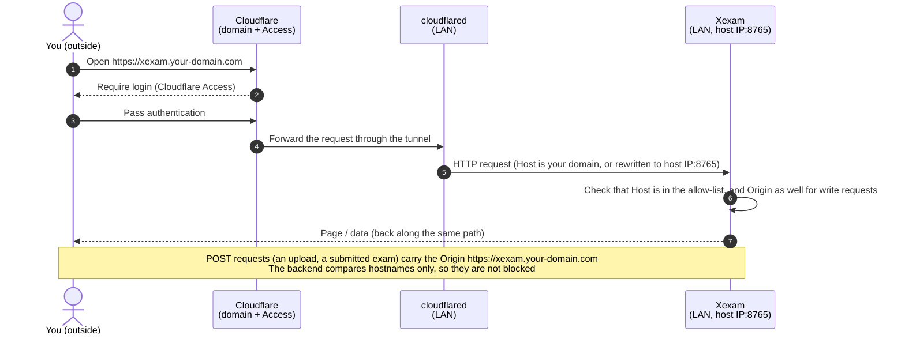

**English** | [日本語](../ja/deployment.md) | [简体中文](../zh-CN/deployment.md)

# Deployment

> New architecture: `nginx` (the only service exposed to the outside) + `backend` (Rust, private network) + SQLite (named volume `xexam_data`). For the structure diagrams see [architecture.md](architecture.md); for the security boundaries see [security.md](security.md).

## 1. Prerequisites

- A machine with Docker installed (including Compose v2); either x86 (amd64) or ARM (arm64) works.
  - The arm64 images were verified in CI under QEMU: **built and started** (`/api/info` reports `aarch64` and the right version, and Nginx `/healthz` is healthy). **They have not been run on real ARM hardware.**
  - The backend is cross-compiled for aarch64 with zig on an x86 build machine (about 5 minutes in CI with a cold cache; Rust does not have to be compiled under QEMU).
    zig's linker does not accept `--fix-cortex-a53-843419`, which rustc adds for aarch64 by default, so the aarch64 binary **does not include** this workaround for the Cortex-A53 erratum.
    Oracle Cloud's Ampere A1 uses Ampere Altra (according to Wikipedia, Arm Neoverse N1 cores), not Cortex-A53, so it is not affected.
    If you want to run on a board with Cortex-A53 cores (some older development boards), please do not use this image, and let me know first.
- A host with `/etc/localtime` (every common Linux distribution has it). Without it, see section 3.1.

## 2. Starting

### Pull the prebuilt images (recommended)

You only need one file from the repository, [`docker-compose.yml`](../../docker/docker-compose.yml) in the `docker/` folder (download it into a folder of its own, for example with `curl -fLO https://raw.githubusercontent.com/Yumin-Space/xexam/main/docker/docker-compose.yml`, and run the commands in that folder). It pulls the two images from Docker Hub (`docker.io/yuminspace/xexam-backend` and `docker.io/yuminspace/xexam-frontend`), where they are public, so no `docker login` is needed. The same tags are also on `ghcr.io/yumin-space/` as a private mirror (that one needs `docker login ghcr.io` with a classic GitHub token that has `read:packages`).

```bash
# no docker login needed: the images are public on Docker Hub
docker compose up -d
```

`docker compose up -d` pulls and starts **two containers**: `xexam-frontend` (Nginx, the only one exposed to the outside) and `xexam-backend` (Rust, private network). Then open <http://localhost:8765> in a browser and sign in with `admin` / `admin`; Xexam asks you to choose your own password right away (section 10). Open the menu (the three-line button at the top right), choose **Question banks** and import your Excel file (in the six-column layout, see section 12 of [usage.md](usage.md)). The interface starts in English; you can switch it to Chinese or Japanese under **Settings**, or on the sign-in page.

### Build from source (when you change the code)

```bash
git clone git@github.com:Yumin-Space/xexam.git
cd xexam
docker compose -f docker/docker-compose.build.yml up -d --build
```

The first build takes a few minutes (it compiles Rust and the frontend); later builds use the cache. In a clone, the compose files and `.env` are in `docker/`; `docker/docker-compose.build.yml` builds with the repository root as its context. Run the commands below from the repository root with `-f docker/docker-compose.build.yml` added (for example `docker compose -f docker/docker-compose.build.yml logs -f`).

The frontend image needs the three READMEs: the **About Xexam** page shows their changelogs, and they are built into the frontend. `nginx/Dockerfile` therefore copies `README.md`, `README/README.ja.md` and `README/README.zh-CN.md` into its build stage, and `.dockerignore` keeps `README.md` and `README/` in the build context. Only the built static files go into the final image.

The commands below name the Compose **services**, `backend` and `frontend`. The containers are called `xexam-backend` and `xexam-frontend`; plain `docker` commands (`docker logs`, `docker exec`) take those names instead.

| Action | Command |
|---|---|
| Check status | `docker compose ps` (both containers should be `healthy`) |
| View logs | `docker compose logs -f` (only the backend: `docker compose logs -f backend`; see section 9) |
| Stop / start again | `docker compose stop` / `docker compose start` |
| Update to the latest version | `docker compose pull && docker compose up -d` (for a source build: `git pull && docker compose -f docker/docker-compose.build.yml up -d --build`). Read section 6 first when you come from an older version |
| Version and architecture | <http://localhost:8765/api/info>, or in the app: the version entry of the menu, for example **Xexam v0.7.5** (the About page) |

> ⚠️ Do not run `docker compose down -v`: `-v` deletes the data volume `xexam_data`, which holds the question banks, the accounts and all study records.

**`docker/docker-compose.yml` and `docker/docker-compose.build.yml` use the same project name (`xexam`), the same volume (`xexam_data`) and the same container names**, so the two cannot run at the same time; run `docker compose stop` before switching. The data is shared between them; see [migration.md](migration.md).

## 3. Configuration (`.env`)

Create a `.env` file next to `docker-compose.yml`; in a clone that is `docker/.env`, which Compose also reads when you run it from the repository root with `-f docker/...` (an older clone with `.env` at the repository root: move it to `docker/`). It is not committed and does not go into the images; the template is [`.env.example`](../../docker/.env.example):

| Variable | Default | Purpose |
|---|---|---|
| `XEXAM_BIND` | `127.0.0.1:8765` | The "address:port" published on the host, for Nginx. It must be written as `IP:port`. `0.0.0.0:8765` = reachable from the LAN. ⚠️ A bare port number = all network interfaces |
| `XEXAM_ALLOWED_HOSTS` | empty | Which domain names / IPs may be used to access it, separated by commas, spaces or semicolons |
| `XEXAM_ALLOWED_ORIGINS` | empty | When a proxy rewrites Host to the origin server's address: enter the public domain (including `https://`) |
| `XEXAM_ALLOW_ANY_HOST` | `0` | `1` = do not check Host (only when authentication is already in front) |
| `XEXAM_PARSE_TIMEOUT_SECS` | `30` | Maximum time to parse one Excel file |
| `XEXAM_SQLITE_JOURNAL` | (unset: WAL) | `delete` keeps SQLite's old rollback journal instead of WAL. Set it only when the data volume is on a network filesystem or on a Windows folder bind-mounted into Docker Desktop; any other value means WAL. See section 2.1 of [database.md](database.md) |
| `XEXAM_COOKIE_SECURE` | (unset) | `1` = the session cookies always get `Secure`. Set it only when the browser always reaches Xexam over HTTPS (for example through Cloudflare Tunnel); unset, `Secure` follows each request (section 10) |
| `XEXAM_LOG` | (unset: `info`) | The backend's log filter, for both `docker compose logs backend` and the System log page, for example `debug` or `warn`. Empty or only spaces means `info`; a value that is not a valid filter also falls back to `info`, and the log then starts with one warning that names the problem |
| `TZ` | (unset: the host's time zone) | Time zone of the timestamps in the database; the compose file mounts the host's `/etc/localtime`, so set `TZ` only to use another zone (for example `UTC`) |

After changing `.env`, run `docker compose up -d` (it recreates the containers as needed). The compose files pass `XEXAM_ALLOWED_HOSTS`, `XEXAM_ALLOWED_ORIGINS`, `XEXAM_ALLOW_ANY_HOST` and `XEXAM_PARSE_TIMEOUT_SECS` always (with the defaults above when `.env` does not set them); `TZ`, `XEXAM_SQLITE_JOURNAL`, `XEXAM_COOKIE_SECURE` and `XEXAM_LOG` only when `.env` sets them (a line such as `XEXAM_LOG=` with nothing after it is passed as an empty value). `XEXAM_BIND` is used by Compose itself, for the published port. `xexam-backend --help` lists every variable the backend reads.

### 3.1 Time zone

The backend writes local times without a zone marker (section 4.6 of [database.md](database.md)). The compose files mount the host's `/etc/localtime` into the backend container, read only, with the long volume syntax:

```yaml
      - type: bind
        source: /etc/localtime
        target: /etc/localtime
        read_only: true
        bind:
          create_host_path: false
```

So the timestamps follow the host's time zone; a `TZ` in `.env` overrides it. `create_host_path: false` makes Compose stop with an error ("bind source path does not exist") on a host without `/etc/localtime`, instead of creating an empty folder there that cannot be mounted over the image's file. **On such a host, remove those six lines from `docker-compose.yml` and set `TZ` in `.env`** (for example `TZ=UTC`), otherwise the backend container does not start. Without the mount and without `TZ` the image uses UTC.

On Docker Desktop (Windows, macOS) the host's `/etc/localtime` is the file of Docker's own virtual machine, not of your computer, and that machine usually runs on UTC. The mount works, but the times are then UTC whatever zone your computer uses: set `TZ` in `.env` to the zone you want.

Changing the time zone later does not rewrite stored times; they keep the zone they were written in.

## 4. Opening Xexam from a phone, another computer or the internet

By default Xexam binds only to the local machine (`127.0.0.1`): only the machine that runs Docker can open <http://localhost:8765>. Xexam has its own sign-in, but anyone who reaches the port reaches the sign-in page, so open it up only as far as you need.

### From another computer through SSH (no configuration)

If Xexam runs on a server, NAS or virtual machine that you can log in to with SSH, run this on your own computer:

```bash
ssh -L 8765:127.0.0.1:8765 user@server
```

While this SSH connection is open, open <http://localhost:8765> in the browser on your own computer. Nothing changes on the server, and no port is opened.

### A phone or a computer on the same network

Do this only on a **trusted network** (such as your home Wi-Fi), not on a public or shared one:

1. Find the LAN IP address of the machine that runs Docker (usually `192.168.x.x` or `10.x.x.x`): on Windows run `ipconfig` and look at the "IPv4 Address" line; on macOS run `ipconfig getifaddr en0`; on Linux run `hostname -I` (usually the first address).
2. Put two lines into `.env`, with that address:

   ```ini
   XEXAM_BIND=0.0.0.0:8765
   XEXAM_ALLOWED_HOSTS=192.168.1.20      # the LAN IP of the machine that runs Docker
   ```

3. Run `docker compose up -d`, then open that address with port 8765 (here `http://192.168.1.20:8765`) in the browser of the phone (Safari on an iPhone, iOS 15.4 or later) or of the other computer.

Away from that network, use Cloudflare Tunnel (below); never forward the port on your router.

### From the internet through Cloudflare Tunnel

Use case: Xexam runs on your LAN, `cloudflared` (Cloudflare's tunnel client) runs on a machine of the same LAN (not necessarily the same one), and you reach Xexam from outside through your own domain, protected by **Cloudflare Access**. The backend is not exposed in the first place, so the tunnel only needs to point at **Nginx** (the port published by `XEXAM_BIND`).



Three things to do:

1. **Let cloudflared reach Nginx.** On the same machine, keep the default binding and point the tunnel at `http://localhost:8765`. On another machine of the LAN, set `XEXAM_BIND=0.0.0.0:8765` (or a specific LAN IP such as `192.168.1.20:8765`) in `.env`, together with `XEXAM_ALLOWED_HOSTS=xexam.your-domain.com`, and run `docker compose up -d`.
2. **Public Hostname** in the Zero Trust dashboard (Networks → Tunnels → your tunnel → Public Hostname): Subdomain / Domain `xexam` / `your-domain.com`, Service Type `HTTP` (not HTTPS), URL `host-IP:8765` (for example `192.168.1.20:8765`).
3. **A policy in Cloudflare Access** that allows **only you** and the people you invite. A domain with no policy is open to the whole world.

The Host the backend sees depends on the tunnel (`.env`):

| What the tunnel does | Setting |
|---|---|
| Host is passed through unchanged as your domain | `XEXAM_ALLOWED_HOSTS=xexam.your-domain.com` |
| `httpHostHeader` is set, so Host is rewritten to `192.168.1.20:8765` | `XEXAM_ALLOWED_HOSTS=192.168.1.20` + `XEXAM_ALLOWED_ORIGINS=https://xexam.your-domain.com` (the browser's `Origin` is still the public domain, so it must be allowed separately) |
| Not sure | Start with the first row. When a request is rejected (403), the page states the `Host` / `Origin` it saw and which option it belongs in; add it and run `docker compose up -d` again. The same reason is in `docker compose logs backend` and in the **System log** |
| You do not want to list domains, and Access is in front | `XEXAM_ALLOW_ANY_HOST=1` (`Host` is no longer checked; the `Origin` check on write requests and the sign-in still apply) |

Nginx passes the `Host` sent by the browser (or the tunnel) to the backend **unchanged** and clears `X-Forwarded-*`; the backend reads only the real `Host`.

**Everybody behind the tunnel shares one rate limit.** Nginx limits the requests per client address: `/api/` 30 requests per second with a burst of 120, `/api/upload` 1 per second with a burst of 5 (section 9 of [security.md](security.md)). Through a tunnel every user arrives from cloudflared's address, so they all count against the same limits. A page load sends about ten requests and the open System log page two a second, which stays well below them; if they are reached anyway, the page retries its reads and then says **Too many requests** (section 17 of [usage.md](usage.md)).

Things not to forget:

- ⚠️ **Xexam's own sign-in is the only lock on the port.** With `XEXAM_BIND=0.0.0.0:…` or `XEXAM_ALLOW_ANY_HOST=1`, anyone who can reach the port reaches the sign-in page and can try passwords (the escalating locks slow that down, but a weak password stays weak). Let only cloudflared reach the port: no port forwarding on the router. On Linux, the host firewall (ufw, firewalld) cannot block ports published by Docker; use the `DOCKER-USER` chain or a specific LAN IP in `XEXAM_BIND`. The safest setup is cloudflared and Xexam on the same machine with the default `127.0.0.1`.
- Change the default `admin` password at the first sign-in, and give every user a password of their own.
- Behind Cloudflare Access you sign in twice (Access, then Xexam). When the Access login expires, an upload or a submit fails with a message saying that your sign-in may have expired: reload the page and sign in again. An exam or practice in progress is kept in the browser and is not lost.

How far this has been verified (stated honestly):

- During the migration, the complete browser flow for both Host situations (Host preserved / Host rewritten) was run against the **old Python version**, using a real Chrome and an HTTPS reverse proxy. That script depended on the old Python code and was removed along with it.
- For the **new stack**: `tests/integration/stack_check.py` uses header-level checks to verify that "after passing through Nginx, the Host / Origin guard still works and `X-Forwarded-*` is not trusted"; `nginx_check.py` verifies that Host is passed through unchanged and checks the rate limits.
- It has **not** been tested with real Cloudflare. For the first go-live, follow the "Not sure" row in the table above and read the 403 message the page gives.

## 5. Data

- Location: named volume `xexam_data` → `/data/xexam.db` inside the container. Updating, rebuilding or deleting containers does not lose it. The database holds the question banks, the accounts, the study records and the settings.
- While the backend runs, SQLite's `xexam.db-wal` and `xexam.db-shm` sit next to the database (WAL mode, since v0.7). On a normal stop the backend copies everything into `xexam.db` and empties `xexam.db-wal`; the two files may stay next to it, empty and harmless.
- The volume can also hold a folder `/data/backups/` with the copies written before schema migrations (section 6). The program never deletes these files. To see them: `docker run --rm -v xexam_data:/data alpine ls -l /data /data/backups`.
- **Backups**: stop the backend first (`docker compose stop`), pack the volume, start again: the commands are in section 5 of [database.md](database.md). A copy of `xexam.db` alone taken while the backend runs can miss the latest changes, which may still be in `xexam.db-wal`; if you cannot stop it, copy `xexam.db`, `xexam.db-wal` and `xexam.db-shm` together. A volume backup includes `backups/`.
- Running the backend directly without Docker (development): see [development.md](development.md).

## 6. Upgrading

Every upgrade is `docker compose pull && docker compose up -d` (with the new `docker-compose.yml` where noted). On its first start the new backend migrates the database to its schema after writing a copy to `/data/backups/`; if that copy cannot be written (disk full, no permission), it exits with an error and the database is not changed. Docker keeps restarting it, and each start tries again; Nginx does not start, because it waits for a healthy backend. `docker compose logs backend` says why. Back up the volume yourself first as well (section 5): a copy outside the volume is safer.

**Coming from v0.6 or older, prepare six-column workbooks first.** Since v0.7 only the six-column layout can be imported, and on every start the backend retires every question that was imported from the three- or four-column layouts of earlier versions (the banks, the study records and the statistics stay). Every bank of v0.6 and older is in those layouts, so after the upgrade nothing can be practised until each bank is updated with a six-column file (section 13.5 of [usage.md](usage.md)).

The step-by-step checklists, the checks afterwards and the rollbacks are in [migration.md](migration.md):

- **From v0.7** (section 1 of migration.md): nothing to do besides the pull; no schema change, the same `docker-compose.yml` and `.env`.
- **From v0.6** (section 2 of migration.md): schema v3 → v4, backup `xexam-schema3-<date-time>.db`, WAL mode, then the retirement of the old-layout questions. Get the new `docker-compose.yml` as well: it no longer sets a fixed default time zone (it follows the host, section 3.1), limits the container logs (section 8) and passes `XEXAM_SQLITE_JOURNAL`, `XEXAM_COOKIE_SECURE` and `XEXAM_LOG` when `.env` sets them. If your earlier timestamps were written in a zone other than the host's, set that zone as `TZ` in `.env` so new records continue in it. No variable has to be added.
- **From v0.5 or v0.5.1** (section 3 of migration.md): schema v2 → v4 in one step, backup `xexam-schema2-<date-time>.db`. Sign-in is new: sign in with `admin` / `admin`, which now owns all earlier data.
- **From v0.4** (section 4 of migration.md): schema v1 → v4 in one step, backup `xexam-schema1-<date-time>.db`. Since v0.5.1 the images come from Docker Hub (`docker.io/yuminspace/…`, public, no login) instead of `ghcr.io`: replace your `docker-compose.yml` with the new one (or change its two `image:` lines to `docker.io/yuminspace/xexam-backend:latest` and `docker.io/yuminspace/xexam-frontend:latest`). For a source build, the compose files are now in `docker/`: move a `.env` at the repository root to `docker/.env`.

After the upgrade, `/api/info` shows `"version": "0.7.5"`. Later starts do not migrate again; the retirement of old-layout questions writes nothing when there is nothing left to retire. **Rolling back** means restoring the copy from `backups/` and running the older images; never run an older version on the migrated database for longer than an emergency. The exact commands are in [migration.md](migration.md); the background is in section 6 of [database.md](database.md).

## 7. Health checks and stopping

- `xexam-frontend`: `GET /healthz` (it does not go through the Host allow-list). `xexam-backend`: `xexam-backend healthcheck` (inside the container it requests itself with `Host: 127.0.0.1`). Nginx starts only after the backend is healthy (`depends_on`).
- When the backend is down or restarting, Nginx does not exit; `/api/` just returns a JSON 502 for a while (`后端暂时连不上`, "the backend is temporarily unreachable") and recovers automatically once the backend is back.
- `docker compose stop`: the backend exits gracefully within 8 seconds (Docker waits up to 15); an import transaction either finishes committing or is rolled back. Then it runs the WAL checkpoint, so everything is in `xexam.db` and `xexam.db-wal` is empty (the log says `WAL checkpoint at shutdown: everything is in xexam.db, the -wal file is empty`). After a crash or a `docker kill` the `-wal` file stays; SQLite applies it at the next start, nothing committed is lost.

## 8. Resources and images

| | |
|---|---|
| `xexam-frontend` | nginx-unprivileged + static files (the changelog for the About page is part of them); listens on 8080; read-only root filesystem |
| `xexam-backend` | a single statically linked executable + tzdata (UTC `/etc/localtime` as a fallback) + `/VERSION`; uid 10001; read-only root filesystem, only `/data` and `/tmp` are writable |
| Networks | `internal` (backend + Nginx, no access to the outside network) and `public` (Nginx only) |
| Container logs | logging driver `json-file` with `max-size: 10m` and `max-file: 3` for each container, so Docker keeps at most about 30 MB of log per container (without a limit Docker keeps container logs forever) |

## 9. Logs: the System log page and `docker compose logs`

There are two places to read what the backend logged. Both show the same lines, filtered by the same `XEXAM_LOG` (default `info`).

| | **System log** (menu, administrators only) | `docker compose logs backend` |
|---|---|---|
| Where | In the app, page `#/logs`, read every 0.5 seconds while it is open (longer after failed reads, at most every 10 seconds) | On the server |
| How much | The last **2000** lines since the backend last started | Everything Docker still keeps: up to 3 files of 10 MB, across restarts |
| After a restart | Empty again (kept in memory only, never in the database) | Kept |
| Also | Level filter, search, **Pause** / **Resume**, **Jump to latest** | The Nginx access and error log: `docker compose logs frontend` |

The Compose service is called `backend` (its container `xexam-backend`), so the page's note says: run `docker compose logs backend` on the server, in the folder of the compose file, or without Compose `docker logs xexam-backend`. In a clone, add `-f docker/docker-compose.yml` (or `-f docker/docker-compose.build.yml`) when you run it from the repository root.

What the log contains: the start-up lines (version, data directory, journal mode, allowed hosts, the reminder about the default password, the upgrade lines and the questions retired because of an old Excel layout), sign-ins and account changes by username (`user "admin" signed in`, `user "admin" updated user "alex"`; a name typed at sign-in that has no account is never logged), refused uploads and writes, warnings and errors. It never contains passwords, session tokens, cookie values, confirmation codes or question text. Requests rejected by the Host / Origin check, failed sign-ins and locks of usernames without an account are logged once and then summed up at most once a minute, so nobody can push the other lines out of the 2000 without signing in. Details: section 8 of [security.md](security.md).

## 10. First start, accounts and recovery

- After installing or upgrading, open Xexam and sign in with `admin` / `admin`, then choose your own password right away; until then anyone who can open the page can use the default password. While an administrator still has it, the sign-in page names that account, and each start of the backend prints a reminder (`docker compose logs backend`).
- Add the other people under **User management** (menu, administrators only), and choose which question banks each of them sees. A user with the **Bank manager** permission can import banks and update or delete their own.
- **Locked out of the password**: `docker compose exec backend xexam-backend reset-password admin` (without Compose: `docker exec xexam-backend xexam-backend reset-password admin`) prints a new temporary password, enables the account, signs it out everywhere and asks for a new password at the next sign-in. It works while the server runs.
- **Locked out by wrong passwords**: a sign-in lock lives in the backend's memory, so `reset-password` (another process) cannot lift it. Another administrator can press **Unlock** in User management, or restart the backend: `docker compose restart backend`.
- Behind Cloudflare Access you sign in twice (Access, then Xexam). Plain HTTP on your own network works: the session cookie gets `Secure` only when the page is opened over `https://`. `XEXAM_COOKIE_SECURE=1` (section 3) forces `Secure` always; set it only if the browser always reaches Xexam over HTTPS.

## 11. Releasing

On a push to `main`, [`.github/workflows/ci.yml`](../../.github/workflows/ci.yml) first runs the version, changelog and docs check, then four check groups (frontend, backend, Nginx and full stack, arm64). Only if all of them pass does it publish the two images `xexam-frontend` and `xexam-backend` (amd64 + arm64) to Docker Hub (`docker.io/yuminspace/`, public) and, as a private mirror, to `ghcr.io/yumin-space/`, both tagged `latest`, `v<CODE_VERSION>` and `sha-<commit>`, and create the matching GitHub Release (its notes list the Docker Hub pull commands first). Last, it records the release: `RELEASE_VERSION` in `VERSION` and the release badge of the READMEs, committed by the bot on `main` (and on `dev` when it can be fast-forwarded). Pushes to `dev` and pull requests into `main` run the same checks and never publish. Details: section 7 of [development.md](development.md).

Docker Hub needs two repository secrets, `DOCKERHUB_USERNAME` and `DOCKERHUB_TOKEN` (an access token with **Read & Write**), and optionally the repository variable `DOCKERHUB_NAMESPACE`; without the secrets, or if `docker/docker-compose.yml` does not name the Docker Hub images of that namespace, the publish job stops before it pushes anything. On ghcr.io, the first time a new image name is published, add this repository under **Manage Actions access** in the GitHub package settings with the role **Admin**, otherwise the push is rejected (`permission_denied: write_package`).
