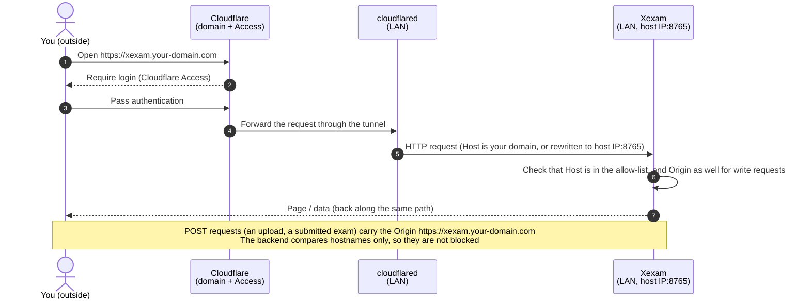

**English** | [日本語](../ja/deployment.md) | [简体中文](../zh-CN/deployment.md)

# Deployment

> New architecture: `nginx` (the only service exposed to the outside) + `backend` (Rust, private network, no internet) + SQLite (named volume `xexam_data`), and since v0.8 `ai-service` (Rust, private network plus outbound internet, its own SQLite in the volume `xexam_ai_data`). For the structure diagrams see [architecture.md](architecture.md); for the security boundaries see [security.md](security.md).

## 1. Prerequisites

- A machine with Docker installed (including Compose v2); either x86 (amd64) or ARM (arm64) works.
  - The arm64 images were verified in CI under QEMU: **built and started** (`/api/info` reports `aarch64` and the right version, and Nginx `/healthz` is healthy). **They have not been run on real ARM hardware.**
  - The backend and ai-service are cross-compiled for aarch64 with zig on an x86 build machine (about 5 minutes each in CI with a cold cache; Rust does not have to be compiled under QEMU).
    zig's linker does not accept `--fix-cortex-a53-843419`, which rustc adds for aarch64 by default, so the aarch64 binary **does not include** this workaround for the Cortex-A53 erratum.
    Oracle Cloud's Ampere A1 uses Ampere Altra (according to Wikipedia, Arm Neoverse N1 cores), not Cortex-A53, so it is not affected.
    If you want to run on a board with Cortex-A53 cores (some older development boards), please do not use this image, and let me know first.
- A host with `/etc/localtime` (every common Linux distribution has it). Without it, see section 3.1.

## 2. Starting

### Pull the prebuilt images (recommended)

You only need one file from the repository, [`docker-compose.yml`](../../docker/docker-compose.yml) in the `docker/` folder (download it into a folder of its own, for example with `curl -fLO https://raw.githubusercontent.com/Yumin-Space/xexam/main/docker/docker-compose.yml`, and run the commands in that folder). It pulls the three images from Docker Hub (`docker.io/yuminspace/xexam-backend`, `docker.io/yuminspace/xexam-ai-service` and `docker.io/yuminspace/xexam-frontend`), where they are public, so no `docker login` is needed. The same tags are also on `ghcr.io/yumin-space/` as a private mirror (that one needs `docker login ghcr.io` with a classic GitHub token that has `read:packages`).

```bash
# no docker login needed: the images are public on Docker Hub
docker compose up -d
```

`docker compose up -d` pulls and starts **three containers**: `xexam-frontend` (Nginx, the only one exposed to the outside), `xexam-backend` (Rust, private network, no internet access) and `ai-service` (Rust, the AI service, image `xexam-ai-service`: private network plus `egress`, outbound internet to reach the AI provider). The frontend starts as soon as the backend is healthy; it does not wait for ai-service, and Xexam works without it. Then open <http://localhost:8765> in a browser and sign in with `admin` / `admin`; Xexam asks you to choose your own password right away (section 10). Open the menu (the three-line button at the top right), choose **Question banks** and import your Excel file (in the six-column layout, see section 12 of [usage.md](usage.md)). The interface starts in English; you can switch it to Chinese or Japanese under **Settings**, or on the sign-in page.

### Build from source (when you change the code)

```bash
git clone git@github.com:Yumin-Space/xexam.git
cd xexam
docker compose -f docker/docker-compose.build.yml up -d --build
```

The first build takes a few minutes (it compiles Rust and the frontend); later builds use the cache. In a clone, the compose files and `.env` are in `docker/`; `docker/docker-compose.build.yml` builds with the repository root as its context. Run the commands below from the repository root with `-f docker/docker-compose.build.yml` added (for example `docker compose -f docker/docker-compose.build.yml logs -f`).

The frontend image needs the three changelogs (`docs/en/changelog.md`, `docs/ja/changelog.md` and `docs/zh-CN/changelog.md`): the **About Xexam** page shows them, and they are built into the frontend. `nginx/Dockerfile` therefore copies them into its build stage, and `.dockerignore`, which keeps `docs/` out of the build context, lets exactly these three files back in. Only the built static files go into the final image.

The commands below name the Compose **services**, `backend`, `ai-service` and `frontend`. The containers are called `xexam-backend`, `ai-service` and `xexam-frontend`; plain `docker` commands (`docker logs`, `docker exec`) take those names instead. `docker/docker-compose.build.yml` builds `ai-service/Dockerfile` as the image `xexam-ai-service:local`.

| Action | Command |
|---|---|
| Check status | `docker compose ps` (all three containers should be `healthy`) |
| View logs | `docker compose logs -f` (only the backend: `docker compose logs -f backend`; only ai-service: `docker compose logs -f ai-service`; see section 9) |
| Stop / start again | `docker compose stop` / `docker compose start` |
| Update to the latest version | `docker compose pull && docker compose up -d` (for a source build: `git pull && docker compose -f docker/docker-compose.build.yml up -d --build`). Read section 6 first when you come from an older version |
| Version and architecture | <http://localhost:8765/api/info>, or in the app: the version entry of the menu, for example **Xexam v0.9.1** (the About page) |

> ⚠️ Do not run `docker compose down -v`: `-v` deletes the two data volumes, `xexam_data` (the question banks, the accounts and all study records) and `xexam_ai_data` (the AI settings and keys, the chats and memories).

**`docker/docker-compose.yml` and `docker/docker-compose.build.yml` use the same project name (`xexam`), the same volumes (`xexam_data`, `xexam_ai_data`, `xexam_link`) and the same container names**, so the two cannot run at the same time; run `docker compose stop` before switching. The data is shared between them; see [migration.md](migration.md).

## 3. Configuration (`.env`)

Create a `.env` file next to `docker-compose.yml`; in a clone that is `docker/.env`, which Compose also reads when you run it from the repository root with `-f docker/...` (an older clone with `.env` at the repository root: move it to `docker/`). It is not committed and does not go into the images; the template is [`.env.example`](../../docker/.env.example):

| Variable | Default | Purpose |
|---|---|---|
| `XEXAM_BIND` | `127.0.0.1:8765` | The "address:port" published on the host, for Nginx. It must be written as `IP:port`. `0.0.0.0:8765` = reachable from the LAN. ⚠️ A bare port number = all network interfaces |
| `XEXAM_ALLOWED_HOSTS` | empty | Which domain names / IPs may be used to access it, separated by commas, spaces or semicolons |
| `XEXAM_ALLOWED_ORIGINS` | empty | When a proxy rewrites Host to the origin server's address: enter the public domain (including `https://`) |
| `XEXAM_ALLOW_ANY_HOST` | `0` | `1` = do not check Host (only when authentication is already in front) |
| `XEXAM_PARSE_TIMEOUT_SECS` | `30` | Maximum time to parse one Excel file |
| `XEXAM_SQLITE_JOURNAL` | (unset: WAL) | `delete` keeps SQLite's old rollback journal instead of WAL. Set it only when the data volume is on a network filesystem or on a Windows folder bind-mounted into Docker Desktop; any other value means WAL. See section 2.1 of [database.md](database.md) |
| `XEXAM_COOKIE_SECURE` | (unset) | `1` = the session cookies always get `Secure`. Set it only when the browser always reaches Xexam over HTTPS (for example through Cloudflare Tunnel); unset, `Secure` follows each request (section 10) |
| `XEXAM_LOG` | (unset: `info`) | The backend's log filter, for both `docker compose logs backend` and the System log page, for example `debug` or `warn`. Empty or only spaces means `info`; a value that is not a valid filter also falls back to `info`, and the log then starts with one warning that names the problem |
| `TZ` | (unset: the host's time zone) | Time zone of the timestamps in the database and of the days of the AI usage statistics; since v1.0 also the 0:00 reset of the daily AI request cap of each user (ai-service); the compose file mounts the host's `/etc/localtime` into the backend and ai-service, so set `TZ` only to use another zone (for example `UTC`) |
| `XEXAM_AI_SECRET_KEY` | (unset: a key file in the AI volume) | The key that encrypts the AI provider keys: 32 bytes as 64 hex digits or base64 (`openssl rand -base64 32`). Section 3.2 |
| `XEXAM_INTERNAL_TOKEN` | (unset: a random token in the link volume) | The token the backend and ai-service share, the same value for both: at least 32 printable ASCII characters without spaces (`openssl rand -hex 32`). Section 3.3 |
| `XEXAM_AI_LOG` | (unset: `info`) | ai-service's log filter, for `docker compose logs ai-service` and the lines it sends to the System log; same rules as `XEXAM_LOG` (empty means `info`, an invalid value falls back to `info` with one warning) |
| `XEXAM_AI_SQLITE_JOURNAL` | (unset: WAL) | `delete` = the rollback journal for the AI database, for the same unusual storage as `XEXAM_SQLITE_JOURNAL` |

v0.9 adds no variable and no compose change. After changing `.env`, run `docker compose up -d` (it recreates the containers as needed). The compose files pass `XEXAM_ALLOWED_HOSTS`, `XEXAM_ALLOWED_ORIGINS`, `XEXAM_ALLOW_ANY_HOST` and `XEXAM_PARSE_TIMEOUT_SECS` always (with the defaults above when `.env` does not set them); `TZ`, `XEXAM_SQLITE_JOURNAL`, `XEXAM_COOKIE_SECURE`, `XEXAM_LOG` and `XEXAM_INTERNAL_TOKEN` to the backend, and `TZ`, `XEXAM_AI_SECRET_KEY`, `XEXAM_INTERNAL_TOKEN`, `XEXAM_AI_LOG` and `XEXAM_AI_SQLITE_JOURNAL` to the AI service, only when `.env` sets them (a line such as `XEXAM_LOG=` with nothing after it is passed as an empty value). The Host / Origin settings apply to the AI routes too: the backend checks every AI request before Nginx passes it on. `XEXAM_BIND` is used by Compose itself, for the published port. `xexam-backend --help` and `xexam-ai-service --help` list every variable each program reads.

The images set the rest themselves, and the compose file does not change them:

| Image | Variables |
|---|---|
| `xexam-backend` | `XEXAM_DATA=/data`, `XEXAM_HOST=0.0.0.0`, `XEXAM_PORT=8765`, `XEXAM_VERSION_FILE=/VERSION`, `XEXAM_LINK_DIR=/link` (where `internal.token` is written; without Docker the default is `link` inside the data directory) |
| `ai-service` | `XEXAM_AI_DATA=/data`, `XEXAM_AI_HOST=0.0.0.0`, `XEXAM_AI_PORT=8766`, `XEXAM_AI_BACKEND_URL=http://backend:8765` (plain http only), `XEXAM_LINK_DIR=/link`, `XEXAM_VERSION_FILE=/VERSION` |

### 3.1 Time zone

The backend writes local times without a zone marker (section 4.6 of [database.md](database.md)), and ai-service counts its usage statistics per local day. The compose files mount the host's `/etc/localtime` into the backend container and into the ai-service container, read only, with the long volume syntax:

```yaml
      - type: bind
        source: /etc/localtime
        target: /etc/localtime
        read_only: true
        bind:
          create_host_path: false
```

So the timestamps follow the host's time zone; a `TZ` in `.env` overrides it. `create_host_path: false` makes Compose stop with an error ("bind source path does not exist") on a host without `/etc/localtime`, instead of creating an empty folder there that cannot be mounted over the image's file. **On such a host, remove those six lines from `docker-compose.yml` (in the backend and in the AI service) and set `TZ` in `.env`** (for example `TZ=UTC`), otherwise the containers do not start. Without the mount and without `TZ` the image uses UTC.

On Docker Desktop (Windows, macOS) the host's `/etc/localtime` is the file of Docker's own virtual machine, not of your computer, and that machine usually runs on UTC. The mount works, but the times are then UTC whatever zone your computer uses: set `TZ` in `.env` to the zone you want.

The titles of the AI+ study chats in AI Chat (the start time of a practice or exam, the time of a record) are written by ai-service in the time zone of its own container, so they follow the same setting.

Changing the time zone later does not rewrite stored times; they keep the zone they were written in.

### 3.2 The AI encryption key (`XEXAM_AI_SECRET_KEY`)

ai-service stores the provider keys entered in **AI settings** encrypted (section 11 of [security.md](security.md)). The key that encrypts them comes from one of two places:

- **Unset (the default)**: at its first start ai-service creates the key file `/data/secret.key` in its own volume `xexam_ai_data` (32 random bytes, mode 0600) and logs `Created a new AI key file /data/secret.key`; later starts log `AI encryption key: /data/secret.key`. A backup of that volume then holds both the encrypted keys and the key that opens them.
- **`XEXAM_AI_SECRET_KEY` in `.env`**: 32 bytes written as 64 hex digits or as base64, for example the output of `openssl rand -base64 32`. The key file is then not used, and a copy of the AI volume alone cannot decrypt the keys. The log says `AI encryption key: from XEXAM_AI_SECRET_KEY`. Keep the value somewhere safe, outside the server.

What goes wrong, and what it looks like (AI stays off in each case; the rest of Xexam works):

| Situation | Log line | Way out |
|---|---|---|
| `XEXAM_AI_SECRET_KEY` is set but not 32 bytes in hex or base64 | `XEXAM_AI_SECRET_KEY is not a valid key (expected 32 bytes as 64 hex digits or base64); AI is off` | Fix the value and run `docker compose up -d` (the file is never used as a fallback) |
| The key file is damaged | `The AI key file /data/secret.key is not valid; AI is off. Move it out of the AI data volume and restart the ai-service container to create a new one, then enter the AI keys again` | As the line says |
| The key changed or was lost (another `XEXAM_AI_SECRET_KEY`, a new key file, a restored database without its key) | `The saved AI keys cannot be decrypted: the AI encryption key was changed or lost. AI is off until an administrator enters the keys again` | Enter the keys again in **AI settings**, test, enable |

Switching from the key file to `XEXAM_AI_SECRET_KEY` (or back) counts as a changed key: enter the AI keys again afterwards. Nothing else is lost; the chats and memories are not encrypted with it.

### 3.3 The internal token (`XEXAM_INTERNAL_TOKEN`)

The backend and ai-service share one secret, the **internal token**: the backend signs with it the short statement of who is asking that Nginx passes to ai-service, and ai-service authenticates with it when it calls the backend (including its state report, the heartbeat) (section 5 of [architecture.md](architecture.md)).

- **Unset (the default)**: `xexam-backend serve` creates `/link/internal.token` in the volume `xexam_link` when it is missing (32 random bytes, 43 characters, mode 0600) and logs `AI link: /link/internal.token`. ai-service reads it from the same volume, mounted read only, and logs `AI link: connected to the main service`. Nothing to do.
- **`XEXAM_INTERNAL_TOKEN` in `.env`**: at least 32 printable ASCII characters without spaces, for example the output of `openssl rand -hex 32`. The compose file passes this one line to both services, so they always get the same value; the backend then writes no file and logs `AI link: using XEXAM_INTERNAL_TOKEN`. Whitespace around the value is ignored.
- A value that breaks the rule turns the link off in **both** services with one of these lines: `XEXAM_INTERNAL_TOKEN is too short (at least 32 characters); AI link off` or `XEXAM_INTERNAL_TOKEN may contain only printable ASCII characters without spaces; AI link off`. AI Chat is then unavailable (`ai.backendDown`) until it is fixed.
- When the two services disagree (for example a token set for only one of them when they are run without this compose file), ai-service logs `AI link: the main service refused the internal token (XEXAM_INTERNAL_TOKEN must be the same for both services)`, and requests that reach it without a valid statement are refused with `refused a request without a valid identity (requests must come through Nginx; XEXAM_INTERNAL_TOKEN must be the same for both services)`, at most once a minute.
- To change the token: stop both services, empty the link volume (`docker run --rm -v xexam_link:/link alpine rm -f /link/internal.token`) or change `XEXAM_INTERNAL_TOKEN`, and start again. ai-service also picks up a new token by itself within seconds.

### 3.4 AI providers (set in the app, not in `.env`)

The provider, its address, the keys and the model are chosen by an administrator in **AI settings** (section 17 of [usage.md](usage.md)) and stored in the AI database. Only the `ai-service` container connects to them, through the network `egress`, with HTTPS (rustls with the Mozilla root certificates built in; the proxy variables `HTTP_PROXY` / `HTTPS_PROXY` are ignored, and redirects are not followed).

| Provider in AI settings | Address | Requests | Authentication |
|---|---|---|---|
| **OpenAI-compatible API** (default) | `https://api.openai.com/v1` to start with; any server with the OpenAI chat completions API, local ones included (usually ending in `/v1`) | `GET {address}/models` (the model list), `POST {address}/chat/completions` with `"stream": true` | `Authorization: Bearer <API key>`; no header when no key is saved (local servers) |
| **Anthropic** | `https://api.anthropic.com` (a `/v1` at the end is removed when saving) | `GET {address}/v1/models?limit=1000`, `POST {address}/v1/messages` with `"stream": true` | `x-api-key: <API key>` and `anthropic-version: 2023-06-01` |
| **Cloudflare AI Gateway** | your gateway's address, for example `https://ai-gateway.example.com/<route>` (`…/openai` or `…/anthropic`); **API format** OpenAI or Anthropic, filled in from the last part of the address | as for the chosen format, below that address | the **Gateway API key** by the **Gateway auth scheme**: `bearer` → `Authorization: Bearer <key>`, `x-api-key` → `x-api-key: <key>`, `cf-aig-authorization` → `cf-aig-authorization: Bearer <key>`; plus, only if the gateway needs it, the **Provider key** by the format (OpenAI `Authorization: Bearer`, Anthropic `x-api-key`) |

- **Bring your own key (BYOK)**: when the gateway holds the provider's key itself, leave **Provider key** empty. When you need both keys, pick the scheme `cf-aig-authorization`: with `bearer` (OpenAI format) or `x-api-key` (Anthropic format) the two keys would need the same header, and AI settings refuses that combination.
- **What is sent**: the model, the system prompt (English: answer clearly, reply in the language the user writes in, plus the date and the user's memory notes), the earlier messages of the chat (newest first, up to about 24 000 characters by default) and the new message. No temperature or other sampling setting. In the OpenAI format `stream_options.include_usage` asks for the token counts; in the Anthropic format `max_tokens` is 8192. If the provider refuses either during the **Test**, the test tries once more without it (or with 4096) and keeps what worked.
- **Time limits**: connect 10 seconds, the first answer byte 120 seconds, at most 120 seconds without any data, 10 minutes for a whole answer (the text so far is kept); the model list 30 seconds; the test up to 2 minutes per try.
- **Errors** of the provider are never shown as its own text: they become fixed codes (`ai.up.auth`, `ai.up.quota`, `ai.up.rateLimit`, …, section 5 of [api.md](api.md)), which the page translates. A test that fails because of the settings (key, quota, model, refused request, unreadable answer) switches AI off; a temporary failure does not.
- **A provider on your own network** (for example a local model server) works with `http://`; the ai-service container must be able to reach its address. AI settings warns that the key travels unencrypted unless the host is `localhost`, `127.0.0.1`, `[::1]` or a name without a dot.

## 4. Opening Xexam from a phone, another computer or the internet

By default Xexam binds only to the local machine (`127.0.0.1`): only the machine that runs Docker can open <http://localhost:8765>. Xexam has its own sign-in, but anyone who reaches the port reaches the sign-in page, so open it up only as far as you need.

### From another computer through SSH (no configuration)

If Xexam runs on a server, NAS or virtual machine that you can log in to with SSH, run this on your own computer:

```bash
ssh -L 8765:127.0.0.1:8765 user@server
```

While this SSH connection is open, open <http://localhost:8765> in the browser on your own computer. Nothing changes on the server, and no port is opened.

### A phone or a computer on the same network

Do this only on a **trusted network** (such as your home Wi-Fi), not on a public or shared one:

1. Find the LAN IP address of the machine that runs Docker (usually `192.168.x.x` or `10.x.x.x`): on Windows run `ipconfig` and look at the "IPv4 Address" line; on macOS run `ipconfig getifaddr en0`; on Linux run `hostname -I` (usually the first address).
2. Put two lines into `.env`, with that address:

   ```ini
   XEXAM_BIND=0.0.0.0:8765
   XEXAM_ALLOWED_HOSTS=192.168.1.20      # the LAN IP of the machine that runs Docker
   ```

3. Run `docker compose up -d`, then open that address with port 8765 (here `http://192.168.1.20:8765`) in the browser of the phone (Safari on an iPhone, iOS 15.4 or later) or of the other computer.

Away from that network, use Cloudflare Tunnel (below); never forward the port on your router.

### From the internet through Cloudflare Tunnel

Use case: Xexam runs on your LAN, `cloudflared` (Cloudflare's tunnel client) runs on a machine of the same LAN (not necessarily the same one), and you reach Xexam from outside through your own domain, protected by **Cloudflare Access**. The backend is not exposed in the first place, so the tunnel only needs to point at **Nginx** (the port published by `XEXAM_BIND`).



Three things to do:

1. **Let cloudflared reach Nginx.** On the same machine, keep the default binding and point the tunnel at `http://localhost:8765`. On another machine of the LAN, set `XEXAM_BIND=0.0.0.0:8765` (or a specific LAN IP such as `192.168.1.20:8765`) in `.env`, together with `XEXAM_ALLOWED_HOSTS=xexam.your-domain.com`, and run `docker compose up -d`.
2. **Public Hostname** in the Zero Trust dashboard (Networks → Tunnels → your tunnel → Public Hostname): Subdomain / Domain `xexam` / `your-domain.com`, Service Type `HTTP` (not HTTPS), URL `host-IP:8765` (for example `192.168.1.20:8765`).
3. **A policy in Cloudflare Access** that allows **only you** and the people you invite. A domain with no policy is open to the whole world.

The Host the backend sees depends on the tunnel (`.env`):

| What the tunnel does | Setting |
|---|---|
| Host is passed through unchanged as your domain | `XEXAM_ALLOWED_HOSTS=xexam.your-domain.com` |
| `httpHostHeader` is set, so Host is rewritten to `192.168.1.20:8765` | `XEXAM_ALLOWED_HOSTS=192.168.1.20` + `XEXAM_ALLOWED_ORIGINS=https://xexam.your-domain.com` (the browser's `Origin` is still the public domain, so it must be allowed separately) |
| Not sure | Start with the first row. When a request is rejected (403), the page states the `Host` / `Origin` it saw and which option it belongs in; add it and run `docker compose up -d` again. The same reason is in `docker compose logs backend` and in the **System log** |
| You do not want to list domains, and Access is in front | `XEXAM_ALLOW_ANY_HOST=1` (`Host` is no longer checked; the `Origin` check on write requests and the sign-in still apply) |

Nginx passes the `Host` sent by the browser (or the tunnel) to the backend **unchanged** and clears `X-Forwarded-*`; the backend reads only the real `Host`.

**Everybody behind the tunnel shares one rate limit.** Nginx limits the requests per client address: `/api/` 30 requests per second with a burst of 120, `/api/upload` 1 per second with a burst of 5, `/api/ai/` 30 per second with a burst of 120 (section 9 of [security.md](security.md)). Through a tunnel every user arrives from cloudflared's address, so they all count against the same limits. A page load sends about ten requests and the open System log page two a second, which stays well below them; if they are reached anyway, the page retries its reads and then says **Too many requests** (section 19 of [usage.md](usage.md)). Starting AI answers is limited per session instead (20 a minute with a burst of 10, counting AI Chat sends and retries and, since v0.9, the AI hints, explanations and summaries together), so users behind one tunnel do not share that limit. Clicking **AI analysis** through many questions in quick succession can reach it; the popover then says to wait a few seconds.

**AI Chat and the study help through the tunnel.** The answers of AI Chat and of the AI+ study help (hints, explanations, summaries) arrive as a stream of server-sent events (`text/event-stream`). Nginx passes them on unbuffered, cloudflared does not buffer that content type either, and ai-service sends a keep-alive comment every 15 seconds while the provider is silent, well below Cloudflare's idle limit of about 100 seconds; so the text appears piece by piece outside your network too. If the connection drops anyway (a phone that sleeps, a tunnel reconnect), the answer is still written and saved, and the page picks it up when it can reach Xexam again. One request of AI settings can take long: the **Test** waits for one answer of the model (up to 2 minutes per try, Nginx waits up to 5); Cloudflare may end such a request after about 100 seconds with an error page of its own. The test still finishes in the AI service; reload AI settings to see its result.

Things not to forget:

- ⚠️ **Xexam's own sign-in is the only lock on the port.** With `XEXAM_BIND=0.0.0.0:…` or `XEXAM_ALLOW_ANY_HOST=1`, anyone who can reach the port reaches the sign-in page and can try passwords (the escalating locks slow that down, but a weak password stays weak). Let only cloudflared reach the port: no port forwarding on the router. On Linux, the host firewall (ufw, firewalld) cannot block ports published by Docker; use the `DOCKER-USER` chain or a specific LAN IP in `XEXAM_BIND`. The safest setup is cloudflared and Xexam on the same machine with the default `127.0.0.1`.
- Change the default `admin` password at the first sign-in, and give every user a password of their own.
- Behind Cloudflare Access you sign in twice (Access, then Xexam). When the Access login expires, an upload or a submit fails with a message saying that your sign-in may have expired: reload the page and sign in again. An exam or practice in progress is kept in the browser and is not lost.

How far this has been verified (stated honestly):

- During the migration, the complete browser flow for both Host situations (Host preserved / Host rewritten) was run against the **old Python version**, using a real Chrome and an HTTPS reverse proxy. That script depended on the old Python code and was removed along with it.
- For the **new stack**: `tests/integration/stack_check.py` uses header-level checks to verify that "after passing through Nginx, the Host / Origin guard still works and `X-Forwarded-*` is not trusted"; `nginx_check.py` verifies that Host is passed through unchanged and checks the rate limits.
- It has **not** been tested with real Cloudflare. For the first go-live, follow the "Not sure" row in the table above and read the 403 message the page gives.

## 5. Data

- Location: named volume `xexam_data` → `/data/xexam.db` inside the container. Updating, rebuilding or deleting containers does not lose it. The database holds the question banks, the accounts, the study records and the settings.
- While the backend runs, SQLite's `xexam.db-wal` and `xexam.db-shm` sit next to the database (WAL mode, since v0.7). On a normal stop the backend copies everything into `xexam.db` and empties `xexam.db-wal`; the two files may stay next to it, empty and harmless.
- The volume can also hold a folder `/data/backups/` with the copies written before schema migrations (section 6). The program never deletes these files. To see them: `docker run --rm -v xexam_data:/data alpine ls -l /data /data/backups`.
- **The AI service's data** (v0.8) is in its own named volume `xexam_ai_data` → `/data` in the `ai-service` container: `xexam-ai.db` (AI settings, encrypted provider keys, safety limits, chats, memories, usage statistics; WAL mode with its `-wal` / `-shm` files) and the key file `secret.key` (section 3.2); since v0.9 its chats also include the practice, exam and record-summary chats of the AI+ study features, with the question texts and the AI answers, and the volume gets a folder `/data/backups/` with the copy written before an AI schema upgrade (section 6). The backend never mounts it, and ai-service never mounts `xexam_data`.
- **The link volume** `xexam_link` → `/link` holds only `internal.token` (section 3.3); the backend mounts it read-write, ai-service read only.
- **Backups**: stop Xexam first (`docker compose stop`), pack **both data volumes**, start again: the commands are in section 5 and 8.4 of [database.md](database.md). A copy of `xexam.db` alone taken while the backend runs can miss the latest changes, which may still be in `xexam.db-wal`; if you cannot stop it, copy `xexam.db`, `xexam.db-wal` and `xexam.db-shm` together (the same for `xexam-ai.db`). A volume backup includes `backups/`. The backup of `xexam_ai_data` contains the key file, which decrypts the saved AI keys: keep it as private as the keys, or set `XEXAM_AI_SECRET_KEY` so that the key is not in the volume. Deleted chats stay in the backups you made before. `xexam_link` needs no backup: the backend writes a new token when it is empty.
- Running the backend directly without Docker (development): see [development.md](development.md).

## 6. Upgrading

Every upgrade is `docker compose pull && docker compose up -d` (with the new `docker-compose.yml` where noted). On its first start the new backend migrates the database to its schema after writing a copy to `/data/backups/`; if that copy cannot be written (disk full, no permission), it exits with an error and the database is not changed. Docker keeps restarting it, and each start tries again; Nginx does not start, because it waits for a healthy backend. `docker compose logs backend` says why. Back up the volume yourself first as well (section 5): a copy outside the volume is safer.

ai-service does the same for its own database: the first start of a v0.9 ai-service upgrades `xexam-ai.db` (schema 3) after writing a copy to `/data/backups/` **in the AI volume** (`xexam-ai-schema<N>-<date-time>.db`), and does not start if the copy cannot be written (the rest of Xexam keeps working; `docker compose logs ai-service` says why). **Keep free disk space of about the size of each database** (the copy is a complete file), and know that these copies are never pruned and keep what you delete later (records, banks, chats): remove old ones yourself when that matters.

**Coming from v0.6 or older, prepare six-column workbooks first.** Since v0.7 only the six-column layout can be imported, and on every start the backend retires every question that was imported from the three- or four-column layouts of earlier versions (the banks, the study records and the statistics stay). Every bank of v0.6 and older is in those layouts, so after the upgrade nothing can be practised until each bank is updated with a six-column file (section 13.5 of [usage.md](usage.md)).

The step-by-step checklists, the checks afterwards and the rollbacks are in [migration.md](migration.md):

- **From v1.0 to v1.1** (section 00 of migration.md): `docker compose pull && docker compose up -d`, with no compose change and no new variable. The main database moves from schema 6 to 7 (backup `xexam-schema6-<date-time>.db` in `xexam_data`) and the AI database from schema 4 to 6 (backup `xexam-ai-schema4-<date-time>.db` in `xexam_ai_data`). The answer, memory and call lengths are tokens now (3000, 1000 and 20000 by default), and the new call ceilings apply at once. Going back: restore both copies and run the v1.0 images.
- **From v0.9.1 to v1.0** (see the 0.9.1 → 1.0 part of migration.md): `docker compose pull && docker compose up -d`, with no compose change and no new variable. The main database is unchanged (schema 6). The AI database moves from schema 3 to 4 (backup `xexam-ai-schema3-<date-time>.db` in `xexam_ai_data`, written before the change; the copy must fit in the free disk space). The new per-user AI request caps (5 a minute, 20 an hour, 100 a day) and the answer length (1000 characters) apply at once, administrators included. Going back: restore the AI copy and run the v0.9.1 images; the main database needs no restore.
- **From v0.8** (section 0b of migration.md): `docker compose pull && docker compose up -d`, with no compose change and no new variable. The main database moves from schema 5 to 6 (backup `xexam-schema5-<date-time>.db` in `xexam_data`) and the AI database from schema 2 to 3 (backup `xexam-ai-schema2-<date-time>.db` in `xexam_ai_data`). Everything else stays as it was; the AI+ study features appear for accounts with the AI+ feature at once, with nothing to set up. Going back: the main database needs no restore, the AI database does (below).
- **From v0.7.5 or v0.7** (section 1 of migration.md): **get the new `docker-compose.yml`** (the service `ai-service` with the third image `xexam-ai-service`, the volumes `xexam_ai_data` and `xexam_link`, the network `egress`); schema v4 → v6, backup `xexam-schema4-<date-time>.db`; the AI database is created new (schema 3). AI stays off until an administrator sets it up. With the old compose file everything but AI works: **AI settings** then opens and says that ai-service is not running (with the hint to use the new compose file), and the AI+ feature switches in User management are hidden.
- **From v0.6** (section 2 of migration.md): schema v3 → v6, backup `xexam-schema3-<date-time>.db`, WAL mode, then the retirement of the old-layout questions. Get the new `docker-compose.yml` as well: it adds ai-service, no longer sets a fixed default time zone (it follows the host, section 3.1), limits the container logs (section 8) and passes `XEXAM_SQLITE_JOURNAL`, `XEXAM_COOKIE_SECURE`, `XEXAM_LOG` and the AI variables when `.env` sets them. If your earlier timestamps were written in a zone other than the host's, set that zone as `TZ` in `.env` so new records continue in it. No variable has to be added.
- **From v0.5 or v0.5.1** (section 3 of migration.md): schema v2 → v6 in one step, backup `xexam-schema2-<date-time>.db`. Sign-in is new: sign in with `admin` / `admin`, which now owns all earlier data.
- **From v0.4** (section 4 of migration.md): schema v1 → v6 in one step, backup `xexam-schema1-<date-time>.db`. Since v0.5.1 the images come from Docker Hub (`docker.io/yuminspace/…`, public, no login) instead of `ghcr.io`: replace your `docker-compose.yml` with the new one (or change its two `image:` lines to `docker.io/yuminspace/xexam-backend:latest` and `docker.io/yuminspace/xexam-frontend:latest`). For a source build, the compose files are now in `docker/`: move a `.env` at the repository root to `docker/.env`.

After the upgrade, `/api/info` shows the version of the images you pulled (`"version": "1.1"` for this release). Later starts do not migrate again; the retirement of old-layout questions writes nothing when there is nothing left to retire. **Rolling back** means restoring the copy from `backups/` and running the older images (from v0.9 to v0.8 only the AI database needs its copy: a v0.8 backend opens the schema-6 main database as it is, while a v0.8 ai-service refuses the schema-3 AI database and everything AI wrote after the upgrade is lost with the restore); never run an older version on the migrated database for longer than an emergency. The exact commands are in [migration.md](migration.md); the background is in section 6 of [database.md](database.md).

### v1.1 notes: the import upload, memory and settings

- **The upload route**: Nginx accepts a body of up to 20 MB on `/api/ai/import/upload` only, and the rest of `/api/ai/` keeps its small limit. A reverse proxy in front of the stack must allow the same size on that path, or the upload is refused with 413 before it reaches Xexam.
- **Memory**: ai-service may hold up to four 20 MB uploads at once (one per user at a time), plus one extraction child. The child is stopped by a watchdog at 768 MiB. The child is the same binary, so the image does not change.
- **Temporary files**: Nginx keeps an upload body in its temporary directory on tmpfs (RAM) while the request runs. The extraction child works in `/tmp`, which is tmpfs in the compose file.
- **Settings**: there is no new environment variable. The import size, the questions per import and the call limits are set in **AI settings › AI banks**.
- **Time zone**: the daily generation quota resets at 0:00 in the time zone of ai-service (its `TZ` setting; example `TZ=UTC`).


## 7. Health checks and stopping

- `xexam-frontend`: `GET /healthz` (it does not go through the Host allow-list). `xexam-backend`: `xexam-backend healthcheck` (inside the container it requests itself with `Host: 127.0.0.1`). `ai-service`: `xexam-ai-service healthcheck` (it asks its own `GET /healthz` on 127.0.0.1, which needs neither the backend nor the provider; every 30 seconds). Nginx and ai-service start only after the backend is healthy (`depends_on`); Nginx does not wait for ai-service.
- When the backend is down or restarting, Nginx does not exit; `/api/` just returns a JSON 502 for a while (`后端暂时连不上`, "the backend is temporarily unreachable") and recovers automatically once the backend is back. AI requests then get 503 `ai.backendDown`.
- When ai-service is absent, stopped or unhealthy, `/api/ai/*` returns a JSON 502 `ai.unavailable`, AI Chat leaves the menu (opened by its address it says only that AI is not available right now; only administrators see that ai-service is not connected), the AI+ feature switches in User management disappear (turning one on or off is refused with 409 `ai.serviceOff` and nothing changes; stored switches are kept) and **AI settings** opens with a status panel that names the cause. How the backend knows: ai-service reports to it every 25 seconds (the heartbeat, section 5 of [architecture.md](architecture.md)); after 60 seconds without a report ai-service counts as not connected, at once when it was stopped normally. The panel checks again every 10 seconds, and the page returns to normal by itself shortly after ai-service is back (it reports as soon as it starts); everything else works all the time.
- `docker compose stop`: the backend exits gracefully within 8 seconds (Docker waits up to 15); an import transaction either finishes committing or is rolled back. Then it runs the WAL checkpoint, so everything is in `xexam.db` and `xexam.db-wal` is empty (the log says `WAL checkpoint at shutdown: everything is in xexam.db, the -wal file is empty`). After a crash or a `docker kill` the `-wal` file stays; SQLite applies it at the next start, nothing committed is lost.
- `docker compose stop` for ai-service: every answer being written ends as **Stopped** and is saved within 8 seconds, then it sends its last "stopping" report (so the backend shows it as stopped at once) and its last log lines (each at most 2 seconds) and checkpoints its database. An answer cut off by a crash is marked as interrupted at the next start.

## 8. Resources and images

| | |
|---|---|
| `xexam-frontend` | nginx-unprivileged + static files (the changelog for the About page is part of them); listens on 8080; read-only root filesystem |
| `xexam-backend` | a single statically linked executable + tzdata (UTC `/etc/localtime` as a fallback) + `/VERSION`; uid 10001; read-only root filesystem, only `/data`, `/link` and `/tmp` are writable |
| `ai-service` | a single statically linked executable + tzdata + `/VERSION`; uid 10001; read-only root filesystem, only its `/data` and `/tmp` are writable (`/link` read only); listens on 8766 inside the network, no published port |
| Networks | `internal` (backend, ai-service and Nginx, no access to the outside network), `public` (Nginx only) and `egress` (ai-service only: outbound internet for the AI provider) |
| Container logs | logging driver `json-file` with `max-size: 10m` and `max-file: 3` for each container, so Docker keeps at most about 30 MB of log per container (without a limit Docker keeps container logs forever) |

## 9. Logs: the System log page and `docker compose logs`

There are two places to read what the backend logged. Both show the same lines, filtered by the same `XEXAM_LOG` (default `info`). ai-service logs to its own container log (`docker compose logs ai-service`, filtered by `XEXAM_AI_LOG`) and also sends its lines to the backend, where the System log shows them with the prefix `AI: ` (not the backend's `docker compose logs backend`).

| | **System log** (menu, administrators only) | `docker compose logs backend` |
|---|---|---|
| Where | In the app, page `#/logs`, read every 0.5 seconds while it is open (longer after failed reads, at most every 10 seconds) | On the server |
| How much | The last **2000** lines since the backend last started | Everything Docker still keeps: up to 3 files of 10 MB, across restarts |
| After a restart | Empty again (kept in memory only, never in the database) | Kept |
| Also | Level filter, search, **Pause** / **Resume**, **Jump to latest** | The Nginx access and error log: `docker compose logs frontend` (since v0.9 the access log shows each request's path without its query string) |

The Compose service is called `backend` (its container `xexam-backend`), so the page's note says: run `docker compose logs backend` on the server, in the folder of the compose file, or without Compose `docker logs xexam-backend`. In a clone, add `-f docker/docker-compose.yml` (or `-f docker/docker-compose.build.yml`) when you run it from the repository root.

What the log contains: the start-up lines (version, data directory, journal mode, allowed hosts, the AI link, the reminder about the default password, the upgrade lines and the questions retired because of an old Excel layout), sign-ins and account changes by username (`user "admin" signed in`, `user "admin" updated user "alex"`; a name typed at sign-in that has no account is never logged), refused uploads and writes, warnings and errors. It never contains passwords, session tokens, cookie values, confirmation codes or question text. Requests rejected by the Host / Origin check, failed sign-ins and locks of usernames without an account are logged once and then summed up at most once a minute, so nobody can push the other lines out of the 2000 without signing in. Details: section 8 of [security.md](security.md).

ai-service's lines: its start (`Xexam AI service 0.9.1 listening on 0.0.0.0:8766`, `AI database: /data/xexam-ai.db (journal: wal)`, the encryption key source), the link (`AI link: connected to the main service`, written once per connection, and `AI link: lost the main service` when it breaks, so a long outage is one pair of lines and not one line per retry), every change of the AI settings and the safety limits by an administrator, tests, the **AI+ feature** switch, an administrator's Pause and Resume (the lines still read `AI function turned off for user "sam" by admin "admin"`, and `… turned on …`), a schema upgrade of the AI database with the name of its backup copy (`Upgraded the AI database to schema 3. A copy of the previous version was saved first: …`, for every schema-1 or schema-2 database; reopening writes nothing), the retention's total (`AI retention: deleted N chats older than D days`), a hint withheld because it gave the answer away (`AI hint withheld because it gave the answer away (user "sam")`, at most one line a minute, then `N more AI hints were withheld since the last report`, never any text) and an answer of the backend's study routes that could not be read (`AI link: an answer of /internal/ai/question could not be read`, at most one line a minute), failed AI calls (`AI call failed for user "sam": ai.up.rateLimit (HTTP 429)`, at most one line per reason a minute), the retention, the removal of deleted users' data, and the audit lines of administrators viewing or clearing users' AI data. They never contain keys, the internal token, prompts, answers, chat titles, memory notes, question texts, session keys or record times. The heartbeat writes no lines. While the backend cannot be reached, ai-service keeps up to 500 lines and sends them later, starting with `<n> AI log lines were dropped while the main service was unreachable` when it had to drop some; audit lines are never dropped.

## 10. First start, accounts and recovery

- After installing or upgrading, open Xexam and sign in with `admin` / `admin`, then choose your own password right away; until then anyone who can open the page can use the default password. While an administrator still has it, the sign-in page names that account, and each start of the backend prints a reminder (`docker compose logs backend`).
- Add the other people under **User management** (menu, administrators only), and choose which question banks each of them sees. A user with the **Bank manager** permission can import banks and update or delete their own.
- **AI** is off after installing: set it up in **AI settings** (section 3.4 and section 17 of [usage.md](usage.md)), then turn on the **AI+ feature** in **User management** for the users who may use AI Chat (those switches appear only while ai-service is connected and the AI+ feature is on in AI settings). On a fresh install the status line of AI settings starts with **Connection not set**. Free mode, which only an administrator can choose, is in **Settings** under **AI chat mode**; it needs no setup here.
- **Locked out of the password**: `docker compose exec backend xexam-backend reset-password admin` (without Compose: `docker exec xexam-backend xexam-backend reset-password admin`) prints a new temporary password, enables the account, signs it out everywhere and asks for a new password at the next sign-in. It works while the server runs.
- **Locked out by wrong passwords**: a sign-in lock lives in the backend's memory, so `reset-password` (another process) cannot lift it. Another administrator can press **Unlock** in User management, or restart the backend: `docker compose restart backend`.
- Behind Cloudflare Access you sign in twice (Access, then Xexam). Plain HTTP on your own network works: the session cookie gets `Secure` only when the page is opened over `https://`. `XEXAM_COOKIE_SECURE=1` (section 3) forces `Secure` always; set it only if the browser always reaches Xexam over HTTPS.

## 11. Releasing

On a push to `main`, [`.github/workflows/ci.yml`](../../.github/workflows/ci.yml) first runs the version, changelog and docs check, then five check groups (frontend, backend, ai-service, Nginx and full stack, arm64). Only if all of them pass does it publish the three images `xexam-frontend`, `xexam-backend` and `xexam-ai-service` (amd64 + arm64) to Docker Hub (`docker.io/yuminspace/`, public) and, as a private mirror, to `ghcr.io/yumin-space/`, both tagged `latest`, `v<CODE_VERSION>` and `sha-<commit>`, and create the matching GitHub Release (its notes list the Docker Hub pull commands first). Last, it records the release: `RELEASE_VERSION` in `VERSION` and the release badge of the READMEs, committed by the bot on `main` (and on `dev` when it can be fast-forwarded). Pushes to `dev` and pull requests into `main` run the same checks and never publish. Details: section 8 of [development.md](development.md).

Docker Hub needs two repository secrets, `DOCKERHUB_USERNAME` and `DOCKERHUB_TOKEN` (an access token with **Read & Write**), and optionally the repository variable `DOCKERHUB_NAMESPACE`; without the secrets, or if `docker/docker-compose.yml` does not name the Docker Hub images of that namespace, the publish job stops before it pushes anything. On ghcr.io, the first time a new image name is published (for example `xexam-ai-service` with v0.8), add this repository under **Manage Actions access** in the GitHub package settings with the role **Admin**, otherwise the push is rejected (`permission_denied: write_package`). The Docker Hub token must be able to write to every one of the three repositories.
