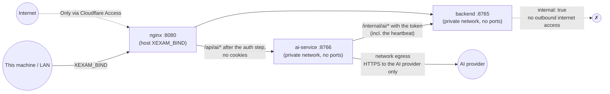

**English** | [日本語](../ja/security.md) | [简体中文](../zh-CN/security.md)

# Security

> Scope: a self-hosted program for a small group of people who know each other, with **accounts and sign-in** since v0.6, administrators, plain users and, since v0.7, **bank managers**. Security rests on five things: the **backend is not exposed**, the **Host/Origin guard**, **sign-in on every route** with sessions and an escalating lock after wrong passwords, **permissions checked by the backend** (who sees and manages which question bank, whose records are whose), and **authentication in front of it, such as Cloudflare Access**, when it is reachable from the internet. Since v0.8 the optional **AI service** runs in a container of its own that never receives a credential, with encrypted provider keys (§11).
> Audit basis: [audit/security.md](../zh-CN/history/audit/security.md). Tests: `backend/tests/` (run against the committed legacy snapshot: 172 golden responses, parser fixtures, id vectors; sign-in and users in `v06_users_and_sign_in.rs`, bank access, ownership and practice in `v065_bank_access_and_practice.rs` and `v07_bank_access_and_layouts.rs`, the System log and floods of rejected requests in `v07_wal_and_logs.rs` and `v07_log_floods.rs`, the AI link, the auth step and the internal routes in `v08_ai_link.rs`), `ai-service/tests/` (identity and access, keys and settings, streaming, administrators' access, no secrets in the logs, proxy variables ignored) and `tests/integration/nginx_check.py` (Nginx, its rate limits and the AI routes included). During the migration, a batch of 340 malicious-request probes was also used to compare the legacy and new versions item by item (0 unexplained differences; 51 recorded as intentional hardening). That probe set was removed together with the old Python code.

## 1. Threat model

| Who | What they can do | Our defense |
|---|---|---|
| Another machine on the same network | Connect straight to the port | Binds to `127.0.0.1` only by default; to open it up you must set `XEXAM_BIND` yourself. Every route except `/api/info`, `/api/auth/state` and signing in needs a session (§5), and `/api/info` says only the version, the CPU architecture and whether the program can be shut down (§7); wrong passwords lock signing in, longer each time (§6) |
| Someone guessing passwords | Try many passwords for one account, or many made-up usernames | Escalating lock per account, kept apart from made-up names, and apart for browsers the owner signed in with before; Argon2id behind a limit of 2 at a time (§6) |
| A signed-in user | Read or change another user's records, see banks not given to them, change banks they do not own, use admin routes | The user id always comes from the session; every bank read is limited to the user's scope; ownership is checked inside the write transaction; admin routes check the role (§7) |
| A malicious web page (in your browser) | Make the browser send a write or delete request to `localhost:8765` (CSRF) | Session cookies are `SameSite=Strict`; write requests check that the `Origin` hostname matches `Host` or is on the allow-list; JSON endpoints require `Content-Type: application/json` (a cross-site form cannot send it). Deleting is only possible through these POST endpoints, never through a GET |
| DNS rebinding | Make a malicious domain resolve to 127.0.0.1 in order to read your data | The `Host` allow-list is checked; GET requests are checked too |
| A malicious / corrupt .xlsx | Zip bombs, XML entity expansion, malformed structures that bring the service down | See §3 |
| Forged headers along the proxy chain | `X-Forwarded-Host` and the like | The backend **reads only the real `Host` header**; Nginx clears all forwarding headers |
| A flood of requests anyone can send | Fill the System log so that the real lines are pushed out; tie up the backend | Rejected requests, failed sign-ins and locks of made-up names are summed up at most once a minute (§8); Nginx limits the requests per client address (§9) |
| Supply chain | Vulnerabilities in dependencies | Dependencies are locked (`Cargo.lock` of the backend and of ai-service, `package-lock.json`); the images contain no extraneous content beyond the package manager; see §10 |
| A compromised or faulty ai-service container | Act as a user in the main app, read the main database, reach the internet from the backend | It never receives a cookie, an `Authorization` header or a Cloudflare Access token, only a 60-second identity statement signed by the backend; it never mounts the main volume; the backend has no route that reads question banks or records for it, and it never calls ai-service (§11) |
| A signed-in user | Read another user's AI chats or memories | The user id comes from the signed identity only; a chat of someone else answers like a missing one (§11) |
| Someone with a copy of the AI volume or database | Read the AI provider keys | Keys are encrypted (XChaCha20-Poly1305); a database copied alone cannot be decrypted, and with `XEXAM_AI_SECRET_KEY` the key is not in the volume at all (§11) |

**Out of scope**: encrypted storage of the main database (the AI provider keys are encrypted, §11), an audit trail beyond the System log, two-factor sign-in, and protection against an administrator (administrators see and manage everything, including, read only, the AI chats and memories of users with AI+; each such view is logged). To reach the app from the internet, keep Cloudflare Access (or something similar) in front of it.

## 2. Network

- The backend **never publishes a port**. In `docker/docker-compose.yml`, `backend` has no `ports:` and its network is `internal: true`; `tests/integration/stack_check.py` asserts that the backend cannot be reached from the host.
- ai-service publishes no port either. It is on the same private network (so Nginx can reach it and it can reach the backend) and on `egress`, the only network with outbound internet access, which no other container joins.
- `XEXAM_BIND` must be written as `IP:port`. A bare port number (such as `8766`) means binding to all network interfaces, which is a common mistake, so the documentation warns about it repeatedly.
- On Linux, the host firewall (ufw / firewalld) **cannot block** ports published by Docker; to restrict who can connect, add rules to the `DOCKER-USER` chain, or set `XEXAM_BIND` to a specific LAN IP.

## 3. Upload (.xlsx)

Only administrators and bank managers may upload (403 for everyone else, before the body is read). The steps run in order. A failure at any step returns 400/413 with a fixed message (in Chinese), and **nothing is written to the database**:

1. Request body size: counted as a stream, **20 MiB**, in real bytes, without trusting `Content-Length`; Nginx adds a further `client_max_body_size 20m` in front (it returns JSON with the same message text).
2. The target (`X-Bank-Target`): read after the Host, Origin, session and size checks and before the file is parsed. A bank that does not exist is 404, a bank the uploader may not update is 403; both cost no parse time.
3. Judged by **content**: the `PK` magic number, ZIP structure, and the presence of a workbook. Legacy `.xls` files, empty files and files with a renamed extension each get their own message.
4. ZIP: entries ≤ 10,000; **duplicate entry names are rejected** (to avoid "what is checked is one thing, what is read is another"); the total decompressed size has a cap; reads are bounded with `take(limit)`, because the declared size cannot be trusted.
5. XML: **any DOCTYPE / entity declaration is rejected outright**, whatever the extension and whatever the encoding (UTF-16 is rejected too); depth ≤ 64, nodes ≤ 1 million (100 × 10,000).
6. Parsing: there is a cooperative deadline (30 seconds by default). The parser looks at the clock after every batch of rows / XML events and **stops by itself** when time is up, so after a timeout it does not keep holding on to CPU and memory. At most 2 parses run at the same time (`PARSE_CONCURRENCY`); the rest queue, and the time spent queueing counts toward the time limit.
   There is also a memory cap: when many cells reference the same shared string it is stored only once (no deep copy), and the total bytes referenced by the cells of columns A–D do not exceed 64 MiB, with a second budget of 64 MiB for columns E and F (six-column layout); an XML element may have at most 256 attributes.
   Only the six-column layout can be imported (since v0.7): a workbook from which the parser reads any question of the old three- or four-column layout is refused with 400 before anything is staged, and the confirmation checks it again.
7. The preview goes into the uploader's **own pending slot** in memory and expires after 30 minutes. Nobody else can confirm or cancel it. All slots together share a memory budget of 128 MiB: staging an upload drops the oldest previews of other users above it, so many bank managers cannot fill the memory with previews. The confirmation code is 128 bits of randomness, single-use, and compared in constant time; a wrong confirmation code does not consume what is in the slot.
8. Confirmation writes everything in **one transaction**, which checks again that the uploader may update the target bank; if the file contains no usable questions, the import is rejected (to prevent emptying the question bank).

The legacy version scanned only the ASCII bytes of lowercase `.xml` / `.rels`, so UTF-16 or a different extension could get around it. This is what the new version hardens (recorded in the table of differences in [api.md](api.md)).

## 4. Host and Origin

| Check | Applies to | Rule |
|---|---|---|
| Host | All requests, AI routes included (the backend's auth step checks them, §11) | Must be on the allow-list: `localhost`, `127.0.0.1`, `::1` by default; `XEXAM_ALLOWED_HOSTS` adds more; `XEXAM_ALLOW_ANY_HOST=1` turns the check off |
| Origin | Write requests | Absent → allowed (command-line tools are not cross-site requests); present → the **hostname** must match the hostname of `Host`, or be in `XEXAM_ALLOWED_ORIGINS` / the allow-list |

Key points:

- **Only the hostname is compared**, not the scheme or the port: when the app is reached through an HTTPS domain, the Origin is `https://example.com` and the Host is `example.com`, so nothing is blocked by mistake.
- The guard reads the real `Host` header. It does **not** read `X-Forwarded-Host` / `Forwarded`, since that would hand the guard over to the client. Nginx forwards with `proxy_set_header Host $http_host` unchanged and clears the other forwarding headers.
- These checks run **before** the session check, so a rejected request never reaches sign-in or any data.
- When a request is rejected, the response states what your Host / Origin was and which value to add to which option (in Chinese, translated by the page). The log gets an English line: the first rejection after a quiet minute on its own (`rejected GET /api/bank: Host "evil.example" is not in the allowed list`), the ones after it summed up at most once a minute (`rejected 250 request(s) by the Host / Origin check since the last report; the last one: …`).
- Use `XEXAM_ALLOW_ANY_HOST=1` only when **authentication is already in place in front of the app**; it does not turn off the Origin check or sign-in.

## 5. Sign-in and sessions

- **Passwords**: 8–128 characters. Stored as Argon2id (the `argon2` crate's default parameters, a random salt per hash), hashed and verified in a blocking task behind a limit of 2 at a time; extra requests wait. Unknown usernames are checked against a dummy hash, so the answer time and the message (`用户名或密码不对。`) do not reveal whether a username exists; a disabled account gets the same answer.
- **Usernames**: 1–40 ASCII letters, digits and `. _ - @`, unique ignoring case. ASCII only on purpose: it rules out look-alike names.
- **Sessions**: 32 random bytes from the operating system in the cookie `xexam_session`; the database stores only their SHA-256, so a copy of the database holds no usable token. 30 days, extended at most once an hour while used; at most 20 per user (a new sign-in beyond that ends the sessions that would expire first). **Every sign-in creates a new token**; a token sent by the client is never reused. Expired sessions are purged at start-up and then at most once an hour.
- **Session rotation on a password change**: changing your own password (in **Settings**, or the forced first change) ends **every** session of the account, the current one included, and this browser gets a new `xexam_session` cookie in the same answer. So a copied or stolen cookie stops working, while you stay signed in here. The change is refused if the password was changed or reset elsewhere while the request ran.
- **Other changes that sign a user out**: an administrator's password reset, disabling the account, changing its role, deleting it, and the command-line `reset-password`. Changing a user's question banks or the bank-manager permission does **not** sign them out: the backend reads the permissions with every request.
- **Cookies**: `HttpOnly`, `SameSite=Strict`, `Path=/`; `Secure` only for an `https://` Origin or with `XEXAM_COOKIE_SECURE=1`, so plain HTTP on your network keeps working. Write requests still pass the Origin check.
- **Known browsers**: a sign-in and a password change also set `xexam_device` (`HttpOnly`, `SameSite=Strict`, `Path=/api/auth`, 400 days): an HMAC-SHA256 of the user id, keyed with the user's current password hash. Nothing is stored for it, and a new password invalidates every such cookie. It only decides which throttle bucket an attempt counts in (§6).
- **Default administrator**: a new or upgraded database without users gets `admin` / `admin`, which must be changed at the first sign-in; until then every other route answers 403. While an enabled administrator still has the default password, the sign-in page names that account and every start of the backend prints a reminder. Change it right after installing or upgrading.
- **Administrator safeguards**: at least one enabled administrator must remain (`至少要保留一个启用的管理员。`), and administrators cannot change their own role, disable their own account, reset its password or delete it through User management (`不能对自己的账户做这个操作。`); their own password is changed in **Settings**.
- **Locked out**: `docker compose exec backend xexam-backend reset-password <username>` sets a new random password (16 characters, printed once to the terminal, never logged), requires a new one at the next sign-in, enables the account and signs it out. It refuses a data directory without a database. It cannot lift an in-memory sign-in lock (it is another process): use **Unlock** or restart the backend.
- **There is no switch that turns sign-in off**: no environment variable, flag or configuration file.

## 6. Login throttle

Wrong passwords lock signing in, in rounds that get longer. The state lives **in memory only**.

| Round | Failures allowed | Then locked for |
|---|---|---|
| 1 | 5 within 15 minutes | 1 minute |
| 2 | 3, counted from the end of the previous lock | 5 minutes |
| 3 | 3 | 15 minutes |
| 4 | 3 | 30 minutes |
| 5 | 3 | 1 hour |
| 6 and later | 3 | 1 day (the maximum) |

- Every attempt counts as a failure the moment it starts, before any hashing, so parallel guesses are counted too; a success takes it back. During a lock every attempt answers **429** with `retryAfter` (seconds) and a `Retry-After` header, even with the right password; these refusals do not count and do not extend the lock.
- **Back to round 1**: a successful sign-in, an administrator's **Unlock** or password reset, a backend restart, or 24 hours without a lock or a failure.
- **Wrong current passwords** in **Settings → Change password** count in the same buckets as sign-ins, so a stolen session cannot be used to guess the password.

**Keyed by account.** The sign-in first looks the typed name up (a cheap query, no hashing):

- **A name with an account** (enabled or not) is counted in buckets keyed by the **user id**. A rename keeps a running lock (and **Unlock** still finds it), a deleted account's state is forgotten, and a new account that later takes an old name starts fresh. These buckets live in their own map, which is bounded by the number of accounts and is **never** emptied to make room: a flood of made-up names cannot push a guessed account back to round 1.
- **A name without an account** gets its own bucket with exactly the same rounds, so the answers never tell whether a username exists. Names that break the username rule share one bucket. This map of **unknown names** holds at most **10,000** names: buckets back at round 1 with nothing recent are swept out regularly, and when it is still full the least advanced name that is not locked is forgotten first (a locked one only when every name is locked). Forgetting such a bucket protects nothing, because no account is behind it.
- **The trade-off**: under such a flood (about ten thousand requests per probe) an attacker can tell whether a name has an account, because only the state of names without one can be forgotten. We accept this: the alternative, evicting real accounts' state, would let anyone reset the lock of the account they are guessing.

**Known browsers.** An attempt from a browser that carries the account's valid `xexam_device` cookie is counted in a second bucket of that account, with the same rounds. Guesses from elsewhere therefore lock only the bucket of other browsers, and the owner keeps signing in from the browsers they used before; wrong passwords typed in such a browser lock its own bucket. A success through a known browser starts only that bucket over; a success without the cookie starts both over. **Unlock** clears both. When both buckets are locked, the account is locked in every browser, and User management says so.

**Global pressure.** When all buckets together have at least 100 failures within 15 minutes, every bucket whose own latest failure is less than a minute old is also refused (one guess per bucket and minute). A bucket without a recent failure of its own is never refused, so a flood of made-up names slows guessing down but cannot lock out an account that is not itself being guessed. Pressure refusals are 429 like a lock but do not advance any round.

**What the log says** (accounts by their username, never a typed name that has no account):

- A lock of a real account is logged **once, when it starts**, one line per lock: `sign-in of user "alex" from other browsers locked for 300 s (lock 2 in a row) after repeated failed attempts` (or `from the browsers where it signed in before`).
- Locks of **usernames without an account** are summed up, because anyone can start one per made-up name: the first after a quiet minute on its own, then `N sign-in lock(s) of usernames without an account started since the last report; the last one: …`.
- **Failed sign-ins**: the first after a quiet minute on its own (`failed sign-in of user "alex"`, with `(the account is disabled)` when the password was right but the account is disabled, or `failed sign-in with a username that has no account`), then `N failed sign-in(s) since the last report`, at most once a minute.
- **Refused (429) attempts**: never one by one; the first after a quiet minute is reported at once, the rest by a once-a-minute timer: `refused N password check(s) of locked or throttled sign-ins since the last report`. The last line of a burst appears within about a minute, even when no further attempt comes.

## 7. Roles, question banks and other people's data

### Roles and route access

The backend has one route table; every route names who may use it, and the check runs once, in the dispatch function, before the request body is read:

| Access | Routes |
|---|---|
| Public | `GET /api/info`, `GET /api/auth/state`, `POST /api/auth/login` |
| Signed in | everything about your own study: the banks you may see, your progress, records and settings, submitting, your own password, signing out |
| Bank manager (administrators and users with the permission) | `POST /api/upload`, `/api/import/confirm`, `/api/import/cancel`, `/api/banks/delete`, `GET /api/imports`. Others: 403 `你没有管理题库的权限，请联系管理员。` |
| Administrator | `GET /api/users`, `GET /api/logs`, `POST /api/users/*`, `POST /api/shutdown`. Others: 403 `只有管理员可以进行这个操作。` |

The AI routes (`/api/ai/*`) are answered by ai-service, which has its own three levels (any signed-in user; AI user: the AI+ feature on and ai-service connected, the user an administrator or holding the AI+ feature, and not paused; administrator, for `/api/ai/admin/*`); see §11 and section 5 of [api.md](api.md).

`GET /api/info` is public because the sign-in page and the container health check use it; it answers only `version`, `arch` and `canShutdown` (since v0.7.5 no longer the number of questions, which would tell anyone who can reach the server how big the library is). It still reads the database, so the health check fails on a broken one.

A path that is not in the table needs a session too. While an account must choose a new password, it can only change the password and sign out (the public routes stay open); everything else answers 403. The role and the bank-manager permission are read from the database with the session, so a change by an administrator applies to the user's next request.

### Question banks per user

- Administrators see and manage every bank. A plain user sees the existing banks an administrator ticked for them and, when **Include banks imported later** is on, every bank imported after that; a new user sees none until some are chosen. A bank manager also sees the banks they imported, while they hold the permission.
- The backend builds a `Viewer` for each request from the session (never from the request body) and limits every read to its scope: `/api/bank` and `/api/banks` list only the visible banks, `/api/progress` counts only their questions, a record's detail leaves out the text of questions of other banks (shown like deleted questions), and `POST /api/attempt` treats a question of another bank exactly like a question that does not exist (not counted, nothing written for it). A made-up or stale request therefore cannot write statistics for a bank the user cannot see.
- `/api/banks` shows the **owner's name to administrators only**. Other users get `ownerId` only for banks they own themselves, and their own study numbers per bank rather than everyone's.

### Ownership (IDOR protection for banks)

- A bank belongs to the user who imported it as a new bank. A bank manager may update and delete **only their own** banks; for any other bank the answer is 403 `这个题库不是你上传的，只能更新或删除你自己上传的题库。`.
- The check is made **inside the write transaction** of the import confirm and of the bank delete, not only before it. So nothing can change the owner between the check and the write (for example an administrator deleting the manager's account, which moves the banks to that administrator); a refused write writes nothing.
- A bank manager deleting their own bank with **Also delete your study records of this bank** deletes only their own records; other users' records stay.
- Bank ids, record ids and user ids are only ever passed to SQLite as parameters.

### Other users' records

- Study records, the wrong-answer notebook and settings are read and written for the signed-in user only. A record id of another user behaves exactly like an id that does not exist (`GET /api/record`, `POST /api/records/delete`: 404), so ids cannot be probed.
- The pending import of an upload belongs to its uploader (§3).

### The library stamp

`GET /api/auth/state` gives each signed-in user a `library` stamp so that open pages notice when banks change. It is an opaque 32-hex digest (the first 16 bytes of a SHA-1), not the counters it is made of. For a user limited to some banks it is computed from those banks and their access only, so it neither reveals nor follows the size, the question count or the update times of banks they cannot see.

### Strict request shapes and explicit deletes

- **Same guards for every route**: Host for every request; for POST also Origin, the session, `Content-Type: application/json`, the 1,000,000-byte body limit, and "the body must be a JSON object". Nginx treats every `/api/` path the same way (methods, rate limit, timeouts).
- **Strict shapes.** `id` must be an integer (a boolean is not), flags such as `withRecords`, `withStats`, `newBanks` and `canManageBanks` must be booleans, `all` must be exactly `true`, `banks` must be `"all"` or a list of existing bank ids, `kind` must be `exam` or `practice`. `GET /api/record` takes exactly one `id` of 1–18 ASCII digits. Anything else is a 400 and changes nothing.
- **Settings validation.** Only the four known keys are read. `theme` must be `system`, `light` or `dark`; `uiLang` `en`, `zh` or `ja`; `questionLang` `ja`, `zh` or `en`; `autoAdvance` a boolean. One invalid value → 400 and nothing is written; unknown keys are ignored. When settings are read back, a stored value that is not valid is ignored and the default is used. The frontend checks the values again before it applies them, and they only ever end up in the `data-theme` and `lang` attributes, never in HTML.
- **Deleting data is explicit.** Nothing is deleted by a GET or as a side effect. Every delete route is POST with a JSON body, so a cross-site form cannot send it (Content-Type) and a script on another site is stopped by the Origin check. Each delete is one transaction. In the UI every delete opens a confirm dialog that names what goes and says it cannot be undone. Removing study data together with a bank, or the wrong-answer notebook together with all records, is a separate checkbox that is off by default. An import that would retire questions asks once more before it is confirmed. There is no undo and no recycle bin: your own backup is the way back (section 5 of [database.md](database.md)).
- **The migration backup.** Before every schema migration the backend copies the database into `backups/` in the data directory. It never overwrites an existing file, and if the copy fails it refuses to start instead of migrating without a backup.

## 8. Logs and privacy

- **What is never logged**, by either service: passwords (also not the one `reset-password` prints), session tokens, cookie values, confirmation codes, the contents of uploaded files and question text; since v0.8 also the AI provider keys and the gateway key, the internal token, identity statements, header values, the base URLs (only "was changed"), the AI messages and answers (prompts), chat titles, memory notes, the bodies of a provider's answers and parser error texts. `ai-service/tests/logs_no_secrets.rs` checks this for the AI service. Log lines name users by their username (`user "admin" signed in`, `user "admin" updated user "alex" (renamed from "al")`), never by id; the names come from the session and from the same transaction as the change. A name typed at sign-in that has no account is never logged, because it may be a password typed into the wrong field. The same lines go to the container log, so usernames are also in `docker compose logs backend` (kept by Docker across restarts, up to 3 files of 10 MB). `the_log_never_holds_passwords_tokens_cookies_or_question_text` in `backend/tests/v07_wal_and_logs.rs` checks this.
- **The System log** (menu, administrators only) shows the last 2000 log lines since the backend started, from memory; nothing is written to the database, and a restart empties it. `GET /api/logs` is an administrator route. Older lines: `docker compose logs backend` (see section 9 of [deployment.md](deployment.md)). The AI service's own lines appear there with the prefix `AI: `, including the audit lines of administrators viewing or clearing users' AI data.
- **Floods are summed up.** Three kinds of line can be caused by anyone who reaches the server, without signing in: requests rejected by the Host / Origin check, failed sign-ins, and locks of usernames without an account. Each kind is logged once after a quiet minute and then summed up in one line at most once a minute (a server timer writes the last line of a burst within about a minute); refused 429 attempts are summed up the same way. **Locks of real accounts are logged one by one**, since one account can lock at most once per lock length. So nobody can push the 2000 lines out of the System log without signing in.
- Lines about rejected requests are always English and give the method, the path (shortened) and why; the 403 body keeps its Chinese text.
- The question banks are the users' own Excel files and are **not in the repository** (`.gitignore` excludes `*.xlsx` and similar files; the only exception is the fictional test fixtures in `tests/baseline/fixtures/`).
- The files in `backups/` are full copies of the database, password hashes included. They sit in the same data volume and are included in a volume backup; treat them like the database itself. The program never deletes them.
- The browser keeps only small things in `localStorage`, per user: the exam or practice in progress (question ids, answers, flags, time; no question text), a copy of the settings for the first paint, and the id of the last user who signed in. On a shared computer, sign out and clear the site data when you are done.

## 9. HTTP layer

| Item | Setting |
|---|---|
| Response headers | All backend responses: `Cache-Control: no-store`, `X-Content-Type-Options: nosniff`. `index.html` additionally has `X-Frame-Options: DENY`, `Referrer-Policy: no-referrer`, `Permissions-Policy` (camera / microphone / geolocation all off) and a strict CSP. `/assets/` (scripts / styles) and the error JSON that Nginx generates itself carry only `X-Content-Type-Options` (plus the cache headers for assets), because once nginx's `add_header` is written in a location, the headers from the level above are no longer inherited; these are not pages that can be embedded or executed |
| CSP | `default-src 'self'; img-src 'self' data:; style-src 'self'; script-src 'self'; base-uri 'none'; form-action 'self'; frame-ancestors 'none'`: no inline scripts or styles |
| HSTS | **Not set**: TLS terminates at Cloudflare, and the origin server speaks HTTP |
| CORS | No CORS headers are sent (same origin) |
| Methods | `GET` / `HEAD` / `POST`; for other methods Nginx answers 403 directly (`limit_except`), so they never reach the backend; the backend itself answers them with 405 + `Allow` |
| Rate limiting | Nginx, per client address: `/api/` 30 requests/second (burst 120); `/api/upload` 1 request/second (burst 5); `/api/ai/` 30 requests/second (burst 120), and starting an AI answer (`/api/ai/send`, `/api/ai/retry`) in addition per session, 20 a minute (burst 10); over the limit → 429 from Nginx itself (not JSON, unlike the sign-in lock). Behind a tunnel every user comes from the tunnel's address and shares these limits: one page load is about ten requests and the open System log page polls twice a second, so the numbers leave room for several users while a runaway script is still stopped. The page retries a refused read twice, then says **Too many requests** |
| Timeouts | Header 15 seconds, body 30 seconds (against slow attacks); upstream connect 5 seconds, read 90 seconds; the two streaming AI routes read 600 seconds without buffering (the AI service sends a keep-alive comment every 15 seconds), the AI test (`/api/ai/admin/verify`) 300 seconds; the auth step 5 seconds |
| Hidden files | `/.xxx` is always 404; no directory listing |
| `Server` header | The backend does not send it; Nginx has `server_tokens off` |

## 10. Containers

- All three containers run as **non-root** (backend and AI service uid 10001), with `cap_drop: ALL`, `no-new-privileges` and a `read_only` root filesystem; only `/tmp` (tmpfs) is writable, plus the backend's `/data` (named volume, which also holds `backups/`) and `/link`, and the AI service's own `/data`. The AI service mounts `/link` read only. The host's `/etc/localtime` is mounted read only.
- **No secrets in the images**: no `.env`, no database, no key file, no real question bank (excluded by `.dockerignore`). The AI key file and the internal token are created at run time in the volumes.
- The backend and AI images are each a single statically linked (musl) executable plus tzdata, with no toolchain other than a shell.
- Container logs are limited to 3 files of 10 MB each.
- `docker compose down -v` deletes the two data volumes. The documentation explicitly warns against adding `-v`.

## 11. The AI service (v0.8)

AI Chat runs in its own container, `ai-service`, with its own database in its own volume. The design keeps the old guarantees of the main app (the backend has no internet access and no outbound client; a sign-in cookie never leaves the browser–Nginx–backend path) and adds ai-service as a component that is trusted as little as possible.

### Identity: the ai-service container never sees a credential

- Every `/api/ai/*` request is first checked by the backend (Nginx `auth_request` to `GET /internal/ai/auth`): the same Host / Origin guard as for `/api/*` (§4; for every method other than GET and HEAD the Origin is checked), the session, and a pending password change. A refused request never reaches ai-service; Nginx answers it with JSON (`auth.signin` 401, `auth.password` 403, `auth.guard` 403, `ai.backendDown` 503).
- Nginx then removes `Cookie`, `Authorization`, `Cf-Access-Jwt-Assertion` and every forwarding header (`X-Forwarded-*`, `Forwarded`, `X-Real-IP`) and passes only `X-Xexam-Identity`, the backend's **identity statement**: the user's id, identity stamp, name, role, whether they may use AI, the session's token hash and an expiry 60 seconds ahead, signed with HMAC-SHA-256 under the internal token. A value the client sends is always overwritten. ai-service verifies the signature, the expiry (not more than 120 seconds ahead) and the exact shape, and takes the identity from nothing else.
- So a compromised AI container cannot act as any user in the main app: it never holds a session cookie or a Cloudflare Access token, and the token hash in the statement cannot be used as a cookie. With the internal token it can only call the four token routes, which answer whether a session is still valid, which users exist with their AI+ flag, and accept log lines and its state report (the heartbeat, below). What it could do with the heartbeat is lie about its own state (say it is enabled, or that nobody is paused); that changes only whether the AI+ feature switches in User management are shown and offered, never any data of the main app.
- The auth step accepts exactly one `xexam_session` cookie, written plainly. A second, empty, quoted or differently cased one is refused (401), so the per-session limit of Nginx on starting answers, which is keyed on that cookie, cannot be sidestepped.
- **Access is re-checked while an answer is written**: every 2 seconds ai-service asks the backend whether the session still exists and still has the AI+ feature (`POST /internal/ai/introspect`) and reads the user's pause flag in its own database. Signing out, a password change, disabling, deleting the user or switching the AI+ feature off stops a running answer within about 2 seconds, and an administrator's **Pause** stops it at once; when the backend does not answer three times in a row, the answer stops too (fail closed).
- **The internal token** is at least 32 printable ASCII characters (by default 32 random bytes, written by the backend to `<link dir>/internal.token`, mode 0600, in the volume `xexam_link`, which ai-service mounts read only). It is compared in constant time, kept out of every `Debug` output, never logged and never sent to a provider. A wrong or missing token makes the token routes answer 404, like an unknown path. A `XEXAM_INTERNAL_TOKEN` that is set but breaks the rule turns the link off in both services, with one log line that says why.
- `/internal/` is never proxied by Nginx (404 from outside), `/_ai_auth` is an internal location, and a path that only becomes `/internal/` or `/api/` after Nginx resolved `.` / `..` segments or escaped dots, slashes or backslashes (`%2e`, `%2f`, `%5c`) is refused with 404.
- **The heartbeat** (`POST /internal/ai/heartbeat`, ai-service to the backend, every 25 seconds) is a token route like the other three: 404 without the token, a JSON object of at most 64 KiB with exactly four keys (`version`, `enabled`, `suspended` with at most 3000 positive ids, the paused users; `stopping`), anything else 400 and the stored report unchanged. It carries no secret, no content and no user data beyond ids, the backend keeps only the last one in memory, and accepted reports write no log line, so the route cannot be used to fill the System log or the disk. It is the only thing that tells the backend ai-service is alive; a missing report for 60 seconds means "not connected", and the safe direction is always off: the AI+ feature switches are hidden and refused, and ai-service itself answers 503 `ai.backendDown` to AI use while the backend does not accept its reports.

### Who can see what

- **Users** see only their own chats and memories. Every user route takes the user id from the identity statement, every query of chats, messages and memories filters by it, and a chat id of another user answers exactly like a missing one (404 `ai.notFound`). Reading and deleting your own data stays possible when the AI+ feature is off, when ai-service has lost the backend and when the user is paused.
- **Administrators** can, in AI settings, see the usage of every user, open the chats and memories of users with the AI+ feature (read only) and **Delete** them, and **Pause** or **Resume** the AI+ feature of a user (never of an administrator; no confirmation, and a paused user keeps their data). Pause and Resume are audited too (the audit lines still say "AI function"): `AI function turned off for user "sam" by admin "admin"` (and `… turned on …`). Every view and every clear is written to the System log by username, without any content (`user "admin" viewed an AI chat of user "sam" (4 messages)`). These lines cannot be dropped: a view is answered only after its line was delivered to the backend (otherwise 503 and no data), and a delete writes its line into the AI database in the same transaction as the delete and delivers it until the backend has taken it.
- **Free mode** (administrators only) lets an administrator talk to the model without the study-assistant instructions and without memories; the only text added is the reply-language line (and, right after a switch, one short mode line). It is a state of the administrator, chosen in Settings under **AI chat mode** (`POST /api/ai/free`, stored in `users.free_mode`), not of a chat. It widens nothing on the data side: the route answers only administrators (anyone else gets 403 `ai.adminOnly`), the state is read only for administrators (a stored value of a user who is no longer an administrator does nothing), a `free` in a send or retry body is ignored, and limits, usage rows, retention, the administrator views and the System log apply as for any chat. In free mode the provider gets the messages typed, no memory notes and no date; the history it receives may still hold earlier normal-mode messages, which every message records (`messages.free`). It lifts only Xexam's own study-assistant role, never the provider's rules.
- **Users never see the container**: the texts for a plain user (the page, the badge tooltip, the error messages, even while ai-service is down) say only that AI is not available right now, or that an administrator paused or did not grant the AI+ feature. Only administrators see `ai-service` named, in the connection panel of AI settings and in the message of AI Chat.
- **Prompt caching** keeps nothing new here: the provider caches the start of the request on its side under its own rules (Anthropic format: two `cache_control` breakpoints; OpenAI format: automatic), and ai-service stores only the number of cached input tokens in `usage.tokens_cached`, never any content.
- **Reasoning is never kept**: when a reasoning model sends its thinking, ai-service uses it only to tell the page "thinking" (one event); the text is never stored, forwarded to the browser or logged. The language the page asks for (`lang`) is checked against a fixed list (`en`, `zh`, `ja`); anything else is a 400 and nothing is sent to the provider.
- **Users are told**: AI Chat shows the line **Administrators can view and delete your AI chats and memories and see your AI usage.** at the top of every view, permanently.
- **The AI provider** receives the user's messages, the earlier messages of the chat (by default up to about 24 000 characters), their memory notes and the date. That is the purpose of the feature; choose the provider accordingly. Usage rows keep only numbers (calls, tokens, latency, an error code), never content.

### Encrypted provider keys

- The API key and the gateway key are stored in the AI database encrypted with **XChaCha20-Poly1305** (a random 24-byte nonce for each encryption, and the key's name as associated data, so a value cannot be moved to the other row). The encryption key is derived (SHA-256, with its own label) from a 32-byte master key; a key id derived the same way is stored with each value.
- **The master key** is `XEXAM_AI_SECRET_KEY` when set (32 bytes as 64 hex digits or base64; an invalid value switches AI off and never falls back to the file), else the key file `secret.key` in the AI data volume, created at the first start from the operating system's random source (mode 0600, the directory 0700). The file is never readable through any route and only its path is logged.
- **What a backup contains**: a backup of the AI volume holds the key file **and** the database, so whoever has it can decrypt the keys; the encryption protects a copy of the database file on its own. To keep the two apart, set `XEXAM_AI_SECRET_KEY` (in `docker/.env`, outside the volume). A backup of `xexam_data` holds no AI secret at all.
- **Key lost or changed**: when the saved keys can no longer be decrypted (another key id, or the decryption fails), AI is switched off once, the System log says so, and AI settings asks for the keys again. Nothing crashes and nothing is shown of the old values.
- **Never shown again**: no route returns a key, a ciphertext, a nonce or the key id, only whether a key is set, its last four characters (for keys of 12 characters or more) and whether it is unreadable. The key fields of AI settings are always empty. A decrypted key exists only while one request to the provider is built and is wiped from memory afterwards; the headers that carry it are marked sensitive.
- **A saved key is never sent to a new place without being typed again**: when the provider or the origin (scheme, host, port) of the address changes, every saved key must be entered again or removed in the same request (400 `ai.keyReenter` otherwise). Redirects are never followed, so a key never reaches another host through a 3xx either.

### Outbound connections

- Only the ai-service container is on the network `egress`; the backend stays on the `internal: true` network without internet access.
- TLS is rustls with the ring provider and the Mozilla root certificates compiled into the binary (no system CA bundle, no OpenSSL; CI fails if `aws-lc`, `openssl-sys` or `native-tls` enters the dependency tree). Proxy variables are ignored (`no_proxy`), so keys never go to a proxy that Docker injects; HTTP/1.1 only; connect 10 seconds, first byte 120 seconds, 120 seconds of silence at most, 10 minutes per answer.
- **The address an administrator enters** (SSRF): only administrators can set it, and an administrator already controls the whole instance. `http://` is allowed (local servers, a gateway on the LAN, the test stub), with a warning in the UI that the key then travels unencrypted. Private and Docker-internal addresses are allowed. What such a request answers is never shown: only model ids, success or failure and fixed error codes, never the provider's text. The internal token is never sent to providers. The remaining risk is an administrator probing internal hosts, which yields only "reachable / not reachable / status class"; this is accepted.
- Answers are capped (100 000 characters per answer, 1 MiB per event, 4 MiB for a model list, 16 KiB of an error body, which is read only for its type or code).

### Deleted content

- The AI database runs with `secure_delete=ON` (freed pages are overwritten) and, after every delete of user content (a user's or an administrator's delete, the retention, the removal of a deleted user's data), a `wal_checkpoint(TRUNCATE)` (at most one every 10 seconds), so that the old pages do not stay in `xexam-ai.db-wal`.
- This is best effort at the SQLite level. **Backups, `VACUUM INTO` copies and file-system or volume snapshots keep deleted chats and memories**; delete those copies too if that matters.
- Chats are deleted automatically after the retention set in AI settings (90 days after their last message by default, checked every hour). When a user is deleted in the main app, ai-service removes their chats, messages and memories at its next reconcile (at start, every 10 minutes, and when an administrator opens **Users with AI+**); their usage rows stay without the user. An id that comes back for another account (a restored main database) is recognised by its stamp and its old AI data is removed before anything is served.

### Requests and limits

- `/api/ai/*` accepts GET and POST only (Nginx answers other methods with 403, ai-service with 405). POST needs `Content-Type: application/json`; bodies are at most 256 KiB at Nginx and 128 KiB at ai-service, must be JSON objects, and unknown keys are refused (400). Error answers never contain a provider's text or a parser message.
- Nginx: per client address 30 requests a second with a burst of 120 for all AI routes; starting an answer (`send`, `retry`) also per session, 20 a minute with a burst of 10. ai-service adds the safety limits of AI settings (one running answer per user and 16 model calls at once by default, the numbers of chats, messages and memories, the message length). These protect the server; there are no usage limits (no token, call or cost quota).

## 12. Known limitations (stated honestly)

- **Sign-in locks live in memory.** A restart clears them (that is also the documented way out for a locked administrator), and they are not shared between processes.
- **The default password.** Until `admin` / `admin` is changed, anyone who can open the page can sign in as administrator. The sign-in page and the start-up log remind you; change it right away.
- **Administrators can do everything**: see every bank, every user's sign-in state and the System log, delete any bank with everyone's records. They cannot read other users' study records through the app, but they have the database. Since v0.8 they can read the AI chats and memories of users with the AI+ feature in AI settings; every view is logged and users are told so, but nothing stops an administrator who also has the server from reading the AI database directly.
- **Account existence under a flood**: see the trade-off in §6.
- **The server trusts `correct`** and the stored `answer` (same as the legacy version): scoring happens in the browser, so cheating on your own score only fools yourself. Since v0.7 the server does check that each question exists and that the user may see it. The `answer` is only stored for review; it is never used for scoring or statistics.
- The Cloudflare path has only been **simulated locally**: the browser-level simulation (a real Chrome plus an HTTPS reverse proxy) was done for the legacy Python version; for the new stack only header-level checks were done (the Host / Origin guard still applies after passing through Nginx). It has not been tested with real Cloudflare.
- iPhone Safari has not been tested on a real device; the build target is iOS 15.4+.
- **AI content leaves the server**: whatever users write in AI Chat goes to the provider an administrator chose, with their memory notes. Deleted chats stay in backups and snapshots (§11).
- **The identity statement is valid for 60 seconds.** Whoever reads it inside the Docker network could replay it to the AI service for that long; it is never logged and only Nginx and the ai-service container see it. ai-service also checks the session again every 2 seconds while it writes an answer.
- **Streaming through Cloudflare Tunnel** has been checked with the made-up provider through Nginx, not through a real Cloudflare account; the keep-alive every 15 seconds stays well under Cloudflare's idle limit. A slow **Test** in AI settings can still be cut by Cloudflare after about 100 seconds (the test itself finishes).
- The arm64 build of the new images: CI has **built and started** it under QEMU (`/api/info` reports `aarch64`), but it has not been run on real ARM hardware. The aarch64 backend binary does not include the linker workaround for Cortex-A53 erratum #843419 (see [deployment.md](deployment.md)).

## 13. Reporting vulnerabilities

This is a private repository for a personal project; if you find a problem, please contact the owner directly.
