**English** | [日本語](../ja/usage.md) | [简体中文](../zh-CN/usage.md)

# Using Xexam

> How to use Xexam in the browser: exams and practice, study records, settings, the question banks and their Excel format, users and the System log, the AI help in practice and results, AI Chat and AI settings. Installing, updating and configuring Xexam are in the [README](../../README.md) and in [deployment.md](deployment.md).
>
> The screenshots use two **made-up demo banks**, "General knowledge" and "Kitchen basics", not content from any real exam. Both are six-column workbooks, so every question, answer and explanation exists in English, Chinese and Japanese. The screenshots show the English interface; those of the Japanese and the Chinese interface are in `docs/ja/screenshots/` and `docs/zh-CN/screenshots/`.

## Contents

- [1. Your first exam](#1-your-first-exam)
- [2. The layout](#2-the-layout)
- [2.1 Home](#21-home-the-dashboard-v25)
- [2.2 Hand-written mode](#22-hand-written-mode-v26)
- [3. Exam & practice](#3-exam--practice)
- [4. The exam page](#4-the-exam-page)
- [5. Practice](#5-practice)
- [6. The result page](#6-the-result-page)
- [7. Study records](#7-study-records)
- [8. Wrong-answer notebook](#8-wrong-answer-notebook)
- [9. Settings](#9-settings)
- [9.1 Profile](#91-profile-v26)
- [10. About Xexam](#10-about-xexam)
- [11. Question banks](#11-question-banks)
- [12. Excel question bank format](#12-excel-question-bank-format)
- [13. Importing question banks](#13-importing-question-banks)
- [14. Users and sign-in](#14-users-and-sign-in)
- [15. System log](#15-system-log)
- [16. AI Chat](#16-ai-chat)
- [17. AI settings](#17-ai-settings)
- [18. On an iPhone](#18-on-an-iphone)
- [19. When a page says "Too many requests"](#19-when-a-page-says-too-many-requests)

## 1. Your first exam

1. Open the menu (the three-line button at the top right) and choose **Question banks** (administrators and bank managers see it). Under **Import Excel**, leave **New bank** selected, click **Import Excel file** and pick your workbook (in the six-column layout, see [section 12](#12-excel-question-bank-format)). Check the preview, then click **Create the question bank**.
2. Click **Start an exam** in the message that confirms the import (or choose **Exam & practice** in the menu). In the **Exam or practice** panel nothing is ticked at first *(v2.4)*: tick the banks or sheets you want (or click **Select all**), then click **Start exam** in the bar at the bottom of the panel (**Count** and **Shuffle** in the same bar set how many questions are asked and in which order). **Start practice** next to it starts a [practice](#5-practice) with the same questions instead.
3. Answer the questions, then click **Submit**. The result page shows the score and, for each wrong question, the correct answer and the explanation (**All (n)** shows every question).
4. To see the exam again later: open the menu, choose **Study records** and click the time of the exam.

A new bank is visible to you and to the administrators, and to every user who has **Include banks imported later**. An administrator gives it to other users in [User management](#14-users-and-sign-in).

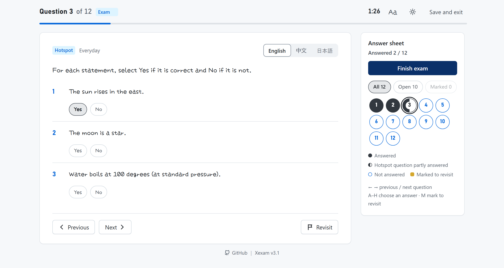

## 2. The layout

- Every page except the exam has a slim header: the **Xexam** logo icon with the word at the top left on a tablet or desktop, only the word **Xexam** on a phone (it takes you to Home; with a very large text size on a narrow phone the word first gets smaller and is left out only as a last resort); at the top right the **Aa** button (v2.6: switches between normal and hand-written text, [section 2.2](#22-hand-written-mode-v26)), a moon / sun button (moon = dark look, sun = light look; one press switches and saves the same choice as **Appearance** in Settings), your account (your username, [section 9.1](#91-profile-v26)), the **AI+** badge (orange when you can use AI now, dark when you have the AI+ feature but cannot use it right now; see [section 14](#14-users-and-sign-in)), and the three-line menu button. The bar sits in the same place on every page. On a phone the account shows only a person icon, the badge and a short admin tag (**Admin**); tapping it shows a tip with your name, role and AI+ state.
- The menu shows only the pages of your role:
  - **Home**, **Exam & practice**, **Study records** and **Settings** for everyone;
  - **Question banks** for administrators and bank managers;
  - **AI Chat** for everyone who can use AI now, or who still has AI chats or memories to read (see [section 16](#16-ai-chat));
  - **User management**, **AI settings** and **System log** for administrators.
- Under a divider follow the version entry (for example **Xexam v0.7.5**), which opens the [About page](#10-about-xexam), then your username with your role (**Administrator** or **User**, plus **Bank manager**) and **Sign out**. Since v2.6 the username row is a link to your [Profile](#91-profile-v26).
- The menu closes after a choice, a click outside it or the Escape key.
- On wide screens the page content is centered and at most 1120 px wide. The narrow pages (Settings, Profile, User management, AI settings, About) sit in the middle too (since v2.6).
- **On a phone** (up to 719 px wide) the header hides while you scroll down and comes back when you scroll up. The bar at the bottom of a practice or exam, and on Exam & practice, stays on the screen.
- **Icons**: the buttons that are only an icon (for example the arrows, the AI icons and the flag in a practice) have a name for screen readers; on a touch screen, press and hold one to see its label.
- **The footer**: every page ends with a small centred line, **GitHub | Xexam 1.1** (the version of the running app). **GitHub** opens the project's repository and **Xexam 1.1** its releases, both in a new tab. The disclaimer about the question banks stays above it. On AI Chat the line is at the bottom of the sidebar (on a phone, of the drawer), never inside a conversation.
- The exam and the practice are focused full-screen pages without the header.
- Opening **Question banks**, **AI settings** or **System log** without the permission shows **Not allowed** with **Back to Home**; **User management** sends everyone but administrators to Home.
- Everything that deletes asks first, in a dialog that says what goes and that it cannot be undone; its confirm button is solid red. **Delete** buttons are red, or turn red when you point at them.

### 2.1 Home (the dashboard, v2.5)

Home is the start page (the Xexam logo, **Back to Home** and signing in lead here). It is one calm column, and it does not start anything by itself: starting an exam or a practice is the job of [Exam & practice](#3-exam--practice).

The blocks, from top to bottom (v2.6):

- **Greeting**: **Hello** and your username ([section 9.1](#91-profile-v26)), with the time of your last study record, or **Start with a practice round.** when you have none. A saved unfinished exam or practice shows its **Continue** / **Discard** card here, so a timed exam is not missed.
- **Page tiles**: a big **Exam & practice** tile, and under it, in this order, **Study records**, **Wrong answers** (the [wrong-answer notebook](#8-wrong-answer-notebook)), **AI Chat** (only when you may use it), **Question banks** (only for whoever may manage or download banks), **Settings** and **Profile**, three to a row; with four tiles a phone shows two by two. There are no tiles for the administrator pages; they stay in the menu.
- **Leaderboard**: the three users with the most correct answers, all time, drawn as a hand-drawn rising line: place 1 at the top right, the next places lower to the left, and your own place below them when you rank lower. Point at a place, or tap it, to read the line under the board, for example **No. 1 · Ann · 320 answered · 290 correct**. Ties go to the user with fewer answers, then to the older account. Disabled users and users with no answer are not listed; administrators are. When you have no answers yet, a line invites you to finish a practice. A user is shown by their username; one who has not set it yet is shown, to the others, only by a masked part of an e-mail login (`a***e`, never the domain), and to themselves by the full login.
- **Most missed** (replaces **Most practised** of v2.5): your own questions with the most wrong answers, all time, at most five, on a parabola: place 1 at the top, places 2 and 3 lower on either side, 4 and 5 at the ends. Each place says how many times you missed it. Point at a place (or reach it with the keyboard) to see that question under the board; a tap or click keeps it there and a second one closes it, **Esc** clears it. The question is shown in full in your default question language ([section 9](#9-settings)), with its correct answer and a muted line such as **Kitchen basics · Cooking · answered 4×, missed 3×**. Before a pick the board says **Tap a point on the curve to see the question**; with no wrong answers it says **No misses yet, keep it up!**. Only your own statistics count, only questions of banks you may see, and retired questions are left out. The server sends only question ids and counts: the page reads the question from the banks it has already loaded.
- **AI study assessment** (only with the **AI+ feature**): a card at the end of the page, folded every time you open Home; its title row with the **AI+** badge opens and closes it. Inside are a short, encouraging paragraph (since v2.7 three or four short sentences: a quiet image from nature, what goes well and one concrete next step, a warm last line) about how you study and what to do in the next days, with the day it was generated (**Generated 2026-11-22**); the card never names the model. It is written from numbers only, taken from your study records of the last 30 days: how many records, answers and correct ones, how many days you studied and the gaps between them, the time per question, your exam results and time limits, the weekdays and times of day, and the size of your wrong-answer notebook. It never sees the questions, banks, sheets or user names.
  - **Generate assessment** (the first time) or **Update assessment** writes a new one; the card opens by itself and the finished text appears there at once (since v2.7 it is not written letter by letter), and **Stop** ends it. The old text stays when the new one fails or is stopped, and the error is shown in the card. While you have runs left, the line under the text says how many, for example **2 left today**.
  - The button is greyed with a reason while an assessment is being written, when today's assessments are used up (**Today’s assessments are used up, come back tomorrow**) and when you have fewer than **3** saved study records (**Available after 3 exams or practice rounds**). How many a day are allowed (3 by default; administrators not limited by default) is set in [AI settings](#17-ai-settings) under **AI safety**; only successful assessments count.
  - *(v2.7)* The assessment is checked before it is shown: if the AI returns counting, drafts, a list, the wrong language or a half sentence, it is asked again, up to 3 calls in all (this costs you nothing extra: it counts once against your AI request caps). If no call gives a usable text, the card shows **The AI did not return a usable assessment this time. Please try again later.**, the old text stays and today's run is **not** used up. A text saved by an older version that would not pass the check is not shown any more (the card reads as if there was no assessment yet) and does not use up a run.
  - Without a usable AI+ feature (none, paused, the assessment feature off, AI not available) the card shows only a saved assessment, without a button, and is not shown at all when there is none.
  - Each assessment is also saved in AI Chat, in a chat named after its date with **AI study assessment**. Deleting that chat does not remove the text from the card.

The leaderboard and Most missed refresh every time you open Home. If they cannot be loaded, their panels say so with a **Retry** button.

**On a wide screen** (900 px and wider) Home is up to 1080 px wide: the greeting and the **Exam & practice** tile across the full width, all small tiles in one row, the leaderboard and Most missed side by side, and the assessment card across the full width below them. Narrower screens show the single column described above.

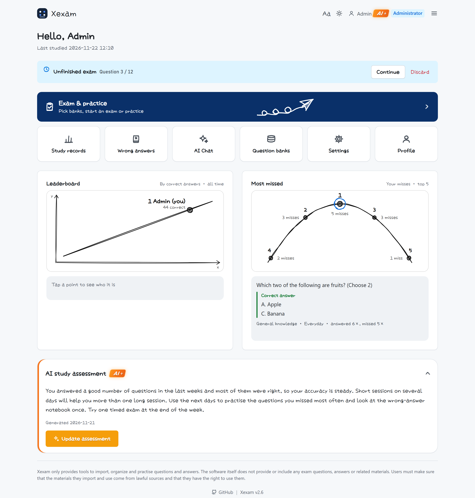

The greeting, the big **Exam & practice** tile and the row of small tiles, the leaderboard and Most missed side by side (a place of Most missed tapped, with its question and correct answer), and the AI study assessment card.

### 2.2 Hand-written mode (v2.6)

Xexam can write its pages in a hand-writing font, like notes on a board. It is **on by default**; the **Aa** button left of the sun / moon in the top bar (also on the exam page) switches between hand-written and normal text, and **Settings** → **Text** has the same choice (**Normal text** / **Hand-written text**). The choice is kept in this browser only: another browser or device starts hand-written again.

- **Hand-written**: Home, Exam & practice, Study records with the record details and the wrong-answer review, the result page, the question and its options on the exam page, the AI Chat conversation, its message box and its greeting, and the name **Xexam** in the top bar. The line icons of these pages look drawn by hand.
- **Not hand-written**: bank names, the bank and sheet list of Exam & practice, the question shown under the Most missed board of Home, the menus, the administrator pages, Settings, Profile and the sign-in pages.
- **Marks**: a correct answer gets a red crayon circle and a wrong one a red brush cross (the strip of the result page, the record details and the verdict of a practice).
- **Drawings**: a paper plane on Home's **Exam & practice** tile, a ruler on **Start exam** and a pencil on **Start practice**, and, in a new AI Chat, a pencil sketch of books, a globe, a pencil and a ruler with the name Xexam (it steps aside while you type on a touch screen).
- **The font** is a subset of the open-source Xiaolai font by LXGW (about 1.1 MB: the interface texts, the common Chinese and Japanese characters, kana and ASCII), under the SIL Open Font License 1.1; the **About Xexam** page links its licence. The browser loads it the first time hand-written text is shown; a character outside the subset is drawn in the normal font.

## 3. Exam & practice

Before there is anything to practise, the **Exam or practice** panel shows a short note instead:

- an administrator, or a bank manager without any bank, gets **Go to Question banks**;
- a user who has not been given a question bank yet reads: “No question bank has been made available to you yet. Ask an administrator to give you access to one; it appears here as soon as they do.”
- when the banks have no active questions (every question has been retired, for example because it came from an older Excel layout), an administrator is asked to update them with a six-column file; a bank manager reads that they can update their own banks with a six-column Excel file or import a new one, and ask an administrator to update the others, with **Go to Question banks**; any other user is asked to turn to an administrator.

After that, Exam & practice has:

- **Unfinished exam** or **Unfinished practice**: a compact card at the top for what you left with **Save and exit**. It shows its title and the question you were on (for example **Question 4/12**), with **Continue** and **Discard**. Its hover tip names the question banks and says **Saved in this browser only**. Your other devices do not see it. **Continue** picks it up where you stopped; **Discard** throws it away. Starting something new while one is saved asks first.
- **Exam or practice**:
  - In the top-right corner of the panel you choose where the questions come from: **All** (every question in the selected sheets) or **Wrong answers** (only the questions you still need to review). Each shows its number of questions. When the notebook has nothing to review in the selected sheets, **Wrong answers** cannot be chosen and one line under the title says why; while **Wrong answers** is chosen, that line says how a question leaves the notebook. On a phone the two buttons stay next to the title; in English and Japanese they show only their icon and number, in Chinese they keep their short words.
  - **Banks and sheets**: each bank is one card with its sheets as rows inside.
    - **Select all** and **Clear** are on the right of the heading row. Since v2.4 nothing is ticked when Exam & practice opens, and a bank that appears later is not ticked either: tick what you want to use.
    - The bank's checkbox selects or clears all its sheets, and you can also tick single sheets. While only some are selected, the checkbox shows − and the card says, for example, **1 of 2 sheets selected** (also while the bank is folded).
    - The arrow button on the right of a bank's row folds or unfolds its sheets. With at most two banks they start unfolded, with more they start folded; your choice is kept until you reload the page.
    - The number of notebook questions of a bank is written on its row, for example **2 to review**.
  - The bar at the bottom of the panel: **Start exam** (green) and **Start practice** (orange), the scope (for example **12 questions in scope**, or **11 of 12 in scope, picked at random**) and two options, **Count** (the number of questions) and **Shuffle** (the question order). Both buttons use the same scope. The two buttons always have the same width. The bar stays at the bottom of the screen while the panel is in view.
  - **Count**: when it is smaller than the scope, the questions are picked at random from the whole scope. **Shuffle** only decides whether they are asked in random order or in bank order.
- **Latest result**: the score of your latest exam or practice with its **Exam** / **Practice** tag, **View details**, **AI summary** (only with the **AI+ feature**, [section 7.1](#71-ai-summary)) and **All study records**, in that order. The **AI summary** button has the same flat amber look as the other AI buttons (an amber icon button on a phone); when it cannot be used it is greyed like **AI generate**, with the tag **Unavailable**.
- The **Overview** card of earlier versions (the numbers of banks, sheets, questions and notebook questions) is gone since v2.6: the tiles of Home and the menu lead to the banks and to the wrong-answer review.

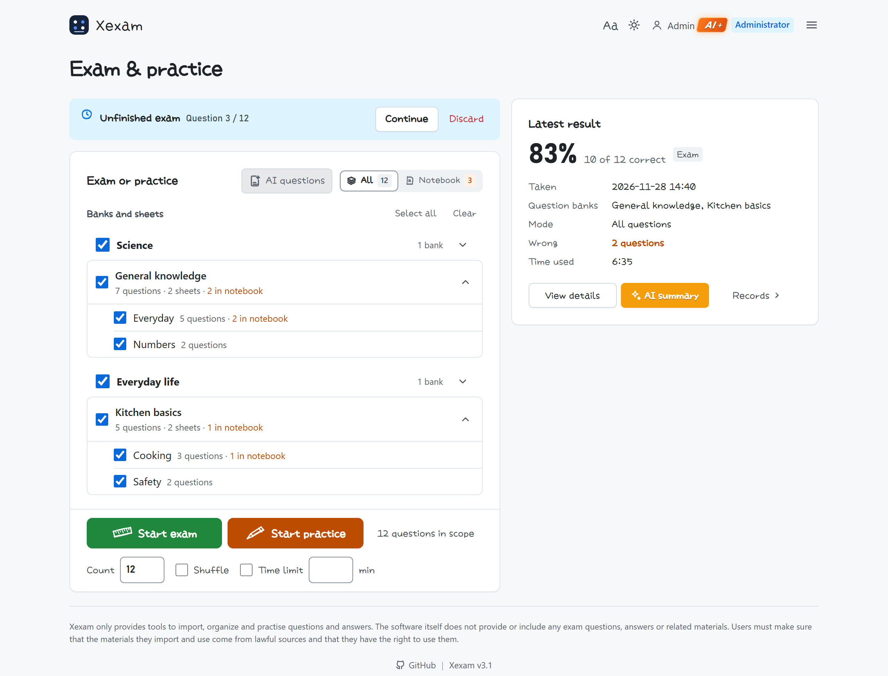

The unfinished exam as a compact banner; **All** and **Wrong answers** in the corner of **Exam or practice**; **Select all** and **Clear** on the row of **Banks and sheets**; the two demo banks as unfolded cards with their sheets; the bar with the green **Start exam**, the orange **Start practice**, the scope, **Count** and **Shuffle**; on the right, the latest result.

### 3.1 Exam time limit

On **Exam & practice**, next to the number of questions and the shuffle option, tick the time-limit box and type the minutes, from 1 to 600. The limit applies to **exams only**: practice ignores it. The box and the number start empty and unticked each time Exam & practice opens; the number you typed stays while you remain on the page. Typing a number ticks the box, and unticking it ignores the number. If the box is ticked and the number is not a whole number from 1 to 600, the exam does not start and the field says why.

A timed exam shows the **time left** at the top of the page; an untimed exam and every practice show the time used, as before. **Save and exit**, closing the page or reloading it pauses the countdown, and the exam continues from the same second when you come back. When the time is up, the exam is submitted by itself, and its unanswered questions are **not completed**, exactly as with a submit by hand.


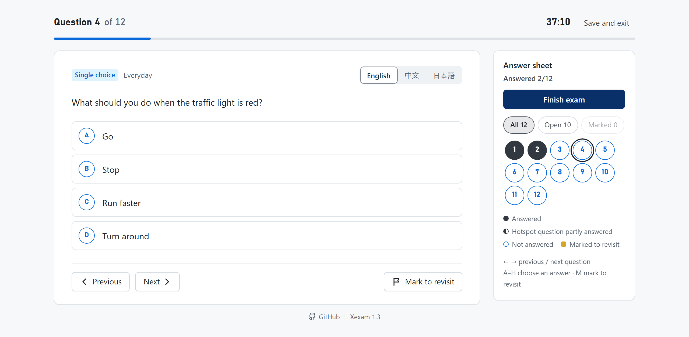

## 4. The exam page

The screenshot in [section 1](#1-your-first-exam) shows it.

- At the top: **Question 4 of 12** (for example), the time used, and **Save and exit**, which keeps your answers and the time used so you can continue later from Exam & practice in the same browser.
- **On a phone (v2.7)** the top row reads, from the left: the answer sheet button (above), a tag **Exam** (a practice shows **Practice**), the count in two lines (**Answered** over **3 / 12**, **Checked** in a practice) and the finish button. An exam and a practice lay out the same, so the buttons stand where you expect them. On the narrowest screens the tag, the finish icon, the count and the **Aa** button drop out one after another to keep everything readable; the full text stays for screen readers.
- **In a narrow window or on a phone** (when the answer sheet is not shown beside the questions) the top row also shows **Answered 3 / 12** (**Checked** in a practice) and a green **Finish exam** button (in a practice, an orange **Finish practice** button), both inside the bar; the answer sheet then has no finish button of its own. On a phone the count has two lines and drops out on the narrowest screens (see above). The button always keeps its label; when the row is tight it switches to a short one (**Finish**) instead of hiding it.
- **Time limit** (only when you set one on Exam & practice, see [section 3.1](#31-exam-time-limit)): the time left counts down at the top of the page instead of the time used, in a larger bold figure. A notice appears when 30 minutes are left (never for a limit of 30 minutes or less). Closing or reloading the page pauses the countdown. At zero the exam is submitted by itself.
- **No right/wrong feedback and no score while you answer.**
- **English** / **中文** / **日本語** switches the question text. Switching changes only the text: your answers, the option letters, the timer and the grading stay the same. The option buttons of hotspot questions switch too.
  - English is the base language of every question: it is always there. Chinese and Japanese are there when the workbook has them.
  - A language that a question does not have, or whose text does not line up with the English one (other options or items), is greyed out for that question; tapping it says why.
  - Every exam or practice starts in your **Default question language** ([section 9](#9-settings)). Since v2.6 the switch changes only this exam or practice: it is kept when you **Save and exit** and continue later, and the next one starts in the default language again. The answers and explanations after you submit start in the default language too.
- **Previous** and **Next** move between questions (on the last question, **Next** becomes **Submit**). **Revisit** marks a question you want to come back to.
- **Answer sheet**: one tile per question. Solid = answered, half-filled = a hotspot question partly answered, hollow = not answered, small yellow square = marked to revisit. Click a tile to jump there. On a phone (up to 600 px wide, or a short landscape screen) the sheet is a **drawer from the left** (v2.7): it starts closed every time you open the exam or practice page and opens with the button at the top left of the page, a small grid icon with **Sheet** over the number of the question, for example **2 / 50**. The drawer is up to 320 px wide, with a dimmed backdrop and, from the top, its title **Answer sheet**, the count, a close button, then the chips and the tiles; it scrolls by itself while the page behind stays where it is. A tap on a tile closes it and shows that question. It also closes with the button again, the close button, a tap on the backdrop, a swipe to the left, **Esc**, or the phone's Back gesture (which closes the drawer and stays on the exam; the next Back leaves it as before). While it is open, the arrow keys and the automatic advance wait. On a tablet (601 to 880 px) and on a desktop the sheet stays in the page as described here. Above the tiles are three chips, **All n**, **Open n** and **Marked n**, which show only the questions of that kind (the counts follow your answers). Below the tiles: **Answered 3 of 12** and **Submit**.
- **Options on a phone**: the option letter starts the first line and the text wraps to the left edge (full width). The review lists after a practice or exam do the same, with the letter and the tags on the first line. The sun / moon button is also in the top row of this page.
- **Submit** asks for confirmation. An unanswered question is **not completed** in every exam, timed or not: it is not wrong, it does not go into the wrong-answer notebook, it is listed under **Not completed** on the result page and in the record, and the score counts all questions. When some questions are open or marked, the dialog lists their numbers; **Keep answering** jumps to the first open question (or, when none is open, to the first marked one).
- Grading: a single-choice or multiple-choice question is correct only when you chose exactly the correct options; a hotspot question is correct only when every item is right.
- Keyboard (desktop): `←` `→` previous / next question, `A`–`H` choose an answer (choice questions), `M` mark to revisit.
- **No AI help while an exam runs**, for anybody: the exam page has none of the AI buttons or icons of [section 5.1](#51-ai-hint-ai-analysis-and-the-ai-panel). An exam gets AI only after you have submitted it, on its [result page](#61-ai-analysis) and in its study record.

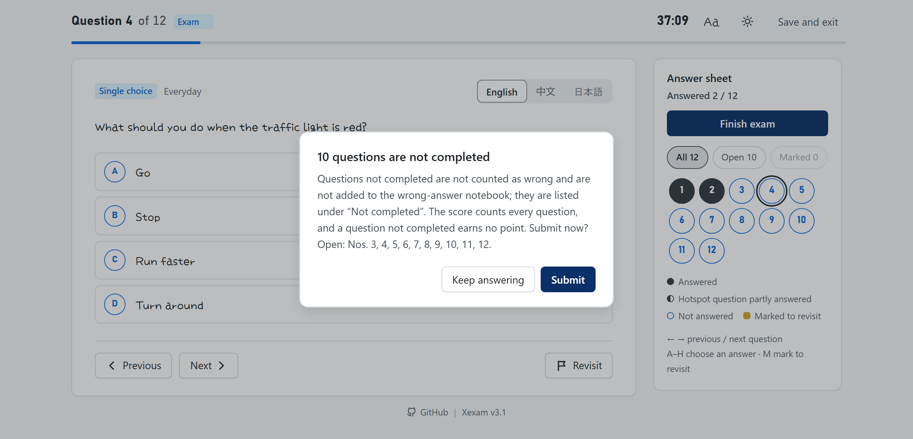

## 5. Practice

A practice uses the same page as the exam, but checks every answer right away. Start it with **Start practice** on Exam & practice, next to **Start exam** and with the same banks, sheets, **Count** and **Shuffle**.

- A **Practice** tag sits next to **Question 4 of 12**.
- **The bar at the bottom** holds, in this order: **Previous** (‹), **Check answer**, **Next** (›), **AI hint** and **AI analysis** (only for users with the **AI+ feature**, see [section 5.1](#51-ai-hint-ai-analysis-and-the-ai-panel)) and **Revisit** (a flag). **Check answer** and **Next** are two separate buttons in fixed places on every question; neither turns into the other.
- **On a phone** the arrows, the AI icons and the flag show only their icons, each with its name on press and hold; **Check answer** and **Next** keep their text (shortened to **Check** and **Next** on a narrow screen). Every button is at least 44 px tall on a touch screen.
- **Check answer** works once something is chosen and the question is not checked yet. Until then it is greyed out in the same place. Every question type is checked with **Check answer** only: picking a single-choice option does not check it, and the pick can still be changed until you check the question. A multiple-choice or hotspot question is checked with **Check answer**; for a hotspot question one item is enough, and items left open count as wrong.
- **Next** goes to the next question at any time. On the last question the same place reads **Finish practice**.
- **After checking**, the question is locked and shows:
  - **Correct** or **Wrong**;
  - the options marked as in the answers and explanations: the correct ones solid green, a wrongly chosen one solid orange (light theme; the dark theme shows tinted cards, see Settings > Appearance);
  - your answer and the correct answer;
  - the explanation and the memory aid, in the language of the page's **English** / **中文** / **日本語** switch.
- Auto-advance never applies in a practice: you move on with **Next**.
- **Effects** (v3.0, if **Answer effects** is on in Settings, [section 9](#9-settings)): checking a right answer throws confetti from the bottom corners with a soft chime; checking a wrong one draws two claw marks across the screen with a short red flash, a shake of the question card and a low buzzer. Taps go through to the page and do not end it; it fades out by itself (the confetti after about 7 seconds, the claw marks after about 3) or ends when you move to another question. They never appear in an exam.
- The answer sheet fills checked questions green (correct) or orange (wrong), and says, for example, **Checked 4 of 12 · 3 correct**.
- **Finish practice** (below the answer sheet on a wide screen, in the top row in a narrow window or on a phone, and on the last question) asks only when some questions are not checked yet. Those count as not answered (wrong), even when an answer is chosen.
- **Save and exit** works as in an exam; Exam & practice then shows **Unfinished practice** with how many questions are checked.
- A finished practice opens the **Practice result** page, is saved in **Study records** as a **Practice** record, and counts in the wrong-answer notebook like an exam.

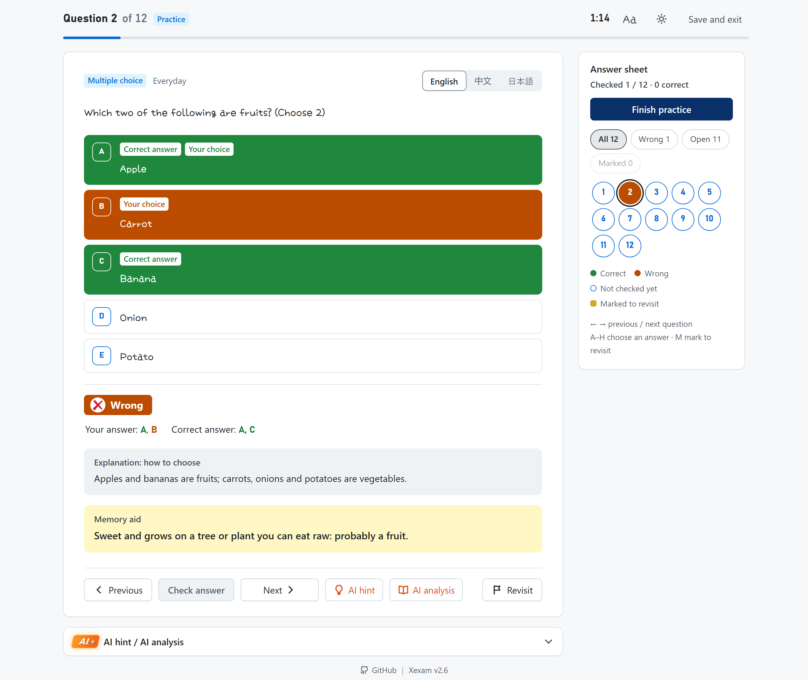

A multiple-choice question after **Check answer**: the **Practice** tag, the verdict **Wrong**, the wrongly chosen option in solid orange, the correct options in solid green, then the explanation and the memory aid.

### 5.1 AI hint, AI analysis and the AI+ panel

Users with the **AI+ feature** can ask an AI model for help on any question of a practice. Everybody else sees the page exactly as described above. Nothing AI-related is shown on an exam page while an exam runs.

**Who sees the controls.** Only accounts that have the AI+ feature: the orange **AI+** badge next to the name, and administrators while the AI+ feature is on in [AI settings](#17-ai-settings). A user who has the feature but cannot use AI right now (an administrator paused it, the AI+ feature is switched off in AI settings, or ai-service is not connected) still sees the controls, greyed out and tagged **Unavailable**. A tooltip says why (on a touch screen a tap shows it as a message): **AI hint: unavailable. The AI+ feature was paused by an administrator.**, or **… AI is not available right now. Try again later or ask an administrator.**; while Xexam is still checking, it says **Checking whether AI is available…**. The server refuses these requests too. If an administrator takes the AI+ feature away while you are practising, the controls disappear the next time a request is refused.

**Where they are.** The **AI+ panel** sits under the question card, above the answer sheet. It is closed when the page opens. **AI hint** and **AI analysis** in the bar open it with that answer (a click on the same button again never closes it). The panel's head shows the AI+ badge, a short state text (**Writing…**, **Thinking…** while a reasoning model is still thinking, **Saved 03:04 PM**, **Stopped**; the thinking text itself is never shown there) and a chevron that opens and closes the panel. Its body scrolls inside the panel, and it has a fixed place in the layout, so nothing jumps when an answer starts or ends.

**The panel's buttons.** At the foot of the panel, in fixed places: **Copy**, **Regenerate** (**Stop** while the answer is being written, and **Stop** is greyed out when nothing is written) and, at the right, the muted text **Saved in AI Chat** once the answer is saved. A button that cannot be used now stays in place, greyed out. On a phone the three buttons are icons, each with its name on press and hold.

**Saved in AI Chat.** Nothing in the panel opens AI Chat, so a practice is never left by pressing it. Instead, when the answer is saved in a chat, the panel shows the text **Saved in AI Chat**. Hover over it with a mouse, or tap it on a touch screen, and a tip names the chat, for example **Saved in the AI Chat "2026-11-12 14:05-Practice"**. The answer is in AI Chat exactly as before ([section 16.1](#161-chats-of-practices-exams-and-summaries)).

**AI hint** says how to approach the question and lists the knowledge points behind it, **without telling you the answer**: the request to the model contains the question and its options, never the answer, and the model is told not to point at, rule out or quote any option. If a hint gives the answer away anyway, Xexam hides it, shows **This hint gave the answer away, so it was hidden. Regenerate to get a new hint.** and does not keep it. That check is a safeguard that catches most, not every, way of putting it, and it can also hide a harmless hint; press **Regenerate** to get another.

**AI analysis** answers the question: the correct answer first (in bold), the knowledge the question tests, why it is right and why each other option is wrong. It uses the question bank's own answer and explanation, so it is only as right as the bank.

**Switching and changing questions.** One panel shows one answer at a time: **AI analysis** replaces the hint in the panel. When you go to another question (**Previous**, **Next**, a tile of the answer sheet or the arrow keys), the panel stays open or closed as it was and shows that question's saved answer of the same kind. If there is none yet, the panel says so and points to the button that creates one; nothing is asked by moving between questions. Closing the panel does not stop a running answer: it goes on, is saved, and the state text keeps saying so.

**Saved answers.** Every answer is saved. Pressing the same button for the same question again shows the saved answer at once and asks the model nothing. **Regenerate** writes a new one and shows it instead; a new answer that fails, is stopped or is hidden leaves the previous one in place and says so. The hint and the analysis of a question are saved separately. When you **Save and exit** and **Continue** later, the practice keeps its saved answers and its chat. A regenerate always goes to the model as a new request (a numbered note is added to its end, saved nowhere and shown nowhere), so an AI gateway that caches responses cannot hand back its cached answer.

**Language.** The answer is written in the language chosen in **Settings**, whatever the question language; the question text sent to the model is the one the page shows (its **English** / **中文** / **日本語** switch). A saved answer in another language than your Settings says so (**This answer is in … Regenerate it to get it in the language of your settings.**).

**One answer at a time.** While an answer is being written, a request for another one does not start it. The panel says which one is still running (**AI hint for question 3 is still being written.**, or that an AI summary or an answer in AI Chat is) and offers **Stop it and write this one** (and **Show it** when it is on this page). Nothing is stopped by itself. By default each user may have one answer at a time ([section 17](#17-ai-settings)).

**Limits.** Every answer asked of the model in chat, hint, analysis and summary counts toward the per-user AI request limits in [section 17](#17-ai-settings) (per minute, per hour and per day). AI generation and AI import are outside these three limits; they are limited by their own call ceilings and the daily number of AI bank jobs. When one is used up, the panel says which one and when AI is available again, and the buttons wait until then.

**In AI Chat.** Each practice has one chat, `<start time>-Practice`, that holds every hint and analysis of it, in order ([section 16.1](#161-chats-of-practices-exams-and-summaries)). What is sent to the AI provider is listed at the end of [section 16](#16-ai-chat).


## 6. The result page

The score, the number right and wrong, and a strip with one box per question (a green tick for a correct one). A practice shows **Practice result** as its title.

**Answers** shows **Wrong only (n)** or **All (n)**. Each question card shows:

- **Correct** or **Wrong**, and your choice and the correct answer: correct options solid green, a wrongly chosen option solid orange (light theme; the dark theme shows tinted cards), each with its **Correct answer** / **Your choice** tag (hotspot statements sit on a neutral background; only their choices are coloured);
- the line **Your answer** / **Correct answer**: in a multiple-choice answer each letter of yours is green when it is one of the correct answers and orange when it is not, so a partly right answer shows both colours;
- its own **English** / **中文** / **日本語** switch. It starts at your default question language and changes only that card: the question, the options, the explanation, the memory aid and the note. Languages the question does not have are greyed out;
- the explanation and the memory aid, in each language the workbook has them; if one language lacks them, another language's text is shown;
- how often you have answered the question so far.

If questions were deleted (with their bank) while you took the exam, a note says so: the score and the saved record cover only the other questions.

Buttons: **Retry wrong answers only**, **Take it again** (**Retake practice** after a practice), **View in study records** and **Back to Exam & practice**. Retrying and retaking start the same kind as the result: an exam again as an exam, a practice as a practice.

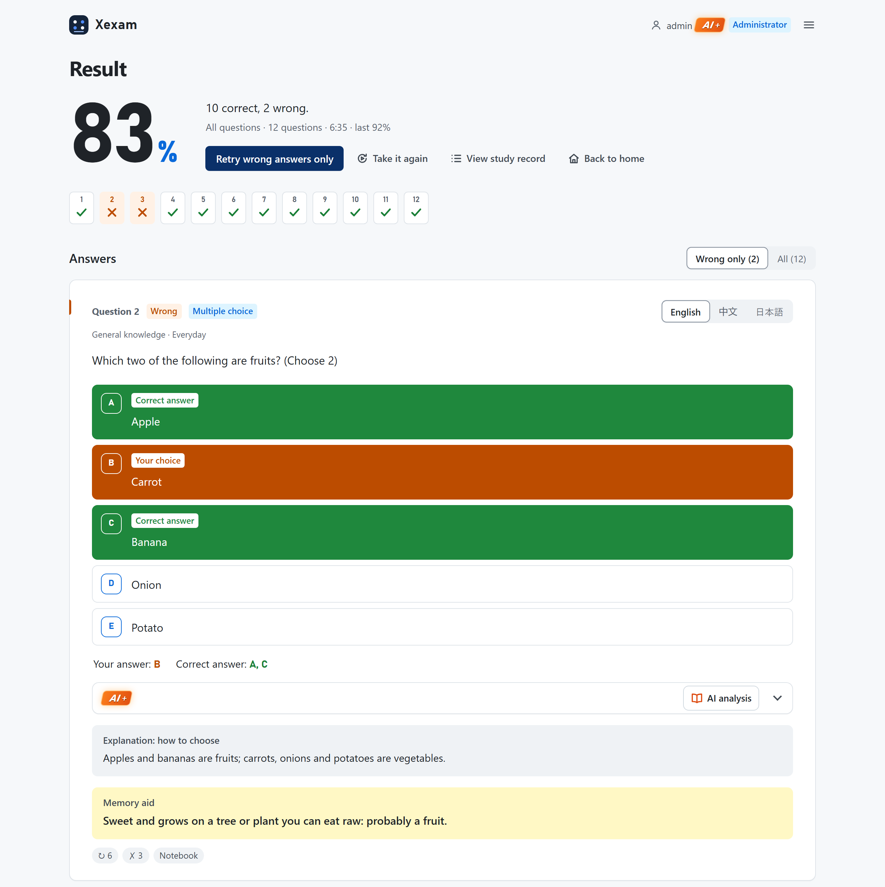

An exam with two wrong answers, **Wrong only** open: the score, then a choice question with the chosen option in solid orange and the correct ones in solid green, its own **English** / **中文** / **日本語** switch, and the explanation and the memory aid.

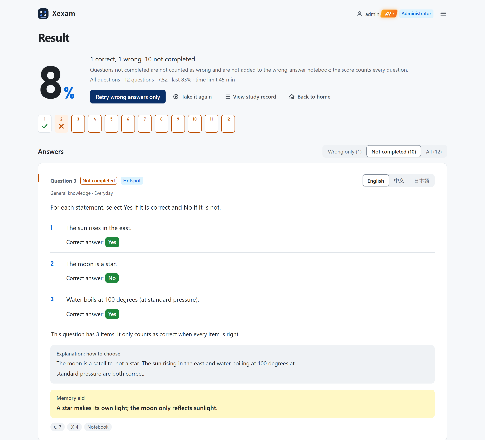

### 6.1 AI analysis

With the **AI+ feature**, every question card of a practice result and of an exam result has an **AI+ bar** under its **Your answer** / **Correct answer** line: the AI+ badge, the state text, **AI analysis** (a button) and a chevron. The same bar is on every question of a study record's detail page ([section 7](#7-study-records)). Nothing of this appears on the exam page while an exam runs.

- **Collapsed at first.** **AI analysis** opens the card's panel with the saved analysis, or asks the model when there is none. The chevron opens the panel without a request and closes it again. Pressing **AI analysis** again shows the saved analysis and asks nothing. Only one card's panel is open at a time: opening another card's panel moves it there.
- **On a phone** the state text stays visible on a collapsed bar too (it shortens with an ellipsis, and it is hidden only on the narrowest screens), so an analysed card can be told apart from one without an analysis.
- **What it does**: the model explains the question like the **AI analysis** of a practice ([section 5.1](#51-ai-hint-ai-analysis-and-the-ai-panel): the correct answer, the knowledge tested, why it is right and why the others are wrong) and, because it is given your answer, says briefly what probably led you astray when you were wrong; for an unanswered question it notes that you did not answer.
- **As in section 5.1**: the panel, the saved answers, **Regenerate**, **Copy**, the language of the reply, the one-answer-at-a-time rule and the greyed state work the same way, and **Saved in AI Chat** (with its tip) replaces any link to AI Chat. The question text sent follows the card's own language switch at the moment you ask, also for **Regenerate** after you switched the card to another language.
- **Which chat**: the answer is saved in the chat of the practice or exam it belongs to (`<start time>-Practice` or `<start time>-Exam`), together with what was written during the practice. Asking on the record's detail page later puts it in the same chat. A record made before v0.9 has no such chat; the first analysis on its detail page starts one, titled with the record's time (section 16.1).
- **Greyed out**: an exam result whose record could not be saved (**This result was not saved, so AI analysis is not available.**). A practice result that could not be saved still offers it.

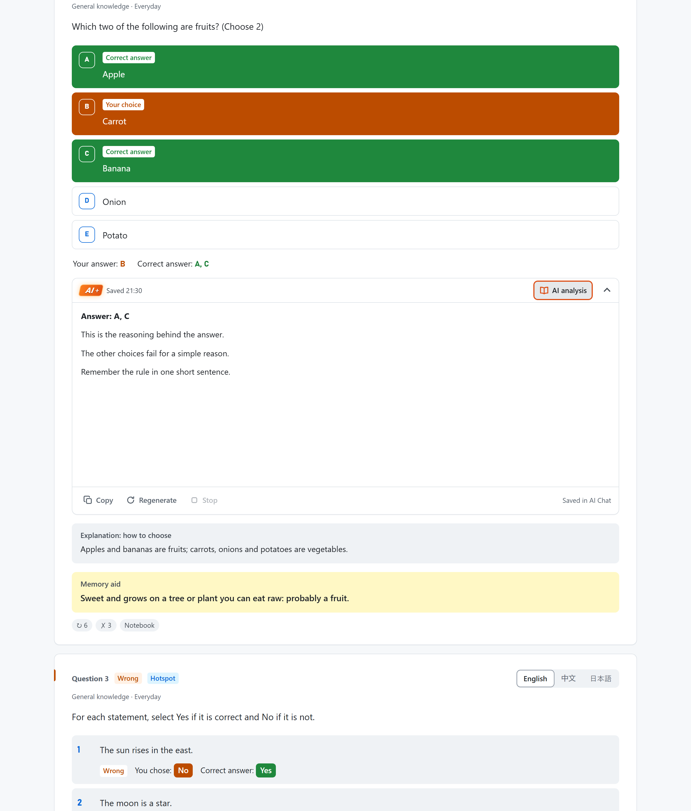

## 7. Study records

- **Overview**: the number of records (**Records**, or **Exams** / **Practice sessions** when the type filter says so), **Avg. accuracy**, **Best accuracy** and small bars for the latest results.
- **Filters**: **Type** (**All types**, **Exams**, **Practice**), **Question bank**, a date range with **From** and **To**, and **Accuracy** (**Any accuracy**, **Below 60%**, **60–79%**, **80% and above**). **Clear filters** resets them.
- **Records**: one row per exam or practice (on a phone: one card) with its **Exam** / **Practice** tag, the time, the question banks, how many questions were answered, the time used, the number correct and the accuracy (green from 80 %, orange below 60 %). Click the time to open the record; **Delete** removes it. *(v2.7)* The list is paged: 10 records a page on a phone and 20 elsewhere, with the pager of AI settings › **AI+ users** under it (‹, the page numbers, ›, **Page 1 / 3**; on a phone the first, the current and the last page, with … between), in place of the old **Show more**. A filter change goes back to page 1; deleting the last record of the last page shows the page before; opening a record and coming back shows the same page. With the **AI+ feature** the table has a new first column with an **AI summary** button on every row ([section 7.1](#71-ai-summary)); a user whose AI is paused or unavailable sees the buttons greyed out, tagged **Unavailable**, and one line above the table says why.
- **Exam record** / **Practice record** (one record): the score and the facts (with **Type**), then every question with your answer, the correct answer, the explanation and the memory aid, each card with its own language switch. **Wrong only (n)** / **All questions (n)** switches between the wrong questions and all of them. **Retry wrong answers** starts the questions you got wrong; **Retake this exam** (**Retake this practice**) starts the same questions again, both as the same kind as the record; **Delete this record** removes it. Exams taken before v0.5 show only the score, because v0.4 did not store the answers. A retired question still shows in a record with its text and a **Retired** tag; only questions that are active now are retried or retaken. With the **AI+ feature** every question card has **AI analysis** ([section 6.1](#61-ai-analysis)), saved in the chat of that practice or exam.
- **Review wrong answers** (top right) opens **Wrong answers**: every active question in your wrong-answer notebook, with how often you answered it and how many more correct answers in a row take it out. You can narrow it to one question bank, and **Practise these** starts a practice with them.
- Deleting: deleting one record keeps the per-question statistics, so the wrong-answer notebook does not change, and it keeps the AI chats made for it (section 16.1). **Delete all** deletes every record (exams and practice); tick **Also clear the wrong-answer notebook and per-question stats** to clear those too. Every delete asks for confirmation and cannot be undone.
- Xexam keeps your latest 500 records (exams and practice); older records are removed automatically.
- **Administrators can look at another user's records (v2.7).** In [User management](#14-users-and-sign-in) the book icon of a row opens that user's **Study records** (title **Lee’s study records**, with **View only** and **Back to User management**). It has the same overview, filters and pages, and a record opens with every answer (**Lee’s choice**, **Lee’s exam record**). It is read only: no **Delete**, **Delete all**, **AI summary**, **Retry wrong answers**, **Retake this exam** or wrong-answer review, and nothing of it mixes with your own records. A user without records shows **This user has no study records yet**. Every look is written to the activity log as **Viewed a user’s study records**.

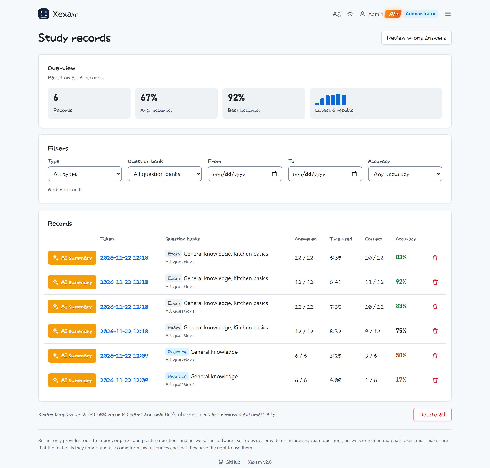

### 7.1 AI summary

With the **AI+ feature**, **Study records** has a new first column, **AI summary**, with one button per record (on a narrow window: in the record's card), and **Exam & practice** has the same button for the latest result, between **View details** and **All study records**. Both open the same window for the same record and show the same saved summary.

- **What it does**: the model is given the questions of that record that you **answered wrong** (your answer, the correct answer, the question and the bank's explanation) and writes: your weak knowledge points, what to watch out for, how to approach such questions from now on, and a detailed but simple summary of those knowledge points. It does not go through the questions one by one.
- **Which questions**: only questions answered wrong. Unanswered questions are not part of it. When the record has more wrong answers than the set number (40 by default, 10 to 70 in **AI safety**), that many are chosen at random, and a new random pick is made each time you press **Regenerate**. A line under the title says what the summary is based on, for example **Based on all 6 wrong answers.**, **Based on 40 of 80 wrong answers, chosen at random.** or, when some of the questions are gone (their bank was deleted or you lost access), **Based on 5 of 6 wrong answers (the others are no longer available).**
- **The window**: a large window over most of the page below the title. At the top: **AI summary** at the left and **Regenerate** (**Stop** while it is being written) and a close button at the right. The text scrolls inside it while the page behind stays still. It closes with the close button, **Esc** or a click outside it. At the bottom are **Copy** and, at the right, the muted text **Saved in AI Chat**, which has the same tip as in [section 5.1](#51-ai-hint-ai-analysis-and-the-ai-panel) and names the summary's chat. Nothing in the window opens AI Chat. Pressing **AI summary** again shows the saved summary at once; **Regenerate** adds a new one and shows it; a new one that fails leaves the previous one in place. The summary is written in the **Settings** language.
- **Greyed out**: for a record without wrong answers (**No questions were answered wrong this time (unanswered questions are not part of the AI summary).**) and for a record saved by an old version that kept no per-question details (**This record was saved by an older version without per-question details, so it cannot be summarised.**). If every wrong question has since disappeared, asking says that these wrong answers are no longer available. The same **Unavailable** states as in [section 5.1](#51-ai-hint-ai-analysis-and-the-ai-panel) apply when AI is paused or unavailable (on Exam & practice the tag sits beside the button).
- **In AI Chat**: each record has one chat, `<record time>-AI summary`, where every summary of it is kept (in AI Chat a summary request shows only its label, for example **AI summary · 40 of 80 wrong answers**). Deleting the study record keeps that chat; it follows the normal chat rules. Only one answer is written at a time ([section 5.1](#51-ai-hint-ai-analysis-and-the-ai-panel)).
- **Limits**: a summary counts toward the per-user AI request limits like every other answer ([section 17](#17-ai-settings)). A long summary can reach the answer length limit, which then cuts it and says so.

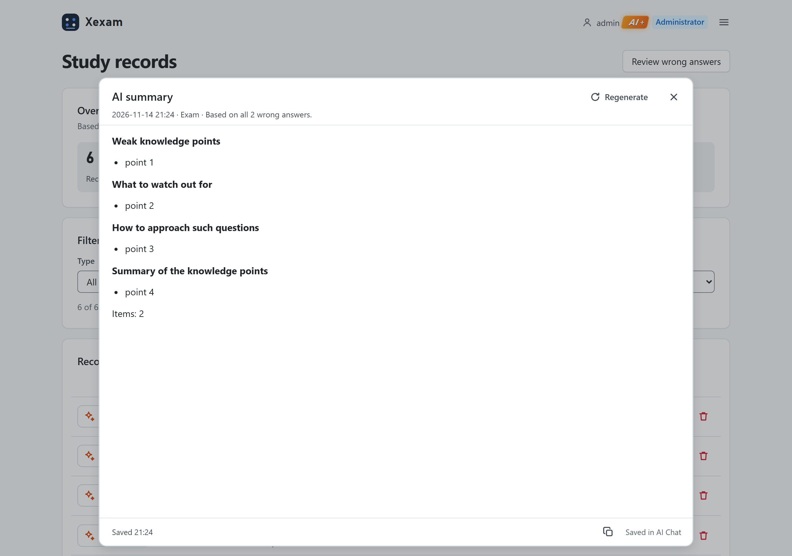

## 8. Wrong-answer notebook

Questions you answer wrong, in an exam or in a practice, go into your wrong-answer notebook and leave it after you answer them correctly **2 times in a row** (in either). Use it from Exam & practice (**Wrong answers** in the top-right corner of **Exam or practice**), from **Study records** → **Review wrong answers** → **Practise**, or right after an exam with **Retry wrong answers only**. A retired question stays in your statistics but is not offered for review; it comes back if a later import of its bank restores it.

## 9. Settings

Since v2.6 your account, your username and **Change password** are on the [Profile](#91-profile-v26) page; Settings has no account part any more.

- **Appearance** (the theme): **System** (the default; follows the light or dark setting of your device), **Light** or **Dark**. On a phone the three are one compact switch, and a line under it says which one is the default (**Default: System**). Since v2.3 the dark theme uses a new set of colours on every page: a pure black page, white text and white hairlines; since v2.7 the dark theme is **all black**: the page, panels, cards, inputs, menus and the drawers are pure black #000000 and are told apart by their thin white lines (24 % white on screens 601 px wide and more, 15 % on phones), with the slightly lighter blue-grey fills (#1A2029), a translucent blue-grey hover and #2A313C for a selected segment unchanged (v2.4 had blue-grey #0E1117 cards); the AI Chat message box has no edge line and is told apart by its own #1A2029 fill (in the light theme it is white with a faint shadow); the meaning colours (exam green, practice orange, AI+ orange, danger red) stay the same; the answer colours stay the same in the light theme, and since v2.8 the dark theme shows graded options, the practice verdict bar and the answer-sheet tiles as see-through tinted cards (since v2.9 in the theme's own green and orange, the same as the status icons of AI settings): a green tint with a green line, letter and label for a correct answer, an orange tint with an orange line, letter and label for a wrong one (the light theme keeps the solid keys).
- **Language**:
  - the interface language: **English** (the default), **中文** or **日本語**. It changes the menus, buttons and messages everywhere, the exam page and the error messages from the server included;
  - **Default question language** (v2.6): **English**, **中文** or **日本語**, the language the questions start in each time you begin an exam or a practice, and the language of the answers and explanations on the result page and in the records, and of the question under Home's Most missed board. The default is **English**; a user who never chose a question language before v2.6 now starts in English too, and a choice made earlier is kept. The switch on the exam page still changes the language, for that exam or practice only ([section 4](#4-the-exam-page)).
- **Text** (v2.6): **Normal text** or **Hand-written text** (the default), the same choice as the **Aa** button of the top bar ([section 2.2](#22-hand-written-mode-v26)). It is kept in this browser only.
- **Answering** → **Auto-advance to the next question** (off by default, exams only): after you answer a single-choice question, or every item of a hotspot question, the next question opens by itself. Multiple-choice questions never move on by themselves. While it is on, the exam page shows **Auto-advance on** at the top.
- **Answering** → **Answer effects** (on by default, practice only): when you check an answer, a right one throws confetti and a wrong one draws two claw marks across the screen. Taps go through and do not end it, moving to another question does; nothing is shown when your device asks for reduced motion.
- **Free mode** of AI Chat (administrators only) is not in Settings: it is a switch on each administrator's row in **AI settings** → **AI+ users** ([section 17](#17-ai-settings)).
- **Reset to defaults**: theme, interface language, auto-advance and answer effects go back to their defaults. The default question language is kept, and so is the text style.

Settings belong to your account and are saved on the Xexam server, the default question language included. So they survive restarts and image updates, clearing the browser cache, and switching to another browser or device; every user has their own. Only an unfinished exam or practice and the text style (**Text**) stay in the current browser.

<table>
<tr>
<td width="50%">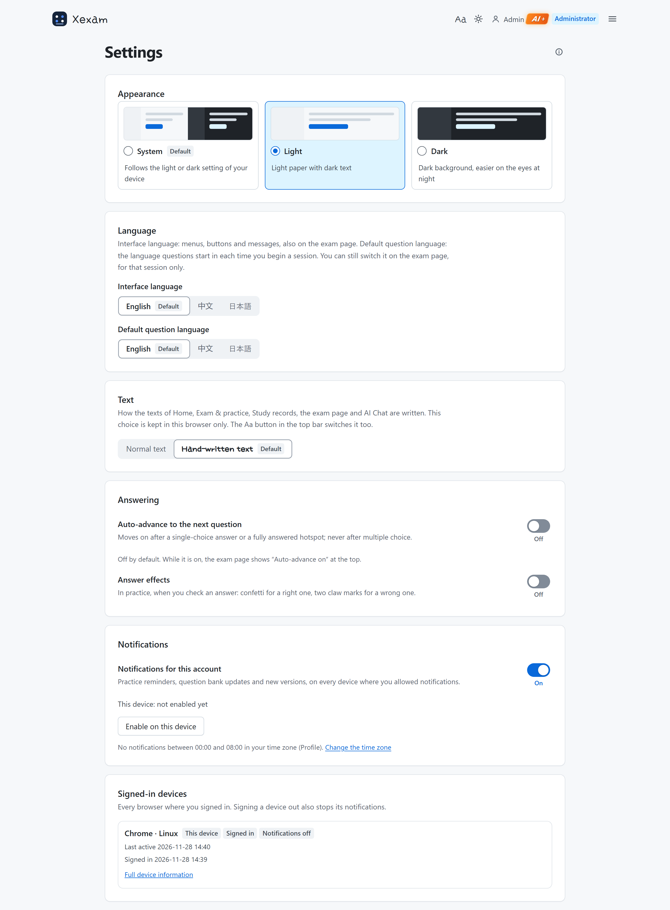</td>
<td width="50%">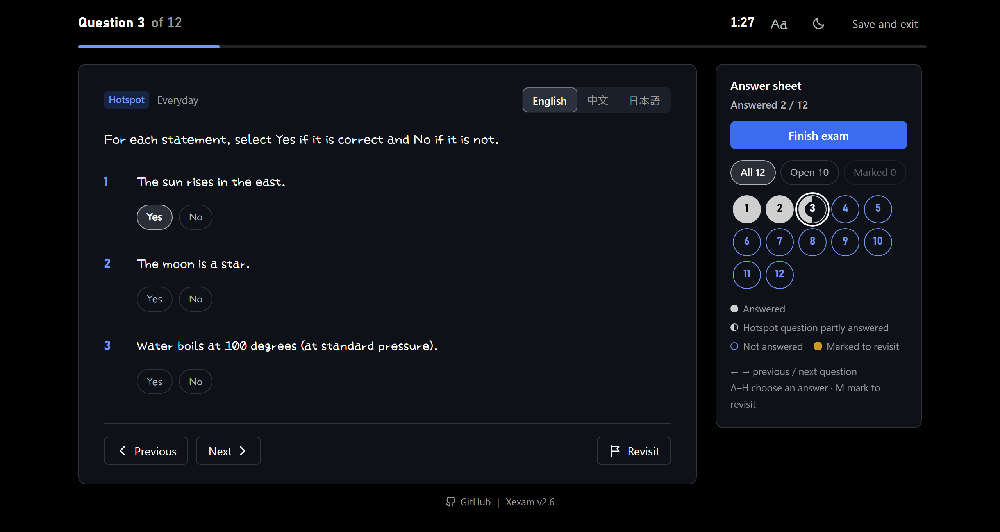</td>
</tr>
<tr>
<td>Settings: <b>Appearance</b>, <b>Language</b> (with <b>Default question language</b>), <b>Text</b>, <b>Answering</b> and <b>Reset to defaults</b>.</td>
<td>The <b>Dark</b> theme, here on the exam page.</td>
</tr>
</table>

### 9.1 Profile (v2.6)

**Profile** (`#/profile`) is your own account. Open it from the user row at the bottom of the menu (your username with your role) or from the **Profile** tile on Home.

- **Account**: your **E-mail** (the login you sign in with) and your **Role** (with **Bank manager** if you have that permission, and the **AI+** badge when you have the AI+ feature; when the badge is dark, a line under it says why). A bank manager also reads what the permission allows. Only an administrator can change the e-mail (**User management** → **Edit**).
- **Username**: the name the others see (leaderboard), and the name in the greeting, the top bar and the menu. Type a new one and press **Save**; a toast says **Your username has been saved.** The rule: up to 20 characters after the spaces at both ends are removed and runs of spaces become one, any script, no `@` and no control or invisible characters. It must not be another account's username or login (letter case of A–Z does not count), which gives **This username is already taken.** Saving the name you already have says **That is already your username.**
- **Change password**: folded until you open it. Type the **Current password**, the **New password** (8 to 128 characters) and repeat it, then **Change password**. Your other browsers and devices are signed out; this one stays signed in.

<table>
<tr>
<td width="50%">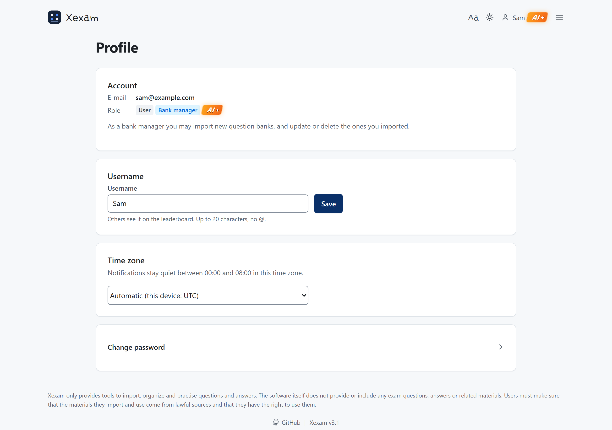</td>
<td width="50%">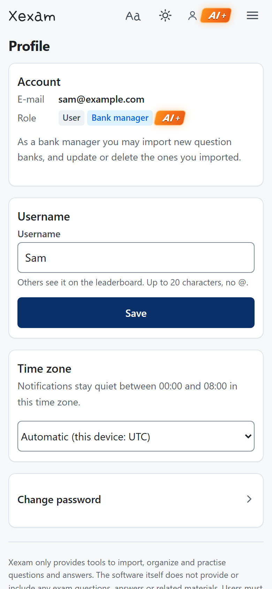</td>
</tr>
<tr>
<td>Profile: <b>Account</b>, <b>Username</b> and <b>Change password</b>.</td>
<td>The same page on an iPhone.</td>
</tr>
</table>

## 10. About Xexam

The version entry of the menu (for example **Xexam v0.7.5**) opens **About Xexam**: the **Version**, the CPU architecture of the **Server**, the **License**, and **What’s new**, which is the [changelog](changelog.md) in the interface language. The newest version is open; the earlier ones are folded under **Earlier versions**.

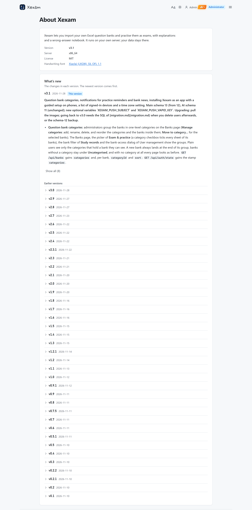

## 11. Question banks

Here administrators and bank managers import Excel workbooks. Users without the permission do not see the page in the menu; opening it directly shows **Not allowed** with **Back to Home**.

- **Import Excel**: pick **New bank** or **Update a bank** (two small buttons next to the title; their tooltips explain them; for an update you choose the bank under **Bank to update**), then click **Import Excel file** or drop the file anywhere on the panel. The hint line says to upload the whole workbook in the six-column layout and ends in a link to the **Excel format guide**.
- **The bank list**, one compact row per bank: its file, number of questions (with the retired ones, for example **5 questions (+2 retired)**) and sheets and last update, with **Update** and **Delete**. Its sheets are folded under the arrow on the right of the row. A bank whose questions are all retired because they came from an older Excel layout says so, and that an update with a six-column file brings it back into use.
  - An **administrator** sees **All question banks**, each with who imported it (**uploaded by sam**, **uploaded by you**), and may update or delete any of them.
  - A **bank manager** sees **Your question banks**: only the banks they imported, which they may update or delete. Banks an administrator gave them to study are on Exam & practice.
- **Import history**: one line per import, the latest 8 (an administrator sees all imports, a bank manager those of their own banks).
- **Excel format and import guide**, folded until you open it, is the short version of [section 12](#12-excel-question-bank-format) and [section 13](#13-importing-question-banks). Its last part, **Use an outside AI to make the Excel file**, has numbered steps and a ready prompt with a **Copy** button ([section 13.10](#1310-making-the-excel-file-with-an-outside-ai)).

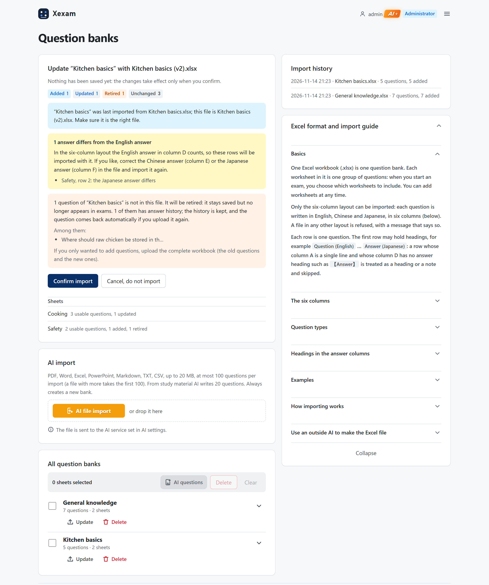

The screenshot shows the preview of an update of "Kitchen basics" with a newer file, `Kitchen basics (v2).xlsx`, before anything is saved: the chips (1 added, 1 updated, 1 retired), the question that would be retired, and the warning that the Japanese answer of one row differs from the English one (the row is imported with the English answer). It also shows the bank list under **All question banks** ("Kitchen basics" was uploaded by the bank manager sam) and the **Excel format and import guide**, opened, with its first two parts: the basics and the six columns.

### 11.1 Downloading a bank (v1.6)

Every bank row on **Question banks** has a **Download** button (first of the row's buttons). It opens a small dialog, **Download bank**, with two choices: **Excel** ("Import format, can be imported again") and **Word** ("For reading and printing"). One tap on a format starts the download; the button reads **Preparing…** meanwhile and a message names the file when it is saved.

- **Languages (v1.9)**: above the format buttons the dialog has the checkboxes **中文**, **English** and **日本語**, all ticked, at least one required (not remembered). **Excel** keeps all six columns in place and leaves the cells of unticked languages empty, so without English the file can no longer be imported again (the dialog says so); **Word** holds only the ticked languages, always English, then Chinese, then Japanese. With all three the file name is unchanged; with fewer it ends with the codes in that order, for example `Garden_en-zh.docx`.
- **Excel (.xlsx)** is the six-column layout of [section 12](#12-excel-question-bank-format), one worksheet per sheet of the bank, so **downloading a bank and importing the file again gives the same questions**.
- **Word (.docx)** is made for reading and printing: the bank name as the title, then the whole bank in **English**, then in **Chinese**, then in **Japanese**, each language starting on a new page and listing every sheet in turn. The headings use Word's built-in heading styles (so the navigation pane and a table of contents work); every question shows its options with the correct ones marked, the answer, the explanation, the mnemonic and the note.
- The file holds the bank's current questions; retired ones are left out. The file name is the bank name with `.xlsx` or `.docx`.
- **Who may download**: administrators, and plain users with the **Download banks** right (a box in the bank dialog of **User management**, right after **Manage banks**, off by default; administrators always have it). A user may download only the banks they can see. A plain user who has the right but is not a bank manager sees **Question banks** as a list of their banks with **Download** buttons, with no import, history or format guide; a bank manager with the right also keeps the management tools. The server checks the right on every download: without it the answer is **You do not have permission to download question banks. Please contact an administrator.**, and a bank the user cannot see is answered like a missing one. The files contain every answer, so give the right only to people who may see them.
- Every download is written to the **Activity** tab of the System log (`bank.download`: user, bank, format, number of sheets and questions).

## 12. Excel question bank format

One workbook (`.xlsx`) is one question bank. Each sheet is a group of questions, one question per row. **Only the six-column layout can be imported**: every question has its own column in English, Chinese and Japanese, and so has its answer and explanation. A file in any other layout, the three- and four-column layouts of earlier versions included, is refused with a message that says so; nothing is imported from it.

| Column | Contents |
|---|---|
| **A** | The **English** question, then its options or hotspot items. The question type, the options and the items are taken from this column, and the question is recognised by it |
| **B** | The **Chinese** question (optional), with the same options (A, B, C…) or the same numbered items as column A |
| **C** | The **Japanese** question (optional), with the same options or items as column A |
| **D** | The **English** answer, explanation and memory aid: `【Answer】B`, then `【Explanation】…` and `【Memory aid】…`. The answer is taken from this column |
| **E** | The **Chinese** answer, explanation and memory aid (optional): `【答案】B`, `【解析】…`, `【记忆口诀】…` |
| **F** | The **Japanese** answer, explanation and memory aid (optional): `【正解】B`, `【解説】…`, `【覚え方】…` |

Here is one complete single-choice question (made up, like every example here; it is the same as in the guide on the **Question banks** page):

| Column | Cell |
|---|---|
| A | Which planet is known as the Red Planet?<br>A. Venus<br>B. Mars<br>C. Jupiter<br>D. Saturn |
| B | 哪颗行星被称为“红色星球”？<br>A. 金星<br>B. 火星<br>C. 木星<br>D. 土星 |
| C | 「赤い惑星」と呼ばれる惑星はどれですか。<br>A. 金星<br>B. 火星<br>C. 木星<br>D. 土星 |
| D | 【Answer】B<br>【Explanation】Iron oxide (rust) in the dust on its surface makes Mars look red.<br>【Memory aid】Mars rusts red. |
| E | 【答案】B<br>【解析】火星表面的尘土含有氧化铁（铁锈），所以看起来是红色的。<br>【记忆口诀】火星生锈红彤彤。 |
| F | 【正解】B<br>【解説】火星の表面の砂には酸化鉄（さび）が含まれているため、赤く見えます。<br>【覚え方】火星はさびて赤い。 |

To start a new line inside a cell, press Alt+Enter (Windows) or Control+Option+Return (Mac).

### 12.1 Rows and headings

- Each row is one question. The first row may hold headings, for example `Question (English)` … `Answer (Japanese)`: a row whose column A is a single line and whose column D has no answer heading such as `【Answer】` is treated as a heading or a note and skipped.
- Xexam recognises the six-column layout by the content of each worksheet: at least one row needs a Japanese question with kana in column C (and no kana in columns A and B) and an answer with its heading, in any of the three languages, in column E or F.

### 12.2 English is authoritative

- The question type, the options, the hotspot items and the question's identity come from column A, the answer key from column D. A row without an English question in A or an English answer in D cannot be read; the preview lists it with the reason.
- Columns B, C, E and F may be left empty in a row: without column B or C, Chinese or Japanese is greyed out on that question; without column E or F, the card shows the explanation of another language.
- Columns B and C must line up with column A (the same option letters, the same number of items). A language that does not line up is greyed out for that question.
- When the answer in column E or F means something else than column D, the row is still imported with the English answer, and the preview warns, for example **1 answer differs from the English answer**, with the rows under **Show the rows**. Answers are compared by meaning: the same letters, or the same choice for each hotspot item (`Yes`, `是` and `はい` count as the same).

### 12.3 Question types

- **Single choice**: in column A, the question first, then one option per line: `A. text`, `B. text` … (two to eight options, A to H; `A)`, `A、` and `A:` work too). The answer is one letter: `【Answer】B`.
- **Multiple choice**: written the same way, with several letters in the answer: `【Answer】C, E` or `【Answer】CE`. An answer counts as right only when exactly these options are chosen.
- **Hotspot** (several statements, one choice for each): the first line of column A is `HOTSPOT` (recommended: it marks the question as a hotspot one; without it, numbered items that end in choices are recognised too), then the question, then one numbered item per line that ends with its choices, separated by ` / `: `1. Water is wet. Yes / No`. Choices of more than one word (such as `Before cooking / After cooking`) need a tab or a full-width space (`　`) in front of them. The answer gives one choice per item, separated by `;`: `【Answer】1 Yes; 2 No`.
- In columns B and C, write the same items with the same numbers; when they end with their own choices (`是 / 否`, `はい / いいえ`), the question shows those in that language. In every answer column, yes and no may be written in any of the three languages: `Yes` / `是` / `はい` and `No` / `否` / `いいえ`.

For example, this hotspot question (columns A and D; columns B, C, E and F hold the same in Chinese and Japanese, with a full-width space before `是 / 否` and `はい / いいえ`):

```
HOTSPOT
For each statement, choose Yes or No.
1. The sun rises in the east. Yes / No
2. The moon is a star. Yes / No
```

```
【Answer】1 Yes; 2 No
【Explanation】The sun rises in the east. The moon only reflects sunlight; it is not a star.
```

### 12.4 Headings in the answer columns

In columns D, E and F, write the answer first, then the explanation and the memory aid, each after its heading in `【…】`. Each of the three columns accepts the headings of all three languages:

- Answer: `【Answer】`, `【答案】`, `【正解】` or `【答え】`.
- Explanation: `【Explanation】`, `【解析】` or `【解説】`.
- Memory aid: `【Memory aid】`, `【Mnemonic】`, `【记忆口诀】`, `【口诀】` or `【覚え方】`.

English headings may be written in any case, and a longer heading that contains one of these words, such as `【解析·怎么选】`, counts too. A cell that holds nothing but the answer may also be just the letters (`B`) or one line such as `Answer: B`. Text in parentheses after the answer, for example `【Answer】B (see chapter 2)`, is not part of the answer: it is shown as a **Note** on the answer cards.

### 12.5 Questions that cannot be read

Questions that cannot be read are **never guessed**: they are listed in the preview with the reason (usually column D does not contain an answer with its heading, or the answer letter is not among the options), and they are never silently marked wrong.

## 13. Importing question banks

### 13.1 Who may import

- **Administrators** import new banks and update or delete every bank.
- **Bank managers** (users with the **Bank manager** permission, set in [User management](#14-users-and-sign-in)) import new banks, which then belong to them, and update or delete only the banks they imported. Banks of administrators and of other users stay out of their reach.
- Other users do not see the **Question banks** page.

### 13.2 New bank or update

A question bank is one imported Excel workbook. On **Question banks** → **Import Excel** you choose where the file goes with two small buttons next to the title:

| Choice | What happens |
|---|---|
| **New bank** | A new bank is created, named after the file (without `.xlsx`; ` (2)`, ` (3)`, … is added if the name is taken). Existing banks are not changed. The same workbook can be imported twice as two separate banks; their study records do not mix |
| **Update a bank** | The file replaces the questions of the bank you pick under **Bank to update** (a bank manager can pick only their own banks). Questions missing from the file are retired **in that bank only**. The bank keeps its name, its owner and the users who see it |

Use **New bank** for a different workbook, and **Update a bank** for a newer version of a workbook you have already imported. Always upload the **whole** workbook, not only the new questions.

A new bank is visible to the person who imported it, to the administrators, and to every user with **Include banks imported later**. An administrator gives it to other users in **User management**.

### 13.3 Preview, then confirm

After the upload Xexam reads and checks the file and shows a preview: small chips with how many questions will be **Added**, **Updated**, **Restored** or **Retired** and how many are **Unchanged** and **Unreadable** (counts of zero are hidden), one line per sheet with its numbers, and for every row that could not be read, the row number and the reason, folded under the line of its sheet (for example **2 unreadable**). **Nothing is written until you confirm** (**Create the question bank** or **Confirm import**; **Cancel, do not import** drops it). The preview also warns you when:

- you create a new bank from a file with the same name as the file an existing bank was imported from (it offers to update that bank instead);
- you update a bank with a file whose name differs from the last import;
- questions would be retired. It lists some of them, and asks once more before the import;
- the Chinese or Japanese answer of a row differs from the English one (the row is imported with the English answer).

Every person who imports has their own preview, kept in memory for 30 minutes. All open previews share a memory budget: when several large files are being previewed at the same time, the oldest preview of another person can be dropped. Confirming a preview that was dropped or is older than 30 minutes says that it has expired: upload the file again.

### 13.4 Import rules

The file is treated as the **complete content of the bank** it goes to. Other banks are never touched.

| Case | Result |
|---|---|
| A question is in the file but not in the bank | **Added** |
| Same question, but other content (other options, answer, explanation, Chinese or Japanese text) changed | **Updated** (answer history is not affected) |
| A question is in the bank but cannot be found in the file | **Retired**: it stays saved with its answer history, but no longer appears in exams or practice |
| A question that was retired earlier appears again | **Restored**, and its wrong-answer notebook entries come back with it |
| The sheet name, the English question or the first option changed | Counts as **a new question**: the old one is retired, and the new one starts without answer history |
| The file contains not a single usable question | Import rejected (this prevents wiping the bank) |

A question is recognised by its worksheet name, its English question (column A without the options) and its first option or item (spaces do not matter).

### 13.5 Banks from an older Excel layout

Up to v0.6 Xexam imported workbooks in a three-column and a four-column layout, whose questions were recognised by their Japanese text. Since v0.7 these layouts can no longer be imported, and **every question that was imported from them is retired at every start** of the backend. The banks, their import history, the study records and the per-question statistics stay; the questions are no longer asked, and a bank whose questions are all retired says so in the bank list.

To use such a bank again, **update it with a six-column version of its workbook** (**Update a bank**). The bank keeps its name, its owner and the users who see it. Because the six-column layout recognises questions by their English text, every question of the file is added as a new question, without answer history; the old ones stay retired, and the old records still show them. You can also import the six-column file as a **New bank** and delete the old one.

### 13.6 Deleting a bank

**Delete** on a bank’s row asks for confirmation (for example **Delete “Kitchen basics”?**). The bank's questions (active and retired) and its import history are deleted, and it disappears from every user's question banks. The checkbox below is off by default:

- **Unchecked**: the answer history and the exam records stay. In those records, the bank's questions show as deleted.
- **Checked**, as an administrator (**Also delete this bank’s study records**): the answer history of the bank's questions and the records that no other remaining bank is part of are deleted too.
- **Checked**, as a bank manager (**Also delete your study records of this bank**): only your own answer history and records are deleted; other users' study records always stay, with the questions shown as deleted.

A delete cannot be undone; your own backup is the only way back (section 5 of [database.md](database.md)).

### 13.7 Checkboxes and bulk actions

Every bank and every sheet in the bank list has a checkbox. Ticking a bank ticks all its sheets; a bank with only some sheets ticked shows a mixed box. When something is ticked, a toolbar appears above the list:

- **Delete** (in the selection bar) deletes the ticked banks and sheets after one dialog that lists what goes and asks whether their study records go too (the same choice as deleting a bank). A bank whose sheets are all ticked is deleted as a whole. A sheet is deleted on its own only while other sheets of the bank remain; an AI-generated bank has one sheet and is deleted as a whole.
- **AI questions** starts an AI-generated bank from the ticked banks and sheets (section 13.9). It is flat amber with white text; when it cannot be used (nothing usable is ticked, an AI+ bank is ticked, the daily limit) it is a plain grey button, with no text under it: tap, hover or focus it to read the reason in a small tip box (Esc or a tap elsewhere closes it). A new AI bank is not ticked on Exam & practice by itself.

Each bank row shows its name in bold, a line of counts (for example **7 questions, 2 sheets**), an arrow that folds its sheets, and the AI+ badge of an AI-generated bank (section 13.9). On a phone the row's buttons (**Update** and **Delete**) sit on their own line under the name, the badge has its own line too, and long names wrap.

### 13.8 AI file import

On **Question banks**, the **AI import** card sits under the **Import Excel** card, with its own drop zone. Choose a file or drag it there: PDF, Word (.docx), Excel (.xlsx), PowerPoint (.pptx), Markdown, TXT or CSV, up to 20 MB (the drop box says **max 20 MB**, the value set in AI settings). The card says that the file is sent to the AI service you configured in [AI settings](#17-ai-settings), and it shows the limits that are set there (size, and at most 100 questions per import by default). Only users with the AI import feature and a usable AI+ see the card; otherwise it is hidden, or greyed out (the reason is in the tip on tap, hover or focus). The button has the same flat amber as the AI generation buttons and the size of **Import Excel file**.

ai-service reads the file in memory and never saves it on disk; the file is gone after processing. The whole file is sent once, as the cached start of every request of the job (prompt caching), so the later calls mostly read it from the provider's cache. The first call reads the whole file: whether it holds questions or study material, and how many questions. After it, up to four calls write the questions at the same time. A file too large for the model is read in parts instead, two or three at a time, and the card shows the progress (for example **Recognising segment 3/9…**).

The confirm step shows what was found. If the file holds questions, a label shows their number (**File has 150 questions**); when there are more than the limit (100 by default), the label is red and a second red label says **Only the first 100 can be imported**: the import takes the first 100 in file order, and the finished card says **the first 100 of 150 questions**. If it is material, the AI writes exactly 20 questions from it. Before **Import**, give the new bank a name: the box is filled with a suggestion, and the button stays greyed out while the box is empty. A name that already exists is refused with **This name already exists — try another one.** Nothing is saved before you confirm; declining, or letting the confirm step expire, costs nothing. Confirming uses one of the day's AI bank jobs (generation and import share them; administrators are exempt, as in section 13.9). AI import, like AI generation, does not count against the per-user AI request limits (per minute, hour and day) and is never refused by them.

While the job runs, its card shows the progress and the figures in two aligned lines, for example **9 calls this run, input/output: 1.4K/21K Token** and, under it, **Cache write/read: 0.9K/12K Token** (the second line only when the provider reports cache use); on a narrow phone the call count moves to its own line. The figures stay on the finished card. A question that fails three times (missing, unreadable or refused by the checks) is skipped, also with **Unlimited** on, so a job always ends: the bank holds the questions that passed and the card lists the skipped ones, for example **imported 48 of 50; 2 could not be converted**. **Cancel import** on a running import that already has converted questions asks whether to **Save the N finished** as an AI bank, **Discard all**, or **Keep going** (material always needs its 20 questions, so there it is a plain cancel). A failed job says why and creates no bank. *(v2.4)* When the AI writes the four options of a question (the file had none), letter references in its explanation ("Option B") are rewritten to the quoted option text; a question that keeps the options of the file is imported as written.

### 13.9 AI-generated question banks

Who: users with the AI+ feature, the generation feature and bank management (administrators always qualify). There are three places to start one: **AI questions** in the toolbar of Bank management (for the ticked banks and sheets), **AI questions** on Exam & practice (for the ticked banks and sheets), and **AI wrong-answer drill** in the wrong-answer notebook mode of Exam & practice.

- **Minimum source**: 30 single- or multiple-choice questions in the ticked banks (hotspot questions do not count); in wrong-answer mode, 10 wrong single- or multiple-choice questions.
- **AI banks are never a source**: as soon as the ticked banks and sheets contain an AI-generated bank, AI generation is greyed out (in both modes, on Exam & practice and in Bank management) until you untick it.
- **Result**: a new bank with one sheet named **AI** and 20 valid questions (at least 10 since v2.4, see below), in Chinese, English and Japanese, each with its answer and explanation: 14 single and 6 multiple choice (never hotspot). A missing or invalid question is generated again (at most 5 tries per question). *(v2.4)* A question that still fails is left out and the job goes on: the bank is made with the questions that passed as long as at least half of them passed (for example 19 of 20), and the finished card says **19 of 20 questions** and how many were left out; with fewer than half, the job fails and saves nothing. Because the options are shuffled, an explanation that points at an option by its letter ("Option B", "A and B") is rewritten to the quoted text of that option instead of being refused, and labels such as "A." are removed when every option starts with its own letter in order.
- **Name**: you type the name in the start dialog (Exam & practice and Bank management); a suggestion is filled in, for example `Kitchen basics_sample01_20261113101530` (source, the first 8 characters of your username and the start time).
- **Quota**: 3 AI bank jobs per user per day, generation and file import together, reset at 0:00 of the server time. One job counts as 1, however many AI calls it needs. A job counts when it is done, or when it is cancelled after a call was sent. Failures and jobs cancelled before their first call do not count. Administrators are exempt. The per-user AI request limits (per minute, hour and day) do not apply to generation or import.
- **Limits**: **Unlimited** is on by default for generation and for import (section 17.5): no call ceiling, no limit on the answer length per call and no deadline. Two safety stops always remain: provider errors in a row stop the job (after each one it waits 15 s, 30 s, then 60 s; errors that may pass by waiting, such as overloaded, rate limited, no connection or server error, stop it after 6 in a row, about four minutes; other errors such as timeout, key, quota, model not found or refused request after 3; *v2.4*), and you can always cancel. With **Unlimited** off, a generation makes at most 15 AI calls (an import 25; 8 to 40 in AI settings, the same for everyone, administrators included), each call keeps the length of section 17.5, and the job has 30 minutes. A failure says why, with the rejection counts by reason, and the same reason is written to the System log at ERROR level.
- **Progress**: a progress card on Exam & practice and Bank management shows the questions made against the goal and one line of figures (calls and input / output tokens). You may leave the page; the card tells you when the job is done or has failed, and its corner button closes it. A finished bank appears on Exam & practice and in Bank management at once, even if you were on another page or in a hidden tab.
- **Marker**: the AI+ badge with a word for where the bank came from: **AI+practice set** (ticked banks and sheets, Exam & practice or Bank management), **AI+wrong-answer set** (wrong-answer notebook mode) or **AI+imported set** (AI file import). It appears on the bank row, on the question cards of its questions and on every review card of them (result, record, wrong-answer review). Its tip names who generated it and when, and says that AI-generated answers may be wrong.
- **Sharing**: an AI bank is shared like any new bank: users who may see every source bank get it when they have the option to include future banks. An administrator can remove an AI bank from a user in User management, like any other bank.


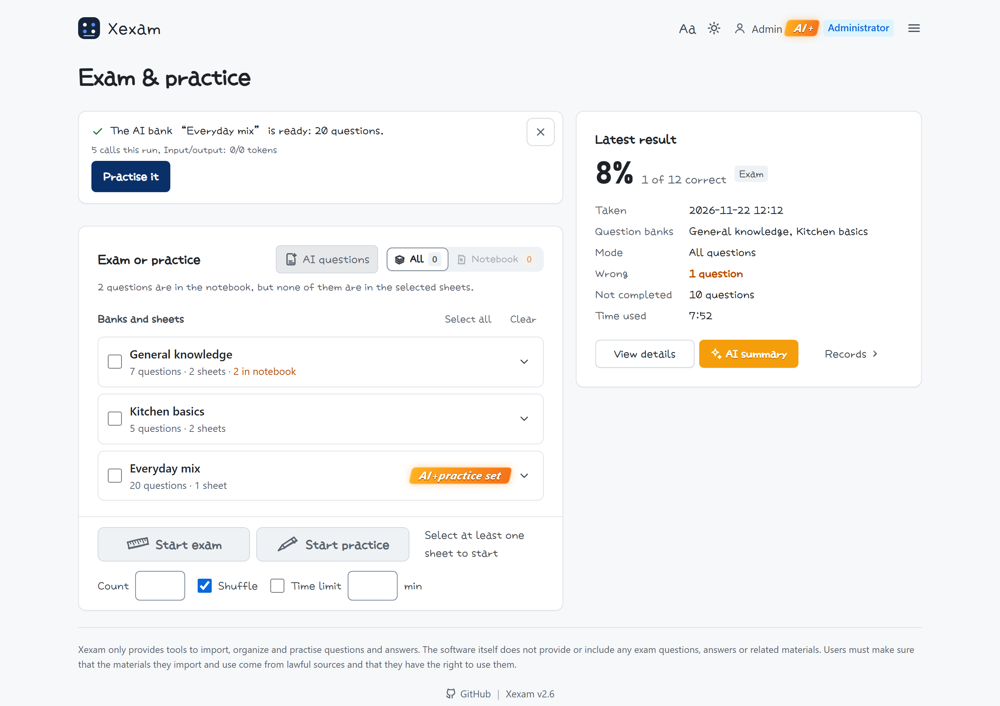

### 13.10 Making the Excel file with an outside AI

This is the guide part **Use an outside AI to make the Excel file** (on the **Question banks** page, inside the Excel format guide). The prompt is shown in a box that scrolls inside itself, with a **Copy** button. Prompt text (English):

1. Open the AI chat you already use outside Xexam.
2. Attach or paste your own material: notes, a PDF, a list of questions or the text of a web page.
3. Copy the prompt below and paste it into the chat. There is nothing to change in it.
4. Ask for the result as an .xlsx file to download. If the AI cannot make a file, ask for the table, paste it into Excel starting at cell A1 and save it as “Excel Workbook (.xlsx)”.
5. Open the file and check a few rows: the options, the answer letters and the three languages.
6. Import it here with “Import Excel file”, as a new bank or as an update of a bank.

```text
I want to turn my own material into a question bank: one Excel file (.xlsx) that I will import into a study app. Use only the material I give you (attached or pasted); do not add facts that are not in it.

WHICH QUESTIONS
- If my material already contains questions (an exercise list, an exam, a question bank), convert every one of them: exactly as many questions as the material has, none added, removed or merged. Keep each question’s content and its correct answer (only translate into the three languages and put it into the format below). Where the material has no explanation or memory aid, write a short one from the material. A question that is not a choice question (for example fill in the blank or short answer) becomes a choice question with its correct answer among the options.
- Otherwise (notes, a book chapter, a web page), make the questions yourself from the material: decide the number from the amount of material, so that every important point is covered by at least one question and no point is repeated.

FILE
- One workbook (.xlsx) with exactly one worksheet, named after the topic of the material (short; none of the characters : \ / ? * [ ]).
- If you cannot create a file, give me one table with the same six columns that I can paste into Excel starting at cell A1.
- Plain text cells only: no merged cells, no images, no formulas, no extra worksheets, no extra columns, no comments.

ROWS
- Row 1 is the heading row, exactly these six headings in columns A to F: Question (English), Question (Chinese), Question (Japanese), Answer (English), Answer (Chinese), Answer (Japanese).
- From row 2 on, one question per row. Never put two questions in one row or one question in two rows. Fill all six cells of every row.

COLUMNS A, B, C: the question in English, Chinese (Simplified) and Japanese
- Each cell holds the question text, then the options, one option per line (line breaks inside the cell). Write the options as A. text, B. text, C. text and so on (4 or 5 options, at most 8, letters in order).
- The three cells of a row are the same question with the same options in the same order and with the same letters.
- Single choice has exactly one right option. Multiple choice has two or more, and its question text says how many to choose.
- Write natural Japanese in column C (with hiragana and katakana). If my material is in another language, translate it.

COLUMNS D, E, F: the answer, in English, Chinese and Japanese
- Line 1 of each cell is the heading and the answer letters only: single choice 【Answer】B, multiple choice 【Answer】C, E (letters in alphabetical order, separated by commas). Chinese uses 【答案】, Japanese uses 【正解】.
- Then a new line with the explanation (one or two sentences): 【Explanation】 in English, 【解析】 in Chinese, 【解説】 in Japanese.
- Then a new line with a short memory aid: 【Memory aid】 in English, 【记忆口诀】 in Chinese, 【覚え方】 in Japanese.
- Use the brackets 【 】 exactly as written. The letters must be the same in D, E and F.

EXAMPLE
The two rows below only show the exact format of the cells. Their content must NOT go into the file.

Example 1 (single choice):
Column A:
Which planet is known as the Red Planet?
A. Venus
B. Mars
C. Jupiter
D. Saturn

Column B:
哪颗行星被称为“红色星球”？
A. 金星
B. 火星
C. 木星
D. 土星

Column C:
「赤い惑星」と呼ばれる惑星はどれですか。
A. 金星
B. 火星
C. 木星
D. 土星

Column D:
【Answer】B
【Explanation】Iron oxide (rust) in the dust on its surface makes Mars look red.
【Memory aid】Mars rusts red.

Column E:
【答案】B
【解析】火星表面的尘土含有氧化铁（铁锈），所以看起来是红色的。
【记忆口诀】火星生锈红彤彤。

Column F:
【正解】B
【解説】火星の表面の砂には酸化鉄（さび）が含まれているため、赤く見えます。
【覚え方】火星はさびて赤い。

Example 2 (multiple choice):
Column A:
Which two of the following are fruits?
A. Carrot
B. Potato
C. Apple
D. Onion
E. Banana

Column B:
下面哪两个是水果？
A. 胡萝卜
B. 土豆
C. 苹果
D. 洋葱
E. 香蕉

Column C:
次のうち果物はどれですか。2 つ選んでください。
A. にんじん
B. じゃがいも
C. りんご
D. たまねぎ
E. バナナ

Column D:
【Answer】C, E
【Explanation】Apples and bananas are fruits; the others are vegetables.
【Memory aid】Sweet ones are fruit.

Column E:
【答案】C、E
【解析】苹果和香蕉是水果，其他都是蔬菜。
【记忆口诀】甜的是水果。

Column F:
【正解】C、E
【解説】りんごとバナナは果物で、ほかは野菜です。
【覚え方】甘いのが果物。

Answer with the file (or the table) only, and no other text in the cells.
```

- The outside AI’s terms and costs are your own business. Do not send material that you may not share.
- AI can make mistakes: check the answers before you study from them.

## 14. Users and sign-in

Since v0.6 everyone signs in. There are three kinds of account:

- **Administrator**: everything, including every question bank, **User management**, **AI settings** and the **System log**, and AI Chat while the AI+ feature is on.
- **User** with the **Bank manager** permission: imports new question banks and updates or deletes the banks they imported, but not anybody else's.
- **User**: takes exams and practises with the question banks an administrator gave them.

Each user has their own study records, wrong-answer notebook, unfinished exam and settings. AI has one name, the **AI+ feature**, and three controls: the global switch in [AI settings](#17-ai-settings), the per-user switch in User management, and **Pause** / **Resume** per user in AI settings under **Users with AI+**.

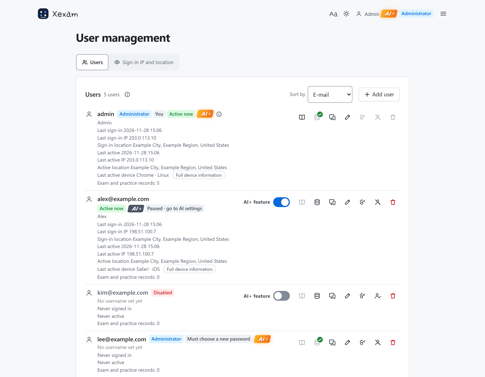

User management, tab **Users** (made-up addresses and places, the eye on the other tab open): admin and alex, each with **Last sign-in**, **Last sign-in IP**, **Sign-in location**, **Last active**, **Last active IP**, **Active location**, **Last active device** (with the **Full device information** button) and the records line; alex's **AI+ feature** is on but **Paused**, so the badge is dark. Further down the list are sam, kim and lee.

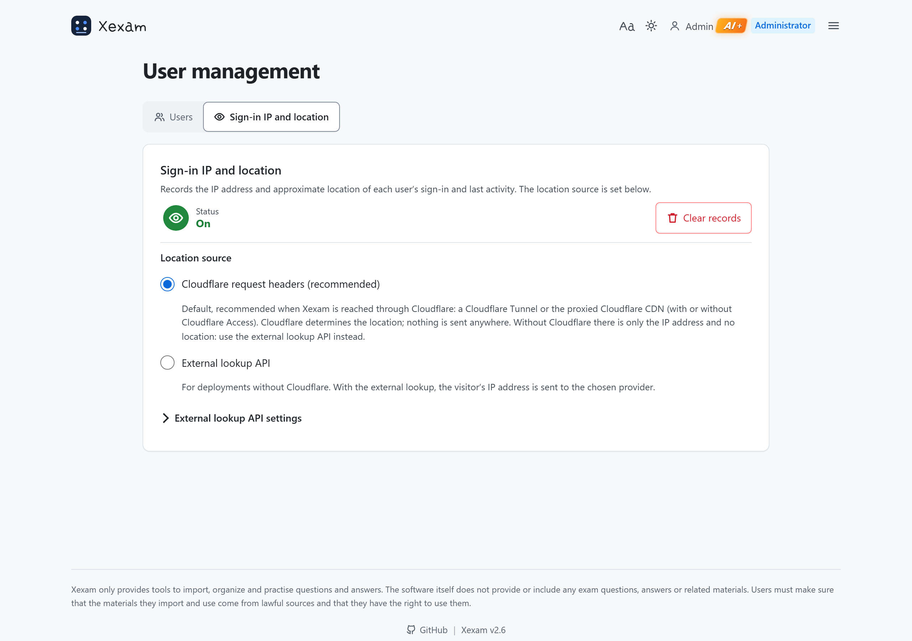

The second tab, **Sign-in IP and location** (`#/users?tab=signin`): the eye with its **On** status, the red **Clear records** button, and the **Location source** setting with **Cloudflare request headers** selected, the privacy line of the **External lookup API** and its collapsed settings.

- **Signing in (v2.6)**: with your **E-mail** (the login an administrator gave you) and your password. The username others see cannot be used to sign in: the page answers **Sign in with your e-mail address; your username cannot be used to sign in.** The only exception is the default administrator `admin` of a new install. A wrong e-mail or password gives **The e-mail or password is not correct.**
- **First start** (a new install, or the first start after upgrading from v0.5 or older): sign in with `admin` / `admin` (the sign-in page reminds you of it). Xexam then asks for a username and a new password (8–128 characters) on one page. The study records, notebook and settings from before v0.6 belong to this administrator.
- **First sign-in of a user (v2.6)**: a new user, created by an administrator, gets the page **Set your username and password**: the **Username** field (up to 20 characters, no `@`; the others see it on the leaderboard) above the two password fields, saved together. An account that existed before v2.6 has no username yet: at its next sign-in it gets the same page when it must also choose a new password, otherwise the small page **Set a username** with one field, **Save** and **Sign out**. Until a username is set, nothing else of Xexam opens, AI included. The rules of the username are in [section 9.1](#91-profile-v26); logins and usernames never repeat across accounts, so nobody can look like somebody else.
- **User management** (menu, administrators only; two tabs, **Users** and **Sign-in IP and location**, see below): on the **Users** tab, one row per user with the login (the e-mail) and, as a muted second line, the username (**No username set yet** until the user has one), role, status (**Normal**, **Disabled**, **Locked · … left**, **3 tries left**, **Must choose a new password**), **Bank manager** when the user has that permission, the **AI+** badge, created, last sign-in and the number of study records (exams and practice). Actions: **Edit**, **Reset password**, **Disable** / **Enable**, **Delete** and, when needed, **Unlock**. A user created or reset by an administrator chooses their own password at the next sign-in. You cannot disable, demote or delete yourself, and the last enabled administrator cannot be removed. The list refreshes itself while it is open, so a lock that starts shows up.
  - **Pages (v2.6)**: the list shows 10 users a page (5 on a phone), with the pager of the AI settings lists (‹, the page numbers, ›, and **Page 1 / 3**; on a phone the first, the current and the last page, with … between); since v2.7 the pager is always shown, also with one page (**Page 1 / 1**), and a phone shows the first, the current and the last page. With more than 10 users a search box (**Search by e-mail or username**) and the sort select work across all users; a new search or sort goes back to page 1, and a newly added user is shown on the page where it lands.
  - **Study records of a user (v2.7)**: a book icon left of the pencil (**View alex’s study records**) opens that user's study records, read only ([section 7](#7-study-records)); it is greyed with **No study records yet** when the user has none. Back returns to the same page, search and sort of the list.
- **Which question banks a user sees** is two independent settings: the existing banks ticked for them, and **Include banks imported later**, which gives them every bank imported from then on (by anyone, also with the command-line `import`). It never adds an existing bank.
  - *(v2.8)* Each plain user's row has a small **database** icon, right after the study-records icon and like the other row icons (hover or hold a finger on it for its tip). It opens the bank dialog (below); its tip names the user and says what they have: **Question banks: all, including ones imported later** (every bank ticked and the later ones included), **Question banks: 1 · General knowledge** (with **, and the ones imported later** when that is on), **Question banks: none yet, so this user sees no question bank**, or **Question banks: none for now; the ones imported later are added automatically**. A bank manager's own uploads are added to the tip. For an administrator the icon is greyed and its tip says that administrators always see and manage every question bank.
  - The database icon opens **Question banks of alex** (for example). One row sits right on top of the bank list: **Manage banks** (the bank-manager permission) and **Download banks** (v1.6, the permission to download the banks the user can see, off by default, see [11.1](#111-downloading-a-bank-v16)) on the left, **Select all** and **Deselect all** at the right end. The list starts with **Include banks imported later**, set apart by its own icon and a thin line, followed by one box per bank with who uploaded it. **Select all** ticks every listed bank, or unticks them all when all are ticked; **Deselect all** unticks them; neither touches **Include banks imported later**. A tick means on. There are no explanations on the page: they appear as tooltips when you point at an option or reach it with the keyboard, and the small **i** button next to **Question banks** explains the list. **Save** says what changed, the banks or only **Manage banks**.
  - The change applies at once and the user stays signed in. Administrators always see every bank. Taking a bank away keeps the user's study records as history. A bank manager always sees the banks they imported, while they have the permission.
- **AI+ feature**: in each plain user's action line, left of the icons, there is an **AI+ feature** switch. It appears only while ai-service is connected and the **AI+ feature** is on in [AI settings](#17-ai-settings); otherwise the rows have no AI+ line, **Add user** has no AI+ box, and one note under the page lead says why (the feature is off in AI settings, or ai-service is not connected); the switches stay as they were stored and come back when AI is available again. It applies at once, without a confirmation, and the user stays signed in; the page shows the new state, and **The AI+ feature is now on for sam.** (or **… off …**), only after the server confirmed the change. With the feature on, the user can use [AI Chat](#16-ai-chat) while the **AI+ feature** is on in AI settings and it is not paused; switched off, an answer being written for them stops within about 2 seconds, and they can still read and delete their chats and memories. Administrators have no switch: the line reads **Administrators always have AI while the AI+ feature is on.** If a page was left open while AI became unavailable, a click is refused with **Turn on the AI+ feature in AI settings first.** (never a success message), nothing changes, and the list is read again, so the switches disappear.
  - **Pause** and **Resume** are the other control, per user, in [AI settings](#17-ai-settings) under **Users with AI+**. A paused user keeps the feature and their data, shows a **Paused** chip next to their switch here, and never changes this switch by being paused.
  - **The badge** next to the name (in the header for yourself, in User management and in AI settings for administrators) has three states: **bright orange** = this user can use AI now; **dark** = the user has the AI+ feature but cannot use AI right now, because an administrator paused it, or the feature is off in AI settings, or ai-service is not connected (the tooltip says which: **The AI+ feature was paused by an administrator.**, or for a plain user **AI is not available right now. Try again later or ask an administrator.**; administrators read **The AI+ feature is not available right now.**); **no badge** = no AI+ feature. On a touch screen a tap on the dark badge opens its tooltip, and a tap elsewhere or **Esc** closes it; **Profile** → **Account** also writes the reason out. An administrator has the bright badge while AI is available and no badge otherwise.
- **Add user**: **E-mail** (the login, since v2.6 required to look like an e-mail address, for example `name@example.com`; at most 40 characters), initial password, role, the **AI+ feature** box on its own line under the role (only while AI is available), and the question bank list with the same controls as the bank dialog of the database icon (nothing ticked and **Include banks imported later** off: a new user sees no question bank until you choose some). A new account is enabled. For an administrator **Manage banks** and the **AI+ feature** box are hidden and the list is greyed out: administrators see and manage everything anyway. **Edit** changes the e-mail login, the role and **Account enabled** (**Manage banks** moved to **Change** in v0.8); a changed login must look like an e-mail address, while an unchanged older login such as `admin` may stay. An administrator never sets another user's username: each user chooses their own. A login cannot be another account's login or username (**This e-mail is already in use.**). Taking the bank-manager permission away applies at the user's next page change.
- **Deleting a user** also deletes their study records (the dialog says how many), wrong-answer notebook and settings. Question banks they imported are not deleted: they move to you, the administrator who deletes the user.
- **Wrong passwords**: 5 wrong passwords for an account within 15 minutes lock its sign-in for 1 minute; after that, every 3 more lock it again, for 5 minutes, 15 minutes, 30 minutes, 1 hour and then 1 day. The lock belongs to the account, not to the typed name, and guessing other usernames cannot wear it away. Browsers that signed in to the account before are counted separately, so guesses from elsewhere do not lock them out. A successful sign-in, **Unlock**, a password reset by an administrator, a restart of the backend, or 24 hours without a new mistake start over with 5 tries. The sign-in page says how long to wait.
  - In **User management** a short note under the row says which browsers are locked, until when, and how many locks in a row there were. **Unlock** gives 5 tries again at once, without asking; it is also offered while the user still has tries left.
- **Change your password or your username**: **Profile** ([section 9.1](#91-profile-v26)); a password change signs out your other browsers.
- **Forgot the administrator password**: `docker compose exec backend xexam-backend reset-password admin` prints a new temporary password, which must be replaced at the next sign-in. It works while Xexam runs. To clear a lock at once, restart the backend: `docker compose restart backend`.

<table>
<tr>
<td width="50%">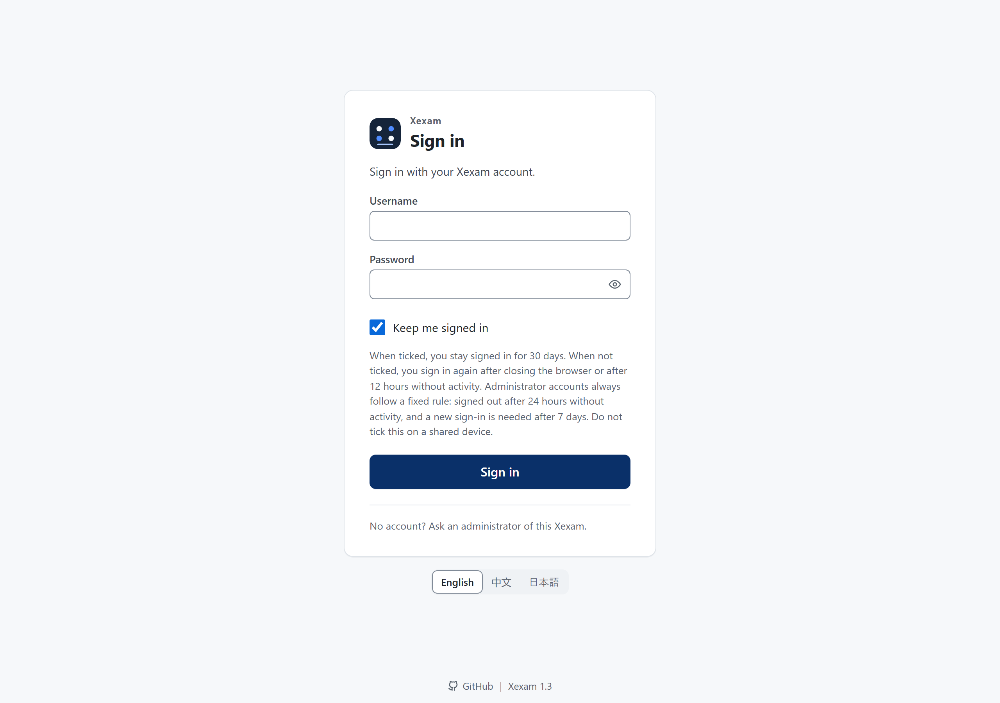</td>
<td width="50%">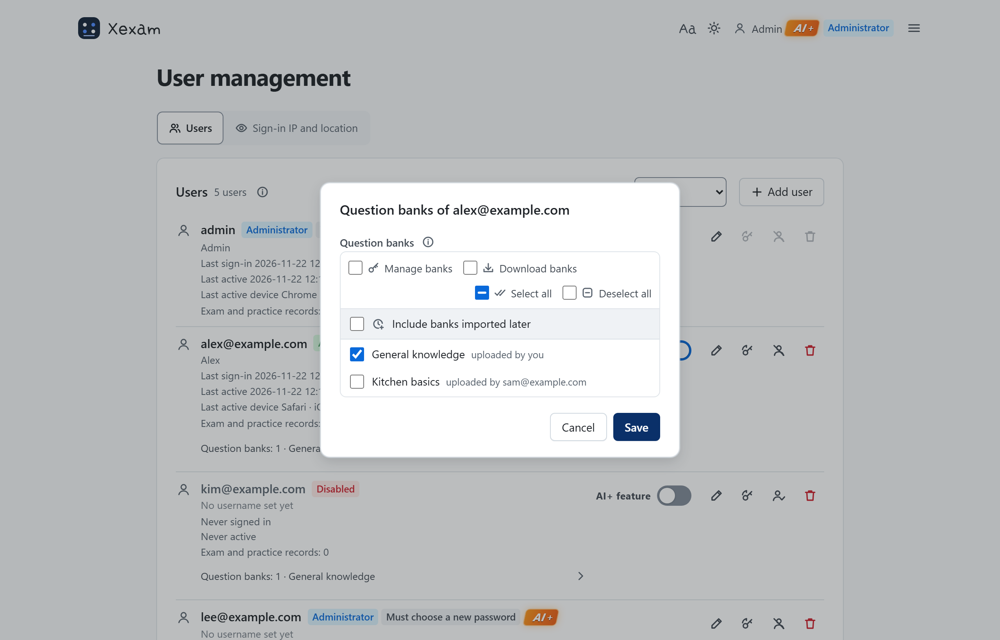</td>
</tr>
<tr>
<td>The sign-in page.</td>
<td><b>Question banks of alex</b>: <b>Manage banks</b>, <b>Download banks</b>, <b>Select all</b> and <b>Deselect all</b> in the row on top of the list, <b>Include banks imported later</b> as its first entry, then the banks with who uploaded each; here only General knowledge is ticked.</td>
</tr>
</table>

### 14.1 Keep me signed in, last active and the sign-in IP (v1.3)

- **Sign-in page**: the box **Keep me signed in** (ticked by default) lets a user stay signed in for 30 days of use. Without it the user is signed out when the browser closes and after 12 idle hours. Administrators are signed out after 24 idle hours or 7 days whatever the box says; a notice appears 10 minutes before. When a session has ended, the sign-in page says so.
- **Users page**: each user shows its facts one per line, in this order: **Last sign-in**; **Last sign-in IP** and **Sign-in location** (only while the eye on the **Sign-in IP and location** tab is open; **Location unknown** when there is none); **Last active**; **Last active IP** and **Active location** (only while the eye is open and the user has been active); **Last active device**; and last **Exam and practice records** (the number of saved exams and practices). Dates are `YYYY-MM-DD HH:mm` with the full year, in your time zone; **Never active** replaces the last-active lines when there is none. The device line (v1.4) names the browser and system of the user's last activity, for example `Safari · iOS`, the same text as the device in the System log; it is shown also while the eye is closed, because a device is not an address, and is left out when unknown. Click or tap the small **Full device information** button next to it to read the full user agent text under the line, and again to hide it. **Active now** marks users active in the last 5 minutes; a select sorts by name, last sign-in or last active.
- **Sign-in IP and location**: User management has two tabs, **Users** (the list, the default) and **Sign-in IP and location** (`#/users?tab=signin`); the second one holds this title and a short description (the IP address and the approximate location of each user's sign-in and last activity; the location source is set on the same tab, see [14.2](#142-the-location-source-cloudflare-or-an-external-lookup-v14)). Its eye button carries a visible two-line status, a small muted "Status" above **On** (green) or **Off** (grey); clicking the eye or the text toggles it after a confirmation, **Turn on sign-in IP and location?** or **Turn off sign-in IP and location?** (v1.6; open eye = shown, slashed eye = hidden; its tooltip says what a click does), off by default; it is a saved setting that stays as it is after you sign out. The IP and the location of each sign-in and of each user's last activity are recorded only while the eye is open. When on, each row shows the IP and place lines described above (city, region, country, as far as the source provides them; **Location unknown** when there is none). While hidden, no new IP addresses or locations are recorded and no lookup is made; saved records are kept and shown again when you open the eye (sign-ins made while it was hidden simply have none). The red **Clear records** button on the right of the same row clears everything saved so far (users, including the last-active address and place, sign-in sessions, the activity log and the remembered places of the external lookup) after a confirmation (**All saved sign-in IP and location history will be cleared. This cannot be undone. Clear it?**); it works with the eye open or hidden, and later sign-ins are recorded again only while the eye is open. Setup: section 3.5 of [deployment.md](deployment.md).

### 14.2 The location source: Cloudflare or an external lookup (v1.4)

Below the eye row of the **Sign-in IP and location** tab (administrators only), **Location source** decides where the place under an address comes from:

- **Cloudflare request headers** (default; recommended when Xexam is reached through Cloudflare: a Cloudflare Tunnel or the proxied Cloudflare CDN, with or without Cloudflare Access): the place comes only from the headers Cloudflare adds (section 3.5 of [deployment.md](deployment.md)). Nothing is sent anywhere. Not everyone uses Cloudflare: without it there is only the IP address and no place, so choose the external lookup API instead.
- **External lookup API** (off by default): for a deployment that does not run behind Cloudflare. After a successful sign-in, and when a user's last-activity address changes, Xexam asks a location provider about the visitor IP. **The visitor's IP address is sent to the chosen provider**; the panel says so in one line. The call is made by the `xexam-ai-service` container, the only one with internet access, so ai-service must be running; the AI+ feature may be off and no AI provider needs to be set up. These lookups do not count towards the AI request limits or the AI usage.

**The chosen source alone decides what is shown.** In Cloudflare mode the place comes only from Cloudflare's headers (since v1.6 also for the rows that ai-service writes to the System log: Nginx passes the place headers to ai-service from trusted proxies only); in external-API mode only from the provider's answer, and Cloudflare's place headers are ignored (the visitor IP still follows the trusted-proxy rule). Switching the source never changes a place that is already stored. New records get the new source's place; records that have no place are filled in later (next paragraph).

Open **External lookup API settings** to set it up:

- **Provider**: a drop-down with ipinfo.io, ip-api.com, ipapi.co, ipwho.is, ip.sb and **Custom**. A preset fills the URL and the field mapping (everything stays editable). The free tier of ip-api.com is http only and allows 45 requests a minute; its preset, and the ipwho.is preset (https, no key), ask for place names in the language of the page (`lang=zh-CN`, `ja` or `en`), which you can change in the URL.
- **Lookup URL**: a template where `{ip}` is replaced by the visitor IP and `{key}` by the optional key, for example `https://provider.example/{ip}/json?token={key}`. `http://` is allowed because some free tiers offer nothing else; the form then warns that the IP is sent unencrypted. Without a key, a query parameter whose value is exactly `{key}` is left out.
- **Key (optional)**: stored encrypted in ai-service's database and never shown again (the form shows only that it is set and, for a long key, its last 4 characters); never written to a log. Leave the field empty on a later save to keep it; **Remove key** deletes it. **Send the key in a request header** puts it in a header instead of the URL: a header name (for example `Authorization`) and a value (for example `Bearer {key}`).
- **Field mapping**: dot paths into the provider's JSON answer for the country name, the country code, the region and the city (for example `data.city`; a number picks an item of a list). Optional: a **Success field** with its **Success value** (for example `status` = `success`) and an **Error flag field** and **Error message field**, so that a provider's "fail" answer is reported as a failure instead of an empty place. A two-letter country code is shown as the country name in the language of the page.
- **Test** looks up the fixed public example address `8.8.8.8` through the settings in the form, saves nothing, and shows the parsed country, region and city, or the exact reason: timeout (3 seconds), HTTP status, the answer is not JSON, too large, redirect refused, the provider reported a failure, or no country, region or city found. **Test and save** runs the same test and stores the settings only when it passes. The external source can be switched on only with settings that were tested and saved (the same rule as the AI settings); **Delete settings** removes them and the key and goes back to Cloudflare.
- When ai-service is not running the form is disabled and only the Cloudflare option works; with the external source on and ai-service not connected, the panel says no place is looked up for now.

**Places for old records (v1.6).** After you switch the source to **External lookup API**, and after you save new provider settings while it is the API, Xexam looks up again every stored address whose records have no place: the **System log** rows, each user's last sign-in and last activity, of any age. Each distinct address is looked up once and the answer fills every record of that address; a place that already exists is never overwritten. Live lookups (new sign-ins and activity) go first and the backfill shares the limit of 30 lookups a minute. When the provider answers that the rate limit is reached, the backfill pauses for 15 minutes; an address that times out or cannot be reached is tried at most 3 times. The backfill runs only in this mode and only while the eye is on: it stops when you turn the eye off, switch the source back to Cloudflare or press **Clear records**, and it is not remembered across a restart of the main service (switch the source again to start it).

Rules of the lookup:

- It happens only after a successful sign-in and when a user's last-activity address changes (checked about once a minute), never on every request. Later activity entries reuse the remembered place of that IP; no new call. A place is remembered for 24 hours per IP (a failure for 15 minutes), in a bounded memory.
- Private, loopback, link-local, shared (CGNAT), documentation, reserved and multicast addresses are never sent.
- While the eye is closed nothing is looked up or recorded.
- It runs in the background and never delays or fails a sign-in: about 3 seconds timeout, the answer is capped, redirects are refused, only JSON is accepted. A failure leaves the place empty and writes one short line without the key to the service log. At most 30 lookups run per minute.

## 15. System log

**System log** (menu, administrators only; everybody else gets **Not allowed**) shows what the backend has logged since it last started, newest at the bottom: startup, sign-ins, changes to users, rejected requests or uploads and so on. The lines of the AI service are there too, starting with `AI: `.

- The page reads new lines every 2 seconds while it is open and follows them as they arrive. Scroll up to read, and **Jump to latest** takes you back down. When reading fails, it waits longer before the next try (up to 10 seconds) and shows why; a read that takes more than 10 seconds is cut off and counts as failed.
- **Pause** stops reading new lines for a while; **Resume** goes on.
- **Level** shows **All** lines, only **Warnings** (and errors) or only **Errors**; **Search the log** filters by text.
- Only the last 2000 lines are kept, in memory only: the list is empty again after a restart. For older lines, run `docker compose logs backend` on the server, in the folder of the compose file (without Compose: `docker logs xexam-backend`).
- The lines name users by their username (`user "admin" updated user "alex"`; a rename adds `(renamed from "…")`). A name typed at sign-in that has no account is never written down. The lines never contain passwords, session tokens, cookie values or question text. Rejected requests and failed sign-ins that come in bursts are summed up once a minute, so nobody can push the other lines out without signing in.
- **AI lines** (`AI: …`): ai-service's start and its link with the backend, changes to the AI settings, tests, switching the **AI+ feature** on or off, failed AI calls (at most one line per reason a minute), the chat retention, and every time an administrator views or deletes a user's AI chats or memories, or pauses or resumes a user's AI+ feature, for example `AI: user "admin" cleared one AI chat of user "sam"` and `AI: AI function turned off for user "sam" by admin "admin"` (the log line of a pause). A user's **AI+ feature** switched on or off is logged by the backend: `user "admin" turned AI+ on for user "sam"`. AI lines never contain keys, messages, answers, chat titles or memory notes. When the backend could not be reached for a while, ai-service sends the lines it kept (up to 500) afterwards, with a note of how many it had to drop; the lines about administrators viewing, deleting, pausing or resuming are never dropped. The regular reports ai-service sends every 25 seconds write no line, but the state of the link does: `AI: AI link: connected to the main service` once each time it connects (at start and after every reconnect) and `AI: AI link: lost the main service` once when it breaks.


The System log with lines from the startup (the last one names the AI link), sign-ins of admin, sam and alex, the AI service's lines about the administrator listing the models, saving the AI settings, testing them and switching the AI+ feature on, alex changing their password, the administrator creating lee and updating kim, and a made-up username that is guessed until it locks; above them the **Level** filter, the search field and **Pause**, below them the note on where older lines are.

### 15.1 The Activity tab (v1.3)

The System log page has two tabs. **Activity** is the record of who did what: sign-ins and sign-outs, refused sign-ins, expired sessions, user and bank management, settings, AI settings and administrator actions, and page visits. Each entry has time, user, action, object, result and the address column: while the sign-in info eye is open it reads **IP · place · device** (the place short: city, else region, else country; the full text is in the tooltip and in the expanded detail), and while it is closed only the **device**. On a phone the address column wraps under the action. In the external lookup mode (section 14.2) the place of a row is the remembered result for its IP. Filters: user, action group and result. A wide screen shows a table, a phone shows cards. Since v2.6 the list shows **20 entries a page** with the pager of the AI settings lists (**Page 2 / 5**; **Page 2 / 5+** while older entries exist that are not loaded yet); **Load earlier entries** sits on the last page and opens the page with the entries it read; a filter change goes back to page 1. The list refreshes every 10 seconds (pause it with the button), and new entries come in only while page 1 is shown, so the rows of a later page do not move while you read them. The settings button sets the days to keep (90, from 7 to 3650; sign-in entries are never deleted) and whether normal users' page visits are recorded (off by default); the page visits of administrators are always recorded. If the entries show only private addresses, a hint says the proxy address is shown and points to `XEXAM_TRUSTED_PROXIES`. **Service log** is the technical log described above; it now reads every 2 seconds.

## 16. AI Chat

**AI Chat** (menu, between **Study records** and **User management**) is a chat with an AI model. It is there once an administrator has set up AI in [AI settings](#17-ai-settings) and switched the **AI+ feature** on and, for a user who is not an administrator, turned on their **AI+ feature** in [User management](#14-users-and-sign-in) (and has not paused it). Administrators can always use it while the AI+ feature is on. The same **AI+ feature** also gives the AI help of the study pages: **AI hint** and **AI analysis** in a practice ([section 5.1](#51-ai-hint-ai-analysis-and-the-ai-panel)), **AI analysis** on result pages ([section 6.1](#61-ai-analysis)) **AI summary** of a record ([section 7.1](#71-ai-summary)) and the **AI study assessment** of Home ([section 2.1](#21-home-the-dashboard-v25)); their answers are saved here ([section 16.1](#161-chats-of-practices-exams-and-summaries)). AI runs in its own container, `xexam-ai-service`, which users never see named. Users also never learn which AI answers (v1.3): only administrators see the connection and the model; for everyone else the line above an answer says just **AI** and the time, in AI Chat and everywhere else AI shows (the AI+ panel, result pages, AI summary, AI-generated banks, AI import, messages and tooltips). When AI cannot be reached, AI Chat is not in the menu, and opening it directly says **AI is not available right now. Try again later or ask an administrator.** with **Try again** (an administrator reads **ai-service is not connected right now.** instead). A user who cannot use AI and has no chats or memories gets the page **AI Chat** with a short note that says why and what to do: **An administrator paused your AI+ feature. Ask an administrator if you need it again.**, **The AI+ feature is not available right now. Try again later.** or **Your account does not have the AI+ feature. An administrator can turn it on for you in User management.**

- **The notice at the top**: under the title one line always says **Admins can view and delete your AI chats and memories.** It cannot be closed, and there is no pop-up. Since v2.3 it is shorter (one line on a phone) and it is not repeated in the drawer. What administrators see is in [section 17](#17-ai-settings); every look and every deletion by an administrator is written to the System log, without any content.
- **The layout (v2.3)**: AI Chat looks like a chat app. **Opening AI Chat starts a new chat**, on every width; a chat named in the address (`#/ai/<id>`) or an answer that is still being written stays open instead, and a user whose AI+ feature is paused opens their latest chat, read only. On a tablet or desktop (720 px and wider) the sidebar is always visible at the left and the conversation fills the rest. On a phone (narrower than 720 px) the page has one header row: the **All chats** button (a two-line menu icon) at the left, the title with the green **Free mode** tag in the middle, then a **New chat** (+) button and a **⋯** menu that deletes this chat; the **All chats** button opens the drawer described below. There are no **Chats** and **Memory** tabs any more: **Memory** is a row of the sidebar, and its view replaces the conversation.
- **A window of fixed height**: the messages scroll inside it and the message box stays at the bottom, so a long chat does not make the page grow; opening a chat starts at the latest message. The message area is a region you can reach with **Tab** (it has a focus ring and the name **Messages**) and scroll with the arrow keys.
- **The address keeps the chat**: an open chat is `#/ai/<id>` in the address bar and an unsent new chat is `#/ai/new`, so a reload, or opening the same address again, shows the same chat; **New chat** opens `#/ai/new`. When the chat in the address was deleted or does not exist, AI Chat resets to a new chat and shows a short note.
- **Free mode** (administrators only): free mode is not a switch of AI Chat but a state of the administrator, switched on the administrator's row in **AI settings** → **AI+ users** ([section 17.6](#176-feature-permissions); before v1.1 it was in Settings). While it is on, a green **Free mode** tag sits to the right of the **AI Chat** title; in normal mode nothing is shown, and AI Chat has no switch and no dividers. Normally every answer follows Xexam's study-assistant instructions and the AI is given your memory notes and today's date. In free mode every message you send, in any chat, new or old, and every **Retry** goes to the model without those instructions, without the date and without memories: you talk to the model directly, and only the reply-language rule below stays. The provider's own safety rules always apply. The choice applies from your next message, is kept on the server (a reload or another device shows it), and is off by default. Every message records the mode it was sent in, and the model is told the current mode in one short line after a chat has gone from one mode to the other; chats themselves have no mode. The limits, the usage statistics, the retention, **Stop** and **Retry**, **Remember this**, the administrators' views and the System log work as usual; memories are simply not used in free mode, and only administrators can use it.
- **The language of the answers** is the language chosen in **Settings** (English, Chinese or Japanese), whatever language you write in, unless you ask for another language in that message. Memory notes made with **Remember this** are written in it too. Each message uses the language set at the time, so switching the interface language changes the language of the next answer.
- **The sidebar and the drawer (v2.3)**: a search box, **New chat**, **Memory**, then your chats newest first under **Today**, **Yesterday**, **Previous 7 days** and **Older**. A row shows the chat's title (the start of its first message, at most 60 characters) and its last-message time (while the open chat's answer is being written the row says **Writing…**, or **Thinking…**, instead), and has a **⋯** menu with the delete command. At the bottom: **Delete all chats** (a red-outlined button), how long chats are kept, for example **Chats are deleted automatically 90 days after their last message.**, and the GitHub line. On a phone the sidebar is a drawer that slides in from the left, the smaller of 320 px and 82 % of the screen wide; it closes when you tap the dimmed page behind it, press **Esc**, swipe left, press the back button or pick an item. A chat is created by its first message. A new chat with no message yet shows a short greeting in the middle of the page.
- **Messages**: your messages as you wrote them; the answers with simple formatting (bold, italics, inline code, code blocks, lists; headings become bold lines, and links are shown as plain text, never as links). Above each message: **You** or **AI**, and the time. Administrators in the free mode (**AI settings** → **AI+ users** → **Free mode**), who can also choose the model, see the connection and the model instead of **AI** (`connection · model`); in the normal mode, and for everyone else, an answer shows only **AI** and the time (v1.4). The server never sends a model or a connection to anyone who is not an administrator (v1.3), and the chat viewer in **AI settings** always shows them. Under it: **Copy** (not shown on an empty message), and under your own messages **Remember this** (see Memory below).
- **Writing a message**: the box (**Ask anything…**). In a new empty chat it sits in the middle of the screen under the greeting; after the first message it docks at the bottom, and the administrator notice always stays at the very bottom. The box area has no separating line and the same background as the conversation, and there is no reply-language hint under it. The box is one compact rounded row while it is empty or short (the brain button for administrators in **Free mode**, the input, **Send**; see 16.2); when the text would wrap or has a new line it expands to full-width text with a controls row below (the brain button on the left, the counter and **Send** on the right). It grows up to 8 lines (40 % of the visible height on a phone), then scrolls inside; long words break at the edge; it shrinks back when the text gets shorter. On a computer **Enter** sends and **Shift+Enter** starts a new line; on a touch screen **Enter** starts a new line. **Ctrl+Enter** (**Cmd+Enter** on a Mac) sends everywhere. Nothing is sent while an input method is still composing a word (Chinese or Japanese input). A message can have up to 16 000 characters (a fixed limit that protects the server, not a setting); a counter appears near the limit.
- **While the answer is written** it appears piece by piece, with **Writing…** under it (**Thinking…** while a reasoning model is still thinking before its first words; its thinking text is shown in the thinking block below); **Jump to latest** appears when you scroll up; it only scrolls to the newest message and never opens the keyboard. You can already type your next question; you can send it once the answer has finished. The **Send** button becomes **Stop**: **Stop** ends the answer, keeps the text so far and marks it **Stopped**. (A double-click on **Send** only sends; a click on **Stop** in the first 0.4 seconds after sending is ignored, so a double-click cannot stop the answer it just started.)
- **The thinking block (v1.3)**: when a reasoning model sends its thinking, AI Chat shows it as a small grey block above the answer. While the model is still thinking the block is open, says **Thinking…** and shows the text as it arrives in a box of limited height (about 320 px, at most 40 % of the screen) that scrolls by itself. As soon as the first words of the answer arrive (or the answer ends) it folds to one line, **Thought for 12 s ▸** (the time the model spent thinking, rounded, at least 1 s). Click, tap or press **Enter** or **Space** on that line to open or fold it again (it is a button; screen readers announce it as expanded or collapsed, and the row is at least 44 px high on a phone). The text is shown as plain text, never as formatting or links. A thinking text over 32 KiB keeps only its beginning and says so under it. The block is saved with the answer (every version of a regenerated answer has its own), is seen in the same way by an administrator who opens the chat, and is deleted with the chat. An answer with no thinking, and every answer written before v1.3, has no block. Models that send their thinking inside the answer are recognised too: a span at the very start wrapped in `<think>`, `<thinking>` or `<thought>`. **Only AI Chat shows it**: **AI hint**, **AI analysis**, **AI summary**, AI-generated banks and AI import discard it (the thinking of a hint often contains the answer). It is never sent back to the model (later questions, **Regenerate** and **Edit** use the written answers only), and **Copy** copies the answer only.
- **The answer goes on without the page**: closing the tab, reloading, switching apps or locking the phone does not stop it. The AI service keeps writing and saving it; when you come back, the chat shows the text so far and follows it until the answer is finished.
- **When something goes wrong**, the answer keeps the text it already had and says why under it: **The answer was interrupted: …** or **No answer: …** (for example when the AI provider was busy or did not answer in time), or **The answer reached the model’s length limit.** A problem in the set-up of AI (a refused key, no credit left, an unknown model) is shown to users as **AI is not set up correctly right now. Please tell an administrator.** **Retry** under the last answer of a chat, when it failed or was stopped, writes that answer again in its place, in the mode that is on now; the focus goes to the message box, and anything you have typed in it stays.
- **One answer at a time**: by default each user has one answer being written at a time (an AI hint, analysis or summary counts too); a second gives **An answer is still being written. Wait for it or press Stop.** (in the windows of the study features it is the note with **Stop it and write this one**, [section 5.1](#51-ai-hint-ai-analysis-and-the-ai-panel)) (an administrator can allow up to four, but never two in the same chat). A chat holds up to 400 messages (then **Start a new chat**) and each user up to 1000 chats (then delete some old ones); administrators can change both. The chats of practices, exams and summaries ([section 16.1](#161-chats-of-practices-exams-and-summaries)) count in both.
- **On a phone** the header is one row, as described under **The layout**. The on-screen keyboard does not push the page up: the message list gets shorter from the bottom, the messages stay where they are and the message box stays right above the keyboard. Only the lists scroll: dragging in the empty area under the chat list, on the title row or the top bar moves nothing, and with a large text size the title, the **Free mode** tag and the account tag shrink step by step instead of overlapping.
- **Deleting**: the delete button of a chat and **Delete all chats** ask first. A deleted chat is gone at once, also from what administrators can see; a backup made before still has it.
- **Read only**: when you cannot use AI, you keep AI Chat as long as you have chats or memories, and a line at the top says why, in the words of the dark badge's tooltip followed by **You can still read and delete your chats and memories.**: **The AI+ feature was paused by an administrator.**, **Your account does not have the AI+ feature.** (no AI+ feature for you) or **AI is not available right now. Try again later or ask an administrator.** (the AI+ feature is off in AI settings, or ai-service is not connected). You can read and delete, but not write, retry or remember. A running answer stops within about 2 seconds of the switch, and a pause stops it at once.


AI Chat as the administrator (with the **AI+** badge next to the name, free mode on): the green **Free mode** tag right of the title, the notice under it, the sidebar with **New chat**, **Memory**, the history and, at the bottom, **Delete all chats** and the retention line, and one chat with two questions to the made-up provider and its answers (bold text, a list, inline code), **You** or **AI** with the model and the time above every message, **Copy** under every message and **Remember this** under the questions, and the message box with **Send**. In normal mode the tag is not shown; AI Chat itself has no mode switch (the choice is the **Free mode** switch in **AI settings** → **AI+ users**).

**Memory** is a list of short notes about you that the AI is given in every chat (**The AI uses these notes in every chat.**), for example the exam you are preparing for.

- The memory view (the **Memory** row of the sidebar; it replaces the conversation until you pick a chat) lists the notes, each with whether it came **From a chat** or was **Added by hand**, with **Edit** and **Delete**, and **Delete all memories** (red-outlined). **Esc** cancels an edit and puts the focus back on its **Edit** button. The box **New memory** with **Add** adds one; a counter shows the characters used of the maximum. By default you can keep 50 notes of up to 200 characters each (an administrator can change both numbers in [section 17](#17-ai-settings)).
- **Remember this** under one of your messages asks the AI to turn that message into a short note. The note appears under the answer as **Save to memory?** in a box you can edit: **Save** keeps it, **Not now** drops it. When a message starts with "Remember …" or "Please remember …" (记住 or 请记住 in Chinese, 覚えておいて in Japanese, or ends with 覚えておいて), the note is offered by itself once the answer has finished. Nothing is saved without **Save**.
- Notes are not deleted by the chat retention; they stay until you (or an administrator) delete them.

What the AI provider receives in AI Chat: your message, the earlier messages of the same chat, the study-assistant instructions with the language of your Settings, your memory notes and today's date. The history is limited to the newest messages that fit about 24 000 characters by default, and it is shortened the same way every time: the newest 4 messages in full, older answers cut to 800 characters (with a “…(shortened)” mark) and older questions to 2000. In free mode it receives only that history, your message and the language rule, plus one short line that names the current mode when the chat has gone from one mode to the other. Providers can keep the start of such a request in their prompt cache, which makes later requests cheaper and faster: with Anthropic the instructions and the history before your new question carry cache points, and OpenAI-format providers cache by themselves where they support it. The tokens served from the cache show as **Cached** in the usage of AI settings. Nothing from your question banks or study records is sent to it by AI Chat unless you paste it into a message. The study features send questions on their own, only when you press one of their buttons, and each request stands alone (no memory notes, no earlier messages, no free mode): an **AI hint** sends the question and its options in the language shown on the page; an **AI analysis** also sends the bank's answer and its explanation and, on a result page or a record's detail page, your own answer; an **AI summary** sends, for each of at most the set number of wrong answers (40 by default), your answer, the correct answer, the question and the bank's explanation. Together with the question the request carries the language rule and the instructions for that feature, and nothing else about you. Hints never include the answer. Those windows say what they are based on, and the chats that keep the answers are listed in section 16.1.

### 16.1 Chats of practices, exams and summaries

Every AI hint, analysis and summary is saved in **AI Chat**, in a chat of its own kind. They follow the normal chat rules: you can read them, continue them and delete them, administrators can view and delete them like any other chat ([section 17](#17-ai-settings)), the retention period deletes them, they count toward the limits of chats per user and messages per chat, and their usage is counted without content.

- **A practice or an exam has one chat**, titled **`<start time>-Practice`** or **`<start time>-Exam`**, for example `2026-11-11 21:58-Practice`. The time is the time you started it (the browser's clock, written in the time zone of ai-service, the same one the usage days follow). The hints and analyses of the practice page, the analyses of its result page and the analyses on the record's detail page all go into that one chat, in order, each one marked with what it is and the number of its question (**AI hint · Question 3** or **AI analysis · Question 3**). A practice that you save, exit and continue later keeps writing into the same chat.
- **A record has one summary chat**, titled **`<record time>-AI summary`**, where every summary of that record is kept; a summary request shows only a label, for example **AI summary · 70 of 80 wrong answers**.
- **The AI study assessments of a day** (Home, [section 2.1](#21-home-the-dashboard-v25)) are kept in one chat titled **`<date>-AI study assessment`**. Deleting it leaves the latest assessment on Home in place.
- **Records made before v0.9** have no start time and no session key. The first AI analysis on the detail page of such a record starts a chat of its own for it, titled with the record's time and **-Practice** or **-Exam**. In the list it can then look like a second chat for the same minute.
- The words after the time follow the interface language (**-Practice**, **-Exam**, **-AI summary**; **-练习**, **-考试**, **-AI总结** in Chinese; **-練習**, **-試験**, **-AIまとめ** in Japanese).
- Study answers have no **Retry** and no **Remember this**; **Copy** works as everywhere. You can write a follow-up question in such a chat as in any chat; it is an ordinary AI Chat message, and the earlier messages of the chat are part of its history. **Regenerate** in the study windows adds a new answer to the same chat and shows it; the earlier answers stay in the chat.
- **Opening a study chat**: the study windows never open AI Chat for you. The panel shows **Saved in AI Chat** when an answer is saved, and its tip names the chat; open **AI Chat** from the menu and pick that chat yourself.
- **Deleting**: deleting a study record keeps its chats. Deleting a chat in AI Chat removes its saved answers: the window of that question writes a new answer, into a new chat, the next time you press its button. **Delete all chats** and an administrator's clearing do the same for every one.

### 16.2 Regenerate, edit and versions (v1.3)

- Under an answer: **Copy**, **Regenerate** (a new version; the earlier ones stay) and, when there are several versions, `‹ 2/3 ›`. Under your question: **Copy**, **Remember this**, **Edit** and the same switcher. **Edit** puts the question in the box under the notice that sending starts a new branch; **Cancel** (or Esc) restores what you had typed. The versions switch without an AI call, also while a chat is read-only. Each regenerate or edit counts as one AI request, and every version counts toward the messages of the chat.
- If the chat was changed in another window, a notice appears and the chat reloads.
- **Administrators**: in **Free mode** the bar under the input has a round brain button on the left (no model name is shown): tap it to open a small popover **Model for this chat** with two selects, **API** (the connection) and then **Model** (that connection's models). It starts on the conversation's remembered choice, otherwise on the default; the model marked **(default)** means "follow the default", and **Use the default** returns to it. Changing only the API changes nothing that is sent. A small dot on the button means the pick is not the default, and its tooltip reads **Model: <name>**. If the chosen model's connection is switched off, the popover warns that sending will fail and offers another model. Next to it a **strength** button opens its own menu: **Default** (no strength parameter is sent) first, then the levels of the connection's family, and **Follow AI settings (now: …)** when the chat has its own choice. The strength button looks the same for every level. **On a phone, while the message box is one row**, the strength is not a button but a dropdown inside the brain popover, after **API** and **Model**; when the box expands, and on wider screens, it is the separate strength button again. Outside free mode the default model for chat is used.

## 17. AI settings

**AI settings** (menu, administrators only; anybody else gets **Only administrators can open AI settings.**) is where AI is connected, tested, switched on and watched. The page always opens, also when ai-service is not running.

**The tabs.** AI settings is one page with five tabs: **Connections and models** (connections, the AI+ switch, then the default model and the model rows with their feature switches: items 1 to 3 below), **AI+ users** (item 4), **AI usage** (item 5), **AI banks** (section 17.5) and **AI safety** (chat retention and safety limits: items 6 and 7). On a phone the tabs are one compact row of icons with short labels (**Models**, **Users**, **Usage**, **Banks**, **Safety**).

**Connection to ai-service.** The page first asks the main service whether ai-service is connected: ai-service reports its state to the main service when it starts, at once when something changes, every 25 seconds, and when it stops; a report older than 60 seconds counts as not connected. While it is connected, one line under the chips says **ai-service is connected (version 1.0; last report 03:04 PM).** and the settings below load. When it is not, the page shows only a panel, **Connection to ai-service**, that names the cause, with **Last report: …** (or **No report since the main service started.**), **Version: …**, **This page checks again every 10 seconds.** and **Try again**; as soon as ai-service is connected, the settings appear by themselves. The causes:

| The panel says | What it means | What to do |
|---|---|---|
| **The main service is not reachable right now. Try again shortly.** | The browser gets no answer from the main service (the backend) | Check that `xexam-backend` is running |
| **The main service has no internal token, so ai-service cannot connect.** | The AI link is off in the main service | Read the main service's log, a line starting with `AI link off` |
| **ai-service is not running or cannot be reached.** | Nothing answers for ai-service | Check that the `xexam-ai-service` container is running; after an upgrade from v0.7.5, download the new `docker-compose.yml` (it adds that container) |
| **ai-service was stopped.** | Its last report said that it was stopping | Start the `xexam-ai-service` container again |
| **ai-service is running but not connected to the main service.** | It answers, but its reports are not accepted | Check that `XEXAM_INTERNAL_TOKEN` is the same for both services (or unset for both) and that `XEXAM_AI_BACKEND_URL` points to the main service |
| **ai-service is running, but the main service has not heard from it since it started.** | It has just started | Wait: it reports every 25 seconds |

The text about the main service appears only when the main service itself cannot be reached; a missing ai-service is never blamed on it.

At the top of the **Connections and models** tab, four cards show where the set-up stands: **AI+ switch** (**On**, **Off**, **Not set up yet**, **Paused: no usable model** or **Paused: the keys cannot be decrypted**), **Connections** (for example **2 connections, all working**, or how many have problems), **Default model** (connection and model, or a warning when it is unavailable) and **Features** (**All 7 on** or **Off: …**). On a fresh install the page asks the provider for no model list until a connection has been saved. When the saved keys can no longer be decrypted (the AI encryption key was changed or lost, see section 3.2 of [deployment.md](deployment.md)), a note says so: edit the connection, enter the key again and test. Then come these sections:

1. **Connections**: up to 8, each with a **Name** (1 to 40 characters), a **Type** and its address and keys. **+ Add connection** adds one; **Edit**, **Test again** and **Delete** act on a saved one, and a line names the features that use it. A new connection can take the saved key of another one (**Use a saved key**).
   - **OpenAI-compatible API** (the default): **API base URL** (`https://api.openai.com/v1` to start with; OpenAI-compatible addresses usually end in `/v1`, including those of local servers) and **API key**.
   - **Anthropic**: **API base URL** (`https://api.anthropic.com`; a `/v1` at the end is removed, because Xexam adds `/v1/messages` itself) and **API key**.
   - **Cloudflare AI Gateway**: **Gateway base URL**, for example `https://ai-gateway.example.com/<route>` (`…/openai` or `…/anthropic`); **API format**, OpenAI (chat completions), OpenAI Responses (*v1.8*) or Anthropic (messages), filled in from the last part of the address (OpenAI or Anthropic) and changeable; **OpenAI Responses** is only ever picked by hand; **Gateway auth scheme**: `Authorization: Bearer`, `x-api-key` or `cf-aig-authorization`; **Gateway API key**; and **Provider key (only if the gateway needs one)**, which is not needed when the gateway holds the provider's key itself.
   - Key fields are always empty (the eye button beside a field is **Show key** / **Hide key** and shows only what you typed). Under each one it says **Saved: …1234** (the last four characters, for keys of 12 characters or more), **Saved**, **Not set**, or **Cannot be decrypted – enter it again**. An empty field keeps the saved key; **Remove this key** removes it. A key is 1–400 visible characters without spaces.
   - **A saved key never goes to a new address by itself**: when you change the address to another server (another scheme, host or port), Xexam first asks you to type the new host name (**Use the saved key for a new address?**; any address is allowed, plain http included) and writes an entry in the Activity log; the key is never shown. The same holds when a new connection takes a saved key with **Use a saved key**. A new path on the same server, for example `/openai` to `/anthropic` on one gateway, keeps the keys.
   - An `http://` address gets the warning **This address uses http://, so the key is sent unencrypted.** (not for `localhost`, `127.0.0.1` or a name without a dot, such as a container on the same Docker network).
   - With the gateway schemes `Authorization: Bearer` (OpenAI or OpenAI Responses format) or `x-api-key` (Anthropic format) the gateway key and a provider key would need the same header; then choose `cf-aig-authorization`, or remove the provider key.
   - **Test and save**: the connection is first tested with one short request and saved only when the test passes (**Connected. 12 models found**); a failed test saves nothing (**Connection failed: …. Nothing was saved**), and a new key that fails leaves the old key in use. The models are listed from the provider right away.
2. **AI+ switch and feature switches**: while AI+ is off, the **AI+ switch** card has the button **Test and turn on AI+**, which tests the default model and switches AI+ on when the test passes (afterwards the card reads **On · default model …**). A running test counts the seconds (**Testing… (12 s)**), and every test ends within 90 seconds (**The test gave no result within 90 seconds. Nothing was saved.**). Each model row has its own feature switch (section 17.10); a feature switched off is off for everyone, administrators included. AI+ can be turned on only after a test has passed. If the default model cannot be used, a warning says so and nothing is switched by itself.
   - Behind Cloudflare Tunnel, Cloudflare may cut a request after about 100 seconds; a test ends within 90 seconds, so it finishes in time.
3. **Models**: **Default model** and the slots **Chat**, **Hint**, **Analysis**, **Summary**, **AI study assessment** (v2.6; on the upgrade it takes the model and thinking strength of **Summary**), **AI bank generation** and **AI bank import**; an empty slot (**Follow the default model**) uses the default. Each row has two pickers: the connection on the left (**Choose a connection…**) and that connection's models on the right (**Choose a model…**, the list the provider returned; **Refresh the model list** reloads it; when the provider lists no models, **Type a model name**). Changing the connection only fills the model list; picking a model tests it (**Testing…**) and then switches (**Switched (850 ms)**) or keeps the old one (**Test failed: …. Still using …**). Changing a slot never switches AI+ off. Models that are probably not chat models (names that point to embedding, reranking, safety classifier, image generation, speech, document parsing or vision-only models) are listed last, each with a small tag (**embedding**, **reranking**, **safety classifier**, **image generation**, **speech**, **document parsing**, **vision only**), and when you type, pick or have saved one of them a hint says so (**… is probably not a chat model (embedding). AI Chat needs a chat model; the test shows whether this one works.**). Nothing is hidden: any model can be saved. Deleting a connection asks first (**Delete the connection "…"?**): the features that use it go back to the default model, and when it holds the default model you choose a **New default model** first.
4. **Users with AI+**: every administrator and every user who has the **AI+ feature** (the switch in User management), the paused ones included, with **User**, the **Badge** (bright, dark or none, as in [section 14](#14-users-and-sign-in); administrators read the administrator wording of its tooltip), **Role**, the **AI+ feature** status, **Chats**, **Memories**, **Tokens in**, **Tokens out**, **Last used** and **View**. Below 900 px wide the two token columns are left out (they are in **Usage**) and the time may wrap, so the table fits a tablet; below 560 px each user is a small card with the name and **View** on the first line and one “column name: value” line per field. (The AI data of an account deleted in User management is removed when this list loads, and every 10 minutes anyway.)
   - **AI+ feature** status: **Active** or **Paused**, with one button, **Pause** or **Resume** (administrators show **Administrators always have AI.** and have no button). No confirmation is asked. **Pause** stops a running answer of that user at once, and from then on they can read and delete their chats and memories, but not write, retry or remember (AI Chat says **The AI+ feature was paused by an administrator.** in its read-only line). **Resume** gives it back. The user stays listed and keeps their data, and the **AI+ feature** switch in User management is not touched. A pause stays until **Resume**, also when the user's AI+ feature is switched off and on again. The System log records both, for example `AI: AI function turned off for user "sam" by admin "admin"` (a pause). A user whose **AI+ feature** is switched off in User management leaves this list; their chats and memories stay (they can still read and delete them) until they are deleted or the retention removes the chats.
   - **View** opens **AI data of sam** (for example), marked **Read only**, with the chats (every message with who wrote it and the time) and the memories; click a chat to read it. **Delete this chat**, **Delete all chats** and **Delete all memories** ask first (the confirm button reads **Delete**). After a delete the focus stays inside the dialog. The viewer shows nothing about free or normal mode. Every view and every delete is written to the System log by username, for example `AI: user "admin" viewed the AI chats and memories of user "sam"`, never with any content.
5. **Usage**: for **Last 12 hours**, **Today**, **Last 7 days** (the default), **30**, **90** or **365 days**: the totals (**Calls**, **Tokens in**, **Tokens out**, **Cached**, **Errors**), then **By user**, **By model**, **By feature** and **Over time** (per hour for the last 12 hours and today, per day for 7 and 30 days, per month for 90 and 365; **Today** starts at 0:00 of the ai-service time zone). **By user** has a search box, columns you can sort and 10 rows per page (on a phone a small table with its own sideways scroll and the name column fixed). **By feature** splits the calls into **AI Chat** (memory notes included), **AI hint**, **AI analysis** (in a practice, on result pages and on a record's detail page), **AI summary**, **AI study assessment** (v2.6; the assessments of v2.5 stay counted under **AI summary**), **AI bank generation**, **AI bank import** and **Other (model lists / connection tests)**, so the bars add up to the total; answers recorded by an older version count as **AI Chat**. A line under the totals gives the cache figures as a pair: **Cache write/read: X/Y**. **Cached** is the part of **Tokens in** that the provider served from its prompt cache (0 when the provider does not report it). Calls include tests, model lists and memory notes. Users that were deleted are summed up in one row, **Deleted users**. Tokens are counted as the provider reports them; a provider that does not report them counts 0. Only numbers are kept, never what was asked or answered. The days follow the time zone of ai-service (`TZ`). Every time shown in AI settings (**Last used**, the last time ai-service was seen, the times in the chat viewer, and the “back at” / “can use AI again” times in the user list) is the full date and time `YYYY-MM-DD HH:mm` in your time zone, also for today.
6. **Chat retention**: **Days to keep**, 1 to 3650, 90 by default. A chat, whatever its kind, is deleted that many days after its last message (checked every hour, in small batches so that running answers are not held up); memories are not affected. The chats of practices, exams and summaries ([section 16.1](#161-chats-of-practices-exams-and-summaries)) follow it too.
7. **Safety limits** (tab **AI safety**): each number has its range and default, and there are **Reset to defaults** and **Save**. A change applies at once and never switches AI off. Lowering a limit deletes or shortens nothing: it only refuses new chats, messages, notes and requests beyond it. Every change is written to the System log, for example `AI limits changed by admin "admin": callsPerHour 20 -> 30`.
   - **Requests per user to the AI provider** (for normal users, and for administrators only when **Administrators are not limited by the AI request caps** is unticked (ticked by default; their requests are still recorded); a request counts whatever its result, and free mode, memory suggestions and every hint, analysis, summary, study assessment and chat answer count; the administrator's connection **Test** and the model list do not):

     | Limit | Default | Range |
     |---|---|---|
     | **Per minute** | 5 | 1–100 |
     | **Per hour** | 20 | 1–2000 |
     | **Per day** | 100 | 1–20000 |

     The minute and the hour are rolling windows (the last 60 seconds and the last 60 minutes). The day count starts again at **0:00 in the time zone of ai-service** (its `TZ` setting, for example `TZ=UTC`). Each value must be at least the one before it: per hour not below per minute, per day not below per hour. When one limit is used up, the request is refused before anything is sent and nothing is saved, and the message names the limit and when AI is available again, for example **You have used up your AI requests (20 per hour). Ask an administrator to change the AI request limits. You can use AI again in about 12 minutes (14:05).**; for the day limit it says **You can use AI again after 0:00 tomorrow.** A request that is refused this way is not sent to the provider and is not counted.
   - **Answer and memory length**:

     | Limit | Default | Range | What it means |
     |---|---|---|---|
     | **Tokens per answer** | 3000 | 1–250000 | The longest answer, in tokens. The server sends it to the model as `max_tokens` unchanged, so an answer can really reach its length; the provider's own limit still applies. *(v2.7)* When the call sends a thinking strength, the limit sent is this value plus room for thinking (2048 for the lowest two levels, 4096 for medium, 8192 above, at most 32 768; an Anthropic-format route stays within its own ceiling), so this stays the budget of the visible answer. |
     | **Tokens per memory** | 200 | 50–250000 | The longest memory note, estimated in tokens (ASCII letters about 1/4 token each, other characters 3/2). |

     An answer that reaches the limit is cut and shows the note **The answer reached the model’s length limit.** An AI summary of many wrong answers is the most likely to be cut; raise the limit for it, or for a model that thinks before it answers. Existing memories and messages are never cut.
   - **Protection of the server** (these protect the server; they are not usage limits):

     | Limit | Default | Range |
     |---|---|---|
     | **Answers at once per user** | 1 | 1–4 |
     | **Model calls at once (whole server)**, the administrators' tests included | 16 | 1–64 |
     | **Chats per user** | 1000 | 10–100000 |
     | **Messages per chat** | 400 | 20–5000 |
     | **Memories per user** | 30 | 1–1000 |

     A user message is always limited to **16 000 characters**; that is fixed and not a setting.

   The chats of practices, exams and summaries ([section 16.1](#161-chats-of-practices-exams-and-summaries)) use the chat limits like any chat: each practice, exam and record summary is one chat, and each hint, analysis or summary is two messages (the question and the answer). With the default **Messages per chat** of 400, one practice or exam chat takes about 200 requests before the window says **This chat is very long (at most 400 messages). Start a new chat.**; raise the limit if you practise very long sessions. Hitting **Chats per user** blocks new study chats the same way as new AI Chat chats (the window then names the number you set).

<table>
<tr>
<td width="50%">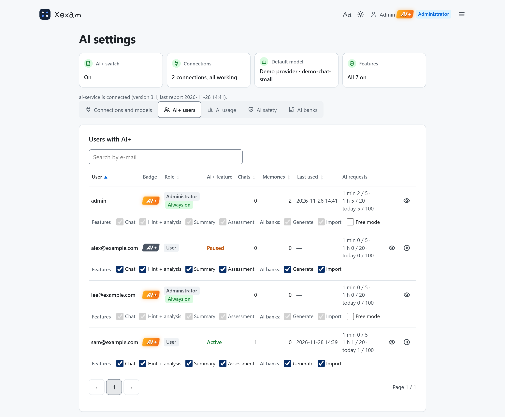</td>
<td width="50%">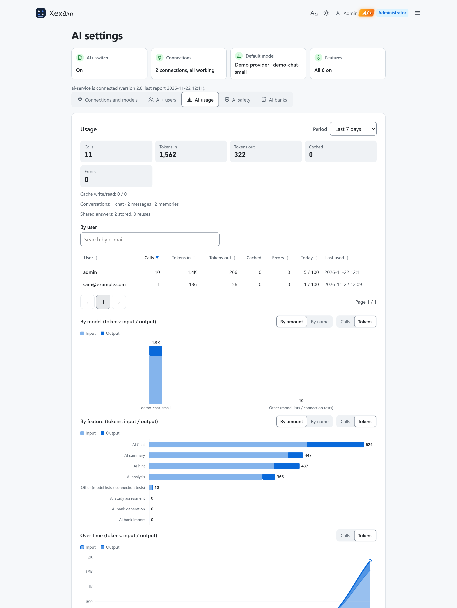</td>
</tr>
<tr>
<td>The <b>AI+ users</b> tab: under the status chip and the four tabs, every user with AI+ with the badge, the role, the <b>AI+ feature</b> (<b>Always on</b>, <b>Active</b> with Pause, <b>Paused</b> with Resume) and the AI requests of the last minute, hour and today against the limits. Every value in these images comes from a made-up provider.</td>
<td>The <b>AI usage</b> tab: the totals of the last 7 days, the conversations, then <b>By user</b> (with <b>Today</b> against the day limit), <b>By model</b>, <b>By feature</b> and <b>Over time</b>.</td>
</tr>
</table>

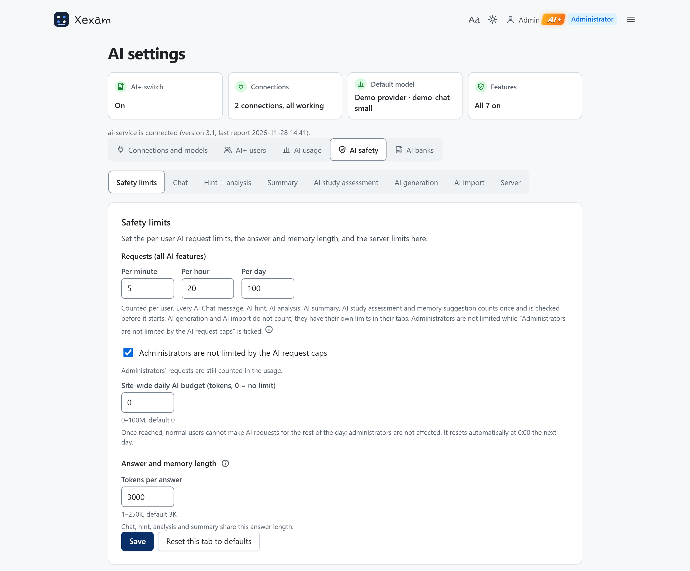

**Setting up AI, step by step**: check that **AI settings** says **ai-service is connected**; on **Connections and models** add a connection (**+ Add connection**: type, address, key) and press **Test and save**; choose the **Default model** from its list (it is tested when picked); press **Test and turn on AI+**; if you like, set the model slots and the **Feature switches**; then turn on the **AI+ feature** for the users who may use it, in **User management** (the switch appears once the steps above are done), and pause or resume a user's **AI+ feature** here under **Users with AI+**. Administrators who want to talk to the model directly turn on the **Free mode** switch of their row under **AI+ users** (section 17.6). Where ai-service runs, how it reaches the provider and what each provider needs: section 3.4 of [deployment.md](deployment.md).

### 17.5 AI banks tab

*(v1.6)* Generation and import ask the provider for structured output where it supports it and fall back to a plain request where it does not. A question names its correct options once, as letters; the program sets the option flags. The token budget of a plan call is the smaller of 22 000 and 6 200 + 90 × questions (20 questions: 8 000) and the global plan has 8 000, so a model that thinks first still has room to answer; the questions per call shrink only when an answer was really cut. *(v1.7)* A slip such as a missing `"options":[` key is repaired, and an answer that still does not parse as a whole is read question by question: the readable questions are kept and only the broken one is written again.

The **AI banks** tab sets the limits of generation and import, in two cards: **AI question generation** (quota, source, per generation, calls) and **AI file import** (file, calls). **Recent AI bank jobs** follows them and pages like the **AI users** tab: a search box, sortable columns, 10 jobs per page, up to 200 jobs. Each row shows time, user, source, new bank, state, questions and calls / tokens (on a phone each job is a compact card); opening a job shows a details block with kind, source, mode, made / goal, calls, tokens, cached tokens, times, state / reason and the bank made. Changing the limits never switches AI off, and nothing already made is changed.

| Setting | Default | What it does |
|---|---|---|
| AI bank jobs per user per day | 3 | Generation and file import together; reset at 0:00 of the server time. Administrators are exempt when the switch is on. |
| Unlimited (generation) | on | No call ceiling, no limit on the answer length per call and no deadline for a generation. Provider errors in a row (6 that may pass by waiting, such as overloaded or rate limited, or 3 others, a timeout included) and Cancel still stop a job. |
| Most AI calls per generation | 15 | Used when Unlimited is off (8 to 40). Applies to everyone, administrators included. |
| Tokens per call | 20000 | The most tokens one call may write (1000 to 250000); the questions per call follow from it. Greyed out while an Unlimited switch is on. |
| Unlimited (import) | on | The same for file import, recognition included. |
| Most AI calls per import | 25 | Used when Unlimited is off (8 to 40), recognition included. |
| Calls per recognition | 20 | Used when Unlimited is off: the most AI calls the reading of one file may make before the confirm step (8 to 40). |
| Largest file | 20 MB | The size limit of the AI import card. |
| Questions per import, at most | 100 | The most questions one import takes from a file that already holds questions (1 to 300). A file with more takes the first ones. |

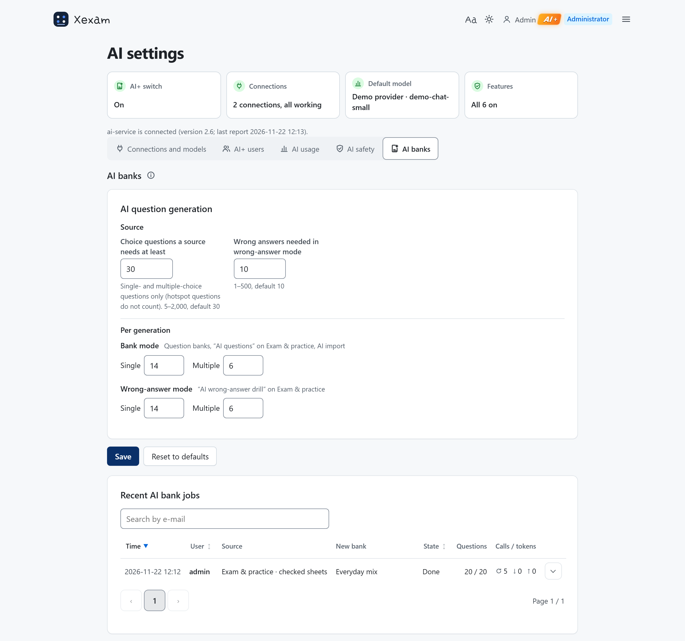

### 17.6 Feature permissions

In **AI+ users**, each user row has six checkboxes: **Chat**, **Hint + analysis** (one box for AI hint and AI analysis: the two are switched together), **Summary**, **Assessment** (the AI study assessment of Home, v2.6; on for everyone after the upgrade), **AI generation** and **AI import**. An unticked feature is greyed out for that user with the reason **You do not have permission to use this feature.** Administrator rows have all six ticked and locked, and a **Free mode** switch (it used to be in Settings). Pausing a user still wins over every checkbox. A user's name stays on one line; a long one ends with "…" and the full name is in its tooltip (v2.4).

### 17.7 AI usage charts

**AI usage** shows three charts: **By model**, **By feature** and **Over time**. The titles say what is drawn, for example **By model (calls: times)** or **By model (tokens: input / output)**. All three have a switch at the top right, **Calls | Tokens** (Tokens is the default; since v1.6 your choice is remembered per user in this browser): in Tokens mode each bar is the input and the output tokens stacked, with the total on top, and **Over time** shows the input and output as stacked areas under the total line, with a small legend. Every bar has its number; a bar **Other (model list and connection tests)** makes the bars add up to the total. Every token count in the tables, charts, job cards and safety hints is shown compact: plain digits below 1 000, then K, M, B and T (for example 999, 12.3K, 4.5M, 3.4B, 1.2T), one decimal at most; the exact number is in the hover / long-press tip and is read out by screen readers. Call, error and question counts stay exact, and so do the totals at the top, with thousands separators. The usage period (12 hours, today, 7 / 30 / 90 / 365 days) is remembered in this browser. A tip (hover, tap or the arrow keys) gives the exact calls, tokens and errors. **Over time** is a line per day, or per month for a long period, with a wide area around each point for hover and tap. No label is ever slanted: on a phone, **By feature** and **By model** are horizontal bar charts (the name on the left, shortened with … only when it is very long, and the value at the end of the bar), and the dates of **Over time** are short and horizontal (MM-DD, or YYYY-MM for months), thinned out so they never overlap. Each chart has its figures as a text table for screen readers. Each of the **By model** and **By feature** charts also has a small **By amount | By name** control next to the switch: **By amount** (the default) puts the biggest bar first, **By name** lists digits first, then Latin letters (by first letter, case-insensitive), then Chinese and Japanese, with **Other** always last; the choice is remembered per chart in this browser, and **Over time** always stays in date order.

### 17.8 Connections, models and switches (v1.3)

- **Connections and models** tab: four cards (AI+ switch, connections, default model, features) summarise the state. A **connection** is a provider address with its keys, up to 8; **Test and save** checks it first and saves nothing when the test fails (a failed key change keeps the old key). Changing the address of a saved key asks you to type the new host name (any address is allowed). **Models**: pick the **default model** (tested when picked) and, optionally, a model for chat, hint and analysis, summary, generation and import; an empty slot uses the default. Changing a slot never switches AI+ off. If the default model cannot be used, a warning says so and nothing is switched. A test takes at most 90 seconds. Each slot row has two pickers: the connection on the left (first entry **Follow the default model**) and that connection's models on the right; changing the connection only fills the model list, and the slot switches (after the test) when you pick a model.
- **Feature switches**: one switch in every model row except **Default** (section 17.10). Off is off for everyone, administrators included. The per-user boxes are on the **AI+ users** tab.
- **AI safety** tab: the request limits with the box **Administrators are not limited by the AI request caps** (ticked), the daily token budget (0 = off), the summary items, sharing of hints and analyses (on / off, days to keep, **Clear shared answers**), and the AI question and import limits (a generation up to 300 questions, an import up to 300 per file, default 100; the number of parts a big source may use).
- **AI usage** tab: by model, with the shared answers and the daily budget.
- **Shared hints and analyses** (everyone with AI+): a hint or analysis that someone already received is shown at once, with a short note that it is shared, without using any request. **Regenerate** asks again and replaces it for everyone.
- **AI questions**: the card lists each question as it is written (tap one to see the options and the explanation), and while the job runs a placeholder bank **generating 8 / 20** shows on Exam & practice and in Bank management.

### 17.9 Thinking strength per connection (v1.6, changed in v2.1)

**Since v2.1 the family belongs to the connection.** In the connection form, **Thinking-strength parameter** offers four families, each shown with its parameter: **Anthropic** (`output_config.effort`), **OpenAI** (`reasoning_effort`), **Google** (`thinking_level`, sent as `extra_body.google.thinking_config.thinking_level`) and **Responses API** (`reasoning.effort`). Until you choose one by hand it follows the format (Anthropic, Responses API, otherwise OpenAI; an address with `generativelanguage`, `google` or `gemini` gives Google). One connection is one family: for a gateway that serves several vendors, add one connection per vendor (same address). The connection cards show the family icon and name.

On the **Connections and models** tab, every model row (default, chat, hint, analysis, summary, generation, import) has a **Thinking strength** line: the family icon of the connection the row uses (hover or touch-and-hold shows the parameter) and a level list. A change is saved at once, needs no connection test and never switches AI+ off.

- **Default sends nothing.** The first entry of every strength list is **Default (no strength parameter is sent)**: the provider uses its own default. A row you never touched is Default too (v2.1 sent the model's default level here). Choosing a level sends its parameter; a stored level that does not belong to the row's connection family (for example after you changed the family) sends nothing either. The list shows the levels of the connection's family only.
- Levels (always shown in English, exactly as sent):

  | Family | Parameter | Levels |
  |---|---|---|
  | **Anthropic** | `output_config.effort` | low, medium, high, xhigh, max |
  | **OpenAI** | `reasoning_effort` | low, medium, high, xhigh, max |
  | **Google** | `thinking_level` | MINIMAL, LOW, MEDIUM, HIGH, XHIGH |
  | **Responses API** | `reasoning.effort` | none, minimal, low, medium, high, xhigh, max |

- **Master switch**: while AI+ is off, every model row, the default row included, is greyed and cannot be operated: feature switches show off, the pickers and level lists are disabled. Stored choices are untouched and return when AI+ is on. The first enabling still goes through the step-2 box.
- **A refusal is not an error.** When a provider answers a request that carries the parameter with HTTP 400 or 422, the request is sent once more without it, and that connection and model are remembered as not supporting it until ai-service restarts or you change a setting. Other models of the same connection keep sending it.
- **AI Chat** (administrators in free mode): the brain button picks **API**, then **Model**; strength has its own button beside it (**Default**, the family's levels, **Follow AI settings (now: …)**). The strength is stored per chat.
- Every change is written to the activity log (`ai.settings.effort`: the slot, the family and the level).
- Thinking uses output tokens: a higher level can lengthen answers and the time they take, and a very long thought can reach **Tokens per answer** (section 17, item 7) before the answer starts. AI generation and AI import leave room for it (section 17.5).

### 17.10 Connection switches, feature switches, safety sub-tabs and pacing (v1.9)

- **Connection on/off switch**: every connection row on **Connections and models** has a switch. **Off** keeps all the connection's settings, key and models, but it leaves every picker and all routing. A feature, the default model or a chat that points to an off connection keeps its choice and fails with **The AI connection this feature uses is not enabled. Ask an administrator.** (administrators see a version that says to turn it on in AI settings or choose another model); nothing falls back to another connection. The status chip reads **On · working** (green) or **Off** (grey). The list is two groups, **Enabled connections (n)** and **Connections not enabled (n)**; both are collapsed at first and stay as you left them for the browser session. Turning a connection off asks first (**Turn off …?**) and lists the features that use it; turning it on needs no question. **Test** still works on an off connection. Switching never cancels a running call.
- **One switch per feature**: the separate feature-switch card is gone. Every model row except **Default** has its own switch, labelled with the feature: **Chat**, **Hint**, **Analysis**, **Summary**, **AI study assessment** (since v2.6), **Generate** and **Import**. Off means off for everyone, **administrators included** (**Off for everyone, administrators included. The model choice is kept.**); the row's pickers are greyed and the chosen model stays. **Hint** and **Analysis** are separate rows with separate models (Analysis also serves result and record analysis); on upgrade both start with the old study model and thinking strength. The per-user boxes on the **AI+ users** tab are unchanged (hint and analysis stay one box) and never limit administrators.
- **Thinking strength**: four family buttons, **Anthropic**, **OpenAI**, **Google** and **Responses API**, plus **Default**. The **Gemma** button is gone: for Gemma 4 on Google AI Studio use **Google** with `HIGH` (thinks) or `MINIMAL` (thinking off); a stored Gemma choice was converted to that on the upgrade, with the same request.
- **AI safety sub-tabs**: the **AI safety** tab has eight sub-tabs, **Limits**, **Chat**, **Hints and analysis**, **Summary**, **AI study assessment** (v2.6), **AI generation**, **AI import** and **Server** (on a phone short names such as **Hints**, **Assess**, **Generate**). Each holds the limits of its feature; **AI study assessment** holds **Assessments per user per day** (default 3, 0 to 50; only successful assessments count, a failed or stopped one does not; 0 = no assessments, except for administrators while they are exempt; the count starts again at 0:00 in the server's time zone) and **Administrators are not limited** (ticked by default); **Limits** holds the request caps (per minute, hour and day) and the daily token budget, and **Server** holds the concurrency protections and the provider pacing below. The sub-tab is part of the address (`#/ai-settings?tab=safety&sub=<name>`, so a link opens it); opening the tab without one returns to the sub-tab you used last in this browser session, or **Limits**. **Save** sends every changed value of the whole form, whichever sub-tab it is on; **Reset** resets only the sub-tab you see (the button says so).
- **Provider rate-limit pacing** (**AI safety → Server**): AI generation and AI import send many calls, and a free tier allows only a few a minute. The switch **Send AI generation and import requests evenly within these limits** is on by default with **Requests per minute** 13 and **Tokens per minute (input + output)** 230 000. Enter your provider's own limit, shared by the whole site: it is used exactly as entered (no hidden margin since v2.1). Xexam spreads the requests evenly (13 a minute is one every 4.6 seconds) over a sliding 60 seconds, estimates each call's tokens before it is sent, and runs fewer calls at once when needed. Only AI generation and AI import queue under it: they wait and never fail; chat, hint, analysis and summary are not paced. One setting for all connections; the **Unlimited** switches of generation and import do not affect it. A line under the fields shows the pace (one request every 60 / requests-per-minute seconds). When the provider still answers "rate limit" (HTTP 429), the job waits the time the provider names and tries again (up to 10 times per call; not an error, also with pacing off). A **daily** quota stops the job: **The AI provider's daily quota is used up, so the job stopped. Try again tomorrow or ask an administrator to change the model.** (no quota is charged). While a job waits 8 seconds or more its card says **Waiting for the provider's quota…**. A limited (not unlimited) job counts the waiting toward its 30-minute deadline.

## 18. On an iPhone

- Open the service address in Safari on your iPhone (first follow section 4 of [deployment.md](deployment.md) so the phone can reach Xexam). It needs **iOS 15.4 or later**.
- Tap the Share button → **Add to Home Screen**. After that it opens full-screen like a standalone app, with the Xexam icon: four dots and a light-blue bar on a navy square.
- The three-line button at the top right opens the same small menu as on a computer. The **Aa** button (hand-written or normal text) and the sun / moon sit left of the account.
- Home is one column (v2.6): the greeting, the **Exam & practice** tile, the small tiles three to a row (two by two when there are four), the leaderboard, Most missed and, last, the folded AI study assessment card. A tap on a place of a board shows its line or question under the board.
- On Exam & practice, **All** and **Wrong answers** stay next to the **Exam or practice** title (in English and Japanese with only their icon and number). The bar at the bottom of the screen has two rows: the scope, **Count** and **Shuffle** on the first; **Start exam** and **Start practice** (the same width) on the second.
- On the exam and practice page, the bar stays at the bottom: **Previous**, **Next** and the flag for **Revisit** as icons. In a practice, **Check answer** and **Next** are two buttons side by side, in fixed places, and the AI icons sit on the same bar for AI+ users. The top row shows **Done x/n** and the green **Finish exam** (or orange **Finish practice**) button, always with its text; the answer sheet below the question has no finish button.
- Study records are shown as compact cards; with the **AI+ feature** each card has its **AI summary** button.
- With the **AI+ feature**, the AI+ panel sits under the question card. It is closed at first; **AI hint** or **AI analysis** in the bar opens it, and its chevron closes it. Its buttons keep fixed places, and a text in the panel says **Saved in AI Chat** when the answer is saved (a tap shows the name of the chat). Greyed-out controls (AI paused or unavailable) stay in place and a tap on one shows why it cannot be used. The **AI summary** opens a window over most of the page.
- **AI Chat** opens a new chat; the history is in a drawer that slides in from the left (the **All chats** button, a two-line menu icon). The header is one row, and the message box stays at the bottom of the screen, right above the keyboard.
- Buttons and other touch targets are at least 44 px; the safe areas for the notch and the bottom bar are handled.

Screenshots on an iPhone (390 px wide):

<table>
<tr>
<td width="25%">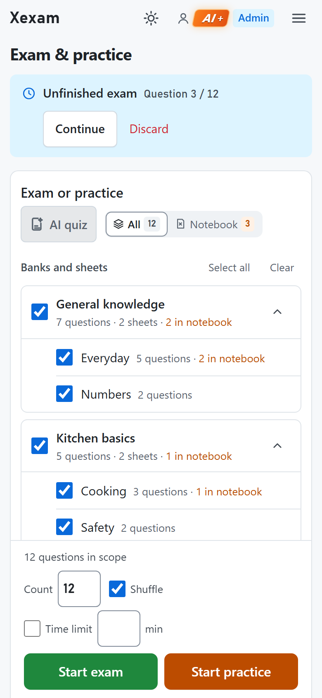</td>
<td width="25%">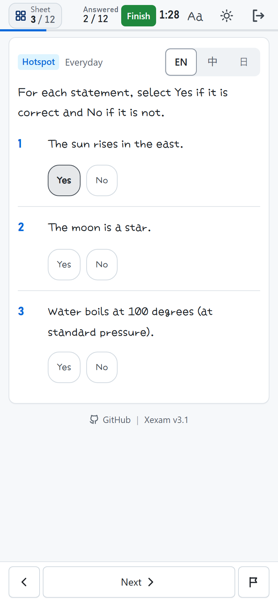</td>
<td width="25%">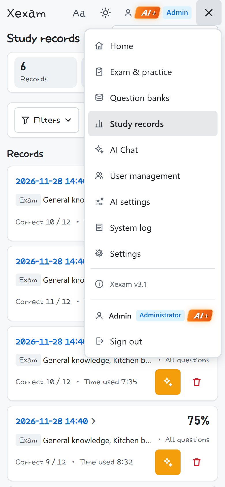</td>
<td width="25%">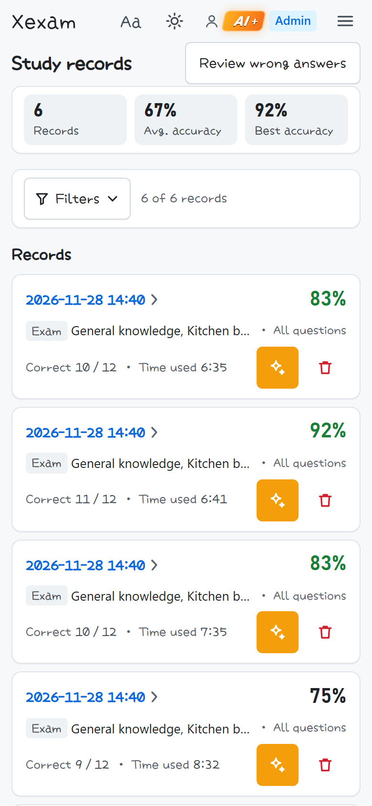</td>
</tr>
<tr>
<td>Exam & practice: the scope, <b>Count</b> and <b>Shuffle</b>, with <b>Start exam</b> and <b>Start practice</b> below them, at the bottom of the screen.</td>
<td>Exam: <b>Previous</b>, <b>Next</b> and <b>Revisit</b> stay at the bottom.</td>
<td>The menu of an administrator, opened from the three-line button.</td>
<td>Study records: each record is a compact card.</td>
</tr>
</table>

<table>
<tr>
<td width="33%">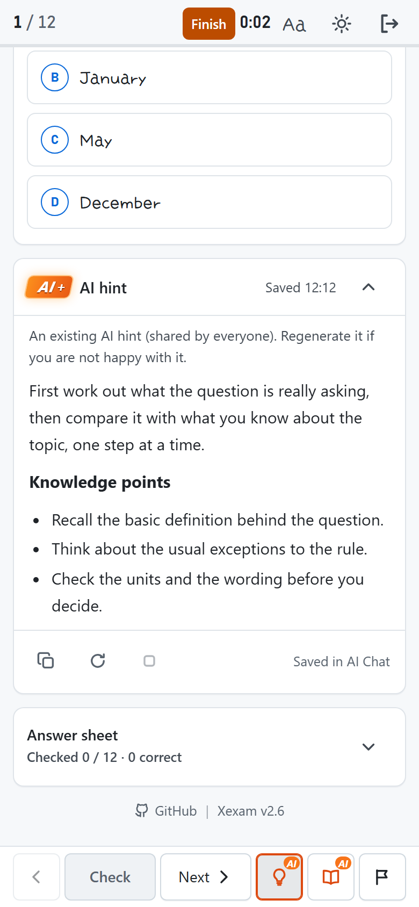</td>
<td width="33%">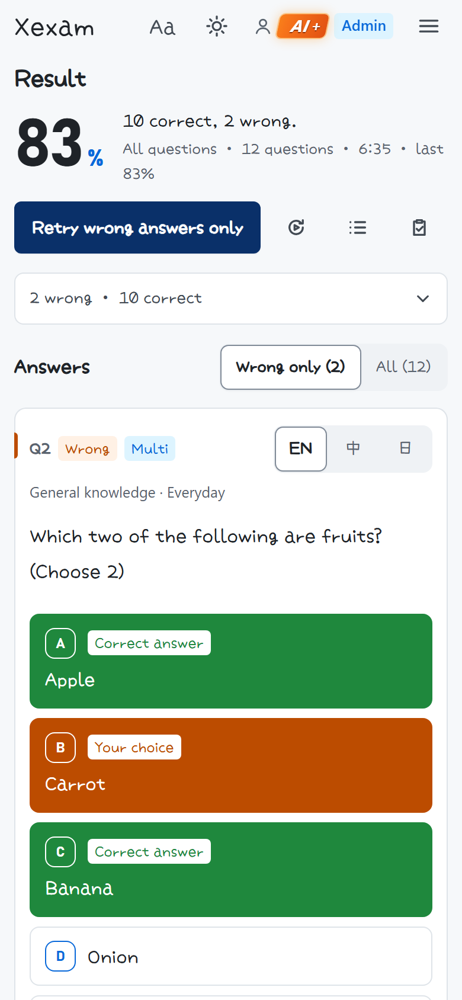</td>
<td width="33%">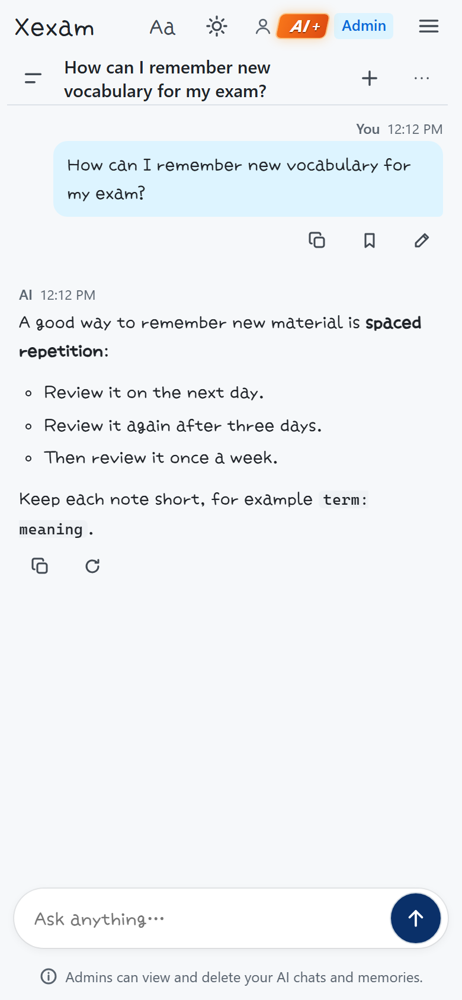</td>
</tr>
<tr>
<td>Practice with the <b>AI+ feature</b>: the AI+ panel open under the question on the AI hint; the bar keeps its places.</td>
<td>Exam result: the compact score, the folded strip and the cards, each with its AI+ bar.</td>
<td>AI Chat: one conversation over the full height, the message box at the bottom.</td>
</tr>
</table>

<table>
<tr>
<td width="33%">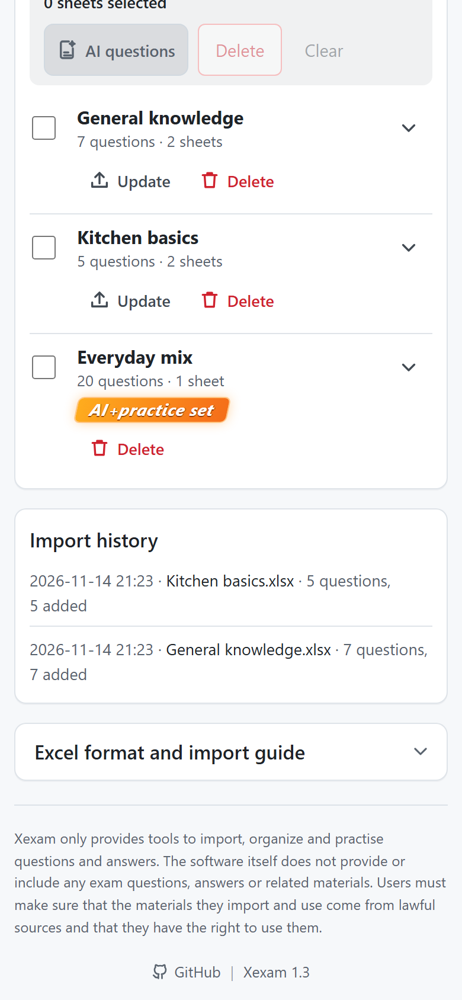</td>
<td>Bank management: each bank's actions sit on their own line under the name, and an AI bank shows its AI+ badge on its own line.</td>
</tr>
</table>

## 19. When a page says "Too many requests"

Xexam's Nginx limits how many requests reach the backend per second from one address (section 9 of [security.md](security.md)). Behind a tunnel such as Cloudflare Tunnel every user arrives from the tunnel's address, so all of them share that limit. When it is reached, the page retries what it was reading by itself (three tries in all, a second or two apart); a save or any other change is not retried. If the request is still refused, the page says **Too many requests**: wait a few seconds, then reload the page or try again. This is different from the sign-in lock after wrong passwords, which says how long to wait.

AI Chat has a limit of its own in Nginx: starting answers (**Send** and **Retry** in AI Chat, and **AI hint**, **AI analysis**, **AI summary** and their **Regenerate**) is limited per signed-in browser, to 20 a minute after a burst of 10, all together. A refused start is not retried; the message box keeps your text and says that there were too many requests, and an AI window says **Too many requests in a short time. Wait a few seconds, then try again.** This can happen when you open AI analysis on one card after another on a long result page; wait a few seconds. Separately, every AI request counts toward the per-user limits of [section 17](#17-ai-settings) (per minute, per hour and per day); when one is used up, the message names it and says when AI is available again, and nothing is sent.
