**English** | [日本語](../ja/usage.md) | [简体中文](../zh-CN/usage.md)

# Using Xexam

> How to use Xexam in the browser: exams and practice, study records, settings, the question banks and their Excel format, users and the System log, the AI help in practice and results, AI Chat and AI settings. Installing, updating and configuring Xexam are in the [README](../../README.md) and in [deployment.md](deployment.md).
>
> The screenshots use two **made-up demo banks**, "General knowledge" and "Kitchen basics", not content from any real exam. Both are six-column workbooks, so every question, answer and explanation exists in English, Chinese and Japanese. The screenshots show the English interface; those of the Japanese and the Chinese interface are in `docs/ja/screenshots/` and `docs/zh-CN/screenshots/`.

## Contents

- [1. Your first exam](#1-your-first-exam)
- [2. The layout](#2-the-layout)
- [3. Home](#3-home)
- [4. The exam page](#4-the-exam-page)
- [5. Practice](#5-practice)
- [6. The result page](#6-the-result-page)
- [7. Study records](#7-study-records)
- [8. Wrong-answer notebook](#8-wrong-answer-notebook)
- [9. Settings](#9-settings)
- [10. About Xexam](#10-about-xexam)
- [11. Question banks](#11-question-banks)
- [12. Excel question bank format](#12-excel-question-bank-format)
- [13. Importing question banks](#13-importing-question-banks)
- [14. Users and sign-in](#14-users-and-sign-in)
- [15. System log](#15-system-log)
- [16. AI Chat](#16-ai-chat)
- [17. AI settings](#17-ai-settings)
- [18. On an iPhone](#18-on-an-iphone)
- [19. When a page says "Too many requests"](#19-when-a-page-says-too-many-requests)

## 1. Your first exam

1. Open the menu (the three-line button at the top right) and choose **Question banks** (administrators and bank managers see it). Under **Import Excel**, leave **New bank** selected, click **Choose Excel file** and pick your workbook (in the six-column layout, see [section 12](#12-excel-question-bank-format)). Check the preview, then click **Create the question bank**.
2. Click **Start an exam** in the message that confirms the import (or choose **Home** in the menu). In the **Start an exam or practice** panel every sheet is ticked at first: untick the ones you do not want, then click **Start exam** in the bar at the bottom of the panel (**Count** and **Shuffle** in the same bar set how many questions are asked and in which order). **Start practice** next to it starts a [practice](#5-practice) with the same questions instead.
3. Answer the questions, then click **Submit**. The result page shows the score and, for each wrong question, the correct answer and the explanation (**All questions (n)** shows every question).
4. To see the exam again later: open the menu, choose **Study records** and click the time of the exam.

A new bank is visible to you and to the administrators, and to every user who has **Include banks imported later**. An administrator gives it to other users in [User management](#14-users-and-sign-in).

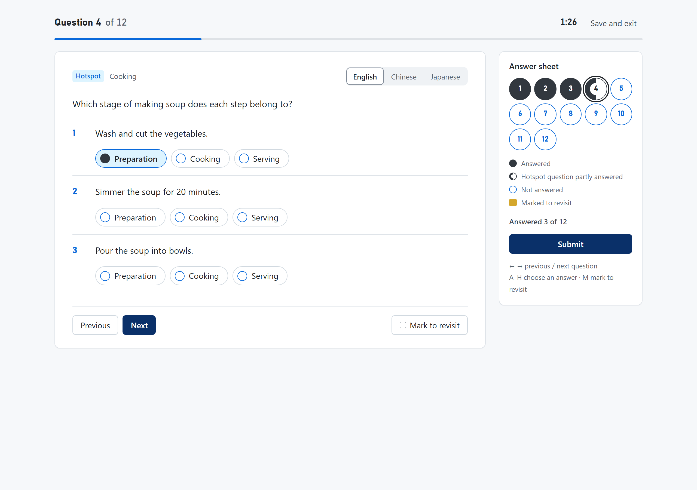

## 2. The layout

- Every page except the exam has a slim header: the Xexam logo at the top left (it takes you to Home); at the top right your username (administrators with an **Administrator** tag, **Admin** on a phone), the **AI+** badge (orange when you can use AI now, dark when you have the AI+ feature but cannot use it right now; see [section 14](#14-users-and-sign-in)), and the three-line menu button.
- The menu shows only the pages of your role:
  - **Home**, **Study records** and **Settings** for everyone;
  - **Question banks** for administrators and bank managers;
  - **AI Chat** for everyone who can use AI now, or who still has AI chats or memories to read (see [section 16](#16-ai-chat));
  - **User management**, **AI settings** and **System log** for administrators.
- Under a divider follow the version entry (for example **Xexam v0.7.5**), which opens the [About page](#10-about-xexam), then your username with your role (**Administrator** or **User**, plus **Bank manager**) and **Sign out**.
- The menu closes after a choice, a click outside it or the Escape key.
- On wide screens the page content is centered and at most 1120 px wide.
- The exam and the practice are focused full-screen pages without the header.
- Opening **Question banks**, **AI settings** or **System log** without the permission shows **Not allowed** with **Back to Home**; **User management** sends everyone but administrators to Home.
- Everything that deletes asks first, in a dialog that says what goes and that it cannot be undone; its confirm button is solid red. **Delete** buttons are red, or turn red when you point at them.

## 3. Home

Before there is anything to practise, the **Start an exam or practice** panel shows a short note instead:

- an administrator, or a bank manager without any bank, gets **Go to Question banks**;
- a user who has not been given a question bank yet reads: “No question bank has been made available to you yet. Ask an administrator to give you access to one; it appears here as soon as they do.”
- when the banks have no active questions (every question has been retired, for example because it came from an older Excel layout), an administrator is asked to update them with a six-column file; a bank manager reads that they can update their own banks with a six-column Excel file or import a new one, and ask an administrator to update the others, with **Go to Question banks**; any other user is asked to turn to an administrator.

After that, Home has:

- **Unfinished exam** or **Unfinished practice**: a compact banner at the top for what you left with **Save and exit**: its title with **Saved in this browser only**, then its question banks, how many questions are answered (in a practice: checked) and the time used. **Continue** picks it up where you stopped; **Discard** throws it away. Your other devices do not see it. Starting something new while one is saved asks first.
- **Start an exam or practice**:
  - In the top-right corner of the panel you choose where the questions come from: **All** (every question in the selected sheets) or **Wrong answers** (only the questions you still need to review). Each shows its number of questions. When the notebook has nothing to review in the selected sheets, **Wrong answers** cannot be chosen and one line under the title says why; while **Wrong answers** is chosen, that line says how a question leaves the notebook. On a phone the two buttons stay next to the title; in English and Japanese they show only their icon and number, in Chinese they keep their short words.
  - **Banks and sheets**: each bank is one card with its sheets as rows inside.
    - **Select all** and **Clear** are on the right of the heading row.
    - The bank's checkbox selects or clears all its sheets, and you can also tick single sheets. While only some are selected, the checkbox shows − and the card says, for example, **1 of 2 sheets selected** (also while the bank is folded).
    - The arrow button on the right of a bank's row folds or unfolds its sheets. With at most two banks they start unfolded, with more they start folded; your choice is kept until you reload the page.
    - A badge such as **2 to review** shows how many notebook questions a bank or sheet has.
  - The bar at the bottom of the panel: **Start exam** (green) and **Start practice** (orange), the scope (for example **12 questions in scope**, or **11 of 12 in scope, picked at random**) and two options, **Count** (the number of questions) and **Shuffle** (the question order). Both buttons use the same scope. The bar stays at the bottom of the screen while the panel is in view.
  - **Count**: when it is smaller than the scope, the questions are picked at random from the whole scope. **Shuffle** only decides whether they are asked in random order or in bank order.
- **Latest result**: the score of your latest exam or practice with its **Exam** / **Practice** tag, **View details**, **AI summary** (only with the **AI+ feature**, [section 7.1](#71-ai-summary)) and **All study records**, in that order.
- **Overview**: how many question banks, usable sheets, active questions and notebook questions you have, with **Review wrong answers** (when the notebook has questions) and, for administrators and bank managers, **Question banks**.

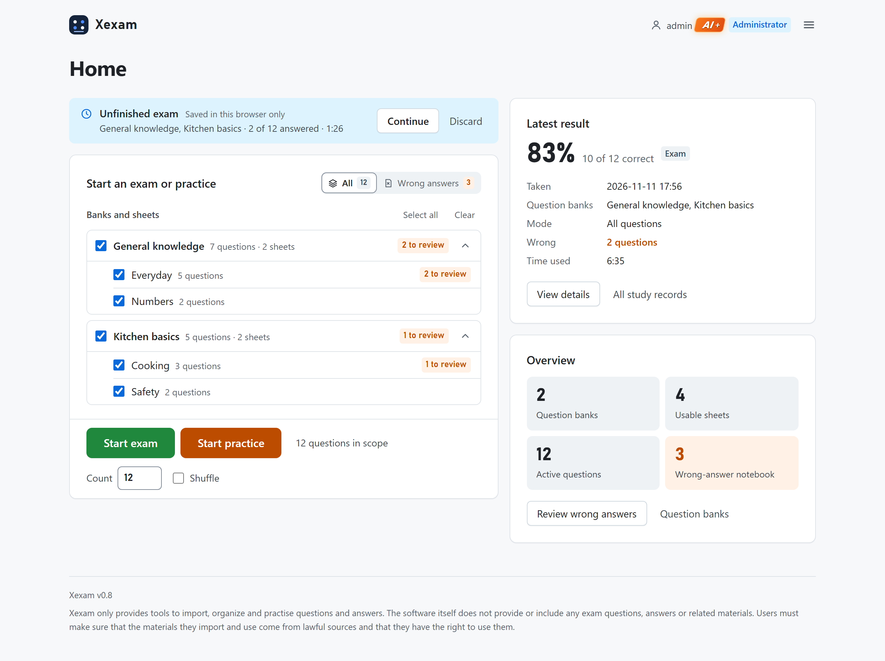

The unfinished exam as a compact banner; **All** and **Wrong answers** in the corner of **Start an exam or practice**; **Select all** and **Clear** on the row of **Banks and sheets**; the two demo banks as unfolded cards with their sheets; the bar with the green **Start exam**, the orange **Start practice**, the scope, **Count** and **Shuffle**; on the right, the latest result and the overview.

## 4. The exam page

The screenshot in [section 1](#1-your-first-exam) shows it.

- At the top: **Question 4 of 12** (for example), the time used, and **Save and exit**, which keeps your answers and the time used so you can continue later from Home in the same browser.
- **No right/wrong feedback and no score while you answer.**
- **English** / **中文** / **日本語** switches the question text. Switching changes only the text: your answers, the option letters, the timer and the grading stay the same. The option buttons of hotspot questions switch too.
  - English is the base language of every question: it is always there. Chinese and Japanese are there when the workbook has them.
  - A language that a question does not have, or whose text does not line up with the English one (other options or items), is greyed out for that question; tapping it says why.
  - Your choice is saved as a setting and is also where the answers and explanations start after you submit.
- **Previous** and **Next** move between questions (on the last question, **Next** becomes **Submit**). **Mark to revisit** marks a question you want to come back to.
- **Answer sheet**: one tile per question. Solid = answered, half-filled = a hotspot question partly answered, hollow = not answered, small yellow square = marked to revisit. Click a tile to jump there. Below the tiles: **Answered 3 of 12** and **Submit**.
- **Submit** asks for confirmation; unanswered questions count as wrong.
- Grading: a single-choice or multiple-choice question is correct only when you chose exactly the correct options; a hotspot question is correct only when every item is right.
- Keyboard (desktop): `←` `→` previous / next question, `A`–`H` choose an answer (choice questions), `M` mark to revisit.
- **No AI help while an exam runs**, for anybody: the exam page has none of the AI buttons or icons of [section 5.1](#51-ai-hint-and-ai-explanation). An exam gets AI only after you have submitted it, on its [result page](#61-ai-analysis) and in its study record.

## 5. Practice

A practice uses the same page as the exam, but checks every answer right away. Start it with **Start practice** on Home, next to **Start exam** and with the same banks, sheets, **Count** and **Shuffle**.

- A **Practice** tag sits next to **Question 4 of 12**.
- **How an answer is checked**:
  - a single-choice question is checked as soon as you pick an option;
  - a multiple-choice or hotspot question has **Check answer**, which works once something is chosen. For a hotspot question one item is enough; items left open count as wrong.
- **After checking**, the question is locked and shows:
  - **Correct** or **Wrong**;
  - the options marked as in the answers and explanations: the correct ones solid green, a wrongly chosen one solid orange;
  - your answer and the correct answer;
  - the explanation and the memory aid, in the language of the page's **English** / **中文** / **日本語** switch.
- Auto-advance never applies in a practice: you move on with **Next**.
- The answer sheet fills checked questions green (correct) or orange (wrong), and says, for example, **Checked 4 of 12 · 3 correct**.
- **Finish practice** (below the answer sheet, and on the last question) asks only when some questions are not checked yet. Those count as not answered (wrong), even when an answer is chosen.
- **Save and exit** works as in an exam; Home then shows **Unfinished practice** with how many questions are checked.
- A finished practice opens the **Practice result** page, is saved in **Study records** as a **Practice** record, and counts in the wrong-answer notebook like an exam.

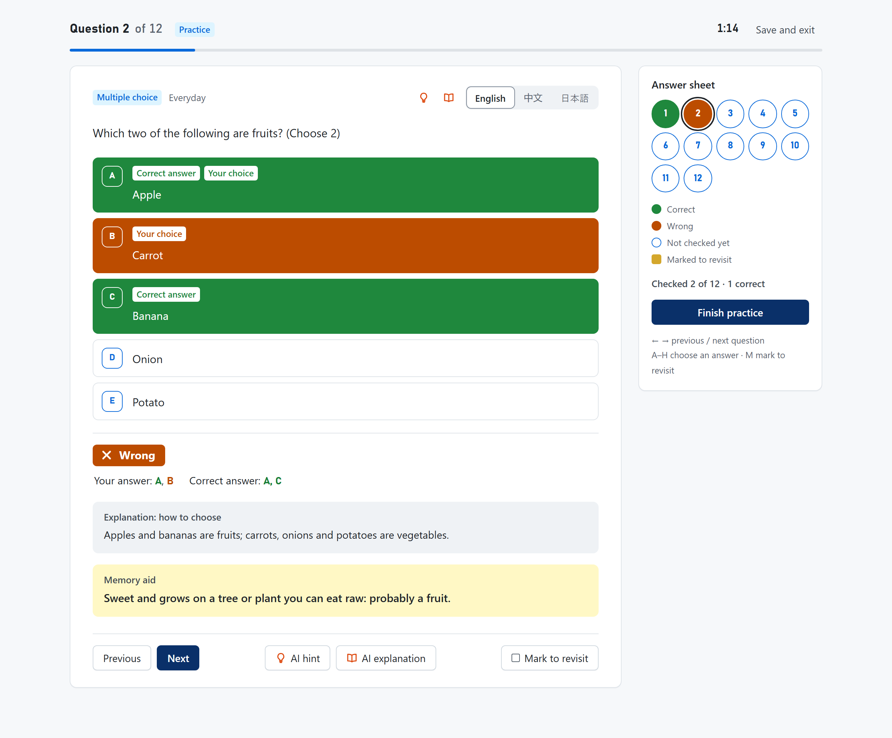

A multiple-choice question after **Check answer**: the **Practice** tag, the verdict **Wrong**, the wrongly chosen option in solid orange, the correct options in solid green, then the explanation and the memory aid.

### 5.1 AI hint and AI explanation

Users with the **AI+ feature** can ask an AI model for help on any question of a practice. Everybody else sees the page exactly as described above.

**Who sees the controls.** Only accounts that have the AI+ feature: the orange **AI+** badge next to the name, and administrators while the AI+ feature is on in [AI settings](#17-ai-settings). A user who has the feature but cannot use AI right now (an administrator paused it, the AI+ feature is switched off in AI settings, or ai-service is not connected) still sees the controls, greyed out and tagged **Unavailable**. A tooltip says why (on a touch screen a tap shows it as a message): **AI hint: unavailable. The AI+ feature was paused by an administrator.**, or **… AI is not available right now. Try again later or ask an administrator.**; while Xexam is still checking, it says **Checking whether AI is available…**. The server refuses these requests too. If an administrator takes the AI+ feature away while you are practising, the controls disappear the next time a request is refused.

**Where they are.** Each question has two buttons in the action bar, **AI hint** and **AI explanation**, between **Next** and **Mark to revisit**, and the same two as a light-bulb icon (hint) and a book icon (explanation) in the card header, left of the **English** / **中文** / **日本語** switch. A button and its icon do exactly the same thing. On a phone the action bar stays at two rows: the buttons read **Hint** and **Explain**, and on very narrow screens show only their icon (their name is still read out by a screen reader). When the header holds more than fits, the language switch drops onto its own line instead of widening the page.

- **AI hint** says how to approach the question and lists the knowledge points behind it, **without telling you the answer**: the request to the model contains the question and its options, never the answer, and the model is told not to point at, rule out or quote any option. If a hint gives the answer away anyway, Xexam hides it, shows **This hint gave the answer away, so it was hidden. Regenerate to get a new hint.** and does not keep it. That check is a safeguard that catches most, not every, way of putting it, and it can also hide a harmless hint; press **Regenerate** to get another.
- **AI explanation** answers the question: the correct answer first (in bold), the knowledge the question tests, why it is right and why each other option is wrong. It uses the question bank's own answer and explanation, so it is only as right as the bank.

**The window.** The answer streams into a small window next to the button (a full-width one on a phone), titled for example **AI hint · Question 3**. A line says what is happening (**Writing…**, **Thinking…** while a reasoning model is still thinking, then **Saved 03:04 PM**). The buttons are **Copy**, **Regenerate** (**Stop** while it is being written) and **Open in AI Chat**. It closes with **Close**, **Esc**, a click outside it or when you move to another question; **Tab** leaves it and returns to the button you came from. The answer is shown with the same simple formatting as AI Chat.


**Saved answers.** Every answer is saved. Pressing the same button (or icon) for the same question again shows the saved answer at once and asks the model nothing. **Regenerate** writes a new one and shows it instead; a new answer that fails, is stopped or is hidden leaves the previous one in place and says so. The hint and the explanation of a question are saved separately. When you **Save and exit** and **Continue** later, the practice keeps its saved answers and its chat. A regenerate always goes to the model as a new request (a numbered note is added to its end, saved nowhere and shown nowhere), so an AI gateway that caches responses cannot hand back its cached answer.

**Language.** The answer is written in the language chosen in **Settings**, whatever the question language; the question text sent to the model is the one the page shows (its **English** / **中文** / **日本語** switch). A saved answer in another language than your Settings says so (**This answer is in … Regenerate it to get it in the language of your settings.**).

**One answer at a time.** While an answer is being written, a request for another one does not start it. The window says which one is still running (**AI hint for question 3 is still being written.**, or that an AI summary or an answer in AI Chat is) and offers **Show it** (only when it is a hint or explanation of this practice) and **Stop it and write this one**. Nothing is stopped by itself. By default each user may have one answer at a time ([section 17](#17-ai-settings)).

**In AI Chat.** Each practice has one chat, `<start time>-Practice`, that holds every hint and explanation of it, in order ([section 16.1](#161-chats-of-practices-exams-and-summaries)). What is sent to the AI provider is listed at the end of [section 16](#16-ai-chat).

## 6. The result page

The score, the number right and wrong, and a strip with one box per question (a green tick for a correct one). A practice shows **Practice result** as its title.

**Answers and explanations** shows **Wrong only (n)** or **All questions (n)**. Each question card shows:

- **Correct** or **Wrong**, and your choice and the correct answer: correct options solid green, a wrongly chosen option solid orange, each with its **Correct answer** / **Your choice** tag (hotspot statements sit on a neutral background; only their choices are coloured);
- the line **Your answer** / **Correct answer**: in a multiple-choice answer each letter of yours is green when it is one of the correct answers and orange when it is not, so a partly right answer shows both colours;
- its own **English** / **中文** / **日本語** switch. It starts at your question language and changes only that card: the question, the options, the explanation, the memory aid and the note. Languages the question does not have are greyed out;
- the explanation and the memory aid, in each language the workbook has them; if one language lacks them, another language's text is shown;
- how often you have answered the question so far.

If questions were deleted (with their bank) while you took the exam, a note says so: the score and the saved record cover only the other questions.

Buttons: **Retry wrong answers only**, **Take it again** (**Retake practice** after a practice), **View in study records** and **Back to home**. Retrying and retaking start the same kind as the result: an exam again as an exam, a practice as a practice.

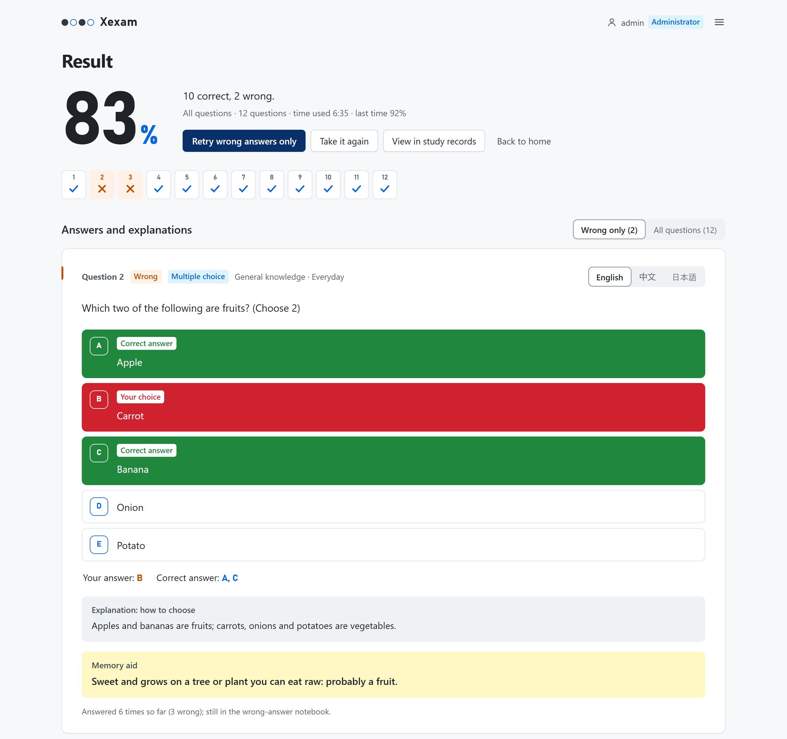

An exam with two wrong answers, **Wrong only** open: the score, then a choice question with the chosen option in solid orange and the correct ones in solid green, its own **English** / **中文** / **日本語** switch, and the explanation and the memory aid.

### 6.1 AI analysis

With the **AI+ feature**, every question card of a practice result and of an exam result has **AI analysis**: a button at the end of the **Your answer** / **Correct answer** line and a book icon in the card header, left of the card's language switch; both do the same thing. The same two controls are on every question of a study record's detail page ([section 7](#7-study-records)). Nothing of this appears on the exam page while an exam runs.

- **What it does**: the model explains the question like an **AI explanation** ([section 5.1](#51-ai-hint-and-ai-explanation): the correct answer, the knowledge tested, why it is right and why the others are wrong) and, because it is given your answer, says briefly what probably led you astray when you were wrong; for an unanswered question it notes that you did not answer.
- **As in section 5.1**: the window, the saved answers, **Regenerate**, the language of the reply, the one-answer-at-a-time rule and the greyed state work the same way; the window is titled **AI analysis · Question 3**. The question text sent follows the card's own language switch at the moment you ask, also for **Regenerate** after you switched the card to another language.
- **Which chat**: the answer is saved in the chat of the practice or exam it belongs to (`<start time>-Practice` or `<start time>-Exam`), together with what was written during the practice. Asking on the record's detail page later puts it in the same chat. A record made before v0.9 has no such chat; the first analysis on its detail page starts one, titled with the record's time (section 16.1).
- **Greyed out**: an exam result whose record could not be saved (**This result was not saved, so AI analysis is not available.**). A practice result that could not be saved still offers it.


## 7. Study records

- **Overview**: the number of records (**Records**, or **Exams** / **Practice sessions** when the type filter says so), **Average accuracy**, **Best accuracy** and small bars for the latest results.
- **Filters**: **Type** (**All types**, **Exams**, **Practice**), **Question bank**, a date range with **From** and **To**, and **Accuracy** (**Any accuracy**, **Below 60%**, **60–79%**, **80% and above**). **Clear filters** resets them.
- **Records**: one row per exam or practice (on a phone: one card) with its **Exam** / **Practice** tag, the time, the question banks, how many questions were answered, the time used, the number correct and the accuracy (green from 80 %, orange below 60 %). Click the time to open the record; **Delete** removes it. With the **AI+ feature** the table has a new first column with an **AI summary** button on every row ([section 7.1](#71-ai-summary)); a user whose AI is paused or unavailable sees the buttons greyed out, tagged **Unavailable**, and one line above the table says why.
- **Exam record** / **Practice record** (one record): the score and the facts (with **Type**), then every question with your answer, the correct answer, the explanation and the memory aid, each card with its own language switch. **Wrong only (n)** / **All questions (n)** switches between the wrong questions and all of them. **Retry wrong answers** starts the questions you got wrong; **Retake this exam** (**Retake this practice**) starts the same questions again, both as the same kind as the record; **Delete this record** removes it. Exams taken before v0.5 show only the score, because v0.4 did not store the answers. A retired question still shows in a record with its text and a **Retired** tag; only questions that are active now are retried or retaken. With the **AI+ feature** every question card has **AI analysis** ([section 6.1](#61-ai-analysis)), saved in the chat of that practice or exam.
- **Review wrong answers** (top right) opens **Wrong-answer review**: every active question in your wrong-answer notebook, with how often you answered it and how many more correct answers in a row take it out. You can narrow it to one question bank, and **Practise these** starts a practice with them.
- Deleting: deleting one record keeps the per-question statistics, so the wrong-answer notebook does not change, and it keeps the AI chats made for it (section 16.1). **Delete all** deletes every record (exams and practice); tick **Also clear the wrong-answer notebook and per-question stats** to clear those too. Every delete asks for confirmation and cannot be undone.
- Xexam keeps your latest 500 records (exams and practice); older records are removed automatically.

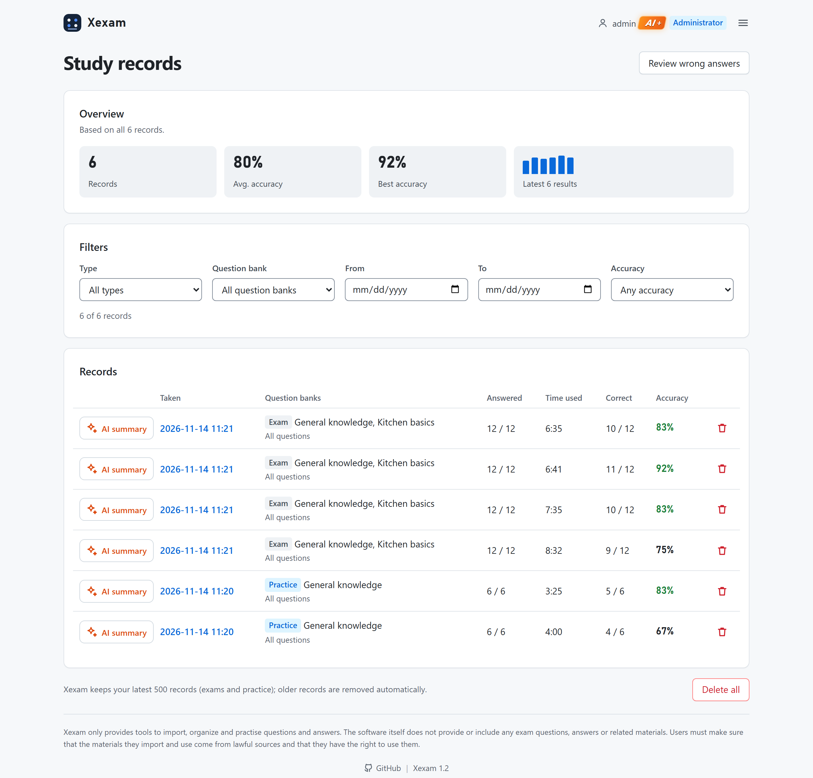

### 7.1 AI summary

With the **AI+ feature**, **Study records** has a new first column, **AI summary**, with one button per record (on a narrow window: in the record's card), and **Home** has the same button for the latest result, between **View details** and **All study records**. Both open the same window for the same record and show the same saved summary.

- **What it does**: the model is given the questions of that record that you **answered wrong** (your answer, the correct answer, the question and the bank's explanation) and writes: your weak knowledge points, what to watch out for, how to approach such questions from now on, and a detailed but simple summary of those knowledge points. It does not go through the questions one by one.
- **Which questions**: only questions answered wrong. Unanswered questions are not part of it. When the record has more than 70 wrong answers, 70 of them are chosen at random, and a new random 70 each time you press **Regenerate**. A line under the title says what the summary is based on, for example **Based on all 6 wrong answers.**, **Based on 70 of 80 wrong answers, chosen at random.** or, when some of the questions are gone (their bank was deleted or you lost access), **Based on 5 of 6 wrong answers (the others are no longer available).**
- **The window**: a large window over most of the page below the title. At the top: **AI summary** at the left and **Regenerate** (**Stop** while it is being written) and a close button at the right. The text scrolls inside it while the page behind stays still. It closes with the close button, **Esc** or a click outside it. **Copy** and **Open in AI Chat** are at the bottom. Pressing **AI summary** again shows the saved summary at once; **Regenerate** adds a new one and shows it; a new one that fails leaves the previous one in place. The summary is written in the **Settings** language.
- **Greyed out**: for a record without wrong answers (**No questions were answered wrong this time (unanswered questions are not part of the AI summary).**) and for a record saved by an old version that kept no per-question details (**This record was saved by an older version without per-question details, so it cannot be summarised.**). If every wrong question has since disappeared, asking says that these wrong answers are no longer available. The same **Unavailable** states as in [section 5.1](#51-ai-hint-and-ai-explanation) apply when AI is paused or unavailable (on Home the tag sits beside the button).
- **In AI Chat**: each record has one chat, `<record time>-AI summary`, where every summary of it is kept (in AI Chat a summary request shows only its label, for example **AI summary · 70 of 80 wrong answers**). Deleting the study record keeps that chat; it follows the normal chat rules. Only one answer is written at a time ([section 5.1](#51-ai-hint-and-ai-explanation)).

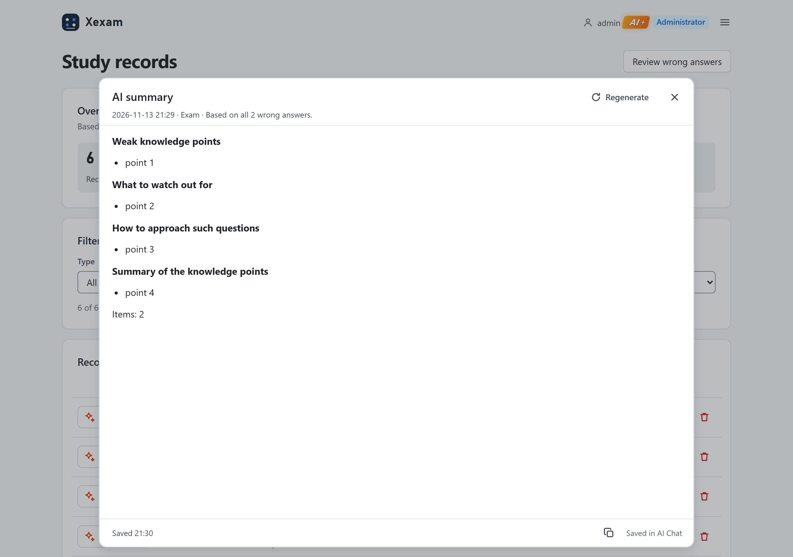

## 8. Wrong-answer notebook

Questions you answer wrong, in an exam or in a practice, go into your wrong-answer notebook and leave it after you answer them correctly **2 times in a row** (in either). Use it from Home (**Wrong answers** in the top-right corner of **Start an exam or practice**), from **Study records** → **Review wrong answers** → **Practise these**, or right after an exam with **Retry wrong answers only**. A retired question stays in your statistics but is not offered for review; it comes back if a later import of its bank restores it.

## 9. Settings

- **Account**: your **Username** and **Role** (with **Bank manager** if you have that permission, and the **AI+** badge when you have the AI+ feature; when the badge is dark, a line under it says why), and **Change password**. A bank manager also reads what the permission allows.
- **Appearance** (the theme): **System** (the default; follows the light or dark setting of your device), **Light** or **Dark**.
- **Language** (the interface language): **English** (the default), **中文** or **日本語**. It changes the menus, buttons and messages everywhere, the exam page and the error messages from the server included. The question text has its own switch on the exam page.
- **Answering** → **Auto-advance to the next question** (off by default, exams only): after you answer a single-choice question, or every item of a hotspot question, the next question opens by itself. Multiple-choice questions never move on by themselves. While it is on, the exam page shows **Auto-advance on** at the top.
- **AI chat mode** (administrators only, and only while the AI+ feature is on): **Normal** or **Free**. **Normal**: the AI answers as the study assistant and uses your AI memories. **Free**: you talk to the model directly, without the study-assistant instructions and the AI memories. The choice applies to all your AI chats, old and new, from your next message on, and AI Chat shows a green **Free mode** tag next to its title while it is on (see [section 16](#16-ai-chat)). It is kept on the server, not in this browser, so it survives a reload and a sign-in on another device; it is off until you choose **Free**, and **Reset to defaults** does not change it.
- **Reset to defaults**: theme, interface language and auto-advance go back to their defaults. The question language and the AI chat mode are kept.

Settings belong to your account and are saved on the Xexam server, together with the question language you last chose. So they survive restarts and image updates, clearing the browser cache, and switching to another browser or device; every user has their own. Only an unfinished exam or practice stays in the current browser. The one exception to "saved with your settings" is the administrator's **AI chat mode**: it is saved in the AI service's own database.

<table>
<tr>
<td width="50%">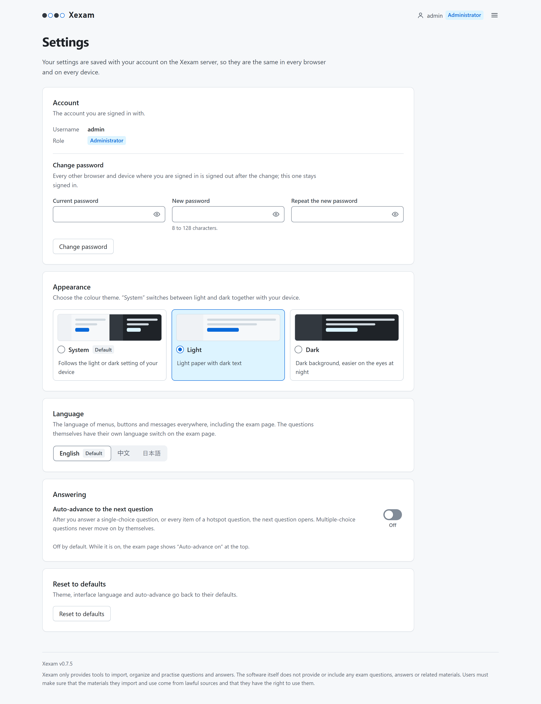</td>
<td width="50%">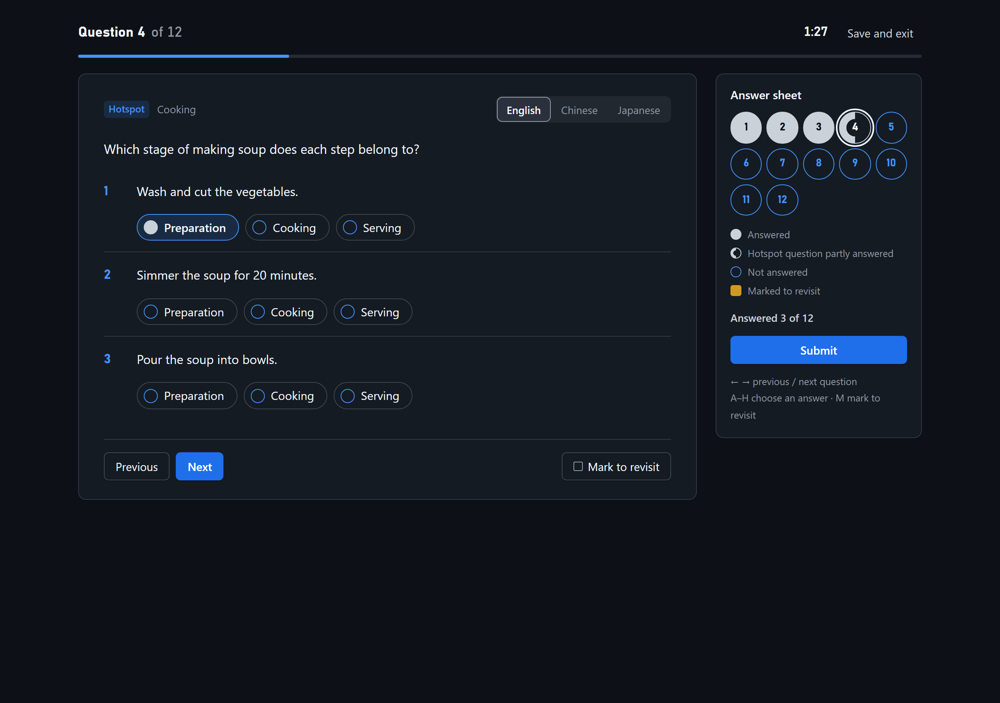</td>
</tr>
<tr>
<td>Settings: <b>Account</b>, <b>Appearance</b>, <b>Language</b>, <b>Answering</b> and, for administrators, <b>AI chat mode</b> (<b>Normal</b> / <b>Free</b>).</td>
<td>The <b>Dark</b> theme, here on the exam page.</td>
</tr>
</table>

## 10. About Xexam

The version entry of the menu (for example **Xexam v0.7.5**) opens **About Xexam**: the **Version**, the CPU architecture of the **Server**, the **License**, and **What’s new**, which is the [changelog](changelog.md) in the interface language. The newest version is open; the earlier ones are folded under **Earlier versions**.

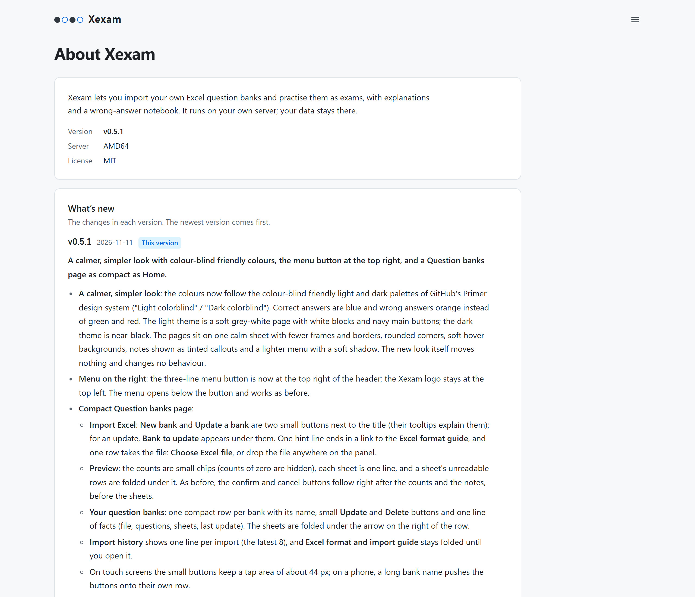

## 11. Question banks

Here administrators and bank managers import Excel workbooks. Users without the permission do not see the page in the menu; opening it directly shows **Not allowed** with **Back to Home**.

- **Import Excel**: pick **New bank** or **Update a bank** (two small buttons next to the title; their tooltips explain them; for an update you choose the bank under **Bank to update**), then click **Choose Excel file** or drop the file anywhere on the panel. The hint line says to upload the whole workbook in the six-column layout and ends in a link to the **Excel format guide**.
- **The bank list**, one compact row per bank: its file, number of questions (with the retired ones, for example **5 questions (+2 retired)**) and sheets and last update, with **Update** and **Delete**. Its sheets are folded under the arrow on the right of the row. A bank whose questions are all retired because they came from an older Excel layout says so, and that an update with a six-column file brings it back into use.
  - An **administrator** sees **All question banks**, each with who imported it (**uploaded by sam**, **uploaded by you**), and may update or delete any of them.
  - A **bank manager** sees **Your question banks**: only the banks they imported, which they may update or delete. Banks an administrator gave them to study are on Home.
- **Import history**: one line per import, the latest 8 (an administrator sees all imports, a bank manager those of their own banks).
- **Excel format and import guide**, folded until you open it, is the short version of [section 12](#12-excel-question-bank-format) and [section 13](#13-importing-question-banks).

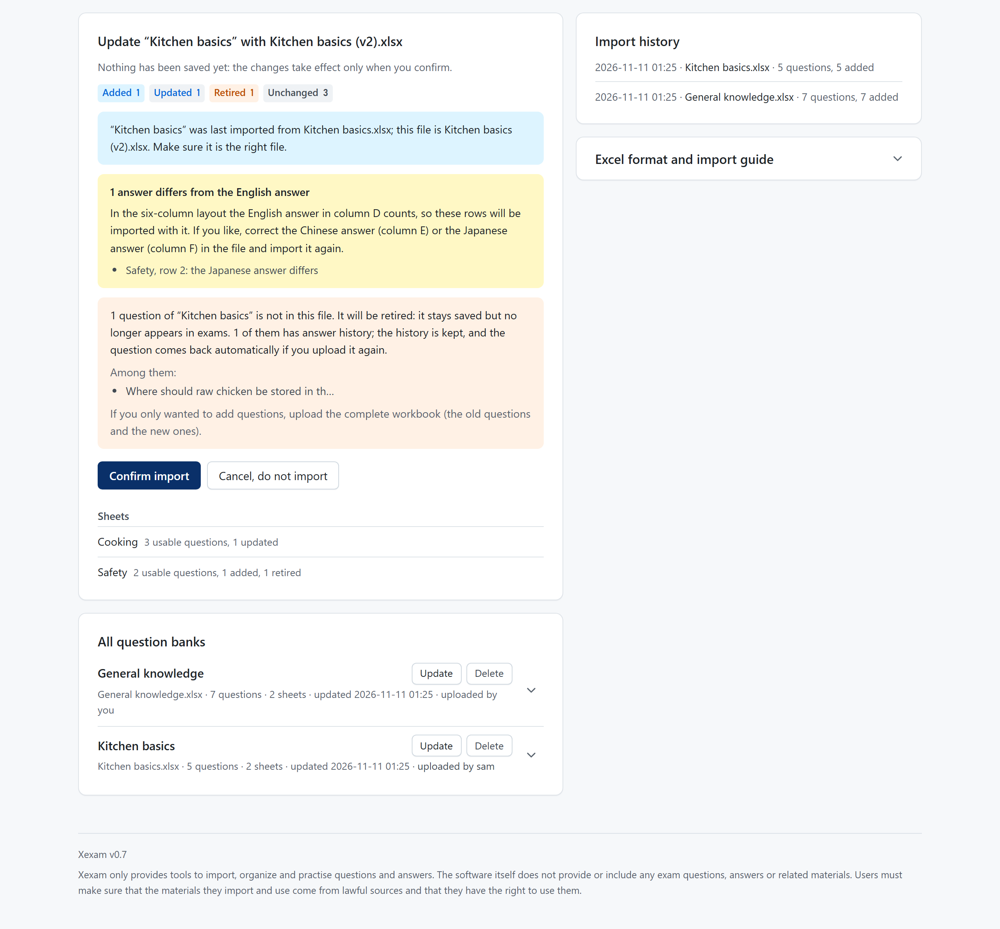

The screenshot shows the preview of an update of "Kitchen basics" with a newer file, `Kitchen basics (v2).xlsx`, before anything is saved: the chips (1 added, 1 updated, 1 retired), the question that would be retired, and the warning that the Japanese answer of one row differs from the English one (the row is imported with the English answer). It also shows the bank list under **All question banks** ("Kitchen basics" was uploaded by the bank manager sam) and the **Excel format and import guide**, opened, with its first two parts: the basics and the six columns.

## 12. Excel question bank format

One workbook (`.xlsx`) is one question bank. Each sheet is a group of questions, one question per row. **Only the six-column layout can be imported**: every question has its own column in English, Chinese and Japanese, and so has its answer and explanation. A file in any other layout, the three- and four-column layouts of earlier versions included, is refused with a message that says so; nothing is imported from it.

| Column | Contents |
|---|---|
| **A** | The **English** question, then its options or hotspot items. The question type, the options and the items are taken from this column, and the question is recognised by it |
| **B** | The **Chinese** question (optional), with the same options (A, B, C…) or the same numbered items as column A |
| **C** | The **Japanese** question (optional), with the same options or items as column A |
| **D** | The **English** answer, explanation and memory aid: `【Answer】B`, then `【Explanation】…` and `【Memory aid】…`. The answer is taken from this column |
| **E** | The **Chinese** answer, explanation and memory aid (optional): `【答案】B`, `【解析】…`, `【记忆口诀】…` |
| **F** | The **Japanese** answer, explanation and memory aid (optional): `【正解】B`, `【解説】…`, `【覚え方】…` |

Here is one complete single-choice question (made up, like every example here; it is the same as in the guide on the **Question banks** page):

| Column | Cell |
|---|---|
| A | Which planet is known as the Red Planet?<br>A. Venus<br>B. Mars<br>C. Jupiter<br>D. Saturn |
| B | 哪颗行星被称为“红色星球”？<br>A. 金星<br>B. 火星<br>C. 木星<br>D. 土星 |
| C | 「赤い惑星」と呼ばれる惑星はどれですか。<br>A. 金星<br>B. 火星<br>C. 木星<br>D. 土星 |
| D | 【Answer】B<br>【Explanation】Iron oxide (rust) in the dust on its surface makes Mars look red.<br>【Memory aid】Mars rusts red. |
| E | 【答案】B<br>【解析】火星表面的尘土含有氧化铁（铁锈），所以看起来是红色的。<br>【记忆口诀】火星生锈红彤彤。 |
| F | 【正解】B<br>【解説】火星の表面の砂には酸化鉄（さび）が含まれているため、赤く見えます。<br>【覚え方】火星はさびて赤い。 |

To start a new line inside a cell, press Alt+Enter (Windows) or Control+Option+Return (Mac).

### 12.1 Rows and headings

- Each row is one question. The first row may hold headings, for example `Question (English)` … `Answer (Japanese)`: a row whose column A is a single line and whose column D has no answer heading such as `【Answer】` is treated as a heading or a note and skipped.
- Xexam recognises the six-column layout by the content of each worksheet: at least one row needs a Japanese question with kana in column C (and no kana in columns A and B) and an answer with its heading, in any of the three languages, in column E or F.

### 12.2 English is authoritative

- The question type, the options, the hotspot items and the question's identity come from column A, the answer key from column D. A row without an English question in A or an English answer in D cannot be read; the preview lists it with the reason.
- Columns B, C, E and F may be left empty in a row: without column B or C, Chinese or Japanese is greyed out on that question; without column E or F, the card shows the explanation of another language.
- Columns B and C must line up with column A (the same option letters, the same number of items). A language that does not line up is greyed out for that question.
- When the answer in column E or F means something else than column D, the row is still imported with the English answer, and the preview warns, for example **1 answer differs from the English answer**, with the rows under **Show the rows**. Answers are compared by meaning: the same letters, or the same choice for each hotspot item (`Yes`, `是` and `はい` count as the same).

### 12.3 Question types

- **Single choice**: in column A, the question first, then one option per line: `A. text`, `B. text` … (two to eight options, A to H; `A)`, `A、` and `A:` work too). The answer is one letter: `【Answer】B`.
- **Multiple choice**: written the same way, with several letters in the answer: `【Answer】C, E` or `【Answer】CE`. An answer counts as right only when exactly these options are chosen.
- **Hotspot** (several statements, one choice for each): the first line of column A is `HOTSPOT` (recommended: it marks the question as a hotspot one; without it, numbered items that end in choices are recognised too), then the question, then one numbered item per line that ends with its choices, separated by ` / `: `1. Water is wet. Yes / No`. Choices of more than one word (such as `Before cooking / After cooking`) need a tab or a full-width space (`　`) in front of them. The answer gives one choice per item, separated by `;`: `【Answer】1 Yes; 2 No`.
- In columns B and C, write the same items with the same numbers; when they end with their own choices (`是 / 否`, `はい / いいえ`), the question shows those in that language. In every answer column, yes and no may be written in any of the three languages: `Yes` / `是` / `はい` and `No` / `否` / `いいえ`.

For example, this hotspot question (columns A and D; columns B, C, E and F hold the same in Chinese and Japanese, with a full-width space before `是 / 否` and `はい / いいえ`):

```
HOTSPOT
For each statement, choose Yes or No.
1. The sun rises in the east. Yes / No
2. The moon is a star. Yes / No
```

```
【Answer】1 Yes; 2 No
【Explanation】The sun rises in the east. The moon only reflects sunlight; it is not a star.
```

### 12.4 Headings in the answer columns

In columns D, E and F, write the answer first, then the explanation and the memory aid, each after its heading in `【…】`. Each of the three columns accepts the headings of all three languages:

- Answer: `【Answer】`, `【答案】`, `【正解】` or `【答え】`.
- Explanation: `【Explanation】`, `【解析】` or `【解説】`.
- Memory aid: `【Memory aid】`, `【Mnemonic】`, `【记忆口诀】`, `【口诀】` or `【覚え方】`.

English headings may be written in any case, and a longer heading that contains one of these words, such as `【解析·怎么选】`, counts too. A cell that holds nothing but the answer may also be just the letters (`B`) or one line such as `Answer: B`. Text in parentheses after the answer, for example `【Answer】B (see chapter 2)`, is not part of the answer: it is shown as a **Note** on the answer cards.

### 12.5 Questions that cannot be read

Questions that cannot be read are **never guessed**: they are listed in the preview with the reason (usually column D does not contain an answer with its heading, or the answer letter is not among the options), and they are never silently marked wrong.

## 13. Importing question banks

### 13.1 Who may import

- **Administrators** import new banks and update or delete every bank.
- **Bank managers** (users with the **Bank manager** permission, set in [User management](#14-users-and-sign-in)) import new banks, which then belong to them, and update or delete only the banks they imported. Banks of administrators and of other users stay out of their reach.
- Other users do not see the **Question banks** page.

### 13.2 New bank or update

A question bank is one imported Excel workbook. On **Question banks** → **Import Excel** you choose where the file goes with two small buttons next to the title:

| Choice | What happens |
|---|---|
| **New bank** | A new bank is created, named after the file (without `.xlsx`; ` (2)`, ` (3)`, … is added if the name is taken). Existing banks are not changed. The same workbook can be imported twice as two separate banks; their study records do not mix |
| **Update a bank** | The file replaces the questions of the bank you pick under **Bank to update** (a bank manager can pick only their own banks). Questions missing from the file are retired **in that bank only**. The bank keeps its name, its owner and the users who see it |

Use **New bank** for a different workbook, and **Update a bank** for a newer version of a workbook you have already imported. Always upload the **whole** workbook, not only the new questions.

A new bank is visible to the person who imported it, to the administrators, and to every user with **Include banks imported later**. An administrator gives it to other users in **User management**.

### 13.3 Preview, then confirm

After the upload Xexam reads and checks the file and shows a preview: small chips with how many questions will be **Added**, **Updated**, **Restored** or **Retired** and how many are **Unchanged** and **Unreadable** (counts of zero are hidden), one line per sheet with its numbers, and for every row that could not be read, the row number and the reason, folded under the line of its sheet (for example **2 unreadable**). **Nothing is written until you confirm** (**Create the question bank** or **Confirm import**; **Cancel, do not import** drops it). The preview also warns you when:

- you create a new bank from a file with the same name as the file an existing bank was imported from (it offers to update that bank instead);
- you update a bank with a file whose name differs from the last import;
- questions would be retired. It lists some of them, and asks once more before the import;
- the Chinese or Japanese answer of a row differs from the English one (the row is imported with the English answer).

Every person who imports has their own preview, kept in memory for 30 minutes. All open previews share a memory budget: when several large files are being previewed at the same time, the oldest preview of another person can be dropped. Confirming a preview that was dropped or is older than 30 minutes says that it has expired: upload the file again.

### 13.4 Import rules

The file is treated as the **complete content of the bank** it goes to. Other banks are never touched.

| Case | Result |
|---|---|
| A question is in the file but not in the bank | **Added** |
| Same question, but other content (other options, answer, explanation, Chinese or Japanese text) changed | **Updated** (answer history is not affected) |
| A question is in the bank but cannot be found in the file | **Retired**: it stays saved with its answer history, but no longer appears in exams or practice |
| A question that was retired earlier appears again | **Restored**, and its wrong-answer notebook entries come back with it |
| The sheet name, the English question or the first option changed | Counts as **a new question**: the old one is retired, and the new one starts without answer history |
| The file contains not a single usable question | Import rejected (this prevents wiping the bank) |

A question is recognised by its worksheet name, its English question (column A without the options) and its first option or item (spaces do not matter).

### 13.5 Banks from an older Excel layout

Up to v0.6 Xexam imported workbooks in a three-column and a four-column layout, whose questions were recognised by their Japanese text. Since v0.7 these layouts can no longer be imported, and **every question that was imported from them is retired at every start** of the backend. The banks, their import history, the study records and the per-question statistics stay; the questions are no longer asked, and a bank whose questions are all retired says so in the bank list.

To use such a bank again, **update it with a six-column version of its workbook** (**Update a bank**). The bank keeps its name, its owner and the users who see it. Because the six-column layout recognises questions by their English text, every question of the file is added as a new question, without answer history; the old ones stay retired, and the old records still show them. You can also import the six-column file as a **New bank** and delete the old one.

### 13.6 Deleting a bank

**Delete** on a bank’s row asks for confirmation (for example **Delete “Kitchen basics”?**). The bank's questions (active and retired) and its import history are deleted, and it disappears from every user's question banks. The checkbox below is off by default:

- **Unchecked**: the answer history and the exam records stay. In those records, the bank's questions show as deleted.
- **Checked**, as an administrator (**Also delete this bank’s study records**): the answer history of the bank's questions and the records that no other remaining bank is part of are deleted too.
- **Checked**, as a bank manager (**Also delete your study records of this bank**): only your own answer history and records are deleted; other users' study records always stay, with the questions shown as deleted.

A delete cannot be undone; your own backup is the only way back (section 5 of [database.md](database.md)).

## 14. Users and sign-in

Since v0.6 everyone signs in. There are three kinds of account:

- **Administrator**: everything, including every question bank, **User management**, **AI settings** and the **System log**, and AI Chat while the AI+ feature is on.
- **User** with the **Bank manager** permission: imports new question banks and updates or deletes the banks they imported, but not anybody else's.
- **User**: takes exams and practises with the question banks an administrator gave them.

Each user has their own study records, wrong-answer notebook, unfinished exam and settings. AI has one name, the **AI+ feature**, and three controls: the global switch in [AI settings](#17-ai-settings), the per-user switch in User management, and **Pause** / **Resume** per user in AI settings under **Users with AI+**.


User management with two administrators (admin and lee), sam (**Bank manager**, every question bank, including ones imported later, the **AI+ feature** on, with the bright badge), alex (one question bank, General knowledge, the **AI+ feature** on but **Paused**, so the badge is dark and a **Paused** chip sits next to the switch) and kim (disabled, no **AI+ feature**, no badge); every plain user has an **AI+ feature** switch under the bank line.

- **First start** (a new install, or the first start after upgrading from v0.5 or older): sign in with `admin` / `admin` (the sign-in page reminds you of it). Xexam then asks for a new password (8–128 characters). The study records, notebook and settings from before v0.6 belong to this administrator.
- **User management** (menu, administrators only): one row per user with role, status (**Normal**, **Disabled**, **Locked · … left**, **3 tries left**, **Must choose a new password**), **Bank manager** when the user has that permission, the **AI+** badge, created, last sign-in and the number of study records (exams and practice). Actions: **Edit**, **Reset password**, **Disable** / **Enable**, **Delete** and, when needed, **Unlock**. A user created or reset by an administrator chooses their own password at the next sign-in. You cannot disable, demote or delete yourself, and the last enabled administrator cannot be removed. The list refreshes itself while it is open, so a lock that starts shows up.
- **Which question banks a user sees** is two independent settings: the existing banks ticked for them, and **Include banks imported later**, which gives them every bank imported from then on (by anyone, also with the command-line `import`). It never adds an existing bank.
  - Each user's row says what they have: **Question banks: all, including ones imported later** (every bank ticked and the later ones included), **Question banks: 1 · General knowledge** (with **, and the ones imported later** when that is on), **Question banks: none yet, so this user sees no question bank**, or **Question banks: none for now; the ones imported later are added automatically**. A bank manager's own uploads are listed below it.
  - **Change** opens **Question banks of alex** (for example). One row of three boxes sits right on top of the bank list: **Manage banks** (the bank-manager permission), **Select all** and **Deselect all**. The list starts with **Include banks imported later**, set apart by its own icon and a thin line, followed by one box per bank with who uploaded it. **Select all** ticks every listed bank, or unticks them all when all are ticked; **Deselect all** unticks them; neither touches **Include banks imported later**. A tick means on. There are no explanations on the page: they appear as tooltips when you point at an option or reach it with the keyboard, and the small **i** button next to **Question banks** explains the list. **Save** says what changed, the banks or only **Manage banks**.
  - The change applies at once and the user stays signed in. Administrators always see every bank. Taking a bank away keeps the user's study records as history. A bank manager always sees the banks they imported, while they have the permission.
- **AI+ feature**: under the bank line, each plain user's row has an **AI+ feature** switch. It appears only while ai-service is connected and the **AI+ feature** is on in [AI settings](#17-ai-settings); otherwise the rows have no AI+ line, **Add user** has no AI+ box, and one note under the page lead says why (the feature is off in AI settings, or ai-service is not connected); the switches stay as they were stored and come back when AI is available again. It applies at once, without a confirmation, and the user stays signed in; the page shows the new state, and **The AI+ feature is now on for sam.** (or **… off …**), only after the server confirmed the change. With the feature on, the user can use [AI Chat](#16-ai-chat) while the **AI+ feature** is on in AI settings and it is not paused; switched off, an answer being written for them stops within about 2 seconds, and they can still read and delete their chats and memories. Administrators have no switch: the line reads **Administrators always have AI while the AI+ feature is on.** If a page was left open while AI became unavailable, a click is refused with **Turn on the AI+ feature in AI settings first.** (never a success message), nothing changes, and the list is read again, so the switches disappear.
  - **Pause** and **Resume** are the other control, per user, in [AI settings](#17-ai-settings) under **Users with AI+**. A paused user keeps the feature and their data, shows a **Paused** chip next to their switch here, and never changes this switch by being paused.
  - **The badge** next to the name (in the header for yourself, in User management and in AI settings for administrators) has three states: **bright orange** = this user can use AI now; **dark** = the user has the AI+ feature but cannot use AI right now, because an administrator paused it, or the feature is off in AI settings, or ai-service is not connected (the tooltip says which: **The AI+ feature was paused by an administrator.**, or for a plain user **AI is not available right now. Try again later or ask an administrator.**; administrators read **The AI+ feature is not available right now.**); **no badge** = no AI+ feature. On a touch screen a tap on the dark badge opens its tooltip, and a tap elsewhere or **Esc** closes it; **Settings** → **Account** also writes the reason out. An administrator has the bright badge while AI is available and no badge otherwise.
- **Add user**: username, initial password, role, the **AI+ feature** box on its own line under the role (only while AI is available), and the question bank list with the same controls as **Change** (nothing ticked and **Include banks imported later** off: a new user sees no question bank until you choose some). A new account is enabled. For an administrator **Manage banks** and the **AI+ feature** box are hidden and the list is greyed out: administrators see and manage everything anyway. **Edit** changes the username, the role and **Account enabled** (**Manage banks** moved to **Change** in v0.8). Taking the bank-manager permission away applies at the user's next page change.
- **Deleting a user** also deletes their study records (the dialog says how many), wrong-answer notebook and settings. Question banks they imported are not deleted: they move to you, the administrator who deletes the user.
- **Wrong passwords**: 5 wrong passwords for an account within 15 minutes lock its sign-in for 1 minute; after that, every 3 more lock it again, for 5 minutes, 15 minutes, 30 minutes, 1 hour and then 1 day. The lock belongs to the account, not to the typed name, and guessing other usernames cannot wear it away. Browsers that signed in to the account before are counted separately, so guesses from elsewhere do not lock them out. A successful sign-in, **Unlock**, a password reset by an administrator, a restart of the backend, or 24 hours without a new mistake start over with 5 tries. The sign-in page says how long to wait.
  - In **User management** a short note under the row says which browsers are locked, until when, and how many locks in a row there were. **Unlock** gives 5 tries again at once, without asking; it is also offered while the user still has tries left.
- **Change your password**: **Settings** → **Account** → **Change password**; your other signed-in browsers are signed out.
- **Forgot the administrator password**: `docker compose exec backend xexam-backend reset-password admin` prints a new temporary password, which must be replaced at the next sign-in. It works while Xexam runs. To clear a lock at once, restart the backend: `docker compose restart backend`.

<table>
<tr>
<td width="50%">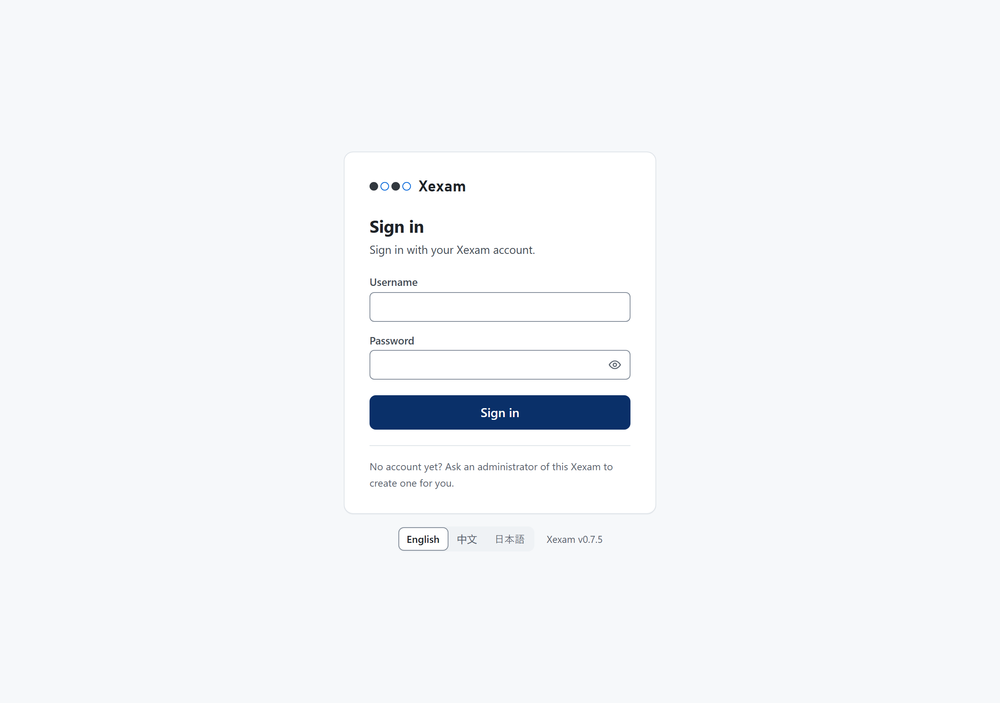</td>
<td width="50%">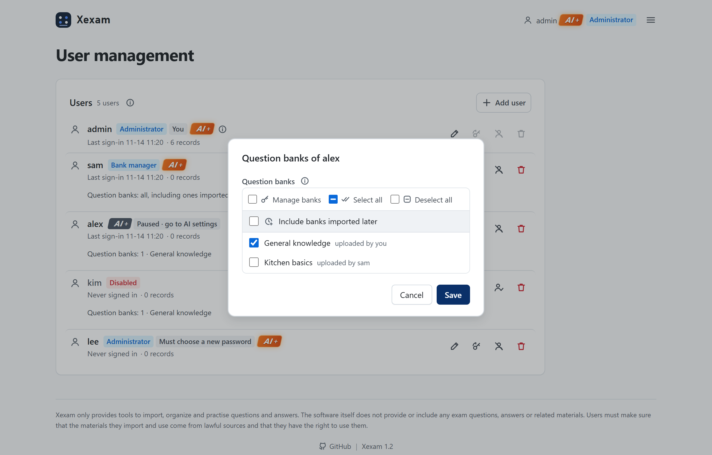</td>
</tr>
<tr>
<td>The sign-in page.</td>
<td><b>Question banks of alex</b>: <b>Manage banks</b>, <b>Select all</b> and <b>Deselect all</b> on top of the list, <b>Include banks imported later</b> as its first entry, then the banks with who uploaded each; here only General knowledge is ticked.</td>
</tr>
</table>

## 15. System log

**System log** (menu, administrators only; everybody else gets **Not allowed**) shows what the backend has logged since it last started, newest at the bottom: startup, sign-ins, changes to users, rejected requests or uploads and so on. The lines of the AI service are there too, starting with `AI: `.

- The page reads new lines every 0.5 seconds while it is open and follows them as they arrive. Scroll up to read, and **Jump to latest** takes you back down. When reading fails, it waits longer before the next try (up to 10 seconds) and shows why; a read that takes more than 10 seconds is cut off and counts as failed.
- **Pause** stops reading new lines for a while; **Resume** goes on.
- **Level** shows **All** lines, only **Warnings** (and errors) or only **Errors**; **Search the log** filters by text.
- Only the last 2000 lines are kept, in memory only: the list is empty again after a restart. For older lines, run `docker compose logs backend` on the server, in the folder of the compose file (without Compose: `docker logs xexam-backend`).
- The lines name users by their username (`user "admin" updated user "alex"`; a rename adds `(renamed from "…")`). A name typed at sign-in that has no account is never written down. The lines never contain passwords, session tokens, cookie values or question text. Rejected requests and failed sign-ins that come in bursts are summed up once a minute, so nobody can push the other lines out without signing in.
- **AI lines** (`AI: …`): ai-service's start and its link with the backend, changes to the AI settings, tests, switching the **AI+ feature** on or off, failed AI calls (at most one line per reason a minute), the chat retention, and every time an administrator views or deletes a user's AI chats or memories, or pauses or resumes a user's AI+ feature, for example `AI: user "admin" cleared one AI chat of user "sam"` and `AI: AI function turned off for user "sam" by admin "admin"` (the log line of a pause). A user's **AI+ feature** switched on or off is logged by the backend: `user "admin" turned AI+ on for user "sam"`. AI lines never contain keys, messages, answers, chat titles or memory notes. When the backend could not be reached for a while, ai-service sends the lines it kept (up to 500) afterwards, with a note of how many it had to drop; the lines about administrators viewing, deleting, pausing or resuming are never dropped. The regular reports ai-service sends every 25 seconds write no line, but the state of the link does: `AI: AI link: connected to the main service` once each time it connects (at start and after every reconnect) and `AI: AI link: lost the main service` once when it breaks.


The System log with lines from the startup (the last one names the AI link), sign-ins of admin, sam and alex, the AI service's lines about the administrator listing the models, saving the AI settings, testing them and switching the AI+ feature on, alex changing their password, the administrator creating lee and updating kim, and a made-up username that is guessed until it locks; above them the **Level** filter, the search field and **Pause**, below them the note on where older lines are.

## 16. AI Chat

**AI Chat** (menu, between **Study records** and **User management**) is a chat with an AI model. It is there once an administrator has set up AI in [AI settings](#17-ai-settings) and switched the **AI+ feature** on and, for a user who is not an administrator, turned on their **AI+ feature** in [User management](#14-users-and-sign-in) (and has not paused it). Administrators can always use it while the AI+ feature is on. The same **AI+ feature** also gives the AI help of the study pages: **AI hint** and **AI explanation** in a practice ([section 5.1](#51-ai-hint-and-ai-explanation)), **AI analysis** on result pages ([section 6.1](#61-ai-analysis)) and **AI summary** of a record ([section 7.1](#71-ai-summary)); their answers are saved here ([section 16.1](#161-chats-of-practices-exams-and-summaries)). AI runs in its own container, `ai-service`, which users never see named. When AI cannot be reached, AI Chat is not in the menu, and opening it directly says **AI is not available right now. Try again later or ask an administrator.** with **Try again** (an administrator reads **ai-service is not connected right now.** instead). A user who cannot use AI and has no chats or memories gets the page **AI Chat** with a short note that says why and what to do: **An administrator paused your AI+ feature. Ask an administrator if you need it again.**, **The AI+ feature is not available right now. Try again later.** or **Your account does not have the AI+ feature. An administrator can turn it on for you in User management.**

- **The notice at the top**: under the title one line always says **Administrators can view and delete your AI chats and memories and see your AI usage.** It cannot be closed, and there is no pop-up. What administrators see is in [section 17](#17-ai-settings); every look and every deletion by an administrator is written to the System log, without any content.
- **Chats** and **Memory** are the two tabs next to the title. From 900 px wide the chat list and the open chat sit side by side; on a narrower screen you see one at a time, and **All chats** takes you back to the list.
- **A window of fixed height**: the messages scroll inside it and the message box stays at the bottom, so a long chat does not make the page grow; opening a chat starts at the latest message. The message area is a region you can reach with **Tab** (it has a focus ring and the name **Messages**) and scroll with the arrow keys.
- **The address keeps the chat**: an open chat is `#/ai/<id>` in the address bar and an unsent new chat is `#/ai/new`, so a reload, or opening the same address again, shows the same chat; **New chat** and **All chats** go back to `#/ai`.
- **Free mode** (administrators only): free mode is not a switch of AI Chat but a state of the administrator, chosen in **Settings** under **AI chat mode** ([section 9](#9-settings)). While it is on, a green **Free mode** tag sits to the right of the **AI Chat** title; in normal mode nothing is shown, and AI Chat has no switch and no dividers. Normally every answer follows Xexam's study-assistant instructions and the AI is given your memory notes and today's date. In free mode every message you send, in any chat, new or old, and every **Retry** goes to the model without those instructions, without the date and without memories: you talk to the model directly, and only the reply-language rule below stays. The provider's own safety rules always apply. The choice applies from your next message, is kept on the server (a reload or another device shows it), and is off by default. Every message records the mode it was sent in, and the model is told the current mode in one short line after a chat has gone from one mode to the other; chats themselves have no mode. The limits, the usage statistics, the retention, **Stop** and **Retry**, **Remember this**, the administrators' views and the System log work as usual; memories are simply not used in free mode, and only administrators can use it.
- **The language of the answers** is the language chosen in **Settings** (English, Chinese or Japanese), whatever language you write in, unless you ask for another language in that message. Memory notes made with **Remember this** are written in it too. Each message uses the language set at the time, so switching the interface language changes the language of the next answer.
- **The chat list**: **New chat**, then your chats, newest first, each with its title (the start of its first message, at most 60 characters), the time of its last message (while the open chat's answer is being written the row says **Writing…**, or **Thinking…**, instead) and a delete button; below them **Delete all chats** (a red-outlined button) and how long chats are kept, for example **Chats are deleted automatically 90 days after their last message.** A chat is created by its first message. A new chat with no message yet says **Ask a question to start. The AI answers in English, the language chosen in Settings.** (with your language's own name).
- **Messages**: your messages as you wrote them; the answers with simple formatting (bold, italics, inline code, code blocks, lists; headings become bold lines, and links are shown as plain text, never as links). Above each message: **You** or **AI** with the model, and the time. Under it: **Copy** (not shown on an empty message), and under your own messages **Remember this** (see Memory below).
- **Writing a message**: the box at the bottom (**Ask anything…**). On a computer **Enter** sends and **Shift+Enter** starts a new line; on a touch screen **Enter** starts a new line. **Ctrl+Enter** (**Cmd+Enter** on a Mac) sends everywhere. Nothing is sent while an input method is still composing a word (Chinese or Japanese input). A message can have up to 16 000 characters (an administrator can change this); a counter appears near the limit.
- **While the answer is written** it appears piece by piece, with **Writing…** under it (**Thinking…** while a reasoning model is still thinking before its first words; what it thinks is never shown or kept); **Jump to latest** appears when you scroll up. You can already type your next question; you can send it once the answer has finished. The **Send** button becomes **Stop**: **Stop** ends the answer, keeps the text so far and marks it **Stopped**. (A double-click on **Send** only sends; a click on **Stop** in the first 0.4 seconds after sending is ignored, so a double-click cannot stop the answer it just started.)
- **The answer goes on without the page**: closing the tab, reloading, switching apps or locking the phone does not stop it. The AI service keeps writing and saving it; when you come back, the chat shows the text so far and follows it until the answer is finished.
- **When something goes wrong**, the answer keeps the text it already had and says why under it: **The answer was interrupted: …** or **No answer: …** (for example when the AI provider was busy or did not answer in time), or **The answer reached the model’s length limit.** A problem in the set-up of AI (a refused key, no credit left, an unknown model) is shown to users as **AI is not set up correctly right now. Please tell an administrator.** **Retry** under the last answer of a chat, when it failed or was stopped, writes that answer again in its place, in the mode that is on now; the focus goes to the message box, and anything you have typed in it stays.
- **One answer at a time**: by default each user has one answer being written at a time (an AI hint, explanation, analysis or summary counts too); a second gives **An answer is still being written. Wait for it or press Stop.** (in the windows of the study features it is the note with **Stop it and write this one**, [section 5.1](#51-ai-hint-and-ai-explanation)) (an administrator can allow up to four, but never two in the same chat). A chat holds up to 400 messages (then **Start a new chat**) and each user up to 1000 chats (then delete some old ones); administrators can change both. The chats of practices, exams and summaries ([section 16.1](#161-chats-of-practices-exams-and-summaries)) count in both.
- **Deleting**: the delete button of a chat and **Delete all chats** ask first. A deleted chat is gone at once, also from what administrators can see; a backup made before still has it.
- **Read only**: when you cannot use AI, you keep AI Chat as long as you have chats or memories, and a line at the top says why, in the words of the dark badge's tooltip followed by **You can still read and delete your chats and memories.**: **The AI+ feature was paused by an administrator.**, **Your account does not have the AI+ feature.** (no AI+ feature for you) or **AI is not available right now. Try again later or ask an administrator.** (the AI+ feature is off in AI settings, or ai-service is not connected). You can read and delete, but not write, retry or remember. A running answer stops within about 2 seconds of the switch, and a pause stops it at once.


AI Chat as the administrator (with the **AI+** badge next to the name, free mode on): the green **Free mode** tag right of the title, the notice under it, the chat list with **New chat**, **Delete all chats** and the retention line, and one chat with two questions to the made-up provider and its answers (bold text, a list, inline code), **You** or **AI** with the model and the time above every message, **Copy** under every message and **Remember this** under the questions, and the message box with **Send**. In normal mode the tag is not shown; AI Chat itself has no mode switch (the choice is **AI chat mode** in **Settings**).

**Memory** is a list of short notes about you that the AI is given in every chat (**The AI uses these notes in every chat.**), for example the exam you are preparing for.

- The **Memory** tab lists the notes, each with whether it came **From a chat** or was **Added by hand**, with **Edit** and **Delete**, and **Delete all memories** (red-outlined). **Esc** cancels an edit and puts the focus back on its **Edit** button. The box **New memory** with **Add** adds one; a counter shows the characters used of the maximum. By default you can keep 50 notes of up to 300 characters each.
- **Remember this** under one of your messages asks the AI to turn that message into a short note. The note appears under the answer as **Save to memory?** in a box you can edit: **Save** keeps it, **Not now** drops it. When a message starts with "Remember …" or "Please remember …" (记住 or 请记住 in Chinese, 覚えておいて in Japanese, or ends with 覚えておいて), the note is offered by itself once the answer has finished. Nothing is saved without **Save**.
- Notes are not deleted by the chat retention; they stay until you (or an administrator) delete them.

What the AI provider receives in AI Chat: your message, the earlier messages of the same chat, the study-assistant instructions with the language of your Settings, your memory notes and today's date. The history is limited to the newest messages that fit about 24 000 characters by default, and it is shortened the same way every time: the newest 4 messages in full, older answers cut to 800 characters (with a “…(shortened)” mark) and older questions to 2000. In free mode it receives only that history, your message and the language rule, plus one short line that names the current mode when the chat has gone from one mode to the other. Providers can keep the start of such a request in their prompt cache, which makes later requests cheaper and faster: with Anthropic the instructions and the history before your new question carry cache points, and OpenAI-format providers cache by themselves where they support it. The tokens served from the cache show as **Cached** in the usage of AI settings. Nothing from your question banks or study records is sent to it by AI Chat unless you paste it into a message. The study features send questions on their own, only when you press one of their buttons, and each request stands alone (no memory notes, no earlier messages, no free mode): an **AI hint** sends the question and its options in the language shown on the page; an **AI explanation** and an **AI analysis** also send the bank's answer and its explanation and, for an analysis, your own answer; an **AI summary** sends, for each of at most 70 wrong answers, your answer, the correct answer, the question and the bank's explanation. Together with the question the request carries the language rule and the instructions for that feature, and nothing else about you. Hints never include the answer. Those windows say what they are based on, and the chats that keep the answers are listed in section 16.1.

### 16.1 Chats of practices, exams and summaries

Every AI hint, explanation, analysis and summary is saved in **AI Chat**, in a chat of its own kind. They follow the normal chat rules: you can read them, continue them and delete them, administrators can view and delete them like any other chat ([section 17](#17-ai-settings)), the retention period deletes them, they count toward the limits of chats per user and messages per chat, and their usage is counted without content.

- **A practice or an exam has one chat**, titled **`<start time>-Practice`** or **`<start time>-Exam`**, for example `2026-11-11 21:58-Practice`. The time is the time you started it (the browser's clock, written in the time zone of ai-service, the same one the usage days follow). The hints and explanations of the practice page, the analyses of its result page and the analyses on the record's detail page all go into that one chat, in order, each one marked with what it is and the number of its question (**AI hint · Question 3**, **AI explanation · Question 3** or **AI analysis · Question 3**). A practice that you save, exit and continue later keeps writing into the same chat.
- **A record has one summary chat**, titled **`<record time>-AI summary`**, where every summary of that record is kept; a summary request shows only a label, for example **AI summary · 70 of 80 wrong answers**.
- **Records made before v0.9** have no start time and no session key. The first AI analysis on the detail page of such a record starts a chat of its own for it, titled with the record's time and **-Practice** or **-Exam**. In the list it can then look like a second chat for the same minute.
- The words after the time follow the interface language (**-Practice**, **-Exam**, **-AI summary**; **-练习**, **-考试**, **-AI总结** in Chinese; **-練習**, **-試験**, **-AIまとめ** in Japanese).
- Study answers have no **Retry** and no **Remember this**; **Copy** works as everywhere. You can write a follow-up question in such a chat as in any chat; it is an ordinary AI Chat message, and the earlier messages of the chat are part of its history. **Regenerate** in the study windows adds a new answer to the same chat and shows it; the earlier answers stay in the chat.
- **Deleting**: deleting a study record keeps its chats. Deleting a chat in AI Chat removes its saved answers: the window of that question writes a new answer, into a new chat, the next time you press its button. **Delete all chats** and an administrator's clearing do the same for every one.

## 17. AI settings

**AI settings** (menu, administrators only; anybody else gets **Only administrators can open AI settings.**) is where AI is connected, tested, switched on and watched. The page always opens, also when ai-service is not running.

**Connection to ai-service.** The page first asks the main service whether ai-service is connected: ai-service reports its state to the main service when it starts, at once when something changes, every 25 seconds, and when it stops; a report older than 60 seconds counts as not connected. While it is connected, one line under the chips says **ai-service is connected (version 0.9; last report 03:04 PM).** and the settings below load. When it is not, the page shows only a panel, **Connection to ai-service**, that names the cause, with **Last report: …** (or **No report since the main service started.**), **Version: …**, **This page checks again every 10 seconds.** and **Try again**; as soon as ai-service is connected, the settings appear by themselves. The causes:

| The panel says | What it means | What to do |
|---|---|---|
| **The main service is not reachable right now. Try again shortly.** | The browser gets no answer from the main service (the backend) | Check that `xexam-backend` is running |
| **The main service has no internal token, so ai-service cannot connect.** | The AI link is off in the main service | Read the main service's log, a line starting with `AI link off` |
| **ai-service is not running or cannot be reached.** | Nothing answers for ai-service | Check that the `ai-service` container is running; after an upgrade from v0.7.5, download the new `docker-compose.yml` (it adds that container) |
| **ai-service was stopped.** | Its last report said that it was stopping | Start the `ai-service` container again |
| **ai-service is running but not connected to the main service.** | It answers, but its reports are not accepted | Check that `XEXAM_INTERNAL_TOKEN` is the same for both services (or unset for both) and that `XEXAM_AI_BACKEND_URL` points to the main service |
| **ai-service is running, but the main service has not heard from it since it started.** | It has just started | Wait: it reports every 25 seconds |

The text about the main service appears only when the main service itself cannot be reached; a missing ai-service is never blamed on it.

At the top four chips show where the set-up stands: **Connection saved** (or **Connection not set**), **Model saved** (**Model not set**), **Test passed** (**Test failed**, **Not tested**) and **AI+ feature on** (**AI+ feature off**; this one shows the state of the global switch). On a fresh install, and after you have saved only the chat retention, the first chip reads **Connection not set** and the page asks the provider for no model list until a connection has been saved. When the saved keys can no longer be decrypted (the AI encryption key was changed or lost, see section 3.2 of [deployment.md](deployment.md)), a note says so: enter the keys again, then test and turn on the AI+ feature. Then come these sections:

1. **Connection**: the **Provider** and its address and keys.
   - **OpenAI-compatible API** (the default): **API base URL** (`https://api.openai.com/v1` to start with; OpenAI-compatible addresses usually end in `/v1`, including those of local servers) and **API key**.
   - **Anthropic**: **API base URL** (`https://api.anthropic.com`; a `/v1` at the end is removed, because Xexam adds `/v1/messages` itself) and **API key**.
   - **Cloudflare AI Gateway**: **Gateway base URL**, for example `https://ai-gateway.example.com/<route>` (`…/openai` or `…/anthropic`); **API format**, OpenAI (chat completions) or Anthropic (messages), filled in from the last part of the address and changeable; **Gateway auth scheme**: `Authorization: Bearer`, `x-api-key` or `cf-aig-authorization`; **Gateway API key**; and **Provider key (only if the gateway needs one)**, which is not needed when the gateway holds the provider's key itself.
   - Key fields are always empty (the eye button beside a field is **Show key** / **Hide key** and shows only what you typed). Under each one it says **Saved: …1234** (the last four characters, for keys of 12 characters or more), **Saved**, **Not set**, or **Cannot be decrypted – enter it again**. An empty field keeps the saved key; **Remove this key** removes it. A key is 1–400 visible characters without spaces.
   - **A saved key never goes to a new address by itself**: when you change the provider, or the address to another server (another scheme, host or port), every saved key must be entered again (an empty field then removes it). A new path on the same server, for example `/openai` to `/anthropic` on one gateway, keeps the keys.
   - An `http://` address gets the warning **This address uses http://, so the key is sent unencrypted.** (not for `localhost`, `127.0.0.1` or a name without a dot, such as a container on the same Docker network).
   - With the gateway schemes `Authorization: Bearer` (OpenAI format) or `x-api-key` (Anthropic format) the gateway key and a provider key would need the same header; then choose `cf-aig-authorization`, or remove the provider key.
   - **Save**. When the AI+ feature is on and the change needs a new test, Xexam asks first (**Saving turns the AI+ feature off for everyone. After the new settings pass a test, turn it on again. Save?**), then saves and says so (**The AI settings were saved. The AI+ feature is now off for everyone: test the new settings, then turn the AI+ feature on again.**). After saving, the models are listed by themselves. Saving only the chat retention or the safety limits never switches anything off.
2. **Model**: **Current model: …**, then one field with its own scrolling list of the models the provider listed (typing filters it; **No model matches.** when nothing fits), **Refresh list** and **Save model**. Models that are probably not chat models (names that point to embedding, reranking, safety classifier, image generation, speech, document parsing or vision-only models) are listed last, each with a small tag (**embedding**, **reranking**, **safety classifier**, **image generation**, **speech**, **document parsing**, **vision only**), and when you type, pick or have saved one of them a hint says so (**… is probably not a chat model (embedding). AI Chat needs a chat model; the test shows whether this one works.**). Nothing is hidden: any model can be saved. When the provider does not list its models, enter the model ID by hand. Saving another model also needs a new test. While the connection form has unsaved changes, listing and testing wait: **Save the connection first.**
3. **Test and enable**: **Test** sends one short request ("Test") with the saved settings, the same way a chat does (when the model field holds another model than the saved one, the button reads **Save model and test** and saves it first). While it runs, it counts the seconds (**Testing… 12 s**) and notes **Slow models can take one or two minutes.** Then it says **The test worked (… ms). You can turn on the AI+ feature now.** (once the feature is on: **The test worked (… ms).**) or **The test failed: …** with a hint (check the key; pick another model or check the address; the model may be slow or not available right now; or check that the `ai-service` container is on the `egress` network), and **Last successful test: …**. The line under **Test** always follows the switch next to it, in both directions. A failure that comes from the settings (the key refused, no credit or quota, an unknown model or address, a refused request, an answer that cannot be read) switches the AI+ feature off; a temporary problem of the provider (rate limit, overload, an error of the provider, no answer in time, no connection) does not: **The AI+ feature stays on: this looks like a temporary problem of the provider.** The **AI+ feature** switch can be turned on only after a test of the current settings has passed (otherwise it says **Save the settings and pass a test first.**); a passed test never turns it on by itself. It then says **The AI+ feature is on.** (or **… is off.**), and the main service learns of it at once, so **User management** shows or hides the AI+ switches. Switching it off stops every answer being written at once. The **Users with AI+** list is read again after a test and after the switch.
   - A test can take a while with a slow provider: up to 2 minutes, and a second try with adjusted settings when the provider refuses the first request. Behind Cloudflare Tunnel, Cloudflare may cut a request after about 100 seconds; the test still finishes, and reloading the page shows its result.
4. **Users with AI+**: every administrator and every user who has the **AI+ feature** (the switch in User management), the paused ones included, with **User**, the **Badge** (bright, dark or none, as in [section 14](#14-users-and-sign-in); administrators read the administrator wording of its tooltip), **Role**, the **AI+ feature** status, **Chats**, **Memories**, **Tokens in**, **Tokens out**, **Last used** and **View**. Below 900 px wide the two token columns are left out (they are in **Usage**) and the time may wrap, so the table fits a tablet; below 560 px each user is a small card with the name and **View** on the first line and one “column name: value” line per field. (The AI data of an account deleted in User management is removed when this list loads, and every 10 minutes anyway.)
   - **AI+ feature** status: **Active** or **Paused**, with one button, **Pause** or **Resume** (administrators show **Administrators always have AI.** and have no button). No confirmation is asked. **Pause** stops a running answer of that user at once, and from then on they can read and delete their chats and memories, but not write, retry or remember (AI Chat says **The AI+ feature was paused by an administrator.** in its read-only line). **Resume** gives it back. The user stays listed and keeps their data, and the **AI+ feature** switch in User management is not touched. A pause stays until **Resume**, also when the user's AI+ feature is switched off and on again. The System log records both, for example `AI: AI function turned off for user "sam" by admin "admin"` (a pause). A user whose **AI+ feature** is switched off in User management leaves this list; their chats and memories stay (they can still read and delete them) until they are deleted or the retention removes the chats.
   - **View** opens **AI data of sam** (for example), marked **Read only**, with the chats (every message with who wrote it and the time) and the memories; click a chat to read it. **Delete this chat**, **Delete all chats** and **Delete all memories** ask first (the confirm button reads **Delete**). After a delete the focus stays inside the dialog. The viewer shows nothing about free or normal mode. Every view and every delete is written to the System log by username, for example `AI: user "admin" viewed the AI chats and memories of user "sam"`, never with any content.
5. **Usage**: for the **Last 7**, **30**, **90** or **365 days**: the totals (**Calls**, **Tokens in**, **Tokens out**, **Cached**, **Errors**), then **By user**, **By model**, **By feature** and **Over time** (per day for 7 and 30 days, per month for 90 and 365). **By feature** splits the calls into **AI Chat**, **AI hint**, **AI explanation** (which includes the AI analysis of result pages) and **AI summary**, always in that order, zeros included; only chat answers are counted there, so tests, model lists and memory notes are not in it; answers recorded by an older version count as **AI Chat**. **Cached** is the part of **Tokens in** that the provider served from its prompt cache (0 when the provider does not report it). Calls include tests, model lists (the row **Model list**) and memory notes. Users that were deleted are summed up in one row, **Deleted users**. Tokens are counted as the provider reports them; a provider that does not report them counts 0. Only numbers are kept, never what was asked or answered. The days follow the time zone of ai-service (`TZ`).
6. **Chat retention**: **Delete chats after (days)**, 1 to 3650, 90 by default. A chat, whatever its kind, is deleted that many days after its last message (checked every hour, in small batches so that running answers are not held up); memories are not affected. The chats of practices, exams and summaries ([section 16.1](#161-chats-of-practices-exams-and-summaries)) follow it too.
7. **Safety limits**: **These protect the server; they are not usage limits.** Seven numbers, each with its range and default, **Reset to defaults** and **Save**. A change applies at once and never switches AI off. Lowering a limit deletes or shortens nothing: it only refuses new chats, messages or notes beyond it. Every change is written to the System log, for example `AI limits changed by admin "admin": chatsPerUser 1000 -> 2000`.

   | Limit | Default | Range |
   |---|---|---|
   | **Answers at once per user** | 1 | 1–4 |
   | **Model calls at once (whole server)**, the administrators' tests included | 16 | 1–64 |
   | **Chats per user** | 1000 | 10–100000 |
   | **Messages per chat** | 400 | 20–5000 |
   | **Memories per user** | 50 | 1–1000 |
   | **Characters per memory** | 300 | 50–2000 |
   | **Characters per message** | 16000 | 1000–32000 |

   There are no limits on tokens, calls or cost.

   The chats of practices, exams and summaries use these limits like any chat: each practice, exam and record summary is one chat, and each hint, explanation, analysis or summary is two messages (the question and the answer). With the default **Messages per chat** of 400, one practice or exam chat takes about 200 requests before the window says **This chat is very long (at most 400 messages). Start a new chat.**; raise the limit if you practise very long sessions. Hitting **Chats per user** blocks new study chats the same way as new AI Chat chats (the window then names the number you set).

<table>
<tr>
<td width="50%">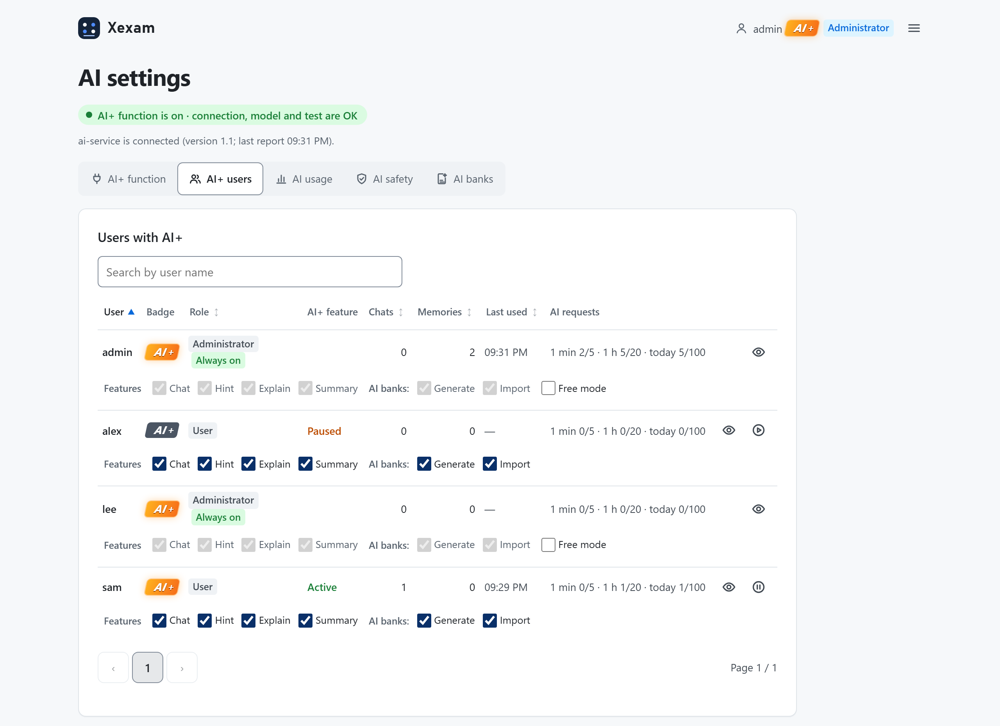</td>
<td width="50%">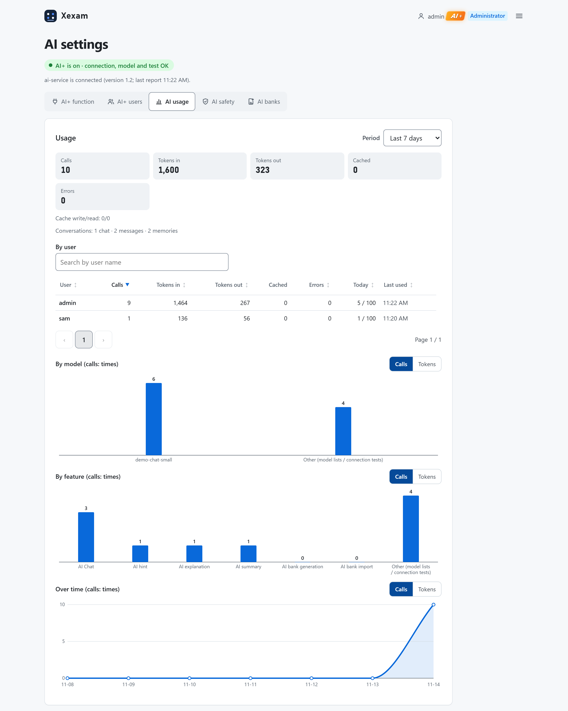</td>
</tr>
<tr>
<td>AI settings with the made-up provider (<code>http://ai-stub:9000/v1</code>; everything in these images is made up): the chips and the <b>ai-service is connected</b> line, the key only as <b>Saved: …9c21</b>, the model, <b>The test worked</b>, the <b>AI+ feature</b> on, and <b>Users with AI+</b> (the administrators, sam <b>Active</b> with <b>Pause</b> and alex <b>Paused</b> with <b>Resume</b>, with their badges).</td>
<td>Further down: <b>Usage</b> (here 6 calls, with <b>Model list</b> for the model listings; the <b>Cached</b> column is 0 because the made-up provider caches nothing), <b>Chat retention</b> and <b>Safety limits</b>.</td>
</tr>
</table>

**Setting up AI, step by step**: check that **AI settings** says **ai-service is connected**; choose the provider, enter the address and the key, **Save**; pick a model from the list (or type its ID) and **Save model**; **Test**; switch on the **AI+ feature**; then turn on the **AI+ feature** for the users who may use it, in **User management** (the switch appears once the steps above are done), and pause or resume a user's **AI+ feature** here under **Users with AI+**. Administrators who want to talk to the model directly choose **Free** under **AI chat mode** in **Settings**. Where ai-service runs, how it reaches the provider and what each provider needs: section 3.4 of [deployment.md](deployment.md).

## 18. On an iPhone

- Open the service address in Safari on your iPhone (first follow section 4 of [deployment.md](deployment.md) so the phone can reach Xexam). It needs **iOS 15.4 or later**.
- Tap the Share button → **Add to Home Screen**. After that it opens full-screen like a standalone app, with the Xexam icon: four dots and a light-blue bar on a navy square.
- The three-line button at the top right opens the same small menu as on a computer.
- On Home, **All** and **Wrong answers** stay next to the **Start an exam or practice** title (in English and Japanese with only their icon and number). The bar at the bottom of the screen has two rows: the scope, **Count** and **Shuffle** on the first; **Start exam** (the wider one) and **Start practice** on the second.
- On the exam and practice page, **Previous**, **Next** and **Mark to revisit** stay at the bottom, and the answer sheet sits below the question with **Answered x of n** and **Submit** (or **Finish practice**) above the tiles.
- Study records are shown as compact cards; with the **AI+ feature** each card has its **AI summary** button.
- With the **AI+ feature**, a practice has **Hint** and **Explain** in the bottom bar (the bar stays at two rows; on very narrow screens only their icons) and the bulb and book icons in the card header; the answer opens in a window across the width of the screen. Greyed-out controls (AI paused or unavailable) wrap onto their own line instead of widening the page. The **AI summary** opens a window over most of the page. A tap on a greyed control shows why it cannot be used.
- **AI Chat** shows the chat list or one chat at a time (**All chats** goes back); the message box stays at the bottom of the screen.
- Buttons and other touch targets are at least 44 px; the safe areas for the notch and the bottom bar are handled.

Screenshots on an iPhone (390 px wide):

<table>
<tr>
<td width="20%">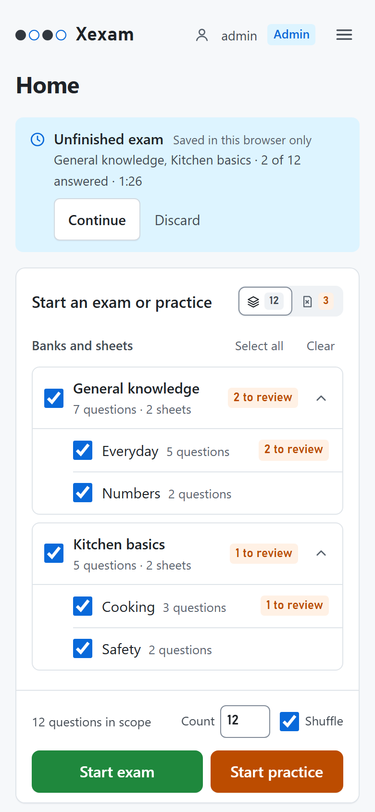</td>
<td width="20%">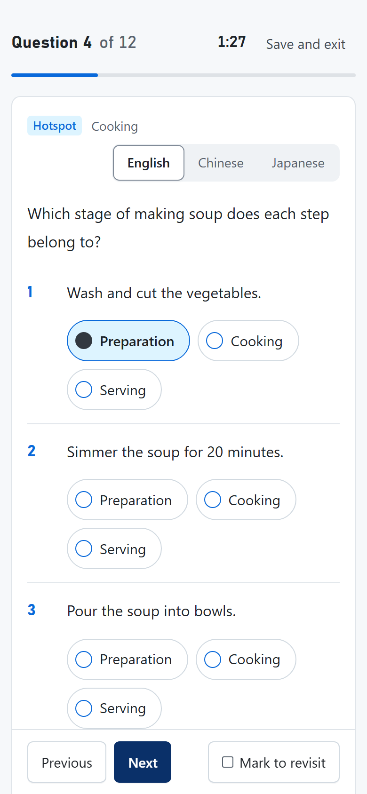</td>
<td width="20%">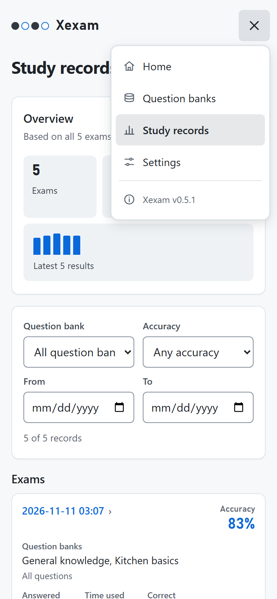</td>
<td width="20%">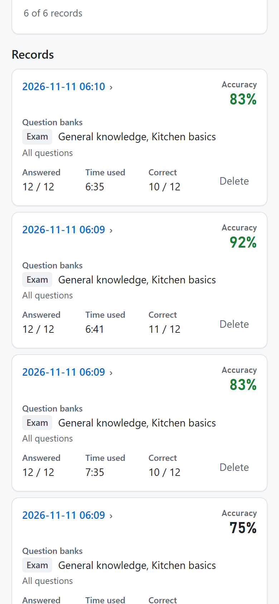</td>
<td width="20%">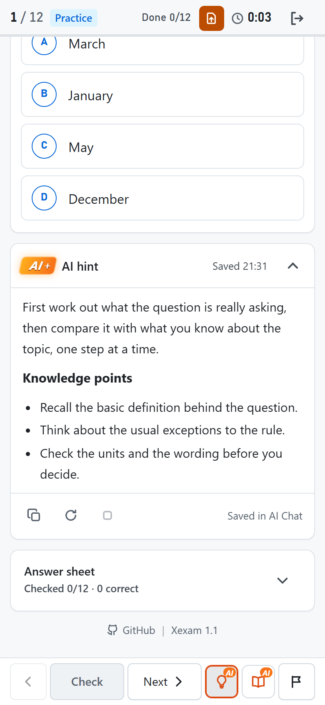</td>
</tr>
<tr>
<td>Home: the scope, <b>Count</b> and <b>Shuffle</b>, with <b>Start exam</b> and <b>Start practice</b> below them, at the bottom of the screen.</td>
<td>Exam: <b>Previous</b>, <b>Next</b> and <b>Mark to revisit</b> stay at the bottom.</td>
<td>The menu of an administrator, opened from the three-line button.</td>
<td>Study records: each record is a compact card.</td>
<td>Practice with the <b>AI+ feature</b>: the AI hint window across the screen, <b>Hint</b> and <b>Explain</b> in the bottom bar.</td>
</tr>
</table>

## 19. When a page says "Too many requests"

Xexam's Nginx limits how many requests reach the backend per second from one address (section 9 of [security.md](security.md)). Behind a tunnel such as Cloudflare Tunnel every user arrives from the tunnel's address, so all of them share that limit. When it is reached, the page retries what it was reading by itself (three tries in all, a second or two apart); a save or any other change is not retried. If the request is still refused, the page says **Too many requests**: wait a few seconds, then reload the page or try again. This is different from the sign-in lock after wrong passwords, which says how long to wait.

AI Chat has a limit of its own in Nginx: starting answers (**Send** and **Retry** in AI Chat, and **AI hint**, **AI explanation**, **AI analysis**, **AI summary** and their **Regenerate**) is limited per signed-in browser, to 20 a minute after a burst of 10, all together. A refused start is not retried; the message box keeps your text and says that there were too many requests, and an AI window says **Too many requests in a short time. Wait a few seconds, then try again.** This can happen when you open AI analysis on one card after another on a long result page; wait a few seconds.
