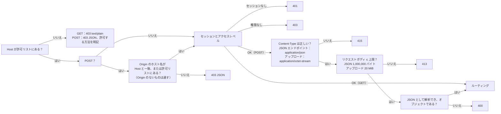

[English](../en/api.md) | **日本語** | [简体中文](../zh-CN/api.md)

# API の説明

> 機械可読版は [openapi.yaml](../en/openapi.yaml) です。本書は人が読むためのもので、各エンドポイントの役割、誰が呼び出せるか、ガードがどのようにリクエストを弾くか、旧 Python 版とどこが違うかを説明します。v0.8 からは、別の ai-service コンテナが応える AI のルート `/api/ai/*`（第 5 節）と、バックエンドと ai-serviceの間の内部ルート（第 6 節）も扱います。v0.9 からは、AI+ 機能の学習用ルート（`/api/ai/study/*` と `/api/ai/summary/*`：練習中、結果ページ、学習記録でのヒント、解説、まとめ。第 5.5 節）、記録をそのセッションに結び付ける 2 つの attempt のフィールド、ai-service が 1 問または 1 件の記録を読むための内部ルート 3 つも扱います。
> 本書が記述するのは**実際の挙動**です。旧版のあらゆるケースをゴールデンレスポンス（`tests/baseline/golden/`、172 件）として記録し、新しい Rust バックエンドはそれらと一件ずつ比較されます。

## 1. 概要

ブラウザはこの REST API だけを通じてバックエンドとやり取りします。フロントエンドにはデータベースへのアクセスも、インポートが可能かどうかやユーザーが何を見られるかを判断するロジックもありません。どちらも、ログイン中のユーザーをもとにバックエンドが決めます。

すべてのルートには、アクセスレベルが 1 つずつ決まっています（`backend/src/api/auth.rs` のルート表 `ROUTES`）。

| アクセス | 呼び出せる人 |
|---|---|
| **公開** | ログインしていない人も含め、誰でも |
| **ログイン** | ログイン中のすべてのユーザー |
| **問題集の管理** | 管理者と、**問題集を管理できる** 権限を持つ一般ユーザー *(v0.7)* |
| **管理者** | 管理者だけ |

| メソッド | パス | アクセス | 役割 | DB に書き込む？ |
|---|---|---|---|---|
| GET | `/api/info` | 公開 | バージョン、CPU アーキテクチャ、プログラムを終了できるか | いいえ |
| GET | `/api/auth/state` | 公開 | 誰がログインしているか、ライブラリのスタンプ *(v0.6)* | いいえ |
| POST | `/api/auth/login` | 公開 | ログイン *(v0.6)* | はい（新しいセッション） |
| POST | `/api/auth/logout` | ログイン | ログアウト *(v0.6)* | はい（セッションを削除） |
| POST | `/api/auth/password` | ログイン | 自分のパスワードを変更する *(v0.6)* | はい |
| GET | `/api/bank` | ログイン | ユーザーが使えるすべての問題集の問題（有効な問題のみ） | いいえ |
| GET | `/api/banks` | ログイン | ユーザーが使える問題集と、そのワークシートと問題数 *(v0.5)* | いいえ |
| GET | `/api/progress` | ログイン | ユーザーの学習の進み具合 | いいえ |
| GET | `/api/records` | ログイン | 保存されているユーザーのすべての学習記録（新しい順） *(v0.5)* | いいえ |
| GET | `/api/record?id=<int>` | ログイン | 1 件の学習記録と、その問題ごとの明細 *(v0.5)* | いいえ |
| GET | `/api/settings` | ログイン | ユーザーの画面の設定 *(v0.5)* | いいえ |
| POST | `/api/attempt` | ログイン | 1 回分の試験または練習の成績を記録する | はい |
| POST | `/api/records/delete` | ログイン | 自分の学習記録を 1 件、またはすべて削除する *(v0.5)* | はい |
| POST | `/api/reset` | ログイン | 自分の学習記録を消去する | はい |
| POST | `/api/settings` | ログイン | 自分の画面の設定を変更する *(v0.5)* | はい |
| POST | `/api/settings/reset` | ログイン | 自分の画面の設定を既定に戻す *(v0.5)* | はい |
| GET | `/api/imports` | 問題集の管理 | 直近 12 回のインポート記録（問題集の管理権限を持つユーザーには、自分の問題集のもの） | いいえ |
| POST | `/api/upload` | 問題集の管理 | .xlsx をアップロードし、**プレビュー**と一回限りの確認コードを得る。任意のヘッダー `X-Bank-Target` *(v0.5)* | **いいえ**（メモリ上に一時保存されるだけ） |
| POST | `/api/import/confirm` | 問題集の管理 | インポートを確定する | **はい**（1 つのトランザクション） |
| POST | `/api/import/cancel` | 問題集の管理 | 自分の確認待ちのインポートを取り消す | いいえ |
| POST | `/api/banks/delete` | 問題集の管理 | 問題集を削除する（その学習データも一緒に削除できる） *(v0.5)* | はい |
| GET | `/api/users` | 管理者 | すべてのアカウントと、その権限とログインのロック *(v0.6)* | いいえ |
| POST | `/api/users/create` | 管理者 | ユーザーを追加する *(v0.6)* | はい |
| POST | `/api/users/update` | 管理者 | ユーザーの名前変更、権限の変更、無効化・有効化、使える問題集と問題集の管理権限の設定 *(v0.6)* | はい |
| POST | `/api/users/password` | 管理者 | ほかのユーザーに新しい初期パスワードを設定する *(v0.6)* | はい |
| POST | `/api/users/delete` | 管理者 | ユーザーとその学習データを削除する *(v0.6)* | はい |
| POST | `/api/users/unlock` | 管理者 | ユーザーのログインのロックを解除する *(v0.6)* | いいえ（メモリのみ） |
| GET | `/api/logs` | 管理者 | システムログの最近の行 *(v0.7)* | いいえ |
| POST | `/api/shutdown` | 管理者 | プログラムを終了する（ローカルマシンで実行しているときのみ使用可能。Docker では常に 403） | いいえ |

`HEAD` は対応する `GET` と同じですが、本文（ボディ）がありません。どのエンドポイントも、まったく同じガード（第 3 節）を通ります。

*(v0.8)* `/api/ai/` の下のすべて（AI チャット、メモリー、AI 設定）には、Nginx がバックエンドにリクエストを確認させた後で、ai-serviceが応えます：第 5 節。その応答は、固定の `code` を持つ JSON と、`send` と `retry` では server-sent events のストリームです。`/internal/*` には Nginx 経由では届きません（第 6 節）。

*(v0.9)* `/api/ai/` の下に、練習中、結果ページ、学習記録で AI+ 機能のために使うルートがさらに 4 つあります（第 5.5 節）。`POST /api/attempt` は、記録がどのセッションのものかを示す 2 つの任意のキーを受け取り、新しい記録の id を返します。`GET /api/record` はそれらをもう一度返します。メインのデータベースは**スキーマ 6**、AI のデータベースは**スキーマ 3** になりました。どちらのアップグレードも、先にバックアップを書き出します（第 7 節「v0.9 での変更」）。

## 2. すべてのレスポンスに共通する事項

- `Cache-Control: no-store` と `X-Content-Type-Options: nosniff`。`Server` ヘッダーはありません。
- JSON は UTF-8 で、日本語や中国語は `\uXXXX` にエスケープされません。区切り文字は `", "` と `": "`（コロンの後にスペースあり）で、キーの順序は固定です（本書と [openapi.yaml](../en/openapi.yaml) に示した順序）。**これは取り決めの一部です**。ゴールデンテスト（`backend/tests/api_golden.rs`）が、JSON を旧版の応答とバイト単位で比較します。
- エラーは `{"error": "<理由>"}` の形式です。理由はユーザーにそのまま表示できる中国語の文で（フロントエンドが表示言語に翻訳します）、第 4 節にすべてを英語の意味と一緒に挙げています。リクエスト層の低レベルな応答だけは、旧版の短い英語のままです：`bad content type`（415）、`too large`（413）、`bad json`（400）、`not found`（404）、`method not allowed`（405）。ログインのロックによる 429 の応答には、キー `retryAfter` が 1 つ加わります。
- バックエンドは、例外名、ファイルパス、SQLite のエラーメッセージをレスポンスに含めません。詳細はログにのみ出力されます。

## 3. ガード（すべてのリクエストが最初に通る）

順序は固定なので、同じ不正なリクエストには常に同じ答えが返ります。



- **Host**：既定では `localhost`、`127.0.0.1`、`::1` のみを受け付けます。別のアドレスやドメイン名でアクセスする場合は、それを環境変数 `XEXAM_ALLOWED_HOSTS` に追加します（カンマ、スペース、またはセミコロン区切り）。`XEXAM_ALLOW_ANY_HOST=1` にすると Host を検査しません（前段にすでに認証がある場合、たとえば Cloudflare Access のときにだけ使います）。
- **Origin**（書き込みリクエストのみ検査）：比較するのは**ホスト名**だけ（プロトコルとポートは比較しません）なので、HTTPS のドメイン名経由でアクセスしても誤って弾かれません。`Origin` のないリクエストは通します（コマンドラインツールはブラウザ内のクロスサイトリクエストではないためです）。プロキシが Host をオリジンサーバーのアドレスに書き換える場合は、公開ドメイン名を `XEXAM_ALLOWED_ORIGINS` に設定します。
- バックエンドは**実際の `Host` ヘッダーだけを読み**、`X-Forwarded-*` は一切読みません。Nginx もそれらを転送しません。
- ほかのメソッド（PUT、DELETE、OPTIONS など）も Host の検査を通り（403 JSON）、その後 **405** と `Allow: GET, HEAD, POST` を返します。
- 拒否されたリクエストへのレスポンスには、送られてきた Host または Origin と、どのオプションにどの値を追加すればよいかが書かれます。**ログ** *(v0.7)*：静かな 1 分の後の最初の拒否は、それだけで 1 行になります（`rejected GET /api/bank: Host "…" is not in the allowed list`）。それに続く拒否は、多くても 1 分に 1 回まとめて記録されます（`rejected N request(s) by the Host / Origin check since the last report; the last one: …`）。次のリクエストが来なくても記録されます。ログの文は常に英語で、403 のボディは中国語のままです。サーバーに届く人なら誰でもログインせずにこうした拒否を起こせるので、1 件 1 行にすると、システムログ（`GET /api/logs`）のほかの行がすべて押し出されてしまうおそれがあるためです。

### セッションとアクセスレベル *(v0.6)*

セッションの検査は、Host（POST では Origin も）の検査の直後、**リクエストボディを読む前に**行われます。

| 状況 | 応答 |
|---|---|
| **公開** のルート | 通します。`GET /api/auth/state` はセッションがあれば読み、ほかのルートはセッションを見ません |
| 有効なセッションがない（Cookie `xexam_session` がない、不明または期限切れ、アカウントが無効にされた） | **401** `请先登录。`（「先にログインしてください。」） |
| アカウントが新しいパスワードを設定しなければならない | 公開ルート（`GET /api/info`、`GET /api/auth/state`、`POST /api/auth/login`）と `POST /api/auth/password`、`POST /api/auth/logout` 以外のすべてのルートで **403** `请先设置新密码。`（「先に新しいパスワードを設定してください。」） |
| 一般ユーザーが **管理者** のルートを呼んだ | **403** `只有管理员可以进行这个操作。`（「この操作ができるのは管理者だけです。」） |
| 権限のない一般ユーザーが **問題集の管理** のルートを呼んだ *(v0.7)* | **403** `你没有管理题库的权限，请联系管理员。`（「問題集を管理する権限がありません。管理者に問い合わせてください。」） |

- ルート表にないパスにもセッションが必要です。セッションがなければ 401、あれば 404 です（GET：`text/plain` の `not found`、POST：Content-Type、サイズ、JSON の検査の後に `{"error": "not found"}`）。
- セッションは Cookie `xexam_session` からだけ読みます。権限と **問題集を管理できる** 権限は、リクエストのたびにセッションと一緒にデータベースから読むので、管理者による変更は、そのユーザーの次のリクエストからすぐに反映されます。
- セッションは 30 日間有効で、使うたびに延長されます。リクエストがあると、多くても 1 時間に 1 回セッションを延長し、Cookie を送り直します。延長するのは、スキームが分かっているリクエストだけです：`XEXAM_COOKIE_SECURE=1` のとき、またはリクエストに `Origin` ヘッダーがあるとき（ブラウザの POST にはすべて付きます）。こうすることで、HTTPS で発行した Cookie から延長のときに `Secure` が外れることはありません。
- 学習記録、間違いノート、進み具合、設定は、常にログイン中のユーザーのものです。その id はセッションから取り、リクエストからは取りません。ほかのユーザーの記録は、存在しない記録とまったく同じ応答になります。

### 各ユーザーが見られるもの・管理できるもの *(v0.7)*

- **管理者** は、すべての問題集を利用・管理できます。
- **一般ユーザー** が見られるのは、管理者がそのユーザーのために選んだ問題集だけです（`GET /api/users` の `banks`。id のリストで、空のこともあります）。`newBanks`（**今後インポートする問題集も含める**）がオンなら、その後に作られた問題集は、作られたときにすべてこのリストに加わります。既存の問題集がこれで加わることはありません。**問題集を管理できる** 権限を持つ一般ユーザーは、自分でインポートした問題集も見られます（権限がある間だけです。権限がなくなると、自分の問題集も、選ばれた問題集に含まれている場合しか見られません）。
- **問題集の管理権限を持つユーザー** は、新しい問題集をインポートし（そのユーザーが所有者になります）、自分が所有する問題集だけを更新・削除できます。管理者やほかのユーザーの問題集を更新・削除しようとすると **403** `这个题库不是你上传的，只能更新或删除你自己上传的题库。`（「この問題集はあなたがアップロードしたものではありません。更新や削除ができるのは、自分でアップロードした問題集だけです。」）になります。この確認は書き込みのトランザクションの中で行われるので、何も書き込まれません。

すべての問題集を見られるわけではないユーザーには、どのルートも同じ規則に従います。

| ルート | 得られるもの |
|---|---|
| `GET /api/bank` | そのユーザーの問題集の問題とワークシートだけ。`file` / `mtime` は、そのユーザーの問題集のどれかへの最新のインポートのもの |
| `GET /api/banks` | そのユーザーの問題集だけ。`studied` と `records` は自分の学習データを数えます |
| `GET /api/progress` | `questions` にはそのユーザーの問題集の問題の統計だけが入ります（間違いノートとその復習もこれに従います）。`history` は変わりません |
| `POST /api/attempt` | 見られない問題集の問題は、削除された問題とまったく同じに扱われます。数に入らず、`notCounted` で返されます |
| `GET /api/records` | そのユーザーの記録はすべて、保存されたときの問題集の名前とともに履歴として残ります |
| `GET /api/record` | 見られない問題集の問題は、削除された問題と同じく `"question": null` になります（問題文は送られません） |
| `GET /api/auth/state` | `library` は、そのユーザーの問題集とアクセスだけに従います |
| `GET /api/info` | 全員に同じ：バージョン、アーキテクチャ、`canShutdown` だけ（このルートは公開で、コンテナのヘルスチェックに使われます） |

## 4. エンドポイントの詳細

### `GET /api/info`
```json
{"version": "0.9", "arch": "x86_64", "canShutdown": false}
```
公開。バージョン番号は `VERSION` ファイルの `CODE_VERSION`（または `XEXAM_VERSION`）です。`arch` はサーバーの CPU アーキテクチャ、`canShutdown` はプログラムが `--allow-shutdown` 付きで起動されたときだけ `true` です。*(v0.7.5)* キー `bankCount`（ライブラリ全体の有効な問題の数）はなくなりました。このルートは公開で、ログインしたページは見られる問題の数を `GET /api/bank` と `GET /api/banks` から数えるためです。このルートは今もデータベースを読むので、データベースを読めないときは 500 を返し、（このルートに問い合わせる）コンテナのヘルスチェックはバックエンドを unhealthy と報告します。

### `GET /api/auth/state` *(v0.6)*
公開。ログインしていないとき（Cookie がない、またはセッションがもう有効でない）：

```json
{"user": null, "defaultAdmin": "admin"}
```

`defaultAdmin` は、既定のパスワード `admin` のままの有効な管理者のユーザー名（id の小さいものが先）、または `null` です。ログインページはこれを使って、初めてログインするときの方法を、アカウントの実際の名前で（名前が変更されている場合もあります）オーナーに伝えます。そのパスワードを変更または再設定するか、そのアカウントを無効化・降格・削除すると、`null` になります。

ログインしているとき（新しいパスワードの設定が必要な間も含む）：

```json
{"user": {"id": 1, "username": "admin", "role": "admin", "mustChangePassword": false, "canManageBanks": true, "aiAllowed": true}, "library": "3f0c9a7d5e21b4c88a9d0e6f17b2c453", "aiAvailable": true, "aiService": {"connected": true, "stopped": false, "lastSeen": 1789900000, "version": "0.9", "enabled": true, "link": true}}
```

- `role` は `admin` または `user` です。`canManageBanks` *(v0.7)* は、すべての管理者と、**問題集を管理できる** 権限を持つ一般ユーザーで `true` です。`aiAllowed` *(v0.8)* は、すべての管理者と、**AI+** を持つ一般ユーザーで `true` です。そもそも AI がオンかどうかは `GET /api/ai/status` にあります。同じ `user` オブジェクトが、ログインとパスワードの変更の応答にも入ります。
- `library` は、ユーザーが見られる問題集を表す中身の見えないスタンプです。16 進数 32 桁のダイジェストで、もとになった数値は何も分かりません。それらの問題集のどれかがインポート・置き換え・削除されると変わり（別のプロセスの `import` コマンドによるものも含みます）、*(v0.7)* ユーザーが見られる問題集や管理できる問題集が変わったときにも変わります（管理者が問題集を割り当てた、権限を変えた、問題集の所有者が変わった）。開いているページはこれを比べ、変わったら問題集を読み直します。一部の問題集だけを見られるユーザーでは、スタンプはその問題集だけから作られます。見られない問題集のサイズ、問題数、更新日時は明かさず、それに合わせて変わることもありません。

- `aiAvailable` *(v0.8、ラウンド 2)* は、AI+ が利用できる間 `true` です。ai-service がバックエンドに報告してから 60 秒以内で（かつ停止すると伝えていない）、**かつ** AI 設定の **AI+ 機能** のスイッチがオンのときです。ログインしているすべてのユーザーで同じ値です。ユーザー管理ページは、これを使って AI+ のスイッチを表示するかどうかを決め、バックエンドは、これを使ってそれを拒否します（下の `POST /api/users/update` と `create`）。
- `aiService` *(v0.8、ラウンド 2)* が応答に入るのは**管理者だけ**です（一般ユーザーの応答にはこのキーがありません）。ai-service についてバックエンドが知っていることで、最後の報告から得ています（バックエンドが ai-service を呼び出すことはありません。ai-service が、25 秒ごと、変更の直後、停止するときに 1 回報告します：第 6 節の `POST /internal/ai/heartbeat`）。報告はメモリに保持されるので、バックエンドを再起動した後は、次の報告が届くまで（25 秒以内）`lastSeen` は `null` です。

| キー | 意味 |
|---|---|
| `connected` | `true`：報告が 60 秒より新しく、停止の報告ではない |
| `stopped` | `true`：最後の報告が、ai-service が終了中だと伝えていた（報告の古さに関係なく） |
| `lastSeen` | バックエンドの起動後に受理された最後の報告の Unix 秒。報告がなければ `null` |
| `version` | 最後の報告に含まれていたバージョン、または `null` |
| `enabled` | 最後の報告にある AI+ 機能のスイッチ（`connected` の間）。接続されていないときは `false` |
| `link` | バックエンドが内部トークンを読み込んでいる（AI との接続がオン）とき `true` |

### `POST /api/auth/login` *(v0.6)*
公開。ボディ：`{"username": "…", "password": "…"}`（どちらも文字列。そうでなければ **400** `请求的格式不对。`）。ユーザー名は前後の空白を除き、大文字小文字を区別せずに比べます。

- **200** `{"user": {…}}`（`GET /api/auth/state` と同じオブジェクト）と、2 つの Cookie：
  - `xexam_session=<43 文字>; HttpOnly; SameSite=Strict; Path=/; Max-Age=2592000`（30 日）。ログインのたびに新しいランダムなトークンが発行され、データベースにはその SHA-256 だけが保存されます。1 人のユーザーのセッションは最大 20 個で、それを超えてログインすると、期限の早いセッションから終了します。
  - `xexam_device=<43 文字>; HttpOnly; SameSite=Strict; Path=/api/auth; Max-Age=34560000`（400 日）：このアカウントが以前ログインしたブラウザであることを示します。アカウントの現在のパスワードハッシュをキーにしたハッシュなので、パスワードが変わると使えなくなります。サーバーには何も保存しません。
  - どちらも、リクエストの `Origin` が `https://…` のとき、または `XEXAM_COOKIE_SECURE=1` のときだけ `Secure` が付くので、LAN 内の HTTP でもログインできます。
- **401** `用户名或密码不对。`（「ユーザー名またはパスワードが正しくありません。」）：パスワードの間違い、存在しないユーザー名、無効なアカウントのどれでも、同じだけの処理をしてから返すので、応答からユーザー名が存在するかどうかは分かりません。
- **429** `{"error": "登录失败次数太多，请稍后再试。", "retryAfter": <秒>}`（「失敗が多すぎます。しばらくしてからもう一度お試しください。」）と `Retry-After` ヘッダー：ログインがロックされている間。ロック中は正しいパスワードでもすべて 429 になり、429 の応答は失敗として数えません。

ロックは段階的に長くなります。15 分以内に 5 回失敗すると 1 分間ロックされ、その後は各段階で 3 回まで失敗でき、ロックは 5 分、15 分、30 分、1 時間、1 日と長くなります。状態はアカウント（そのユーザー id。名前を変えても引き継がれます）に記録され、アカウントのない名前にも同じ段階が適用されます。アカウントの `xexam_device` Cookie を持つブラウザからの試行は、ほかのすべてのブラウザとは別に数えるので、ユーザー名を推測している人が、そのアカウントの持ち主を以前使ったブラウザから締め出すことはできません。ログインの成功、管理者によるパスワード再設定または **ロック解除**、バックエンドの再起動、または 24 時間何もないことで、アカウントの状態は最初に戻ります。詳細と理由：[security.md](security.md)。

### `POST /api/auth/logout` *(v0.6)*
ログイン（新しいパスワードの設定が必要な間も可）。ボディは `{}` または空。このセッションを削除し、期限切れの Cookie（`xexam_session=; HttpOnly; SameSite=Strict; Path=/; Max-Age=0`）と一緒に `{"ok": true}` を返します。

### `POST /api/auth/password` *(v0.6)*
ログイン（新しいパスワードの設定が必要な間も可）。ボディ：`{"current": "…", "password": "…"}`。新しいパスワードの設定が必要なアカウントでなければ `current` が必要です（必要なアカウントでは、セッションが本人であることの証明になります）。

- **200** `{"user": {…}}`、`mustChangePassword: false`。このセッションも含め、アカウントのすべてのセッションが終了します。このブラウザには**新しい** `xexam_session` Cookie（と、新しいパスワードの `xexam_device` Cookie）が送られるので、アカウントのほかのブラウザはログアウトされ、コピーされた Cookie も使えなくなります。
- **400** `请求的格式不对。`：`password`（または必要な `current`）がない、または文字列でない。`密码需要 8–128 个字符。`（「パスワードは 8〜128 文字にしてください。」）。`新密码不能和原来的一样。`（「新しいパスワードは元のパスワードと別のものにしてください。」）。
- **403** `当前密码不对。`（「現在のパスワードが正しくありません。」）。現在のパスワードの間違いはログインの失敗と同じ枠で数えるので、ここでもロック（上と同じ **429**）がかかります。
- **401** `请先登录。`：リクエストの処理中に、アカウントが無効化・削除された、またはパスワードがほかの場所で変更・再設定されたとき（何も書き込みません）。

### `GET /api/users` *(v0.6)*
管理者。すべてのアカウントを id の順に返します。

```json
{"users": [{"id": 2, "username": "cook", "role": "user", "disabled": false, "createdAt": "2026-11-10 14:00", "lastLoginAt": "2026-11-10 15:02", "mustChangePassword": false, "records": 12, "banks": [1, 3], "newBanks": true, "canManageBanks": true, "ai": true, "ownedBanks": [3], "lock": null, "aiSuspended": false}], "aiAvailable": true}
```

- `createdAt` / `lastLoginAt` はローカル時刻 `YYYY-MM-DD HH:MM` です。`lastLoginAt` は最初のログインまで `null` です。
- `records` は、ユーザーの学習記録（試験と練習）の数です。
- `banks` *(v0.7)*：そのユーザーが見られる問題集の id の昇順のリスト（まだ存在する問題集だけ。`[]` = なし）。常にリストです。`"all"` は書き込むときの省略形にすぎません（下記）。
- `newBanks` *(v0.7)*：**今後インポートする問題集も含める**。`true` なら、これから作られる問題集（誰かが新しい問題集としてインポートしたもの、またはコマンドラインの `import`）は、同じトランザクションで `banks` に加わります。既存の問題集を加えることはありません。
- `canManageBanks` *(v0.7)* は、保存されている **問題集を管理できる** 権限です。`banks`、`newBanks`、`canManageBanks` は権限が変わっても保持されますが、意味を持つのはアカウントが一般ユーザーの間だけです。管理者はすべての問題集を利用・管理できます。
- `ai` *(v0.8)*：保存されている、ユーザーの **AI+ 機能** のスイッチ。意味があるのは一般ユーザーだけで（管理者は AI がオンの間は常に使えます）、AI 設定で AI+ 機能がオンの間だけです。AI+ が利用できないときも保持されます。
- `aiSuspended` *(v0.8、ラウンド 2)*、`lock` の後：管理者が AI 設定でそのユーザーの **AI+ 機能** を一時停止したとき `true`（第 5 節の `suspend`。画面では「一時停止」「一時停止中」と表示され、JSON では名前 `suspended` のままです）。ai-service の最後の報告から来るので、バックエンドに報告がない間（たとえば再起動の直後）は全員 `false` で、一時停止できない管理者は常に `false` です。`ai` とは別で、一時停止しても保存されているスイッチは変わりません。
- `aiAvailable` *(v0.8、ラウンド 2)*、`users` の隣のトップレベルのキー：`GET /api/auth/state` と同じ値。**ユーザーの一覧を返すすべての応答**にあります（`create`、`update`、`password`、`delete`、`unlock` も）。
- `ownedBanks` *(v0.7)*：ユーザーが新しい問題集としてインポートした（所有している）問題集の id の昇順のリスト。
- `lock`：アカウントのログインの状態（メモリ上）。最初の段階でロックもされていなければ `null`、それ以外は次のとおりです。

```json
{"until": "2026-11-10 15:20:07", "retryAfter": 298, "round": 2, "triesLeft": 0, "knownBrowser": false, "otherUntil": null, "otherRetryAfter": 0}
```

| キー | 意味 |
|---|---|
| `until` | 現在のロックが終わるローカル時刻 `YYYY-MM-DD HH:MM:SS`。ロックされていなければ `null` |
| `retryAfter` | それまでの秒数。ロックされていなければ `0` |
| `round` | ロック中：このロックで終わった段階（1 = 最初の 1 分のロック）。それ以外：進行中の段階（2 以上） |
| `triesLeft` | 進行中の段階で、次のロックまでに失敗できる残りの回数（ロック中は `0`） |
| `knownBrowser` | `true`：表示している状態は、ユーザーが以前ログインしたブラウザからのログインを数えたもの。`false`：それ以外のすべてのブラウザから。両方を記録しているときは、ユーザーをより強く止めているほうを表示します |
| `otherUntil` / `otherRetryAfter` | ほかのブラウザも同時にロックされていて、アカウントがすべてのブラウザでロックされているときだけ設定されます：その 2 つ目のロックの終わりとその秒数（それ以外は `null` / `0`） |

### `POST /api/users/create` *(v0.6)*
管理者。ボディ：`{"username": "…", "password": "…", "role": "admin" | "user", "banks": "all" | [<問題集の id>, …], "newBanks": <bool>, "canManageBanks": <bool>, "ai": <bool>}`。*(v0.7)* `banks` の既定は `[]`（管理者が選ぶまで、新しいユーザーには問題集が表示されません）、`newBanks` と `canManageBanks` の既定は `false` です。*(v0.8)* `ai`（**AI+**）の既定も `false` です。`ai: true` でユーザーを作成すると、`user "<admin>" turned AI+ on for user "<name>"` もログに出ます。*(v0.8、ラウンド 2)* AI+ が利用できない間（上の `aiAvailable` を参照）は **409** `ai.serviceOff` で拒否され、ユーザーは作成されません。`ai: false` や `ai` なしは、これまでどおり使えます。`"banks": "all"` は省略形で、今あるすべての問題集を意味し、`newBanks` を指定しなければ `newBanks: true` にもなります。重複した id は無視されます。新しいアカウントは有効で、最初のログインで新しいパスワードを設定しなければなりません。応答：`GET /api/users` と同じ `{"users": [...]}`。

ユーザー名は 1〜40 文字（ASCII の英字、数字と `. _ - @`。前後の空白は除きます）で、大文字小文字を区別せずに一意です。パスワードは 8〜128 文字です。

| 応答 | 場面 |
|---|---|
| **400** `用户名不对：1–40 个字符，只能用字母、数字和 . _ - @。`（「ユーザー名が正しくありません……」） | `username` がない、文字列でない、または規則に合わない |
| **400** `密码需要 8–128 个字符。` | `password` が短すぎる、または長すぎる |
| **400** `请求的格式不对。` | `password` がない、または文字列でない。`role` がない、または `admin` / `user` でない。`banks` が `"all"` でも整数のリストでもない。`newBanks`、`canManageBanks`、`ai` のどれかが真偽値でない |
| **400** `选择的题库中有不存在的（可能已被删除），请刷新页面后再试。`（「選んだ問題集の中に存在しないものがあります……」） *(v0.7)* | `banks` の中の id が既存の問題集でない（または正の整数でない）。何も作成されません |
| **409** `这个用户名已经有人用了。`（「このユーザー名はすでに使われています。」） | ほかのアカウントが（大文字小文字を区別せずに）その名前を持っている |
| **409** `{"error": "请先在 AI 设置里开启 AI+ 功能。", "code": "ai.serviceOff"}`（「先に AI 設定で AI+ 機能をオンにしてください。」） *(v0.8、ラウンド 2)* | `ai: true` なのに AI+ が利用できない。ボディの検証の後（形式の正しくない `ai` は今でも 400）、何かを書き込む前、パスワードをハッシュする前に確認します |

### `POST /api/users/update` *(v0.6)*
管理者。ボディ：`{"id": <int>, "username"?, "role"?, "disabled"?, "banks"?, "newBanks"?, "canManageBanks"?, "ai"?}`。省略したキーは変わりません。応答：`{"users": [...]}`。

- アカウントを無効にするか権限を変えると、そのセッションは終了します。名前の変更、`banks`、`newBanks`、`canManageBanks`、`ai` の変更ではセッションは残り、変更はユーザーの次のリクエストから反映されます。
- `ai` *(v0.8)* は、ユーザーの **AI+ 機能** をオンまたはオフにします。次の AI のリクエストからすぐに反映され（バックエンドは AI のリクエストをすべて確認します）、オフにすると、そのユーザーのために作成中の回答は約 2 秒以内に止まります。そのユーザーの AI チャットとメモは残ります。変更は `user "<admin>" turned AI+ on for user "<name>"`（または `off`）としてログに出ます。
- *(v0.8、ラウンド 2)* AI+ が利用できない間（ai-service が接続されていない、または AI 設定で AI+ 機能がオフ）は、**`ai` キーを含むリクエストは全体が拒否されます**。**409** `{"error": "请先在 AI 设置里开启 AI+ 功能。", "code": "ai.serviceOff"}`：`true` でも `false` でも、保存されている値と同じでも違っても、単独でもほかのフィールドと一緒でも同じです。何も書き込まれず、何もログに出ません。`ai` のないリクエストには影響しません。これは、バックエンド自身のルートのエラーで `code` を持つ唯一のものです。すべてのユーザーの保存されているスイッチは AI+ が利用できない間も保持され、利用できるようになるとまた有効になります。
- `banks` は選ばれた問題集を置き換えます（id のリスト、`[]` = 問題集なし。または `"all"` で、今あるすべての問題集。`newBanks` を指定しなければ `newBanks: true` にもなります）。`newBanks` だけを送ると、フラグだけが変わります。オフにしても、ユーザーが今見られる問題集はそのままです。
- **400**：作成と同じです（`username`、`role`、`banks`、`newBanks`、`canManageBanks`、`ai`。`disabled` が真偽値でない → `请求的格式不对。`。`id` がない、または整数でない（真偽値は整数とみなしません）→ `请求的格式不对。`）。
- **404** `这个用户不存在（可能已被删除），请刷新页面后再试。`（「このユーザーは存在しません……」）。
- **409** `不能对自己的账户做这个操作。`（「自分のアカウントにはこの操作はできません。」）：自分を無効にしたり、自分の権限を変えたりしたとき。`至少要保留一个启用的管理员。`（「有効な管理者を少なくとも 1 人残す必要があります。」）：変更すると有効な管理者がいなくなるとき。`这个用户名已经有人用了。`。

すべての確認は書き込みと同じトランザクションの中で行われるので、2 つのリクエストが両方とも確認を通ってしまうことはありません。

### `POST /api/users/password` *(v0.6)*
管理者。ボディ：`{"id": <int>, "password": "…"}`。ほかのユーザーに新しい初期パスワードを設定します。そのユーザーは次のログインで新しいパスワードを設定しなければならず、セッションは終了し、`xexam_device` Cookie は一致しなくなり、ログインのロックも解除されます。自分のパスワードは `POST /api/auth/password` で変更します（ここでは **409** `不能对自己的账户做这个操作。`）。ほかのエラー：400（パスワードの規則、形式の正しくないボディ）、404（存在しないユーザー）。

### `POST /api/users/delete` *(v0.6)*
管理者。ボディ：`{"id": <int>}`。アカウントを、そのセッション、学習記録（明細を含む）、間違いの統計、設定、選ばれた問題集と一緒に削除します。*(v0.7)* そのユーザーが所有していた問題集は削除されず、ユーザーを削除した管理者のものになります。*(v0.8)* そのユーザーはすぐに AI のルートに届かなくなります。その AI チャットとメモは、ai-serviceが次の照合のとき（10 分以内、または管理者が AI のユーザーの一覧を開いたとき）に削除します。自分自身と最後の有効な管理者には **409**、存在しない id には **404** を返します。

### `POST /api/users/unlock` *(v0.6)*
管理者。ボディ：`{"id": <int>}`。アカウントのログインの状態を、すべてのブラウザについて完全に消去します（最初の段階、5 回試せる状態に戻ります）。ロック中でも、ロックはされていないが最初の段階を過ぎているだけでも使えます。ユーザー id で動くので、名前を変えた後でも、自分のアカウントにも使えます。存在しない id には **404**。応答：`{"users": [...]}`。

### `GET /api/bank`
ログイン。`file` / `mtime` は直近のインポート（ユーザーが見られる問題集へのもの）のファイル名と日時です。`questions` には、ユーザーが見られるすべての問題集の有効な問題だけが入ります。問題集の id の昇順にまとめられ、各問題集の中ではその問題集の順序で並びます。`sheets` には、ワークシート名ごとに、利用可能な問題の数と無効化済みの問題の数が入ります（別々の問題集にある同じ名前のワークシートは合算されます。問題集ごとの数は `GET /api/banks` にあります）。問題のフィールドは [openapi.yaml](../en/openapi.yaml) の `Question` を参照してください。
v0.5 からは、どの問題にも最後にキーが 1 つ追加されます。`"bank": <問題集の id>`（`row` の後ろ）です。

問題のキーの順序は `kind, tag, stem, options, items, answer, translation, zh, [english, en,] [lang, ja,] explanation, mnemonic, note, [explain,] id, sheet, row, bank` です。角括弧の中のキーは、それを持つ形式にだけ現れるので、古いファイルの出力は以前とバイト単位で同一です。v0.7 からは 6 列形式しかインポートできず、古い形式の問題は起動のたびに出題停止になるので、`GET /api/bank` に含まれるのは通常 6 列形式の問題だけです。古い形は、以前の記録にある出題停止の問題のために、今も `GET /api/record` に現れます。

- **3 列形式**（A 問題、B 中国語、C 答え）：どれも現れません。
- **4 列形式**（A 英語、B 中国語、C 日本語、D 答え）：`english`（A 列の原文）と `en`（日本語の構造に合わせて分割した英語）。`stem`、`options`、`items`、`answer` は C 列の日本語に由来します。
- **6 列形式** *(v0.7)*（A 英語、B 中国語、C 日本語の問題、D 英語、E 中国語、F 日本語の答えと解説）：英語が基準なので、`stem`、`options`、`items`、`answer` は英語のもので、`"lang": "en"` がそれを示します。`zh`（B 列）と `ja`（C 列）は、ほかの 2 つの言語を英語の構造に合わせて分割したものです（対応していないときは `null` / なし）。`explain` には言語ごとの解説、覚え方、答えの注記が入ります：`{"en": {"explanation", "mnemonic", "note"}, "zh": {…}, "ja": {…}}`。3 つのどれもない言語は省かれます。`explanation` / `mnemonic` / `note` は古いクライアントのために残してあります（中国語の文があればそれ、なければ日本語、なければ英語）。ホットスポット問題の `tag` は `HOTSPOT` です（古い形式では `ホットスポット`）。

`zh` / `en` / `ja` の中のホットスポット問題には、キー `choices` が 1 つ追加されます。各小項目の選択肢を、その言語で書いたものです。

### `GET /api/banks` *(v0.5)*
ログイン。問題集とは、インポートした 1 つのワークブックのことです。ユーザーが見られる問題集を `id` の順に返します。

```json
{"banks": [{"id": 1, "name": "Kitchen basics", "filename": "Kitchen basics.xlsx", "legacy": true, "createdAt": "2026-11-10 14:00", "updatedAt": "2026-11-10 15:00", "total": 5, "inactive": 0, "sheets": [{"name": "Cooking", "usable": 3, "inactive": 0}, {"name": "Safety", "usable": 2, "inactive": 0}], "studied": 4, "records": 3, "ownerId": 1, "owner": "admin", "manageable": true}]}
```

- `name` は、問題集を作成したときのファイル名から `.xlsx` を除いたものです（ほかの問題集がすでに同じ名前を使っている場合は ` (2)`、` (3)`、… が付きます）。問題集を更新すると `filename` と `updatedAt` は変わりますが、`name` は変わりません。
- `legacy`：v0.5 より前のデータを持つ問題集で、`X-Bank-Target` を付けないアップロードのインポート先です。この問題集の問題 id は、[database.md](database.md) の 4.1 節にある通常の問題 id です。ほかの問題集はすべて問題集ごとの id を使うので、同じワークブックを 2 つの独立した問題集としてインポートできます。
- `total` = 有効な問題の数、`inactive` = 無効化された問題の数です。`sheets` は問題集内の問題の順に並び、問題がすべて無効化されたワークシート（`usable` が 0）も含みます。
- `studied` = この問題集の問題（有効・無効を問わず）のうち、統計があるものの数です。`records` = この問題集を含む学習記録の数です。管理者にはすべてのユーザーのデータを数えます（学習データと一緒に削除したときに消えるもの）。それ以外のユーザーには *(v0.7)* 自分のデータだけを数えます。
- `ownerId` / `owner` *(v0.7)*：その問題集を新しい問題集としてインポートしたユーザーの id とユーザー名です（v0.7 より前の問題集は最初の管理者のものです）。両方が得られるのは管理者だけです。ほかのユーザーには、自分の問題集のときだけ `ownerId` が入り（それ以外は `null`）、`owner` は常に `null` なので、問題集の一覧からほかのアカウントの名前は分かりません。
- `manageable` *(v0.7)*：このユーザーがその問題集を更新・削除できるかどうか（管理者：常に、問題集の管理権限を持つユーザー：自分の問題集、それ以外：なし）。

### `GET /api/progress`
ログイン。`questions` は、ユーザーの問題ごとの累計統計（何回解いたか、何回正解したか、何回間違えたか、現在何回連続で正解しているか）で、見られる問題集のものに限られます。`history` は直近 60 件の学習記録です（データベースには 500 件が残ります。`GET /api/records` を参照）。各記録の最後には `kind` *(v0.7)* が付きます。`masterStreak` は間違いノートから外れるまでに必要な連続正解回数（2）です。

```json
{"version": 1, "questions": {"1a2b3c4d5e6f": {"attempts": 3, "correct": 2, "wrong": 1, "streak": 2, "last": true, "at": "2026-11-10 15:10"}}, "history": [{"at": "2026-11-10 15:10", "sheets": ["Cooking"], "mode": "all", "total": 5, "correct": 4, "percent": 80, "seconds": 130, "kind": "exam"}], "masterStreak": 2}
```

### `GET /api/imports`
問題集の管理。`{"imports": [{"id", "at", "filename", "added", "updated", "removed", "restored", "skipped", "total"}, …]}` を、新しいものから 12 件返します。管理者にはすべてのインポートを、問題集の管理権限を持つユーザーには *(v0.7)* 自分が所有する問題集へのインポートだけを返します。

### `POST /api/upload`
問題集の管理。リクエストボディは .xlsx の生のバイト列です。任意のヘッダー `X-Filename` には、パーセントエンコードしたファイル名を入れます。サーバーは次の処理を行います。

1. ファイルの**内容**だけで .xlsx かどうかを判断します（マジックナンバー + ZIP 構造 + ワークブックがある + DOCTYPE / エンティティ宣言がない + 展開後のサイズに上限がある）。空のファイル、旧形式の `.xls`、破損したファイル、拡張子を書き換えたファイルには、それぞれ専用の中国語の説明が付きます。
2. 解析します。*(v0.7)* パーサーが古い 3 列・4 列形式の問題を 1 問でも読み取ると、アップロードは **400** `只能导入六列格式（A–C 列：英文、中文、日文题目；D–F 列：英文、中文、日文答案）。这个文件是旧的三列或四列格式，请改成六列格式后再导入。`（「インポートできるのは 6 列形式だけです（A〜C 列：英語・中国語・日本語の問題文、D〜F 列：英語・中国語・日本語の解答）。このファイルは古い 3 列または 4 列形式です。6 列形式に直してから、もう一度インポートしてください。」）で拒否されます。新しい問題集でも更新でも同じです。何も一時保存されず、確認待ちスロットにも触れません。ログにはファイル名を含む英語の行が出ます。
3. プレビューを生成し、解析結果をメモリ上の**アップロードした人自身の確認待ちスロット**に入れます（再度アップロードすると置き換えられます。ほかのユーザーのスロットには触れません）。有効期間は 30 分です。
4. **データベースには書き込みません。**

プレビュー（`added / updated / unchanged / restored / removed / skipped / usable`、ワークシートごとの明細、読み取れなかった行とその理由）と、一回限りの確認コード `token` を返します。

```json
{"sheets": [{"name": "Cooking", "total": 3, "usable": 3, "skipped": [], "added": 3, "updated": 0, "removed": 0, "restored": 0, "skippedMore": 0, "skippedCount": 0}], "added": 3, "updated": 0, "unchanged": 0, "restored": 0, "removed": 0, "skipped": 0, "usable": 3, "removed_samples": [], "removed_stats": 0, "filename": "Kitchen basics.xlsx", "token": "…"}
```

各ワークシートには、読み取れなかった行が最大 30 行まで並びます（`skipped`、それぞれ `{"row", "reason"}`）。`skippedMore` はそれ以外に何行あるか、`skippedCount` は全部で何行あるかです。

**警告** *(v0.7)*：中国語（E 列）や日本語（F 列）の答えが英語の答え（D 列）と異なる行も、英語の答えでインポートされ、警告として一覧に載ります。キーが現れるのはこのときだけなので、警告のないプレビューのキーは以前の版とまったく同じです。警告のあるワークシートには `warnings`（最大 30 件の `{"row", "reason"}`。`restored` の直後）と、その最後に `warningsMore` と `warningsCount` が付きます。プレビュー全体には、`removed_stats` の後に警告の総数 `warnings` が付きます。理由は `E 列的中文答案和 D 列的英文答案不一致（已按英文答案导入）`（「E 列の中国語の答えが D 列の英語の答えと一致しません（英語の答えでインポートしました）」）と、F 列の日本語の答えについての同様の文です。

**インポート先の問題集** *(v0.5)*：任意のヘッダー `X-Bank-Target` で、ファイルをどの問題集に入れるかを指定します。プレビューのキーはどの場合も同じで、インポート先の問題集だけを基準に計算されます。

| `X-Bank-Target` | 意味 |
|---|---|
| なし | v0.4 とまったく同じ動作で、レガシー問題集がインポート先です（まだない場合は確定時に作成されます） |
| `new`（前後の空白は無視、大文字小文字は区別しない） | 確定時に新しい問題集を作成し、アップロードした人が所有者になります。プレビューでは、利用可能な問題がすべて `added` になります |
| 問題集の id、`^[0-9]{1,18}$`（前後の空白は無視） | その問題集を更新（置き換え）します。存在しない id → **404** `这个题库不存在（可能已被删除），请刷新页面后再试。` |
| それ以外 | **400** `上传目标不对，请刷新页面后再试。`（「アップロード先が正しくありません……」） |

このヘッダーは、ガードとサイズ上限の後、ファイルの解析の前に読まれます。問題集の管理権限を持つユーザーが更新できるのは、自分が所有する問題集だけです *(v0.7)*。ほかの人の既存の問題集（ヘッダーなしのアップロードではレガシー問題集も）→ ファイルを解析する前に **403** `这个题库不是你上传的，只能更新或删除你自己上传的题库。`。拒否されたアップロードは確認待ちスロットに影響しません。

**メモリの枠** *(v0.7)*：管理者と問題集の管理権限を持つユーザーはそれぞれスロットを持ち、パーサーの上限に近いワークブックは 1 つで 100 MB を超えることがあるため、一時保存したすべてのプレビューで 128 MiB の枠を共有します（内容から見積もります）。新しいアップロードを一時保存するときは、まず期限切れのプレビューを捨て、合計が枠を超えている間は、ほかのユーザーのいちばん古いプレビューから捨てます。最新のアップロードは必ず残ります。プレビューを捨てられたユーザーには、確定時に、30 分を過ぎたときとまったく同じ **409** が返ります。

ほかの応答：**413** `文件太大了（最大 20 MB）。…`（「ファイルが大きすぎます（最大 20 MB）……」）。**400** とファイルを拒否した理由（.xlsx でない、破損している、展開すると大きすぎる、解析に時間がかかりすぎた、古い形式である、など）。

### `POST /api/import/confirm`
問題集の管理。リクエストボディは `{"token": "…"}` です。

- 確認コードは 128 ビットの乱数（22 文字）で、**一度しか使えません**。確定できるのは呼び出した人自身の確認待ちのアップロードだけです。誤った確認コード、ほかのユーザーの確認コード、ASCII 以外の確認コードは「無効」として扱われ、確認待ちの内容は消費されません。期限切れ（または捨てられた）のプレビューは取り出せません。どれも → **409** `这次上传的预览已经过期或已被处理，请重新上传。`（「このアップロードのプレビューは期限切れか、すでに処理されています。もう一度アップロードしてください。」）。
- インポートは**1 つのトランザクション**の中で完了します。すべて成功するか、問題集に一切変更が加わらないかのどちらかです（**500** `写入数据库失败，题库没有任何改动。`、「データベースへの書き込みに失敗しました。問題集は変更されていません。」）。
- このファイルに利用可能な問題が 1 問もない場合 → **400** `这份文件里没有读到任何可用的题，没有导入。`（「このファイルから使える問題を読み取れなかったため、インポートしませんでした。」）。
- *(v0.7)* 一時保存されたワークブックに古い 3 列・4 列形式の問題があれば、ここでも何も書き込む前に拒否します（**400**、アップロードのときと同じメッセージ）。

インポートのルール（ファイルは**インポート先の問題集の完全な内容**として扱われます）：初めて現れた問題は追加、変更された問題は更新、その問題集にあってファイルに見つからない問題は**無効化**（学習記録は保持）、無効化された問題が再び現れると自動的に復元されます。ほかの問題集には一切手を付けません。

レスポンス：`{"result": <プレビューと同じ形。ただし filename / token はない>, "bank": <ユーザーから見た GET /api/bank>}`。アップロードに `X-Bank-Target` が付いていた場合に限り、3 つ目のキー `"bankId": <作成 / 更新した問題集の id>` が続きます（そのため v0.4 のレスポンスはバイト単位で同じままです）。プレビューの後でインポート先の問題集が削除されていた場合 → **404** `这个题库不存在（可能已被删除），请刷新页面后再试。`。ほかの人のものになっていた場合（削除されたユーザーの問題集が管理者に移った）→ **403** `这个题库不是你上传的，只能更新或删除你自己上传的题库。`。どちらの場合も何も書き込まれず、確認コードは使用済みになります。

### `POST /api/import/cancel`
問題集の管理。呼び出した人自身の確認待ちのアップロードを破棄します（ほかのユーザーのアップロードは残ります）。確認コードは不要です。応答：`{"ok": true}`。

### `POST /api/banks/delete` *(v0.5)*
問題集の管理。リクエストボディ：`{"id": <int>, "withRecords": <bool、既定は false>}`。1 つのトランザクションで、問題集の問題（有効・無効の両方）、インポート履歴、ユーザーのその問題集へのアクセス、問題集自体を削除します。`withRecords: true` の場合は、その問題集の学習データも削除します。対象は、それらの問題の統計（間違いノート）、問題ごとの明細、そしてこの問題集から出題され、現在も存在する問題集からは出題されていない学習記録すべてです（通常は、この問題集だけから出題された記録です。以前に削除した問題集も使っていた記録も、中身のない記録として残らないように一緒に削除されます）。`withRecords` がない場合、学習記録と統計は残り、その明細では問題が削除済みと表示されます。

- 管理者はどの問題集でも削除でき、`withRecords` は**すべての**ユーザーの学習データを削除します。
- 問題集の管理権限を持つユーザーは *(v0.7)* 自分が所有する問題集だけを削除でき（それ以外は **403** `这个题库不是你上传的，只能更新或删除你自己上传的题库。`、何も書き込まれません）、`withRecords` は**自分の**学習データだけを削除します。ほかのユーザーの記録は残り、その問題は削除済みと表示されます。

この問題集をインポート先にしている確認待ちのアップロード（この id へのアップロード、またはこれがレガシー問題集のときの `X-Bank-Target` なしのアップロード）は、どのユーザーのものでも破棄されます。

レスポンス：`{"banks": [...], "bank": <GET /api/bank>, "progress": <GET /api/progress>}`。3 つとも、呼び出した人から見たものです。`id` がない、または整数でない場合（真偽値は整数とみなしません）、あるいは `withRecords` があるのに真偽値でない場合 → **400** `请求的格式不对。`。存在しない id → **404** `这个题库不存在（可能已被删除），请刷新页面后再试。`。

### `POST /api/attempt`
ログイン。リクエストボディは `{"results": [{"id": "…", "correct": true, "answer": ["B"]}], "sheets": ["…"], "mode": "all", "seconds": 123, "kind": "exam"}` です。

サニタイズのルール：`results` はリストでなければならず（そうでなければ **400** `成绩的格式不对`、「成績の形式が正しくありません。」）、読むのは最初の 2000 件だけです。各項目には文字列の `id`（64 文字で切ります）と真偽値の `correct` が必要で、それ以外の項目は捨てます。1 件も残らなければ → **400** `没有成绩可保存`（「保存する成績がありません。」）。`sheets` は最大 50 個の文字列を残します（それぞれ 80 文字で切ります）。`mode` が `all / weak / retry` のいずれでもない場合は `all` として扱います。`seconds` は 0 から 604800 の範囲に収め、異常値は 0 として扱います。**サーバーは `correct` を信頼します**。採点はブラウザ内で行われます（[security.md](security.md) を参照）。

*(v0.7)* `kind` は `"exam"`（既定。ない場合や `null` の場合も）または `"practice"` です。それ以外の値 → **400** `成绩的格式不对`。どちらの種類も統計（間違いノート）を同じように更新し、同じ 500 件の保存枠に数えます。違うのはページでの表示だけです。

*(v0.5)* 各結果には任意で `answer` を付けられます。後で記録を見直すためだけに保存されるもので、最大 64 要素の JSON 配列です。各要素は 8 文字以内の文字列、0〜999 の整数、または `null` です（`["C"]`、`["A", "D"]`、`[0, 1, null]`）。それ以外の値は「回答なし」として保存されますが、結果そのものは受け付けます。サーバーは、数に入れた結果 1 件ごとに明細を 1 行保存し、さらに問題の出題元である問題集のスナップショットも保存します。ユーザーごとに最新の **500** 件の記録を残します（それより古いものは明細と一緒に削除されます）。

*(v0.9)* ボディには `"key"` と `"startedAt"` も付けられます。記録がどの練習または試験のセッションから保存されたかを示すもので、AI+ 機能がそのセッションの回答を 1 つのチャットにまとめるために使います（第 5.5 節）。`key` はちょうど 32 桁の小文字の 16 進数の文字列です（ブラウザがセッションごとに新しく作ります）。`startedAt` は 1〜4102444800 の整数です（unix 秒、セッションが始まった時刻）。**それぞれ単独で判定されます**：ない、または無効な値（長さが違う、大文字や 16 進数でない文字、文字列で送られた数、小数、`null`、範囲外の値）は `NULL` として保存され、そのためにリクエストが拒否されることはないので、古いクライアントもそのまま動きます。キーは一意ではなく、メインのデータベースがキーで記録を探すこともありません。v0.9 より前に保存された記録や、有効な `key` のない記録には、どちらもありません。

**数に入れるのは存在する問題だけです** *(v0.7)*。問題がもうない結果（解答中に問題集が削除された、または id がでたらめ）や、ユーザーが見られない問題集の問題の結果は、統計、明細、`total` / `correct` / `percent`、問題集のスナップショットから外されます。無効化された問題（後のインポートに含まれていなかったもの）はまだ存在するので、数に入ります。そのうえで：

- 外された結果がある場合：残りで記録を保存します。記録の `sheets` には、数に入った問題が属するワークシートだけが（送られた順に）並び、応答の最後に `"notCounted": [<外した id>]` が付きます。
- 1 件も残らない場合：何も保存せず、**409** `这场考试的题目已经被删除，成绩没有保存。`（「この試験の問題は削除されたため、成績は保存されませんでした。」）。

応答は、そのユーザーの `GET /api/progress` です（外された結果があるときは `notCounted` も付きます。`GET /api/progress` そのものには付きません）。*(v0.9)* 最後に `"recordId"` が付きます。常に最後で、いま保存した記録の id（`GET /api/records` が挙げる `id`）です。ブラウザがそれを推測する必要はもうありません。

`percent` は**偶数丸め（銀行丸め）**（Python の `round`）を使います。8 問中 1 問正解なら 12 で、13 ではありません。

### `GET /api/records` *(v0.5)*
ログイン。ユーザーの記録を新しい順に並べた `{"records": [RecordSummary, …], "retention": 500}` を返します。RecordSummary は次の形です。

```json
{"id": 7, "at": "2026-11-10 15:10", "banks": [{"id": 1, "name": "Kitchen basics", "deleted": false}], "sheets": ["Cooking"], "mode": "all", "total": 5, "correct": 4, "percent": 80, "seconds": 130, "answered": 5, "detail": true, "kind": "exam"}
```

`banks` は記録を保存したときのスナップショットです。問題集がまだ存在する間は、その現在の名前が入ります（なくなると `deleted: true`）。`detail` は問題ごとの明細があるかどうかを示します（v0.5 より前に保存された試験には明細がありません）。`answered` は明細のうち回答がある行の数で、明細がない場合は `null` です。`kind` *(v0.7)* は `exam` または `practice` です（v0.7 より前の記録は試験です）。

### `GET /api/record?id=<int>` *(v0.5)*
ログイン。`{"record": RecordSummary, "items": [{"seq": 0, "questionId": "…", "answer": ["C"], "correct": true, "question": {…}}]}`。`answer` は保存された配列、または `null` です。`question` は `GET /api/bank` とまったく同じ形の問題で、最後に `"active": <bool>` が付きます（無効化された問題も含まれます）。問題がもう存在しない場合や、*(v0.7)* ユーザーが見られない問題集の問題の場合は `null` です（問題文は送られません）。
*(v0.9)* このルートの `record` にだけ（`GET /api/records` と、記録を並べるほかの応答は変わりません）、最後に `"sessionKey"`（保存されたセッションキー、または `null`）と `"startedAt"`（unix 秒、または `null`）が付きます。学習記録のページは、これらを使ってその記録の AI チャットを探します。
`id` は、1〜18 桁の ASCII 数字からなるクエリパラメーターがちょうど 1 つでなければなりません（パーセントエンコーディングはデコードされます）。そうでない場合 → **400** `请求的格式不对。`。存在しない id、またはほかのユーザーの記録 → **404** `这条考试记录不存在（可能已被删除），请刷新页面后再试。`（「この試験記録は存在しません……」）。

### `POST /api/records/delete` *(v0.5)*
ログイン。リクエストボディは次のどちらかです。`{"id": <int>}`（その記録と明細を削除します。問題ごとの統計、つまり間違いノートは**変わりません**）、または `{"all": true, "withStats": <bool、既定は false>}`（ユーザーのすべての記録と明細を削除します。`withStats: true` の場合は統計も空にします。これは `POST /api/reset` と同じです）。削除されるのは、常に呼び出した人自身の記録だけです。
レスポンス：`{"records": [...], "retention": 500, "progress": <GET /api/progress>}`。それ以外のボディ（`id` も `all` もない、両方ある、`all` が `true` でない、`id` と一緒に `withStats` がある、型が違う）→ **400** `请求的格式不对。`。存在しない id → **404** `这条考试记录不存在（可能已被删除），请刷新页面后再试。`。

### `POST /api/reset`
ログイン。呼び出した人の学習記録（その問題ごとの明細を含む）と問題ごとの統計を消去します。問題集とほかのユーザーには手を付けません。応答：そのユーザーの（空になった）`GET /api/progress`。

### `GET /api/settings` / `POST /api/settings` / `POST /api/settings/reset` *(v0.5)*
ログイン。設定はユーザーごとにデータベースに保存されます（コンテナの再起動や更新、ブラウザのキャッシュの消去、ブラウザの切り替えの後も残ります）。

```json
{"theme": "system", "uiLang": "en", "autoAdvance": false, "questionLang": "ja"}
```

| キー | 値 | 既定 |
|---|---|---|
| `theme` | `system` · `light` · `dark` | `system` |
| `uiLang` | `en` · `zh` · `ja` | `en` |
| `autoAdvance` | `true` · `false` | `false` |
| `questionLang` | `ja` · `zh` · `en` | `ja` |

`GET` は、既定値に保存済みの値を重ねたものを返します（保存済みの値が正しくない場合は無視します）。`POST /api/settings` はこれらのキーの任意の組み合わせを受け取り、設定全体を返します。未知のキーは無視します。既知のキーの値が正しくない場合 → **400** `设置的值不对。`（「設定の値が正しくありません。」）となり、何も書き込みません。`POST /api/settings/reset`（ボディは `{}` または空）は `theme`、`uiLang`、`autoAdvance` を既定に戻し、`questionLang` はそのまま残して、設定全体を返します。

### `GET /api/logs` *(v0.7)*
管理者。**システムログ** のページが表示するシステムログです。バックエンドが起動してから記録した最新の 2000 行で、メモリ上にだけ保持されます（再起動すると空に戻ります。データベースには何も書き込みません）。`docker compose logs backend` で見える行（同じ `XEXAM_LOG` のフィルターを通ったもの）に、起動と終了の状態を示す行と、*(v0.8)* ai-serviceが送る行（`target` が `xexam_ai_service` で、メッセージが `AI: ` で始まる。これらは `docker compose logs backend` には出ません）を加えたものです。ログの行ではユーザーをユーザー名で示し（`user "admin" updated user "alex"`）、id や、アカウントのない入力された名前は決して出しません。パスワード、トークン、Cookie の値、問題文が含まれることもありません。

クエリパラメーター（どちらも省略可）：

- `after=<seq>`：この連番より後の行だけを返します（1〜19 桁の ASCII 数字）。
- `boot=<id>`：クライアントが最後に読んだ応答の `boot`（`A-Z a-z 0-9 _ -` からなる 1〜64 文字）。

```json
{"lines": [{"seq": 41, "time": "2026-11-10 15:10:02", "level": "info", "target": "xexam_backend::api::auth", "message": "user \"admin\" signed in"}], "last": 41, "dropped": false, "boot": "Xq3v9T0bLm2k"}
```

- `lines`：古いものから順に並びます。`seq` は 1 行ごとに 1 ずつ増え、バックエンドのプロセスごとに 1 から始まります。`time` は秒までのローカル時刻、`level` は `error`、`warn`、`info`、`debug`、`trace` のいずれか、`target` は記録したモジュール、`message` は本文とそのフィールドです（4000 文字を超えた分は切ります）。
- `last`：最新の行の連番（まだ何も記録していなければ 0）。次の問い合わせの `after` に使います。
- `dropped`：`after` より新しい行（`after` がなければ 1 行目から）が、返される前にバッファから押し出されていたときに `true`。
- `boot`：このバックエンドのプロセスのランダムな id。次の問い合わせの `boot` に使います。
- `after` がなければ、保持しているすべての行を返します。再起動すると連番は 1 から始まり直すので、`last` より大きい `after` や、このプロセスの id ではない `boot` は、`after` がないときと同じように扱います：保持しているすべての行を返します。
- `after` や `boot` の形式が正しくない、空、または 2 回指定された → **400** `请求的格式不对。`。ほかのパラメーターは無視します。

ログインせずに誰でも起こせる行（拒否されたリクエスト、ログインの失敗、アカウントのないユーザー名のロック）は、多くても 1 分に 1 回まとめて記録するので（第 3 節）、ほかの行を押し出すことはできません。

### `POST /api/shutdown`
管理者。`--allow-shutdown` を付けて起動した場合（Windows では `start.bat` をダブルクリック）にのみ使用できます。それ以外は **403** `在 Docker 里请用 docker compose stop 停止容器。`（「Docker で動かしているときは、docker compose stop でコンテナを停止してください。」）。Docker では常に 403 になるので、`docker compose stop` を使います。

### エラーメッセージ
ほかのバックエンドのメッセージと同じく、中国語で、文面は固定です（フロントエンドが翻訳します）。どのルートでも返りうるものは第 3 節にあります。アップロードとパーサーのメッセージ（ファイルを拒否した理由、行が読み取れない理由）は、その翻訳と一緒に `frontend/src/i18n/server-messages.ts` にあります。

| ステータス | メッセージ | 意味 | 場面 |
|---|---|---|---|
| 400 | `请求的格式不对。` | リクエストの形式が正しくありません。 | v0.5 以降のエンドポイントのボディやクエリの形式が正しくない |
| 400 | `上传目标不对，请刷新页面后再试。` | アップロード先が正しくありません。ページを再読み込みしてから再試行してください。 | `X-Bank-Target` の形式が正しくない |
| 400 | `设置的值不对。` | 設定の値が正しくありません。 | `POST /api/settings` |
| 400 | `成绩的格式不对` | 成績の形式が正しくありません。 | `POST /api/attempt`：`results` がリストでない、または `kind` が正しくない |
| 400 | `没有成绩可保存` | 保存する成績がありません。 | `POST /api/attempt`：有効な結果がない |
| 400 | `用户名不对：1–40 个字符，只能用字母、数字和 . _ - @。` | ユーザー名が正しくありません。1〜40 文字で、英字・数字と . _ - @ だけが使えます。 | ユーザー：作成、更新 |
| 400 | `密码需要 8–128 个字符。` | パスワードは 8〜128 文字にしてください。 | パスワードのルート、作成 |
| 400 | `新密码不能和原来的一样。` | 新しいパスワードは元のパスワードと別のものにしてください。 | `POST /api/auth/password` |
| 400 | `选择的题库中有不存在的（可能已被删除），请刷新页面后再试。` | 選んだ問題集の中に存在しないものがあります（削除された可能性があります）。ページを再読み込みしてから再試行してください。 | ユーザー：作成、更新 *(v0.7)* |
| 400 | `这份文件里没有读到任何可用的题，没有导入。` | このファイルから使える問題を読み取れなかったため、インポートしませんでした。 | 確定 |
| 400 | `只能导入六列格式（A–C 列：英文、中文、日文题目；D–F 列：英文、中文、日文答案）。这个文件是旧的三列或四列格式，请改成六列格式后再导入。` | インポートできるのは 6 列形式だけです（A〜C 列：英語・中国語・日本語の問題文、D〜F 列：英語・中国語・日本語の解答）。このファイルは古い 3 列または 4 列形式です。6 列形式に直してから、もう一度インポートしてください。 | アップロード、確定 *(v0.7)* |
| 401 | `请先登录。` | 先にログインしてください。 | 有効なセッションがない |
| 401 | `用户名或密码不对。` | ユーザー名またはパスワードが正しくありません。 | ログイン |
| 403 | `请先设置新密码。` | 先に新しいパスワードを設定してください。 | アカウントが新しいパスワードを設定しなければならない |
| 403 | `只有管理员可以进行这个操作。` | この操作ができるのは管理者だけです。 | 管理者のルート |
| 403 | `你没有管理题库的权限，请联系管理员。` | 問題集を管理する権限がありません。管理者に問い合わせてください。 | 問題集の管理のルート *(v0.7)* |
| 403 | `这个题库不是你上传的，只能更新或删除你自己上传的题库。` | この問題集はあなたがアップロードしたものではありません。更新や削除ができるのは、自分でアップロードした問題集だけです。 | アップロード、確定、問題集の削除 *(v0.7)* |
| 403 | `当前密码不对。` | 現在のパスワードが正しくありません。 | `POST /api/auth/password` |
| 404 | `这个题库不存在（可能已被删除），请刷新页面后再试。` | この問題集は存在しません（削除された可能性があります）。ページを再読み込みしてから再試行してください。 | `X-Bank-Target`、確定、問題集の削除 |
| 404 | `这条考试记录不存在（可能已被删除），请刷新页面后再试。` | この試験記録は存在しません（削除された可能性があります）。ページを再読み込みしてから再試行してください。 | `/api/record`、`/api/records/delete` |
| 404 | `这个用户不存在（可能已被删除），请刷新页面后再试。` | このユーザーは存在しません（削除された可能性があります）。ページを再読み込みしてから再試行してください。 | ユーザーのルート |
| 409 | `这次上传的预览已经过期或已被处理，请重新上传。` | このアップロードのプレビューは期限切れか、すでに処理されています。もう一度アップロードしてください。 | 確定 |
| 409 | `这场考试的题目已经被删除，成绩没有保存。` | この試験の問題は削除されたため、成績は保存されませんでした。 | `POST /api/attempt` *(v0.7)* |
| 409 | `这个用户名已经有人用了。` | このユーザー名はすでに使われています。 | ユーザー：作成、更新 |
| 409 | `不能对自己的账户做这个操作。` | 自分のアカウントにはこの操作はできません。 | ユーザー：更新、パスワード、削除 |
| 409 | `至少要保留一个启用的管理员。` | 有効な管理者を少なくとも 1 人残す必要があります。 | ユーザー：更新、削除 |
| 409 | `请先在 AI 设置里开启 AI+ 功能。`（`"code": "ai.serviceOff"` 付き） | 先に AI 設定で AI+ 機能をオンにしてください。 | ユーザー：`ai` 付きの更新、`ai: true` での作成。AI+ が利用できない間 *(v0.8)* |
| 429 | `登录失败次数太多，请稍后再试。` | 失敗が多すぎます。しばらくしてからもう一度お試しください。 | ログイン、パスワードの変更（`retryAfter` 付き） |
| 500 | `写入数据库失败，题库没有任何改动。` | データベースへの書き込みに失敗しました。問題集は変更されていません。 | 確定 |
| 500 | `服务器内部出错，请稍后再试。` | サーバー内部でエラーが発生しました。しばらくしてからもう一度お試しください。 | すべてのルート |

## 5. AI のルート（`/api/ai/*`、v0.8）

`/api/ai/` の下のルートには、バックエンドではなく ai-service（`ai-service` コンテナ、イメージ `xexam-ai-service`）が応えます。Nginx はこうしたリクエストをすべて、まずバックエンドの認証ステップ（第 6 節）に送り、バックエンドが許可したときだけ、ブラウザの Cookie を除き、代わりにバックエンドの署名付きの本人確認の文（`X-Xexam-Identity`）を付けて渡します。そのため、クライアントはほかのルートとまったく同じように呼び出します：同じオリジンで、セッションの Cookie を付けて。本人確認を自分で設定することはできません（Nginx がこのヘッダーを常に上書きします）。

### 5.1 共通の規則

- **メソッド**：GET と POST だけです。ほかのメソッドには Nginx が 403 を返し、ai-service自身は 405 と `Allow: GET, POST` を返します。`/api/ai/` の下の知らないパスは 404 `ai.notFound` です。`HEAD` には対応していません。
- **認証ステップによる拒否**（Nginx が応え、ai-serviceにはリクエストが届きません）：

  | ステータス | `code` | 場面 |
  |---|---|---|
  | 401 | `auth.signin` | 有効なセッションがない。`error` のテキストはバックエンドの `请先登录。`（「先にログインしてください。」）です。認証ステップは、そのままの形で書かれた `xexam_session` の Cookie をちょうど 1 つだけ受け付けます：2 つ目（大文字・小文字を問わず）、空、引用符付き、空白を詰めたものは、セッションがない場合と同じく拒否します |
  | 403 | `auth.password` | アカウントが先に新しいパスワードを設定しなければならない（`请先设置新密码。`） |
  | 403 | `auth.guard` | Host、または GET 以外のメソッドで Origin が許可されていない（第 3 節と同じガード） |
  | 503 | `ai.backendDown` | バックエンドが応答できなかった、または AI との接続がオフ（内部トークンがない） |
  | 502 | `ai.unavailable` | ai-serviceがない、停止している、または応答しない |
  | 413 | `ai.badRequest` | ボディが 256 KiB を超えている |
  | 429 | （JSON ではない） | Nginx のレート制限：アドレスごとに 1 秒あたり 30 リクエスト（バースト 120）。`send`、`retry`、`study/ask`、`summary/ask` はさらにセッションごとに 1 分あたり 20 回の開始（バースト 10） |

  フロントエンドは、`/api/ai/*` での JSON のない 5xx をすべて `ai.unavailable` として扱います。
- **POST** には `Content-Type: application/json` が必要です（`; charset=utf-8` は付けても構いません。そうでなければ 415 `ai.badRequest`）。ボディは JSON のオブジェクトで（空のボディは `{}` とみなします）、最大 128 KiB です（413 `ai.badRequest`）。**ルートが挙げていないキーは拒否します**（400 `ai.badRequest`）。型の違う値も同じです。id は、ボディでもクエリ文字列でも正の整数です。
- **応答**：JSON（`Content-Type: application/json; charset=utf-8`、`Cache-Control: no-store`、`X-Content-Type-Options: nosniff`）で、バックエンドの応答と違って **コンパクト**（`:` と `,` の後に空白なし）、キーはここに示す順です。パースして使い、バイト単位で比べないでください。
- **エラー**：`{"error": "<中国語のテキスト>", "code": "<コード>"}`。キーのエラーには `"field": "apiKey" | "gatewayKey"`、数を示すエラー（`ai.tooLong`、`ai.messageLimit`、`ai.chatLimit`、`ai.memoryLimit`、`ai.memoryTooLong`）には `"limit": <n>`、`ai.limitRange` と `ai.limitOrder` には `"field": "<キー>"`、`ai.callLimit`（5.6）には `cap`、`limit`、`retryAt`、`retryAfter` が加わります。*(v1.0)* *(v0.9)* *(v0.9)* 学習用ルート（5.5）の 409 `ai.busy` は、最後に `"running"` が付きます。コードは固定で、フロントエンドはテキストではなく、常にコードで翻訳します。プロバイダー自身のエラーテキストが渡されることはありません。
- **アクセスレベル**（本人確認の文から決まります）：

  | レベル | 対象 | それ以外 |
  |---|---|---|
  | **署名あり** | ログインしている任意のユーザー | （認証ステップが拒否） |
  | **AI ユーザー** | **AI+ 機能** がオン（有効で、今の設定でテスト済みで、キーが読める）**かつ** ai-service がバックエンドに接続していて、**かつ** そのユーザーが AI を使える（管理者か、AI+ がオン）**かつ** そのユーザーが一時停止されていない（管理者では起こりません） | 次の順に確認します：AI+ 機能がオフなら 403 `ai.disabled`。バックエンドが ai-service の報告を 60 秒間受理していなければ 503 `ai.backendDown`（下記）。AI+ がなければ 403 `ai.notAllowed`。管理者がそのユーザーを一時停止していれば 403 `ai.suspended` |
  | **管理者** | `role = admin`。AI がオフの間も | 403 `ai.adminOnly` |

  自分のチャットとメモの閲覧と削除に必要なのは **署名あり** だけなので、AI+ がオフでも、一時停止されていても、利用できなくても使えます。書き込みには **AI ユーザー** が必要です。
- **2 つの状態** *(v0.8、ラウンド 2)*：ユーザーの **AI+ 機能** は、ユーザー管理にある保存されたスイッチ（`ai`）です。AI 設定の **一時停止 / 再開**（`suspend`、`resume`、下記。JSON とコードは *suspended* という語のままです）は、それとは別の、2 つ目の状態です。ユーザーが AI を使えるのは、スイッチがオンで、一時停止されておらず、AI+ が利用できる間だけです。一時停止は ai-service 自身のデータベースに保存され、そのユーザーの AI+ 機能をオフにしてオンに戻しても残り、**再開** だけが解除します。
- **ai-service は 60 秒の規則を自分自身に適用します**：バックエンドに報告しなければならず（第 6 節の `heartbeat`）、最後の報告が過去 60 秒以内に受理されていない間は、`GET /api/ai/status` は `enabled: false` を返し、**AI ユーザー** のルートは 503 `ai.backendDown` を返します。**署名あり** と **管理者** のルートは使えます。
- **範囲**：ユーザーのルートはどれもユーザー id を本人確認の文から取り、リクエストからは決して取りません。チャット、メッセージ、メモの問い合わせはどれもそれで絞り込みます。ほかのユーザーのチャットやメモには、存在しないものとまったく同じ応答を返します（404 `ai.notFound`）。ほかのユーザーのデータを読んだり削除したりするのは `/api/ai/admin/*` だけで、そのような表示と消去はすべてシステムログに書き込まれます。

### 5.2 ルート

| メソッド | パス | アクセス | ボディ / クエリ | 200 の応答 |
|---|---|---|---|---|
| GET | `/api/ai/status` | 署名あり | | `Status` |
| GET | `/api/ai/chats` | 署名あり | | `{"chats": [ChatSummary]}`、`updatedAt` の新しい順 |
| GET | `/api/ai/chat` | 署名あり | `?id=<チャットの id>` | `{"chat": ChatSummary, "messages": [Message]}` |
| POST | `/api/ai/send` | AI ユーザー | `{"chatId": <id> \| null, "text": "…", "lang"?: "en" \| "zh" \| "ja", "free"?: <無視される>}` | **イベントストリーム**（5.3） |
| POST | `/api/ai/retry` | AI ユーザー | `{"chatId": <id>, "lang"?: "en" \| "zh" \| "ja"}` | **イベントストリーム**（5.3） |
| POST | `/api/ai/free` | 管理者 | `{"free": <bool>}` | `{"free": <bool>}`（管理者のフリーモード、下記） |
| POST | `/api/ai/stop` | 署名あり | `{}` または `{"chatId": <id>}` | `{"ok": true, "stopped": <bool>}` |
| POST | `/api/ai/chats/delete` | 署名あり | `{"id": <id>}` または `{"all": true}` | `{"deleted": <n>}` |
| POST | `/api/ai/study/ask` | AI ユーザー | `StudyAsk`（5.5）：`kind` は `hint` または `explain`、セッションと問題 | **イベントストリーム**（5.3、5.5） *(v0.9)* |
| GET | `/api/ai/study/saved` | 署名あり | `?mode=&key=`、または `&record=&source=&question=&kind=`（5.5） | `StudyAnswer` の `Saved` *(v0.9)* |
| POST | `/api/ai/summary/ask` | AI ユーザー | `{"recordId": <id>, "lang"?: "en" \| "zh" \| "ja"}` | **イベントストリーム**（5.3、5.5） *(v0.9)* |
| GET | `/api/ai/summary/saved` | 署名あり | `?record=<id>&at=<12 桁>`（5.5） | `SummaryAnswer` の `Saved` *(v0.9)* |
| GET | `/api/ai/memories` | 署名あり | | `{"memories": [Memory], "limit": 50, "maxTokens": 1000}`（現在の上限。`maxTokens` は `memoryTokens`、v1.1 から既定 1000（推定トークン数）） |
| POST | `/api/ai/memories/add` | AI ユーザー | `{"content": "…", "source"?: "manual" \| "chat"}` | `{"memory": Memory}` |
| POST | `/api/ai/memories/update` | AI ユーザー | `{"id": <id>, "content": "…"}` | `{"memory": Memory}` |
| POST | `/api/ai/memories/delete` | 署名あり | `{"id": <id>}` または `{"all": true}` | `{"deleted": <n>}` |
| POST | `/api/ai/memories/suggest` | AI ユーザー | `{"messageId": <自分のユーザーメッセージの id>, "lang"?: "en" \| "zh" \| "ja"}` | `{"suggestion": "…"}`（何も保存しない） |
| GET | `/api/ai/admin/settings` | 管理者 | | `Settings` |
| POST | `/api/ai/admin/settings` | 管理者 | `SettingsUpdate` | `Settings` + `"switchedOff": <bool>` |
| POST | `/api/ai/admin/models` | 管理者 | `{}` | `{"models": ["…"], "listed": <bool>}` |
| POST | `/api/ai/admin/verify` | 管理者 | `{}` | `Verify` |
| POST | `/api/ai/admin/enable` | 管理者 | `{"enabled": <bool>}` | `Settings` |
| POST | `/api/ai/admin/suspend` | 管理者 | `{"userId": <id>}` | `{"user": AdminUserRow}`、**監査あり** |
| POST | `/api/ai/admin/resume` | 管理者 | `{"userId": <id>}` | `{"user": AdminUserRow}`、**監査あり** |
| GET | `/api/ai/admin/usage` | 管理者 | `?days=7`（既定）、`30`、`90`、`365` | `Usage` |
| GET | `/api/ai/admin/users` | 管理者 | | `{"users": [AdminUserRow]}` |
| GET | `/api/ai/admin/user` | 管理者 | `?id=<ユーザーの id>` | `{"user": AdminUserRow, "chats": [ChatSummary], "memories": [Memory]}`、**監査あり** |
| GET | `/api/ai/admin/chat` | 管理者 | `?user=<ユーザーの id>&id=<チャットの id>` | `{"chat": ChatSummary, "messages": [Message]}`、**監査あり**。チャットはそのユーザーのものでなければならない（そうでなければ 404 で、監査の行なし） |
| POST | `/api/ai/admin/clear` | 管理者 | `{"userId": <id>, "what": "chat", "chatId": <id>}`、または `{"userId": <id>, "what": "chats" \| "memories"}` | `{"deleted": <n>}`、**監査あり** |
| GET | `/api/ai/admin/limits` | 管理者 | | `{"limits": {…}, "defaults": {…}, "ranges": {"<key>": [min, max], …}}` |
| POST | `/api/ai/admin/limits` | 管理者 | 10 の上限のキーのどれか（下の `admin/limits` を参照）、整数 | GET と同じ |

ai-serviceの `GET /healthz`（`{"ok":true,"version":"0.9","arch":"x86_64"}`、本人確認は不要）は、そのコンテナのヘルスチェックが使います。Nginx にはこのための location がないので、外からは届きません。

**形**（キーはこの順）：

```text
Status        {"enabled": bool,          // AI+ が利用できる：AI+ 機能がオン（有効で、今の設定でテスト済みで、
                                         // キーが読める）かつ、ai-service の報告をバックエンドが 60 秒以内に受理している
               "allowed": bool,          // 今チャットできる：有効で、かつ（管理者または AI+）で、一時停止されていない
               "suspended": bool,        // 管理者があなたの AI+ 機能を一時停止している（管理者では常に false）
               "hasData": bool,          // チャットかメモが少なくとも 1 つある
               "running": {"chatId": n, "messageId": n} | null,   // 作成中の自分の回答（最新のもの）
               "retentionDays": n, "memoryLimit": n, "memoryMaxTokens": n, "maxMessageChars": n,
               "messageChars": 16000, "memoryTokens": n,               // 安全上限（v1.0）：messageChars は 1 つのメッセージの固定の上限で、常に 16000。memoryTokens は 1 つのメモの上限で、既定 1000（推定トークン数）
               "keyProblem": bool,       // 管理者だけ：保存したキーを使えない（ほかの人には false）
               "configured": bool,       // 管理者だけ：モデルと必要なキーが保存されている（ほかの人には false）
               "freeMode": bool,         // 管理者だけ：あなたのフリーモードがオン（ほかの人には false）。POST /api/ai/free を参照
               "calls"?: {"used": {"minute": n, "hour": n, "day": n}, "caps": {"minute": n, "hour": n, "day": n}, "blocked": null | {"cap", "limit", "retryAt"}}}   // v1.0：AI+ があなたに使えるとき（一時停止中かどうかを問わず）だけ。5.6 を参照
ChatSummary   {"id": n, "title": str, "createdAt": n, "updatedAt": n, "messageCount": n, "running": bool,   // チャットにモードはない
               "kind": "chat"|"practice"|"exam"|"summary",   // v0.9：AI チャット、または練習・試験・記録のまとめの学習チャット
               "recordId": n|null}                          // v0.9：学習チャットのメインアプリの記録（表示用のみ）。それ以外は null
Message       {"id": n, "role": "user"|"assistant", "content": str, "status": "streaming"|"done"|"stopped"|"error",
               "error": code|null, "truncated": bool, "model": str|null, "createdAt": n,
               "free": bool,            // このメッセージが書かれた（答えられた）モード：true = フリーモード
               // v0.9（AI チャットのメッセージは kind が "chat" で、残りの 6 つは null）
               "kind": "chat"|"hint"|"explain"|"summary", "questionId": str|null, "questionNo": n|null,
               "source": "practice"|"result"|null, "lang": "en"|"zh-CN"|"ja"|null,
               "recordId": n|null,     // チャットの記録。source が "result" で、かつ kind が "summary" のときだけ
               "sample": StudySample|null}   // まとめだけ
Memory        {"id": n, "content": str, "source": "manual"|"chat", "createdAt": n, "updatedAt": n}
Settings      {"provider": "openai"|"anthropic"|"gateway", "baseUrl": str, "format": "openai"|"anthropic",
               "gatewayAuth": "bearer"|"x-api-key"|"cf-aig-authorization", "model": str, "manualModel": bool,
               "enabled": bool, "verified": bool, "verifiedAt": n|null, "retentionDays": n,
               "keys": {"apiKey": KeyInfo, "gatewayKey": KeyInfo},
               "keyProblem": null|"mismatch"|"invalidEnv"|"invalidFile", "updatedAt": n, "updatedBy": str,   // updatedBy：最初の保存まで ""
               "defaults": {"openai": "https://api.openai.com/v1", "anthropic": "https://api.anthropic.com"}}
KeyInfo       {"set": bool, "hint": str, "unreadable": bool}        // hint = "…" + 最後の 4 文字、12 文字未満のキーでは ""
SettingsUpdate{"provider"?, "baseUrl"?, "format"?, "gatewayAuth"?,  // どのキーも省略可：省略 = そのまま
               "apiKey"?: str|null, "gatewayKey"?: str|null,        // 文字列はキーを置き換え、null は削除する
               "model"?: str, "manualModel"?: bool, "retentionDays"?: n}
Verify        {"ok": bool, "code": str|null, "httpStatus": n|null, "latencyMs": n, "model": str,
               "verifiedAt": n|null, "enabled": bool, "switchedOff": bool}
Usage         {"days": n, "from": "YYYY-MM-DD", "to": "YYYY-MM-DD", "unit": "day"|"month",
               "totals": {"calls", "tokensIn", "tokensOut", "errors", "tokensCached"},
               "byUser": [{"userId": n|null, "username": str|null, "calls", "tokensIn", "tokensOut", "errors", "lastAt", "today"?: n, "tokensCached"}],   // v1.0："today" はユーザー ID のある行だけ（サーバーのタイムゾーンで今日 0 時からの数えた呼び出し）
               "byModel": [{"model": str, "other": bool, "calls", "tokensIn", "tokensOut", "errors", "tokensCached"}],
               "byPeriod": [{"period": "YYYY-MM-DD"|"YYYY-MM", "calls", "tokensIn", "tokensOut", "errors", "tokensCached"}],
               "byPurpose": [{"purpose": "chat"|"hint"|"explain"|"summary"|"generate"|"import"|"other", "calls", "tokensIn", "tokensOut", "errors", "tokensCached"}]}   // v0.9
AdminUserRow  {"id": n, "username": str, "role": "admin"|"user", "ai": bool, "aiAllowed": bool, "disabled": bool,
               "exists": bool, "suspended": bool,   // suspended：一時停止中（管理者では決して true にならない）
               "chats": n, "messages": n, "memories": n, "lastUsedAt": n|null,
               "tokensIn": n, "tokensOut": n,
               "calls": {"used": {"minute": n, "hour": n, "day": n}, "blocked": null | {"cap", "limit", "retryAt"}}}   // v1.0：いま数えている呼び出し（5.6）。Status の caps のない形と同じ
StudySample   {"used": n, "usable": n, "wrong": n}   // v0.9、まとめ：送った間違い / 問題がまだ存在する間違い / 記録にある間違い
StudyAnswer   {"messageId": n, "kind": "hint"|"explain", "questionId": str, "questionNo": n, "source": "practice"|"result",
               "status": "streaming"|"done"|"stopped"|"error", "error": code|null, "truncated": bool, "content": str,
               "lang": "en"|"zh-CN"|"ja", "model": str|null, "createdAt": n, "finishedAt": n|null}   // v0.9
SummaryAnswer {"messageId": n, "recordId": n|null, "status", "error", "truncated", "content", "lang", "model", "createdAt", "finishedAt",
               "sample": StudySample|null}   // v0.9；recordId の後は StudyAnswer と同じキーで、kind、question、source はなし
Saved         {"chatId": n|null, "chatTitle": str|null, "latest": StudyAnswer|SummaryAnswer|null, "lastGood": StudyAnswer|SummaryAnswer|null}   // v0.9
RunningInfo   {"chatId": n, "messageId": n, "chatKind": str, "kind": str, "questionId": str|null, "questionNo": n|null,
               "source": str|null, "recordId": n|null}   // v0.9：作成中の回答。学習用ルートの 409 ai.busy に入る
```

時刻は unix 秒です。ルートごとの注記：

- **`lang`** *(v0.8、ラウンド 2)*：`send`、`retry`、`memories/suggest` で、設定ページの言語です：`"en"`、`"zh"`、`"ja"`（`"zh-CN"` は `zh` として受け付けます）。学習アシスタントは、そのメッセージでユーザーが別の言語を求めない限り、常にその言語で答えるよう指示されます。メモの提案もその言語で書かれます。`lang` がなければ英語になります（ai-service はユーザーの設定を知らないので、フロントエンドは常に送ります）。値があるのにそれ以外（別の文字列、数、`null`、`""`）なら 400 `ai.badRequest` で、何も保存せず、プロバイダーにも何も送りません。リクエストごとにそれぞれの `lang` を使うので、1 つのチャットの中でメッセージごとに言語が変わることがあります。再試行は、再試行のリクエストの `lang` を使います。
- **`send`**：`text` は前後の空白を除き、1〜16 000 文字が必要です（v1.0 からは設定ではなく、1 つのメッセージの固定の上限。空なら 400 `ai.badRequest`、長すぎれば `limit` 16000 付きの 400 `ai.tooLong`）。`chatId: null`（またはキーなし）は新しいチャットを始め、そのタイトルは文の冒頭（最大 60 文字）になります。`chatsPerUser` を超える新しいチャットは 409 `ai.chatLimit`、`messagesPerChat` を超えることになるチャットは 409 `ai.messageLimit` です。回答の**モード**はリクエストに含まれません。その時点での管理者のフリーモードで決まります（次の項目）。ボディの `free` キーは今も受け付けますが、値にかかわらず**無視されます**（エラーも効果もありません）。チャットにモードはなく、`ChatSummary` に `free` はありません。プロバイダーに送る履歴は、そのチャットのそれまでの完了または停止した文章のあるメッセージで、新しいものから、最大 24 000 文字を取り（v1.0。v0.9.1 の予算）、その後時系列に並べたものです。各メッセージがどのモードで書かれたかは問いません（**プロンプトと履歴** を参照）。
- **フリーモード** はチャットではなく**管理者**の状態です。`POST /api/ai/free` に `{"free": true}` または `{"free": false}` を送るとオン・オフが切り替わり、`{"free": <bool>}` が返ります。ボディはブール値のキー `free` だけを持たなければならず（それ以外は 400 `ai.badRequest`）、ルートは管理者専用で（管理者以外は 403 `ai.adminOnly`）、AI がオフの間も使え、繰り返しても害はありません。状態は ai-service 自身のデータベース（`users.free_mode`）にユーザーごとに保存されるので、再読み込み、別のブラウザ、再起動の後も残り、`GET /api/ai/status` は `freeMode` として報告します（一般ユーザーでは、何が保存されていても常に `false`：降格された管理者には通常どおり応答し、再び管理者になれば保存されたフラグがまた効きます）。**オン**の間は、その管理者のすべての `send` と `retry` が、古いチャットでも新しいチャットでも、フリーモードで答えられます：システムプロンプトは返答言語の 1 行だけです（学習アシスタントの指示も、日付も、メモリーもなし。メモリーは読みもしません）。**オフ**の間は、すべてのメッセージが通常どおりに答えられます。変更が効くのは**次の**メッセージからで、すでに作成中の回答は、始まったときのモードのままです。**どのメッセージもモードを記録します**（`Message.free` と、イベントストリームの `start.free`）：質問とその回答は、質問を送ったときに有効だったモードを持ち、再試行は再試行のときのモードを使います（質問にもそれを記録します）。フリーモードが外すのは Xexam 自身の学習アシスタントの役割だけで、プロバイダー自身の安全規則は外しません。AI チャットにはそのためのスイッチも区切り線もありません：選ぶのは**設定**の「AI 対話モード」の項目です（通常モード / フリーモード。AI を使える管理者にだけ表示されます）。AI チャットは、モードがオンの間、タイトルの横に緑色の「フリーモード」のタグを表示します。
- **プロンプトと履歴**。通常の回答のシステムプロンプトは、今日の日付を添えた学習アシスタントの文、次にユーザーのメモリー（更新が新しいものから、メモ全体だけ、最大 4000 文字）、最後に返答言語の 1 行の順です。固定の部分が先、リクエストごとに変わる部分が後なので、リクエストの先頭はリクエスト間で同一です。送る履歴に、現在とは**別の**モードで書かれたメッセージが含まれるとき（切り替えの直後）は、言語の行の後に**短いモードの行が 1 つ**付きます：`Current mode: normal (Xexam study assistant); earlier turns may be free mode.` または `Current mode: free (general assistant, not the study-assistant role); earlier turns may be normal mode.` そのようなメッセージがなければモードの行はなく、フリーモードのプロンプトは言語の行だけです。**古いメッセージは短くしてから**送ります：履歴の最新の 4 件は全文で送り、それより古い回答は先頭 800 文字で切って `…(shortened)` を付け、それより古い質問は先頭 2000 文字で切って `…` を付けます。切り方はメッセージとその古さだけで決まるので、同じメッセージは常に同じ文章になります。履歴の文字数の枠は短くした後の長さで数えます。保存されたメッセージは変更されません。
- **プロンプトキャッシュ**。**Anthropic** 形式では、システムプロンプトは `cache_control`（`ephemeral`）の区切りを持つ 1 つのテキストブロックとして送られ、履歴の最後のメッセージ（新しい質問の直前のもの）にも 2 つ目が付くので、会話は、キャッシュされた先頭部分を再利用します。**OpenAI** 形式では何も加えません：自動でキャッシュするプロバイダーは、自分でそうします。プロバイダーが自分のキャッシュから提供したと報告したもの（`cache_read_input_tokens`、または `prompt_tokens_details.cached_tokens`）は呼び出しとともに保存され、`admin/usage` に `tokensCached` として表示されます。これは `tokensIn` の一部であり、それに加えるものではありません。何も報告しないプロバイダーは 0 と数えます。キャッシュが変えるのはプロバイダーの課金であり、回答は変わりません。
- **`retry`**：チャットの最後のメッセージが、ユーザーのメッセージの後の、失敗したか停止した回答でなければなりません。それをその場で書き直します（同じメッセージ id、新しいユーザーメッセージはなし）。そうでなければ 409 `ai.notRetryable` です。*(v0.9)* 学習用の回答（ヒント、解説、まとめ。`kind` が `chat` でないメッセージ）は、失敗や停止であっても、この方法では決して再試行されません：409 `ai.notRetryable`。それぞれ専用のルート（5.5）でもう一度尋ねます。専用のルートは、自分のプロンプトと回答の確認を保つからです。*(v0.9.1)* 再試行のプロバイダーへのリクエストは、最後のユーザーのターンに付けた番号付きのメモ `(Regenerate request #N: …)` で終わります。N はその回答の最初の再試行で 2、次で 3、というように増えます（ai-service のメモリーの中だけで数えるので、再起動すると数え直しになります）。このメモは保存も表示もされません。プロバイダーが Cloudflare AI Gateway のときは、リクエストにヘッダー `cf-aig-skip-cache: true` も付くので、Gateway はキャッシュから答えません。もう一度尋ねた学習用の回答にも、同じメモとヘッダーが付きます（5.5）。
- **AI チャットの中の学習チャット** *(v0.9)*：5.5 のチャットは、`chats`、`chat`、`chats/delete`、管理者の表示にとって普通のチャットです。AI を使えるユーザーは、その中に `send` することもできます（続きの質問）：そのメッセージは通常の `chat` メッセージなので、AI チャットのメッセージと同じように（チャットの履歴、メモリー、フリーモードを使って）答えられ、その `start` イベントの `chatKind` は `practice`、`exam`、`summary` のどれかになります。`memories/suggest` が受け付けるのは種類が `chat` のメッセージだけで、学習チャットのメッセージには 404 を返します。
- 既定では **作成中の回答は 1 ユーザーにつき 1 つ** です（`perUserRunning`、最大 4。同じチャットで 2 つになることはない）：ほかの `send`、`retry`、`memories/suggest` は 409 `ai.busy` になります。サーバー全体で `globalRunning` を超えるモデルの呼び出しは 503 `ai.serverBusy` です。どちらも、何かを保存する前に拒否します。
- **`stop`**：`{}` なら作成中の自分の回答をすべて、`{"chatId": …}` ならそのチャットの回答だけを止めます。それらが保存されるまで最大 5 秒待ちます。何も作成中でなければ `stopped: false` です。回答はイベント `stopped` で終わり、その文章は残ります。*(v0.9)* ヒント、解説、まとめも同じ方法で止まります（その学習チャットの `{"chatId"}`、または `{}`）。
- **`chats/delete`** は、そのチャットで作成中の回答を先に止め、その後チャットをそのメッセージと一緒にすぐ削除します。自分のものでないチャットの `{"id": …}`：404。
- **`memories/add`、`memories/update`**：文の空白は 1 つの空白にまとめます。1〜`memoryTokens` 推定トークン（v1.1 から既定 1000。v1.0 は 200 文字。`limit` 付きの 400 `ai.memoryTooLong`）。`memoriesPerUser` を超えるメモ：`limit` 付きの 409 `ai.memoryLimit`。`source` の既定は `manual` です。
- **`memories/suggest`** は、自分のメッセージの 1 つ（その最初の 2000 文字）を短いメモにするようモデルに頼み、それを返します。何も保存しません（`memories/add` に `source: "chat"` を付けて保存します）。回答のメッセージやほかの人のメッセージ：404。空の提案：502 `ai.up.protocol`。
- **`admin/settings` の POST** は次の順に検証します：プロバイダー、`baseUrl`（最大 300 文字の絶対の `http://` または `https://` のアドレスで、ユーザー名、クエリ、`#` なし。400 `ai.badUrl`。Anthropic 形式では末尾の `/v1` を取り除きます）、形式と認証方式、キー（空白なしの表示可能な ASCII 文字 1〜400 文字。`field` 付きの 400 `ai.badKey`）、**キーの再入力**（プロバイダーやアドレスのオリジンが変わるとき、保存したすべてのキーを文字列か `null` でもう一度送らなければなりません。`field` 付きの 400 `ai.keyReenter` で、何も保存しません）、ヘッダーの衝突（プロバイダーのキーがあるときに、Gateway の方式 `bearer` と OpenAI 形式、または `x-api-key` と Anthropic 形式。400 `ai.headerClash`）、モデル（`A–Z a–z 0–9 . _ : / @ + -` で最大 200 文字）、`retentionDays` 1〜3650（400 `ai.badRetention`）。必要なキーがそろっているかは、ここではなく `models` と `verify` が確認します。プロバイダー、アドレス、形式、認証方式、モデル、キーのどれかを変えると、通っていたテストが消え、AI がオフになります（オンだったときは `switchedOff: true`。作成中の回答はすべて `ai.disabled` で止まります）。`retentionDays` だけを保存しても、これらは何も変わらず、何もオフになりません。`updatedBy` は、新規インストールでは最初の保存まで `""` で、その保存が何を変えたかにかかわらず同じです。AI 設定のページは、新規インストールの初期値（OpenAI 互換、その既定のアドレス、キーなし）を保存された接続とはみなさないので、保持期間だけを保存しても、接続のチップは「接続が未設定」のままです。`format` なしでプロバイダーを `gateway` に変えると、形式はアドレスの最後の部分から決まります（`…/anthropic` → `anthropic`、それ以外は `openai`）。
- **`admin/models`** は **保存した** 設定でモデルを一覧にします（必要なキーがないときは `field` 付きの 400 `ai.keyMissing`）。OpenAI 形式：`data[].id` を並べ替えたもの。Anthropic 形式：プロバイダーの順。モデルを一覧にしないプロバイダー（404、405、501、空または読めない一覧）では `{"models": [], "listed": false}` になります：モデルを手入力してください。キー、接続、利用枠、タイムアウトの問題は、その `ai.up.*` のコード付きの 502 / 504 になります。結果は 10 分間保持します。
- **`admin/verify`** は、保存した設定とモデルでストリーミングのリクエストを 1 つ、チャットと同じ方法で、プロンプト "Reply with the single word OK." とメッセージ "Test" で送ります（先に 400 `ai.modelMissing` / `ai.keyMissing`、409 `ai.keyProblem` を確認します）。成功には、文章のある回答か、トークン数付きの正常な終了が必要です。プロバイダーがリクエストを拒否した（`ai.up.badRequest`）ときは、`stream_options` なしで（OpenAI 形式）、または `max_tokens` を 8192 ではなく 4096 にして（Anthropic 形式）もう一度試し、うまくいけばその設定を残します。失敗は 200 で `ok: false`、`ai.up.*` のコード、プロバイダーの HTTP ステータスを返します：設定を指すコード（`auth`、`quota`、`notFound`、`badRequest`、`protocol`、`refused`）は通っていたテストを消して AI をオフにし、一時的なもの（`rateLimit`、`overloaded`、`server`、`timeout`、`connect`）は何も変えません。1 回の試行に最大 2 分かかることがあり、Nginx はこのルートで最大 300 秒待ちます。
- **`admin/enable`** の `{"enabled": true}` には、今の設定のテストに通っていること（409 `ai.notVerified`）と、キーが読めること（409 `ai.keyProblem`）が必要です。`false` は作成中の回答をすべて止めます（`ai.disabled`）。これはインストール全体の **AI+ 機能** のスイッチです（AI 設定ではチップ「AI+ 機能はオン」/「AI+ 機能はオフ」で表示されます）。応答する前に、ai-service が新しい状態をバックエンドに報告するので、`aiAvailable` はすぐに追随します。`settings`（AI をオフにするとき）、`verify`（AI をオフにするとき）、`suspend`、`resume` も同じです。
- **`admin/suspend`** と **`admin/resume`** *(v0.8、ラウンド 2)* は、1 人の一般ユーザーの AI+ 機能を**一時停止**・**再開**します（AI 設定ではボタン **一時停止** / **再開** と状態 **一時停止中** として表示されます。ルート名、`suspended` キー、コード `ai.suspended` は、以前の語のままです）。ボディは `{"userId": <id>}` だけです（ほかは 400 `ai.badRequest`）。応答は、新しい `suspended` を持つ `{"user": AdminUserRow}` です。ユーザーはバックエンドを通じて調べます（バックエンドが応えられないときは 503 `ai.backendDown`、ユーザーが存在しなければ 404 `ai.notFound`）。管理者は一時停止できません：409 `ai.adminAlways`。AI+ 機能がオフのユーザーも API からは一時停止できます（AI 設定のページに並ぶのは、その機能を持つユーザーだけです）。**一時停止** は、そのユーザーの作成中の回答やメモの提案をすぐに止め（そこまでの文章は残り、ストリームは `error` イベント `ai.suspended` で終わります）、それ以後、そのユーザーの AI ユーザーのルートは 403 `ai.suspended` を返します。チャットとメモリーの閲覧と削除はできて、ユーザーはデータとともに一覧に残ります。ページは確認を求めません。どちらのルートも繰り返して安全です：フラグと監査の行は 1 つのトランザクションで書き、何も変えない繰り返しは、新しい行なしで 200 を返します。**監査あり**：システムログの行は、`AI function turned off for user "<name>" by admin "<admin>"`（一時停止）と `AI function turned on for user "<name>" by admin "<admin>"`（再開）で、接頭辞 `AI: ` が付きます。この英語のログの行は、文面を変えていません。フラグは ai-service 自身のデータベースに保存されます（スキーマ 2、[database.md](database.md)）。スキーマ 2 のファイルにない列（この版の以前のビルドのもの）は、次の起動時に自動で追加されます。
- **`admin/usage`**：7 日と 30 日は日ごと、90 日と 365 日は月ごと。`byPeriod` は範囲のすべての期間を 0 も含めて古い順に並べます。プロバイダーが報告しなかったトークンは 0 と数えます。`tokensCached` は、プロバイダーが自分のプロンプトキャッシュから提供した `tokensIn` の一部です（**プロンプトキャッシュ** を参照）。AI 設定の使用量タブでは **キャッシュ** 列として表示されます。それが追加される前に記録された呼び出しは 0 と数えます。`byUser` は呼び出しの数で並べ、削除されたユーザーは `userId: null` の 1 行です。`byModel` では、機能のために選んだモデルを使わない呼び出し（モデル一覧と接続テスト）は、`model: ""` と `other: true` の 1 行になります。ほかの行は `other: false` で、行の合計は呼び出しの総数になります。*(v1.1)* `byPurpose` は必ず **7 行** で、順は `chat`、`hint`、`explain`、`summary`、`generate`、`import`、`other`、0 の行も残し、合計は呼び出しの総数になります：`generate` = AI 問題集の生成の呼び出し、`import` = AI ファイルインポートの呼び出し（認識と書き込み）、`other` = モデル一覧と接続テスト。使用量タブのグラフの切り替え（呼び出し回数 | トークン数）は描画を変えるだけで、応答は同じです。*(v1.0)* ユーザー ID のある `byUser` の行には `today` があります：そのユーザーの今日 0 時（サーバーのタイムゾーン）以降に数えた呼び出しで、日の上限が比べる数です（5.6 を参照）。*(v0.9)* `byPurpose` は `byPeriod` の後に付き、同じ範囲の**チャットの呼び出し**（モデルを一覧にした呼び出しは含みません）を、必ずこの順の 4 行に分けます（0 の行も残します）：`chat`（AI チャット、および v0.9 より前に記録されたすべての呼び出し）、`hint`、`explain`、`summary`。AI 設定の使用量タブでは「機能別」の表として表示されます。
- **`admin/users`** は、まずバックエンドと照合し（削除されたユーザーの AI データを削除）、その後、**AI+ 機能を持つユーザー**を一覧にします：すべての管理者と、AI+ がオンのすべてのユーザー（一時停止中のユーザーも `suspended: true` で含む）をユーザー名の順に並べます。トークンは全期間の合計です。*(ラウンド 2)* AI+ 機能をオフにされたユーザーは、まだ AI データがあっても一覧に載りません。そのデータは残ります（本人は閲覧と削除ができ、保存期間が適用され、`admin/user` は今も監査付きでそれを表示します）。そのためここでは `exists` は常に `true` です（形が変わらないよう、キーは残してあります）。
- **`admin/user`** も照合を行い、ユーザーがメインのアプリにもう存在しないときだけ 404 を返します（AI データのないユーザーには空の一覧）。**表示は監査されます**：行 `user "<admin>" viewed the AI chats and memories of user "<name>"`（`admin/chat` では `… viewed an AI chat of user "<name>" (<n> messages)`）を、データを返す前にシステムログに届けます。バックエンドがそれを受け取れないときの応答は 503 `ai.backendDown` で、データはありません。
- **`admin/clear`**：`what: "chat"` には `chatId` が必要で、`chats` と `memories` には付けてはいけません（400）。消去するチャットで作成中の回答は先に止めます。監査の行（`cleared one AI chat of user …`、`cleared all <n> AI chats of user …`、`cleared all <n> AI memories of user …`）は、削除と同じトランザクションで書き、バックエンドが受け取るまで届け続けます。
- **`admin/limits`**：キーは `perUserRunning`（1〜4、既定 1）、`globalRunning`（1〜64、16）、`chatsPerUser`（10〜100000、1000）、`messagesPerChat`（20〜5000、400）、`memoriesPerUser`（1〜1000、50）、`memoryTokens`（50〜250000 トークン、1000）、`callsPerMinute`（1〜100、5）、`callsPerHour`（1〜2000、20）、`callsPerDay`（1〜20000、100）、`replyMaxTokens`（1〜250000 トークン、3000。最長の回答で、モデルへ `max_tokens` として送ります。5.6 を参照）です。*(v1.0)* `messageChars` はもうキーではありません。それを指定した POST は 400 `ai.badRequest` で、16 000 文字の固定の上限は状態に示されます。呼び出しの上限は順序を守る必要があります（`callsPerMinute` ≤ `callsPerHour` ≤ `callsPerDay`）。そうでなければ、`field`（値が小さすぎるより長い時間枠）付きの 400 `ai.limitOrder` となり、何も保存されません。POST は任意の一部を受け付けます。範囲外または整数でない値は `field` 付きの 400 `ai.limitRange`、知らないキーは 400 `ai.badRequest` で、そのときは何も保存しません。変更はすぐに反映され（実行中の呼び出しは取り消しません）、AI をオフにすることも、既存のデータを削除・短縮することもありません。ログに出ます：`AI limits changed by admin "<name>": chatsPerUser 1000 -> 2000`。*(v0.9)* 学習チャットもほかのチャットと同じに数えます：1 つにつき `chatsPerUser` の 1 つ分で、ヒント、解説、まとめを求めるたびにそのチャットにメッセージが 2 つ加わるので、既定の `messagesPerChat` 400 では、1 回の練習や試験で 200 回まで尋ねられます。

### 5.3 `send` と `retry` のイベントストリーム

回答が始まる **前** の失敗は普通の JSON のエラーです（403 `ai.disabled` / `ai.notAllowed` / `ai.suspended` / `ai.adminOnly`、400 `ai.tooLong` / `ai.badRequest`、404 `ai.notFound`、409 `ai.busy` / `ai.messageLimit` / `ai.chatLimit` / `ai.keyProblem` / `ai.notRetryable`、503 `ai.backendDown` / `ai.serverBusy`）。それ以外では、応答は `200` で、`Content-Type: text/event-stream; charset=utf-8`、`Cache-Control: no-store`、`X-Accel-Buffering: no` が付き、`Content-Length` はありません。ストリームは、自分のメッセージ（再試行ではリセットした回答）が保存されるとすぐに始まるので、プロバイダーの失敗は HTTP のエラーではなく `error` のイベントとして届きます。

各イベントは、`event: <名前>`、`data: <1 行の JSON>`、空行です：

| イベント | `data` | いつ |
|---|---|---|
| `start` | `{"chatId": n, "chatTitle": str, "userMessageId": n, "assistantMessageId": n, "model": str, "newChat": bool, "retry": bool, "free": bool, "chatKind": str}` | 最初に、必ず。`free` は、この回答が書かれるモード（その時点での管理者のフリーモード）。*(v0.9)* `chatKind` はチャットの種類（新しいチャットでは `chat`）。学習用ルートはさらにキーを送ります（5.5） |
| `thinking` | `{}` | *(ラウンド 2)* 多くても 1 回で、最初の `delta` の前だけ：モデルが推論を送り始めた（OpenAI の `reasoning_content` / `reasoning`、Anthropic の thinking ブロック。*(v0.9)* OpenAI 形式の回答の冒頭にある `<think>…</think>` ブロックも。一部のサーバーはこれを文章として送ります）。推論そのものは、保存も、ブラウザへの送信も、ログへの記録もしません |
| `delta` | `{"text": str}` | 回答の次の断片、順番どおり |
| `done` | `{"status": "done", "tokensIn": n\|null, "tokensOut": n\|null, "truncated": bool}` | 回答が完了した（`truncated`：モデルが長さの上限で止まった） |
| `stopped` | `{"status": "stopped"}` | **停止**、または ai-serviceの終了 |
| `error` | `{"status": "error", "code": str, "error": "<中国語のテキスト>"}`。*(v0.9)* ヒントが伏せられたとき（`ai.hintLeak`、5.5）は `"withdraw": true` が加わる | プロバイダーの失敗、アクセスの喪失（`ai.notAllowed`、`ai.backendDown`）、ユーザーの一時停止（`ai.suspended`、テキスト `管理员已暂停你的 AI+ 功能。`）、AI+ 機能のオフ（`ai.disabled`、テキスト `AI+ 功能暂时不可用。`）、チャットの削除（`ai.notFound`）。そこまでの文章は残る |

```text
event: start
data: {"chatId":12,"chatTitle":"How do I plan a week of revision?","userMessageId":41,"assistantMessageId":42,"model":"demo-chat-small","newChat":true,"retry":false,"free":false,"chatKind":"chat"}

event: thinking
data: {}

event: delta
data: {"text":"Start with "}

: keep-alive

event: done
data: {"status":"done","tokensIn":38,"tokensOut":112,"truncated":false}
```

- ほかに何も送らなかった間は、15 秒ごとにコメントの行 `: keep-alive` が来ます。`done`、`stopped`、`error` のちょうど 1 つでストリームが終わり、その後サーバーが閉じます。
- **回答は接続に左右されません。** クライアントがいなくなっても、ai-serviceは回答を書き続け、その文章を多くても 2 秒ごとと最後に保存します。`GET /api/ai/status`（`running`）と `GET /api/ai/chat`（`status: "streaming"` とそこまでの文章を持つメッセージ、チャットの `running: true`）がそれを示します。終わるまで 2 秒ごとにチャットを読んでください。クラッシュで `streaming` のまま残ったメッセージは、次の起動時に `ai.interrupted` 付きの `error` になります。
- 書いている間、ai-serviceは 2 秒ごとにセッションを確認します。セッションが終わったか、AI+ がオフになったときは、ストリームは `error` `ai.notAllowed` で終わります。管理者があなたを一時停止したときは、`error` `ai.suspended` で終わります（次の確認を待たず、すぐに）。
- 推論は次の項目の 1 000 000 文字の上限には数えませんが、120 秒のアイドルタイマーはリセットします。`thinking` は、モデルが作業していることを示す合図にすぎません。一度も受け取らなかったクライアントも何も失いません。再接続した回答（`GET /api/ai/chat` で読むもの）には、thinking の状態はありません。
- プロバイダーに対する制限時間：接続 10 秒、最初のバイトまで 120 秒、データなしで 120 秒、全体で 10 分（`ai.up.timeout`）。1 000 000 文字を超える回答は切ります（`ai.up.tooLong`）。

### 5.4 エラーコード

`error` のテキストは ai-service のもの（中国語。`ai.serviceOff` はバックエンドのもの）です。ここの意味は、ページが表示する日本語の文に沿っています。

| コード | HTTP | 意味 |
|---|---|---|
| `ai.unavailable` | 502（Nginx） | ai-service に今は接続できません（動いていません）。画面では一般ユーザーに「AI は今使えません……」と表示し、`ai-service` の名前を出すのは管理者だけです。 |
| `ai.backendDown` | 503 | AI は今使えません（メインサービスに接続できません。本人確認が無効なとき、AI との接続がオフのときも。テキスト `AI 暂时无法使用，请稍后再试或联系管理员。`。画面では `ai.unavailable` と同じ文面なので、ユーザーがコンテナの存在を知ることはありません）。*(ラウンド 2)* バックエンドが ai-service の報告を 60 秒間受理していない間の、ai-service の AI ユーザーのルートからも返ります。 |
| `ai.serverBusy` | 503 | AI は今混雑しています（`globalRunning` の枠がすべて使用中。テキスト `AI 现在太忙，请稍后再试。`）。 |
| `ai.internal` | 500 | AI で内部エラーが起きました（テキスト `AI 内部出错了，请稍后再试。`）。 |
| `ai.disabled` | 403 | AI+ 機能は今は利用できません（オフになっています。テキスト `AI+ 功能暂时不可用。`）。 |
| `ai.notAllowed` | 403 | このアカウントには AI+ 機能がありません（テキスト `你的账号没有开通 AI+ 功能。`）。 |
| `ai.suspended` | 403 | *(ラウンド 2)* 管理者があなたの AI+ 機能を一時停止しました（テキスト `管理员已暂停你的 AI+ 功能。`）。一時停止によって止められた作成中の回答のコードでもあります。 |
| `ai.adminAlways` | 409 | *(ラウンド 2)* 管理者は常に AI を使えるため、一時停止できません（テキスト `管理员始终可以使用 AI，不能暂停。`）。 |
| `ai.serviceOff` | 409 | *(ラウンド 2)* ai-service ではなく**バックエンド**が返します：先に AI 設定で AI+ 機能をオンにしてください（テキスト `请先在 AI 设置里开启 AI+ 功能。`）。`POST /api/users/update` を参照。 |
| `ai.adminOnly` | 403 | 管理者だけが操作できます（管理者以外による `POST /api/ai/free` も）。 |
| `ai.notFound` | 404 | 見つかりません（またはあなたのものではありません）。 |
| `ai.busy` | 409 | まだ回答を作成中です。*(v0.9)* 学習用ルートでは、応答の最後に `"running"` も付きます：作成中の回答の `RunningInfo`（見つからないときは `null`）で、ページはどの回答かを示せます。 |
| `ai.tooLong` | 400 | メッセージが 16 000 文字を超えています（`limit`：16000。v1.0 から固定の上限）。 |
| `ai.messageLimit` | 409 | チャットが `messagesPerChat` に達しました（`limit`）：新しいチャットを始めてください。 |
| `ai.chatLimit` | 409 | チャットが `chatsPerUser` 件あります（`limit`）：いくつか削除してください。 |
| `ai.notRetryable` | 409 | この回答は再試行できません。*(v0.9)* すべてのヒント、解説、まとめも同じです。テキストは変わりません。 |
| `ai.hintLeak` | （ストリーム） | *(v0.9)* ヒントが答えを明かしてしまうため、伏せられました（テキスト `这个提示透露了答案，已被隐藏。请重新生成。`。`withdraw: true` 付き）。 |
| `ai.noWrong` | 409 | *(v0.9)* その記録には、まとめる間違いがありません（テキスト `这次没有答错的题（未作答的题不计入 AI 总结）。`）。 |
| `ai.noUsable` | 409 | *(v0.9)* その記録の間違いはすべて、削除された、またはユーザーにもう見えない問題のものです（テキスト `这些答错的题已经不可用（题库已删除或没有访问权限），无法总结。`）。 |
| `ai.noDetail` | 409 | *(v0.9)* その記録には問題ごとの明細がありません（v0.5 より前に保存されたもの。テキスト `这条记录没有逐题记录，无法总结。`）。 |
| `ai.badRequest` | 400 / 405 / 413 / 415 | リクエストが無効です。 |
| `ai.memoryLimit` | 409 | メモリーがいっぱいです（`limit`）。 |
| `ai.memoryTooLong` | 400 | メモが長すぎます（`limit`、`memoryTokens`、既定 1000。推定トークン数で数えます）。 |
| `ai.callLimit` | 429 | *(v1.0)* ユーザーごとの呼び出し上限（分、時間、日のいずれか）に達しました：`cap`、`limit`、`retryAt`、`retryAfter`、およびヘッダー `Retry-After`。何も保存されません。5.6 を参照。 |
| `ai.limitOrder` | 400 | *(v1.0)* 呼び出しの上限の順序が正しくありません（`field`）：長い時間枠は短い時間枠より小さくできません。何も保存されません。 |
| `ai.notVerified` | 409 | AI を有効にする前に、設定を保存してテストに通してください。 |
| `ai.keyProblem` | 409 | 保存したキーを復号できません。入力し直してください。 |
| `ai.badUrl` | 400 | 完全な `http://` または `https://` のアドレスではありません（またはユーザー名、クエリ、`#` 付き）。 |
| `ai.badKey` | 400 | キーは空白なしの表示可能な文字 1〜400 文字です（`field`）。 |
| `ai.headerClash` | 400 | Gateway のキーとプロバイダーのキーが同じヘッダーを使うことになります（`field: apiKey`）。 |
| `ai.keyMissing` | 400 | 先にこのキーを入力してください（`field`）。 |
| `ai.keyReenter` | 400 | アドレスまたはプロバイダーが変わりました。このキーを入力し直してください（`field`）。 |
| `ai.modelMissing` | 400 | 先にモデルを選んでください。 |
| `ai.badRetention` | 400 | 保存期間は 1〜3650 日です。 |
| `ai.limitRange` | 400 | 上限が、その範囲の整数ではありません（`field`）。 |
| `ai.interrupted` | （保存される） | 回答の作成中にサービスが再起動しました。 |
| `ai.up.auth` | 502 | AI プロバイダーがキーを拒否しました。 |
| `ai.up.quota` | 502 | AI アカウントのクレジットまたは利用枠が残っていません。 |
| `ai.up.notFound` | 502 | AI プロバイダーにこのモデルまたはアドレスがありません。 |
| `ai.up.rateLimit` | 502 | AI プロバイダーが混雑しています（レート制限）。 |
| `ai.up.overloaded` | 502 | AI プロバイダーが過負荷です。 |
| `ai.up.server` | 502 | AI プロバイダーで内部エラーが起きました。 |
| `ai.up.badRequest` | 502 | AI プロバイダーがリクエストを拒否しました。 |
| `ai.up.timeout` | 504 | AI プロバイダーが時間内に応答しませんでした。 |
| `ai.up.connect` | 502 | AI プロバイダーに接続できませんでした。 |
| `ai.up.protocol` | 502 | プロバイダーの応答を読み取れませんでした（リダイレクトや、`message_stop` なしで終わる Anthropic のストリームも）。 |
| `ai.up.refused` | 502 | AI は回答を断りました。 |
| `ai.up.tooLong` | （ストリーム） | 回答が長すぎたため途中で切れました。 |

プロバイダーの応答を `ai.up.*` のコードに対応付ける方法：まずボディの中のエラーの種類やコード（200 の後にストリームの中で届くエラーも。一部の Gateway はそう送ります。そこにある数値のコードは HTTP ステータスと同じように読みます）、それがなければ HTTP ステータス：401 / 403 は `auth`、402 は `quota`、404 は `notFound`、429 は `rateLimit`、503 / 529 は `overloaded`、そのほかの 5xx は `server`、そのほかの 4xx は `badRequest`、3xx と読めない応答は `protocol`、文章のない拒否やコンテンツフィルターは `refused`。使用量の統計では、コードは `ai.up.` を除いて保存します。

### 5.5 学習用ルート（v0.9）

この 4 つのルートは、練習中、結果ページ、学習記録での AI+ 機能のためのものです。`study/ask` と `summary/ask` は **AI ユーザー** のルートで、`send` と同じように応えます（5.3：同じイベントストリーム、同じ Nginx の開始の制限、`POST /api/ai/stop` で停止）。`study/saved` と `summary/saved` に必要なのは **署名あり** だけなので、AI+ 機能がオフ、一時停止中、または利用できないユーザーも、以前に保存された内容を読めます。問題と記録がブラウザから届くことはありません：ai-service が、呼び出したユーザー自身のセッションでバックエンドから読みます（第 6 節）。そのため、ユーザーが尋ねられるのは、見られる問題集の問題と、自分の記録だけです。無効なボディは、アクセスの確認より前に拒否されます（400 `ai.badRequest`）。

**学習チャット。** 回答はどれも、その種類の専用のチャットに保存されます。これらのチャットはほかのチャットと一緒に一覧に載ります（`ChatSummary.kind`、`ChatSummary.recordId`）：

| `kind` | 1 つのチャットの単位 | 保存される `title` | `recordId` |
|---|---|---|---|
| `chat` | AI チャット（`send`） | 最初のメッセージの冒頭 | `null` |
| `practice` | 練習のセッションごと（その `key`） | `YYYY-MM-DD HH:MM`、セッションの開始時刻 | 結果ページから回答を求めたときは、その記録 |
| `exam` | 試験のセッションごと（その `key`） | `YYYY-MM-DD HH:MM`、セッションの開始時刻 | その記録 |
| `summary` | 記録ごと | その記録の `at` | その記録 |

保存されるタイトルは時刻だけで、画面が種類に応じて表示言語の接尾辞を付けます（中国語は `-练习` / `-考试` / `-AI总结`、英語は `-Practice` / `-Exam` / `-AI summary`、日本語は `-練習` / `-試験` / `-AIまとめ`）。時刻は、ai-service コンテナのタイムゾーンでのセッションの開始時刻で、記録の `startedAt`、それがなければリクエストの `startedAt`、それもなければ記録の `at` をそのまま使います。開始時刻が現在より 5 分より先、または 400 日より前のときは、現在として扱います。`recordId` は表示専用です（復元の後で id が再利用されることがあります）：保存された記録について回答を求めたときに 1 度だけ設定され、チャットを探すために使われることはありません。チャットは、種類とセッションキーで探します。記録**と** `key` の両方を挙げるリクエストは、その記録が保存されたときの key と一致しなければならず、そうでなければ 404 `ai.notFound` です。セッションキーなしで保存された記録（v0.9 より前のすべての記録）は、AI をその記録に初めて使うときに、その記録の種類の、記録の時刻をタイトルにした専用のチャットを 1 つ持ちます。

学習チャットは、すべてのチャットの通常の規則に従います：AI+ がオフの間も、ユーザーは読むことも削除することもでき、`chatsPerUser` と `messagesPerChat` に数えられ（`chats/delete`、保存期間、`admin/user`、`admin/chat`、`admin/clear` も普通のチャットと同じに扱います）、管理者の表示も同じように監査されます。学習用の回答は、メモリー、そのチャットのそれまでのメッセージを使わず、フリーモードにもなりません：プロンプトは、その機能の指示とユーザーのターンちょうど 1 つで、`Message.free` は `false` です。

#### `POST /api/ai/study/ask`

ボディ（ここにないキーは 400 `ai.badRequest`。任意のキーでは `null` はないものとして扱います）：

| キー | 値 | |
|---|---|---|
| `kind` | `"hint"` または `"explain"` | 必須 |
| `mode` | `"practice"` または `"exam"` | 必須：セッションの種類 |
| `source` | `"practice"` または `"result"` | 必須：どこで尋ねたか（練習のページ、または結果ページ / 記録の詳細） |
| `questionId` | 文字列、`^[0-9A-Za-z_-]{1,64}$` | 必須 |
| `no` | 1〜100000 の整数 | 必須：ユーザーに見えている問題番号 |
| `qlang` | `"en"`、`"zh"`、`"ja"` | 必須：問題を表示している言語 |
| `key` | 小文字の 16 進数 32 桁 | セッションキー（`POST /api/attempt` の `key`） |
| `startedAt` | 1 以上の整数 | unix 秒、セッションが始まった時刻 |
| `recordId` | 正の整数 | 保存された記録（結果ページ用） |
| `lang` | `"en"`、`"zh"`（`"zh-CN"` も）、`"ja"` | 返答の言語。ない場合は、バックエンドが知っているユーザーの設定の言語 |

許される組み合わせ：ヒントは `mode` が `practice` で `source` が `practice` のときだけ。`source` が `practice` なら `mode` は `practice` で `recordId` はなし。`mode` が `exam` なら `source` は `result` で `recordId` が必要。`recordId` がないときは、`key` と `startedAt` の両方が必要です。

次の順に確認します：検証、次に `send` のアクセスの確認（403 `ai.disabled` / `ai.notAllowed` / `ai.suspended`、503 `ai.backendDown`、409 `ai.keyProblem`）、次にバックエンドから問題を取得（バックエンドに接続できない、またはその応答を読み取れないときは 503 `ai.backendDown`。セッションがなくなった、またはユーザーに AI+ 機能がないとバックエンドが言うときは 403 `ai.notAllowed`。存在しない問題、ユーザーが見られない問題集の問題、または指定した記録にない問題は 404 `ai.notFound`）、次にチャット、次に枠の確認：何かを保存する前に、`running` 付きの 409 `ai.busy`、409 `ai.chatLimit` / `ai.messageLimit`（`limit`）。その後、回答がストリームで届きます。

モデルが受け取るもの：**ヒント**は、答えのない問題（正解、その解説、その注記は決して含まれません）。**解説**は、問題、正解、保存されている解説で、結果ページ（`source` が `result`）では、さらにユーザーの回答、または未回答だったことも含みます。問題は、その翻訳がある場合は `qlang` で表示されます。保存されるユーザーメッセージは、答えの部分のない問題文で、4000 文字で切ります。

*(v0.9.1)* **もう一度尋ねる。** チャットに、同じ問題で `kind` と `source` も同じ回答が、状態を問わず（完了、失敗、停止、差し止め）すでにあるとき、その質問は再生成です：プロバイダーへのリクエストは `retry`（5.2）と同じ番号付きのメモで終わり、N は 1 + すでにある回答の数です。Cloudflare AI Gateway では `cf-aig-skip-cache: true` も付きます。`summary/ask` も、そのチャットにすでにあるまとめについて同じことをします。最初の質問にはどちらも付かないので、キャッシュする Gateway がキャッシュから答えることがあります。メモは保存も表示もされません。

ストリームは 5.3 のものです。`start` イベントには、さらにキーが付きます：

```text
event: start
data: {"chatId":12,"chatTitle":"2026-11-12 09:30","userMessageId":41,"assistantMessageId":42,"model":"demo-chat-small","newChat":true,"retry":false,"free":false,"chatKind":"practice","kind":"hint","questionId":"a1b2c3d4e5f6","questionNo":3,"source":"practice","recordId":null,"sample":null,"lang":"en"}
```

`recordId` は `source` が `result` のときだけその記録で（それ以外は `null`）、`sample` は常に `null`、`lang` は返答の言語（`en`、`zh-CN`、`ja`）です。6000 文字に達したヒントはそこで切られ、`done` と `truncated: true` で終わります。

**ヒントは答えを明かしません。** ai-service は、ヒントを書いている間、その文章を正解と照らして確認し、答えを挙げていないと分かっている文章だけを通します。ヒントが答えを挙げていると確認でわかったときは、回答はイベント `error` の `ai.hintLeak` と `"withdraw": true` で終わります：クライアントは、すでに表示したヒントの文章を取り除かなければなりません。そのヒントは何も保存されず（メッセージは status が `error`、error が `ai.hintLeak`、`content` は空）、その呼び出しは使用量でエラーとして数えられ、ai-service は、システムログに 1 分に最大 1 行を書きます（`AI hint withheld because it gave the answer away (user "<name>")`、続いて `<n> more AI hints were withheld since the last report`）。この行に文章は含まれません。もう一度尋ねると（`retry` ではなく新しいリクエスト）、新しいヒントが得られます。この確認は、単語リストと規則による安全網であって、保証ではありません。`<think>`、`</think>`、`<thinking>`、`</thinking>`（大文字小文字は問いません。OpenAI 形式の回答のいちばん最初にある `<think>…</think>` の範囲だけは推論として扱い、確認の前に捨てます）を含むヒントも、同じように差し止めます。解説とまとめは確認しません：答えを挙げるためのものだからです。

#### `GET /api/ai/study/saved`

クエリ。生の値で（どれもパーセントエンコーディングは不要）、各名前は多くても 1 回、知らない名前は無視します：`mode`（`practice` または `exam`）、`key`（小文字の 16 進数 32 桁）か `record`（正の id）のどちらかちょうど 1 つ、`source`（`practice` または `result`）、`question`（上と同じ問題 id）、`kind`（`hint` または `explain`）。`ask` と同じ組み合わせが適用されます（ヒントは `practice` と `practice` のときだけ。`source` が `practice` なら `mode` は `practice` で `key` が必要。`mode` が `exam` なら `source` は `result`。`record` には `source` が `result` であることが必要）。それ以外は 400 `ai.badRequest` です。

応答：`StudyAnswer` の `Saved`。`latest` は、その場所のその問題の最新の回答で、status は問いません（作成中なら `streaming` で、そこまでの文章付き。終わるまで 2 秒ごとに読み直してください）。`lastGood` は、`status` が `done` で文章がある最新の回答で、**`latest` が `done` でないときだけ**入ります（それ以外は `null`）。そのため、失敗した、または伏せられた再試行の後でも、最後に成功した回答が表示できます。同じ問題への練習中の回答と結果ページの回答は、別々に保たれます（`source`）。何も見つからないとき：`{"chatId": null またはそのチャットの id, "chatTitle": そのチャットのタイトルまたは null, "latest": null, "lastGood": null}`。

`record` を使うときは、ai-service が記録の身元をバックエンドに尋ね（`record-info`、第 6 節）、それをメモリに最大 10 分間（最大 1000 件）保持して、チャットを探します。そのユーザーのものでない記録、または種類が `mode` と違う記録は、上の空の応答になります。バックエンドが応えられないときは 503 `ai.backendDown` です。読むのに AI+ 機能は不要なので、AI がオフの間も応答します。

#### `POST /api/ai/summary/ask`

ボディは `{"recordId": <正の id>, "lang"?: "en" | "zh" | "ja"}` だけです。まとめは、その記録でユーザーが間違えた問題を対象にします：ai-service は、そのうち**最大 70 問**を、バックエンドにランダムに（重複なしで）選ばせて記録の順に並べ、その問題と答えの側とともに受け取ります。問題と答えの文章は、合わせて最大 120 000 文字です（それより長い文章は、均等な割り当てに切ります）。未回答の問題は数に入りません。拒否：403 `ai.notAllowed`（セッションがない、または AI+ がない）、404 `ai.notFound`（そのユーザーの記録でない）、409 `ai.noDetail`（記録に問題ごとの明細がない）、409 `ai.noWrong`（回答して間違えた問題がない）、409 `ai.noUsable`（間違えた問題がすべて、削除された、またはもう見えない）、さらに `send` のエラー。チャットはその記録の `summary` チャットです（記録ごとに 1 つ、その記録の `at` をタイトルにします）。もう一度尋ねると、そこに新しいまとめが加わります。`start` イベントは `chatKind` が `summary`、`kind` が `summary`、`questionId`、`questionNo`、`source` は `null`、`recordId` はその記録、`sample` は `StudySample`、そして `lang` です。保存されるユーザーメッセージは機械用の 1 行 `[AI summary] <at> <kind> <used>/<usable>/<wrong>` で、画面はその代わりにラベルを表示します。

`sample`：`used` はモデルに送った間違いの数（最大 70）、`usable` は問題がまだ存在して見られる間違いの数、`wrong` は記録にある間違いの数です。すべてを使わなかったときは、画面が「間違えた `wrong` 問中 `used` 問に基づく」とユーザーに伝えます。

#### `GET /api/ai/summary/saved`

クエリ `record=<正の id>&at=<12 桁>`：`at` は、記録の `at` から句読点を除いたものです（`2026-11-10 15:10` は `202611101510`）。それ以外は 400 `ai.badRequest`。応答：`SummaryAnswer` の `Saved`。`latest` / `lastGood` の規則は同じです。バックエンドは呼び出さず、AI+ 機能も不要です。チャットは記録の id**と**その時刻で探すので、削除されて同じ id の別の記録に置き換わったときも、取り違えません。

#### 混雑の応答

ユーザーのために回答が作成中（既定では同時に 1 つ、`perUserRunning`）、またはそのチャットにすでにある：`send` と同じ 409 `ai.busy` で、今は最後に `"running"` が付きます：`RunningInfo`（どのチャット、どのメッセージ、どの種類の回答で、どの問題または記録のものか）、見つからないときは `null` です。ページはこれを使って、作成中の回答を示し、それを止めて（その `chatId` で `POST /api/ai/stop`）もう一度尋ねる選択肢を出します。ai-service が自分でそれを止めることはありません。

#### ログとプライバシー

問題文、ヒント、解説、まとめ、回答、チャットのタイトル、セッションキー、記録の時刻は、バックエンドのログにも ai-service のログにも決して書かれません。Nginx のアクセスログはクエリ文字列を除いたパスを記録するので、saved ルートの `key` と `at` はそこに届きません。バックエンドの応答を読み取れないときは、ai-service は 1 分に最大 1 行（`AI link: an answer of <path> could not be read`）を記録し、そのリクエストだけを 503 `ai.backendDown` で失敗させます。データのルートからの 404 は、AI との接続の状態を変えません。

### 5.6 ユーザーごとのリクエスト上限と回答の長さ *(v1.0)*

- **数えるもの。** ai-service が、サインインしたユーザーのために AI プロバイダーへ行う呼び出しで、受け付けられたものすべて：AI チャットの送信と再試行（フリーモードを含む）、学習用の質問（ヒント、解説、まとめ。再生成、「止めてこれを生成」を含む）、各メモの提案。結果は問いません。停止したり、エラーで終わったりした呼び出しも数えます。数えないもの：管理者の接続テスト（`admin/verify`）とモデル一覧（`admin/models`）、保存された回答・チャット・メモリーの読み取り、受け付けられる前に拒否されたリクエスト（`ai.busy`、`ai.serverBusy`、`ai.disabled`、`ai.suspended`、`ai.tooLong`、`ai.chatLimit`、`ai.messageLimit`、`ai.memoryTooLong`）。管理者にも同じ上限があります。
- **上限。** ユーザーごとに `callsPerMinute`（既定 5）、`callsPerHour`（20）、`callsPerDay`（100）を `admin/limits` で設定します。分と時間の上限は移動する時間枠です（直近 60 秒と直近 3 600 秒）。日の上限は、サーバーのタイムゾーン（ai-service の `TZ`、deployment.md を参照）の今日 0 時以降に始まった呼び出しを数え、次の 0 時に再び始まります。実行中の呼び出しも数えます。上限を下げても実行中の呼び出しは止まりません。ユーザーは、時間枠から十分な呼び出しが出ていくまで（日の上限の場合は次の 0 時まで）止められます。
- **拒否。** HTTP 429、JSON、ヘッダー `Retry-After`（`retryAfter` と同じ秒数）：

  ```json
  {"error": "你的 AI 请求额度已用完（每小时 20 次），请联系管理员设置 AI 请求额度上限。", "code": "ai.callLimit", "cap": "hour", "limit": 20, "retryAt": 1762950300, "retryAfter": 712}
  ```

  `cap` は `minute`、`hour`、`day` のいずれかで、最も遅く解放される上限です。`limit` はその値です。`retryAt` はそれが解放される unix 秒（`day` の場合はサーバーのタイムゾーンの次の 0 時）です。`retryAfter` は今からの整数秒で、最低 1 です。テキストは上限名を示し、日の上限は「明天 0 点后可以再次使用。」で終わります（メッセージは中国語のまま）。クライアントは `code` で翻訳し、テキストでは翻訳しません。何も保存されず、呼び出し側は送ったテキストを保持します。ストリームが始まる前は、拒否は `ai.busy` と同じく普通の JSON です。Nginx 自身の 429（5.1 節）は JSON ではなく、別の上限です。
- **数。** `GET /api/ai/status` は、AI+ があなたに使えるとき `calls` を持ちます（上の形を参照）。`GET /api/ai/admin/users` と `GET /api/ai/admin/user` の管理者の行は `calls`（`used`、`blocked`）を持ちます。ユーザー ID のある `GET /api/ai/admin/usage` の各 `byUser` 行は `today` を持ちます。
- **ログ。** ユーザーが上限に達すると、その上限が再び解放されるまでシステムログに 1 行出ます：`user "<name>" reached the AI request cap (20 per hour)`。拒否されたリクエストごとの行はありません。
- **回答の長さ。** 数えられる呼び出しは、`replyMaxTokens`（既定 3000、1〜250000 トークン）をそのまま `max_tokens` として送ります。リクエストの言語によって変わりません。接続テストとモデル一覧は独自のリクエストボディを保ちます。フィールドを拒否する OpenAI 互換プロバイダー（`max_tokens` を名指しする 400 または 422。ストリームのイベントが出る前）には、同じ呼び出しの中で `max_completion_tokens` で再び頼み、次に上限なしで頼みます。`max_tokens` を拒否する Anthropic プロバイダーには、保存されたテストの値がそれより小さいとき、その値で再び頼みます。再試行は同じ呼び出しに属するので、上限に対しては 1 回、使用量の行は 1 つだけ数えます。うまくいった方式は、次に再起動するまで設定ごとに覚えます。上限に達した回答は `truncated: true` 付きの `done` で終わります（AI チャットに注記が出ます）。長い回答や、答える前に考えるモデル（その思考も数えます）には `replyMaxTokens` を上げてください。
- **ほかの上限。** メッセージは最大 16 000 文字です（固定で、設定ではありません）。メモリーは推定トークン数で数えます（`memoryTokens`、既定 1000。ASCII 文字は約 1/4 トークン、そのほかの文字は 3/2 トークン）。上限を下げても、既存のメッセージとメモリーは切られません。

### 5.7 AI 問題集、ファイルインポート、機能の権限（v1.1）

以下のすべての経路は 5.1 節の規則に従います。正確な本文と応答は `openapi.yaml` にあります。

| 経路 | 対象 | 内容 |
|---|---|---|
| `POST /api/ai/gen/start` | AI+ ユーザーで、生成の機能と問題集管理の権限を持つ人 | チェックした問題集やシート（`source` が `scope`）、問題集管理ページ、または誤答から生成を始めます。ユーザーごとに 1 件のジョブ。 |
| `GET /api/ai/gen/job` | ジョブの所有者 | ジョブの状態、作成数と目標、進捗、失敗時の理由コードと拒否の内訳。 |
| `POST /api/ai/gen/cancel` | ジョブの所有者 | 待機中または実行中のジョブを取り消します。 |
| `POST /api/ai/gen/dismiss` | ジョブの所有者 | 終わったジョブのカードを隠します。 |
| `GET /api/ai/admin/gen?limit=50` | 管理者 | すべてのユーザーの最近のジョブ（`limit` は 1〜200）。 |
| `POST /api/ai/import/upload` | AI+ ユーザーで、インポートの機能と問題集管理の権限を持つ人 | 生の本文、`Content-Type: application/octet-stream`（それ以外は 415 `ai.badRequest`）、名前は URL エンコードされた `X-Filename`。AI 設定のファイル上限まで。プレビュー付きのジョブを返します。 ファイルの認識中、ジョブの `read` は `{"done": n, "total": m}`（全部分のうち読み終えた数。部分の数が決まるまでは `{0, 0}`）で、カードには **n/m 区間を認識中…** のように表示されます。失敗 `ai.import.tooMuchText` には `errorArg` が付き、問題ファイルの最大文字数（300 000 と、10 000 × (`recognizeMaxCalls` − 2) の小さいほう）がメッセージに表示されます。問題らしい行が 3 行以上あるファイルは、別の分類呼び出しをせず、最初の 2 つの部分で問題かどうかを判断します。 |
| `POST /api/ai/import/confirm` | ジョブの所有者 | プレビューを確定します。本文は `{"id", "name"}`：`name` は確認ステップで入力した問題集名です（必須・前後の空白は除去。空なら 400 `ai.import.nameEmpty`、長すぎる・制御文字を含むなら 400 `ai.gen.badName`、同名の問題集があれば 409 `ai.import.nameTaken`。ジョブは待機のままで、何も作られません）。権限は再度確認され、問題集はバックエンドが作り、1 日の枠はここで計上されます。 |
| `POST /api/ai/admin/free` | 管理者 | 管理者アカウントのフリーモード。管理者でない対象は 409 `ai.freeAdminOnly`。 |
| `POST /api/ai/admin/features` | 管理者 | ユーザーの 6 つの機能の権限（`chat`、`hint`、`explain`、`summary`、`generate`、`import`）を設定します。管理者は機能の制限で拒否されません。 |
| `POST /api/banks/sheets/delete` | 問題集管理（メインアプリ） | 本文 `{"id": <問題集 ID>, "sheets": ["…"], "withRecords": true または false}`。管理できる問題集の一部のシートを削除します。404 `MSG_BANK_NOT_FOUND`。すべてのシートを指定すると 400 `MSG_SHEETS_ALL`（その場合は問題集ごと削除）。AI 問題集では 400 `MSG_AI_BANK_SHEETS`。 |

見るかもしれない状態コード：`ai.gen.quota`（429、1 日の生成枠を使い切った。`Retry-After` が付く）、`ai.gen.busy`（409、同じユーザーのほかのジョブが実行中。`job` は `null` のことがある）、`ai.gen.aiSource`（422、AI 問題集は元にできない）、`ai.featureOff`（403、そのユーザーではその機能がオフ）、`ai.gen.forbidden`（403、ジョブの待機中に権限が失われた）、`ai.suspended`（403、そのユーザーでは AI が一時停止中）。

**機能のキーと上限。** `GET /api/ai/status` と `POST /api/ai/admin/features` は、6 つの `features` キー（`chat`、`hint`、`explain`、`summary`、`generate`、`import`）を持ちます。`GET` と `POST /api/ai/admin/limits` は 25 のキーを持ちます：v1.0 の 10 個、生成のキー（`genPerDay`、`genAdminsExempt`、`genMinSource`、`genMinWrong`、`genBankSingle`、`genBankMulti`、`genWrongSingle`、`genWrongMulti`、既定 20000 の `genCallTokens`（1000〜250000 トークン）、既定 15 の `genMaxCalls`）、既定 25 の `importMaxCalls`、既定 20 の `recognizeMaxCalls`（1 つのファイルの認識ステップで AI を呼び出せる最大数）、`genRunning`、既定 20 の `importMaxMb`、既定 50（1〜50）の `importMaxQuestions`。呼び出しの上限はどちらも 8〜40 で、管理者を含め全員に適用されます。

**内部経路**（`/internal/*`、バックエンドと ai-service の間、トークンが必要）：`/internal/ai/gen/source`、`/internal/ai/gen/seeds`、`/internal/ai/gen/create`（10 MiB の本文を受け付ける唯一の経路。ほかの内部経路は 64 KiB のまま）、`/internal/ai/gen/lookup`、`/internal/ai/import/check`。

**ログ。** 失敗した生成やインポートは、理由コード、拒否の内訳、使ったモデル呼び出し数、ユーザー名とともに、システムログに ERROR で記録されます。質問文、プロンプト、答え、キー、Gateway のアドレス、ファイル名は含まれません。


## 6. 内部ルート（`/internal/*`、v0.8）

これらのルートは、バックエンドと ai-serviceの間の接続です。**Nginx 経由では届きません**（`/internal/` のための location がないので、外からのリクエストは 404 になります）。ここでは設計を説明するためだけに記載します。バックエンドは、Host ガードの前に、セッションのレイヤーを通さずにこれらに応えます。

| メソッド | パス | 呼び出し元 | 認証 |
|---|---|---|---|
| GET | `/internal/ai/auth` | Nginx の `auth_request`（と vite の開発 / プレビューサーバー） | ブラウザのセッションの Cookie |
| POST | `/internal/ai/introspect` | ai-service | `X-Xexam-Internal-Token` |
| POST | `/internal/ai/users` | ai-service | `X-Xexam-Internal-Token` |
| POST | `/internal/ai/log` | ai-service | `X-Xexam-Internal-Token` |
| POST | `/internal/ai/heartbeat` | ai-service *(ラウンド 2)* | `X-Xexam-Internal-Token` |
| POST | `/internal/ai/question` | ai-service *(v0.9)* | `X-Xexam-Internal-Token` |
| POST | `/internal/ai/record` | ai-service *(v0.9)* | `X-Xexam-Internal-Token` |
| POST | `/internal/ai/record-info` | ai-service *(v0.9)* | `X-Xexam-Internal-Token` |

`/internal/` の下のほかのパス、間違ったメソッド、トークンがないか間違っているトークンのルート（またはトークンが読み込まれていない間）は、知らないパスとまったく同じく 404 `text/plain` の `not found` を返すので、ルートの存在は明かされません。拒否したトークンは、多くても約 1 分に 1 回ログに出します。トークンのルートには `Content-Type: application/json` と JSON のオブジェクトが必要で、その応答はバックエンドのいつもの JSON です。

- **`GET /internal/ai/auth`** は、Host、Origin、メソッドを `X-Original-Host`、`X-Original-Origin`、`X-Original-Method`（Nginx が設定）からだけ読み、セッションをそのままの形のちょうど 1 つの `xexam_session` の Cookie から読みます。セッションは決して延長しません。応答：204 で `X-Xexam-Identity` と `Cache-Control: no-store`（許可）。401 `{"error": "请先登录。", "code": "auth.signin"}` で `X-Xexam-Deny: signin`。403 で `X-Xexam-Deny: password`（`auth.password`）または `guard`（`auth.guard`、ガード自身のメッセージ）。AI との接続がオフのときはボディなしの 503。データベースが失敗したときは 500。
- `X-Xexam-Identity` の **本人確認の文**：`base64url(payload) + "." + base64url(HMAC-SHA-256(internal token, "xexam-identity-v1." + base64url(payload)))`（パディングなし）。payload はこの順のコンパクトな JSON です：`{"v":1,"id":<users.id>,"stamp":"<users.uid>","username":"…","role":"admin"|"user","aiAllowed":<bool>,"sid":"<the session's token hash, 64 hex>","exp":<now + 60>}`。ai-serviceは署名、`now ≤ exp ≤ now + 120`、すべてのフィールドを確認し（知らないフィールドは拒否）、この文を決してログに出しません。
- **`POST /internal/ai/introspect`** `{"sid": "<64 hex>", "id": <user id>}` → `{"ok": true, "user": {"id", "stamp", "username", "role", "aiAllowed"}}`。セッションがなくなったか、ほかのユーザーのものか、パスワードを変えなければならないときは `{"ok": false}`。回答を書いている間、2 秒ごとに使います。小文字の 16 進数 64 桁でない `sid`：400。
- **`POST /internal/ai/users`** `{"ids": [<id>, …], "holders": <bool>}`（どちらも省略可。id は最大 10 000 個で、ai-serviceは 1 回に最大 3000 個送ります）→ `{"users": [{"id", "stamp", "username", "role", "disabled", "ai", "aiAllowed"}]}`：求められたユーザーのうち存在するものすべてと、`holders: true` ならすべての管理者と AI+ を持つすべてのユーザー。重複なしで、id の順です。ない id は、そのユーザーが削除されたことを意味します。
- **`POST /internal/ai/log`** `{"lines": [{"level": "INFO" | "WARN" | "ERROR", "message": "…"}]}` → `{"ok": true}`：最大 50 行。2000 文字を超えるメッセージは切り（`…` で終わる）、制御文字は取り除きます。各行はターゲット `xexam_ai_service` と接頭辞 `AI: ` を付けてシステムログに入ります。無効な行が 1 つでもあると（ほかのレベル、メッセージがない、50 行を超える）、まとめて 400 で拒否します。ボディは約 590 KiB まで（文字をエスケープしても満杯のまとまりが入る大きさ）で、ほかのトークンのルートは 64 KiB まで受け付けます。
- **`POST /internal/ai/heartbeat`** *(v0.8、ラウンド 2)* `{"version": "0.9", "enabled": <bool>, "suspended": [<id>, …], "stopping": <bool>}` → `{"ok": true}`。ai-service が自分の状態を報告するもので、バックエンドは、これで AI+ が利用できるかどうかを知り、これだけで ai-service のことを知ります（バックエンドが ai-service を呼び出すことはありません）。4 つのキーはすべて必須で、ほかのキーは許可されません。`version` はバージョンの文字列（`0-9 A-Z a-z . + -`、最大 20 文字）、`enabled` は ai-service が使っている AI+ 機能のスイッチ（オンで、今の設定でテスト済みで、キーが読める）、`suspended` は 一時停止されているユーザーの id（正の整数、重複は無視）を最大 3000 個並べたもの、`stopping` は ai-service が終了するときに送る最後の報告でだけ `true` です。それ以外は 400 で、保存されている報告は変わりません。正しい報告は、最後の報告を置き換えます。ほかのトークンのルートの規則（トークン、`Content-Type: application/json`、64 KiB まで、トークン・メソッド・パスが違えば 404）に従い、受理された報告も無効な報告も、ログの行は書きません。
  - **ai-service が報告するとき**：起動したとき（トークンが読めるようになった後に 1 回）、管理者が AI+ 機能をオン・オフにした直後、AI をオフにする設定の変更、AI をオフにするテスト、ユーザーの一時停止・再開の直後（そのリクエストの応答は報告を待ちます）、25 秒ごと、報告に失敗した 5 秒後、そして終了するときに `stopping: true` で 1 回（2 秒まで）。報告は 1 つずつ送るので、古い状態が新しい状態を追い越すことはありません。ai-service 自身のログには接続の様子が出ます：`AI link: connected to the main service` は接続ごとに**1 回**（最初に受理された報告のとき、その後は接続が失われた後にだけ）、`AI link: lost the main service` は、つながっていた接続が失敗したときに 1 回書かれ、その間の失敗や成功は何も書きません。どちらの行も、接頭辞 `AI: ` を付けてシステムログに入ります。
  - **バックエンドが報告をどうするか**：最後の報告だけをメモリに保持します。その報告が 60 秒より新しく、停止の報告でない間、ai-service は **接続されている** と数え、接続されていて `enabled` の間、**AI+ は利用できます**。バックエンドはこれを `aiAvailable` と `aiService`（`GET /api/auth/state`）で見せ、`suspended` を `aiSuspended`（`GET /api/users`）に使い、AI+ が利用できない間はユーザーの AI+ のスイッチを拒否します（`ai.serviceOff`）。バックエンドを再起動した後は、次の報告が届くまで（最大 25 秒）報告がありません。外から見ると `/internal/ai/heartbeat` は 404 です（`/api/internal/ai/heartbeat` は、ログインしたユーザーには 404、ログイン前は 401）。
- **3 つのデータのルート** *(v0.9)* `question`、`record`、`record-info` は、ai-service が学習用ルート（5.5）のために 1 問または 1 件の記録を読むためのものです。ai-service がメインのデータベースを開くことはなく、ユーザーに見えない問題を見ることもありません。ほかのトークンのルートの規則（トークン、`Content-Type: application/json`、最大 64 KiB の JSON のオブジェクト、トークン・メソッド・パスが違えば 404 `not found`）に従い、読むだけです：何も書き込まず、何もログに出しません。ボディはキーごとに確認されます：知らないキー、足りないキー、型の違い、範囲外の値は 400 `请求的格式不对。` です。それ以外の応答はすべて **HTTP 200** で、拒否もそうです。ai-service は `/internal/` からの 404 を「トークンが拒否された」と読むからです。キーは camelCase です。
  - **セッションとの結び付き**：`sid`（小文字の 16 進数 64 桁）は、ユーザー `id` の有効なセッションで、パスワードの変更待ちでないものでなければならず、そうでなければ `{"ok": false, "reason": "session"}` です。セッションは延長されません。AI+ 機能のないユーザー（管理者は常に持っています）には、`question` と `record` は `{"ok": false, "reason": "notAllowed"}` を返します。`record-info` が名指しするのは呼び出したユーザー自身の記録だけで、`notAllowed` を返すことはないので、AI がオフの間も保存された回答を読めます。存在しない問題、ユーザーが見られない問題集の問題、そのユーザーのものでない記録、種類が違う記録、その問題のない記録：どれも同じ 1 つの応答 `{"ok": false, "reason": "notFound"}` です。
  - **`POST /internal/ai/question`** `{"sid", "id", "questionId": "<^[0-9A-Za-z_-]{1,64}$>", "qlang": "en"|"zh"|"ja", "elang": "en"|"zh"|"ja", "record"?: {"id": <n>, "kind": "practice"|"exam"} | null}` → `{"ok": true, "uiLang": "en"|"zh"|"ja", "question": StudyQuestion, "solution": Solution, "item": {"seq": n, "answer": [str|n|null] | null, "correct": bool} | null, "record": {"id", "at", "kind", "key": str|null, "startedAt": n|null} | null}`。`item` と `record` が入るのは `record` が送られたときだけです（問題がその記録に 2 回あるときは最小の `seq`。未回答なら `answer` は `null`。今の問題に合わない項目は `null`）。`uiLang` はユーザーの設定の言語です。無効化された問題も見つかります（`active: false`）。
  - **`POST /internal/ai/record`** `{"sid", "id", "recordId", "max": 1..70, "elang"}` → `{"ok": true, "uiLang", "record": {"id", "at", "kind", "mode", "total", "correct", "answered": n|null, "detail": bool, "key": str|null, "startedAt": n|null}, "wrong": n, "usable": n, "items": [{"seq": n, "answer": [str|n|null], "question": StudyQuestion, "solution": Solution}], "budgetCut": bool}`。`wrong` は間違えた項目の数、`usable` はそのうち問題がまだ存在して見られるものの数です。`items` には、その usable な項目が最大 `max` 個、重複なしでランダムに選ばれ、`seq` の順に入ります。1 問のルートより短い上限で、合わせて最大 120 000 文字の文章です（`budgetCut` は、それで何かが切られたかどうか）。明細のない記録は、`detail: false`、`wrong: 0`、`usable: 0`、項目なしになります。
  - **`POST /internal/ai/record-info`** `{"sid", "id", "recordId"}` → `{"ok": true, "uiLang", "record": {"id", "at", "kind", "key": str|null, "startedAt": n|null}}`、または `reason` が `session` / `notFound`。
  - `StudyQuestion` は `{"id": str, "kind": "single"|"multi"|"hotspot", "lang": "en"|"zh"|"ja", "stem": str, "options": [{"key": "A".."H", "text": str}], "items": [{"text": str, "choices": [str]}], "active": bool, "cut": bool}` です（`options` は単一選択と複数選択、`items` はホットスポットの問題用。`lang` は文章が実際に書かれている言語で、問題に `qlang` への翻訳がないときは基準の言語です。`cut` は、文章または数が上限で切られたことを示します）。正解や解説は決して含みません。`Solution` は `{"answer": [str] | [n], "explanation": str, "mnemonic": str, "note": str, "explainLang": "en"|"zh"|"ja"|"", "keyTexts": [str]}` です：正解（文字、またはホットスポットの項目ごとに選んだ 1 つの添字）、希望の言語の解説（文章があるとき。なければ、ある別の言語のもので、`explainLang` がその言語を示します。言語ごとの解説がない問題では `""`）、そして `keyTexts` は、その問題がある言語すべてでの正しい選択肢の文章です。record のルートでは、`mnemonic` と `note` は `""`、`keyTexts` は `[]` です。どの文章も、最後の `…` を含めた上限で切られます。

## 7. 旧版との違い

以下は、新しい Rust バックエンドと旧 Python v0.2 とで**意図的に異なる**点です。どの項目も `tests/baseline/golden/allowed_differences_rust.json` と `allowed_probe_differences_rust.json` に登録されており、登録されていない差異があるとテストが失敗します。

| 違い | 旧版 | 新版 | 理由 |
|---|---|---|---|
| サポートされないメソッド（PUT / DELETE / OPTIONS…） | 501 + 標準ライブラリの HTML ページ | 405 + `Allow: GET, HEAD, POST` | 標準的な動作 |
| 静的ファイル | バックエンド自身が配信 | バックエンドは配信しない（404）。Nginx が配信 | フロントエンドとバックエンドの分離 |
| 不正な `Content-Length`（数字以外、負数、重複） | 0 として扱う、または 413 | 400 を返し、接続を閉じる | HTTP 層がハンドラーに入る前に拒否する。ブラウザと Nginx はこのようなリクエストを送らない |
| `Content-Type: Application/JSON`（大文字小文字） | 415 | 受け付ける | MIME タイプは大文字小文字を区別しない |
| `Content-Type: text/plain;application/json` | 受け付ける | 415 | 本当に `application/json` でなければならない（v0.2 の Python 側も同様に修正した） |
| チャンク転送によるアップロード | 空のファイルとして扱う（400） | ストリーミングでバイト数を数え、20 MiB を超えると 413 を返す | `Content-Length` を信用しない |
| DOCTYPE / エンティティ宣言 | 小文字の `.xml` / `.rels` の ASCII バイトだけを走査。UTF-16、`.dat`、`.XML` は検査をすり抜けて展開される | どの拡張子、どのエンコーディングでも拒否する。XML パーサー層もあらゆる DOCTYPE を拒否する | セキュリティ強化 |
| 重複した ZIP エントリ名 | 最後のものを使う | 拒否する（破損扱い） | 検査と読み取りで異なる内容が見えるのを避けるため |
| ZIP エントリ数 | 無制限 | 最大 10,000 | リソース上限 |
| XML ノード数 / 深さ | 無制限 | 100 万（100 × 10,000） / 64 階層 | リソース上限 |
| エラーメッセージ内のライブラリ例外テキスト | Python / expat の原文が付く | 固定の中国語メッセージで、前置きの部分は変わらない | 内部の詳細を漏らさないため |
| `Server` レスポンスヘッダー | `Xexam/<バージョン> Python/<バージョン>` | なし | バージョンを漏らさないため |
| `//api/info`（二重スラッシュ） | 標準ライブラリによって畳み込まれ 200 になる | 404 | フロントエンドはこのようなパスを送らない |
| 巨大なリクエストヘッダー（70,000 バイト） | 431 | 先に Nginx が拒否する | Nginx のヘッダーバッファの上限 |
| `seconds` が文字列のとき | `int()` はあらゆる Unicode 数字（全角 `７７`、アラビア・インド数字）を受け付け、長すぎる数字列には別途 4300 桁の制限がある | ASCII 数字のみ認め、それ以外は 0 として扱う | ページは数字しか送らない。どちらも学習記録の意味には影響しない |
| `--data` / `XEXAM_DATA` を指定せずにそのまま実行 | データディレクトリはプログラムのディレクトリ配下の `data` | データディレクトリは**カレントディレクトリ**配下の `data` | Docker を使わないローカル実行にのみ影響します。`--data` を明示的に指定してください |
| サブコマンドをオプションの後ろに書く（`--data /d import x.xlsx`） | 該当なし（旧版は `--import`） | サブコマンドは最初の引数でなければならず、そうでないと `serve` として扱われる（旧来の書き方 `--import x.xlsx` は引き続き使える） | 引数の解析がより単純になるため |

v0.6 からは、ゴールデンテストは既定の管理者としてログインした状態で実行されます（テスト用のヘルパーがセッションを開始します）。そのため、ログインが導入される前と同じリクエストとレスポンスを比べ続けています。v0.7 からは、旧版の 3 列形式のインポートを API が一時保存できるようにする、テスト専用の設定でも実行されます（`OldLayouts::AllowForTests`。テストコードだけが設定する API の状態のフィールドで、環境変数、フラグ、設定のどれでもオンにできず、本番では常にこれらの形式を拒否します）。v0.7.5 からは、`GET /api/info` のキャプチャを `bankCount` 抜きで比較します。新しい応答が省く唯一のキーです。

### v0.5 での変更（v0.4 との比較）

古いクライアントが送るリクエストは、次の点を除いて、すべてこれまでどおり動き、同じ答えが返ります。

| 変更点 | v0.4 | v0.5 |
|---|---|---|
| `GET /api/bank` の問題（確定 / 削除のレスポンスの `bank` 内も同様） | … `"row": 3}` | … `"row": 3, "bank": 1}` |
| データベースに残す試験記録 | 60 | 500（`/api/progress` が返すのは引き続き 60） |
| データベーススキーマ | v1 | v2。初回起動時に自動で移行される（[database.md](database.md) を参照） |

### v0.6 での変更（v0.5 との比較）

| 変更点 | v0.5 | v0.6 |
|---|---|---|
| `GET /api/info`、`GET /api/auth/state`、`POST /api/auth/login` 以外のすべてのルート | Host / Origin のガードを通れば誰でも使える | ログインしたセッションが必要（なければ 401）。第 3 節を参照 |
| 学習記録、統計、設定 | 全員で 1 つ | ユーザーごとに 1 つ |
| 問題集の管理、`POST /api/shutdown` | 誰でも | 管理者だけ |
| 新しいルート | | `/api/auth/*` と `/api/users*` |
| データベーススキーマ | v2 | v3（ユーザーとセッション） |

### v0.7 での変更（v0.6 との比較）

| 変更点 | v0.6 | v0.7 |
|---|---|---|
| アップロード、確定、取り消し、インポート履歴、問題集の削除 | 管理者だけ | **問題集の管理** のルート：管理者と、権限を持つユーザー（自分の問題集だけを管理） |
| 一般ユーザーが見られるもの | すべての問題集 | すべての問題集、または管理者が選んだ問題集（問題集の管理権限があれば自分の問題集も）。すべてのルートに適用（第 3 節） |
| 確認待ちのアップロード | サーバー全体で 1 つ | アップロードした人ごとに 1 つ。128 MiB のメモリの枠を共有 |
| `GET /api/auth/state` | `user` に `canManageBanks` なし。`defaultAdmin` は真偽値。`library` は読める数値 | `user.canManageBanks`。`defaultAdmin` はユーザー名または `null`。`library` は中身の見えない 16 進数 32 桁のダイジェスト |
| `GET /api/users` | | `banks`、`newBanks`、`canManageBanks`、`ownedBanks`。`lock` に `knownBrowser`、`otherUntil`、`otherRetryAfter` が加わる |
| `POST /api/users/create`、`POST /api/users/update` | | `banks`（`"all"` または id のリスト）、`newBanks`、`canManageBanks` |
| `GET /api/banks` | | `ownerId`、`owner`、`manageable` |
| `POST /api/attempt` | すべての結果を数に入れる | `kind`。存在し、見られる問題だけを数に入れる（`notCounted`、1 件も残らなければ 409） |
| `GET /api/records`、`GET /api/record`、`GET /api/progress` の history | | 最後のキーとして `kind` |
| アップロード、確定 | 3 列形式と 4 列形式 | 6 列形式だけ。古い形式 → 400 |
| アップロードのプレビュー | | `warnings` |
| 新しいルート | | `GET /api/logs` |
| データベーススキーマ | v3 | v4（問題集へのアクセス、問題集の所有者、記録の種類）。[database.md](database.md) を参照 |

### v0.7.5 での変更（v0.7 との比較）

| 変更点 | v0.7 | v0.7.5 |
|---|---|---|
| `GET /api/info` | `{"version", "arch", "canShutdown", "bankCount"}` | `{"version", "arch", "canShutdown"}`：`bankCount` はなくなった |
| `/api/` に対する Nginx のレート制限 | 1 秒あたり 10 リクエスト、バースト 30 | 1 秒あたり 30 リクエスト、バースト 120（クライアントのアドレスごと。アップロードは変わらず） |

### v0.8 での変更（v0.7.5 との比較）

ほかはすべて v0.7.5 と同じ応答です。

| 変更点 | v0.7.5 | v0.8 |
|---|---|---|
| `GET /api/auth/state`、`POST /api/auth/login`、`POST /api/auth/password` | `user` は `canManageBanks` で終わる | `canManageBanks` の後に `user.aiAllowed` |
| `GET /api/users`（とユーザーのルートの応答） | | `canManageBanks` の後、`ownedBanks` の前に `ai`（AI+ のスイッチ） |
| `POST /api/users/create`、`POST /api/users/update` | | 省略可能な `ai`（真偽値） |
| 新しいルート | | `/api/ai/*`（第 5 節）。ai-service が応え、`send` と `retry` はイベントストリームで応答する。ラウンド 2 で、`suspend` と `resume`（画面では一時停止 / 再開）、`send` / `retry` / `suggest` の `lang`、`POST /api/ai/free` と `Status` の `freeMode`（管理者のフリーモード。`start` とすべての `Message` に `free`。`ChatSummary` には `free` がなく、`send` はそれを無視する）、`thinking` イベント、`Status` と `AdminUserRow` の `suspended`、`Usage` の `tokensCached`（プロンプトキャッシュ）が加わる |
| `GET /api/auth/state`（ログイン時） | | `library` の後に `aiAvailable`。管理者にはさらに `aiService`（`connected`、`stopped`、`lastSeen`、`version`、`enabled`、`link`） |
| `GET /api/users`（と一覧を返すすべての応答） | | `users` の後にトップレベルの `aiAvailable`。すべての行の `lock` の後に `aiSuspended` |
| `POST /api/users/update`、`POST /api/users/create` | | AI+ が利用できない間、`ai` キーに対して 409 `ai.serviceOff`（create では `ai: true`） |
| 新しい内部ルート | | `POST /internal/ai/heartbeat`（第 6 節） |
| `GET /api/logs` | | ai-serviceの行も（`target` `xexam_ai_service`、接頭辞 `AI: `） |
| データベーススキーマ | v4 | v5（`users.ai_enabled`、`users.uid`）。[database.md](database.md) を参照 |
| Nginx | `/api/` だけ | `/api/ai/` も（先に認証ステップ。ボディは 256 KiB まで。`send` / `retry` はバッファせずにストリーミング）。`/internal/` は外からは 404 |

### v0.9 での変更（v0.8 との比較）

ほかはすべて v0.8 と同じ応答です。古いクライアントもそのまま動きます：新しいキーはどれも、オブジェクトの最後に加わるか、省略可能です。

| 変更点 | v0.8 | v0.9 |
|---|---|---|
| `POST /api/attempt` | セッションのフィールドなし。応答の最後は進み具合のキー（と `notCounted`） | 省略可能な `key` と `startedAt`（それぞれ単独で判定。無効なら `NULL` として保存）。応答の最後に `recordId` |
| `GET /api/record?id=` | `record` は一覧と同じキー | `record` の最後に `sessionKey` と `startedAt` も付く（`GET /api/records` は変わらない） |
| 新しいルート | | `POST /api/ai/study/ask`、`GET /api/ai/study/saved`、`POST /api/ai/summary/ask`、`GET /api/ai/summary/saved`（5.5） |
| `ChatSummary` | `running` が最後のキー | `running` の後に `kind` と `recordId` |
| `Message` | `free` が最後のキー | `free` の後にキーが 7 つ：`kind`、`questionId`、`questionNo`、`source`、`lang`、`recordId`、`sample` |
| `send` と `retry` の `start` イベント | `free` で終わる | `free` の後に `chatKind`。学習用ルートはさらに `kind`、`questionId`、`questionNo`、`source`、`recordId`、`sample`、`lang` を加える |
| `error` イベント | `status`、`code`、`error` | 伏せられたヒントには `withdraw: true` が加わる |
| `POST /api/ai/retry` | 最後の回答が失敗または停止したものでないチャットを拒否する | すべての学習用の回答も拒否する（409 `ai.notRetryable`、テキストは変わらない） |
| 409 `ai.busy` | 追加のキーなし | 学習用ルートでは、最後に `running` が加わる |
| `GET /api/ai/admin/usage` | `byPeriod` で終わる | `byPeriod` の後に `byPurpose`（4 行：`chat`、`hint`、`explain`、`summary`。v1.1 からは 7 行で、使用量の段落を参照） |
| 新しいコード | | `ai.hintLeak`、`ai.noWrong`、`ai.noUsable`、`ai.noDetail` |
| 新しい内部ルート | | `POST /internal/ai/question`、`POST /internal/ai/record`、`POST /internal/ai/record-info`（第 6 節） |
| Nginx | `send` と `retry` はバッファせずにストリーミング、セッションごとに 1 分あたり 20 回の開始 | `study/ask` と `summary/ask` も同じ。アクセスログはクエリ文字列を除いたパスを記録する |
| ai-service の `heartbeat` と `/healthz` | バージョン `0.8` | バージョン `0.9` |
| AI チャットの保存期間による削除 | 古いチャットを 1 つのトランザクションで削除 | 20 件ずつのまとまりで、間に短い休みを入れて削除するので、1 回の掃除がほかの書き込みを長く止めることはない |
| メインのデータベーススキーマ | v5 | **v6**：`attempts.session_key`（テキスト）と `attempts.started_at`（整数）。古い記録ではどちらも `NULL`、インデックスも制約もなし。アップグレード（v5 から、またはもっと古いスキーマから一度に）は、先にデータベースファイルの隣にバックアップ `backups/xexam-schema<N>-<YYYYmmdd-HHMMSS>.db` を書き出し（`<N>` はそのファイルが持っていたスキーマで、v0.8 のデータベースなら `xexam-schema5-…`）、`Upgraded the database to schema 6. A copy of the previous version was saved first: …` をログに出します。バックアップに失敗すると、何も変更しません。スキーマ 6 のファイルは、開いても再び変更されません。[database.md](database.md) を参照 |
| AI のデータベーススキーマ | v2 | **v3**：`chats.kind`、`chats.ref`、`chats.record_id`。`messages.kind`、`question_id`、`question_no`、`source`、`lang`、`sample_used`、`sample_usable`、`sample_wrong`。`usage.purpose`（12 列）。インデックス `idx_chats_ref`（ユーザー、種類、ref ごとに一意）、`idx_messages_study`、`idx_messages_streaming`。既存のチャットとメッセージは種類が `chat` になり、既存の使用量の行には purpose がありません（`chat` として数えます）。アップグレード（スキーマ 1 または 2 から）は、先に AI のデータベースの隣にバックアップ `backups/xexam-ai-schema<N>-<YYYYMMDD-HHMMSS>.db` を書き出し、`Upgraded the AI database to schema 3. A copy of the previous version was saved first: …` をログに出します。バックアップに失敗すると、ファイルはそのままで、ai-service は起動しません。v0.8 の ai-service はスキーマ 3 のファイルを拒否し、バックアップの復元を求めます。[migration.md](migration.md) を参照 |

### v1.0 での変更（v0.9.1 との比較）

AI のルートだけが変わり、どの変更も追加か既定値です。ほかのルートとバックエンドは変わりません。スマホ向けのレイアウト、AI+ パネル、フッター、AI 設定のタブはフロントエンドだけで、API の変更は要りません。

| 変更 | v0.9.1 | v1.0 |
|---|---|---|
| `GET /api/ai/status` | `messageChars` は調整できる上限。最後は `freeMode` | `messageChars` は常に 16000（固定）。`memoryChars` は既定 200。AI+ があなたに使えるとき、`freeMode` の後に `calls` |
| `Saved`（学習用とまとめ） | `chatId`、`latest`、`lastGood` | `chatId` の後に `chatTitle`（保存されたチャットのタイトル。チャットがなければ `null`） |
| `GET /api/ai/admin/users`、`GET /api/ai/admin/user` | 行は `tokensOut` で終わる | 行は `calls` で終わる |
| `GET /api/ai/admin/usage` | `byUser` の行に `today` はない | ユーザー ID のある `byUser` の行は、`lastAt` の後に `today` を持つ |
| `GET` / `POST /api/ai/admin/limits` | 7 つのキー。`messageChars` は調整可能 | 10 のキー：`callsPerMinute`、`callsPerHour`、`callsPerDay`、`replyMaxChars` を追加。`messageChars` は削除（それを指定する POST は 400 `ai.badRequest`）。`memoryChars` は既定 200 |
| `POST /api/ai/admin/limits` | 順序の規則なし | 呼び出しの上限は順序を守る必要がある（400 `ai.limitOrder`） |
| `GET /api/ai/memories` | `maxChars` の既定 300 | `maxChars` の既定 200 |
| `ai.tooLong` | `limit` は調整できる `messageChars` | `limit` は常に 16000 |
| AI チャット、学習、まとめの呼び出しで送る `max_tokens` | Anthropic：8192（テストで必要な場合は 4096）。OpenAI 互換：トークン上限なし | `replyMaxChars` から（5.6、v1.0）。接続テストとモデル一覧は変更なし |
| 新しいコード | | `ai.callLimit`（429）、`ai.limitOrder`（400） |
| AI のデータベース | スキーマ 3 | スキーマ 4：`limits` に 4 つの新しい列。`message_chars` は未使用。`memory_chars` は一度だけ既定 200 に（[database.md](database.md) を参照） |

### v1.1 での変更（v1.0 との比較）

- **試験の制限時間**：`POST /api/attempt` は、制限時間つきの試験だけ `limit`（秒、60〜36000）を受け取り、すべての試験で `end`（`submit` または `timeUp`）を受け取ります。v1.1 が保存した試験は、記録に `ended` と `unanswered` を返します。`limit` は制限時間つきの試験だけに現れます。練習と v1.1 より前の記録は変わりません。
- **問題集**：`GET /api/banks` は、AI 問題集に `ai` オブジェクト（作成者、元、件数、時刻）を返します。`POST /api/banks/sheets/delete` は新しい経路です。
- **AI**：生成とインポートの経路、6 つの機能の権限、5.7 節の 25 の上限。状態の応答に `gen` が加わり、`usage.byPurpose` に `import` の用途が加わります。
- **Lengths in tokens（v1.1 から）**：`replyMaxTokens`（3000）、`memoryTokens`（1000）、`genCallTokens`（20000）が `replyMaxChars`、`memoryChars`、`genCallChars` に代わります（後者は削除）。`GET /api/ai/memories` は `maxTokens` を返し、`GET /api/ai/status` は `memoryTokens` と `memoryMaxTokens` を返します。インポート job の `callChars` は `callTokens` になりました。AI データベースは 1 回の起動で schema 6 に上がります（5.7 と database.md を参照）。
- **認識の上限**：`recognizeMaxCalls`（既定 20）は 1 つのファイルの認識で行う AI 呼び出しの数を制限します。問題数が `importMaxQuestions` の 125% を超えるファイルは、AI を呼び出す前に拒否されます（`ai.import.tooMany`）。
- **バージョン**：`GET /api/info` は `"version": "1.1"` を返し、AI サービスの `/healthz` も同じです。


## 8. 呼び出し例

```bash
# バージョンとアーキテクチャを確認する（公開）
curl -s http://localhost:8765/api/info

# ログインして、セッションの Cookie をファイルに保存する（ご自身のユーザー名とパスワードを使ってください）
curl -s -c cookies.txt -X POST http://localhost:8765/api/auth/login \
  -H 'Content-Type: application/json' -d '{"username": "admin", "password": "…"}'

# 自分は誰としてログインしている？
curl -s -b cookies.txt http://localhost:8765/api/auth/state

# 6 列形式のワークブックを新しい問題集としてアップロードする（プレビューが得られるだけで、DB には書き込まない）
curl -s -b cookies.txt -X POST http://localhost:8765/api/upload \
  -H 'Content-Type: application/octet-stream' -H 'X-Filename: my-bank.xlsx' -H 'X-Bank-Target: new' \
  --data-binary @my-bank.xlsx

# インポートを確定する（前のステップで返された token を入れる。レスポンスの最後に "bankId" が付く）
curl -s -b cookies.txt -X POST http://localhost:8765/api/import/confirm \
  -H 'Content-Type: application/json' -d '{"token": "…"}'

# 問題集 1 を、そのワークブックの新しい版で更新する（確定は上と同じ）
curl -s -b cookies.txt -X POST http://localhost:8765/api/upload \
  -H 'Content-Type: application/octet-stream' -H 'X-Filename: my-bank.xlsx' -H 'X-Bank-Target: 1' \
  --data-binary @my-bank.xlsx

# 問題集の一覧を取得し、問題集 2 をその学習データと一緒に削除する
curl -s -b cookies.txt http://localhost:8765/api/banks
curl -s -b cookies.txt -X POST http://localhost:8765/api/banks/delete \
  -H 'Content-Type: application/json' -d '{"id": 2, "withRecords": true}'

# 問題集 1 と今後インポートするすべての問題集を使える、問題集の管理権限を持つユーザーを追加する（最初のログインで新しいパスワードを設定します）
curl -s -b cookies.txt -X POST http://localhost:8765/api/users/create \
  -H 'Content-Type: application/json' \
  -d '{"username": "cook", "password": "initial-pass-1", "role": "user", "banks": [1], "newBanks": true, "canManageBanks": true}'

# 画面をダークモードと日本語に切り替える
curl -s -b cookies.txt -X POST http://localhost:8765/api/settings \
  -H 'Content-Type: application/json' -d '{"theme": "dark", "uiLang": "ja"}'

# システムログを読み、次からは最後に見た行より後の行だけを読む
curl -s -b cookies.txt http://localhost:8765/api/logs
curl -s -b cookies.txt 'http://localhost:8765/api/logs?after=41&boot=Xq3v9T0bLm2k'

# AI（v0.8）：オンになっていて、自分は使えるか？（管理者：ai-service は接続されているか？）
curl -s -b cookies.txt http://localhost:8765/api/ai/status
curl -s -b cookies.txt http://localhost:8765/api/auth/state

# 新しいチャットで質問し、回答が届くのを見る（-N：各イベントを届いたそばから表示）
curl -s -N -b cookies.txt -X POST http://localhost:8765/api/ai/send -H 'Content-Type: application/json' -d '{"chatId": null, "text": "How do I plan a week of revision?", "lang": "en"}'

# 管理者として：OpenAI 互換のプロバイダーを接続し（ここでは架空のキー）、モデルを一覧にし、1 つ保存し、テストして、有効にする
curl -s -b cookies.txt -X POST http://localhost:8765/api/ai/admin/settings -H 'Content-Type: application/json' -d '{"provider": "openai", "baseUrl": "https://api.openai.com/v1", "apiKey": "sk-demo-not-a-real-key"}'
curl -s -b cookies.txt -X POST http://localhost:8765/api/ai/admin/models -H 'Content-Type: application/json' -d '{}'
curl -s -b cookies.txt -X POST http://localhost:8765/api/ai/admin/settings -H 'Content-Type: application/json' -d '{"model": "demo-chat-small"}'
curl -s -b cookies.txt -X POST http://localhost:8765/api/ai/admin/verify -H 'Content-Type: application/json' -d '{}'
curl -s -b cookies.txt -X POST http://localhost:8765/api/ai/admin/enable -H 'Content-Type: application/json' -d '{"enabled": true}'

# ユーザー 2 の AI+ 機能をオンにする（AI+ が利用できない間は 409 ai.serviceOff）
curl -s -b cookies.txt -X POST http://localhost:8765/api/users/update -H 'Content-Type: application/json' -d '{"id": 2, "ai": true}'

# ユーザー 2 の AI+ 機能を一時停止し、再開する（AI 設定の「一時停止」/「再開」ボタンでも同じことができる）
curl -s -b cookies.txt -X POST http://localhost:8765/api/ai/admin/suspend -H 'Content-Type: application/json' -d '{"userId": 2}'
curl -s -b cookies.txt -X POST http://localhost:8765/api/ai/admin/resume -H 'Content-Type: application/json' -d '{"userId": 2}'

# 練習の結果を、そのセッションに結び付けて保存する（v0.9。key = クライアントが作る小文字の 16 進数 32 桁、startedAt = unix 秒。応答の最後に "recordId"）
curl -s -b cookies.txt -X POST http://localhost:8765/api/attempt -H 'Content-Type: application/json' -d '{"kind": "practice", "key": "0123456789abcdef0123456789abcdef", "startedAt": 1789900000, "results": [{"id": "a1b2c3d4e5f6", "correct": false, "answer": ["B"]}]}'

# その練習の問題への AI ヒント（v0.9）と、保存された内容の読み取り
curl -s -N -b cookies.txt -X POST http://localhost:8765/api/ai/study/ask -H 'Content-Type: application/json' -d '{"kind": "hint", "mode": "practice", "source": "practice", "key": "0123456789abcdef0123456789abcdef", "startedAt": 1789900000, "questionId": "a1b2c3d4e5f6", "no": 3, "qlang": "en", "lang": "en"}'
curl -s -b cookies.txt 'http://localhost:8765/api/ai/study/saved?mode=practice&key=0123456789abcdef0123456789abcdef&source=practice&question=a1b2c3d4e5f6&kind=hint'

# 記録 7 の結果ページでの問題の AI 解説と、その記録の AI まとめ（v0.9）
curl -s -N -b cookies.txt -X POST http://localhost:8765/api/ai/study/ask -H 'Content-Type: application/json' -d '{"kind": "explain", "mode": "practice", "source": "result", "recordId": 7, "questionId": "a1b2c3d4e5f6", "no": 3, "qlang": "en"}'
curl -s -N -b cookies.txt -X POST http://localhost:8765/api/ai/summary/ask -H 'Content-Type: application/json' -d '{"recordId": 7, "lang": "en"}'
curl -s -b cookies.txt 'http://localhost:8765/api/ai/summary/saved?record=7&at=202611101510'

# 自分のフリーモードをオンにし、またオフに戻す（管理者だけ。どのチャットでも次のメッセージから効く）
curl -s -b cookies.txt -X POST http://localhost:8765/api/ai/free -H 'Content-Type: application/json' -d '{"free": true}'
curl -s -b cookies.txt -X POST http://localhost:8765/api/ai/free -H 'Content-Type: application/json' -d '{"free": false}'
```

> Nginx 経由でアクセスする場合、`curl` が既定で付ける `Host: localhost:8765` は許可リストに入っています。別のドメイン名でアクセスする前に、まず `XEXAM_ALLOWED_HOSTS` を設定してください。`curl` は `Origin` を送らないので、Origin の検査は通ります（AI のルートの認証ステップでも同じです）。`cookies.txt` には有効なセッションが入っているので、ほかの人に見せず、使い終わったら削除してください。
