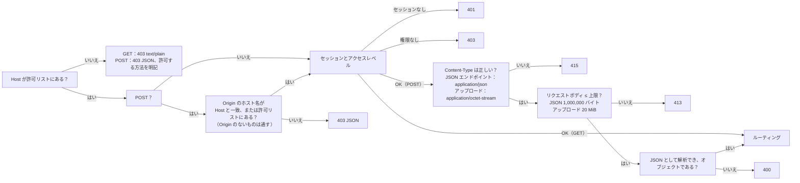

[English](../en/api.md) | **日本語** | [简体中文](../zh-CN/api.md)

# API の説明

> 機械可読版は [openapi.yaml](../en/openapi.yaml) です。本書は人が読むためのもので、各エンドポイントの役割、誰が呼び出せるか、ガードがどのようにリクエストを弾くか、旧 Python 版とどこが違うかを説明します。
> 本書が記述するのは**実際の挙動**です。旧版のあらゆるケースをゴールデンレスポンス（`tests/baseline/golden/`、172 件）として記録し、新しい Rust バックエンドはそれらと一件ずつ比較されます。

## 1. 概要

ブラウザはこの REST API だけを通じてバックエンドとやり取りします。フロントエンドにはデータベースへのアクセスも、インポートが可能かどうかやユーザーが何を見られるかを判断するロジックもありません。どちらも、ログイン中のユーザーをもとにバックエンドが決めます。

すべてのルートには、アクセスレベルが 1 つずつ決まっています（`backend/src/api/auth.rs` のルート表 `ROUTES`）。

| アクセス | 呼び出せる人 |
|---|---|
| **公開** | ログインしていない人も含め、誰でも |
| **ログイン** | ログイン中のすべてのユーザー |
| **問題集の管理** | 管理者と、**問題集を管理できる** 権限を持つ一般ユーザー *(v0.7)* |
| **管理者** | 管理者だけ |

| メソッド | パス | アクセス | 役割 | DB に書き込む？ |
|---|---|---|---|---|
| GET | `/api/info` | 公開 | バージョン、CPU アーキテクチャ、プログラムを終了できるか、問題数 | いいえ |
| GET | `/api/auth/state` | 公開 | 誰がログインしているか、ライブラリのスタンプ *(v0.6)* | いいえ |
| POST | `/api/auth/login` | 公開 | ログイン *(v0.6)* | はい（新しいセッション） |
| POST | `/api/auth/logout` | ログイン | ログアウト *(v0.6)* | はい（セッションを削除） |
| POST | `/api/auth/password` | ログイン | 自分のパスワードを変更する *(v0.6)* | はい |
| GET | `/api/bank` | ログイン | ユーザーが使えるすべての問題集の問題（有効な問題のみ） | いいえ |
| GET | `/api/banks` | ログイン | ユーザーが使える問題集と、そのワークシートと問題数 *(v0.5)* | いいえ |
| GET | `/api/progress` | ログイン | ユーザーの学習の進み具合 | いいえ |
| GET | `/api/records` | ログイン | 保存されているユーザーのすべての学習記録（新しい順） *(v0.5)* | いいえ |
| GET | `/api/record?id=<int>` | ログイン | 1 件の学習記録と、その問題ごとの明細 *(v0.5)* | いいえ |
| GET | `/api/settings` | ログイン | ユーザーの画面の設定 *(v0.5)* | いいえ |
| POST | `/api/attempt` | ログイン | 1 回分の試験または練習の成績を記録する | はい |
| POST | `/api/records/delete` | ログイン | 自分の学習記録を 1 件、またはすべて削除する *(v0.5)* | はい |
| POST | `/api/reset` | ログイン | 自分の学習記録を消去する | はい |
| POST | `/api/settings` | ログイン | 自分の画面の設定を変更する *(v0.5)* | はい |
| POST | `/api/settings/reset` | ログイン | 自分の画面の設定を既定に戻す *(v0.5)* | はい |
| GET | `/api/imports` | 問題集の管理 | 直近 12 回のインポート記録（問題集の管理権限を持つユーザーには、自分の問題集のもの） | いいえ |
| POST | `/api/upload` | 問題集の管理 | .xlsx をアップロードし、**プレビュー**と一回限りの確認コードを得る。任意のヘッダー `X-Bank-Target` *(v0.5)* | **いいえ**（メモリ上に一時保存されるだけ） |
| POST | `/api/import/confirm` | 問題集の管理 | インポートを確定する | **はい**（1 つのトランザクション） |
| POST | `/api/import/cancel` | 問題集の管理 | 自分の確認待ちのインポートを取り消す | いいえ |
| POST | `/api/banks/delete` | 問題集の管理 | 問題集を削除する（その学習データも一緒に削除できる） *(v0.5)* | はい |
| GET | `/api/users` | 管理者 | すべてのアカウントと、その権限とログインのロック *(v0.6)* | いいえ |
| POST | `/api/users/create` | 管理者 | ユーザーを追加する *(v0.6)* | はい |
| POST | `/api/users/update` | 管理者 | ユーザーの名前変更、権限の変更、無効化・有効化、使える問題集と問題集の管理権限の設定 *(v0.6)* | はい |
| POST | `/api/users/password` | 管理者 | ほかのユーザーに新しい初期パスワードを設定する *(v0.6)* | はい |
| POST | `/api/users/delete` | 管理者 | ユーザーとその学習データを削除する *(v0.6)* | はい |
| POST | `/api/users/unlock` | 管理者 | ユーザーのログインのロックを解除する *(v0.6)* | いいえ（メモリのみ） |
| GET | `/api/logs` | 管理者 | システムログの最近の行 *(v0.7)* | いいえ |
| POST | `/api/shutdown` | 管理者 | プログラムを終了する（ローカルマシンで実行しているときのみ使用可能。Docker では常に 403） | いいえ |

`HEAD` は対応する `GET` と同じですが、本文（ボディ）がありません。どのエンドポイントも、まったく同じガード（第 3 節）を通ります。

## 2. すべてのレスポンスに共通する事項

- `Cache-Control: no-store` と `X-Content-Type-Options: nosniff`。`Server` ヘッダーはありません。
- JSON は UTF-8 で、日本語や中国語は `\uXXXX` にエスケープされません。区切り文字は `", "` と `": "`（コロンの後にスペースあり）で、キーの順序は固定です（本書と [openapi.yaml](../en/openapi.yaml) に示した順序）。**これは取り決めの一部です**。スモークテストが `grep '"bankCount": 0'` を実行します。
- エラーは `{"error": "<理由>"}` の形式です。理由はユーザーにそのまま表示できる中国語の文で（フロントエンドが表示言語に翻訳します）、第 4 節にすべてを英語の意味と一緒に挙げています。リクエスト層の低レベルな応答だけは、旧版の短い英語のままです：`bad content type`（415）、`too large`（413）、`bad json`（400）、`not found`（404）、`method not allowed`（405）。ログインのロックによる 429 の応答には、キー `retryAfter` が 1 つ加わります。
- バックエンドは、例外名、ファイルパス、SQLite のエラーメッセージをレスポンスに含めません。詳細はログにのみ出力されます。

## 3. ガード（すべてのリクエストが最初に通る）

順序は固定なので、同じ不正なリクエストには常に同じ答えが返ります。



- **Host**：既定では `localhost`、`127.0.0.1`、`::1` のみを受け付けます。別のアドレスやドメイン名でアクセスする場合は、それを環境変数 `XEXAM_ALLOWED_HOSTS` に追加します（カンマ、スペース、またはセミコロン区切り）。`XEXAM_ALLOW_ANY_HOST=1` にすると Host を検査しません（前段にすでに認証がある場合、たとえば Cloudflare Access のときにだけ使います）。
- **Origin**（書き込みリクエストのみ検査）：比較するのは**ホスト名**だけ（プロトコルとポートは比較しません）なので、HTTPS のドメイン名経由でアクセスしても誤って弾かれません。`Origin` のないリクエストは通します（コマンドラインツールはブラウザ内のクロスサイトリクエストではないためです）。プロキシが Host をオリジンサーバーのアドレスに書き換える場合は、公開ドメイン名を `XEXAM_ALLOWED_ORIGINS` に設定します。
- バックエンドは**実際の `Host` ヘッダーだけを読み**、`X-Forwarded-*` は一切読みません。Nginx もそれらを転送しません。
- ほかのメソッド（PUT、DELETE、OPTIONS など）も Host の検査を通り（403 JSON）、その後 **405** と `Allow: GET, HEAD, POST` を返します。
- 拒否されたリクエストへのレスポンスには、送られてきた Host または Origin と、どのオプションにどの値を追加すればよいかが書かれます。**ログ** *(v0.7)*：静かな 1 分の後の最初の拒否は、それだけで 1 行になります（`rejected GET /api/bank: Host "…" is not in the allowed list`）。それに続く拒否は、多くても 1 分に 1 回まとめて記録されます（`rejected N request(s) by the Host / Origin check since the last report; the last one: …`）。次のリクエストが来なくても記録されます。ログの文は常に英語で、403 のボディは中国語のままです。サーバーに届く人なら誰でもログインせずにこうした拒否を起こせるので、1 件 1 行にすると、システムログ（`GET /api/logs`）のほかの行がすべて押し出されてしまうおそれがあるためです。

### セッションとアクセスレベル *(v0.6)*

セッションの検査は、Host（POST では Origin も）の検査の直後、**リクエストボディを読む前に**行われます。

| 状況 | 応答 |
|---|---|
| **公開** のルート | 通します。`GET /api/auth/state` はセッションがあれば読み、ほかのルートはセッションを見ません |
| 有効なセッションがない（Cookie `xexam_session` がない、不明または期限切れ、アカウントが無効にされた） | **401** `请先登录。`（「先にログインしてください。」） |
| アカウントが新しいパスワードを設定しなければならない | 公開ルート（`GET /api/info`、`GET /api/auth/state`、`POST /api/auth/login`）と `POST /api/auth/password`、`POST /api/auth/logout` 以外のすべてのルートで **403** `请先设置新密码。`（「先に新しいパスワードを設定してください。」） |
| 一般ユーザーが **管理者** のルートを呼んだ | **403** `只有管理员可以进行这个操作。`（「この操作ができるのは管理者だけです。」） |
| 権限のない一般ユーザーが **問題集の管理** のルートを呼んだ *(v0.7)* | **403** `你没有管理题库的权限，请联系管理员。`（「問題集を管理する権限がありません。管理者に問い合わせてください。」） |

- ルート表にないパスにもセッションが必要です。セッションがなければ 401、あれば 404 です（GET：`text/plain` の `not found`、POST：Content-Type、サイズ、JSON の検査の後に `{"error": "not found"}`）。
- セッションは Cookie `xexam_session` からだけ読みます。権限と **問題集を管理できる** 権限は、リクエストのたびにセッションと一緒にデータベースから読むので、管理者による変更は、そのユーザーの次のリクエストからすぐに反映されます。
- セッションは 30 日間有効で、使うたびに延長されます。リクエストがあると、多くても 1 時間に 1 回セッションを延長し、Cookie を送り直します。延長するのは、スキームが分かっているリクエストだけです：`XEXAM_COOKIE_SECURE=1` のとき、またはリクエストに `Origin` ヘッダーがあるとき（ブラウザの POST にはすべて付きます）。こうすることで、HTTPS で発行した Cookie から延長のときに `Secure` が外れることはありません。
- 学習記録、間違いノート、進み具合、設定は、常にログイン中のユーザーのものです。その id はセッションから取り、リクエストからは取りません。ほかのユーザーの記録は、存在しない記録とまったく同じ応答になります。

### 各ユーザーが見られるもの・管理できるもの *(v0.7)*

- **管理者** は、すべての問題集を利用・管理できます。
- **一般ユーザー** が見られるのは、すべての問題集（今後インポートするものも含む。`GET /api/users` の `"banks": "all"`）か、管理者が選んだ問題集だけ（id のリスト。空のこともあります）のどちらかです。**問題集を管理できる** 権限を持つ一般ユーザーは、自分でインポートした問題集も見られます（権限がある間だけです。権限がなくなると、自分の問題集も、選ばれた問題集に含まれている場合しか見られません）。
- **問題集の管理権限を持つユーザー** は、新しい問題集をインポートし（そのユーザーが所有者になります）、自分が所有する問題集だけを更新・削除できます。管理者やほかのユーザーの問題集を更新・削除しようとすると **403** `这个题库不是你上传的，只能更新或删除你自己上传的题库。`（「この問題集はあなたがアップロードしたものではありません。更新や削除ができるのは、自分でアップロードした問題集だけです。」）になります。この確認は書き込みのトランザクションの中で行われるので、何も書き込まれません。

すべての問題集を見られるわけではないユーザーには、どのルートも同じ規則に従います。

| ルート | 得られるもの |
|---|---|
| `GET /api/bank` | そのユーザーの問題集の問題とワークシートだけ。`file` / `mtime` は、そのユーザーの問題集のどれかへの最新のインポートのもの |
| `GET /api/banks` | そのユーザーの問題集だけ。`studied` と `records` は自分の学習データを数えます |
| `GET /api/progress` | `questions` にはそのユーザーの問題集の問題の統計だけが入ります（間違いノートとその復習もこれに従います）。`history` は変わりません |
| `POST /api/attempt` | 見られない問題集の問題は、削除された問題とまったく同じに扱われます。数に入らず、`notCounted` で返されます |
| `GET /api/records` | そのユーザーの記録はすべて、保存されたときの問題集の名前とともに履歴として残ります |
| `GET /api/record` | 見られない問題集の問題は、削除された問題と同じく `"question": null` になります（問題文は送られません） |
| `GET /api/auth/state` | `library` は、そのユーザーの問題集とアクセスだけに従います |
| `GET /api/info` | 変わりません。`bankCount` はライブラリ全体の有効な問題の数です（このルートは公開で、コンテナのヘルスチェックに使われます。何を表示するかは、フロントエンドが `GET /api/banks` から決めます） |

## 4. エンドポイントの詳細

### `GET /api/info`
```json
{"version": "0.7", "arch": "x86_64", "canShutdown": false, "bankCount": 5}
```
公開。`bankCount` はライブラリ全体の有効な問題の数です。バージョン番号は `VERSION` ファイルの `CODE_VERSION`（または `XEXAM_VERSION`）です。

### `GET /api/auth/state` *(v0.6)*
公開。ログインしていないとき（Cookie がない、またはセッションがもう有効でない）：

```json
{"user": null, "defaultAdmin": "admin"}
```

`defaultAdmin` は、既定のパスワード `admin` のままの有効な管理者のユーザー名（id の小さいものが先）、または `null` です。ログインページはこれを使って、初めてログインするときの方法を、アカウントの実際の名前で（名前が変更されている場合もあります）オーナーに伝えます。そのパスワードを変更または再設定するか、そのアカウントを無効化・降格・削除すると、`null` になります。

ログインしているとき（新しいパスワードの設定が必要な間も含む）：

```json
{"user": {"id": 1, "username": "admin", "role": "admin", "mustChangePassword": false, "canManageBanks": true}, "library": "3f0c9a7d5e21b4c88a9d0e6f17b2c453"}
```

- `role` は `admin` または `user` です。`canManageBanks` *(v0.7)* は、すべての管理者と、**問題集を管理できる** 権限を持つ一般ユーザーで `true` です。
- `library` は、ユーザーが見られる問題集を表す中身の見えないスタンプです。16 進数 32 桁のダイジェストで、もとになった数値は何も分かりません。それらの問題集のどれかがインポート・置き換え・削除されると変わり（別のプロセスの `import` コマンドによるものも含みます）、*(v0.7)* ユーザーが見られる問題集や管理できる問題集が変わったときにも変わります（管理者が問題集を割り当てた、権限を変えた、問題集の所有者が変わった）。開いているページはこれを比べ、変わったら問題集を読み直します。一部の問題集だけを見られるユーザーでは、スタンプはその問題集だけから作られます。見られない問題集のサイズ、問題数、更新日時は明かさず、それに合わせて変わることもありません。

### `POST /api/auth/login` *(v0.6)*
公開。ボディ：`{"username": "…", "password": "…"}`（どちらも文字列。そうでなければ **400** `请求的格式不对。`）。ユーザー名は前後の空白を除き、大文字小文字を区別せずに比べます。

- **200** `{"user": {…}}`（`GET /api/auth/state` と同じオブジェクト）と、2 つの Cookie：
  - `xexam_session=<43 文字>; HttpOnly; SameSite=Strict; Path=/; Max-Age=2592000`（30 日）。ログインのたびに新しいランダムなトークンが発行され、データベースにはその SHA-256 だけが保存されます。1 人のユーザーのセッションは最大 20 個で、それを超えてログインすると、期限の早いセッションから終了します。
  - `xexam_device=<43 文字>; HttpOnly; SameSite=Strict; Path=/api/auth; Max-Age=34560000`（400 日）：このアカウントが以前ログインしたブラウザであることを示します。アカウントの現在のパスワードハッシュをキーにしたハッシュなので、パスワードが変わると使えなくなります。サーバーには何も保存しません。
  - どちらも、リクエストの `Origin` が `https://…` のとき、または `XEXAM_COOKIE_SECURE=1` のときだけ `Secure` が付くので、LAN 内の HTTP でもログインできます。
- **401** `用户名或密码不对。`（「ユーザー名またはパスワードが正しくありません。」）：パスワードの間違い、存在しないユーザー名、無効なアカウントのどれでも、同じだけの処理をしてから返すので、応答からユーザー名が存在するかどうかは分かりません。
- **429** `{"error": "登录失败次数太多，请稍后再试。", "retryAfter": <秒>}`（「失敗が多すぎます。しばらくしてからもう一度お試しください。」）と `Retry-After` ヘッダー：ログインがロックされている間。ロック中は正しいパスワードでもすべて 429 になり、429 の応答は失敗として数えません。

ロックは段階的に長くなります。15 分以内に 5 回失敗すると 1 分間ロックされ、その後は各段階で 3 回まで失敗でき、ロックは 5 分、15 分、30 分、1 時間、1 日と長くなります。状態はアカウント（そのユーザー id。名前を変えても引き継がれます）に記録され、アカウントのない名前にも同じ段階が適用されます。アカウントの `xexam_device` Cookie を持つブラウザからの試行は、ほかのすべてのブラウザとは別に数えるので、ユーザー名を推測している人が、そのアカウントの持ち主を以前使ったブラウザから締め出すことはできません。ログインの成功、管理者によるパスワード再設定または **ロック解除**、バックエンドの再起動、または 24 時間何もないことで、アカウントの状態は最初に戻ります。詳細と理由：[security.md](security.md)。

### `POST /api/auth/logout` *(v0.6)*
ログイン（新しいパスワードの設定が必要な間も可）。ボディは `{}` または空。このセッションを削除し、期限切れの Cookie（`xexam_session=; HttpOnly; SameSite=Strict; Path=/; Max-Age=0`）と一緒に `{"ok": true}` を返します。

### `POST /api/auth/password` *(v0.6)*
ログイン（新しいパスワードの設定が必要な間も可）。ボディ：`{"current": "…", "password": "…"}`。新しいパスワードの設定が必要なアカウントでなければ `current` が必要です（必要なアカウントでは、セッションが本人であることの証明になります）。

- **200** `{"user": {…}}`、`mustChangePassword: false`。このセッションも含め、アカウントのすべてのセッションが終了します。このブラウザには**新しい** `xexam_session` Cookie（と、新しいパスワードの `xexam_device` Cookie）が送られるので、アカウントのほかのブラウザはログアウトされ、コピーされた Cookie も使えなくなります。
- **400** `请求的格式不对。`：`password`（または必要な `current`）がない、または文字列でない。`密码需要 8–128 个字符。`（「パスワードは 8〜128 文字にしてください。」）。`新密码不能和原来的一样。`（「新しいパスワードは元のパスワードと別のものにしてください。」）。
- **403** `当前密码不对。`（「現在のパスワードが正しくありません。」）。現在のパスワードの間違いはログインの失敗と同じ枠で数えるので、ここでもロック（上と同じ **429**）がかかります。
- **401** `请先登录。`：リクエストの処理中に、アカウントが無効化・削除された、またはパスワードがほかの場所で変更・再設定されたとき（何も書き込みません）。

### `GET /api/users` *(v0.6)*
管理者。すべてのアカウントを id の順に返します。

```json
{"users": [{"id": 2, "username": "cook", "role": "user", "disabled": false, "createdAt": "2026-11-10 14:00", "lastLoginAt": "2026-11-10 15:02", "mustChangePassword": false, "records": 12, "banks": [1, 3], "canManageBanks": true, "ownedBanks": [3], "lock": null}]}
```

- `createdAt` / `lastLoginAt` はローカル時刻 `YYYY-MM-DD HH:MM` です。`lastLoginAt` は最初のログインまで `null` です。
- `records` は、ユーザーの学習記録（試験と練習）の数です。
- `banks` *(v0.7)*：`"all"`（今後インポートするものも含むすべての問題集）、またはそのユーザーに選ばれた問題集の id の昇順のリスト（まだ存在する問題集だけ。`[]` = なし）。`canManageBanks` *(v0.7)* は、保存されている **問題集を管理できる** 権限です。どちらも権限が変わっても保持されますが、意味を持つのはアカウントが一般ユーザーの間だけです。管理者はすべての問題集を利用・管理できます。
- `ownedBanks` *(v0.7)*：ユーザーが新しい問題集としてインポートした（所有している）問題集の id の昇順のリスト。
- `lock`：アカウントのログインの状態（メモリ上）。最初の段階でロックもされていなければ `null`、それ以外は次のとおりです。

```json
{"until": "2026-11-10 15:20:07", "retryAfter": 298, "round": 2, "triesLeft": 0, "knownBrowser": false, "otherUntil": null, "otherRetryAfter": 0}
```

| キー | 意味 |
|---|---|
| `until` | 現在のロックが終わるローカル時刻 `YYYY-MM-DD HH:MM:SS`。ロックされていなければ `null` |
| `retryAfter` | それまでの秒数。ロックされていなければ `0` |
| `round` | ロック中：このロックで終わった段階（1 = 最初の 1 分のロック）。それ以外：進行中の段階（2 以上） |
| `triesLeft` | 進行中の段階で、次のロックまでに失敗できる残りの回数（ロック中は `0`） |
| `knownBrowser` | `true`：表示している状態は、ユーザーが以前ログインしたブラウザからのログインを数えたもの。`false`：それ以外のすべてのブラウザから。両方を記録しているときは、ユーザーをより強く止めているほうを表示します |
| `otherUntil` / `otherRetryAfter` | ほかのブラウザも同時にロックされていて、アカウントがすべてのブラウザでロックされているときだけ設定されます：その 2 つ目のロックの終わりとその秒数（それ以外は `null` / `0`） |

### `POST /api/users/create` *(v0.6)*
管理者。ボディ：`{"username": "…", "password": "…", "role": "admin" | "user", "banks": "all" | [<問題集の id>, …], "canManageBanks": <bool>}`。`banks` の既定は `[]`（管理者が選ぶまで、新しいユーザーには問題集が表示されません）、`canManageBanks` の既定は `false` です（*どちらも v0.7*）。新しいアカウントは有効で、最初のログインで新しいパスワードを設定しなければなりません。応答：`GET /api/users` と同じ `{"users": [...]}`。

ユーザー名は 1〜40 文字（ASCII の英字、数字と `. _ - @`。前後の空白は除きます）で、大文字小文字を区別せずに一意です。パスワードは 8〜128 文字です。

| 応答 | 場面 |
|---|---|
| **400** `用户名不对：1–40 个字符，只能用字母、数字和 . _ - @。`（「ユーザー名が正しくありません……」） | `username` がない、文字列でない、または規則に合わない |
| **400** `密码需要 8–128 个字符。` | `password` が短すぎる、または長すぎる |
| **400** `请求的格式不对。` | `password` がない、または文字列でない。`role` がない、または `admin` / `user` でない。`banks` が `"all"` でも整数のリストでもない。`canManageBanks` が真偽値でない |
| **400** `选择的题库中有不存在的（可能已被删除），请刷新页面后再试。`（「選んだ問題集の中に存在しないものがあります……」） *(v0.7)* | `banks` の中の id が既存の問題集でない。何も作成されません |
| **409** `这个用户名已经有人用了。`（「このユーザー名はすでに使われています。」） | ほかのアカウントが（大文字小文字を区別せずに）その名前を持っている |

### `POST /api/users/update` *(v0.6)*
管理者。ボディ：`{"id": <int>, "username"?, "role"?, "disabled"?, "banks"?, "canManageBanks"?}`。省略したキーは変わりません。応答：`{"users": [...]}`。

- アカウントを無効にするか権限を変えると、そのセッションは終了します。名前の変更、`banks` や `canManageBanks` の変更ではセッションは残り、変更はユーザーの次のリクエストから反映されます。
- `banks` は選ばれた問題集を置き換えます（`"all"`、または id のリスト。`[]` = 問題集なし）。
- **400**：作成と同じです（`username`、`role`、`banks`、`canManageBanks`。`disabled` が真偽値でない → `请求的格式不对。`。`id` がない、または整数でない（真偽値は整数とみなしません）→ `请求的格式不对。`）。
- **404** `这个用户不存在（可能已被删除），请刷新页面后再试。`（「このユーザーは存在しません……」）。
- **409** `不能对自己的账户做这个操作。`（「自分のアカウントにはこの操作はできません。」）：自分を無効にしたり、自分の権限を変えたりしたとき。`至少要保留一个启用的管理员。`（「有効な管理者を少なくとも 1 人残す必要があります。」）：変更すると有効な管理者がいなくなるとき。`这个用户名已经有人用了。`。

すべての確認は書き込みと同じトランザクションの中で行われるので、2 つのリクエストが両方とも確認を通ってしまうことはありません。

### `POST /api/users/password` *(v0.6)*
管理者。ボディ：`{"id": <int>, "password": "…"}`。ほかのユーザーに新しい初期パスワードを設定します。そのユーザーは次のログインで新しいパスワードを設定しなければならず、セッションは終了し、`xexam_device` Cookie は一致しなくなり、ログインのロックも解除されます。自分のパスワードは `POST /api/auth/password` で変更します（ここでは **409** `不能对自己的账户做这个操作。`）。ほかのエラー：400（パスワードの規則、形式の正しくないボディ）、404（存在しないユーザー）。

### `POST /api/users/delete` *(v0.6)*
管理者。ボディ：`{"id": <int>}`。アカウントを、そのセッション、学習記録（明細を含む）、間違いの統計、設定、選ばれた問題集と一緒に削除します。*(v0.7)* そのユーザーが所有していた問題集は削除されず、ユーザーを削除した管理者のものになります。自分自身と最後の有効な管理者には **409**、存在しない id には **404** を返します。

### `POST /api/users/unlock` *(v0.6)*
管理者。ボディ：`{"id": <int>}`。アカウントのログインの状態を、すべてのブラウザについて完全に消去します（最初の段階、5 回試せる状態に戻ります）。ロック中でも、ロックはされていないが最初の段階を過ぎているだけでも使えます。ユーザー id で動くので、名前を変えた後でも、自分のアカウントにも使えます。存在しない id には **404**。応答：`{"users": [...]}`。

### `GET /api/bank`
ログイン。`file` / `mtime` は直近のインポート（ユーザーが見られる問題集へのもの）のファイル名と日時です。`questions` には、ユーザーが見られるすべての問題集の有効な問題だけが入ります。問題集の id の昇順にまとめられ、各問題集の中ではその問題集の順序で並びます。`sheets` には、ワークシート名ごとに、利用可能な問題の数と無効化済みの問題の数が入ります（別々の問題集にある同じ名前のワークシートは合算されます。問題集ごとの数は `GET /api/banks` にあります）。問題のフィールドは [openapi.yaml](../en/openapi.yaml) の `Question` を参照してください。
v0.5 からは、どの問題にも最後にキーが 1 つ追加されます。`"bank": <問題集の id>`（`row` の後ろ）です。

問題のキーの順序は `kind, tag, stem, options, items, answer, translation, zh, [english, en,] [lang, ja,] explanation, mnemonic, note, [explain,] id, sheet, row, bank` です。角括弧の中のキーは、それを持つ形式にだけ現れるので、古いファイルの出力は以前とバイト単位で同一です。

- **3 列形式**（A 問題、B 中国語、C 答え）：どれも現れません。
- **4 列形式**（A 英語、B 中国語、C 日本語、D 答え）：`english`（A 列の原文）と `en`（日本語の構造に合わせて分割した英語）。`stem`、`options`、`items`、`answer` は C 列の日本語に由来します。
- **6 列形式** *(v0.7)*（A 英語、B 中国語、C 日本語の問題、D 英語、E 中国語、F 日本語の答えと解説）：英語が基準なので、`stem`、`options`、`items`、`answer` は英語のもので、`"lang": "en"` がそれを示します。`zh`（B 列）と `ja`（C 列）は、ほかの 2 つの言語を英語の構造に合わせて分割したものです（対応していないときは `null` / なし）。`explain` には言語ごとの解説、覚え方、答えの注記が入ります：`{"en": {"explanation", "mnemonic", "note"}, "zh": {…}, "ja": {…}}`。3 つのどれもない言語は省かれます。`explanation` / `mnemonic` / `note` は古いクライアントのために残してあります（中国語の文があればそれ、なければ日本語、なければ英語）。ホットスポット問題の `tag` は `HOTSPOT` です（古い形式では `ホットスポット`）。

`zh` / `en` / `ja` の中のホットスポット問題には、キー `choices` が 1 つ追加されます。各小項目の選択肢を、その言語で書いたものです。

### `GET /api/banks` *(v0.5)*
ログイン。問題集とは、インポートした 1 つのワークブックのことです。ユーザーが見られる問題集を `id` の順に返します。

```json
{"banks": [{"id": 1, "name": "Kitchen basics", "filename": "Kitchen basics.xlsx", "legacy": true, "createdAt": "2026-11-10 14:00", "updatedAt": "2026-11-10 15:00", "total": 5, "inactive": 0, "sheets": [{"name": "Cooking", "usable": 3, "inactive": 0}, {"name": "Safety", "usable": 2, "inactive": 0}], "studied": 4, "records": 3, "ownerId": 1, "owner": "admin", "manageable": true}]}
```

- `name` は、問題集を作成したときのファイル名から `.xlsx` を除いたものです（ほかの問題集がすでに同じ名前を使っている場合は ` (2)`、` (3)`、… が付きます）。問題集を更新すると `filename` と `updatedAt` は変わりますが、`name` は変わりません。
- `legacy`：v0.5 より前のデータを持つ問題集で、`X-Bank-Target` を付けないアップロードの取り込み先です。この問題集の問題 id は、[database.md](database.md) の 4.1 節にある通常の問題 id です。ほかの問題集はすべて問題集ごとの id を使うので、同じワークブックを 2 つの独立した問題集としてインポートできます。
- `total` = 有効な問題の数、`inactive` = 無効化された問題の数です。`sheets` は問題集内の問題の順に並び、問題がすべて無効化されたワークシート（`usable` が 0）も含みます。
- `studied` = この問題集の問題（有効・無効を問わず）のうち、統計があるものの数です。`records` = この問題集を含む学習記録の数です。管理者にはすべてのユーザーのデータを数えます（学習データと一緒に削除したときに消えるもの）。それ以外のユーザーには *(v0.7)* 自分のデータだけを数えます。
- `ownerId` / `owner` *(v0.7)*：その問題集を新しい問題集としてインポートしたユーザーの id とユーザー名です（v0.7 より前の問題集は最初の管理者のものです）。両方が得られるのは管理者だけです。ほかのユーザーには、自分の問題集のときだけ `ownerId` が入り（それ以外は `null`）、`owner` は常に `null` なので、問題集の一覧からほかのアカウントの名前は分かりません。
- `manageable` *(v0.7)*：このユーザーがその問題集を更新・削除できるかどうか（管理者：常に、問題集の管理権限を持つユーザー：自分の問題集、それ以外：なし）。

### `GET /api/progress`
ログイン。`questions` は、ユーザーの問題ごとの累計統計（何回解いたか、何回正解したか、何回間違えたか、現在何回連続で正解しているか）で、見られる問題集のものに限られます。`history` は直近 60 件の学習記録です（データベースには 500 件が残ります。`GET /api/records` を参照）。各記録の最後には `kind` *(v0.7)* が付きます。`masterStreak` は間違いノートから外れるまでに必要な連続正解回数（2）です。

```json
{"version": 1, "questions": {"94e4bfe00e8d": {"attempts": 3, "correct": 2, "wrong": 1, "streak": 2, "last": true, "at": "2026-11-10 15:10"}}, "history": [{"at": "2026-11-10 15:10", "sheets": ["Cooking"], "mode": "all", "total": 5, "correct": 4, "percent": 80, "seconds": 130, "kind": "exam"}], "masterStreak": 2}
```

### `GET /api/imports`
問題集の管理。`{"imports": [{"id", "at", "filename", "added", "updated", "removed", "restored", "skipped", "total"}, …]}` を、新しいものから 12 件返します。管理者にはすべてのインポートを、問題集の管理権限を持つユーザーには *(v0.7)* 自分が所有する問題集へのインポートだけを返します。

### `POST /api/upload`
問題集の管理。リクエストボディは .xlsx の生のバイト列です。任意のヘッダー `X-Filename` には、パーセントエンコードしたファイル名を入れます。サーバーは次の処理を行います。

1. ファイルの**内容**だけで .xlsx かどうかを判断します（マジックナンバー + ZIP 構造 + ワークブックがある + DOCTYPE / エンティティ宣言がない + 展開後のサイズに上限がある）。空のファイル、旧形式の `.xls`、破損したファイル、拡張子を書き換えたファイルには、それぞれ専用の中国語の説明が付きます。
2. 解析してプレビューを生成し、解析結果をメモリ上の**アップロードした人自身の確認待ちスロット**に入れます（再度アップロードすると置き換えられます。ほかのユーザーのスロットには触れません）。有効期間は 30 分です。
3. **データベースには書き込みません。**

プレビュー（`added / updated / unchanged / restored / removed / skipped / usable`、ワークシートごとの明細、読み取れなかった行とその理由）と、一回限りの確認コード `token` を返します。

```json
{"sheets": [{"name": "Cooking", "total": 3, "usable": 3, "skipped": [], "added": 3, "updated": 0, "removed": 0, "restored": 0, "skippedMore": 0, "skippedCount": 0}], "added": 3, "updated": 0, "unchanged": 0, "restored": 0, "removed": 0, "skipped": 0, "usable": 3, "removed_samples": [], "removed_stats": 0, "filename": "Kitchen basics.xlsx", "token": "…"}
```

各ワークシートには、読み取れなかった行が最大 30 行まで並びます（`skipped`、それぞれ `{"row", "reason"}`）。`skippedMore` はそれ以外に何行あるか、`skippedCount` は全部で何行あるかです。

**警告** *(v0.7)*：6 列形式で、中国語（E 列）や日本語（F 列）の答えが英語の答え（D 列）と異なる行も、英語の答えで取り込まれ、警告として一覧に載ります。キーが現れるのはこのときだけなので、3 列や 4 列のファイルのプレビューは変わりません。警告のあるワークシートには `warnings`（最大 30 件の `{"row", "reason"}`。`restored` の直後）と、その最後に `warningsMore` と `warningsCount` が付きます。プレビュー全体には、`removed_stats` の後に警告の総数 `warnings` が付きます。理由は `E 列的中文答案和 D 列的英文答案不一致（已按英文答案导入）`（「E 列の中国語の答えが D 列の英語の答えと一致しません（英語の答えで取り込みました）」）と、F 列の日本語の答えについての同様の文です。

**取り込み先の問題集** *(v0.5)*：任意のヘッダー `X-Bank-Target` で、ファイルをどの問題集に入れるかを指定します。プレビューのキーはどの場合も同じで、取り込み先の問題集だけを基準に計算されます。

| `X-Bank-Target` | 意味 |
|---|---|
| なし | v0.4 とまったく同じ動作で、レガシー問題集が取り込み先です（まだない場合は確定時に作成されます） |
| `new`（前後の空白は無視、大文字小文字は区別しない） | 確定時に新しい問題集を作成し、アップロードした人が所有者になります。プレビューでは、利用可能な問題がすべて `added` になります |
| 問題集の id、`^[0-9]{1,18}$`（前後の空白は無視） | その問題集を更新（置き換え）します。存在しない id → **404** `这个题库不存在（可能已被删除），请刷新页面后再试。` |
| それ以外 | **400** `上传目标不对，请刷新页面后再试。`（「アップロード先が正しくありません……」） |

このヘッダーは、ガードとサイズ上限の後、ファイルの解析の前に読まれます。問題集の管理権限を持つユーザーが更新できるのは、自分が所有する問題集だけです *(v0.7)*。ほかの人の既存の問題集（ヘッダーなしのアップロードではレガシー問題集も）→ ファイルを解析する前に **403** `这个题库不是你上传的，只能更新或删除你自己上传的题库。`。拒否されたアップロードは確認待ちスロットに影響しません。

**メモリの枠** *(v0.7)*：管理者と問題集の管理権限を持つユーザーはそれぞれスロットを持ち、パーサーの上限に近いワークブックは 1 つで 100 MB を超えることがあるため、一時保存したすべてのプレビューで 128 MiB の枠を共有します（内容から見積もります）。新しいアップロードを一時保存するときは、まず期限切れのプレビューを捨て、合計が枠を超えている間は、ほかのユーザーのいちばん古いプレビューから捨てます。最新のアップロードは必ず残ります。プレビューを捨てられたユーザーには、確定時に、30 分を過ぎたときとまったく同じ **409** が返ります。

ほかの応答：**413** `文件太大了（最大 20 MB）。…`（「ファイルが大きすぎます（最大 20 MB）……」）。**400** とファイルを拒否した理由（.xlsx でない、破損している、展開すると大きすぎる、解析に時間がかかりすぎた、など）。

### `POST /api/import/confirm`
問題集の管理。リクエストボディは `{"token": "…"}` です。

- 確認コードは 128 ビットの乱数（22 文字）で、**一度しか使えません**。確定できるのは呼び出した人自身の確認待ちのアップロードだけです。誤った確認コード、ほかのユーザーの確認コード、ASCII 以外の確認コードは「無効」として扱われ、確認待ちの内容は消費されません。期限切れ（または捨てられた）のプレビューは取り出せません。どれも → **409** `这次上传的预览已经过期或已被处理，请重新上传。`（「このアップロードのプレビューは期限切れか、すでに処理されています。もう一度アップロードしてください。」）。
- インポートは**1 つのトランザクション**の中で完了します。すべて成功するか、問題集に一切変更が加わらないかのどちらかです（**500** `写入数据库失败，题库没有任何改动。`、「データベースへの書き込みに失敗しました。問題集は変更されていません。」）。
- このファイルに利用可能な問題が 1 問もない場合 → **400** `这份文件里没有读到任何可用的题，没有导入。`（「このファイルから使える問題を読み取れなかったため、インポートしませんでした。」）。

インポートのルール（ファイルは**取り込み先の問題集の完全な内容**として扱われます）：初めて現れた問題は追加、変更された問題は更新、その問題集にあってファイルに見つからない問題は**無効化**（学習記録は保持）、無効化された問題が再び現れると自動的に復元されます。ほかの問題集には一切手を付けません。

レスポンス：`{"result": <プレビューと同じ形。ただし filename / token はない>, "bank": <ユーザーから見た GET /api/bank>}`。アップロードに `X-Bank-Target` が付いていた場合に限り、3 つ目のキー `"bankId": <作成 / 更新した問題集の id>` が続きます（そのため v0.4 のレスポンスはバイト単位で同じままです）。プレビューの後で取り込み先の問題集が削除されていた場合 → **404** `这个题库不存在（可能已被删除），请刷新页面后再试。`。ほかの人のものになっていた場合（削除されたユーザーの問題集が管理者に移った）→ **403** `这个题库不是你上传的，只能更新或删除你自己上传的题库。`。どちらの場合も何も書き込まれず、確認コードは使用済みになります。

### `POST /api/import/cancel`
問題集の管理。呼び出した人自身の確認待ちのアップロードを破棄します（ほかのユーザーのアップロードは残ります）。確認コードは不要です。応答：`{"ok": true}`。

### `POST /api/banks/delete` *(v0.5)*
問題集の管理。リクエストボディ：`{"id": <int>, "withRecords": <bool、既定は false>}`。1 つのトランザクションで、問題集の問題（有効・無効の両方）、インポート履歴、ユーザーのその問題集へのアクセス、問題集自体を削除します。`withRecords: true` の場合は、その問題集の学習データも削除します。対象は、それらの問題の統計（間違いノート）、問題ごとの明細、そしてこの問題集から出題され、現在も存在する問題集からは出題されていない学習記録すべてです（通常は、この問題集だけから出題された記録です。以前に削除した問題集も使っていた記録も、中身のない記録として残らないように一緒に削除されます）。`withRecords` がない場合、学習記録と統計は残り、その明細では問題が削除済みと表示されます。

- 管理者はどの問題集でも削除でき、`withRecords` は**すべての**ユーザーの学習データを削除します。
- 問題集の管理権限を持つユーザーは *(v0.7)* 自分が所有する問題集だけを削除でき（それ以外は **403** `这个题库不是你上传的，只能更新或删除你自己上传的题库。`、何も書き込まれません）、`withRecords` は**自分の**学習データだけを削除します。ほかのユーザーの記録は残り、その問題は削除済みと表示されます。

この問題集を取り込み先にしている確認待ちのアップロード（この id へのアップロード、またはこれがレガシー問題集のときの `X-Bank-Target` なしのアップロード）は、どのユーザーのものでも破棄されます。

レスポンス：`{"banks": [...], "bank": <GET /api/bank>, "progress": <GET /api/progress>}`。3 つとも、呼び出した人から見たものです。`id` がない、または整数でない場合（真偽値は整数とみなしません）、あるいは `withRecords` があるのに真偽値でない場合 → **400** `请求的格式不对。`。存在しない id → **404** `这个题库不存在（可能已被删除），请刷新页面后再试。`。

### `POST /api/attempt`
ログイン。リクエストボディは `{"results": [{"id": "…", "correct": true, "answer": ["B"]}], "sheets": ["…"], "mode": "all", "seconds": 123, "kind": "exam"}` です。

サニタイズのルール：`results` はリストでなければならず（そうでなければ **400** `成绩的格式不对`、「成績の形式が正しくありません。」）、読むのは最初の 2000 件だけです。各項目には文字列の `id`（64 文字で切ります）と真偽値の `correct` が必要で、それ以外の項目は捨てます。1 件も残らなければ → **400** `没有成绩可保存`（「保存する成績がありません。」）。`sheets` は最大 50 個の文字列を残します（それぞれ 80 文字で切ります）。`mode` が `all / weak / retry` のいずれでもない場合は `all` として扱います。`seconds` は 0 から 604800 の範囲に収め、異常値は 0 として扱います。**サーバーは `correct` を信頼します**。採点はブラウザ内で行われます（[security.md](security.md) を参照）。

*(v0.7)* `kind` は `"exam"`（既定。ない場合や `null` の場合も）または `"practice"` です。それ以外の値 → **400** `成绩的格式不对`。どちらの種類も統計（間違いノート）を同じように更新し、同じ 500 件の保存枠に数えます。違うのはページでの表示だけです。

*(v0.5)* 各結果には任意で `answer` を付けられます。後で記録を見直すためだけに保存されるもので、最大 64 要素の JSON 配列です。各要素は 8 文字以内の文字列、0〜999 の整数、または `null` です（`["C"]`、`["A", "D"]`、`[0, 1, null]`）。それ以外の値は「回答なし」として保存されますが、結果そのものは受け付けます。サーバーは、数に入れた結果 1 件ごとに明細を 1 行保存し、さらに問題の出題元である問題集のスナップショットも保存します。ユーザーごとに最新の **500** 件の記録を残します（それより古いものは明細と一緒に削除されます）。

**数に入れるのは存在する問題だけです** *(v0.7)*。問題がもうない結果（解答中に問題集が削除された、または id がでたらめ）や、ユーザーが見られない問題集の問題の結果は、統計、明細、`total` / `correct` / `percent`、問題集のスナップショットから外されます。無効化された問題（後のインポートに含まれていなかったもの）はまだ存在するので、数に入ります。そのうえで：

- 外された結果がある場合：残りで記録を保存します。記録の `sheets` には、数に入った問題が属するワークシートだけが（送られた順に）並び、応答の最後に `"notCounted": [<外した id>]` が付きます。
- 1 件も残らない場合：何も保存せず、**409** `这场考试的题目已经被删除，成绩没有保存。`（「この試験の問題は削除されたため、成績は保存されませんでした。」）。

応答は、そのユーザーの `GET /api/progress` です（外された結果があるときは `notCounted` も付きます。`GET /api/progress` そのものには付きません）。

`percent` は**偶数丸め（銀行丸め）**（Python の `round`）を使います。8 問中 1 問正解なら 12 で、13 ではありません。

### `GET /api/records` *(v0.5)*
ログイン。ユーザーの記録を新しい順に並べた `{"records": [RecordSummary, …], "retention": 500}` を返します。RecordSummary は次の形です。

```json
{"id": 7, "at": "2026-11-10 15:10", "banks": [{"id": 1, "name": "Kitchen basics", "deleted": false}], "sheets": ["Cooking"], "mode": "all", "total": 5, "correct": 4, "percent": 80, "seconds": 130, "answered": 5, "detail": true, "kind": "exam"}
```

`banks` は記録を保存したときのスナップショットです。問題集がまだ存在する間は、その現在の名前が入ります（なくなると `deleted: true`）。`detail` は問題ごとの明細があるかどうかを示します（v0.5 より前に保存された試験には明細がありません）。`answered` は明細のうち回答がある行の数で、明細がない場合は `null` です。`kind` *(v0.7)* は `exam` または `practice` です（v0.7 より前の記録は試験です）。

### `GET /api/record?id=<int>` *(v0.5)*
ログイン。`{"record": RecordSummary, "items": [{"seq": 0, "questionId": "…", "answer": ["C"], "correct": true, "question": {…}}]}`。`answer` は保存された配列、または `null` です。`question` は `GET /api/bank` とまったく同じ形の問題で、最後に `"active": <bool>` が付きます（無効化された問題も含まれます）。問題がもう存在しない場合や、*(v0.7)* ユーザーが見られない問題集の問題の場合は `null` です（問題文は送られません）。
`id` は、1〜18 桁の ASCII 数字からなるクエリパラメーターがちょうど 1 つでなければなりません（パーセントエンコーディングはデコードされます）。そうでない場合 → **400** `请求的格式不对。`。存在しない id、またはほかのユーザーの記録 → **404** `这条考试记录不存在（可能已被删除），请刷新页面后再试。`（「この試験記録は存在しません……」）。

### `POST /api/records/delete` *(v0.5)*
ログイン。リクエストボディは次のどちらかです。`{"id": <int>}`（その記録と明細を削除します。問題ごとの統計、つまり間違いノートは**変わりません**）、または `{"all": true, "withStats": <bool、既定は false>}`（ユーザーのすべての記録と明細を削除します。`withStats: true` の場合は統計も空にします。これは `POST /api/reset` と同じです）。削除されるのは、常に呼び出した人自身の記録だけです。
レスポンス：`{"records": [...], "retention": 500, "progress": <GET /api/progress>}`。それ以外のボディ（`id` も `all` もない、両方ある、`all` が `true` でない、`id` と一緒に `withStats` がある、型が違う）→ **400** `请求的格式不对。`。存在しない id → **404** `这条考试记录不存在（可能已被删除），请刷新页面后再试。`。

### `POST /api/reset`
ログイン。呼び出した人の学習記録（その問題ごとの明細を含む）と問題ごとの統計を消去します。問題集とほかのユーザーには手を付けません。応答：そのユーザーの（空になった）`GET /api/progress`。

### `GET /api/settings` / `POST /api/settings` / `POST /api/settings/reset` *(v0.5)*
ログイン。設定はユーザーごとにデータベースに保存されます（コンテナの再起動や更新、ブラウザのキャッシュの消去、ブラウザの切り替えの後も残ります）。

```json
{"theme": "system", "uiLang": "en", "autoAdvance": false, "questionLang": "ja"}
```

| キー | 値 | 既定 |
|---|---|---|
| `theme` | `system` · `light` · `dark` | `system` |
| `uiLang` | `en` · `zh` · `ja` | `en` |
| `autoAdvance` | `true` · `false` | `false` |
| `questionLang` | `ja` · `zh` · `en` | `ja` |

`GET` は、既定値に保存済みの値を重ねたものを返します（保存済みの値が正しくない場合は無視します）。`POST /api/settings` はこれらのキーの任意の組み合わせを受け取り、設定全体を返します。未知のキーは無視します。既知のキーの値が正しくない場合 → **400** `设置的值不对。`（「設定の値が正しくありません。」）となり、何も書き込みません。`POST /api/settings/reset`（ボディは `{}` または空）は `theme`、`uiLang`、`autoAdvance` を既定に戻し、`questionLang` はそのまま残して、設定全体を返します。

### `GET /api/logs` *(v0.7)*
管理者。**システムログ** のページが表示するシステムログです。バックエンドが起動してから記録した最新の 2000 行で、メモリ上にだけ保持されます（再起動すると空に戻ります。データベースには何も書き込みません）。`docker compose logs backend` で見える行（同じ `XEXAM_LOG` のフィルターを通ったもの）に、起動と終了の状態を示す行を加えたものです。ログの行にパスワード、トークン、Cookie の値、問題文が含まれることはありません。

クエリパラメーター（どちらも省略可）：

- `after=<seq>`：この連番より後の行だけを返します（1〜19 桁の ASCII 数字）。
- `boot=<id>`：クライアントが最後に読んだ応答の `boot`（`A-Z a-z 0-9 _ -` からなる 1〜64 文字）。

```json
{"lines": [{"seq": 41, "time": "2026-11-10 15:10:02", "level": "info", "target": "xexam_backend::api::auth", "message": "user 2 signed in"}], "last": 41, "dropped": false, "boot": "Xq3v9T0bLm2k"}
```

- `lines`：古いものから順に並びます。`seq` は 1 行ごとに 1 ずつ増え、バックエンドのプロセスごとに 1 から始まります。`time` は秒までのローカル時刻、`level` は `error`、`warn`、`info`、`debug`、`trace` のいずれか、`target` は記録したモジュール、`message` は本文とそのフィールドです（4000 文字を超えた分は切ります）。
- `last`：最新の行の連番（まだ何も記録していなければ 0）。次の問い合わせの `after` に使います。
- `dropped`：`after` より新しい行（`after` がなければ 1 行目から）が、返される前にバッファから押し出されていたときに `true`。
- `boot`：このバックエンドのプロセスのランダムな id。次の問い合わせの `boot` に使います。
- `after` がなければ、保持しているすべての行を返します。再起動すると連番は 1 から始まり直すので、`last` より大きい `after` や、このプロセスの id ではない `boot` は、`after` がないときと同じように扱います：保持しているすべての行を返します。
- `after` や `boot` の形式が正しくない、空、または 2 回指定された → **400** `请求的格式不对。`。ほかのパラメーターは無視します。

ログインせずに誰でも起こせる行（拒否されたリクエスト、ログインの失敗、アカウントのないユーザー名のロック）は、多くても 1 分に 1 回まとめて記録するので（第 3 節）、ほかの行を押し出すことはできません。

### `POST /api/shutdown`
管理者。`--allow-shutdown` を付けて起動した場合（Windows では `start.bat` をダブルクリック）にのみ使用できます。それ以外は **403** `在 Docker 里请用 docker compose stop 停止容器。`（「Docker で動かしているときは、docker compose stop でコンテナを停止してください。」）。Docker では常に 403 になるので、`docker compose stop` を使います。

### エラーメッセージ
ほかのバックエンドのメッセージと同じく、中国語で、文面は固定です（フロントエンドが翻訳します）。どのルートでも返りうるものは第 3 節にあります。アップロードとパーサーのメッセージ（ファイルを拒否した理由、行が読み取れない理由）は、その翻訳と一緒に `frontend/src/i18n/server-messages.ts` にあります。

| ステータス | メッセージ | 意味 | 場面 |
|---|---|---|---|
| 400 | `请求的格式不对。` | リクエストの形式が正しくありません。 | v0.5 以降のエンドポイントのボディやクエリの形式が正しくない |
| 400 | `上传目标不对，请刷新页面后再试。` | アップロード先が正しくありません。ページを再読み込みしてから再試行してください。 | `X-Bank-Target` の形式が正しくない |
| 400 | `设置的值不对。` | 設定の値が正しくありません。 | `POST /api/settings` |
| 400 | `成绩的格式不对` | 成績の形式が正しくありません。 | `POST /api/attempt`：`results` がリストでない、または `kind` が正しくない |
| 400 | `没有成绩可保存` | 保存する成績がありません。 | `POST /api/attempt`：有効な結果がない |
| 400 | `用户名不对：1–40 个字符，只能用字母、数字和 . _ - @。` | ユーザー名が正しくありません。1〜40 文字で、英字・数字と . _ - @ だけが使えます。 | ユーザー：作成、更新 |
| 400 | `密码需要 8–128 个字符。` | パスワードは 8〜128 文字にしてください。 | パスワードのルート、作成 |
| 400 | `新密码不能和原来的一样。` | 新しいパスワードは元のパスワードと別のものにしてください。 | `POST /api/auth/password` |
| 400 | `选择的题库中有不存在的（可能已被删除），请刷新页面后再试。` | 選んだ問題集の中に存在しないものがあります（削除された可能性があります）。ページを再読み込みしてから再試行してください。 | ユーザー：作成、更新 *(v0.7)* |
| 400 | `这份文件里没有读到任何可用的题，没有导入。` | このファイルから使える問題を読み取れなかったため、インポートしませんでした。 | 確定 |
| 401 | `请先登录。` | 先にログインしてください。 | 有効なセッションがない |
| 401 | `用户名或密码不对。` | ユーザー名またはパスワードが正しくありません。 | ログイン |
| 403 | `请先设置新密码。` | 先に新しいパスワードを設定してください。 | アカウントが新しいパスワードを設定しなければならない |
| 403 | `只有管理员可以进行这个操作。` | この操作ができるのは管理者だけです。 | 管理者のルート |
| 403 | `你没有管理题库的权限，请联系管理员。` | 問題集を管理する権限がありません。管理者に問い合わせてください。 | 問題集の管理のルート *(v0.7)* |
| 403 | `这个题库不是你上传的，只能更新或删除你自己上传的题库。` | この問題集はあなたがアップロードしたものではありません。更新や削除ができるのは、自分でアップロードした問題集だけです。 | アップロード、確定、問題集の削除 *(v0.7)* |
| 403 | `当前密码不对。` | 現在のパスワードが正しくありません。 | `POST /api/auth/password` |
| 404 | `这个题库不存在（可能已被删除），请刷新页面后再试。` | この問題集は存在しません（削除された可能性があります）。ページを再読み込みしてから再試行してください。 | `X-Bank-Target`、確定、問題集の削除 |
| 404 | `这条考试记录不存在（可能已被删除），请刷新页面后再试。` | この試験記録は存在しません（削除された可能性があります）。ページを再読み込みしてから再試行してください。 | `/api/record`、`/api/records/delete` |
| 404 | `这个用户不存在（可能已被删除），请刷新页面后再试。` | このユーザーは存在しません（削除された可能性があります）。ページを再読み込みしてから再試行してください。 | ユーザーのルート |
| 409 | `这次上传的预览已经过期或已被处理，请重新上传。` | このアップロードのプレビューは期限切れか、すでに処理されています。もう一度アップロードしてください。 | 確定 |
| 409 | `这场考试的题目已经被删除，成绩没有保存。` | この試験の問題は削除されたため、成績は保存されませんでした。 | `POST /api/attempt` *(v0.7)* |
| 409 | `这个用户名已经有人用了。` | このユーザー名はすでに使われています。 | ユーザー：作成、更新 |
| 409 | `不能对自己的账户做这个操作。` | 自分のアカウントにはこの操作はできません。 | ユーザー：更新、パスワード、削除 |
| 409 | `至少要保留一个启用的管理员。` | 有効な管理者を少なくとも 1 人残す必要があります。 | ユーザー：更新、削除 |
| 429 | `登录失败次数太多，请稍后再试。` | 失敗が多すぎます。しばらくしてからもう一度お試しください。 | ログイン、パスワードの変更（`retryAfter` 付き） |
| 500 | `写入数据库失败，题库没有任何改动。` | データベースへの書き込みに失敗しました。問題集は変更されていません。 | 確定 |
| 500 | `服务器内部出错，请稍后再试。` | サーバー内部でエラーが発生しました。しばらくしてからもう一度お試しください。 | すべてのルート |

## 5. 旧版との違い

以下は、新しい Rust バックエンドと旧 Python v0.2 とで**意図的に異なる**点です。どの項目も `tests/baseline/golden/allowed_differences_rust.json` と `allowed_probe_differences_rust.json` に登録されており、登録されていない差異があるとテストが失敗します。

| 違い | 旧版 | 新版 | 理由 |
|---|---|---|---|
| サポートされないメソッド（PUT / DELETE / OPTIONS…） | 501 + 標準ライブラリの HTML ページ | 405 + `Allow: GET, HEAD, POST` | 標準的な動作 |
| 静的ファイル | バックエンド自身が配信 | バックエンドは配信しない（404）。Nginx が配信 | フロントエンドとバックエンドの分離 |
| 不正な `Content-Length`（数字以外、負数、重複） | 0 として扱う、または 413 | 400 を返し、接続を閉じる | HTTP 層がハンドラーに入る前に拒否する。ブラウザと Nginx はこのようなリクエストを送らない |
| `Content-Type: Application/JSON`（大文字小文字） | 415 | 受け付ける | MIME タイプは大文字小文字を区別しない |
| `Content-Type: text/plain;application/json` | 受け付ける | 415 | 本当に `application/json` でなければならない（v0.2 の Python 側も同様に修正した） |
| チャンク転送によるアップロード | 空のファイルとして扱う（400） | ストリーミングでバイト数を数え、20 MiB を超えると 413 を返す | `Content-Length` を信用しない |
| DOCTYPE / エンティティ宣言 | 小文字の `.xml` / `.rels` の ASCII バイトだけを走査。UTF-16、`.dat`、`.XML` は検査をすり抜けて展開される | どの拡張子、どのエンコーディングでも拒否する。XML パーサー層もあらゆる DOCTYPE を拒否する | セキュリティ強化 |
| 重複した ZIP エントリ名 | 最後のものを使う | 拒否する（破損扱い） | 検査と読み取りで異なる内容が見えるのを避けるため |
| ZIP エントリ数 | 無制限 | 最大 10,000 | リソース上限 |
| XML ノード数 / 深さ | 無制限 | 100 万（100 × 10,000） / 64 階層 | リソース上限 |
| エラーメッセージ内のライブラリ例外テキスト | Python / expat の原文が付く | 固定の中国語メッセージで、前置きの部分は変わらない | 内部の詳細を漏らさないため |
| `Server` レスポンスヘッダー | `Xexam/<バージョン> Python/<バージョン>` | なし | バージョンを漏らさないため |
| `//api/info`（二重スラッシュ） | 標準ライブラリによって畳み込まれ 200 になる | 404 | フロントエンドはこのようなパスを送らない |
| 巨大なリクエストヘッダー（70,000 バイト） | 431 | 先に Nginx が拒否する | Nginx のヘッダーバッファの上限 |
| `seconds` が文字列のとき | `int()` はあらゆる Unicode 数字（全角 `７７`、アラビア・インド数字）を受け付け、長すぎる数字列には別途 4300 桁の制限がある | ASCII 数字のみ認め、それ以外は 0 として扱う | ページは数字しか送らない。どちらも学習記録の意味には影響しない |
| `--data` / `XEXAM_DATA` を指定せずにそのまま実行 | データディレクトリはプログラムのディレクトリ配下の `data` | データディレクトリは**カレントディレクトリ**配下の `data` | Docker を使わないローカル実行にのみ影響します。`--data` を明示的に指定してください |
| サブコマンドをオプションの後ろに書く（`--data /d import x.xlsx`） | 該当なし（旧版は `--import`） | サブコマンドは最初の引数でなければならず、そうでないと `serve` として扱われる（旧来の書き方 `--import x.xlsx` は引き続き使える） | 引数の解析がより単純になるため |

v0.6 からは、ゴールデンテストは既定の管理者としてログインした状態で実行されます（テスト用のヘルパーがセッションを開始します）。そのため、ログインが導入される前と同じリクエストとレスポンスを比べ続けています。

### v0.5 での変更（v0.4 との比較）

古いクライアントが送るリクエストは、次の点を除いて、すべてこれまでどおり動き、同じ答えが返ります。

| 変更点 | v0.4 | v0.5 |
|---|---|---|
| `GET /api/bank` の問題（確定 / 削除のレスポンスの `bank` 内も同様） | … `"row": 3}` | … `"row": 3, "bank": 1}` |
| データベースに残す試験記録 | 60 | 500（`/api/progress` が返すのは引き続き 60） |
| データベーススキーマ | v1 | v2。初回起動時に自動で移行される（[database.md](database.md) を参照） |

### v0.6 での変更（v0.5 との比較）

| 変更点 | v0.5 | v0.6 |
|---|---|---|
| `GET /api/info`、`GET /api/auth/state`、`POST /api/auth/login` 以外のすべてのルート | Host / Origin のガードを通れば誰でも使える | ログインしたセッションが必要（なければ 401）。第 3 節を参照 |
| 学習記録、統計、設定 | 全員で 1 つ | ユーザーごとに 1 つ |
| 問題集の管理、`POST /api/shutdown` | 誰でも | 管理者だけ |
| 新しいルート | | `/api/auth/*` と `/api/users*` |
| データベーススキーマ | v2 | v3（ユーザーとセッション） |

### v0.7 での変更（v0.6 との比較）

| 変更点 | v0.6 | v0.7 |
|---|---|---|
| アップロード、確定、取り消し、インポート履歴、問題集の削除 | 管理者だけ | **問題集の管理** のルート：管理者と、権限を持つユーザー（自分の問題集だけを管理） |
| 一般ユーザーが見られるもの | すべての問題集 | すべての問題集、または管理者が選んだ問題集（問題集の管理権限があれば自分の問題集も）。すべてのルートに適用（第 3 節） |
| 確認待ちのアップロード | サーバー全体で 1 つ | アップロードした人ごとに 1 つ。128 MiB のメモリの枠を共有 |
| `GET /api/auth/state` | `user` に `canManageBanks` なし。`defaultAdmin` は真偽値。`library` は読める数値 | `user.canManageBanks`。`defaultAdmin` はユーザー名または `null`。`library` は中身の見えない 16 進数 32 桁のダイジェスト |
| `GET /api/users` | | `banks`、`canManageBanks`、`ownedBanks`。`lock` に `knownBrowser`、`otherUntil`、`otherRetryAfter` が加わる |
| `GET /api/banks` | | `ownerId`、`owner`、`manageable` |
| `POST /api/attempt` | すべての結果を数に入れる | `kind`。存在し、見られる問題だけを数に入れる（`notCounted`、1 件も残らなければ 409） |
| `GET /api/records`、`GET /api/record`、`GET /api/progress` の history | | 最後のキーとして `kind` |
| アップロードのプレビュー | | `warnings`（6 列形式のファイルのみ） |
| 新しいルート | | `GET /api/logs` |
| データベーススキーマ | v3 | v4（問題集へのアクセス、問題集の所有者、記録の種類）。[database.md](database.md) を参照 |

## 6. 呼び出し例

```bash
# バージョンと問題数を確認する（公開）
curl -s http://localhost:8765/api/info

# ログインして、セッションの Cookie をファイルに保存する（ご自身のユーザー名とパスワードを使ってください）
curl -s -c cookies.txt -X POST http://localhost:8765/api/auth/login \
  -H 'Content-Type: application/json' -d '{"username": "admin", "password": "…"}'

# 自分は誰としてログインしている？
curl -s -b cookies.txt http://localhost:8765/api/auth/state

# アップロード（プレビューが得られるだけで、DB には書き込まない）
curl -s -b cookies.txt -X POST http://localhost:8765/api/upload \
  -H 'Content-Type: application/octet-stream' -H 'X-Filename: demo.xlsx' \
  --data-binary @tests/baseline/fixtures/demo.xlsx

# インポートを確定する（前のステップで返された token を入れる）
curl -s -b cookies.txt -X POST http://localhost:8765/api/import/confirm \
  -H 'Content-Type: application/json' -d '{"token": "…"}'

# 同じファイルを、別の新しい問題集としてインポートする（確定は上と同じ。レスポンスの最後に "bankId" が付く）
curl -s -b cookies.txt -X POST http://localhost:8765/api/upload \
  -H 'Content-Type: application/octet-stream' -H 'X-Filename: demo.xlsx' -H 'X-Bank-Target: new' \
  --data-binary @tests/baseline/fixtures/demo.xlsx

# 問題集の一覧を取得し、問題集 2 をその学習データと一緒に削除する
curl -s -b cookies.txt http://localhost:8765/api/banks
curl -s -b cookies.txt -X POST http://localhost:8765/api/banks/delete \
  -H 'Content-Type: application/json' -d '{"id": 2, "withRecords": true}'

# 問題集 1 を使える、問題集の管理権限を持つユーザーを追加する（最初のログインで新しいパスワードを設定します）
curl -s -b cookies.txt -X POST http://localhost:8765/api/users/create \
  -H 'Content-Type: application/json' \
  -d '{"username": "cook", "password": "initial-pass-1", "role": "user", "banks": [1], "canManageBanks": true}'

# 画面をダークモードと日本語に切り替える
curl -s -b cookies.txt -X POST http://localhost:8765/api/settings \
  -H 'Content-Type: application/json' -d '{"theme": "dark", "uiLang": "ja"}'

# システムログを読み、次からは最後に見た行より後の行だけを読む
curl -s -b cookies.txt http://localhost:8765/api/logs
curl -s -b cookies.txt 'http://localhost:8765/api/logs?after=41&boot=Xq3v9T0bLm2k'
```

> Nginx 経由でアクセスする場合、`curl` が既定で付ける `Host: localhost:8765` は許可リストに入っています。別のドメイン名でアクセスする前に、まず `XEXAM_ALLOWED_HOSTS` を設定してください。`curl` は `Origin` を送らないので、Origin の検査は通ります。`cookies.txt` には有効なセッションが入っているので、ほかの人に見せず、使い終わったら削除してください。
