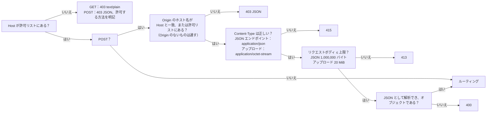

[English](../en/api.md) | **日本語** | [简体中文](../zh-CN/api.md)

# API の説明

> 機械可読版は [openapi.yaml](../en/openapi.yaml) です。本書は人が読むためのもので、各エンドポイントの役割、ガードがどのようにリクエストを弾くか、旧 Python 版とどこが違うかを説明します。
> 本書が記述するのは**実際の挙動**です。旧版のあらゆるケースをゴールデンレスポンス（`tests/baseline/golden/`、172 件）として記録し、新しい Rust バックエンドはそれらと一件ずつ比較されます。

## 1. 概要

ブラウザはこの REST API だけを通じてバックエンドとやり取りします。フロントエンドにはデータベースへのアクセスも、インポートが可能かどうかを判断するロジックもありません。

| メソッド | パス | 役割 | DB に書き込む？ |
|---|---|---|---|
| GET | `/api/info` | バージョン、CPU アーキテクチャ、プログラムを終了できるか、問題数 | いいえ |
| GET | `/api/bank` | すべての問題集の問題（有効な問題のみ） | いいえ |
| GET | `/api/banks` | 問題集の一覧（インポートしたワークブックごとに 1 つ）と、そのワークシートと問題数 *(v0.5)* | いいえ |
| GET | `/api/progress` | 学習記録 | いいえ |
| GET | `/api/imports` | 直近 12 回のインポート記録 | いいえ |
| GET | `/api/records` | 保存されているすべての試験記録（新しい順） *(v0.5)* | いいえ |
| GET | `/api/record?id=<int>` | 1 件の試験記録と、その問題ごとの明細 *(v0.5)* | いいえ |
| GET | `/api/settings` | 画面の設定 *(v0.5)* | いいえ |
| POST | `/api/upload` | .xlsx をアップロードし、**プレビュー**と一回限りの確認コードを得る。任意のヘッダー `X-Bank-Target` *(v0.5)* | **いいえ**（メモリ上に一時保存されるだけ） |
| POST | `/api/import/confirm` | インポートを確定する | **はい**（1 つのトランザクション） |
| POST | `/api/import/cancel` | 確認待ちのインポートを取り消す | いいえ |
| POST | `/api/banks/delete` | 問題集を削除する（その学習データも一緒に削除できる） *(v0.5)* | はい |
| POST | `/api/attempt` | 1 回分の試験の成績を記録する（選んだ答えも一緒に記録できる） | はい |
| POST | `/api/records/delete` | 試験記録を 1 件、またはすべて削除する *(v0.5)* | はい |
| POST | `/api/reset` | 学習記録を消去する | はい |
| POST | `/api/settings` | 画面の設定を変更する *(v0.5)* | はい |
| POST | `/api/settings/reset` | 画面の設定を既定に戻す *(v0.5)* | はい |
| POST | `/api/shutdown` | プログラムを終了する（ローカルマシンで実行しているときのみ使用可能。Docker では常に 403） | いいえ |

`HEAD` は対応する `GET` と同じですが、本文（ボディ）がありません。v0.5 のエンドポイントも、ほかのエンドポイントとまったく同じガード（第 3 節）を通ります。

## 2. すべてのレスポンスに共通する事項

- `Cache-Control: no-store`、`X-Content-Type-Options: nosniff`。
- JSON は UTF-8 で、日本語や中国語は `\uXXXX` にエスケープされません。区切り文字は `", "` と `": "`（コロンの後にスペースあり）で、キーの順序は固定です。**これは取り決めの一部です**。スモークテストが `grep '"bankCount": 0'` を実行します。
- エラーは `{"error": "<ユーザーにそのまま表示できる中国語の理由>"}` の形式です。バックエンドは、例外名、ファイルパス、SQLite のエラーをレスポンスに含めません。詳細はログにのみ出力されます。

## 3. ガード（すべてのリクエストが最初に通る）

順序は固定なので、同じ不正なリクエストには常に同じ答えが返ります。



- **Host**：既定では `localhost`、`127.0.0.1`、`::1` のみを受け付けます。別のアドレスやドメイン名でアクセスする場合は、それを環境変数 `XEXAM_ALLOWED_HOSTS` に追加します（カンマ、スペース、またはセミコロン区切り）。`XEXAM_ALLOW_ANY_HOST=1` にすると Host を検査しません（前段にすでに認証がある場合、たとえば Cloudflare Access のときにだけ使います）。
- **Origin**（書き込みリクエストのみ検査）：比較するのは**ホスト名**だけ（プロトコルとポートは比較しません）なので、HTTPS のドメイン名経由でアクセスしても誤って弾かれません。`Origin` のないリクエストは通します（コマンドラインツールはブラウザ内のクロスサイトリクエストではないためです）。プロキシが Host をオリジンサーバーのアドレスに書き換える場合は、公開ドメイン名を `XEXAM_ALLOWED_ORIGINS` に設定します。
- バックエンドは**実際の `Host` ヘッダーだけを読み**、`X-Forwarded-*` は一切読みません。Nginx もそれらを転送しません。
- 拒否されたリクエストはログに 1 行残ります。レスポンスには、送られてきた Host と、どのオプションにどの値を追加すればよいかが書かれます。

## 4. エンドポイントの詳細

### `GET /api/info`
```json
{"version": "0.5.1", "arch": "x86_64", "canShutdown": false, "bankCount": 5}
```
`bankCount` は有効な問題の数です。バージョン番号は `VERSION` ファイルに由来します。

### `GET /api/bank`
`file` / `mtime` は直近のインポート（どの問題集のものでも）のファイル名と日時です。`questions` には、すべての問題集の有効な問題だけが入ります。問題集の id の昇順にまとめられ、各問題集の中ではその問題集の順序で並びます。`sheets` には、ワークシート名ごとに、利用可能な問題の数と無効化済みの問題の数が入ります（別々の問題集にある同じ名前のワークシートは合算されます。問題集ごとの数は `GET /api/banks` にあります）。問題のフィールドは [openapi.yaml](../en/openapi.yaml) の `Question` を参照してください。
v0.5 からは、どの問題にも最後にキーが 1 つ追加されます。`"bank": <問題集の id>`（`row` の後ろ）です。それ以外は何も変わっていません。
4 列形式の問題（A 英語、B 中国語、C 日本語、D 答え）には、キー `english`（A 列の原文）と `en`（日本語の構造に合わせて分割した英語）が追加で付きます。この 2 つは `zh` と `explanation` の間に入ります。英語のない問題（3 列形式の問題はすべて含む）にはこの 2 つのキーは**現れない**ので、旧形式のファイルの出力は以前とバイト単位で同一です。`zh` / `en` の中のホットスポット問題には、キー `choices` が 1 つ追加されます。各小項目の選択肢を、その言語で書いたものです。`stem`、`options`、`items`、`answer` は常に C 列の日本語に由来します。

### `GET /api/banks` *(v0.5)*
問題集とは、インポートした 1 つのワークブックのことです。`id` の順に並びます。

```json
{"banks": [{"id": 1, "name": "Kitchen basics", "filename": "Kitchen basics.xlsx", "legacy": true, "createdAt": "2026-11-10 14:00", "updatedAt": "2026-11-10 15:00", "total": 5, "inactive": 0, "sheets": [{"name": "Cooking", "usable": 3, "inactive": 0}, {"name": "Safety", "usable": 2, "inactive": 0}], "studied": 4, "records": 3}]}
```

- `name` は、問題集を作成したときのファイル名から `.xlsx` を除いたものです（ほかの問題集がすでに同じ名前を使っている場合は ` (2)`、` (3)`、… が付きます）。問題集を更新すると `filename` と `updatedAt` は変わりますが、`name` は変わりません。
- `legacy`：v0.5 より前のデータを持つ問題集で、`X-Bank-Target` を付けないアップロードの取り込み先です。この問題集の問題 id は、[database.md](database.md) の 4.1 節にある通常の問題 id です。ほかの問題集はすべて問題集ごとの id を使うので、同じワークブックを 2 つの独立した問題集としてインポートできます。
- `total` = 有効な問題の数、`inactive` = 無効化された問題の数です。`sheets` は問題集内の問題の順に並び、問題がすべて無効化されたワークシート（`usable` が 0）も含みます。
- `studied` = この問題集の問題（有効・無効を問わず）のうち、統計があるものの数です。`records` = この問題集が記録されている試験記録の数です。

### `GET /api/progress`
`questions` は問題ごとの累計統計（何回解いたか、何回正解したか、何回間違えたか、現在何回連続で正解しているか）です。`history` は直近 60 回分の試験です（v0.5 でも変わりません。ただし、データベースには 500 回分が残るようになりました。`GET /api/records` を参照）。`masterStreak` は間違いノートから外れるまでに必要な連続正解回数（2）です。

### `POST /api/upload`
リクエストボディは .xlsx の生のバイト列です。サーバーは次の処理を行います。

1. ファイルの**内容**だけで .xlsx かどうかを判断します（マジックナンバー + ZIP 構造 + ワークブックがある + DOCTYPE / エンティティ宣言がない + 展開後のサイズに上限がある）。空のファイル、旧形式の `.xls`、破損したファイル、拡張子を書き換えたファイルには、それぞれ専用の中国語の説明が付きます。
2. 解析してプレビューを生成し、解析結果をメモリ上の**唯一の確認待ちスロット**に入れます（再度アップロードすると置き換えられます）。有効期間は 30 分です。
3. **データベースには書き込みません。**

プレビュー（`added / updated / unchanged / restored / removed / skipped / usable`、ワークシートごとの明細、読み取れなかった行とその理由）と、一回限りの確認コード `token` を返します。

**取り込み先の問題集** *(v0.5)*：任意のヘッダー `X-Bank-Target` で、ファイルをどの問題集に入れるかを指定します。プレビューのキーはどの場合も同じで、取り込み先の問題集だけを基準に計算されます。

| `X-Bank-Target` | 意味 |
|---|---|
| なし | v0.4 とまったく同じ動作で、レガシー問題集が取り込み先です（まだない場合は確定時に作成されます） |
| `new`（前後の空白は無視、大文字小文字は区別しない） | 確定時に新しい問題集を作成します。プレビューでは、利用可能な問題がすべて `added` になります |
| 問題集の id、`^[0-9]{1,18}$`（前後の空白は無視） | その問題集を更新（置き換え）します。存在しない id → **404** `这个题库不存在（可能已被删除），请刷新页面后再试。` |
| それ以外 | **400** `上传目标不对，请刷新页面后再试。` |

このヘッダーは、ガードとサイズ上限の後、ファイルの解析の前に読まれます。拒否されたアップロードは確認待ちスロットに影響しません。

### `POST /api/import/confirm`
リクエストボディは `{"token": "…"}` です。

- 確認コードは 128 ビットの乱数（22 文字）で、**一度しか使えません**。誤った確認コードでは確認待ちの内容は消費されません。期限切れのものは取り出せません。ASCII 以外の確認コードは「無効」として扱われます（409）。
- インポートは**1 つのトランザクション**の中で完了します。すべて成功するか、問題集に一切変更が加わらないかのどちらかです。
- このファイルに利用可能な問題が 1 問もない場合は 400 を返し、インポートしません（問題集が空になるのを防ぐためです）。

インポートのルール（ファイルは**取り込み先の問題集の完全な内容**として扱われます）：初めて現れた問題は追加、変更された問題は更新、その問題集にあってファイルに見つからない問題は**無効化**（学習記録は保持）、無効化された問題が再び現れると自動的に復元されます。ほかの問題集には一切手を付けません。

レスポンス：`{"result": <プレビューと同じ形。ただし filename / token はない>, "bank": <GET /api/bank>}`。アップロードに `X-Bank-Target` が付いていた場合に限り、3 つ目のキー `"bankId": <作成 / 更新した問題集の id>` が続きます（そのため v0.4 のレスポンスはバイト単位で同じままです）。プレビューの後で取り込み先の問題集が削除されていた場合 → **404** `这个题库不存在（可能已被删除），请刷新页面后再试。`。何も書き込まれず、確認コードは使用済みになります。

### `POST /api/banks/delete` *(v0.5)*
リクエストボディ：`{"id": <int>, "withRecords": <bool、既定は false>}`。1 つのトランザクションで、問題集の問題（有効・無効の両方）、インポート履歴、問題集自体を削除します。`withRecords: true` の場合は、その問題集の学習データも削除します。対象は、それらの問題の統計（間違いノート）、問題ごとの試験明細、そしてこの問題集から出題され、現在も存在する問題集からは出題されていない試験記録すべてです（通常は、この問題集だけから出題された試験記録です。以前に削除した問題集も使っていた試験も、中身のない記録として残らないように一緒に削除されます）。`withRecords` がない場合、試験記録と統計は残り、その明細では問題が削除済みと表示されます。
確認待ちのアップロードがこの問題集を取り込み先にしている場合（この id へのアップロード、またはこれがレガシー問題集のときの `X-Bank-Target` なしのアップロード）、そのアップロードは破棄されます。

レスポンス：`{"banks": [...], "bank": <GET /api/bank>, "progress": <GET /api/progress>}`。`id` がない、または整数でない場合（真偽値は整数とみなしません）、あるいは `withRecords` があるのに真偽値でない場合 → **400** `请求的格式不对。`。存在しない id → **404** `这个题库不存在（可能已被删除），请刷新页面后再试。`。

### `POST /api/import/cancel`
確認待ちの内容を破棄します。確認コードは不要です。

### `POST /api/attempt`
リクエストボディは `{"results": [{"id": "…", "correct": true, "answer": ["B"]}], "sheets": ["…"], "mode": "all", "seconds": 123}` です。

サニタイズのルール：`results` はリストでなければならず、最大 2000 件。`mode` が `all / weak / retry` のいずれでもない場合は `all` として扱います。`seconds` は 0 から 604800 の範囲に収め、異常値は 0 として扱います。**サーバーは `correct` を信頼し、id が問題集にあるかどうかも検査しません**。採点はブラウザ内で行われます（[security.md](security.md) を参照）。

*(v0.5)* 各結果には任意で `answer` を付けられます。後で試験を見直すためだけに保存されるもので、最大 64 要素の JSON 配列です。各要素は 8 文字以内の文字列、0〜999 の整数、または `null` です（`["C"]`、`["A", "D"]`、`[0, 1, null]`）。それ以外の値は「回答なし」として保存されますが、結果そのものは受け付けます。サーバーは、受け付けた結果 1 件ごとに明細を 1 行保存し、さらに問題の出題元である問題集のスナップショットも保存します。試験は最新の **500** 回分を残します（それより古いものは明細と一緒に削除されます）。レスポンスは変わりません。

`percent` は**偶数丸め（銀行丸め）**（Python の `round`）を使います。8 問中 1 問正解なら 12 で、13 ではありません。

### `GET /api/records` *(v0.5)*
`{"records": [RecordSummary, …], "retention": 500}` を新しい順に返します。RecordSummary は次の形です。

```json
{"id": 7, "at": "2026-11-10 15:10", "banks": [{"id": 1, "name": "Kitchen basics", "deleted": false}], "sheets": ["Cooking"], "mode": "all", "total": 5, "correct": 4, "percent": 80, "seconds": 130, "answered": 5, "detail": true}
```

`banks` は試験を保存したときのスナップショットです。問題集がまだ存在する間は、その現在の名前が入ります（なくなると `deleted: true`）。`detail` は問題ごとの明細があるかどうかを示します（v0.5 より前に保存された試験には明細がありません）。`answered` は明細のうち回答がある行の数で、明細がない場合は `null` です。

### `GET /api/record?id=<int>` *(v0.5)*
`{"record": RecordSummary, "items": [{"seq": 0, "questionId": "…", "answer": ["C"], "correct": true, "question": {…}}]}`。`answer` は保存された配列、または `null` です。`question` は `GET /api/bank` とまったく同じ形の問題で、最後に `"active": <bool>` が付きます（無効化された問題も含まれます）。問題がもう存在しない場合は `null` です。
`id` は、1〜18 桁の ASCII 数字からなるクエリパラメーターがちょうど 1 つでなければなりません（パーセントエンコーディングはデコードされます）。そうでない場合 → **400** `请求的格式不对。`。存在しない id → **404** `这条考试记录不存在（可能已被删除），请刷新页面后再试。`。

### `POST /api/records/delete` *(v0.5)*
リクエストボディは次のどちらかです。`{"id": <int>}`（その試験記録と明細を削除します。問題ごとの統計、つまり間違いノートは**変わりません**）、または `{"all": true, "withStats": <bool、既定は false>}`（すべての試験記録と明細を削除します。`withStats: true` の場合は統計も空にします。これは `POST /api/reset` と同じです）。
レスポンス：`{"records": [...], "retention": 500, "progress": <GET /api/progress>}`。それ以外のボディ（`id` も `all` もない、両方ある、`all` が `true` でない、`id` と一緒に `withStats` がある、型が違う）→ **400** `请求的格式不对。`。存在しない id → **404** `这条考试记录不存在（可能已被删除），请刷新页面后再试。`。

### `POST /api/reset`
成績履歴（その問題ごとの明細を含む）と問題ごとの統計を消去します。問題集には手を付けません。

### `GET /api/settings` / `POST /api/settings` / `POST /api/settings/reset` *(v0.5)*
設定はデータベースに保存されます（コンテナの再起動や更新、ブラウザのキャッシュの消去、ブラウザの切り替えの後も残ります）。

```json
{"theme": "system", "uiLang": "en", "autoAdvance": false, "questionLang": "ja"}
```

| キー | 値 | 既定 |
|---|---|---|
| `theme` | `system` · `light` · `dark` | `system` |
| `uiLang` | `en` · `zh` · `ja` | `en` |
| `autoAdvance` | `true` · `false` | `false` |
| `questionLang` | `ja` · `zh` · `en` | `ja` |

`GET` は、既定値に保存済みの値を重ねたものを返します（保存済みの値が正しくない場合は無視します）。`POST /api/settings` はこれらのキーの任意の組み合わせを受け取り、設定全体を返します。未知のキーは無視します。既知のキーの値が正しくない場合 → **400** `设置的值不对。` となり、何も書き込みません。`POST /api/settings/reset`（ボディは `{}` または空）は `theme`、`uiLang`、`autoAdvance` を既定に戻し、`questionLang` はそのまま残して、設定全体を返します。

### v0.5 で追加されたエラーメッセージ
ほかのバックエンドのメッセージと同じく、中国語で、文面は固定です（フロントエンドが翻訳します）。

| メッセージ | 返る場面 |
|---|---|
| `这个题库不存在（可能已被删除），请刷新页面后再试。` | 404：存在しない問題集の id（`X-Bank-Target`、確定、`/api/banks/delete`） |
| `这条考试记录不存在（可能已被删除），请刷新页面后再试。` | 404：存在しない試験記録（`/api/record`、`/api/records/delete`） |
| `上传目标不对，请刷新页面后再试。` | 400：`X-Bank-Target` の形式が正しくない |
| `请求的格式不对。` | 400：v0.5 のエンドポイントのボディ / クエリの形式が正しくない |
| `设置的值不对。` | 400：設定の値が正しくない |

### `POST /api/shutdown`
`--allow-shutdown` を付けて起動した場合（Windows では `start.bat` をダブルクリック）にのみ使用できます。Docker では常に 403 になるので、`docker compose stop` を使います。

## 5. 旧版との違い

以下は、新しい Rust バックエンドと旧 Python v0.2 とで**意図的に異なる**点です。どの項目も `tests/baseline/golden/allowed_differences_rust.json` と `allowed_probe_differences_rust.json` に登録されており、登録されていない差異があるとテストが失敗します。

| 違い | 旧版 | 新版 | 理由 |
|---|---|---|---|
| サポートされないメソッド（PUT / DELETE / OPTIONS…） | 501 + 標準ライブラリの HTML ページ | 405 + `Allow: GET, HEAD, POST` | 標準的な動作 |
| 静的ファイル | バックエンド自身が配信 | バックエンドは配信しない（404）。Nginx が配信 | フロントエンドとバックエンドの分離 |
| 不正な `Content-Length`（数字以外、負数、重複） | 0 として扱う、または 413 | 400 を返し、接続を閉じる | HTTP 層がハンドラーに入る前に拒否する。ブラウザと Nginx はこのようなリクエストを送らない |
| `Content-Type: Application/JSON`（大文字小文字） | 415 | 受け付ける | MIME タイプは大文字小文字を区別しない |
| `Content-Type: text/plain;application/json` | 受け付ける | 415 | 本当に `application/json` でなければならない（v0.2 の Python 側も同様に修正した） |
| チャンク転送によるアップロード | 空のファイルとして扱う（400） | ストリーミングでバイト数を数え、20 MiB を超えると 413 を返す | `Content-Length` を信用しない |
| DOCTYPE / エンティティ宣言 | 小文字の `.xml` / `.rels` の ASCII バイトだけを走査。UTF-16、`.dat`、`.XML` は検査をすり抜けて展開される | どの拡張子、どのエンコーディングでも拒否する。XML パーサー層もあらゆる DOCTYPE を拒否する | セキュリティ強化 |
| 重複した ZIP エントリ名 | 最後のものを使う | 拒否する（破損扱い） | 検査と読み取りで異なる内容が見えるのを避けるため |
| ZIP エントリ数 | 無制限 | 最大 10,000 | リソース上限 |
| XML ノード数 / 深さ | 無制限 | 100 万（100 × 10,000） / 64 階層 | リソース上限 |
| エラーメッセージ内のライブラリ例外テキスト | Python / expat の原文が付く | 固定の中国語メッセージで、前置きの部分は変わらない | 内部の詳細を漏らさないため |
| `Server` レスポンスヘッダー | `Xexam/<バージョン> Python/<バージョン>` | なし | バージョンを漏らさないため |
| `//api/info`（二重スラッシュ） | 標準ライブラリによって畳み込まれ 200 になる | 404 | フロントエンドはこのようなパスを送らない |
| 巨大なリクエストヘッダー（70,000 バイト） | 431 | 先に Nginx が拒否する | Nginx のヘッダーバッファの上限 |
| `seconds` が文字列のとき | `int()` はあらゆる Unicode 数字（全角 `７７`、アラビア・インド数字）を受け付け、長すぎる数字列には別途 4300 桁の制限がある | ASCII 数字のみ認め、それ以外は 0 として扱う | ページは数字しか送らない。どちらも学習記録の意味には影響しない |
| `--data` / `XEXAM_DATA` を指定せずにそのまま実行 | データディレクトリはプログラムのディレクトリ配下の `data` | データディレクトリは**カレントディレクトリ**配下の `data` | Docker を使わないローカル実行にのみ影響します。`--data` を明示的に指定してください |
| サブコマンドをオプションの後ろに書く（`--data /d import x.xlsx`） | 該当なし（旧版は `--import`） | サブコマンドは最初の引数でなければならず、そうでないと `serve` として扱われる（旧来の書き方 `--import x.xlsx` は引き続き使える） | 引数の解析がより単純になるため |

### v0.5 での変更（v0.4 との比較）

古いクライアントが送るリクエストは、次の点を除いて、すべてこれまでどおり動き、同じ答えが返ります。

| 変更点 | v0.4 | v0.5 |
|---|---|---|
| `GET /api/bank` の問題（確定 / 削除のレスポンスの `bank` 内も同様） | … `"row": 3}` | … `"row": 3, "bank": 1}` |
| データベースに残す試験記録 | 60 | 500（`/api/progress` が返すのは引き続き 60） |
| データベーススキーマ | v1 | v2。初回起動時に自動で移行される（[database.md](database.md) を参照） |

## 6. 呼び出し例

```bash
# バージョンと問題数を確認する
curl -s http://localhost:8765/api/info

# アップロード（プレビューが得られるだけで、DB には書き込まない）
curl -s -X POST http://localhost:8765/api/upload \
  -H 'Content-Type: application/octet-stream' -H 'X-Filename: demo.xlsx' \
  --data-binary @tests/baseline/fixtures/demo.xlsx

# インポートを確定する（前のステップで返された token を入れる）
curl -s -X POST http://localhost:8765/api/import/confirm \
  -H 'Content-Type: application/json' -d '{"token": "…"}'

# 同じファイルを、別の新しい問題集としてインポートする（確定は上と同じ。レスポンスの最後に "bankId" が付く）
curl -s -X POST http://localhost:8765/api/upload \
  -H 'Content-Type: application/octet-stream' -H 'X-Filename: demo.xlsx' -H 'X-Bank-Target: new' \
  --data-binary @tests/baseline/fixtures/demo.xlsx

# 問題集の一覧を取得し、問題集 2 をその学習データと一緒に削除する
curl -s http://localhost:8765/api/banks
curl -s -X POST http://localhost:8765/api/banks/delete \
  -H 'Content-Type: application/json' -d '{"id": 2, "withRecords": true}'

# 画面をダークモードと日本語に切り替える
curl -s -X POST http://localhost:8765/api/settings \
  -H 'Content-Type: application/json' -d '{"theme": "dark", "uiLang": "ja"}'
```

> Nginx 経由でアクセスする場合、`curl` が既定で付ける `Host: localhost:8765` は許可リストに入っています。別のドメイン名でアクセスする前に、まず `XEXAM_ALLOWED_HOSTS` を設定してください。
