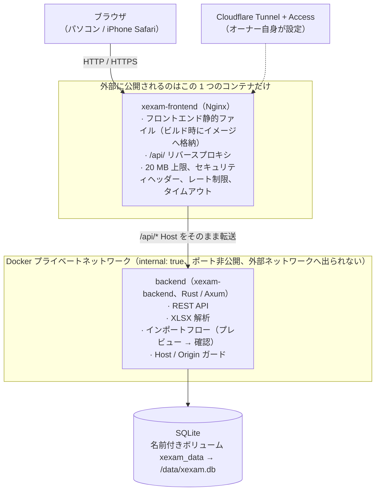
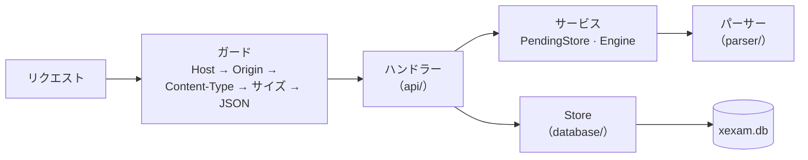
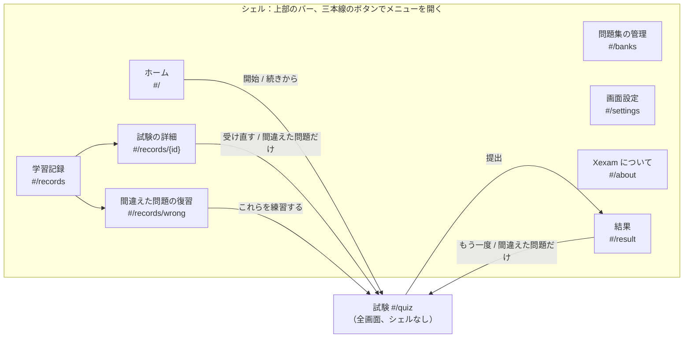
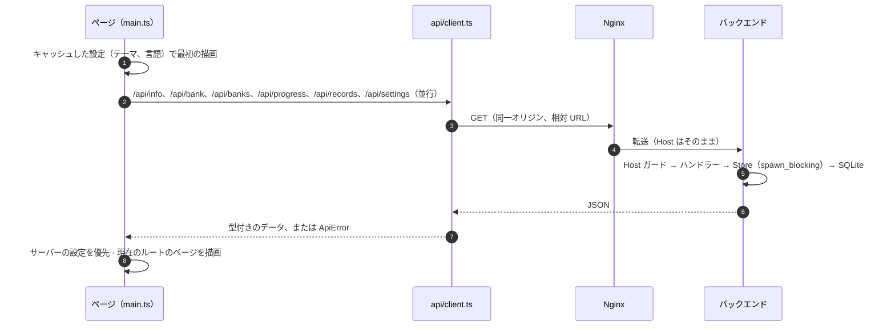
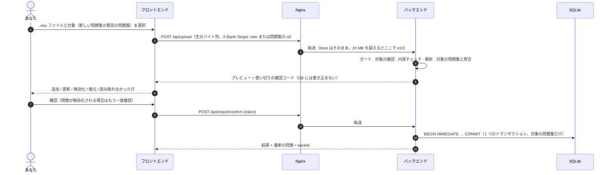

[English](../en/architecture.md) | **日本語** | [简体中文](../zh-CN/architecture.md)

# アーキテクチャ（v0.5）

> Xexam の構成を説明します。前段に Nginx、その後ろに Rust のバックエンド、保存先は SQLite、フロントエンドはフレームワークなしの TypeScript です。
> 旧 Python 版から切り替えたときの背景資料（中国語のみ）：旧コードの監査は [architecture-audit.md](../zh-CN/history/architecture-audit.md)、決定事項と既定値は [migration-plan.md](../zh-CN/history/migration-plan.md) にあります。

## 1. 全体像



- **ポートを公開するのは Nginx だけです**（`XEXAM_BIND`、既定は `127.0.0.1:8765` → コンテナ内の `8080`）。
- バックエンドのネットワークは `internal: true` です。`ports` がなく、ホストからも外部からも接続できず、バックエンド自身も外部ネットワークにアクセスできません。
- データベースを読み書きできるのはバックエンドだけです。Nginx のコンテナには、データベースもソースコードも Node も入っていません。
- ブラウザとバックエンドの間は REST だけです（[api.md](api.md) を参照）。フロントエンドにはデータベースへのアクセスも、「このインポートは実行してよいか」といった判断もありません。
- アプリが保持するものは、すべてデータディレクトリ（Docker では `/data`）にあります。データベース `xexam.db`（問題、学習記録、設定）と、アップグレード後には、スキーマ移行の前に書き出したコピーを入れた `backups/` フォルダです。

## 2. ディレクトリ構成

```
frontend/       TypeScript 5.9（strict）+ Vite、素の DOM、フレームワークなし
  src/main.ts     エントリーポイント：キャッシュした設定で最初の描画、ルートに対応するページを選ぶ、読み込みを開始
  src/router.ts   ハッシュルート（#/、#/banks、#/records、#/records/<id>、#/records/wrong、#/settings、#/about、#/quiz、#/result）
  src/api/        型付きの fetch ラッパー：client（エラーは ApiError になる）、bank、import、progress、settings
  src/types/      API の型（docs/en/openapi.yaml に対応）
  src/domain/     純粋関数：採点、間違いノートの判定、出題する問題の選び方、パーセンテージ、問題の言語、README の更新履歴の解析（単体テストあり）
  src/i18n/       t() / tn()、catalog/<area>.ts（en / zh / ja の UI テキスト）、server-messages.ts、errors.ts
  src/state/      共有状態（store）、アクション、設定（preferences、settings-cache）、保存中の試験（session-storage）
  src/components/ shell（上部のバーとメニュー）、review（解答の振り返りカード）、common
  src/pages/      home、banks、records、settings、about、quiz、result
  src/styles/     main.css（カラートークン、ライト / ダーク、shell）+ ページ領域ごとの CSS ファイル
  src/utils/      DOM ビルダー、ダイアログ、トースト、書式整形
  vite.config.ts  ビルド設定。プラグイン xexam-changelog が、ビルド時に 3 つの README の更新履歴を読み込む（5 節）
backend/        Rust（Axum 0.8 + Tokio + rusqlite）、ツールチェーンは 1.99.1 に固定
  src/api/        ルーティング、ガード（Host / Origin / Content-Type / サイズ）、JSON 形式、成績データのサニタイズ
  src/services/   確認待ちインポートのスロット（PendingStore）、パースエンジンのインターフェース、インポートフロー
  src/parser/     .xlsx のパース：ZIP 対策、XML、問題の判別、問題 id
  src/database/   schema（v1 はそのまま + v2 の追加分）、Store、旧 progress.json の移行、タイムスタンプ
    store/          banks、records、settings、migrate（schema v1 → v2、バックアップ付き）
  src/security/   Host / Origin の判定、サイズ制限付きのリクエストボディ読み取り
  src/config/     環境変数
  tests/          単体、ゴールデンレスポンス、パース突き合わせ、id ベクトル、v0.5（問題集、記録、設定、移行）
nginx/          nginx.conf + Dockerfile（3 つの README を取り込んでフロントエンドをビルド → 静的な成果物だけを同梱）
docker/         docker-compose.yml（2 つのイメージを pull）、docker-compose.build.yml（ソースからビルド。コンテキストはリポジトリのルート）、.env.example
README.md       英語版の README（更新履歴を含む）。日本語版と中国語版は README/ の README.ja.md と README.zh-CN.md
tests/          baseline/（旧版のゴールデンレスポンスとフィクスチャ）· integration/（nginx、スタック全体、progress.json の移行）
docs/           en/（英語、原本）· ja/ · zh-CN/（history/ あり：過去の文書、中国語のみ）
```

## 3. データモデル（v0.5）

テーブルの詳しい一覧は [database.md](database.md) にあります。ここでは考え方を説明します。

### 問題集

- **問題集は、インポートした 1 つのワークブックです。** `banks` テーブルには問題集ごとに 1 行あります。アップロードは、新しい問題集か既存の問題集のどちらかに入ります（`X-Bank-Target` ヘッダー、[api.md](api.md) を参照）。
- **インポートで置き換わるのは、対象の問題集の内容だけです。** その問題集の問題のうちファイルにないものは無効化されます。ほかの問題集の問題には一切触れません。
- **レガシー問題集。** v0.5 より前のデータは 1 つの問題集になります（`legacy_ids = 1`）。その問題 id はパーサーが計算した素の id のままなので、以前の統計、間違いノート、試験履歴はそのままつながっています。`X-Bank-Target` のないアップロードはこの問題集に入ります。古いクライアントとコマンドラインの `import` がこれに当たります。
- **問題集ごとの id。** それ以外の問題集では、問題を `sha1("xexam-bank:{bank_id}\n{parser id}")` の先頭 12 桁（16 進）で保存します。そのため、同じワークブックを 2 回インポートして、独立した 2 つの問題集にできます。id も学習データも混ざりません。問題集の id は再利用されません。
- 問題ごとの統計（`stats`）のキーは問題 id です。そのため、統計は id を通じて問題集に属します。
- 問題集を削除すると、その問題、インポート履歴、問題集自体が消えます。学習データが消えるのは、指定したときだけです（`withRecords`。確認ダイアログのチェックボックスで、最初はオフ）。消えるのは、その問題の統計と問題ごとの詳細、そしてこの問題集から出題され、まだ残っているほかの問題集からは出題されていない試験記録です。

### 試験記録

- `attempts` には、提出した試験ごとに 1 行あります。v0.5 からは、その試験の出題元になった問題集のスナップショット（当時の id と名前）も持ちます。データベースは最新の **500** 件を残します。`/api/progress` が返すのは、これまでどおり最新の 60 件です。
- `attempt_items`（v0.5 で追加）には、試験の問題ごとに 1 行あります。問題 id、回答（ページが送ったものを整えた後の値。値がなければ未回答）、正誤です。v0.5 より前に保存された試験には、この行はありません。
- 記録の詳細（`GET /api/record`）は、これらの行を、**現在**保存されている問題（無効化されたものも含む）と並べて返します。問題集と一緒に削除された問題には、そのことを示す注記が付きます。
- 記録を 1 件削除しても、統計（間違いノート）はそのままです。すべての記録を削除するときは、統計も一緒に消去できます。

### 設定

- `settings` テーブルは同じ `xexam.db` の中にあり、テーマ、表示言語、自動で次の問題へ進むかどうか、問題の言語を保存します。データディレクトリにあるので、コンテナを更新しても、ブラウザのキャッシュを消しても、別のブラウザや別の端末から開いても残ります。アカウントはありません。このインスタンスを使う全員で 1 組の設定です。
- ブラウザは `localStorage`（`xexam.settings.v1`）にコピーを持ちますが、これは最初のフレームを正しいテーマと言語で描くためだけです。サーバーの値が読み込まれた時点で、そちらが優先されます。
- v0.4 までは、問題の言語はブラウザ（`xexam.lang.v1`）にだけありました。v0.5 で最初にページを読み込んだとき、サーバー側がまだ既定値であれば、一度だけサーバーへ移します。

### ブラウザに残るもの

- 解答途中の試験（`localStorage` の `xexam.session.v1`）：問題 id、回答、「あとで見直す」の印、現在の位置、経過時間です。問題文は含みません。v0.4 から変わっていません。
- メニューを開いているかどうかは保存しません。メニューは、ページを移ると閉じます。

## 4. バックエンド



v0.5 で追加したものも含め、すべてのルートは 1 つのディスパッチ関数を通ります。そのため、ガードの順序はどのリクエストでも同じです。主な設計判断（理由は [audit/rust-stack.md](../zh-CN/history/audit/rust-stack.md) を参照）：

| 問題 | 対応 |
|---|---|
| rusqlite は同期的 | 接続を 1 つだけ `Arc<Mutex<Connection>>` の後ろに置き、データベース呼び出しは `spawn_blocking` の中で実行します。ロックは `.await` をまたぎません。旧版の「1 つの接続 + RLock」と 1 対 1 で対応します |
| リクエストボディの上限 | 自前のストリーミング読み取り：読みながら実際のバイト数を数え、20 MiB を超えたらただちに 413 を返します。**`Content-Length` は信用しません**（チャンク転送のアップロードも同様） |
| 解析でサービスが止まってしまわないか | 解析はブロッキングスレッドで行い、協調的なデッドラインがあります（`XEXAM_PARSE_TIMEOUT_SECS`、既定 30 秒。時間になるとパーサー自身が停止します）。同時に実行できる解析は最大 2 つです。ZIP のエントリ数、展開後のサイズ、XML の深さ / ノード数 / 要素あたりの属性数、セルの総数と総バイト数にはいずれも上限があり、共有文字列は 1 つだけ保持します |
| インポートの原子性 | プレビューはメモリ上の**唯一のスロット**にだけ置き、データベースには書きません。確認時に `BEGIN IMMEDIATE … COMMIT` を実行し、失敗したら全体をロールバックします。確認コードは使い切りで、128 ビットのランダム値、定数時間で比較され、同時に確認しても成功するのは 1 つだけです |
| コミットが中断された場合 | インポートのコミットは独立したタスクで、クライアントが切断しても最後まで実行されます。`docker stop` は最大 15 秒待ち、バックエンドは 8 秒以内に正常終了します |
| スキーマのアップグレード | データの入ったスキーマ 1 のデータベースを開くと、バックエンドはまず `VACUUM INTO` で `xexam.db` の隣の `backups/` にコピーを書き出し、それから 1 つのトランザクションで移行します。コピーを書き出せなければ起動しません。最新のデータベースを開いたときは何も書き込みません（[database.md](database.md) の 6 節を参照） |
| データの削除 | 問題集の削除も記録の削除も、それぞれ 1 つのトランザクションで実行します。問題集を削除すると、その問題集を対象にした確認待ちのアップロードも破棄します |
| ログ | `tracing`、色なし。**確認コードもドキュメントの内容も記録しません** |
| エラー | 常に `{"error": "<中国語の理由>"}` です。データベースの例外、ファイルパス、SQLite のエラーはログにだけ出力し、レスポンスには含めません。フロントエンドは知っているメッセージを翻訳します（5 節） |

バックエンドのコマンドライン：

```
xexam-backend [serve] [--data DIR] [--host ADDR] [--port N] [--allow-shutdown] [--no-browser]
xexam-backend healthcheck [--port N]          コンテナのセルフチェック（Host: 127.0.0.1 を送るので、許可リストの影響を受けない）
xexam-backend import <question-bank.xlsx> [--data DIR]  コマンドラインでレガシー問題集へインポート（旧版の --import も使える）
xexam-backend migrate-progress [progress.json] [--data DIR]  以前のバージョンの progress.json をデータベースへ移行
```

データベースを開くコマンド（`serve`、`import`、`migrate-progress`）は、どれも最初にスキーマのアップグレードを実行します。

## 5. フロントエンド

フレームワークは使わず、素の DOM を使います。共有の状態は、型付きのオブジェクト 1 つです（`src/state/store.ts`）。描画のたびに、状態から現在のページを作り直します。試験ページには小さな「リフレッシャー」もあり、全体を描き直さずに解答用紙と進捗を更新します。

### シェル、ルート、ページ



- **ルーター**（`src/router.ts`）：ハッシュルートなので、サーバー側のフォールバックは不要で、再読み込みしても同じページにとどまります。ルートは `src/state/actions.ts` の `navigate(route)` で切り替えます。試験ページからどのように離れても、回答は保存されます。試験がないときに `#/quiz` を開くとホームへ移ります（保存した試験があれば、その続きになります）。結果がないときに `#/result` を開くと学習記録へ移ります。
- **シェル**（`src/components/shell.ts`）：試験ページ以外のどのページにも、左上の Xexam のロゴ（ホームへのリンク）と右上の三本線のボタンだけを置いた細いバーがあります。ボタンを押すと、小さなドロップダウンメニューが開きます。中身は 4 つのメイン項目（ホーム、問題集の管理、学習記録、画面設定）と、区切り線の下の「Xexam v0.6」（実行中のバージョン。「Xexam について」のページを開きます）です。項目を選ぶ、メニューの外をクリックする、Esc キーを押す、のどれかで閉じます。ページを移ったときも閉じます。メニューは横に場所を取らないので、ページは画面の幅をすべて使えます。広い画面では、内容は最大 1120 px の幅で中央に置きます。試験はシェルのない、集中できる全画面表示です。
- **ページ**（`src/pages/`）：`home`（試験の開始・再開）、`banks`（問題集のインポート、更新、内容の確認、削除、形式の説明）、`records`（絞り込み付きの試験一覧、試験の詳細、間違えた問題の復習）、`settings`、`about`（バージョン、サーバーのアーキテクチャ、ライセンス、更新履歴）、`quiz`、`result`。ページ同士は互いを import せず、`src/state/actions.ts` の関数を呼びます。ページの中だけで使う UI 状態（絞り込み条件、開いているアップロードのプレビュー）は、そのページのモジュール自体に置きます。結果ページ、試験の詳細、間違えた問題の復習で共通の振り返りカードは `src/components/review.ts` にあります。
- **ホーム**（`src/pages/home.ts`）：未提出の試験があれば、一番上に小さなバナーを出します（「未提出の試験」、「このブラウザにだけ保存」、問題集 · 回答数 · 経過時間、**続きから回答** / **破棄する**）。「試験を始める」パネルの右上には、出題範囲を選ぶ小さなボタンが 2 つあります。**すべて**（選んだシートの問題数付き）と **間違いノート**（要復習の問題数付き）です。選んだシートに要復習の問題がないときは **間違いノート** を選べず、タイトルの下の 1 行でその理由を示します。**間違いノート** を選んでいるときは、同じ行で、問題がノートから外れる条件を示します。スマートフォンでは、英語と日本語の表示ではこの 2 つのボタンがアイコンと数だけになります（中国語は短い語も残します）。問題集の一覧には見出しの行（「問題集とシート」）があり、その右側に **すべて選択** / **解除** があります。問題集はそれぞれ 1 枚のカードで、そのシートはカードの中のコンパクトな行です。問題集のチェックボックスでそのシートをすべて選択・解除でき、一部だけ選んでいるときは「−」と「2 シート中 1 シートを選択」を表示します（シートを隠しているときも）。問題集の行の右側の矢印で、そのシートを表示したり隠したりできます。問題集が 2 つまでなら最初は表示し、3 つ以上なら隠します。切り替えた状態は、ページを再読み込みするまで覚えています。パネルの中にスクロールする枠は作りません（スマートフォンでは、入れ子のスクロールがページのスクロールとぶつかるため）。パネルの下端のバーは、パネルが画面に見えている間、画面の下に固定されます。そこには **試験を開始**、範囲の文（「現在の範囲：12 問」/「現在の範囲 12 問からランダムに 11 問を出題」）、**問題数** と **シャッフル** が並びます（**シャッフル** にマウスを重ねると「問題の順番をシャッフルする」と表示されます。**問題数** の入力欄のスクリーンリーダー向けの名前とツールチップは「問題数」です）。スマートフォンでは、1 行目に範囲と 2 つのオプション、2 行目に **試験を開始** が並びます。**問題数** が範囲より少ないときは、範囲全体から、どの問題も同じ確率でランダムに選びます。**シャッフル** が決めるのは、出題の順番（ランダムか問題集の順番か）だけです（`src/domain/grading.ts` の `pickQuestions`）。
- **問題集の管理**（`src/pages/banks.ts`）：ホームと同じくらいコンパクトに並べます。**Excel の取り込み** のタイトルの横には、**新しい問題集** / **既存を更新** の 2 つの小さなピル型のボタンがあります（ラジオボタンで、説明はツールチップと、スクリーンリーダー向けの説明文です）。更新するときは、その下に **更新する問題集** を出します。ヒントは 1 行で、最後のリンク **Excel の書き方** で、折りたたまれた書き方の説明を開きます。ファイルを受け付けるのも 1 行です（**Excel ファイルを選ぶ**、またはパネルのどこかにファイルをドロップ）。取り込み先を切り替えても書き換えるのはその部分だけなので、キーボードのフォーカスはそのまま残ります。プレビューには、まず数のチップ（0 のものは隠します）、続いて案内と注意、確定とキャンセルのボタンを表示し、そのあとにシートごとの 1 行を並べます。読み取れなかった行は、そのシートの行の下に折りたたみます。**登録済みの問題集** は問題集ごとに 1 行で、名前、小さな **更新** / **削除** のボタン、1 行の情報があり、シートは矢印（シェブロン）の下に折りたたみます。**取り込み履歴** は最新の 8 件を 1 行ずつ表示します。書き方の説明は `<details>` で、最初は折りたたまれています。
- **Xexam について**（`src/pages/about.ts`、`#/about`）：バージョン、サーバーのアーキテクチャ（`/api/info` の `arch`）、ライセンス、そして **更新内容** を表示します。**更新内容** は、表示言語の README の更新履歴です。最新のバージョンは開いた状態で、それより前のバージョンは **以前のバージョン** の下に折りたたみます。サーバーで動いているバージョンの項目には **このバージョン** と表示します。更新履歴はビルド時にフロントエンドへ組み込みます。`vite.config.ts` のプラグイン `xexam-changelog` が 3 つの README（`README.md`、`README/README.ja.md`、`README/README.zh-CN.md`）を読み、`src/domain/changelog.ts` の `parseChangelog()` で `### vX.Y — 日付` の見出しごとに分けて、仮想モジュール `virtual:changelog` にします。このモジュールは別のチャンクになり、このページを開いたときにだけ読み込まれます。表示できるのは簡単な Markdown だけです：段落、`- ` の箇条書き、行頭を 2 文字下げた `- ` による入れ子の箇条書き、`**太字**`、インラインコード。リポジトリ内への相対リンクは、リンクではなく文字として表示されます。そのため、README の更新履歴はこの範囲の書き方にとどめます。
- **設定**（`src/state/preferences.ts`）：テーマ（`<html data-theme>`）と言語（`<html lang>`）を適用します。変更はすぐに反映し、そのあと `POST /api/settings` で保存します。保存に失敗したら、元の設定に戻してメッセージを表示します。

### 表示言語

- **UI カタログ**（`src/i18n/catalog/<area>.ts`）：領域ごとに 1 ファイルです（`common`、`home`、`banks`、`records`、`settings`、`quiz`、`result`、`about`）。各ファイルには、同じキーが英語、中国語、日本語でそろっています。どの言語にもキーの抜けがないことを、TypeScript と `catalog.test.ts` が確かめます。コードはテキストを `t('area.key', params)` で取得し、数を含むものには `tn(key, n)` を使います。選んだ言語は、試験ページも含めてすべてに適用されます。
- **サーバーメッセージ**（`src/i18n/server-messages.ts`）：バックエンドのエラーメッセージは中国語のままです（テスト済みの API の一部だからです）。フロントエンドは、知っているメッセージを英語または日本語に翻訳します。文字列全体での一致にも、値を含むパターンにも対応します。中国語のときはそのまま表示し、知らないテキストもそのまま表示します。`server-messages.test.ts` はバックエンドのソースを読み、翻訳のないバックエンドメッセージがあると失敗します。
- **エラー**（`src/i18n/errors.ts`）：`errorText(e)` は、どんなエラーも現在の言語のテキストに変えます。ネットワークエラーと「レスポンスが JSON ではない」（Cloudflare Access のログイン期限切れが原因のことが多い）には、再読み込みしてログインし直すよう促す専用の案内が付きます。

### その他のルール

- **採点はブラウザ内で行います**（仕様ではサーバー側を推奨していましたが、ここは意図的な逸脱です。理由は [migration-plan.md](../zh-CN/history/migration-plan.md) の Q3 を参照）。ルールは純粋関数として `src/domain/grading.ts` にあり、単体テストがあります。サーバーが受け取るのは `{問題 id, correct}` と、v0.5 からは回答内容です。回答内容は、あとで振り返るために保存するだけです。
- 自動で次の問題へ進む機能（設定項目で、既定はオフ）：単一選択で答えを選んだとき、またはホットスポット問題で最後に残った小問を選んだとき、約 350 ms 後に次の問題へ進みます。複数選択では進みません。最後の問題より先へは進まず、選択を外したときも進みません。
- HTML にインラインスタイルはありません。CSP が `style-src 'self'` だからです。計算で決まる少数のサイズ（進捗バー、得点バー）は CSSOM で設定しており、これは CSP で許可されています。
- ビルドターゲットは `es2020` / `safari15` です。iPhone は iOS 15.4 以上が必要です。

## 6. リクエストの流れ

### アプリの読み込み



これらのリクエストのどれかが失敗すると、アプリはエラーページを 1 つ表示します。そこには再読み込みボタンと、翻訳した理由が載ります。

### 問題集の更新（アップロード → プレビュー → 確認）



プレビューを開いたまま「問題集の管理」ページを離れると、そのプレビューは取り消されます（`POST /api/import/cancel`）。

### 試験を受ける

すべての問題集の問題を、一度にブラウザへ取得します。回答はブラウザ内で行い、解答途中の試験は変更のたびに `localStorage` に保存されます。提出すると、ページが採点し、`POST /api/attempt` を送ります。中身は各問題の `{id, correct, answer}` と、シート、モード、所要時間です。バックエンドは 1 つのトランザクションで、問題ごとの統計を更新し、問題集のスナップショットと問題ごとの詳細行を付けて試験を保存し、最新の 500 件より古い試験を削除します。返すのは学習の進捗です。そのあとページは記録の一覧を読み込み直し、結果ページから新しい記録へリンクできるようにします。

### エラー

バックエンドはエラーを `{"error": "<中国語のメッセージ>"}` で返します。`api/client.ts` がこれを `ApiError` に変え、`errorText()` がメッセージをサーバーメッセージの対応表に渡します。対応表は、現在の表示言語のメッセージを返します（知らないメッセージならそのまま返します）。

## 7. ビルドとイメージ

| イメージ | ビルド | 実行時の内容 |
|---|---|---|
| `xexam-frontend` | `node:24-alpine` でフロントエンドをコンパイル（3 つの README の更新履歴も組み込む）→ `nginxinc/nginx-unprivileged:1.27-alpine` | nginx.conf + 静的ファイル、非 root の uid、8080 で待ち受け |
| `xexam-backend` | ビルドマシン自身のアーキテクチャで動く `rust:1.99.1-slim-bookworm` で、zig を使って静的な musl バイナリへクロスコンパイル → `alpine:3.21` + tzdata | 実行ファイル 1 つ + `/VERSION`、uid 10001、ルートファイルシステムは読み取り専用 |

「Xexam について」のページの更新履歴のために、`nginx/Dockerfile` はビルド段階で `README.md`、`README/README.ja.md`、`README/README.zh-CN.md` を、リポジトリと同じ配置でフロントエンドのソースの 1 つ上のフォルダへコピーします（`COPY README.md /` と `COPY README/README.ja.md README/README.zh-CN.md /README/`）。`vite.config.ts` はそこから読み込みます。そのため `.dockerignore` は、この 3 つの README（`README.md` と `README/`）をビルドコンテキストから除外しません（`docs/` などは引き続き除外します）。最終的なイメージに入るのはビルドした静的ファイルだけで、README のファイルそのものは入りません。

どちらのサービスも `cap_drop: ALL`、`no-new-privileges`、`read_only: true`、`tmpfs: /tmp` を使います。バックエンドが書き込めるのは `/data`（データボリューム）と `/tmp` だけです。

## 8. 旧版との対応

| 旧（Python） | 新 |
|---|---|
| `server.py` | `backend/src/api/` + `main.rs` |
| `app/db.py` | `backend/src/database/` |
| `app/xlsx_parser.py` | `backend/src/parser/` |
| `web/app.js` / `style.css` / `index.html` | `frontend/src/` |
| 1 つのコンテナに 1 つのプロセス | 2 つのコンテナ：nginx + backend |
| `docker-compose.yml`（イメージを pull） | `docker/docker-compose.yml`（`xexam-frontend` と `xexam-backend` の 2 つのイメージを pull）；`docker/docker-compose.build.yml`（ソースからビルド） |

旧 Python 実装はリポジトリから削除しましたが、失われたわけではありません。Git タグ `python-v0.2` が最後のバージョンを指しており、旧イメージ `ghcr.io/yumin-space/xexam:v0.2.2` も引き続き GHCR から pull できます（非公開なので、先に `docker login ghcr.io` を実行します。Docker Hub にはありません）。ロールバックについては [migration.md](migration.md) を参照してください。
