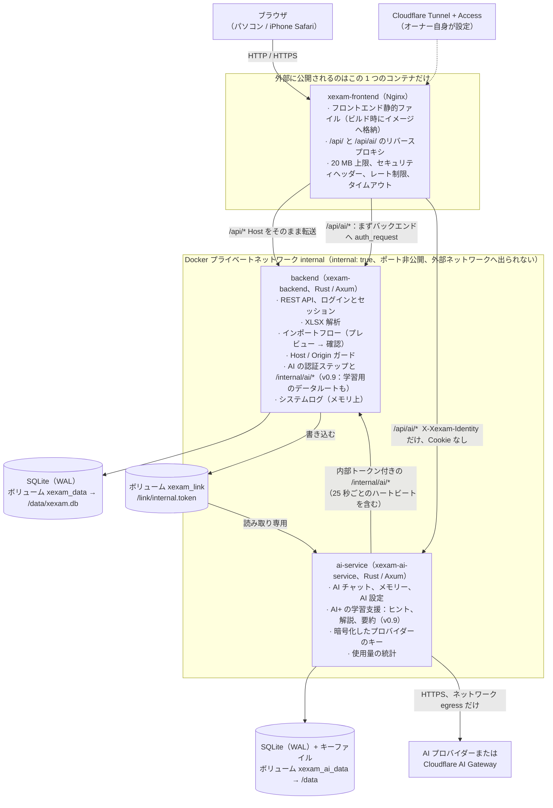
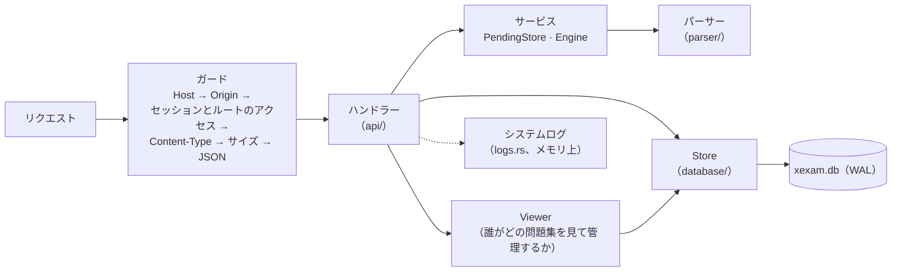
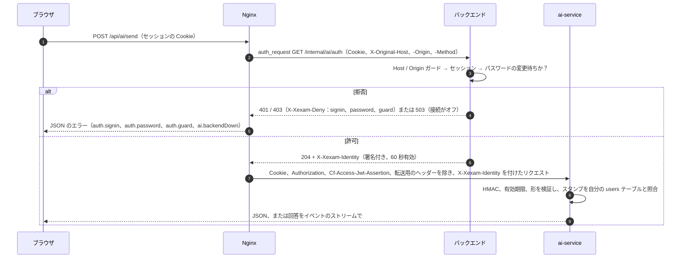
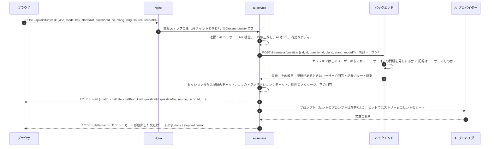
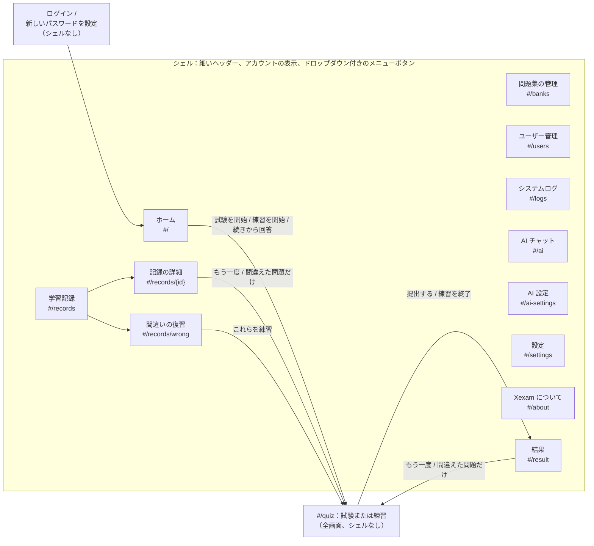
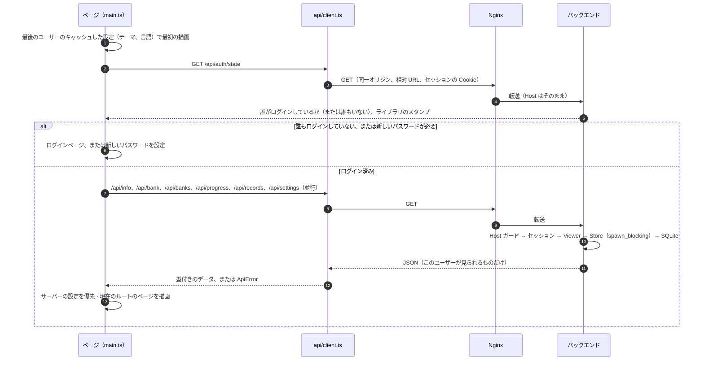
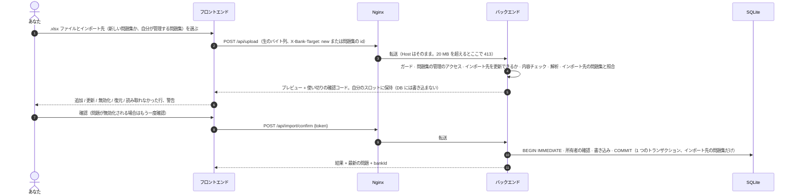
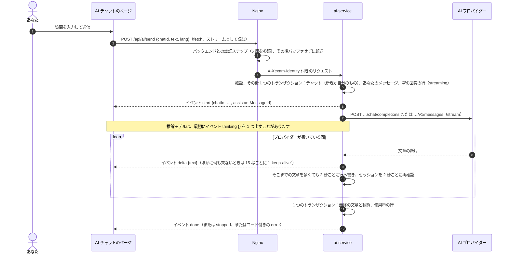

[English](../en/architecture.md) | **日本語** | [简体中文](../zh-CN/architecture.md)

# アーキテクチャ（v1.1）

> Xexam の構成を説明します。前段に Nginx、その後ろに Rust のバックエンド、その隣に別の Rust のサービス、ai-service（v0.8。v0.9 でこれに AI+ の学習機能が加わり、v1.0 で利用者ごとの AI リクエスト上限と、回答・メモリーの長さ（文字数）が加わります）、保存先は SQLite（サービスごとに 1 つのデータベース）、フロントエンドはフレームワークなしの TypeScript です。v1.0 ではスマートフォンを優先したインターフェースに作り直しました（6 節）。
> 旧 Python 版から切り替えたときの背景資料（中国語のみ）：旧コードの監査は [architecture-audit.md](../zh-CN/history/architecture-audit.md)、決定事項と既定値は [migration-plan.md](../zh-CN/history/migration-plan.md) にあります。

## 1. 全体像



- **ポートを公開するのは Nginx だけです**（`XEXAM_BIND`、既定は `127.0.0.1:8765` → コンテナ内の `8080`）。
- バックエンドのネットワークは `internal: true` です。`ports` がなく、ホストからも外部からも接続できず、バックエンド自身も外部ネットワークにアクセスできません。ai-service もこのネットワークにあり、さらに唯一のコンテナとしてネットワーク `egress` にもつながっていて、AI プロバイダーに届くための外向きのインターネット接続を持ちます。ai-service もポートを公開しません。
- 各データベースを読み書きするのは、それぞれのサービスだけです：`xexam.db` はバックエンド、`xexam-ai.db` は ai-service（データの境界、5 節）。Nginx のコンテナには、データベースもソースコードも Node も入っていません。
- **上限は外側から内側へ**：Nginx は接続元のアドレスごと、AI セッションごとに制限します（[security.md](security.md) の 9 節）。ai-service はその後、ユーザーごとに作成中の回答の数と、インスタンス全体で同時に行うモデル呼び出しを制限し、v1.0 からは利用者ごとのリクエスト上限（1 分に 5 回、1 時間に 20 回、1 日に 100 回。管理者も対象。5 節）を加えます。これらの上限はサーバーとプロバイダーの請求を守るためのもので、アクセス制御ではありません。
- ブラウザとバックエンドの間は REST だけです（[api.md](api.md) を参照）。`/api/info`、`/api/auth/state`、ログインそのもの以外のすべてのルートにセッションが必要です。フロントエンドにはデータベースへのアクセスも、「このインポートは実行してよいか」「このユーザーはこの問題集を見てよいか」といった判断もありません。決めるのはバックエンドで、フロントエンドは表示するだけです。
- メインのアプリが保持するものは、すべてバックエンドのデータディレクトリ（Docker では `/data`）にあります。データベース `xexam.db`（ユーザー、問題、学習記録、設定）、バックエンドの動作中はその `xexam.db-wal` と `xexam.db-shm` のファイル、そしてアップグレード後には、スキーマ移行の前に書き出したコピーを入れた `backups/` フォルダです。AI のものはすべて、ai-service 専用のデータディレクトリ（そのコンテナでは `/data`、ボリューム `xexam_ai_data`）にあります：`-wal` / `-shm` のファイルを伴う `xexam-ai.db` と、キーファイル `secret.key` です。

## 2. ディレクトリ構成

```
frontend/       TypeScript 5.9（strict）+ Vite、素の DOM、フレームワークなし
  vite.config.ts  ビルド設定、開発時の /api と /api/ai/ のプロキシ、プラグイン xexamAiAuth（Nginx と同じく、AI のリクエストの
                  認証ステップ）、プラグイン xexam-changelog（docs/ の 3 つの更新履歴を読む）
  src/main.ts     エントリーポイント：キャッシュした設定で最初の描画、ログインの確認、ルートに対応するページを選ぶ
  src/router.ts   ハッシュルート（#/、#/banks、#/users、#/logs、#/ai、#/ai-settings、#/records、#/records/<id>、#/records/wrong、
                  #/settings、#/about、#/quiz、#/result）
  src/api/        型付きの fetch ラッパー：client（エラーは code と field を持つ ApiError になる。Nginx の 429 のやり直し、制限時間。
                  AI の回答用の postStream）、ai、auth、bank、import、logs、progress、settings、users
  src/types/      API の型（docs/en/openapi.yaml に対応）、ビルド時に作る更新履歴モジュールの型
  src/domain/     単体テスト付きの純粋関数：採点とランダムな出題、練習の答え合わせ、保存した結果（notCounted）、
                  問題の言語、記録の絞り込み、ロックの説明と待ち時間、インポートの警告、システムログのバッファ、更新履歴の解析、
                  イベントストリームのパーサー（sse）、AI チャットの状態（ai-chat）、回答に使う安全な Markdown のサブセット（ai-markdown）、
                  メモの要求（ai-memory）、AI 設定のフォームの規則（ai-settings）、そして AI+ の学習機能（v0.9：ai-plus は、どのコントロールを誰に、どの状態で見せるか。
                  ai-study は 1 つの回答の状態。ai-run は、尋ね、止め、問い合わせるエンジン。ai-spec はリクエストの組み立て。
                  v1.0：ai-panel は AI+ パネルの状態と保存済みチャットの注記）
  src/i18n/       t() / tn()、catalog/<area>.ts（en / zh / ja の UI テキスト）、server-messages.ts、errors.ts
  src/state/      共有状態（store）、アクション（読み込み、ログイン、画面の移動）、問題集へのアクセスの規則、AI の状態（ai）、設定
                  （preferences、settings-cache）、保存中の試験や練習（session-storage）、ブラウザのストレージのキー
  src/components/ shell（ヘッダー、メニュー）、review（解答カード）、lang-switch（English / 中文 / 日本語）、kind-tag（試験 / 練習）、
                  fields（ログインとユーザーのページの入力欄）、ai-badge（AI+）、ai-render（回答）、ai-plus-controls（v0.9 の学習用コントロールのすべて。
                  全ページ分）、ai-summary（要約のウィンドウ）、ai-study-ui、tooltip、
                  mini-switch、mini-icons、common
  src/pages/      auth（ログイン、新しいパスワード）、home、banks、users、logs、ai（AI チャット）、ai-settings、forbidden（「権限がありません」）、
                  records、settings、about、quiz、result
  src/styles/     main.css（カラートークン、ライト / ダーク、セーフエリア、ダイアログ、トースト）+ shell.css（上部バー、メニュー、フッター）と
                  icon-button.css（アイコンのボタン、長押しのラベル）+ ページ領域ごとの CSS ファイル
  src/utils/      DOM ビルダー、ダイアログ、トースト、書式整形、クリップボード、media.ts（PHONE のメディアクエリ、PHONE_MQ）
backend/        Rust（Axum 0.8 + Tokio + rusqlite）、ツールチェーンは 1.99.1 に固定
  src/main.rs     コマンドライン、起動（データベース、ログ、注意の表示）、WAL のチェックポイント付きの正常終了
  src/api/        ディスパッチとガード（Host / Origin / セッション / Content-Type / サイズ）、ルート、ログインとユーザーのルート（auth.rs。
                  AI の認証ステップを含む）、各ルートのアクセスを定めたルート表、JSON 形式、成績データのサニタイズ、
                  internal.rs（v0.8：内部トークン、本人確認の文、/internal/ai/* のルート）、internal_study.rs
                  （v0.9：3 つの学習用データルート）
  src/auth/       パスワード（Argon2id）、セッションのトークンと Cookie、既知のブラウザの Cookie、ログインの制限（throttle.rs）
  src/services/   ユーザーごとの確認待ちのインポート（PendingStore）と共有のメモリの枠、パースエンジンのインターフェース、インポートフロー
  src/parser/     .xlsx のパース：ZIP 対策、XML、問題の判別（6 列形式。3 列と 4 列の形式は、見分けて拒否するためだけ）、
                  問題 id
  src/database/   schema（v1 はそのまま + v2 から v6 の追加分）、ジャーナルモード（journal.rs）、Store、旧 progress.json、タイムスタンプ
    store/          banks（見る人、所有者）、records、settings、users（アカウント、セッション、AI+）、study（v0.9：AI サービスが 1 つの問題や記録について読んでよいもの）、
                    migrate（v1 → v6、バックアップ、修復）
  src/models/     共通の型：問題、インポート先、Viewer と BankScope
  src/logs.rs     システムログ：リングバッファ、tracing のレイヤー、BurstLog
  src/security/   Host / Origin の判定、サイズ制限付きのリクエストボディ読み取り、トークン
  src/config/     環境変数、VERSION ファイル
  tests/          単体、ゴールデンレスポンス、パース突き合わせ（3 列、4 列、6 列形式）、id ベクトル、バージョンごとのファイル
                  （v05_…、v06_…、v065_…、v07_…、v08_ai_link、v09_ai_study）
ai-service/     AI サービス（v0.8）：Rust（Axum 0.8 + Tokio + rusqlite + rustls 付きの reqwest）、専用の Cargo.lock、unsafe なし
  src/main.rs     コマンドライン（serve、healthcheck、--help）、起動、バックグラウンドのタスク、正常終了（最後の「stopping」の報告も）
  src/app.rs      共有の状態：設定のスナップショット、キーの状態、上限、作成中の回答、バックエンドとの接続、ハートビート
  src/api/        ディスパッチ（mod.rs：メソッド → パス → 本人確認 → Content-Type → ボディ → アクセス）、ユーザーのルート、管理者のルート、study.rs
                  （v0.9：学習用のルート）
  src/chat.rs     回答を作るタスク：ゲート、ユーザーごとの登録、取り消し、保存、2 秒ごとの再確認
  src/provider/   OpenAI 互換と Anthropic のアダプター（Gateway はどちらの形式でも）、イベントストリームのパーサー、エラーの対応付け
  src/store/      AI のデータベース：スキーマ v3、settings / secrets / limits の行、users / chats / messages / memories（学習用のチャット
                  とその保存済みの回答を含む）、使用量の統計（目的別）、監査の送信待ち（audit outbox）
  src/study/      v0.9：ヒント、解説、要約のプロンプト、ヒントのガード（guard/）、チャットのタイトル、バックエンドのデータルートの
                  厳密な型（wire.rs）、記録の識別情報のキャッシュ（cache.rs）
  src/identity.rs、link.rs  本人確認の文。内部トークンと /internal/ai/* の呼び出し（ハートビートを含む）
  src/secret.rs、settings.rs  キーの暗号化とキーファイル。プロバイダー、URL の方針、フィンガープリント、設定の更新
  src/limits.rs、prompt.rs、retention.rs、logs.rs、codes.rs、config.rs  安全上限（回答とメモリーの長さ、トークン換算を含む）。システムプロンプトと履歴。
                  保存期間、照合（reconcile）、送信待ち。ログと転送。エラーコードとそのテキスト。環境変数
  src/quota.rs    v1.0：利用者ごとのリクエスト上限（1 分と 1 時間はローリング、1 日はサーバーのタイムゾーンの 0:00 から）
  tests/          ストリーミング、設定とキー、本人確認とアクセス、管理者向けのデータ、秘密を含まないログ、プロキシの環境。v0.9：
                  ストア（v09_store）、ガード（study_guard）、プロンプト（study_prompts）、学習用のルート（study_api）
nginx/          nginx.conf + Dockerfile（3 つの更新履歴をインポートしてフロントエンドをビルド → 静的な成果物だけを同梱）
docker/         docker-compose.yml（3 つのイメージを pull）、docker-compose.build.yml（ソースからビルド。コンテキストはリポジトリのルート）、.env.example
scripts/        release-notes.py（docs/en/changelog.md から Release の説明文を作る）、set-release-version.py（RELEASE_VERSION と README のバッジ）
tools/          screenshots/：使い捨てのインスタンスから README と文書のスクリーンショットを撮り直す。icons/：アプリのアイコンを作る。
                phone-walk/（v1.0）：使い捨てのスタックを電話の幅で歩いてレイアウトを確認する（development.md の 5.1 節）
VERSION         CODE_VERSION（コードのバージョン）と RELEASE_VERSION（最後に公開したリリース）
README.md       英語版の README（docs/en/ の更新履歴へリンク）。日本語版と中国語版は README/ の README.ja.md と README.zh-CN.md
LICENSE         MIT ライセンス
tests/          baseline/（旧版のゴールデンレスポンスとフィクスチャ）· integration/（nginx、スタック全体、progress.json の移行、
                ai_stub.py：チェックとスクリーンショットに使う架空の AI プロバイダー）
docs/           en/（英語、原本）· ja/ · zh-CN/（history/ あり：過去の文書、中国語のみ）。それぞれに専用の
                screenshots/ と changelog.md。en/openapi.yaml
```

## 3. データモデル（v0.9）

テーブルの詳しい一覧は [database.md](database.md) にあります。ここでは考え方を説明します。

### ユーザーとセッション

- **ユーザー** には権限があります：**管理者** か一般ユーザーです。一般ユーザーには **問題集を管理できる** 権限を与えることもできます。新しいデータベースやアップグレードしたデータベースには、最初に管理者 `admin` / `admin` があり、最初のログインで新しいパスワードを設定しなければなりません。
- **セッション** はデータベースにあります（Cookie の値の SHA-256 だけを保存します）。そのため、再起動しても誰もログアウトされません。パスワードを間違えたときのロックはメモリ上にだけあります（[security.md](security.md) を参照）。
- **個人のものはすべて 1 人のユーザーのもの**：学習記録、間違いノート（問題ごとの統計）、設定です。どのルートも、ログイン中のユーザーのものを読み書きします。ユーザー id は常にセッションから取り、リクエストからは取りません。
- **問題集は共有されます**。ただし、誰がどの問題集を見られるかはユーザーごとに決まります（次の節）。
- **AI+ 機能**（`users.ai_enabled`、v0.8。ユーザー管理の **AI+ 機能** の行）は、一般ユーザーに AI+ 機能を使えるようにする、ユーザーごとの付与です。管理者は常に使えます。ユーザーごとの 2 つの状態のうちの 1 つにすぎません。**一時停止**（AI 設定の **一時停止** / **再開**）は AI データベースにあり（[database.md](database.md) の 8 節）、こちらを変えることは決してありません。各ユーザーには識別用のスタンプ（`users.uid`。作成時に一度だけ設定される 32 桁のランダムな 16 進数）もあり、AI サービスはこれをユーザー id と一緒に保存して、その id が別のアカウントのものになったことに気づけるようにします。

### 問題集

- **問題集は、インポートした 1 つのワークブックです。** `banks` テーブルには問題集ごとに 1 行あります。アップロードは、新しい問題集か既存の問題集のどちらかに入ります（`X-Bank-Target` ヘッダー、[api.md](api.md) を参照）。
- **インポートで置き換わるのは、対象の問題集の内容だけです。** その問題集の問題のうちファイルにないものは無効化されます。ほかの問題集の問題には一切触れません。
- **レガシー問題集。** v0.5 より前のデータは 1 つの問題集になります（`legacy_ids = 1`）。その問題 id はパーサーが計算した素の id のままなので、以前の統計、間違いノート、試験履歴はそのままつながっています。`X-Bank-Target` のないアップロードはこの問題集に入ります。古いクライアントとコマンドラインの `import` がこれに当たります。
- **問題集ごとの id。** それ以外の問題集では、問題を `sha1("xexam-bank:{bank_id}\n{parser id}")` の先頭 12 桁（16 進）で保存します。そのため、同じワークブックを 2 回インポートして、独立した 2 つの問題集にできます。id も学習データも混ざりません。問題集の id は再利用されません。
- **所有者。** どの問題集にも所有者がいます。新しい問題集としてインポートしたユーザーです。v0.7 より前の問題集と、ログインしたユーザーなしで作られた問題集（コマンドラインの `import`）は、最初の管理者のものです。ユーザーを削除すると、そのユーザーが所有していた問題集は、削除した管理者に移ります。
- **1 つの形式。** v0.7 からは 6 列形式（A〜C は英語、中国語、日本語の問題、D〜F はその答えと解説）だけをインポートできます。英語が基準です。問題の種類、選択肢、識別、正解は A 列と D 列から取り、問題には言語ごとの解説を保存します（`lang`、`ja`、`explain`。[database.md](database.md) の 4.7 節を参照）。パーサーは以前の版の 3 列・4 列形式も今も判別します。アップロード、インポートの確定、コマンドラインの `import` が、何かを一時保存したり書き込んだりする前にそれらを拒否できるようにするためです（`services::check_layout`、400）。以前にそれらからインポートした問題は、起動のたびに出題停止になります（`Store::retire_old_layout_questions`、[database.md](database.md) の 4.2 節）。問題集とその学習データは残ります。
- 問題集を削除すると、その問題、インポート履歴、誰がそれを見られるかの情報、問題集自体が消えます。学習データが消えるのは、指定したときだけです（`withRecords`。確認ダイアログのチェックボックスで、最初はオフ）。管理者はすべてのユーザーの学習データを、問題集の管理権限を持つユーザーは自分の学習データだけを消します。

### 誰がどの問題集を見て管理するか：Viewer と BankScope

問題集のデータを読む、または問題集に書き込むリクエストは、どれもログイン中のユーザーから **`Viewer`** を作ります。その時点のデータベースから読むので、管理者による変更は、誰もログアウトさせずに次のリクエストから反映されます。

| | `admin` | `can_manage` | `scope`（`BankScope`） |
|---|---|---|---|
| 管理者 | はい | はい、すべての問題集 | `All` |
| 一般ユーザー | いいえ | 権限のとおり | `Only(その user_banks の行と、問題集の管理権限がある間は自分が所有する問題集)` |

一般ユーザーの `user_banks` の行は、管理者がそのユーザーのためにチェックした既存の問題集です。**今後インポートする問題集も含める**（`users.new_banks`）は閲覧者の一部ではありません。問題集を作るトランザクションの中で、新しい問題集ごとに行を 1 つ加えるだけです。

- **読み取り**：Store の `*_as` メソッドは、Viewer かその `BankScope` を受け取ります。一部の問題集だけを見られるユーザーには、`/api/bank` と `/api/banks` でその問題集だけを、`/api/progress` でその問題の統計だけを返し、記録の詳細では、ほかの問題集の問題を削除された問題と同じように省きます。`/api/banks` の studied と records の数は、管理者以外には本人のものです。問題集の所有者が分かるのは管理者だけです。
- **書き込み**：`Viewer::manages(owner)` は、管理者では常に真、問題集の管理権限を持つユーザーでは自分が所有する問題集のときだけ真です。既存の問題集へのインポートと問題集の削除は、これを**書き込みのトランザクションの中で**確認します。そのため、その間に所有者が変わっても（削除されたユーザーの問題集が管理者に移る）、確認と書き込みの間に入り込むことはできません。拒否したときは何も書き込みません（403 `MSG_NOT_BANK_OWNER`）。アップロードのルートは、解析する前にもインポート先をもう一度確認するので、拒否されるアップロードに解析の時間を使うことはありません。
- **試験**：一般ユーザーが提出したとき、そのユーザーの範囲外の問題は、もう存在しない問題とまったく同じに扱います。数に入れず、何も書き込まず、その id を `notCounted` で返します。
- **開いているページの更新**：`GET /api/auth/state` は、中身の見えないダイジェストである **ライブラリのスタンプ** を持ちます。管理者では、ライブラリ全体に従います。一般ユーザーでは、そのユーザーの問題集とそのアクセスだけに従うので、見られない問題集を明かすことも、それに合わせて変わることもありません。ページは画面を移るたびと、タブが再び表示されたときにこれを比べ、変わっていれば問題集を読み直します。

### 学習記録：試験と練習

- `attempts` には、提出した試験や練習ごとに 1 行あります。その所有者（`user_id`）、種類（`exam` または `practice`）、出題元になった問題集のスナップショット（当時の id と名前）、そして v0.9 からは、その記録の元になったセッションのキーと開始時刻（`session_key`、`started_at`。古い記録では NULL）を持ちます。この 2 つが、記録をそのセッションの AI チャットに結び付けます。ユーザーごとに最新の **500** 件を残します。`/api/progress` が返すのは最新の 60 件です。
- `attempt_items` には、記録の問題ごとに 1 行あります。問題 id、回答（ページが送ったものを整えた後の値。値がなければ未回答）、正誤です。v0.5 より前に保存された記録には、この行はありません。
- 練習も、試験とまったく同じように間違いノートに反映されます。
- 記録の詳細（`GET /api/record`。`sessionKey` と `startedAt` も返します）は、詳細の行を、**現在**保存されている問題（無効化されたものも含む）と並べて返します。問題集と一緒に削除された問題や、ユーザーがもう見られない問題集の問題には、問題文の代わりに注記が付きます。
- 記録を 1 件削除しても、統計（間違いノート）はそのままです。すべての記録を削除するときは、統計も一緒に消去できます。

### 設定

- `user_settings` は、ユーザーごとのテーマ、表示言語、自動で次の問題へ進むかどうか、問題の言語を保存します。データディレクトリにあるので、コンテナを更新しても、ブラウザのキャッシュを消しても、別のブラウザや別の端末から開いても残ります。
- ブラウザはユーザーごとに `localStorage`（`xexam.u<id>.settings.v1`）にコピーを持ちますが、これは最初のフレームを正しいテーマと言語で描くためだけです。サーバーの値が読み込まれた時点で、そちらが優先されます。

### AI のデータ（AI サービス専用のデータベース）

- `xexam-ai.db` には、AI 設定と暗号化したプロバイダーのキー、安全上限（v1.0 からは利用者ごとの 3 つのリクエスト上限と回答の長さも。メモリーの長さも上限の 1 つです）、AI サービスが見たことのあるユーザー（id、スタンプ、最後に分かった名前）、そのチャットとメッセージ、メモ、モデルの呼び出しごとの使用量の行（内容は決して含まない）、まだ届けていない監査の行が入ります。テーブルの一覧は [database.md](database.md) の 8 節にあります。
- チャットは、最後のメッセージから一定の日数（既定は 90 日。AI 設定で設定）が過ぎると自動で削除されます。メモは削除されるまで残ります。メインのアプリでユーザーを削除すると、AI サービスの照合（reconcile）がその AI データを削除し、使用量の行はユーザーなしで残します。AI+ 機能を付与されていないユーザーは AI 設定の一覧から消えますが、そのデータは、削除されるか保存期間で消されるまで残ります。
- v0.9 からは、チャットに AI+ の学習機能の回答も入ります：練習のセッションごと、試験ごと、記録の要約ごとに 1 つのチャットがあり、それぞれに保存済みのヒント、解説、要約が入ります（送った問題文と AI の回答は、このデータベースにコピーされます。[database.md](database.md) の 8.2 節）。ユーザー、管理者の閲覧、上限、保存期間のどれから見ても、普通のチャットです。学習画面がこれらのチャットを開くことは決してありません。AI+ のパネルと要約のウィンドウは、注記 **AI チャットに記録済み** と、チャットの名前を示すヒント（v1.0）だけを表示します。

### ブラウザに残るもの

- 解答途中の試験や練習（`localStorage` の `xexam.u<id>.session.v1`。そのブラウザのユーザーごとに 1 つ）：問題 id、回答、印、現在の位置、経過時間、種類、練習ではどの問題を答え合わせしたか、そして v0.9 からはセッションのランダムなキーと開始時刻（再開しても保たれ、保存のときに送られます）。問題文は含みません。
- 最後にログインしたユーザーの id（`xexam.lastUser.v1`）。そのユーザーのキャッシュした設定で最初のフレームを描くためです。
- 既知のブラウザの Cookie `xexam_device`（[security.md](security.md) を参照）とセッションの Cookie `xexam_session`。どちらも `HttpOnly` です。
- メニューを開いているかどうかは保存しません。メモリ上にだけあり、メニューはページを移るたびに閉じます。
- AI 設定に入力した AI のキーは、保存するまでページのメモリ上にだけあり、保存の後、ページの移動時、ログアウト時に消去されます。チャットとメモがブラウザに保存されることはありません。AI+ のパネルと要約のウィンドウは、表示した回答をメモリ上にだけ保ち、ログアウトと再読み込みで忘れます。

## 4. バックエンド



すべてのルートは 1 つのディスパッチ関数を通るので、ガードの順序はどのリクエストでも同じです。（唯一の例外は `/internal/` の下のパス、つまり AI サービスとの接続です：ディスパッチはこれを Host ガードの前に、セッションのレイヤーを通さずに `api/internal.rs` へ渡します。その後、認証ステップが `X-Original-*` ヘッダーに対して自分でガードを実行します。5 節を参照。）セッションの確認は、Host（POST では Origin も）の確認の直後、ボディを読む前に、各ルートのアクセスを定めた 1 つのルート表に対して行います：**公開**、**ログイン**、**問題集の管理**（管理者と問題集の管理権限を持つユーザー：アップロード、インポートの確定 / 取り消し、インポート履歴、問題集の削除）、**管理者**（ユーザー、システムログ、終了）。ルート表にないパスにもセッションが必要です。主な設計判断（初期の検討は [audit/rust-stack.md](../zh-CN/history/audit/rust-stack.md) を参照）：

| 問題 | 対応 |
|---|---|
| rusqlite は同期的 | 接続を 1 つだけ `Arc<Mutex<Connection>>` の後ろに置き、データベース呼び出しは `spawn_blocking` の中で実行します。ロックは `.await` をまたぎません。旧版の「1 つの接続 + RLock」と 1 対 1 で対応します |
| ジャーナルモード | v0.7 から `synchronous=FULL` の WAL です（`database/journal.rs`）。`XEXAM_SQLITE_JOURNAL=delete` にすると、従来のロールバックジャーナルのままになります。SQLite がモードを拒否したときは、エラーではなく警告としてログに残します。実際のモードは起動時に 1 回ログに出し、正常終了のときに `wal_checkpoint(TRUNCATE)` を実行します。[database.md](database.md) の 2.1 節を参照 |
| リクエストボディの上限 | 自前のストリーミング読み取り：読みながら実際のバイト数を数え、20 MiB を超えたらただちに 413 を返します。**`Content-Length` は信用しません**（チャンク転送のアップロードも同様） |
| 解析でサービスが止まってしまわないか | 解析はブロッキングスレッドで行い、協調的なデッドラインがあります（`XEXAM_PARSE_TIMEOUT_SECS`、既定 30 秒。時間になるとパーサー自身が停止します）。同時に実行できる解析は最大 2 つです。ZIP のエントリ数、展開後のサイズ、XML の深さ / ノード数 / 要素あたりの属性数、セルの総数と総バイト数にはいずれも上限があり、共有文字列は 1 つだけ保持します |
| 確認待ちのインポート | プレビューはメモリ上にだけ置き、データベースには書きません。**アップロードするユーザーごとに自分のスロットがあります**（ユーザー id がキー）：ある問題集の管理権限を持つユーザーのアップロードが、ほかのユーザーのプレビューを置き換えたり、確定したり、取り消したりすることはありません。すべてのスロットで **128 MiB** のメモリの枠を共有します（解析した問題から見積もります）。アップロードを一時保存するとき、合計が枠を超えている間は、ほかのユーザーのいちばん古いプレビューから捨てます。捨てられたユーザーが確定すると、30 分の期限を過ぎたときと同じく、プレビューが期限切れだと表示されます。最新のアップロードは必ず残ります |
| インポートの原子性 | 確定時に `BEGIN IMMEDIATE … COMMIT` を実行し、失敗したら全体をロールバックします。所有者の確認もこのトランザクションの一部です。確認コードは使い切りで、128 ビットのランダム値、定数時間で比較され、同時に確認しても成功するのは 1 つだけです |
| コミットが中断された場合 | インポートのコミットは独立したタスクで、クライアントが切断しても最後まで実行されます。`docker stop` は最大 15 秒待ち、バックエンドは 8 秒以内に正常終了します |
| スキーマのアップグレード | データの入った古いスキーマのデータベースを開くと、バックエンドはまず `VACUUM INTO` で `xexam.db` の隣の `backups/` にコピーを書き出し、それから 1 つのトランザクションで移行し、そのあとで WAL に切り替えます。コピーを書き出せなければ起動しません。最新のデータベースを開いたときは何も書き込みません（[database.md](database.md) の 6 節を参照） |
| データの削除 | 問題集、記録、ユーザーの削除は、それぞれ 1 つのトランザクションで実行します。問題集を削除すると、その問題集を対象にした確認待ちのアップロードも破棄します |
| パスワード | Argon2id を `spawn_blocking` で、同時に最大 2 つ。ログインの制限は、ハッシュを計算する前に応答します。[security.md](security.md) を参照 |
| ログ | `tracing`、色なし、`XEXAM_LOG`（既定 `info`。空のときも `info`、無効な値なら警告を 1 回出して `info`）で絞り込み。ユーザーは id ではなくユーザー名で示します。**パスワード、セッションのトークン、Cookie の値、確認コード、内部トークン、本人確認の文、問題文は決して記録しません**（v0.9 からは、学習用のデータルートは何も書きません）。下を参照 |
| エラー | 常に `{"error": "<中国語の理由>"}` です。データベースの例外、ファイルパス、SQLite のエラーはログにだけ出力し、レスポンスには含めません。フロントエンドは知っているメッセージを翻訳します（6 節） |

### システムログ

- `main.rs` は `tracing` のサブスクライバーを 1 つ、**1 つのフィルター**（`XEXAM_LOG`、既定 `info`）と 2 つの出力で設定します。標準エラー出力（`docker compose logs backend` で見えるもの）と、`logs.rs` の `BufferLayer` です。起動時と終了時に `main.rs` が標準出力に書く簡単な状態の行もバッファに加えます。`reset-password` が表示する新しいパスワードは加えません（このコマンドはそもそも別のプロセスで動きます）。
- バッファは**最新 2000 行のリング**で、メモリ上にだけあります。再起動すると空に戻り、データベースには何も書き込みません。各行には連番（そのプロセスの最初の行が 1）、秒までのローカル時刻、レベル、ターゲット（モジュール）、フィールド付きのメッセージがあります。メッセージは 4000 文字を超えた分を切ります。
- `GET /api/logs?after=<seq>&boot=<id>`（管理者のみ）は、`after` より後の行、最新の連番（`last`）、`after` と保持している最も古い行の間の行が捨てられたかどうか（`dropped`）、バックエンドのプロセスのランダムな id である `boot` を返します。再起動すると連番は 1 から始まり直すので、再起動前の `boot` を送ったクライアントには、保持しているすべての行を返します。
- **AI サービスの行** は `POST /internal/ai/log` で届き（1 回の呼び出しで最大 50 行。各行は 2000 文字で切り、制御文字は取り除きます）、ターゲット `xexam_ai_service` と接頭辞 `AI: ` を付けて同じバッファに加わります。バックエンドの標準エラー出力には書きません。ai-service のコンテナが自分の行を自分で出力します。
- **BurstLog。** サーバーに届く人なら誰でもログインせずに起こせる行は、`BurstLog` を通します：Host / Origin の確認で拒否したリクエスト、ログインの失敗、アカウントのないユーザー名のロックです。静かな 1 分の後の最初の出来事はすぐに記録し、それに続くものは数えておいて、多くても 1 分に 1 回、1 行にまとめて記録します。まとめるのは次の出来事か、毎分動くサーバーのタイマーなので、後に何も続かなくても、まとまりの終わりはおよそ 1 分以内に記録されます。拒否した（429）ログインも、ログインの制限が同じようにまとめます。そのため、こうしたリクエストを大量に送っても、2000 行からほかの行を押し出すことはできません。

### バージョン

バックエンドは `/api/info` でバージョンを返します。読む順序は次のとおりです：`XEXAM_VERSION`（正しい値のとき）、`XEXAM_VERSION_FILE` が指すファイルの `CODE_VERSION`（イメージでは `/VERSION`。リポジトリの `VERSION` のコピー）、バイナリに組み込まれたバージョン。同じファイルの `RELEASE_VERSION` はここでは無視します。`CODE_VERSION` が 2 回あるファイルからはバージョンを取りません。`KEY=VALUE` の行が 1 つもないファイルは、古い 1 行の形式として読みます。

### コマンドライン

```
xexam-backend [serve] [--data DIR] [--host ADDR] [--port N] [--allow-shutdown] [--no-browser]
xexam-backend healthcheck [--port N]          コンテナのセルフチェック（Host: 127.0.0.1 を送るので、許可リストの影響を受けない）
xexam-backend import <question-bank.xlsx> [--data DIR]  コマンドラインで 6 列形式のワークブックをレガシー問題集へインポート（旧版の --import も使える）
xexam-backend migrate-progress [progress.json] [--data DIR]  以前のバージョンの progress.json をデータベースへ移行
xexam-backend reset-password <username> [--data DIR]  新しいランダムなパスワード（1 回だけ表示）。次のログインで変更が必要
```

データベースを開くコマンド（`serve`、`import`、`migrate-progress`、`reset-password`）は、どれも最初にスキーマのアップグレードを実行し、`XEXAM_SQLITE_JOURNAL` のジャーナルモードを求め、古い形式の問題を出題停止にします。サーバーの動作中でも実行できます（Docker では `docker compose exec backend xexam-backend …`）。内部トークンを読み込むか作成するのは `serve` だけです（`XEXAM_INTERNAL_TOKEN`、なければ `<リンクディレクトリ>/internal.token`。リンクディレクトリは `XEXAM_LINK_DIR`、なければデータディレクトリの中の `link`、イメージでは `/link`）。ほかのコマンドは決してこれに触れません。

## 5. AI サービス（v0.8。学習機能は v0.9）

AI チャット、AI のメモリー、AI 設定には、3 つ目のコンテナ `ai-service`（イメージ `xexam-ai-service`）が応えます。専用の SQLite データベースを持つ、別の Rust のプログラム（`ai-service/`。バックエンドと同じく Axum + Tokio + rusqlite）です。バックエンドには HTTP クライアントも TLS も AI のコードも加わっていません。「インターネットに接続しない」という保証はそのままで、ai-service のために小さな内部ルートを応答するだけです：Nginx 用の認証ステップと、7 つのトークンのルート（v0.8 からの 4 つと、v0.9 からの、学習機能に必要な問題と記録を渡す 3 つ）です。

### データの境界

オーナーの規則です。コードと compose ファイルはこれに従います。

- **どの SQLite ファイルも、2 つのコンテナから開かれることはありません。** `xexam_data`（`xexam.db` を含む）をマウントするのはバックエンドだけ、`xexam_ai_data`（`xexam-ai.db` とキーファイル `secret.key` を含む）をマウントするのは `ai-service` だけです。フロントエンドはボリュームをマウントしません。
- **ai-service がメインのアプリのデータに届くのは、バックエンドの API を通してだけです**：トークンで守られたルート `/internal/ai/introspect`、`/internal/ai/users`、`/internal/ai/log`、`/internal/ai/heartbeat`（セッションが誰のものか、どのユーザーがいて誰が AI+ 機能を持つか、システムログ用の自分の行、自分自身の状態）と、v0.9 からは `/internal/ai/question`、`/internal/ai/record`、`/internal/ai/record-info`。この 3 つが渡すのは、**呼び出したユーザーが見られる問題 1 つ、または呼び出したユーザー自身の記録で、しかも呼び出したユーザーの有効なセッションで尋ねられたときだけ**です：バックエンドはセッションをユーザーに結び付け、別のユーザーのセッション、ユーザーが見られない問題集の問題、呼び出したユーザーのものでない記録には何も答えません（どれにも、まったく同じ「見つからない」という応答を返します）。それでも、問題集、記録、設定を自分で読むことは決してなく、この 3 つの射影以上のものを受け取ることもありません（下の「AI+ の学習支援」）。
- **バックエンドが AI のデータに届くのは、ai-service の API を通してだけです**。そして v0.8 では一度もそうしません：バックエンドは ai-service をまったく呼び出しません。ハートビートは逆向きです（ai-service がバックエンドに知らせます。下を参照）。バックエンドが AI について知っているのは、最後に受け取った報告だけで、メモリ上にだけ保持します。
- **各データベースを移行するのは、それぞれのサービスだけです**：バックエンドは `xexam.db`（スキーマ v6。v1.0 で変更なし）を移行し、ai-service は `xexam-ai.db`（スキーマ v4。v1.0 から。[database.md](database.md) の 8 節を参照）を作成して開きます。
- **唯一の共有ボリューム `xexam_link` には、ファイル `internal.token` が 1 つあるだけです**。データベースは決して置きません。書き込むのはバックエンドで、ai-service は読み取り専用でマウントします。

そのため、`xexam_data` のバックアップには AI の秘密もチャットも入らず、`xexam_ai_data` のバックアップには問題集もパスワードも学習記録も入りません。

### 誰からの要求か：認証ステップと本人確認の文



- **認証ステップ**（`GET /internal/ai/auth`、`backend/src/api/internal.rs` と `api::auth::introspect`）は、すべての `/api/*` のリクエストと同じ Host / Origin ガードとセッションの確認を行います。ただし、Host、Origin、メソッドは Nginx が設定する `X-Original-*` ヘッダーからだけ読み、セッションを延長せず、セッションの Cookie をほかのルートより厳しく扱います：`xexam_session` の Cookie がちょうど 1 つ、そのままの形で書かれていなければなりません（Nginx のセッションごとの制限も同じ Cookie をキーにします）。
- **本人確認の文**（`X-Xexam-Identity`）は `base64url(payload) "." base64url(HMAC-SHA-256(token, "xexam-identity-v1." + base64url(payload)))` です。payload はコンパクトな JSON `{"v":1,"id","stamp","username","role","aiAllowed","sid","exp"}` で、ユーザーの id、識別用のスタンプ（`users.uid`）、名前と権限、AI を使えるかどうか（管理者か、AI+ がオン）、セッションのトークンのハッシュ、60 秒先の有効期限です。決してログに記録しません。AI サービスはほかに本人確認の情報源を受け付けません：Cookie、`Authorization`、転送用のヘッダーは決して読まず、クライアントが送った `X-Xexam-Identity` は Nginx が上書きします。
- **内部トークン** は、この文に署名し、7 つのトークンのルートへの ai-service の呼び出しを認証します（ヘッダー `X-Xexam-Internal-Token`、定数時間で比較）。設定されていれば `XEXAM_INTERNAL_TOKEN`（両方のサービスで同じ値）、なければファイル `<リンクディレクトリ>/internal.token` で、このファイルがないときは `xexam-backend serve` が作成します（43 文字、32 バイトのランダム値、モード 0600）。トークンがないか間違っているとき、トークンのルートは、知らないパスとまったく同じく 404 を返します。
- **vite の開発 / プレビューサーバー** も、`frontend/vite.config.ts` の小さなプラグイン（`xexamAiAuth`）で同じことをします：バックエンドの認証ステップに問い合わせ、認証情報を取り除き、文を設定します。そのため、開発、スクリーンショットのツール、本番が 1 つの信頼モデルを共有します。
- **回答中の再確認**：回答を書いている間 2 秒ごとに、ai-service は `POST /internal/ai/introspect` で、セッションがまだあるか、同じユーザー（同じスタンプ）のものか、まだ AI+ 機能があるかを問い合わせ、一時停止されていないかを自分のデータベースで確認します。アクセスがなくなっていれば、回答は `ai.notAllowed` で、ユーザーが一時停止されていれば `ai.suspended`（コードの名前はそのままです）で止まります。確認が 3 回続けて失敗すると（バックエンドに届かない）、`ai.backendDown` で止まります。
- **再利用されたユーザー id**（メインのデータベースをバックアップから戻したとき、または新しいメインのボリューム）は、スタンプが違うことで、最初のリクエストか次の照合のときに気づかれます：その id の古い AI データは、何かを返す前に削除されます。

### ハートビート：バックエンドが ai-service の存在を知る方法

バックエンドは ai-service を呼び出さないので、動いていることは ai-service 自身から知ります：`POST /internal/ai/heartbeat`（トークンのルート。内部トークンがなければ 404 を返し、Nginx 経由では届きません）に、コンパクトな JSON `{"version","enabled","suspended","stopping"}` を送ります。バージョン、AI 設定で AI+ 機能がオンかどうか、AI+ 機能を一時停止されているユーザーの id（キーは今も `suspended`。最大 3000 件）、これが停止前の最後の報告かどうかです。バックエンドは `{"ok":true}` を返します。

- **いつ**：起動時、変更の直後にすぐ（管理者による設定の有効化、無効化、テスト、変更、一時停止、再開、見つかったキーの問題、ユーザーのデータの削除。管理者のハンドラーは、報告を待ってから応答します）、25 秒ごと、失敗した報告の 5 秒後、そして ai-service の終了時に `stopping: true` で 1 回（2 秒まで）。同時に送っている報告は 1 つだけで、ハートビートはログの行を書きません。
- **バックエンドの扱い**：最後の報告だけをメモリ上に保持します（何も保存しません。バックエンドの再起動後は、次の報告まで、長くても 25 秒、空です）。その報告が 60 秒より新しく、stopping の報告でない間、ai-service は **接続中** とみなされます。接続中で `enabled` のとき、AI+ 機能は **利用可能** です。`GET /api/auth/state` は、ログイン中のすべてのユーザーに `aiAvailable` を、管理者には `aiService` を持たせます。`/api/users*` の応答は、`aiAvailable` と各行の `aiSuspended`（一時停止中のユーザー）を持ちます（[api.md](api.md) を参照）。
- **利用可能かどうかで変わること**：AI+ 機能が利用可能でない間、バックエンドはユーザーの AI+ 機能のオン・オフの切り替えを拒否し（409 `ai.serviceOff`、何も変わらない）、フロントエンドはユーザー管理でそのスイッチを隠します。保存済みのスイッチは保たれます。
- **ai-service も自分に同じ 60 秒の規則を適用します**：受け入れられた報告がないと、ユーザーのルートは 503 `ai.backendDown` を返し、その状態は `enabled: false` を示します。自分のチャットとメモリーの閲覧と削除、およびすべての管理者のルートは動き続けます。
- **逆向きにしない理由**：バックエンドが ai-service を問い合わせる方式だと、HTTP クライアントと AI データへのルートが必要になり、データの境界が許しません。

### AI+ の学習支援（v0.9）

AI+ 機能を持つアカウントでは、AI チャットのほかに、学習の資料について AI に尋ねる 4 つのものがあります：**AI ヒント** と **AI 解説**（練習）、**AI 解析**（練習や試験の結果のすべての問題と、記録の詳細ページ。結果についての解説です）、そして記録の間違いの **AI まとめ**（学習記録とホーム）。試験が進行中の間は、試験のページにこれらは一切ありません。どの回答も、そのセッションまたは記録のチャットに保存されるので、AI チャットに表示されます（[database.md](database.md) の 8.2 節）。



- **ブラウザが送るのは id だけで、問題文は決して送りません。** ボディには、問題 id、ページに表示されている番号、問題の言語、返答言語（`lang`。設定の言語：`en`、`zh-CN`、`ja`。`zh` も受け付けます）、練習ではセッションのキーと開始時刻、結果のページや詳細ページでは記録の id が入ります。ai-service は、本人確認の文にあるセッション id を使って、バックエンドから問題を読むので、細工したボディで別のユーザーの問題や記録を指定することはできません。問題は指定した言語で、選択肢の記号付きで返り、その隣に解答（答えのキー、解説、覚え方、注、正しい選択肢の文）が付きます。どれも長さに上限があります。翻訳の生の列、シート、行、問題集の id や名前、所有者、ユーザー名、統計は一切含まれません。
- **ヒントは答えを受け取りません。** `hint_prompt` は問題だけを受け取ります：その関数のシグネチャに解答の引数はなく（`compile_fail` のテストで固定）、プロンプトはモデルに、どの選択肢が正しいかを決して言わず、ほのめかしもしないよう伝えます。解答が届くのは**ヒントのガード**（下記）だけです。解説のプロンプトは解答を受け取り、結果ページのものは、その記録でユーザーが答えた内容（または、その問題が未回答だったこと）も受け取ります。問題と回答の文はタグの間にデータとして渡し、プロンプトは、その中の文は指示ではないと伝えます。返答言語の行には「ユーザーが求めない限り」という末尾がありません。これらのプロンプトには、自由記述のユーザーのターンがないからです。
- **ヒントのガード**（`study/guard/`）は、ヒントがストリームされている間にそれをフィルターします。文章の最新の部分（問題によって 64 から 600 文字）を保留し、正規化した文章の窓を走査して、答えを挙げる言い回し（判定の語を伴う選択肢の記号や番号、「最初の選択肢」のような序数、正しい、または誤りと呼ばれるホットスポットの記述、問題文や誤った選択肢にない正しい選択肢の文）を探し、通ったものだけを放出するので、送られ、保存され、集計されるのは放出された文だけです。規則が働いたときは、そのヒントは何も残しません：回答はコード `ai.hintLeak` のエラーとして保存され、ストリームは `withdraw: true` 付きの `error` イベントで終わり（ページは表示していた分を取り除きます）、ヒントを差し止めたことを知らせる 1 行のログが、多くても 1 分に 1 回、内容なしで出ます（`AI hint withheld because it gave the answer away (user "…")`、その後は件数）。6000 文字を超えるヒントは、`truncated` 付きの `done` で終わります。ガードは**ベストエフォートのフィルターで、証明ではありません**：単語のリストと規則で動き、そのテストには捕まえない言い回しも載っています。ガードに頼らない保護は、ヒントのプロンプトに答えが決して含まれないことです。内容ストリームの一番先頭にある `<think>…</think>` の範囲（推論のパーサーを持たないサーバー）は、推論のテキストと同じに扱われ、ガードが見る前に捨てられます。それ以外の `<think>`、`</think>`、`<thinking>`、`</thinking>`（本文の途中の範囲や単独のタグ。大文字小文字を問わず、タグがストリームの複数の断片に分かれて届いた場合も含む）は本文に混じった推論なので、ガードはそのヒントを差し止めます（`ai.hintLeak`）。解説、解析、まとめは確認しません。
- **どのチャットか。** 記録がある場合（結果のページ、記録の詳細ページ）、チャットはブラウザではなくバックエンドの記録から決まります：記録のセッションのキーがそのセッションのチャットを決めるので（詳細ページは、練習や試験のチャットとその保存済みの回答を共有します）、キーなしで保存された記録（v0.9 より前）には、`r<id>@<記録の時刻>` という名前の、記録の種類の専用のチャットができます。ブラウザもキーを送ってきて、それが記録のものと違うときは、404 `ai.notFound` で答えます。記録がない場合（練習のページ）、チャットはセッションのキーのものです。タイトルはセッションが始まった時刻で、コンテナのタイムゾーンで表します（ほかに何も分からないときは記録の時刻）。1 つのセッションの最初の質問が同時に 2 つ来ても、1 つのチャットにまとまります（`idx_chats_ref`）。
- **同時に回答するのは 1 つだけ。** 既定では、ユーザーの作成中の回答は 1 つです（安全上限）。1 つが動いている間の 2 つ目の質問は 409 `ai.busy` で拒否され、そのエラーは、どの回答かを示す `running`（チャット id、メッセージ id、チャットの種類、種類、問題 id と番号、source、記録 id）を持つので、ページはどれかを伝えて **それを止めてこちらを作成** を提案できます。そのボタンは、名前の挙がったチャットを止めて、もう一度だけ尋ねます。自動で止めることは決してなく、停止が空の `stop` を送ることもありません。
- **保存済みの回答の取得。** `GET /api/ai/study/saved`（mode、`key` または `record`、source、問題、種類）と `GET /api/ai/summary/saved`（記録 id と記録の時刻の 12 桁）は、`{chatId, latest, lastGood}` を返します：どの状態でも最新の回答と、それが違うときは最新の良い回答です。必要なのは有効な本人確認だけで、AI+ 機能は要らないので、保存済みの回答は読めたままです。`record=` では、記録の識別情報は、ユーザー id、ユーザーのスタンプ、記録 id をキーにした小さなキャッシュ（1000 件、10 分、「見つからない」は決してキャッシュしない）から、なければ `POST /internal/ai/record-info` から得ます。ページは、ストリームを持たない回答が書かれている間、これらのルートを 2 秒ごとに読みます。
- **要約。** `POST /api/ai/summary/ask` は記録 id を受け取ります：バックエンドは、呼び出したユーザー自身の記録を、**間違えた**問題を最大 70 件まで（置き換えなしの一様なランダムな抽出で、記録の順。未回答の問題は数えません）、問題と回答の文を合計で最大 120 000 文字まで（各項目を比例して短くし、そのことを伝えます）付けて返します。記録のチャットは `summary` で、記録ごとに 1 つです。記録やその問題が削除されても、回答は残ります。拒否：409 `ai.noDetail`（v0.5 より前の記録には問題ごとの詳細がありません）、`ai.noWrong`、`ai.noUsable`（問題がなくなった、またはもう見えない）。
- **データルートの失敗は、1 つのリクエストの失敗で、接続の喪失ではありません。** `Link::data_call` は、404 や読み取れない応答を、そのリクエストの失敗（503 `ai.backendDown`）として扱い、接続を切れたことには決してしないので、バックエンドより新しい ai-service のイメージが、全員の AI をオフにしてしまうことはありません。すべての応答は、厳密な型（`deny_unknown_fields`）で読みます。
- **どこにも記録しないもの**：問題文、ヒント、解説、要約、回答、チャットのタイトル、セッションのキー、記録の時刻（保存済みのルートはキーと記録の時刻をクエリに載せるので、Nginx のアクセスログはクエリ文字列を除いたパスだけを残します）。

### AI サービスの中

| 問題 | 対応 |
|---|---|
| ルーティング | バックエンドと同じ `dispatch` のフォールバックが 1 つ（GET と POST だけ、それ以外は 405、知らないパスは 404 `ai.notFound`）。レイヤーはパニックのレイヤーだけで、ストリームを切ったりバッファしたりしかねないボディの上限、タイムアウト、圧縮のレイヤーはありません。ボディは自前で読みます（最大 128 KiB、JSON のオブジェクト、知らないキーは拒否） |
| アクセス | **署名あり**（有効な文なら何でも：状態、自分のチャットとメモの閲覧と削除、停止、v0.9 からは 2 つの保存済みの回答の取得）、**AI ユーザー**（AI 設定で AI+ 機能がオン、ai-service がバックエンドに接続中、`aiAllowed`、一時停止されていない：送信、再試行、メモの書き込み、v0.9 からはヒント、解説、要約を尋ねること）、**管理者**（`role = admin`。AI がオフの間も）。ユーザーのルートはどれもユーザー id を文からだけ取り、他人の id には存在しない場合と同じく 404 を返します |
| ストリーミングと切り離し | 各回答は、HTTP のレスポンスとは独立した専用のタスクで動くので、ブラウザを閉じても止まりません。タスクは文章を多くても 2 秒ごとに 1 回と最後に 1 回、短いトランザクションでデータベースに書きます（データベースのロックは `.await` をまたぎません）。回答の作成中、ページは 2 秒ごとに `GET /api/ai/chat` を読んで再びつながります |
| 停止 | 停止、チャットの削除、管理者による消去、AI+ 機能のオフ、アクセスの喪失、一時停止、終了は、どれもタスクを取り消します。そこまでの文章は残り、使用量の行はちょうど 1 つ書かれます。削除は、タスクの最後の書き込みを待ってから削除します |
| 同時実行 | AI 設定の安全上限：ユーザーごとの作成中の回答（既定 1。1 つのチャットで 2 つになることはない。学習用の質問も AI チャットの回答と同じに数え、別の回答が動いている間は 409 `ai.busy` で拒否されます）と、インスタンス全体で同時に行うモデルの呼び出し（既定 16。実行時にサイズを変えるセマフォ）。AI のデータベースの `limits` テーブルにあります |
| 利用者ごとのリクエスト上限（v1.0） | サインインしている利用者のモデル呼び出しはすべて（AI チャットの送信と再試行、AI ヒント、解説、解析、要約、再生成、メモの提案）を数え、1 分あたり 5 回、1 時間あたり 20 回（どちらもローリング）、1 日あたり 100 回（日は、サーバーのタイムゾーンの 0:00 から始まります）の上限と照合します。管理者も数えます。数えるのは利用者の `usage` の行のうち chat と memory の種類と、メモリー上で実行中の呼び出しです。そのため、ずれる可能性のあるカウンターのテーブルはありません。管理者の接続テストとモデル一覧は数えません。拒否は 429 `ai.callLimit` と `Retry-After` を返します（1 日の上限のときは `retryAt` が次の 0:00）。上限は AI 設定の安全上限です（[database.md](database.md) の 3 節、`calls_per_minute`、`calls_per_hour`、`calls_per_day`） |
| 回答とメモリーの長さ（v1.0。v1.1 からトークン数） | 回答の長さ（**回答 1 件の最大トークン数**、既定 3000、最大 250000）は、数えるすべての呼び出しで `max_tokens` としてそのままプロバイダーに送られます。プロバイダー自身の上限は引き続き適用されます。メモリーの長さ（**メモリー 1 件の最大トークン数**、既定 1000）は推定トークン数で、ASCII 文字は約 1/4 トークン、そのほかの文字は 3/2 トークンとして数えます。利用者のメッセージは常に固定の 16000 文字までで、これは管理者の設定ではありません |
| プロバイダー | OpenAI 互換（`/chat/completions`）、Anthropic（`/v1/messages`）、どちらかの形式の Cloudflare AI Gateway。自前のイベントストリームのパーサー（推論のテキストは、先頭にある `<think>` の範囲も、`thinking` イベントを 1 つ送るために認識するだけで、保存もログ記録もしません）。段階ごとの制限時間。上流のエラーは固定のコード（`ai.up.*`）に対応付け、プロバイダーのテキストは決して返しません。再生成と再試行は、プロバイダーへのリクエストの最後のユーザーのターンに番号付きのメモを加え（保存も表示もされません。学習用の再生成の番号は保存済みの回答から、AI チャットの再試行の番号はメモリー内の数から決まります）、Cloudflare AI Gateway には `cf-aig-skip-cache: true` も付くので、キャッシュする Gateway がキャッシュした回答を返すことはありません（v0.9.1） |
| フリーモード | **管理者** の状態で、チャットの状態ではありません：`users.free_mode`。設定の **AI 対話モード** で選びます（通常モード / フリーモード。`POST /api/ai/free`、管理者のみ。`GET /api/ai/status` では `freeMode` として報告）。オンの間は、古いチャットも新しいチャットも、どのチャットの送信と再試行でもフリーモード用のプロンプト（返答言語の行だけ：学習アシスタントの指示も、日付も、メモリーもなし）を使います。リクエストのボディで送られた `free` は無視されます。チャットにはモードがなく、AI チャットにはスイッチも区切り線もなく、モードがオンの間はタイトルの隣に緑の **フリーモード** のタグが出るだけです。フリーモードが外すのは Xexam 自身の役割だけで、プロバイダーの規則は決して外しません |
| プロンプトと履歴 | システムプロンプトは、先頭がリクエストごとに同一になるように組み立てます（固定の文、日付、メモリー、最後に言語の行）。どのメッセージも自分のモードを記録し（`messages.free`）、履歴は両方のモードで**全体**がモデルに渡り、切り替えの後で、送る履歴にもう一方のモードのメッセージが含まれるときだけ、言語の行の後にモードを伝える短い 1 行が付きます（「Current mode: normal … earlier turns may be free mode.」またはフリーモード側の対応する行）。新しい 4 件の履歴メッセージは全文で送り、それより古い回答は 800 文字で（続けて `…(shortened)`）、古い質問は 2000 文字で、常に同じ位置で切るので、同じメッセージはリクエストのたびに同じテキストになります。長さの予算（メッセージの長さの上限に 8000 文字を足したもの、最低 24 000）は短縮した後のテキストで数え、古いものから先に外します |
| プロンプトキャッシュ | Anthropic 形式：システムブロックと、最後の履歴メッセージ（新しい質問の 1 つ前のもの）に `cache_control` の区切りを置きます。OpenAI 形式：プロバイダー側で自動で行われ、そのために何も送りません。プロバイダーが報告するキャッシュされた入力トークンは `usage.tokens_cached` に保存され、使用量では **Cached** として表示されます |
| 外向きの HTTP | rustls、ring のプロバイダー、組み込みの Mozilla のルート証明書を使う `reqwest`（OpenSSL、aws-lc、native-tls はなし。CI で確認）。プロキシなし、リダイレクトなし、HTTP/1.1 |
| キー | `XEXAM_AI_SECRET_KEY` またはキーファイルのキーによる XChaCha20-Poly1305。復号したキーは、プロバイダーへのリクエストを 1 つ組み立てる間だけ存在します（[security.md](security.md) の 11 節） |
| 有効化 | AI+ 機能がオンになるのは、保存したスイッチがオンで、今の設定でテストに通っていて（プロバイダー、アドレス、形式、認証方式、モデル、キーのリビジョン、暗号化キーの id のフィンガープリント）、キーを復号できる間だけです。それらのどれかを変えて保存すると、全員に対してオフになり、管理者がもう一度テストしてオンにするまで戻りません |
| ログ | `tracing` で標準エラー出力へ（`docker compose logs ai-service`）、フィルターは `XEXAM_AI_LOG`。サービス自身の行は、まとめてバックエンドのシステムログ（`AI: …`）にも送ります。接続は、接続ごとに 1 回 `AI link: connected to the main service` と書き（もう一度書くのは `AI link: lost the main service` の後だけ）、長い障害でも、再試行のたびに 1 行ではなく 1 組の行で済みます。監査の行（管理者がユーザーの AI データを表示または消去した）はすぐに送るか、バックエンドが受け取るまで `audit_outbox` テーブルに残し、決して捨てません |
| バックグラウンドの処理 | チャットの保存期間（起動の 60 秒後、その後は 1 時間ごと。v0.9 からは 20 件ずつのまとまりで短い間を置き、ブロッキング用のスレッドで）、バックエンドとの照合（起動時、その後は 10 分ごと：削除されたユーザーの AI データを削除）、監査の送信待ち（30 秒ごと）、削除の後の WAL のチェックポイント（多くても 10 秒に 1 回） |
| 終了 | SIGTERM を受けると、作成中の回答はすべて `stopped` で終わり、8 秒以内に保存されます。compose は最大 15 秒待ちます |

コマンドライン：`xexam-ai-service [serve]` はサービスを起動し（既定）、`xexam-ai-service healthcheck` は 127.0.0.1 で自分の `GET /healthz` に問い合わせ（イメージのヘルスチェック）、`xexam-ai-service --help` は環境変数を一覧にします。`GET /healthz` は本人確認なしで `{"ok":true,"version":…,"arch":…}` を返します。Nginx にはこのための location がないので、Docker ネットワークの中からしか届きません。

`ai-service` がない、停止している、または正常でないときは、Nginx は `/api/ai/*` に JSON の 502（`ai.unavailable`）を返し、フロントエンドは AI チャットを隠し、AI 設定は開いて原因（動いていない、停止した、接続されていない、最初の報告待ち）を示す状態パネルを表示し、ユーザー管理の AI+ 機能のスイッチは消え、それ以外はすべてこれまでどおり動きます。`ai-service` のない古い compose ファイルでも、アプリは同じように動きます。compose ファイルでは、フロントエンドのコンテナはこれに依存していません。

### AI 問題集とファイルインポート（v1.1）

どちらの流れも、2 つのデータベースを分けたままにします。**バックエンド** は主データベース（問題集、問題、記録）を持ち、**ai-service** は AI データベース（ジョブ、呼び出し、利用状況）を持ちます。どちらのサービスも、相手のファイルには書き込みません。

- **生成**（`POST /api/ai/gen/start`）：ブラウザは ai-service に依頼します。バックエンドは、ユーザーが見られる元の問題と誤答を返します（`/internal/ai/gen/source`、`/internal/ai/gen/seeds`）。ai-service は、バッチを計画し、プロバイダーを呼び出し、すべての問題を確認します。ユーザーごとに同時に 1 件のジョブだけを実行し、ジョブは全体のゲートの最後の空きを取りません。目標に達すると `/internal/ai/gen/create` を呼び出し、バックエンドが問題集とシートを 1 つのトランザクションで書きます。
- **インポート**（`POST /api/ai/import/upload`、続いて `/api/ai/import/confirm`）：生のファイルは Nginx（同じサインイン、この経路だけ 20 MB の本文上限）を通って ai-service に届き、メモリに保持されます。文章は同じバイナリの短命な子プロセスが抽出し、AI が文章の中の問題を認識（区切りごとに 2〜3 件ずつ並列）するか、資料から 20 問を作ります。ブラウザはプレビューを表示します。確定時、ai-service はバックエンド（`/internal/ai/import/check`）に、ユーザーがまだ問題集を作れるかを確認し、バックエンドが書き込みます。どの段階でも、ファイルはディスクに書かれません。


## 6. フロントエンド

フレームワークは使わず、素の DOM を使います。共有の状態は、型付きのオブジェクト 1 つです（`src/state/store.ts`）。描画のたびに、状態から現在のページを作り直します。試験ページには小さな「リフレッシャー」もあり、全体を描き直さずに解答用紙と進捗を更新します。

### シェル、ルート、ページ



- **ログイン**（`src/pages/auth.ts`）：起動時、アプリはまず `GET /api/auth/state` を問い合わせます。誰もログインしていなければログインページ、新しいパスワードを設定しなければならないアカウントなら **新しいパスワードを設定** のページです。どちらもアプリ全体を置き換えます（シェルもルートもありません）。既定のパスワードのままの管理者がいる間は、ログインページの案内にそのアカウントの名前が出ます。アプリは画面を移るたびと、タブが再び表示されたときにも問い合わせるので、ほかの場所で終わったセッションは次のクリックでログインページになり、権限やライブラリのスタンプの変更は、ログアウトせずに反映されます。
- **ルーター**（`src/router.ts`）：ハッシュルートなので、サーバー側のフォールバックは不要で、再読み込みしても同じページにとどまります。ルートは `src/state/actions.ts` の `navigate(route)` で切り替えます。試験ページからどのように離れても、回答は保存されます。試験も練習もないときに `#/quiz` を開くとホームへ移ります（保存したものがあれば、その続きになります）。結果がないときに `#/result` を開くと学習記録へ移ります。管理者以外が `#/users` を開くとホームへ移ります。問題集の管理権限なしで `#/banks` を開いたとき、管理者以外が `#/logs` や `#/ai-settings` を開いたときは、**ホームに戻る** の付いた **権限がありません** のページ（`src/pages/forbidden.ts`）を表示します。`#/ai` は最初の AI の状態の応答を待ってから、AI チャット（すべての機能、またはまだチャットやメモがあるユーザーには読み取り専用）、データのないユーザーがなぜ使えないか（一時停止、AI+ 機能がオフ、または付与されていない）を伝える AI チャットのページ、AI サービスに接続できないときは「AI は今使えません」のページ、または **権限がありません** を表示します。`#/ai/<id>` はそのチャット、`#/ai/new` はまだ送っていない新しいチャットです：アドレスは開いているチャットに従うので、再読み込み（やリンク）で同じチャットが開きます。
- **シェル**（`src/components/shell.ts`）：試験ページとログインのページ以外のどのページにも細いヘッダーがあり、左上に Xexam のロゴ（ホームへのリンク）、右上にアカウントの表示と三本線のメニューボタンがあります。メニューには **ホーム**、**問題集の管理**（管理者と問題集の管理権限を持つユーザー）、**学習記録**、**AI チャット**（AI サービスが応答している間、AI を使える人か、まだ AI のデータがある人）、**ユーザー管理**、**AI 設定**、**システムログ**（管理者）、**設定** が並び、区切り線の下にバージョンの項目（たとえば **Xexam v0.7.5**。「Xexam について」のページを開きます）、一番下にログインしている人（**管理者** または **問題集を管理**、そして **AI+** バッジ付き）と **ログアウト** があります。現在のページの項目は強調されます。記録の詳細、間違えた問題の復習、結果は学習記録として扱います。項目を選ぶ、メニューの外をクリックする、Esc キーを押す、のどれかで閉じます。どの画面の幅でも同じように動きます。ページの内容は中央に置き、幅は最大 1120 px です。
- **フッター**（v1.0、`src/components/github-line.ts`、`src/domain/github-links.ts`。スタイルは `shell.css`）：どのページも末尾に小さく中央揃えのフッターがあります。免責の行の下に **GitHub | Xexam \<version\>** を表示します。2 つのリンクはリポジトリとそのリリースのページへ（新しいタブ）、バージョンは `/api/info` から得る実行中の `CODE_VERSION` で、コードに書かれた数字ではありません。下部に固定されたバーのあるページ（練習、試験、ホームの開始バー）では、フッターは内容の下に置かれ、バーが隠しません。AI チャットの全画面の画面では、会話の一覧の一番下にあり、会話の中には入りません。フッターの左寄せのバージョン行は削除しました。
- **スマートフォン優先のレイアウト**（v1.0）：メディアクエリは 1 つ、`PHONE`（`max-width: 600px`、または高さ 500 px 以下の横向きのスマートフォン）で、`src/utils/media.ts` に `PHONE_MQ` として 1 回定義され、各スタイルシートに同じ文字列がそのまま繰り返されます。その下では、上部バーはスクロールで隠れ、上にスクロールすると戻ります。どの操作もアイコンで、タッチ領域は 44 px、長押しでラベルが出ます（`src/components/icon-button.ts`、`src/domain/hold-tip.ts`）。内容が画面の領域を使います。スクリプトが見出しなど操作できない要素にフォーカスしても、フォーカスの枠は出ません。実際の操作要素には枠が残ります。
- **ページ**（`src/pages/`）：`home`（試験や練習の開始・再開）、`banks`（問題集のインポート、更新、内容の確認、削除、形式の説明）、`users`（アカウント、権限、問題集へのアクセス、AI+、ロック）、`logs`（システムログ）、`ai`（AI チャットとメモリー）、`ai-settings`（管理者）、`records`（絞り込み付きの記録の一覧、記録の詳細、間違えた問題の復習）、`settings`、`about`、`quiz`、`result`、`auth`、`forbidden`。ページ同士は互いを import せず、`src/state/actions.ts` の関数を呼びます。ページの中だけで使う UI 状態（絞り込み条件、開いているアップロードのプレビュー）は、そのページのモジュール自体に置きます。結果ページ、記録の詳細、間違えた問題の復習で共通の解答カードは `src/components/review.ts` にあります。
- **ホーム**（`src/pages/home.ts`）：未提出の試験や未完了の練習は、一番上の小さなバナーになります（練習なら **未完了の練習**。**このブラウザにだけ保存**、問題集 · 回答数または答え合わせ済みの数 · 経過時間）。**続きから回答** と **破棄する** があります。**試験・練習を始める** パネルの右上には、出題範囲を選ぶ 2 つの小さなボタン **すべて** と **間違いノート** があり、それぞれに問題数が付きます。**問題集とシート** の見出しの右側には **すべて選択** と **解除** があります。問題集はそれぞれ 1 枚のカードで、そのシートはカードの中のコンパクトな行です。行の矢印で表示したり隠したりします。パネルが画面に見えている間は、画面下部に固定されたバーに **試験を開始**、**練習を開始**、範囲の文、2 つのオプション **問題数** と **シャッフル** が並びます。スマートフォンでは、1 行目に範囲とオプション、2 行目に 2 つのボタンが並び、**試験を開始** が幅の広い主ボタンです。横のカード **直近の結果** には、どちらかの種類の最新の記録が、そのタグと一緒に表示されます。問題集を何も割り当てられていない一般ユーザーには、代わりに管理者に依頼するよう案内が表示されます（問題集の管理権限を持つユーザーには、問題集の管理へのリンク）。問題集に有効な問題がないとき（たとえば古い Excel 形式のものだったため、すべて出題停止のとき）は、管理者と問題集の管理権限を持つユーザーには問題集の管理へのリンク付きの案内が、ほかのユーザーには管理者に依頼するよう案内が表示されます。
- **問題集の管理**（`src/pages/banks.ts`）：管理者には **登録済みの問題集** が表示され、各問題集に **<名前> がアップロード** が付きます。問題集の管理権限を持つユーザーには **あなたの問題集**（自分でインポートした問題集）だけが表示され、更新・削除できるのもそれだけです。**Excel のインポート** には、タイトルの横に **新しい問題集** / **既存を更新** の 2 つの小さなピル型のボタン、**Excel の書き方** を開くリンクの付いたヒントの 1 行、ファイルの行（**Excel ファイルをインポート**、またはパネルのどこかにファイルをドロップ）があります。プレビューには、まず数のチップ（0 のものは隠します）、案内と警告（中国語や日本語の答えが英語と異なる 6 列形式の行）、確定とキャンセルのボタン、そのあとにシートごとの 1 行を並べ、読み取れなかった行はその下に折りたたみます。**インポート履歴** には、ユーザーが管理する問題集の最新 8 件のインポートを表示します。
- **ユーザー管理**（`src/pages/users.ts`、管理者のみ）：アカウントごとに 1 行で、権限、状態、ログインの状態、学習記録の数、問題集（すべての問題集にチェックがあり、今後のものも含むときは **問題集：すべて（今後インポートするものも含む）**、それ以外は選ばれた問題集かまだなし。今後のものを含むかどうかも示します。**変更** で選びます。規則は `src/state/bank-access.ts`）、そして一般ユーザーには **AI+ 機能** のスイッチ（`.mini-switch`、確認なし）が並び、ユーザーが一時停止されている間はその隣に **一時停止中** のチップが付きます。**AI+ 機能** の行と、**ユーザーを追加** のボックスは、`aiAvailable`（`/api/users*` のどの応答にも含まれます）が真の間だけ描かれ、そうでないときは、ページの冒頭の文の下の短い注記が、隠れている理由を伝えます。サーバーは、そうでないときの変更を拒否し（409 `ai.serviceOff`）、古くなっていたページはその拒否をトーストで表示して一覧を読み直します。**変更** と **ユーザーを追加** の問題集のチェックリストには、上部に操作の行が 1 つ（**問題集を管理**、**すべて選択**、**すべて解除**）あり、一覧の最初の項目が **今後インポートする問題集も含める** です。説明はツールチップで（`src/components/tooltip.ts`。マウスを重ねたときとキーボードのフォーカスで表示し、マウスのクリックでは決して表示しません）、各項目には小さなアイコンがあります（`src/components/mini-icons.ts`）。**すべて選択** と **すべて解除** は問題集だけを変え、**変更** は変わったものだけを送ります。行には操作 **編集**、**パスワード再設定**、**無効にする** / **有効にする**、**ロック解除**（ログインがロックされている間、またはロックの後で試せる回数が最初より少ない間に表示）、削除があります。一覧は、ウィンドウが再び表示されたときと、ページが表示されている間は 30 秒ごとに読み直します。フォームやダイアログを開いているときは読み直しません。
- **システムログ**（`src/pages/logs.ts`、管理者のみ）：ページが開いていて、表示されていて、一時停止していない間、0.5 秒ごとに `GET /api/logs` を読みます（同時に 1 つのリクエストだけ）。保持するのは同じく最大 2000 行です（`src/domain/logs.ts`）。読み込みに失敗すると、待ち時間を毎回 2 倍にし（1、2、4、8 秒、最大 10 秒）、10 秒たっても終わらない読み込みは中止して失敗として数えます（`src/api/logs.ts` の `LOG_READ_TIMEOUT_MS`）。新しい行は一番下に加え、一覧が最後までスクロールされている間は追いかけます。上にスクロールすると追いかけるのをやめ、**最新へ移動** を表示します。**一時停止** / **再開**、レベルの絞り込み（**すべて** / **警告** / **エラー**）、検索は、表示を変えるだけです。行が捨てられた箇所には印が付きます。
- **練習**（`kind = practice` の試験ページ。規則は `src/domain/practice.ts`。AI+ のコントロールは下記）：どの問題のバーにも、常に **答え合わせ** と **次へ** の 2 つのボタンが、固定の場所に別々にあります（v1.0。どちらかに置き換わることはありません）。**答え合わせ** は何かを選ぶと使え、答え合わせの後はグレーになります。単一選択問題は、選択肢を選んだ時点で答え合わせをします。**次へ** はいつでも使え、最後の問題では同じ場所で **練習を終了** に変わります。答え合わせをした問題はロックされ、正解か不正解か、色分けした選択肢、正解、解説、覚え方を表示します。自動で次の問題へ進むことはありません。**練習を終了** は、答え合わせをしていない問題があるときだけ確認を求めます。答え合わせをしていない問題は未回答として数えます。結果は `"kind": "practice"` で送り、結果ページは **練習の結果** と表示し、もう一度行うと練習が始まります。
- **ランダムな出題**：`src/domain/grading.ts` の `pickQuestions()`。**問題数** が範囲より少ないときは、範囲全体から、どの問題も同じ確率でランダムに選びます。**シャッフル** が決めるのは、そのあと出題する順番（ランダムか問題集の順番か）だけです。
- **問題の言語**（`src/components/lang-switch.ts`）：試験と練習のページ、そして正解と解説のすべてのカードに同じ切り替えがあり、表示言語に関係なく常に **English** / **中文** / **日本語** と表示し、各ボタンにはそれぞれの `lang` 属性が付きます。問題にない言語のボタンもタップでき、その理由をトーストで示します。各カードは問題の言語の設定から始まり、そのカードだけを切り替えます。6 列形式の問題は言語ごとの解説を表示し、ある言語にない場合はほかの言語の文を表示します（中国語、日本語、英語の順）。
- **Xexam について**（`src/pages/about.ts`、`#/about`）：バージョンとサーバーの CPU アーキテクチャ（`/api/info` から）、ライセンス（MIT）、そして **更新内容** を表示します。**更新内容** は、表示言語の更新履歴です（`docs/en/changelog.md`、`docs/zh-CN/changelog.md`、`docs/ja/changelog.md`）。最新のバージョンは開いた状態で、それより前のバージョンは **以前のバージョン** の下に折りたたみ、サーバーで動いているバージョンの項目には **このバージョン** と表示します。更新履歴は実行時には取得しません。`frontend/vite.config.ts` のプラグイン `xexam-changelog` がフロントエンドのビルド時に 3 つの更新履歴を読み、`src/domain/changelog.ts` で `### vX.Y — 日付` の項目を解析して、モジュール `virtual:changelog` として提供します。このモジュールは別のファイルになり、このページを開いたときにだけ読み込まれます。表示できるのは段落、1 段階の入れ子までの `- ` の箇条書き、`**太字**`、`` `コード` `` です。リポジトリ内のファイルへのリンクは、ただの文字として表示されます。
- **設定**（`src/state/preferences.ts`）：テーマ（`<html data-theme>`）と言語（`<html lang>`）を適用します。変更はすぐに反映し、そのあと `POST /api/settings` で保存します。保存に失敗したら、元の設定に戻してメッセージを表示します。設定にはアカウントの部分（自分のパスワードの変更）もあり、暗い AI+ バッジの理由の行を表示します。また、AI+ 機能がオンの間は管理者にだけ、セクション **AI 対話モード**（**通常モード** / **フリーモード**、`POST /api/ai/free`。状態はサーバーから来るので、再読み込みや別の端末でも保たれます）があります。タッチ画面では、暗い AI+ バッジをタップすると理由が表示され、ほかの場所のタップか Esc で閉じます。
- **AI の状態**（`src/state/ai.ts`）：`loading`、`unavailable`、または `GET /api/ai/status` の応答（`suspended` と、管理者には `freeMode` を含む）を持つ `ready`。ログインの後、セッションの確認のときに多くても 60 秒に 1 回、そして管理者が AI を変更した直後に読みます。失敗（ネットワーク、502、503、JSON でない）は単に `unavailable` を意味し、エラーページにはなりません。メニューの項目、バッジ、AI チャットのモードはこれで決まります。バッジ自体は純粋関数 1 つ、`src/domain/badge-state.ts` の `badgeState()` です（なし / 理由が一時停止または利用不可の暗い表示 / 明るい表示）。ヘッダー、ユーザー管理、AI 設定が使います。
- **AI チャット**（`src/pages/ai.ts`）：システムログのページと同じく、その場で自分を描き直します。入力欄の要素は描き直しの間も残すので、入力した文字とカーソルの位置は失われません。`src/api/client.ts` の `postStream()` が `POST /api/ai/send` または `/retry`（常に `lang`、つまり設定の言語を付けて）を `fetch` で送り、ボディを `src/domain/sse.ts` のイベントのパーサーに渡します。`src/domain/ai-chat.ts` のリデューサーが `start` / `thinking` / `delta` / `done` / `stopped` / `error` を適用します（`thinking` は最初の文章が来るまで「考え中…」を表示します）。管理者のフリーモードがオンの間は、タイトルの隣に緑の **フリーモード** のタグが出ます。AI チャットにスイッチも、モードの区切り線もありません（選択は設定の `src/pages/settings.ts`、セクション **AI 対話モード** にあり、AI+ 機能がオンの間、管理者にだけ表示されます）。チャットを使うアクセスはないが、チャットやメモがあるユーザーには、暗いバッジと同じ理由のテキストを添えて、AI チャットが読み取り専用で表示されます。メッセージの欄はキーボードでフォーカスできる領域で、再試行はフォーカスをメッセージの入力欄に戻します。読み込みのエラーの後、タブが再び表示されたとき、回答の作成中にページを開いたときは、回答が終わるまで 2 秒ごとにチャットを読みます。回答は `src/domain/ai-markdown.ts` と `src/components/ai-render.ts` がテキストノードだけで描き、`innerHTML` は決して使いません。
- **AI 設定**（`src/pages/ai-settings.ts`）：常に開きます。`GET /api/auth/state` から `aiService` を読み、ai-service が接続されていない間は、設定の代わりに原因を示す状態パネルを表示します（`serviceCause()`。10 秒ごとに再確認）。接続中は（v1.0）、ページは 1 つのままで、状態の行の下に 4 つの分類のタブがあります：**AI+ 機能**（AI+ のスイッチとテストと有効化、接続、モデル。チャット用でなさそうなモデルは、タグ付きで最後に並べ、隠しません）、**AI+ ユーザー**（AI+ を持つユーザー。確認なしの **一時停止** / **再開**、読み取り専用の表示のダイアログ。管理者が行えるのは **削除** だけ）、**AI 使用量**（CSS の棒の付いた使用量の表と、会話の表示）、**AI 安全**（チャットの保存期間、利用者ごとのリクエスト上限と回答・メモリーの長さ、サーバーを守る上限）。タブはアドレス（`#/ai-settings?tab=…`）に保たれるので、再読み込みしても残ります。AI で問題集を生成するための 5 つ目のタブは v1.1 に予定されていて、v1.0 では表示しません。状態の行には、接続、モデル、テスト、AI+ 機能のチップがそれぞれ 1 つあります。新規インストールでは、接続のチップは **接続が未設定** と表示します（キーのない、工場出荷時の OpenAI 互換のアドレスは保存した接続ではなく、保存期間だけを保存しても接続にはなりません）。テストと有効化は AI+ 機能がオンかどうかを示し、オンの間に接続かモデルを保存すると、まず確認し、その後で全員に対してオフにします（テストに通っても、オンには戻りません）。900 px 未満ではユーザーの表の 2 つのトークンの列を隠し、560 px 未満では各ユーザーが小さなカードになります。フォームの規則（プロバイダーごとの欄、AI サービスと同じキーの再入力とヘッダーの衝突の確認、変更の検出）は、`src/domain/ai-settings.ts` の純粋関数です。
- **AI+ の学習用コントロール**（v0.9。パネルは v1.0 から：`src/components/ai-plus-controls.ts`、`ai-panel.ts`、`ai-summary.ts`。規則は `src/domain/ai-plus.ts`、`ai-study.ts`、`ai-run.ts`、`ai-spec.ts`、`ai-panel.ts`）：1 つのコンポーネントがすべてのページのすべてのコントロールを作るので、どのページも同じやり方でそれを表示し、グレーにし、説明し、開きます。`aiPlusView()`（バッジの状態に基づく）が判断します：AI+ 機能がなければ**何も作られず**、ページはまったく v0.8 のままです。機能があっても AI が今は使えない（一時停止、AI オフ、ai-service に届かない、状態の読み込み中）ときは、コントロールはグレーになり、**使用不可** のタグと、その理由がツールチップに出ます（タップしたときはトースト）。タグなしで、そのコントロール自身の理由でグレーになることもあります（問題ごとの詳細がない記録、間違いのない記録、保存されなかった試験の結果）。置かれる場所（v1.0）：練習のページには、バーの **AI ヒント** と **AI 解説** のボタンがあり、どちらも問題カードのすぐ下に出る 1 つの **AI+ パネル** を開きます（ページを開いたときは閉じていて、シェブロンで開閉します。パネルには回答と、その下のフッター：コピー、再生成、停止があります）。結果ページと記録の詳細ページのすべてのカードには、解答の行の下に、そのカード自身の AI+ のバー（**AI 解析**。カード自身のボタン）があります。学習記録（先頭の列の **AI まとめ**。狭い画面では各カードの中）と、ホーム（最新の記録の **AI まとめ**）にも置かれます。v0.9 の電球と本のアイコン、ポップオーバーはなくなりました。試験のページには、試験が進行している間は何もありません。パネルも要約のウィンドウも、どこへも移動しません：練習や試験を AI チャットへ離れることは決してありません（回答はそこに保存され、パネルには、チャットの名前を示すヒント付きの注記 **AI チャットに記録済み** が出ます）。要約は、**再生成** 付きの大きなモーダルのダイアログで開きます。開くと、まず保存済みの回答がすぐに表示され（`GET /api/ai/study/saved` から読む）、何も保存されていないときだけ尋ねます。失敗した、停止した、差し止められた再生成は、前の良い回答を注記付きで残します。エンジン（`ai-run.ts`）は、生成をウィンドウに結び付けることはなく（閉じても止まらず、**停止** はそのチャットだけを止めます）、ユーザーが削除したかもしれない保存済みの回答を読み直し（削除されたチャットは保存済みとして提示されません）、ストリームを失ったときは 2 秒ごとに問い合わせ、使用中の流れを適用し、エラーを `studyErrorText` でテキストにします（Nginx 自身の 429 は待つように伝え、設定された上限は表示します）。推論モデルでは、まず **考え中…** が表示されます。返答は設定の言語です。純粋な部分には単体テストがあり、DOM の部分はスクリーンショットのツールとゲートのブラウザ操作が対象です。

### 表示言語

- **UI カタログ**（`src/i18n/catalog/<area>.ts`）：領域ごとに 1 ファイルです（`common`、`home`、`banks`、`records`、`settings`、`quiz`、`result`、`about`、`auth`、`users`、`logs`、`ai`、v0.9 からは `aiplus`）。各ファイルには、同じキーが英語、中国語、日本語でそろっています。どの言語にもキーの抜けがないことを、TypeScript と `catalog.test.ts` が確かめます。コードはテキストを `t('area.key', params)` で取得し、数を含むものには `tn(key, n)` を使います。選んだ言語は、試験ページとログインのページも含めてすべてに適用されます。
- **サーバーメッセージ**（`src/i18n/server-messages.ts`）：バックエンドのエラーメッセージは中国語のままです（テスト済みの API の一部だからです）。フロントエンドは、知っているメッセージを英語または日本語に翻訳します。文字列全体での一致にも、値を含むパターンにも対応します。中国語のときはそのまま表示し、知らないテキストもそのまま表示します。`server-messages.test.ts` はバックエンドのソースを読み、翻訳のないバックエンドメッセージがあると失敗します。
- **エラー**（`src/i18n/errors.ts`）：`errorText(e)` は、どんなエラーも現在の言語のテキストに変えます。ネットワークエラーと「レスポンスが JSON ではない」（Cloudflare Access のログイン期限切れが原因のことが多い）には、再読み込みしてログインし直すよう促す専用の案内が付きます。Nginx 自身の 429（種類 `tooMany`）は、その案内なしで、数秒待つよう伝えます。AI サービスのエラーは固定の `code`（`ai.*`、`auth.*`）を持ち、そのコードで翻訳します（キー `ai.err.*`）。数値（`limit`）は埋め込みます。`/api/ai/*` での JSON でない 5xx は `ai.unavailable` として扱います。

### その他のルール

- **採点はブラウザ内で行います**（仕様ではサーバー側を推奨していましたが、ここは意図的な逸脱です。理由は [migration-plan.md](../zh-CN/history/migration-plan.md) の Q3 を参照）。ルールは純粋関数として `src/domain/grading.ts` にあり、単体テストがあります。サーバーが受け取るのは `{問題 id, correct}` と回答内容で、回答内容はあとで振り返るために保存するだけです。
- 自動で次の問題へ進む機能（設定項目で、既定はオフ。試験だけ）：単一選択で答えを選んだとき、またはホットスポット問題で最後に残った小問を選んだとき、約 350 ms 後に次の問題へ進みます。複数選択では進みません。最後の問題より先へは進まず、選択を外したときも、練習でも進みません。
- HTML にインラインスタイルはありません。CSP が `style-src 'self'` だからです。計算で決まる少数のサイズ（進捗バー、得点バー）は CSSOM で設定しており、これは CSP で許可されています。
- ビルドターゲットは `es2020` / `safari15` です。iPhone は iOS 15.4 以上が必要です。

## 7. リクエストの流れ

### アプリの読み込み



これらのリクエストのどれかが失敗すると、アプリはエラーページを 1 つ表示します。そこには再読み込みボタンと、翻訳した理由が載ります。Nginx のレート制限で拒否された場合は、ページの見出しが **リクエストが多すぎます** になり、数秒待つよう伝えます。その後のリクエストで 401 が返ると、ログインページを表示します。

**Nginx の 429。** Nginx は `/api/` を、クライアントのアドレスごとに 1 秒あたり 30 リクエスト、バースト 120 に制限します（[security.md](security.md) の 9 節）。トンネル経由では、全ユーザーが 1 つのアドレスを共有します。この 429 は JSON ではないので、ログインのロック（`retryAfter` 付きの JSON の 429）と区別できます。`src/api/client.ts` は、このように拒否された GET や HEAD を、合わせて 3 回まで試します（`Retry-After` があればそれだけ待ち、最大 10 秒。なければ 1 秒、次に 2 秒）。ほかのメソッドは決してやり直しません。それでも拒否されたリクエストは、種類 `tooMany` で失敗します。

### 問題集の更新（アップロード → プレビュー → 確認）



プレビューを開いたまま「問題集の管理」ページを離れると、そのプレビューは取り消されます（`POST /api/import/cancel`）。

### 試験や練習を行う

ユーザーが見られるすべての問題集の問題を、一度にブラウザへ取得します。回答はブラウザ内で行い、解答途中の試験や練習は変更のたびに `localStorage` に保存されます。提出すると（または **練習を終了** と）、ページが採点し、`POST /api/attempt` を送ります。中身は各問題の `{id, correct, answer}` と、シート、モード、所要時間、種類、そして v0.9 からはセッションの `key` と `startedAt` です。バックエンドは 1 つのトランザクションで、もう存在しない問題やユーザーが見られない問題を外し、ユーザーの問題ごとの統計を更新し、問題集のスナップショットと、数に入れた問題ごとの詳細行を付けて記録を保存し、ユーザーの記録を最新の 500 件に減らします。返すのは学習の進み具合、外した問題があれば `notCounted`、そして v0.9 からは新しい記録の id である `recordId` を最後のキーとして返します（結果ページは、どれが最新かを推測せずに、その記録について AI に尋ねるためにこれを使います）。そのあとページは記録の一覧を読み込み直し、結果ページから新しい記録へリンクできるようにします。

### AI に質問する（送信 → ストリーム → 保存）



ブラウザがいなくなっても（タブを閉じた、スマートフォンをロックした、接続が切れた）、切れるのはページへの矢印だけです：AI サービスは回答を書き続けて保存します。ページは `GET /api/ai/status`（`running`）と `GET /api/ai/chat` で回答を見つけ直し、終わるまで 2 秒ごとにチャットを読みます。ストリームが始まる前の失敗（許可されていない、作成中、長すぎる、AI がオフ）は普通の JSON のエラーです。始まった後のプロバイダーの失敗はイベント `error` として届き、そこまでの文章は残ります。イベントの形式は [api.md](api.md) の 5 節にあります。

### エラー

バックエンドはエラーを `{"error": "<中国語のメッセージ>"}` で返します。`api/client.ts` がこれを `ApiError` に変え、`errorText()` がメッセージをサーバーメッセージの対応表に渡します。対応表は、現在の表示言語のメッセージを返します（知らないメッセージならそのまま返します）。AI サービスは固定の `code`（一部のエラーでは `field` や `limit` も）を加え、フロントエンドはそれで翻訳します。

## 8. ビルドとイメージ

| イメージ | ビルド | 実行時の内容 |
|---|---|---|
| `xexam-frontend` | `node:24-alpine` でフロントエンドをコンパイル。「Xexam について」のページのために、3 つの更新履歴（`docs/<lang>/changelog.md`）をこのビルド段階へコピー → `nginxinc/nginx-unprivileged:1.27-alpine` | nginx.conf + 静的ファイル、非 root の uid、8080 で待ち受け |
| `xexam-backend` | ビルドマシン自身のアーキテクチャで動く `rust:1.99.1-slim-bookworm` で、zig を使って静的な musl バイナリへクロスコンパイル → `alpine:3.21` + tzdata（予備として UTC の `/etc/localtime` 付き） | 実行ファイル 1 つ + `/VERSION`（`CODE_VERSION` を読む）、uid 10001、ルートファイルシステムは読み取り専用、`/data` と `/link` |
| `xexam-ai-service`（v0.8） | `ai-service/Dockerfile`：バックエンドと同じビルド（zig、musl。`backend/zigcc-aarch64.sh` と `backend/build-release.sh` を再利用）。TLS は Mozilla のルート証明書を組み込んだ rustls + ring なので、CA バンドルも cmake / nasm / go も不要 → `alpine:3.21` + tzdata | 実行ファイル 1 つ + `/VERSION`、uid 10001、`/data`（モード 0700）と `/link`、ヘルスチェック `xexam-ai-service healthcheck` |

「Xexam について」のページのために、`nginx/Dockerfile` は `docs/en/changelog.md`、`docs/ja/changelog.md`、`docs/zh-CN/changelog.md` を、リポジトリと同じ配置でフロントエンドのソースの 1 つ上のフォルダへコピーします（`COPY docs/en/changelog.md /docs/en/`。`ja` と `zh-CN` も同じ）。`vite.config.ts` はそこから読み込みます。そのため `.dockerignore` は、`docs/` と README をビルドコンテキストから外したうえで、この 3 つのファイルだけを戻します（`!docs/en/changelog.md`。`ja` と `zh-CN` も同じ）。最終的なイメージに入るのはビルドした静的ファイルだけで、更新履歴のファイルは入りません。

3 つのサービスはどれも `cap_drop: ALL`、`no-new-privileges`、`read_only: true`、`tmpfs: /tmp` を使い、コンテナのログファイルは 10 MB のものを最大 3 つまで残します。バックエンドが書き込めるのは `/data`（データボリューム）、`/link`（リンクボリューム）、`/tmp` だけ、ai-service は自分の `/data` と `/tmp` だけです（`/link` は読み取り専用でマウントします）。どちらもホストの `/etc/localtime` を読み取り専用でマウントするので、タイムスタンプはホストのタイムゾーンに従います（Docker Desktop では Docker 自身の仮想マシンのタイムゾーンで、たいてい UTC です）。ネットワーク：`public`（Nginx の公開ポート）、`internal`（`internal: true`：Nginx、バックエンド、AI サービス）、`egress`（ai-service だけ）。

## 9. 旧版との対応

| 旧（Python） | 新 |
|---|---|
| `server.py` | `backend/src/api/` + `main.rs` |
| `app/db.py` | `backend/src/database/` |
| `app/xlsx_parser.py` | `backend/src/parser/` |
| `web/app.js` / `style.css` / `index.html` | `frontend/src/` |
| 1 つのコンテナに 1 つのプロセス | 2 つのコンテナ：nginx + backend。v0.8 からは 3 つ目として ai-service |
| `docker-compose.yml`（イメージを pull） | `docker/docker-compose.yml`（イメージ `xexam-frontend`、`xexam-backend`、v0.8 からは `xexam-ai-service` を pull）；`docker/docker-compose.build.yml`（ソースからビルド） |

旧 Python 実装はリポジトリから削除しましたが、失われたわけではありません。Git タグ `python-v0.2` が最後のバージョンを指しており、旧イメージ `ghcr.io/yumin-space/xexam:v0.2.2` も引き続き GHCR から pull できます（非公開なので、先に `docker login ghcr.io` を実行します。Docker Hub にはありません）。ロールバックについては [migration.md](migration.md) を参照してください。
