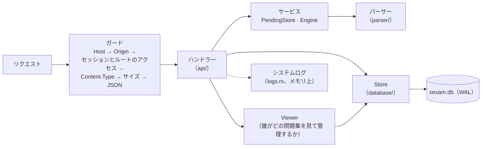
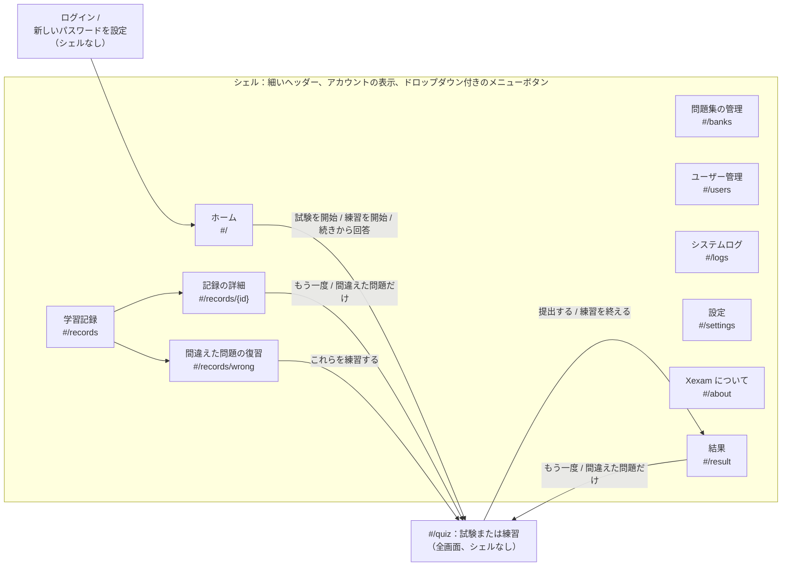
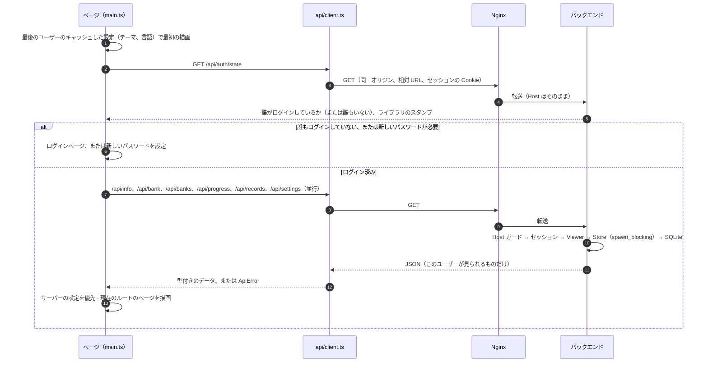
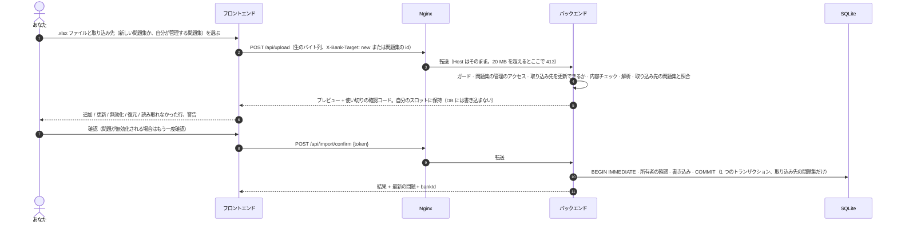

[English](../en/architecture.md) | **日本語** | [简体中文](../zh-CN/architecture.md)

# アーキテクチャ（v0.7.5）

> Xexam の構成を説明します。前段に Nginx、その後ろに Rust のバックエンド、保存先は SQLite、フロントエンドはフレームワークなしの TypeScript です。
> 旧 Python 版から切り替えたときの背景資料（中国語のみ）：旧コードの監査は [architecture-audit.md](../zh-CN/history/architecture-audit.md)、決定事項と既定値は [migration-plan.md](../zh-CN/history/migration-plan.md) にあります。

## 1. 全体像


- **ポートを公開するのは Nginx だけです**（`XEXAM_BIND`、既定は `127.0.0.1:8765` → コンテナ内の `8080`）。
- バックエンドのネットワークは `internal: true` です。`ports` がなく、ホストからも外部からも接続できず、バックエンド自身も外部ネットワークにアクセスできません。
- データベースを読み書きできるのはバックエンドだけです。Nginx のコンテナには、データベースもソースコードも Node も入っていません。
- ブラウザとバックエンドの間は REST だけです（[api.md](api.md) を参照）。`/api/info`、`/api/auth/state`、ログインそのもの以外のすべてのルートにセッションが必要です。フロントエンドにはデータベースへのアクセスも、「このインポートは実行してよいか」「このユーザーはこの問題集を見てよいか」といった判断もありません。決めるのはバックエンドで、フロントエンドは表示するだけです。
- アプリが保持するものは、すべてデータディレクトリ（Docker では `/data`）にあります。データベース `xexam.db`（ユーザー、問題、学習記録、設定）、バックエンドの動作中はその `xexam.db-wal` と `xexam.db-shm` のファイル、そしてアップグレード後には、スキーマ移行の前に書き出したコピーを入れた `backups/` フォルダです。

## 2. ディレクトリ構成

```
frontend/       TypeScript 5.9（strict）+ Vite、素の DOM、フレームワークなし
  vite.config.ts  ビルド設定、開発時の /api プロキシ、プラグイン xexam-changelog（3 つの README を読む）
  src/main.ts     エントリーポイント：キャッシュした設定で最初の描画、ログインの確認、ルートに対応するページを選ぶ
  src/router.ts   ハッシュルート（#/、#/banks、#/users、#/logs、#/records、#/records/<id>、#/records/wrong、#/settings、#/about、#/quiz、#/result）
  src/api/        型付きの fetch ラッパー：client（エラーは ApiError になる。Nginx の 429 のやり直し、制限時間）、auth、bank、
                  import、logs、progress、settings、users
  src/types/      API の型（docs/en/openapi.yaml に対応）、ビルド時に作る更新履歴モジュールの型
  src/domain/     単体テスト付きの純粋関数：採点とランダムな出題、練習の答え合わせ、保存した結果（notCounted）、
                  問題の言語、記録の絞り込み、ロックの説明と待ち時間、取り込みの警告、システムログのバッファ、更新履歴の解析
  src/i18n/       t() / tn()、catalog/<area>.ts（en / zh / ja の UI テキスト）、server-messages.ts、errors.ts
  src/state/      共有状態（store）、アクション（読み込み、ログイン、画面の移動）、問題集へのアクセスの規則、設定（preferences、
                  settings-cache）、保存中の試験や練習（session-storage）、ブラウザのストレージのキー
  src/components/ shell（ヘッダー、メニュー）、review（解答カード）、lang-switch（English / 中文 / 日本語）、kind-tag（試験 / 練習）、
                  fields（ログインとユーザーのページの入力欄）、common
  src/pages/      auth（ログイン、新しいパスワード）、home、banks、users、logs、forbidden（「権限がありません」）、records、settings、about、quiz、result
  src/styles/     main.css（カラートークン、ライト / ダーク、shell）+ ページ領域ごとの CSS ファイル
  src/utils/      DOM ビルダー、ダイアログ、トースト、書式整形
backend/        Rust（Axum 0.8 + Tokio + rusqlite）、ツールチェーンは 1.99.1 に固定
  src/main.rs     コマンドライン、起動（データベース、ログ、注意の表示）、WAL のチェックポイント付きの正常終了
  src/api/        ディスパッチとガード（Host / Origin / セッション / Content-Type / サイズ）、ルート、ログインとユーザーのルート（auth.rs）、
                  各ルートのアクセスを定めたルート表、JSON 形式、成績データのサニタイズ
  src/auth/       パスワード（Argon2id）、セッションのトークンと Cookie、既知のブラウザの Cookie、ログインの制限（throttle.rs）
  src/services/   ユーザーごとの確認待ちのインポート（PendingStore）と共有のメモリの枠、パースエンジンのインターフェース、インポートフロー
  src/parser/     .xlsx のパース：ZIP 対策、XML、問題の判別（6 列形式。3 列と 4 列の形式は、見分けて拒否するためだけ）、
                  問題 id
  src/database/   schema（v1 はそのまま + v2、v3、v4 の追加分）、ジャーナルモード（journal.rs）、Store、旧 progress.json、タイムスタンプ
    store/          banks（見る人、所有者）、records、settings、users（アカウント、セッション）、migrate（v1 → v4、バックアップ、修復）
  src/models/     共通の型：問題、取り込み先、Viewer と BankScope
  src/logs.rs     システムログ：リングバッファ、tracing のレイヤー、BurstLog
  src/security/   Host / Origin の判定、サイズ制限付きのリクエストボディ読み取り、トークン
  src/config/     環境変数、VERSION ファイル
  tests/          単体、ゴールデンレスポンス、パース突き合わせ（3 列、4 列、6 列形式）、id ベクトル、バージョンごとのファイル
                  （v05_…、v06_…、v065_…、v07_…）
nginx/          nginx.conf + Dockerfile（3 つの README を取り込んでフロントエンドをビルド → 静的な成果物だけを同梱）
docker/         docker-compose.yml（2 つのイメージを pull）、docker-compose.build.yml（ソースからビルド。コンテキストはリポジトリのルート）、.env.example
scripts/        release-notes.py（更新履歴から Release の説明文を作る）、set-release-version.py（RELEASE_VERSION と README のバッジ）
tools/          screenshots/：使い捨てのインスタンスから README と文書のスクリーンショットを撮り直す（development.md を参照）
VERSION         CODE_VERSION（コードのバージョン）と RELEASE_VERSION（最後に公開したリリース）
README.md       英語版の README（更新履歴を含む）。日本語版と中国語版は README/ の README.ja.md と README.zh-CN.md
LICENSE         MIT ライセンス
tests/          baseline/（旧版のゴールデンレスポンスとフィクスチャ）· integration/（nginx、スタック全体、progress.json の移行）
docs/           en/（英語、原本）· ja/ · zh-CN/（history/ あり：過去の文書、中国語のみ）。それぞれに専用の
                screenshots/。en/openapi.yaml
```

## 3. データモデル（v0.7）

テーブルの詳しい一覧は [database.md](database.md) にあります。ここでは考え方を説明します。

### ユーザーとセッション

- **ユーザー** には権限があります：**管理者** か一般ユーザーです。一般ユーザーには **問題集を管理できる** 権限を与えることもできます。新しいデータベースやアップグレードしたデータベースには、最初に管理者 `admin` / `admin` があり、最初のログインで新しいパスワードを設定しなければなりません。
- **セッション** はデータベースにあります（Cookie の値の SHA-256 だけを保存します）。そのため、再起動しても誰もログアウトされません。パスワードを間違えたときのロックはメモリ上にだけあります（[security.md](security.md) を参照）。
- **個人のものはすべて 1 人のユーザーのもの**：学習記録、間違いノート（問題ごとの統計）、設定です。どのルートも、ログイン中のユーザーのものを読み書きします。ユーザー id は常にセッションから取り、リクエストからは取りません。
- **問題集は共有されます**。ただし、誰がどの問題集を見られるかはユーザーごとに決まります（次の節）。

### 問題集

- **問題集は、インポートした 1 つのワークブックです。** `banks` テーブルには問題集ごとに 1 行あります。アップロードは、新しい問題集か既存の問題集のどちらかに入ります（`X-Bank-Target` ヘッダー、[api.md](api.md) を参照）。
- **インポートで置き換わるのは、対象の問題集の内容だけです。** その問題集の問題のうちファイルにないものは無効化されます。ほかの問題集の問題には一切触れません。
- **レガシー問題集。** v0.5 より前のデータは 1 つの問題集になります（`legacy_ids = 1`）。その問題 id はパーサーが計算した素の id のままなので、以前の統計、間違いノート、試験履歴はそのままつながっています。`X-Bank-Target` のないアップロードはこの問題集に入ります。古いクライアントとコマンドラインの `import` がこれに当たります。
- **問題集ごとの id。** それ以外の問題集では、問題を `sha1("xexam-bank:{bank_id}\n{parser id}")` の先頭 12 桁（16 進）で保存します。そのため、同じワークブックを 2 回インポートして、独立した 2 つの問題集にできます。id も学習データも混ざりません。問題集の id は再利用されません。
- **所有者。** どの問題集にも所有者がいます。新しい問題集としてインポートしたユーザーです。v0.7 より前の問題集と、ログインしたユーザーなしで作られた問題集（コマンドラインの `import`）は、最初の管理者のものです。ユーザーを削除すると、そのユーザーが所有していた問題集は、削除した管理者に移ります。
- **1 つの形式。** v0.7 からは 6 列形式（A〜C は英語、中国語、日本語の問題、D〜F はその答えと解説）だけをインポートできます。英語が基準です。問題の種類、選択肢、識別、正解は A 列と D 列から取り、問題には言語ごとの解説を保存します（`lang`、`ja`、`explain`。[database.md](database.md) の 4.7 節を参照）。パーサーは以前の版の 3 列・4 列形式も今も判別します。アップロード、インポートの確定、コマンドラインの `import` が、何かを一時保存したり書き込んだりする前にそれらを拒否できるようにするためです（`services::check_layout`、400）。以前にそれらから取り込んだ問題は、起動のたびに出題停止になります（`Store::retire_old_layout_questions`、[database.md](database.md) の 4.2 節）。問題集とその学習データは残ります。
- 問題集を削除すると、その問題、インポート履歴、誰がそれを見られるかの情報、問題集自体が消えます。学習データが消えるのは、指定したときだけです（`withRecords`。確認ダイアログのチェックボックスで、最初はオフ）。管理者はすべてのユーザーの学習データを、問題集の管理権限を持つユーザーは自分の学習データだけを消します。

### 誰がどの問題集を見て管理するか：Viewer と BankScope

問題集のデータを読む、または問題集に書き込むリクエストは、どれもログイン中のユーザーから **`Viewer`** を作ります。その時点のデータベースから読むので、管理者による変更は、誰もログアウトさせずに次のリクエストから反映されます。

| | `admin` | `can_manage` | `scope`（`BankScope`） |
|---|---|---|---|
| 管理者 | はい | はい、すべての問題集 | `All` |
| 一般ユーザー | いいえ | 権限のとおり | `Only(その user_banks の行と、問題集の管理権限がある間は自分が所有する問題集)` |

一般ユーザーの `user_banks` の行は、管理者がそのユーザーのためにチェックした既存の問題集です。**今後インポートする問題集も含める**（`users.new_banks`）は閲覧者の一部ではありません。問題集を作るトランザクションの中で、新しい問題集ごとに行を 1 つ加えるだけです。

- **読み取り**：Store の `*_as` メソッドは、Viewer かその `BankScope` を受け取ります。一部の問題集だけを見られるユーザーには、`/api/bank` と `/api/banks` でその問題集だけを、`/api/progress` でその問題の統計だけを返し、記録の詳細では、ほかの問題集の問題を削除された問題と同じように省きます。`/api/banks` の studied と records の数は、管理者以外には本人のものです。問題集の所有者が分かるのは管理者だけです。
- **書き込み**：`Viewer::manages(owner)` は、管理者では常に真、問題集の管理権限を持つユーザーでは自分が所有する問題集のときだけ真です。既存の問題集へのインポートと問題集の削除は、これを**書き込みのトランザクションの中で**確認します。そのため、その間に所有者が変わっても（削除されたユーザーの問題集が管理者に移る）、確認と書き込みの間に入り込むことはできません。拒否したときは何も書き込みません（403 `MSG_NOT_BANK_OWNER`）。アップロードのルートは、解析する前にも取り込み先をもう一度確認するので、拒否されるアップロードに解析の時間を使うことはありません。
- **試験**：一般ユーザーが提出したとき、そのユーザーの範囲外の問題は、もう存在しない問題とまったく同じに扱います。数に入れず、何も書き込まず、その id を `notCounted` で返します。
- **開いているページの更新**：`GET /api/auth/state` は、中身の見えないダイジェストである **ライブラリのスタンプ** を持ちます。管理者では、ライブラリ全体に従います。一般ユーザーでは、そのユーザーの問題集とそのアクセスだけに従うので、見られない問題集を明かすことも、それに合わせて変わることもありません。ページは画面を移るたびと、タブが再び表示されたときにこれを比べ、変わっていれば問題集を読み直します。

### 学習記録：試験と練習

- `attempts` には、提出した試験や練習ごとに 1 行あります。その所有者（`user_id`）、種類（`exam` または `practice`）、出題元になった問題集のスナップショット（当時の id と名前）を持ちます。ユーザーごとに最新の **500** 件を残します。`/api/progress` が返すのは最新の 60 件です。
- `attempt_items` には、記録の問題ごとに 1 行あります。問題 id、回答（ページが送ったものを整えた後の値。値がなければ未回答）、正誤です。v0.5 より前に保存された記録には、この行はありません。
- 練習も、試験とまったく同じように間違いノートに反映されます。
- 記録の詳細（`GET /api/record`）は、詳細の行を、**現在**保存されている問題（無効化されたものも含む）と並べて返します。問題集と一緒に削除された問題や、ユーザーがもう見られない問題集の問題には、問題文の代わりに注記が付きます。
- 記録を 1 件削除しても、統計（間違いノート）はそのままです。すべての記録を削除するときは、統計も一緒に消去できます。

### 設定

- `user_settings` は、ユーザーごとのテーマ、表示言語、自動で次の問題へ進むかどうか、問題の言語を保存します。データディレクトリにあるので、コンテナを更新しても、ブラウザのキャッシュを消しても、別のブラウザや別の端末から開いても残ります。
- ブラウザはユーザーごとに `localStorage`（`xexam.u<id>.settings.v1`）にコピーを持ちますが、これは最初のフレームを正しいテーマと言語で描くためだけです。サーバーの値が読み込まれた時点で、そちらが優先されます。

### ブラウザに残るもの

- 解答途中の試験や練習（`localStorage` の `xexam.u<id>.session.v1`。そのブラウザのユーザーごとに 1 つ）：問題 id、回答、印、現在の位置、経過時間、種類、練習ではどの問題を答え合わせしたか。問題文は含みません。
- 最後にログインしたユーザーの id（`xexam.lastUser.v1`）。そのユーザーのキャッシュした設定で最初のフレームを描くためです。
- 既知のブラウザの Cookie `xexam_device`（[security.md](security.md) を参照）とセッションの Cookie `xexam_session`。どちらも `HttpOnly` です。
- メニューを開いているかどうかは保存しません。メモリ上にだけあり、メニューはページを移るたびに閉じます。

## 4. バックエンド



すべてのルートは 1 つのディスパッチ関数を通るので、ガードの順序はどのリクエストでも同じです。セッションの確認は、Host（POST では Origin も）の確認の直後、ボディを読む前に、各ルートのアクセスを定めた 1 つのルート表に対して行います：**公開**、**ログイン**、**問題集の管理**（管理者と問題集の管理権限を持つユーザー：アップロード、インポートの確定 / 取り消し、インポート履歴、問題集の削除）、**管理者**（ユーザー、システムログ、終了）。ルート表にないパスにもセッションが必要です。主な設計判断（初期の検討は [audit/rust-stack.md](../zh-CN/history/audit/rust-stack.md) を参照）：

| 問題 | 対応 |
|---|---|
| rusqlite は同期的 | 接続を 1 つだけ `Arc<Mutex<Connection>>` の後ろに置き、データベース呼び出しは `spawn_blocking` の中で実行します。ロックは `.await` をまたぎません。旧版の「1 つの接続 + RLock」と 1 対 1 で対応します |
| ジャーナルモード | v0.7 から `synchronous=FULL` の WAL です（`database/journal.rs`）。`XEXAM_SQLITE_JOURNAL=delete` にすると、従来のロールバックジャーナルのままになります。SQLite がモードを拒否したときは、エラーではなく警告としてログに残します。実際のモードは起動時に 1 回ログに出し、正常終了のときに `wal_checkpoint(TRUNCATE)` を実行します。[database.md](database.md) の 2.1 節を参照 |
| リクエストボディの上限 | 自前のストリーミング読み取り：読みながら実際のバイト数を数え、20 MiB を超えたらただちに 413 を返します。**`Content-Length` は信用しません**（チャンク転送のアップロードも同様） |
| 解析でサービスが止まってしまわないか | 解析はブロッキングスレッドで行い、協調的なデッドラインがあります（`XEXAM_PARSE_TIMEOUT_SECS`、既定 30 秒。時間になるとパーサー自身が停止します）。同時に実行できる解析は最大 2 つです。ZIP のエントリ数、展開後のサイズ、XML の深さ / ノード数 / 要素あたりの属性数、セルの総数と総バイト数にはいずれも上限があり、共有文字列は 1 つだけ保持します |
| 確認待ちのインポート | プレビューはメモリ上にだけ置き、データベースには書きません。**アップロードするユーザーごとに自分のスロットがあります**（ユーザー id がキー）：ある問題集の管理権限を持つユーザーのアップロードが、ほかのユーザーのプレビューを置き換えたり、確定したり、取り消したりすることはありません。すべてのスロットで **128 MiB** のメモリの枠を共有します（解析した問題から見積もります）。アップロードを一時保存するとき、合計が枠を超えている間は、ほかのユーザーのいちばん古いプレビューから捨てます。捨てられたユーザーが確定すると、30 分の期限を過ぎたときと同じく、プレビューが期限切れだと表示されます。最新のアップロードは必ず残ります |
| インポートの原子性 | 確定時に `BEGIN IMMEDIATE … COMMIT` を実行し、失敗したら全体をロールバックします。所有者の確認もこのトランザクションの一部です。確認コードは使い切りで、128 ビットのランダム値、定数時間で比較され、同時に確認しても成功するのは 1 つだけです |
| コミットが中断された場合 | インポートのコミットは独立したタスクで、クライアントが切断しても最後まで実行されます。`docker stop` は最大 15 秒待ち、バックエンドは 8 秒以内に正常終了します |
| スキーマのアップグレード | データの入った古いスキーマのデータベースを開くと、バックエンドはまず `VACUUM INTO` で `xexam.db` の隣の `backups/` にコピーを書き出し、それから 1 つのトランザクションで移行し、そのあとで WAL に切り替えます。コピーを書き出せなければ起動しません。最新のデータベースを開いたときは何も書き込みません（[database.md](database.md) の 6 節を参照） |
| データの削除 | 問題集、記録、ユーザーの削除は、それぞれ 1 つのトランザクションで実行します。問題集を削除すると、その問題集を対象にした確認待ちのアップロードも破棄します |
| パスワード | Argon2id を `spawn_blocking` で、同時に最大 2 つ。ログインの制限は、ハッシュを計算する前に応答します。[security.md](security.md) を参照 |
| ログ | `tracing`、色なし、`XEXAM_LOG`（既定 `info`。空のときも `info`、無効な値なら警告を 1 回出して `info`）で絞り込み。ユーザーは id ではなくユーザー名で示します。**パスワード、セッションのトークン、Cookie の値、確認コード、問題文は決して記録しません**。下を参照 |
| エラー | 常に `{"error": "<中国語の理由>"}` です。データベースの例外、ファイルパス、SQLite のエラーはログにだけ出力し、レスポンスには含めません。フロントエンドは知っているメッセージを翻訳します（5 節） |

### システムログ

- `main.rs` は `tracing` のサブスクライバーを 1 つ、**1 つのフィルター**（`XEXAM_LOG`、既定 `info`）と 2 つの出力で設定します。標準エラー出力（`docker compose logs backend` で見えるもの）と、`logs.rs` の `BufferLayer` です。起動時と終了時に `main.rs` が標準出力に書く簡単な状態の行もバッファに加えます。`reset-password` が表示する新しいパスワードは加えません（このコマンドはそもそも別のプロセスで動きます）。
- バッファは**最新 2000 行のリング**で、メモリ上にだけあります。再起動すると空に戻り、データベースには何も書き込みません。各行には連番（そのプロセスの最初の行が 1）、秒までのローカル時刻、レベル、ターゲット（モジュール）、フィールド付きのメッセージがあります。メッセージは 4000 文字を超えた分を切ります。
- `GET /api/logs?after=<seq>&boot=<id>`（管理者のみ）は、`after` より後の行、最新の連番（`last`）、`after` と保持している最も古い行の間の行が捨てられたかどうか（`dropped`）、バックエンドのプロセスのランダムな id である `boot` を返します。再起動すると連番は 1 から始まり直すので、再起動前の `boot` を送ったクライアントには、保持しているすべての行を返します。
- **BurstLog。** サーバーに届く人なら誰でもログインせずに起こせる行は、`BurstLog` を通します：Host / Origin の確認で拒否したリクエスト、ログインの失敗、アカウントのないユーザー名のロックです。静かな 1 分の後の最初の出来事はすぐに記録し、それに続くものは数えておいて、多くても 1 分に 1 回、1 行にまとめて記録します。まとめるのは次の出来事か、毎分動くサーバーのタイマーなので、後に何も続かなくても、まとまりの終わりはおよそ 1 分以内に記録されます。拒否した（429）ログインも、ログインの制限が同じようにまとめます。そのため、こうしたリクエストを大量に送っても、2000 行からほかの行を押し出すことはできません。

### バージョン

バックエンドは `/api/info` でバージョンを返します。読む順序は次のとおりです：`XEXAM_VERSION`（正しい値のとき）、`XEXAM_VERSION_FILE` が指すファイルの `CODE_VERSION`（イメージでは `/VERSION`。リポジトリの `VERSION` のコピー）、バイナリに組み込まれたバージョン。同じファイルの `RELEASE_VERSION` はここでは無視します。`CODE_VERSION` が 2 回あるファイルからはバージョンを取りません。`KEY=VALUE` の行が 1 つもないファイルは、古い 1 行の形式として読みます。

### コマンドライン

```
xexam-backend [serve] [--data DIR] [--host ADDR] [--port N] [--allow-shutdown] [--no-browser]
xexam-backend healthcheck [--port N]          コンテナのセルフチェック（Host: 127.0.0.1 を送るので、許可リストの影響を受けない）
xexam-backend import <question-bank.xlsx> [--data DIR]  コマンドラインで 6 列形式のワークブックをレガシー問題集へインポート（旧版の --import も使える）
xexam-backend migrate-progress [progress.json] [--data DIR]  以前のバージョンの progress.json をデータベースへ移行
xexam-backend reset-password <username> [--data DIR]  新しいランダムなパスワード（1 回だけ表示）。次のログインで変更が必要
```

データベースを開くコマンド（`serve`、`import`、`migrate-progress`、`reset-password`）は、どれも最初にスキーマのアップグレードを実行し、`XEXAM_SQLITE_JOURNAL` のジャーナルモードを求め、古い形式の問題を出題停止にします。サーバーの動作中でも実行できます（Docker では `docker compose exec backend xexam-backend …`）。

## 5. フロントエンド

フレームワークは使わず、素の DOM を使います。共有の状態は、型付きのオブジェクト 1 つです（`src/state/store.ts`）。描画のたびに、状態から現在のページを作り直します。試験ページには小さな「リフレッシャー」もあり、全体を描き直さずに解答用紙と進捗を更新します。

### シェル、ルート、ページ



- **ログイン**（`src/pages/auth.ts`）：起動時、アプリはまず `GET /api/auth/state` を問い合わせます。誰もログインしていなければログインページ、新しいパスワードを設定しなければならないアカウントなら **新しいパスワードを設定** のページです。どちらもアプリ全体を置き換えます（シェルもルートもありません）。既定のパスワードのままの管理者がいる間は、ログインページの案内にそのアカウントの名前が出ます。アプリは画面を移るたびと、タブが再び表示されたときにも問い合わせるので、ほかの場所で終わったセッションは次のクリックでログインページになり、権限やライブラリのスタンプの変更は、ログアウトせずに反映されます。
- **ルーター**（`src/router.ts`）：ハッシュルートなので、サーバー側のフォールバックは不要で、再読み込みしても同じページにとどまります。ルートは `src/state/actions.ts` の `navigate(route)` で切り替えます。試験ページからどのように離れても、回答は保存されます。試験も練習もないときに `#/quiz` を開くとホームへ移ります（保存したものがあれば、その続きになります）。結果がないときに `#/result` を開くと学習記録へ移ります。管理者以外が `#/users` を開くとホームへ移ります。問題集の管理権限なしで `#/banks` を開いたとき、管理者以外が `#/logs` を開いたときは、**ホームに戻る** の付いた **権限がありません** のページ（`src/pages/forbidden.ts`）を表示します。
- **シェル**（`src/components/shell.ts`）：試験ページとログインのページ以外のどのページにも細いヘッダーがあり、左上に Xexam のロゴ（ホームへのリンク）、右上にアカウントの表示と三本線のメニューボタンがあります。メニューには **ホーム**、**問題集の管理**（管理者と問題集の管理権限を持つユーザー）、**学習記録**、**ユーザー管理** と **システムログ**（管理者）、**設定** が並び、区切り線の下にバージョンの項目（たとえば **Xexam v0.7.5**。「Xexam について」のページを開きます）、一番下にログインしている人（**管理者** または **問題集を管理** 付き）と **ログアウト** があります。現在のページの項目は強調されます。記録の詳細、間違えた問題の復習、結果は学習記録として扱います。項目を選ぶ、メニューの外をクリックする、Esc キーを押す、のどれかで閉じます。どの画面の幅でも同じように動きます。ページの内容は中央に置き、幅は最大 1120 px です。
- **ページ**（`src/pages/`）：`home`（試験や練習の開始・再開）、`banks`（問題集のインポート、更新、内容の確認、削除、形式の説明）、`users`（アカウント、権限、問題集へのアクセス、ロック）、`logs`（システムログ）、`records`（絞り込み付きの記録の一覧、記録の詳細、間違えた問題の復習）、`settings`、`about`、`quiz`、`result`、`auth`、`forbidden`。ページ同士は互いを import せず、`src/state/actions.ts` の関数を呼びます。ページの中だけで使う UI 状態（絞り込み条件、開いているアップロードのプレビュー）は、そのページのモジュール自体に置きます。結果ページ、記録の詳細、間違えた問題の復習で共通の解答カードは `src/components/review.ts` にあります。
- **ホーム**（`src/pages/home.ts`）：未提出の試験や未完了の練習は、一番上の小さなバナーになります（練習なら **未完了の練習**。**このブラウザにだけ保存**、問題集 · 回答数または答え合わせ済みの数 · 経過時間）。**続きから回答** と **破棄する** があります。**試験・練習を始める** パネルの右上には、出題範囲を選ぶ 2 つの小さなボタン **すべて** と **間違いノート** があり、それぞれに問題数が付きます。**問題集とシート** の見出しの右側には **すべて選択** と **解除** があります。問題集はそれぞれ 1 枚のカードで、そのシートはカードの中のコンパクトな行です。行の矢印で表示したり隠したりします。パネルが画面に見えている間は、画面下部に固定されたバーに **試験を開始**、**練習を開始**、範囲の文、2 つのオプション **問題数** と **シャッフル** が並びます。スマートフォンでは、1 行目に範囲とオプション、2 行目に 2 つのボタンが並び、**試験を開始** が幅の広い主ボタンです。横のカード **直近の結果** には、どちらかの種類の最新の記録が、そのタグと一緒に表示されます。問題集を何も割り当てられていない一般ユーザーには、代わりに管理者に依頼するよう案内が表示されます（問題集の管理権限を持つユーザーには、問題集の管理へのリンク）。問題集に有効な問題がないとき（たとえば古い Excel 形式のものだったため、すべて出題停止のとき）は、管理者と問題集の管理権限を持つユーザーには問題集の管理へのリンク付きの案内が、ほかのユーザーには管理者に依頼するよう案内が表示されます。
- **問題集の管理**（`src/pages/banks.ts`）：管理者には **登録済みの問題集** が表示され、各問題集に **<名前> がアップロード** が付きます。問題集の管理権限を持つユーザーには **あなたの問題集**（自分で取り込んだ問題集）だけが表示され、更新・削除できるのもそれだけです。**Excel の取り込み** には、タイトルの横に **新しい問題集** / **既存を更新** の 2 つの小さなピル型のボタン、**Excel の書き方** を開くリンクの付いたヒントの 1 行、ファイルの行（**Excel ファイルを選ぶ**、またはパネルのどこかにファイルをドロップ）があります。プレビューには、まず数のチップ（0 のものは隠します）、案内と警告（中国語や日本語の答えが英語と異なる 6 列形式の行）、確定とキャンセルのボタン、そのあとにシートごとの 1 行を並べ、読み取れなかった行はその下に折りたたみます。**取り込み履歴** には、ユーザーが管理する問題集の最新 8 件のインポートを表示します。
- **ユーザー管理**（`src/pages/users.ts`、管理者のみ）：アカウントごとに 1 行で、権限、状態、ログインの状態、学習記録の数、問題集（すべての問題集にチェックがあり、今後のものも含むときは **問題集：すべて（今後インポートするものも含む）**、それ以外は選ばれた問題集かまだなし。今後のものを含むかどうかも示します。**変更** で選びます。規則は `src/state/bank-access.ts`）が並びます。**変更** と **ユーザーを追加** のチェックリストの 1 行目には **今後インポートする問題集も含める** と **すべて選択** があります。この 2 つは独立していて、**すべて選択** は一覧の問題集をチェックしたり外したりするだけです。行には操作 **編集**、**パスワード再設定**、**無効にする** / **有効にする**、**ロック解除**（ログインがロックされている間、またはロックの後で試せる回数が最初より少ない間に表示）、削除があります。一覧は、ウィンドウが再び表示されたときと、ページが表示されている間は 30 秒ごとに読み直します。フォームやダイアログを開いているときは読み直しません。
- **システムログ**（`src/pages/logs.ts`、管理者のみ）：ページが開いていて、表示されていて、一時停止していない間、0.5 秒ごとに `GET /api/logs` を読みます（同時に 1 つのリクエストだけ）。保持するのは同じく最大 2000 行です（`src/domain/logs.ts`）。読み込みに失敗すると、待ち時間を毎回 2 倍にし（1、2、4、8 秒、最大 10 秒）、10 秒たっても終わらない読み込みは中止して失敗として数えます（`src/api/logs.ts` の `LOG_READ_TIMEOUT_MS`）。新しい行は一番下に加え、一覧が最後までスクロールされている間は追いかけます。上にスクロールすると追いかけるのをやめ、**最新へ移動** を表示します。**一時停止** / **再開**、レベルの絞り込み（**すべて** / **警告** / **エラー**）、検索は、表示を変えるだけです。行が捨てられた箇所には印が付きます。
- **練習**（`kind = practice` の試験ページ。規則は `src/domain/practice.ts`）：単一選択問題は、選択肢を選んだ時点で答え合わせをします。複数選択問題とホットスポット問題には **答え合わせ** があり、何かを選ぶと使えます。答え合わせをした問題はロックされ、正解か不正解か、色分けした選択肢、正解、解説、覚え方を表示します。自動で次の問題へ進むことはありません。**練習を終える** は、答え合わせをしていない問題があるときだけ確認を求めます。答え合わせをしていない問題は未回答として数えます。結果は `"kind": "practice"` で送り、結果ページは **練習の結果** と表示し、もう一度行うと練習が始まります。
- **ランダムな出題**：`src/domain/grading.ts` の `pickQuestions()`。**問題数** が範囲より少ないときは、範囲全体から、どの問題も同じ確率でランダムに選びます。**シャッフル** が決めるのは、そのあと出題する順番（ランダムか問題集の順番か）だけです。
- **問題の言語**（`src/components/lang-switch.ts`）：試験と練習のページ、そして正解と解説のすべてのカードに同じ切り替えがあり、表示言語に関係なく常に **English** / **中文** / **日本語** と表示し、各ボタンにはそれぞれの `lang` 属性が付きます。問題にない言語のボタンもタップでき、その理由をトーストで示します。各カードは問題の言語の設定から始まり、そのカードだけを切り替えます。6 列形式の問題は言語ごとの解説を表示し、ある言語にない場合はほかの言語の文を表示します（中国語、日本語、英語の順）。
- **Xexam について**（`src/pages/about.ts`、`#/about`）：バージョンとサーバーの CPU アーキテクチャ（`/api/info` から）、ライセンス（MIT）、そして **更新内容** を表示します。**更新内容** は、表示言語の README の更新履歴です（`README.md`、`README/README.zh-CN.md`、`README/README.ja.md`）。最新のバージョンは開いた状態で、それより前のバージョンは **以前のバージョン** の下に折りたたみ、サーバーで動いているバージョンの項目には **このバージョン** と表示します。更新履歴は実行時には取得しません。`frontend/vite.config.ts` のプラグイン `xexam-changelog` がフロントエンドのビルド時に 3 つの README を読み、`src/domain/changelog.ts` で `### vX.Y — 日付` の項目を解析して、モジュール `virtual:changelog` として提供します。このモジュールは別のファイルになり、このページを開いたときにだけ読み込まれます。表示できるのは段落、1 段階の入れ子までの `- ` の箇条書き、`**太字**`、`` `コード` `` です。リポジトリ内のファイルへのリンクは、ただの文字として表示されます。
- **設定**（`src/state/preferences.ts`）：テーマ（`<html data-theme>`）と言語（`<html lang>`）を適用します。変更はすぐに反映し、そのあと `POST /api/settings` で保存します。保存に失敗したら、元の設定に戻してメッセージを表示します。設定にはアカウントの部分（自分のパスワードの変更）もあります。

### 表示言語

- **UI カタログ**（`src/i18n/catalog/<area>.ts`）：領域ごとに 1 ファイルです（`common`、`home`、`banks`、`records`、`settings`、`quiz`、`result`、`about`、`auth`、`users`、`logs`）。各ファイルには、同じキーが英語、中国語、日本語でそろっています。どの言語にもキーの抜けがないことを、TypeScript と `catalog.test.ts` が確かめます。コードはテキストを `t('area.key', params)` で取得し、数を含むものには `tn(key, n)` を使います。選んだ言語は、試験ページとログインのページも含めてすべてに適用されます。
- **サーバーメッセージ**（`src/i18n/server-messages.ts`）：バックエンドのエラーメッセージは中国語のままです（テスト済みの API の一部だからです）。フロントエンドは、知っているメッセージを英語または日本語に翻訳します。文字列全体での一致にも、値を含むパターンにも対応します。中国語のときはそのまま表示し、知らないテキストもそのまま表示します。`server-messages.test.ts` はバックエンドのソースを読み、翻訳のないバックエンドメッセージがあると失敗します。
- **エラー**（`src/i18n/errors.ts`）：`errorText(e)` は、どんなエラーも現在の言語のテキストに変えます。ネットワークエラーと「レスポンスが JSON ではない」（Cloudflare Access のログイン期限切れが原因のことが多い）には、再読み込みしてログインし直すよう促す専用の案内が付きます。Nginx 自身の 429（種類 `tooMany`）は、その案内なしで、数秒待つよう伝えます。

### その他のルール

- **採点はブラウザ内で行います**（仕様ではサーバー側を推奨していましたが、ここは意図的な逸脱です。理由は [migration-plan.md](../zh-CN/history/migration-plan.md) の Q3 を参照）。ルールは純粋関数として `src/domain/grading.ts` にあり、単体テストがあります。サーバーが受け取るのは `{問題 id, correct}` と回答内容で、回答内容はあとで振り返るために保存するだけです。
- 自動で次の問題へ進む機能（設定項目で、既定はオフ。試験だけ）：単一選択で答えを選んだとき、またはホットスポット問題で最後に残った小問を選んだとき、約 350 ms 後に次の問題へ進みます。複数選択では進みません。最後の問題より先へは進まず、選択を外したときも、練習でも進みません。
- HTML にインラインスタイルはありません。CSP が `style-src 'self'` だからです。計算で決まる少数のサイズ（進捗バー、得点バー）は CSSOM で設定しており、これは CSP で許可されています。
- ビルドターゲットは `es2020` / `safari15` です。iPhone は iOS 15.4 以上が必要です。

## 6. リクエストの流れ

### アプリの読み込み



これらのリクエストのどれかが失敗すると、アプリはエラーページを 1 つ表示します。そこには再読み込みボタンと、翻訳した理由が載ります。Nginx のレート制限で拒否された場合は、ページの見出しが **リクエストが多すぎます** になり、数秒待つよう伝えます。その後のリクエストで 401 が返ると、ログインページを表示します。

**Nginx の 429。** Nginx は `/api/` を、クライアントのアドレスごとに 1 秒あたり 30 リクエスト、バースト 120 に制限します（[security.md](security.md) の 9 節）。トンネル経由では、全ユーザーが 1 つのアドレスを共有します。この 429 は JSON ではないので、ログインのロック（`retryAfter` 付きの JSON の 429）と区別できます。`src/api/client.ts` は、このように拒否された GET や HEAD を、合わせて 3 回まで試します（`Retry-After` があればそれだけ待ち、最大 10 秒。なければ 1 秒、次に 2 秒）。ほかのメソッドは決してやり直しません。それでも拒否されたリクエストは、種類 `tooMany` で失敗します。

### 問題集の更新（アップロード → プレビュー → 確認）



プレビューを開いたまま「問題集の管理」ページを離れると、そのプレビューは取り消されます（`POST /api/import/cancel`）。

### 試験や練習を行う

ユーザーが見られるすべての問題集の問題を、一度にブラウザへ取得します。回答はブラウザ内で行い、解答途中の試験や練習は変更のたびに `localStorage` に保存されます。提出すると（または **練習を終える** と）、ページが採点し、`POST /api/attempt` を送ります。中身は各問題の `{id, correct, answer}` と、シート、モード、所要時間、種類です。バックエンドは 1 つのトランザクションで、もう存在しない問題やユーザーが見られない問題を外し、ユーザーの問題ごとの統計を更新し、問題集のスナップショットと、数に入れた問題ごとの詳細行を付けて記録を保存し、ユーザーの記録を最新の 500 件に減らします。返すのは学習の進み具合です（外した問題があれば `notCounted` も）。そのあとページは記録の一覧を読み込み直し、結果ページから新しい記録へリンクできるようにします。

### エラー

バックエンドはエラーを `{"error": "<中国語のメッセージ>"}` で返します。`api/client.ts` がこれを `ApiError` に変え、`errorText()` がメッセージをサーバーメッセージの対応表に渡します。対応表は、現在の表示言語のメッセージを返します（知らないメッセージならそのまま返します）。

## 7. ビルドとイメージ

| イメージ | ビルド | 実行時の内容 |
|---|---|---|
| `xexam-frontend` | `node:24-alpine` でフロントエンドをコンパイル。「Xexam について」のページの更新履歴のために、3 つの README をこのビルド段階へコピー → `nginxinc/nginx-unprivileged:1.27-alpine` | nginx.conf + 静的ファイル、非 root の uid、8080 で待ち受け |
| `xexam-backend` | ビルドマシン自身のアーキテクチャで動く `rust:1.99.1-slim-bookworm` で、zig を使って静的な musl バイナリへクロスコンパイル → `alpine:3.21` + tzdata（予備として UTC の `/etc/localtime` 付き） | 実行ファイル 1 つ + `/VERSION`（`CODE_VERSION` を読む）、uid 10001、ルートファイルシステムは読み取り専用 |

「Xexam について」のページの更新履歴のために、`nginx/Dockerfile` は `README.md`、`README/README.ja.md`、`README/README.zh-CN.md` を、リポジトリと同じ配置でフロントエンドのソースの 1 つ上のフォルダへコピーします（`COPY README.md /` と `COPY README/README.ja.md README/README.zh-CN.md /README/`）。`vite.config.ts` はそこから読み込みます。そのため `.dockerignore` は、この 3 つの README（`README.md` と `README/`）をビルドコンテキストに残します（`docs/` などは引き続き除外します）。最終的なイメージに入るのはビルドした静的ファイルだけで、README は入りません。

どちらのサービスも `cap_drop: ALL`、`no-new-privileges`、`read_only: true`、`tmpfs: /tmp` を使い、コンテナのログファイルは 10 MB のものを最大 3 つまで残します。バックエンドが書き込めるのは `/data`（データボリューム）と `/tmp` だけです。ホストの `/etc/localtime` を読み取り専用でマウントするので、タイムスタンプはホストのタイムゾーンに従います（Docker Desktop では Docker 自身の仮想マシンのタイムゾーンで、たいてい UTC です）。

## 8. 旧版との対応

| 旧（Python） | 新 |
|---|---|
| `server.py` | `backend/src/api/` + `main.rs` |
| `app/db.py` | `backend/src/database/` |
| `app/xlsx_parser.py` | `backend/src/parser/` |
| `web/app.js` / `style.css` / `index.html` | `frontend/src/` |
| 1 つのコンテナに 1 つのプロセス | 2 つのコンテナ：nginx + backend |
| `docker-compose.yml`（イメージを pull） | `docker/docker-compose.yml`（`xexam-frontend` と `xexam-backend` の 2 つのイメージを pull）；`docker/docker-compose.build.yml`（ソースからビルド） |

旧 Python 実装はリポジトリから削除しましたが、失われたわけではありません。Git タグ `python-v0.2` が最後のバージョンを指しており、旧イメージ `ghcr.io/yumin-space/xexam:v0.2.2` も引き続き GHCR から pull できます（非公開なので、先に `docker login ghcr.io` を実行します。Docker Hub にはありません）。ロールバックについては [migration.md](migration.md) を参照してください。
