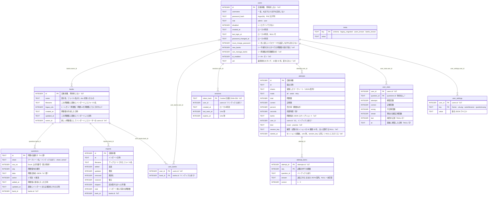
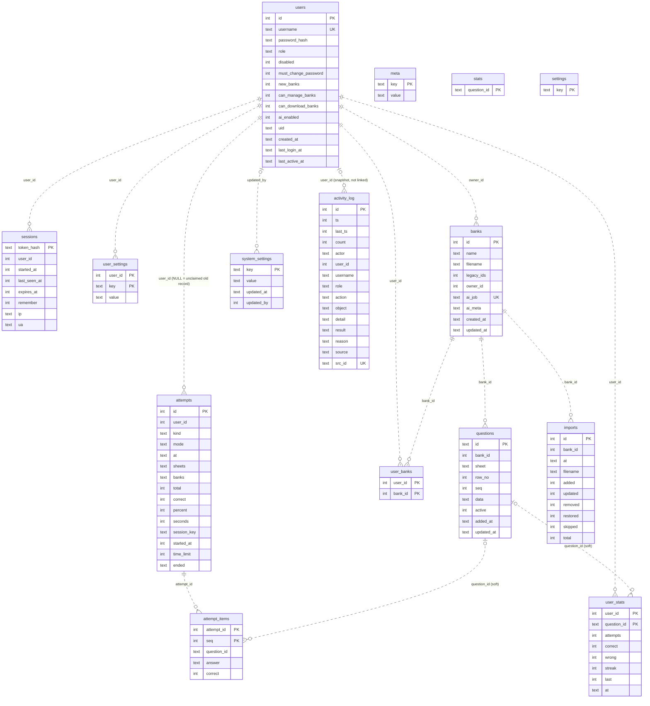
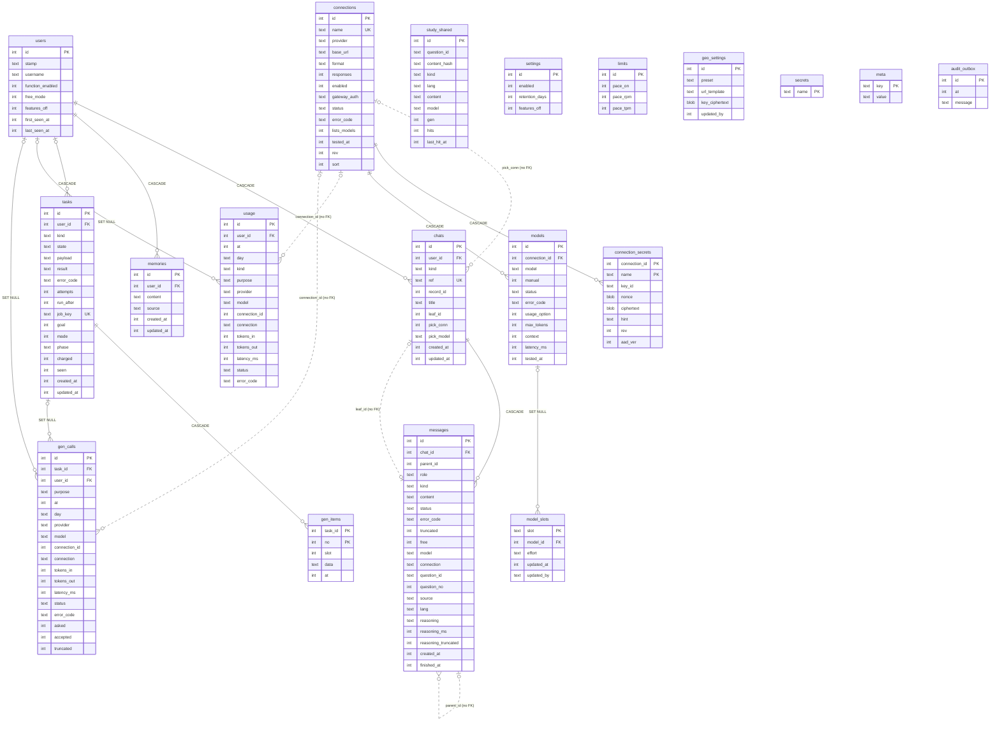

[English](../en/database.md) | **日本語** | [简体中文](../zh-CN/database.md)

# データベース

> データベースは SQLite で、**ファイルは `xexam.db` の 1 つだけ**です。Rust バックエンドは旧 Python 版のデータベースを引き継いでいます。元のテーブル定義（スキーマ v1）は**1 文字も変えずに**残し、その後のスキーマはどれも加えるだけです（新しいテーブルと新しい列。作り直しや書き換えは一切しません）：**スキーマ v2**（v0.5：問題集、試験の詳細、設定）、**スキーマ v3**（v0.6：ユーザーとログイン）、**スキーマ v4**（v0.7：ユーザーごとの問題集、問題集の所有者、練習の記録）、**スキーマ v5**（v0.8：ユーザーごとの AI+ 機能の付与と識別用のスタンプ）、**スキーマ v6**（v0.9：記録を保存した練習または試験のセッションのキーと開始時刻）。*v1.6* でメインデータベースはスキーマ **10**（ユーザーごとの問題集のダウンロード権限。第 6.16 節）になります。既存のデータベースは、新しいバージョンを初めて起動したときに、バックアップのコピーを書き出してから自動的に移行されます（第 6 節）。v0.7 からデータベースは **WAL モード** で動きます（第 2 節）。
> v0.8 からは、ai-service が専用のボリュームに **2 つ目の、別のデータベース** `xexam-ai.db` を持ちます（第 8 節）。そのスキーマは v1.9 から **9**（v1.4 は 8、v1.3 は 7、v1.1 は 6、v1.0 は 4、v0.9 までは 3）です。2 つのサービスが互いのデータベースを開くことはありません。**v1.1 はメインのデータベースをスキーマ v7 に上げます**（第 6 節）。
> 根拠：[audit/database.md](../zh-CN/history/audit/database.md)。突き合わせテスト：`backend/tests/db_golden.rs`（旧 Python 実装で作成した `tests/baseline/fixtures/sample.db` と、コミット済みのスナップショットを使用）。移行とそのバックアップは、`backend/tests/v05_banks_records_settings.rs`（v2）、`v06_users_and_sign_in.rs`（v3）、`v065_bank_access_and_practice.rs`（v4）、`v07_bank_access_and_layouts.rs`（v4 の問題集へのアクセス、リリース前のデータベースの変換、古い形式の問題の出題停止）、`v07_wal_and_logs.rs`（WAL モード）、`v08_ai_link.rs`（v5）、`v09_ai_study.rs`（v6、バックエンドの学習用ルート）でテストしています。AI のデータベースは `ai-service/tests/`（スキーマ 3 は `v09_store.rs`）と `ai-service/src/store/` の単体テストでテストしています。

## 1. ファイルの場所

| 実行方法 | 場所 |
|---|---|
| Docker（推奨） | 名前付きボリューム `xexam_backend_data`。コンテナの `/data` にマウントされ、ファイルは `/data/xexam.db` です。コンテナを更新・削除しても失われません |
| Docker を使わない場合 | データディレクトリ（既定は `./data`、または `XEXAM_DATA`、または `--data`）の下の `xexam.db` |

ボリュームの実際の名前は `<プロジェクト名>_<ボリューム名>` = `xexam_backend_data` で、`docker volume ls` で確認できます。**`docker compose down -v` は実行しないでください**。`-v` を付けるとボリュームもコンテナと一緒に削除されます。

データベースと同じ場所にあるほかのファイル：

- **`xexam.db-wal` と `xexam.db-shm`** は、バックエンドの動作中にあります（WAL モード、第 2 節）。`-wal` ファイルには、SQLite が `xexam.db` へ書き写すまで、最新のコミット済みの変更が入っています。バックエンドが正常に停止すると、すべてが `xexam.db` に書き写され、`xexam.db-wal` は空になります。この 2 つのファイルは空のまま残ることがありますが、害はありません。これらはデータベースの一部です。バックエンドの動作中に削除しないでください。コピーするときは `xexam.db` と一緒にコピーします（第 5 節）。
- **`backups/`** には、スキーマ移行の前に書き出したコピーが入ります（第 6 節）。例：`/data/backups/xexam-schema3-20261111-140501.db`。プログラムがこれらのファイルを削除することはありません。不要になったら自分で削除してください。

何がどこに保存されるか：

| 場所 | 内容 |
|---|---|
| ボリューム内の `xexam.db`（動作中は `-wal` / `-shm` も） | 問題集とその所有者と問題（出題停止中のものを含む）、インポート履歴、ユーザー（パスワードはハッシュだけ）とそのセッション、各ユーザーが使える問題集、ユーザーごとの問題ごとの統計（間違いノート）、問題ごとの詳細を含む学習記録（試験と練習。v0.9 からは、それぞれを保存したセッションのキーと開始時刻も）、設定（テーマ、表示言語、自動で次の問題へ進む設定、問題の言語） |
| ボリューム内の `backups/` | スキーマ移行の前に書き出されたデータベースのコピー（`xexam-schema1-…` から `xexam-schema5-…` まで） |
| バックエンドのメモリだけ | システムログ、ログインのロック、インポートのプレビュー。どれも再起動すると空になります |
| ボリューム `xexam_ai_auth`（v0.8） | バックエンドと ai-service が共有するトークン `internal.token` だけ。バックエンドが書き込み、ai-service が読みます。データベースはありません |
| ai-service のボリューム `xexam_ai_data`（v0.8） | `xexam-ai.db`（AI 設定、暗号化したプロバイダーのキー、安全上限、チャット、メモ、使用量の統計。v0.9 からは、チャットに練習のセッションごと、試験ごと、記録の要約ごとのチャットが入り、それらが持つ問題文と AI の回答も含みます）、キーファイル `secret.key`、そして AI のスキーマをアップグレードする前に書き出したコピーのフォルダー `backups/`（第 8 節） |
| ブラウザ（`localStorage`） | ユーザーごとに：未提出の試験や未完了の練習（問題 id、回答、印、答え合わせ済みの問題、経過時間。問題文は含みません）、最初の画面を表示するための設定のコピー |

## 2. 接続設定

| 設定 | 値 | 理由 |
|---|---|---|
| `journal_mode` | `WAL`（v0.7 から）。`XEXAM_SQLITE_JOURNAL=delete` のときは `DELETE` | コミットは `-wal` ファイルにだけ書き込み、読み取り側（たとえばサーバーの横で起動したコマンドラインツール）が書き込み側を止めません。2.1 を参照 |
| `synchronous` | `FULL` | コミットのたびに、ディスクに書かれるまで待ちます（WAL モードでは `-wal` ファイルの fsync 1 回）。そのため、停電してもコミット済みのものは失われません |
| `foreign_keys` | `ON` | （スキーマには実際には外部キーがありません。旧版と同じにしています） |
| `busy_timeout` | 5000 ms | 他の接続にロックされているとき、最大 5 秒待ちます |
| 自動チェックポイント | SQLite の既定（1000 ページごと） | バックエンドの動作中、`-wal` ファイルを小さく保ちます |
| トランザクション | `BEGIN IMMEDIATE … COMMIT`、失敗時は `ROLLBACK`（`COMMIT` に失敗した場合もロールバック） | すべて成功するか、何も変わらないかのどちらかです |

バックエンドの接続は**1 つだけ**で、ミューテックスの内側に置かれています。データベース呼び出しは専用のスレッド（`spawn_blocking`）で実行されるため、Tokio の実行スレッドをブロックせず、ロックも `.await` をまたぎません。これは旧版の「1 つの接続 + RLock」とそのまま対応しています。

### 2.1 WAL モード（v0.7）

- **保持される。** ジャーナルモードは `xexam.db` のヘッダーに記録されます。バックエンドはデータベースを開くたびに（サーバーでもコマンドラインのコマンドでも）このモードを求めますが、それは移行に成功した**後**だけです。開くのに失敗したとき（たとえば移行前のバックアップを書き出せないとき）は、古いデータベースファイルはまったくそのまま残ります。
- **使わない設定。** `XEXAM_SQLITE_JOURNAL=delete`（`docker/.env`、または Docker を使わない場合は環境変数）にすると、v0.6 以前のロールバックジャーナルのままになります。使うのは、データディレクトリが、WAL の共有メモリファイル `xexam.db-shm` を信頼できないストレージにある場合だけです：ネットワークファイルシステム、または Docker Desktop にバインドマウントした Windows のフォルダです。それ以外の値や値なしは WAL を意味します。この変数なしで次に起動すると、WAL に戻ります。
- **SQLite が拒否したとき。** ジャーナルモードのせいでバックエンドが起動に失敗することはありません。SQLite が WAL に切り替えられない場合（別のプロセスが切り替えを妨げる形でデータベースを開いている、またはファイルシステムが対応していない）、ログに `SQLite did not switch the journal mode to wal; continuing in mode delete` のような警告が出て、バックエンドは SQLite が報告したモードで動き続けます。
- **起動時の行。** 起動のたびに、実際のモードを 1 回ログに出します：`SQLite journal mode: wal`、または `SQLite journal mode: delete (XEXAM_SQLITE_JOURNAL=delete)`。
- **終了時。** 正常に停止すると（`docker compose stop`、Ctrl+C）、バックエンドは `PRAGMA wal_checkpoint(TRUNCATE)` を実行します。`xexam.db-wal` の中身がすべて `xexam.db` に書き写され、`-wal` ファイルは空になります。そのあと最後の接続を閉じると `-wal` と `-shm` が削除されることもありますが、（たとえば Windows では）空のまま残ることもあり、害はありません。ログには `WAL checkpoint at shutdown: everything is in xexam.db, the -wal file is empty` と出ます。そのときに別のプロセス（たとえばコマンドラインのコマンド）がまだデータベースを開いていると、チェックポイントは最後まで終わりません。そのことはログの警告に出て、SQLite が後で完了させます。
- **サーバーの動作中のコマンドラインのコマンド。** `reset-password`、`import`、`migrate-progress` は、別のプロセスから同じファイルを開きます。同じコンテナ（`docker compose exec backend …`）や同じマシンでなら、WAL モードでも安全です。
- **古いバージョン。** Xexam v0.6 以前は、データベースを開くときに `DELETE` を求めるので、WAL のデータベースを自分で元に戻します。ロールバックのときに、ジャーナルモードのための追加の手順は要りません（6.7 節）。

## 3. テーブル



13 のテーブルで、今も**外部キー制約はありません**。つながりはコードが保ち、削除のときは、それに属する行を同じトランザクションで削除します。図にない以前のスキーマのテーブルが 2 つあります：`stats`（v0.5 以前の問題ごとの統計）と `settings`（v0.5 の設定）です。v3 への移行のときに、その行は最初の管理者にコピーされました（`user_stats`、`user_settings`）。ロールバックを「バックアップを復元する」だけにしておくため、使われないまま残してあります。

各スキーマで加わったもの：

- **v1**（旧 Python 版。そのまま保持）：`meta`、`questions`、`attempts`、`stats`、`imports`。
- **v2**（v0.5）：テーブル `banks`、`attempt_items`、`settings`。列 `questions.bank_id INTEGER`（NULL になるのは古いバイナリが書き込んだ行だけです。6.6 を参照）、`attempts.banks TEXT NOT NULL DEFAULT '[]'`（その試験の出題元になった問題集の JSON スナップショット。`[{"id": 1, "name": "…"}]`）、`imports.bank_id INTEGER`。インデックス `idx_questions_bank (bank_id, active)` と `idx_attempt_items_question (question_id)`。
- **v3**（v0.6）：テーブル `users`、`sessions`、`user_stats`、`user_settings`。列 `attempts.user_id INTEGER`。インデックス `idx_sessions_user` と `idx_attempts_user`。
- **v5**（v0.8）：列 `users.ai_enabled INTEGER NOT NULL DEFAULT 0`（ユーザーごとの **AI+ 機能** の付与：AI+ 機能がオンで利用可能な間、そのユーザーは AI チャットを使えます。管理者にも保存しますが、常に使える管理者では無視します）と `users.uid TEXT NOT NULL DEFAULT ''`（小文字の 16 進数 32 桁のランダムな識別用のスタンプ。アカウントを作るときに設定し、決して変えません。AI サービスはこれをユーザー id の隣に保存し、スタンプの違う AI データを捨てます。8.3 節）。ほかにはありません：AI 設定、チャット、メモは AI のデータベースにあります。
- **v4**（v0.7）：テーブル `user_banks`。列 `users.new_banks INTEGER NOT NULL DEFAULT 0`、`users.can_manage_banks INTEGER NOT NULL DEFAULT 0`、`banks.owner_id INTEGER`、`attempts.kind TEXT NOT NULL DEFAULT 'exam' CHECK (kind IN ('exam', 'practice'))`。インデックス `idx_user_banks_bank (bank_id)` と `idx_banks_owner (owner_id)`。`meta` のキー `users_known` と `banks_known`（6.6 節）。v0.7 の 6 列形式のワークブックには、列は必要ありませんでした。言語ごとの文は `questions.data` に入ります（4.7 節）。v0.7 のリリース前のビルドには、`users.new_banks` の代わりに `users.all_banks` がありました。そうしたデータベースは、開いたときに変換されます（6.5 節）。
- **v6**（v0.9）：列 `attempts.session_key TEXT`（その記録を保存した練習または試験のセッションのランダムなキー。小文字の 16 進数 32 桁。AI サービスはこれでそのセッションのチャットに名前を付けます。8.2 節）と `attempts.started_at INTEGER`（そのセッションが始まった時刻。ブラウザーの時計での unix 秒）。v0.9 より前に保存したすべての記録と、ブラウザーが有効な値を送らなかった保存では、どちらも NULL です。2 つはそれぞれ別に判定され、無効なほうは NULL として保存し、そのために保存を拒否することはありません。インデックスも制約もありません。この列で記録を探すことはなく（記録は常に `attempts.id` で見つかります）、キーが一意であることも保証しません：それに頼る処理はありません。メインのデータベースで変わったのはそれだけです：AI のチャットとその文、タイトルは AI のデータベースにあります。

v1 のテーブル作成文は `backend/src/database/schema.rs`（`SCHEMA`）に一字一句そのまま保存されており、旧版 `app/db.py` の `SCHEMA` と同じです。この文は今も起動のたびに最初に実行されます。その後の追加分はそのすぐ隣にあります（`MIGRATE_V2_TABLES`、`V2_COLUMNS`、…、`MIGRATE_V4_INDEXES`、`V5_COLUMNS`、`V6_COLUMNS`）。どれも `IF NOT EXISTS` を使うか、先に確認してから実行するため、最新のデータベースを開いても**何も書き込みません**（テスト済み：データベースファイルとその `-wal` ファイルは、どちらも 1 バイトも変わりません）。SQLite は `ALTER TABLE … ADD COLUMN` を、保存済みの `CREATE TABLE` の文の末尾に列を書き足す形で記録します。そのため、`questions`、`attempts`、`imports` の `sqlite_master` の文は、v1 の文に追加した列が付いたものになります（`users` のものは、v3 の文に v4 と v5 の列が付いたもの）。新しく作ったデータベースと移行したデータベースのスキーマは完全に同じです（`db_golden.rs` でテスト済み）。

## 4. 学習記録を左右する細かな仕様

### 4.1 問題 id
統計（`user_stats`）と間違いノートは、どちらも問題 id をキーにしています。id は次のとおりです。

```
sha1( ワークシート名 + "\n" + 空白除去(問題文)[:300] + "|" + 空白除去(最初の選択肢または最初の小項目)[:200] )  の先頭 12 桁の 16 進数
```

- 問題文と最初の選択肢は、問題の**基準の文**のものです：6 列形式では英語の問題（A 列）で、v0.7 からインポートできるのはこの形式だけです。以前の版の 3 列と 4 列形式では日本語の問題を使っていました。その問題は出題停止になり（4.2 節）、そうした問題集を 6 列のファイルで更新すると、すべての問題の id が変わります。統計のない新しい問題として追加され、古い問題は出題停止のままです。
- 「空白除去」の「空白」は Python の `\s`（29 コードポイント。U+001C–U+001F と、U+3000 の全角スペースを含みます）で、**空白を除去してから切り詰め**ます。切り詰めは**コードポイント**単位です。Rust の `char::is_whitespace` は 25 個しかないため、バックエンド側でこの 29 コードポイントの判定を自前で実装しています。
- **Unicode 正規化は一切行いません**（NFKC も行いません）。実際の問題集の多くには全角 ASCII が含まれており、正規化するとすべての id が変わってしまうためです。
- 同じワークブック内で重複する id には、順に `-2`、`-3`……が付きます。これは**行の並び順に依存します**。完全に同じ内容の 2 つの問題の行を入れ替えると、学習記録がもう一方の問題に移ります。これは旧版の挙動であり、そのまま維持し、ここに明記しています。
- 問題文の言い回しを変更した場合 = 新しい問題として扱われます（古い問題は無効化され、古い問題の記録は新しい問題に引き継がれません）。選択肢、答え、解説、翻訳だけを変更した場合は「更新」となり、記録には影響しません。
- 85 件のアサーション（`tests/baseline/golden/id_vectors.json`）によって、Rust と Python の id がバイト単位で同一であることが保証されています。
- **問題集（v0.5）**：上の id がそのまま保存に使われるのは、**レガシー問題集**の問題です（v0.5 より前のデータすべてと、`X-Bank-Target` を付けずにアップロードしたもの）。そのため、既存の統計、間違いノート、履歴はつながったままです。それ以外の問題集では、**問題集ごとの id** を保存します。`sha1("xexam-bank:" + bank_id + "\n" + id)` の先頭 12 桁の 16 進数です。これにより、同じワークブックを 2 つの独立した問題集としてインポートしても、記録が混ざりません。問題集の id は再利用されない（`AUTOINCREMENT`）ので、問題集ごとの id も再利用されません。

### 4.2 削除せずに無効化する
インポート時、**インポート先の問題集**にあるのにファイルに見つからない問題は `active = 0` になり、その統計はそのまま保持されます。後でその問題を同じ問題集に再びアップロードすると、自動的に有効に復元され、間違いノートにも戻ります。ほかの問題集の問題が、インポートで変更されることはありません。

**古い形式（v0.7）。** バックエンドと、データベースを開くコマンドラインのコマンドは、起動のたびに、6 節の移行と修復の後で、6 列形式でない有効な問題（`data` に `"lang": "en"` がないもの。4.7 節）をすべて出題停止にします。`active = 0`、`updated_at` = 現在時刻、`seq` は問題集のほかの問題の後ろ（順序は保ったまま）で、インポートがファイルからなくなった問題を出題停止にするのとまったく同じです。問題集、インポート履歴、`user_stats`、`attempts`、`attempt_items` は残ります。有効な問題がなくなった問題集も残るので、6 列形式のファイルで更新することも、削除することもできます。1 つのトランザクションで実行し、問題集ごとに警告を 1 行記録します（`retired 12 questions of bank "Kitchen basics": they use the old 3- / 4-column layout; import the six-column version of the workbook`）。出題停止にするものがなければ、何も書き込みません。3 列や 4 列のファイルはインポートできないので、そうした問題がインポートで復帰することはありません。

問題がデータベースから消えるのは、問題集を削除したとき（`POST /api/banks/delete`）だけです。その問題集の問題（有効なものも無効化されたものも）、`imports` の行、`user_banks` の行（誰がそれを見られるか）、`banks` の行を、1 つのトランザクションで削除します。`withRecords` を指定すると、それらの問題の学習データも削除します：その `user_stats` と `attempt_items` の行、そして `banks` スナップショットにその問題集が含まれていて、まだ存在するほかの問題集が含まれていない `attempts` の行（残っている詳細と一緒に）です。管理者はこの方法で**すべての**ユーザーの学習データを削除します。問題集の管理権限を持つユーザーが自分の問題集を削除するときは、その問題集の**自分の**学習データだけを削除し、ほかのユーザーの記録は残ります（その問題は削除済みと表示されます）。`withRecords` を指定しない場合、`user_stats`、`attempts`、`attempt_items` はそのまま残ります。

### 4.3 間違いノート
ユーザーごとに、`user_stats` に自分の間違いノートがあります。`wrong > 0` かつ `streak < 2` の問題は間違いノートに入り、連続で 2 回正解すると外れます。試験も練習も、同じように間違いノートを更新します。一部の問題集だけを見られるユーザー（4.8 節）には、その問題集の問題の統計だけが見えます。

### 4.4 学習記録
各ユーザーの学習記録は、その `user_id` を持つ `attempts` の行です。`kind` は、記録が `exam`（試験）か `practice`（練習）かを示します（v0.7 より前の記録は、列の既定値どおりすべて試験です）。ユーザーごとに直近 **500** 件を残します（`RECORD_RETENTION`。v0.5 より前は 60 件でした）。提出のたびに、そのユーザーのそれより古いものを `attempt_items` と一緒に削除します。`GET /api/progress` の `history` で返すのは、直近 60 件だけです。

- v0.5 からは、新しい記録ごとに、1 問につき 1 行の `attempt_items`（ページが回答を送ってきた場合はその回答と、正解かどうか）と、`banks` スナップショットも保存します。それより前に保存した記録には詳細がありません。
- v0.9 からは、記録は保存元の練習または試験のセッションのキーと開始時刻も持ちます（`session_key`、`started_at`。古い記録では NULL）。`POST /api/attempt` は新しい記録の id（`recordId`。常に最後のキー）を返し、`GET /api/record` はこの 2 つの値を `sessionKey` と `startedAt` として返します（一覧の `GET /api/records` は変わりません）。記録をそのセッションの AI チャットに結び付けるためだけに存在し（8.2 節）、ほかのものが読むことはありません。v0.9 の AI のルートは、これらと記録の問題と回答を、バックエンドのトークンルート経由で読み、このファイルから直接読むことは決してありません（[architecture.md](architecture.md) の 5 節）。
- 数に入れるのは、まだ存在し、かつユーザーが見られる問題だけです（v0.7）。解答中に問題集が削除された問題や、ユーザーの範囲外の問題集の問題の結果は、統計も詳細の行も書き込まず、`total`、`correct`、`percent` から外します。このとき `sheets` には、数に入った問題が属するワークシートだけが並びます。1 問も残らなければ、何も保存しません。
- 記録を 1 件削除すると（`POST /api/records/delete`）、その記録と詳細は消えますが、統計は変わりません。すべて削除するときはユーザーの統計も空にでき（`withStats`）、これは `POST /api/reset` と同じです。

### 4.5 設定
`user_settings` には、ユーザーと変更された設定ごとに 1 行が入ります。`value` は値の JSON テキストです（`"dark"`、`true`）。行がない設定は既定値になります（`theme` は `system`、`uiLang` は `en`、`autoAdvance` は false、`questionLang` は `ja`）。保存されている値が正しくない場合は無視されます。ブラウザもコピーを持ちますが、最初の画面を描くためだけに使います。正となるのはデータベースなので、設定はコンテナを更新しても、ブラウザのキャッシュを消しても残り、別のブラウザでも同じです。

### 4.6 タイムスタンプ
ローカル時刻の文字列で、形式は `%Y-%m-%d %H:%M` です。**タイムゾーンの表記はなく**、分単位までです（`sessions` テーブルは Unix 時刻も 2 つ持ちます）。コンテナ内のタイムゾーンは、既定ではホストと同じです（`docker/docker-compose.yml` がホストの `/etc/localtime` を読み取り専用でマウントします）。`docker/.env` に `TZ` を設定するとそちらが優先され（例：`TZ=UTC`）、どちらもなければイメージは UTC になります。Docker Desktop（Windows、macOS）では、マウントされるのは Docker 自身の仮想マシンのファイル（たいてい UTC）なので、`TZ` を設定してください。イメージにはタイムゾーンのデータベースが含まれているので、`TZ` には任意のタイムゾーンを指定できます。後からタイムゾーンを変えても、保存済みの日時は書き換えません。書き込まれたときのタイムゾーンのままです。

### 4.7 問題の JSON（`questions.data`）
`data` は、問題全体の JSON から `id`、`sheet`、`row` を除いたものです（それぞれ専用の列があります）。主なキー：`kind`（`single`、`multi`、`hotspot`）、`stem`、`options`、`items`、`answer`、`translation`、`zh`（基準の問題に合わせて分割した中国語の文）、`explanation`、`mnemonic`、`note`。4 列形式の問題には、`english` と `en`（英語の文）もあります。

**6 列形式**の問題（v0.7）には、キーがさらに 3 つあり、`english` / `en` はありません。基準の文がすでに英語だからです。

- `"lang": "en"`：基準の文（`stem`、`options`、`items`）の言語。3 列と 4 列形式の問題には `lang` のキーはありません。基準の文は日本語です。
- `"ja"`：英語の問題に合わせて分割した日本語の問題（C 列）。形は `zh` と同じです。C 列が英語の問題と対応していないときはありません（そのとき試験ページは **日本語** のボタンをグレーアウトします）。
- `"explain"`：言語ごとの解説、覚え方、注記。`{"en": {"explanation", "mnemonic", "note"}, "zh": {…}, "ja": {…}}`。答えの列に 3 つのどれもない言語は省きます。

解説を 1 つしか知らないクライアントのために、6 列形式の問題の `explanation`、`mnemonic`、`note` には、E 列にあれば中国語の文、なければ日本語（F 列）、なければ英語（D 列）が入ります。3 列と 4 列形式の問題は、出題停止の問題としてデータベースに残り、その JSON は以前のバージョンとまったく同じです（新しいキーはありません）。パーサーは今もこれらの形式を読みます（インポートがそれを見分けて拒否するためです）。パーサーのゴールデンテストが、その出力をバイト単位で確かめています。

### 4.8 誰がどの問題集を見られるか（v0.7）
- **管理者** は、すべての問題集を利用・管理できます。
- **一般ユーザー** が見られるのは、`user_banks` にそのユーザーの分として並んだ問題集（管理者がチェックした既存の問題集）だけです。`users.new_banks = 1`（**今後インポートする問題集も含める**）は行を加えるだけです。問題集が作られるたびに（誰かが新しい問題集としてインポートしたとき、またはコマンドラインの `import` がレガシー問題集を作ったとき）、このフラグを持つユーザー全員に、同じトランザクションでその問題集の行が加わります。既存の問題集を加えることはなく、問題集のチェックを外すと、その行だけが削除されます。新しいユーザーは、行がなく、フラグもオフの状態で始まります。v4 への移行の時点でいたユーザーには、既存のすべての問題集の行とフラグを設定したので、アップグレードで問題集を失った人はいません。
- **問題集の管理権限を持つユーザー**（`users.can_manage_banks = 1`）は、権限がある間、自分が所有する問題集（`banks.owner_id`）も見られ、更新・削除できるのはその問題集だけです。新しい問題集としてインポートした問題集は、インポートしたユーザーのものです。v0.7 より前の問題集と、ログインしたユーザーなしで作られた問題集（コマンドラインの `import`）は、最初の管理者のものです。
- ユーザーを削除すると、そのセッション、学習記録（詳細を含む）、統計、設定、`user_banks` の行を削除します。そのユーザーが所有していた問題集は、削除した管理者に移ります。その AI チャットとメモは AI のデータベースにあり、AI サービスが次の照合のときに削除します（8.3 節）。

## 5. バックアップと復元

v0.8 からは、バックアップするデータボリュームが **2 つ** あります：`xexam_backend_data`（このデータベース）と `xexam_ai_data`（AI のデータベースとそのキーファイル。8.4 節）です。`xexam_ai_auth` はバックアップ不要です。下のコマンドは `xexam_backend_data` のためのもので、AI のボリュームも同じ方法で扱えます。

**データベースをコピーする前に、バックエンドを停止してください。** WAL モードでは、バックエンドの動作中は最新の変更が `xexam.db-wal` にあることがあるので、`xexam.db` だけのコピーでは抜けることがあります。正常に停止した後は、すべてが `xexam.db` にあり、隣に `-wal` ファイルが残っていても空です。

```bash
docker compose stop

# バックアップ：ボリュームを現在のフォルダ内の xexam-data.tgz にまとめる（中身はデータベース全体。.gitignore で無視されるので、コミットしないこと）
docker run --rm -v xexam_backend_data:/data -v "$PWD:/backup" alpine tar czf /backup/xexam-data.tgz -C /data .

docker compose start
```

停止できない場合は、`xexam.db`、`xexam.db-wal`、`xexam.db-shm` を一度にまとめてコピーし、下のようにコピーを確かめてください。コミット済みの変更がすべてそろうのは、3 つのファイルを合わせたときだけです。書き込みの途中に取ったコピーは矛盾していることもあるので、頼りにするのは停止したボリュームのコピーです。動作中のデータベースの矛盾のないコピーは、SQLite 自身でも作れます：`VACUUM INTO`、またはコマンドラインツール `sqlite3` の `.backup`。

**バックアップの検証**（コピーに対して行い、原本では決して試さないでください）：

```bash
mkdir work && tar xzf xexam-data.tgz -C work
sqlite3 work/xexam.db "PRAGMA integrity_check"      # ok と出力されること
```

**復元。** バックアップを置く前に、残っている `-wal` と `-shm` のファイルを削除してください。これらは置き換えるデータベースのもので、SQLite が復元したデータベースに適用してはいけないからです。正常に停止した後は空かなくなっているので、この `rm` で大事なものが消えることはありません。

```bash
docker compose stop
docker run --rm -v xexam_backend_data:/data -v "$PWD:/backup" alpine sh -c 'rm -f /data/xexam.db-wal /data/xexam.db-shm && tar xzf /backup/xexam-data.tgz -C /data'
docker compose start
```

`backups/` のファイルはボリュームの一部なので、ボリュームのバックアップに含まれます。

**PC を替える場合**：新しい PC に新しい `docker-compose.yml` を配置し、一度 `docker compose up -d` を実行してボリュームを作成してから、上記の方法でそこにバックアップを復元します（2 つのデータボリュームの両方）。バックアップファイルにはデータベース全体（パスワードのハッシュを含む）と、AI のキーとそれを復号するキーが入っているので、人に渡さず、コミットもしないでください（`.gitignore` で `*.tgz` は無視されます）。

## 6. スキーマの移行と古いバージョンへの戻し方

`meta.schema` は、そのデータベースのスキーマを示します（v0.4 までは `1`、v0.5 は `2`、v0.6 は `3`、v0.7 と v0.7.5 は `4`、v0.8 は `5`、v0.9 は `6`、v1.1 は `7`、v1.3 は `8`、v1.4 は `9`、v1.6 は `10`）。あるバージョンが古いスキーマのデータベースを開くと、そのバージョンのスキーマまで一度に引き上げます。

1. **バックアップ。** データベースに何かデータが入っていれば、SQLite の `VACUUM INTO` で整合性のとれたコピーを、`xexam.db` と同じ場所の `backups/xexam-schema<N>-<YYYYmmdd-HHMMSS>.db` に書き出します。`<N>` は、今回の起動の前にファイルが持っていたスキーマです（既存のファイルは上書きせず、代わりに `-2`、`-3`……を付けます）。段階がいくつ続いても、バックアップは常に **1 つ** です。コピーは古いスキーマの、それだけで完結した 1 つのファイルで、`-wal` ファイルにまだあった変更も含みます。`VACUUM INTO` は完全なファイルを書き出すので、アップグレードの前に**データベースと同じくらいの空きディスク容量**を確保してください。コピーが自動で削除されることはなく、後で削除したもの（記録、問題集、ユーザー）も残るので、それが問題になるときは古いコピーを自分で削除してください。**コピーを書き出せない場合**（ディスクがいっぱい、権限がないなど）、プログラムは起動せず、何も変更しません。理由はログに出ます。
2. **移行。** **1 つの** `BEGIN IMMEDIATE` トランザクションの中で、古いスキーマから現在のスキーマまでのすべての段階を行い（6.1、6.4、6.5、6.8、6.10、そしてリリース前の v4 のデータベースの変換）、最後に `meta.schema` を設定します。
3. **ジャーナルモード。** その後で初めて、バックエンドはファイルを WAL に切り替えます（2.1 節）。

ログにはコピーの名前が出ます：`Upgraded the database to schema 6. A copy of the previous version was saved first: /data/backups/xexam-schema5-….db (restore it if you ever go back to an older version).`（「データベースをスキーマ 6 に更新しました。先に以前のバージョンのコピーを保存しました……（古いバージョンに戻すときは、これを復元してください）」）。新規のデータベースも同じ手順を通ります（バックアップはなく、レガシー問題集も作りません）。そのため、新しいデータベースと移行したデータベースは同じ構造になります。

### 6.1 スキーマ v2（v0.5）

v0.5 以降が、`meta.schema` がないか `1` のデータベースを開くと、バックアップの名前は `xexam-schema1-<YYYYmmdd-HHMMSS>.db` になります（普通のスキーマ 1 のデータベースです）。v2 の段階では、`banks`、`attempt_items`、`settings` と新しいインデックスを作成し、3 つの列を追加します。問題があれば、続けて**レガシー問題集**を作成し、すべてをそこに結び付けます：`name` = 直近のインポートのファイル名から `.xlsx` を除いたもの（インポートがなければ `Question bank`）、`filename` = そのファイル名、`created_at` = いちばん古い `questions.added_at`、`updated_at` = 直近のインポートの日時（インポートがなければ、問題が最後に変更された日時）です。すべての問題とインポートの行に `bank_id` が入り、すべての試験記録の `banks` スナップショットにはこの問題集が入ります。問題 id、統計、試験記録、インポート履歴は変更しません。

### 6.2 v0.4（またはそれ以前）に戻す

v2 のファイルは、v0.4 でも旧 Python 版でも開けます。新しい列は NULL を許すか既定値を持ち、`user_version` も今も 0 だからです。**ただし、問題集が 2 つ以上になったら、古いバージョンを使い続けないでください。** 古いバージョンはデータベース全体を 1 つの問題集として扱うため、次にインポートすると、ほかのすべての問題集の問題を無効化してしまいます。新しいテーブルも無視します。さらに、試験記録を 60 件まで削ってしまいます。スキーマ v3 以降のデータベースには、v0.4 が知らないユーザーもいます。

**ロールバックするときは、代わりにバックアップを復元してください。** プログラムを停止し、`xexam.db` を `backups/` 内の `xexam-schema1-…` のファイルに置き換え（ファイル名を `xexam.db` に変え、隣にある `xexam.db-wal` / `xexam.db-shm` は削除します）、古いバージョンを起動します。移行後に新しいバージョンで行った変更は、このコピーには入っていません。

それでも古いバージョンがファイルに書き込んでしまった場合、v0.5 以降は次の起動時に、古いバージョンが追加した問題をレガシー問題集に結び付けます（6.6）。古いバージョンが保存した試験記録には詳細がなく、問題集のスナップショットも空です。古いバージョンが削った試験の詳細の行は、使われない行として `attempt_items` に残ります（表示されることはありません）。

### 6.3 旧 Python 実装との互換性

v0.4 までは、2 つの実装が**同じファイル、同じスキーマ**を使っていました。当初は合成データを使って、この往復を一通り実際に確かめました（旧 Python でデータベースを作成 → Rust で読み書き → 旧 Python で読み戻し。原本の sha256 は前後で変わらず、`PRAGMA integrity_check` も通りました）。旧 Python のコードを削除した後は、残りの保証をテストが守っています。`sample.db`（旧実装が書き出したデータベース）は現在のスキーマに移行され、問題 id、統計、試験記録、インポートはすべてそのまま残ります。そのバックアップは今もスキーマ 1 のままで、中身は元の行とまったく同じです。移行したファイルは、その後に開いて読み取り、閉じても 1 バイトも変わりません。また、新しいデータベースの `sqlite_master` は、旧実装の文にその後の追加分を加えたものです。実際に Python 版へロールバックするには、スキーマ 1 のバックアップを復元し（6.2）、旧イメージ（`ghcr.io/yumin-space/xexam:v0.2.2`。非公開の GHCR にしかないので、先に `docker login ghcr.io` を実行します）で開きます。

### 6.4 スキーマ v3（v0.6）

`meta.schema` が `2` のとき（バックアップは `xexam-schema2-<YYYYmmdd-HHMMSS>.db`）、または `1` のときは 6.1 と同じトランザクションの中で行います。v3 の段階では、`users`、`sessions`、`user_stats`、`user_settings` を作成し、`attempts.user_id` を追加します。ユーザーがまだいなければ、既定の管理者 `admin`（パスワード `admin`。最初のログインで変更が必要）を作成し、既存のデータをこの管理者のものにします：ユーザーのないすべての試験記録、`stats` のすべての行の `user_stats` へのコピー、`settings` のすべての行の `user_settings` へのコピーです。古い `stats` と `settings` テーブルは、使われないまま残ります。

### 6.5 スキーマ v4（v0.7）

`meta.schema` が `3` のとき（バックアップは `xexam-schema3-<YYYYmmdd-HHMMSS>.db`）、または `1` や `2` のときはそれまでの段階と同じトランザクションの中で行います。v4 の段階では：

- `user_banks` とそのインデックスを作成し、`users.new_banks`、`users.can_manage_banks`、`banks.owner_id`、`attempts.kind` を追加します。
- **存在するすべてのユーザー** に、既存のすべての問題集の `user_banks` の行と `new_banks = 1` を設定するので、全員が引き続きすべての問題集を見られ、今後インポートするものも見られます。
- 全員の `can_manage_banks` は `0` のままです（管理者はもともと問題集を管理できます）。
- すべての問題集を **最初の管理者** のものにします：id がいちばん小さい有効な管理者です（有効な管理者がいないときだけ、無効な管理者）。
- `attempts.kind` には埋める値は要りません。既定値の `exam` が、古い記録のどれにも当てはまるからです。
- `meta.users_known` と `meta.banks_known`（6.6 を参照）を書き込みます。v0.8 からは、同じトランザクションで v5 の段階（6.8）が続き、それが `meta.schema` を設定します。

その後、起動は 6.6 の確認、WAL への切り替え（2.1 節）、古い形式の問題の出題停止（4.2 節）と続きます。v0.6 以前のデータベースには 3 列と 4 列形式の問題しかないので、そのすべてが出題停止になります。

**リリース前の v4。** v0.7 のリリース前に作られたビルドは、`users.new_banks` の代わりに `users.all_banks`（1 = 今後のものも含めすべての問題集）を保存していました。`4` と記録されていて、まだこの列があるデータベースは、開いたときに、バックアップ `backups/xexam-schema4-<YYYYmmdd-HHMMSS>.db` を作ってから 1 つのトランザクションで変換されます（v0.8 からは v5 の段階と同じトランザクションで、バックアップも 1 つです）。`all_banks = 1` のユーザーには既存のすべての問題集の行と `new_banks = 1` を設定し、`all_banks = 0` のユーザーは自分の行をそのまま持ち、`new_banks = 0` になります。その後、列 `all_banks` を削除し、`meta.banks_known` を書き込みます。`meta.users_known` はリリース前のビルドが書いたままにするので、その間に古いバージョンが作ったユーザー（このマークより上）は、続いて実行される 6.6 の確認で、アップグレードのときのユーザーと同じく、すべての問題集と `new_banks = 1` を受け取ります。ログには `Converted the question bank access of a database written by a v0.7 pre-release to the released format and upgraded the database to schema 5. A copy of the previous version was saved first: <path>.` と出ます。

### 6.6 起動のたびの確認

起動のたびに、移行の後で、バックエンドはロールバックの後に古いバイナリだけが残しうる行を（読み取りだけで）確認し、見つかればそれぞれ 1 つのトランザクションで直します。直すものがなければ、**何も書き込みません**。古いバージョンは `user_banks` も `users.new_banks` も知らず、そこでは全員がすべての問題集を見られました。

- **古いバージョンが作った問題集**：`meta.banks_known` には、このバージョンが知っている最大の問題集 id が入ります。v4 への移行のときと、このバージョンが問題集を作るたびに書き込みます（問題集 id は再利用しません）。`new_banks = 1` のユーザー全員に、それより大きい id の問題集ごとに行を加えます。このバージョンがその問題集を作った場合と同じです。その後、マークを進めます。この確認を最初に行うので、次の確認が作る問題集がそれらを隠すことはありません。
- **問題集のない問題**（`bank_id` が NULL）と、レガシー問題集があるときの問題集のないインポートの行：レガシー問題集に結び付けます（必要なら作成します）。
- **ユーザーが 1 人もいない**：既定の管理者 `admin` / `admin` をもう一度作成します。**ユーザーのない試験記録**：最初の管理者のものにします。
- **正しい所有者のいない問題集**（NULL、またはもう存在しないユーザー）：最初の管理者のものにします。
- もう存在しないユーザーや問題集の **`user_banks` の行**：削除します。
- **古いバージョンが作ったユーザー**：`meta.users_known` には、このバージョンが知っている最大のユーザー id が入ります。v4 への移行のときと、このバージョンがユーザーを作るたびに書き込みます（ユーザー id は再利用しません）。それより大きい id のユーザーは、ロールバックの後に古いバージョンが `user_banks` の行なしで作ったものです。そうしたユーザーには、アップグレードのときのユーザーと同じく、既存のすべての問題集の行と `new_banks = 1` を設定し、マークを進めます。
- マークがない場合（マークを書かないビルドが最初に開いたデータベース）は、そうした問題集やユーザーを見分けられないので、マークだけを書き込みます。
- **識別用のスタンプのないユーザー**（`uid = ''`、v0.8）：ロールバックの後に v0.7.5 が作ったユーザーにはスタンプがないので、スタンプを設定します。その AI+ はオフです（列の既定値）。

その後、古い形式の問題を出題停止にします（4.2 節）。

### 6.7 v0.6 に戻す

**バックアップを復元してください**：バックエンドを停止し、`xexam.db` を `backups/xexam-schema3-….db` に置き換え（ファイル名を `xexam.db` に変え、隣にある `xexam.db-wal` / `xexam.db-shm` は削除します）、v0.6 を起動します。移行の後に v0.7 以降で行ったことは、このコピーには入っていません。具体的なコマンドは [migration.md](migration.md) の 2.6 節にあります。

v0.6 はスキーマ 4 のファイルそのものも開けます。新しいテーブルと列を無視し、ファイルを `DELETE` ジャーナルに戻します。ただし、これは緊急のときだけにしてください。v0.6 は v0.7 の規則を知らないので、全員が再びすべての問題集を見られるようになり、問題集をインポートしたり削除したりできるのは管理者だけになり、練習の記録は試験のように見え、6 列形式の問題についても何も知りません。その後で新しいバージョンをもう一度起動すると、v0.6 が残したものを 6.6 が直します：v0.6 がインポートした問題集には所有者が付き、`new_banks = 1` のユーザーに届きます。v0.6 が作ったユーザーには、すべての問題集と `new_banks = 1` が設定され、v0.6 がインポートした問題は出題停止になります（4.2 節）。

### 6.8 スキーマ v5（v0.8）

`meta.schema` が `4` のとき（バックアップは `xexam-schema4-<YYYYmmdd-HHMMSS>.db`）、または `1`、`2`、`3` のときはそれまでの段階と同じトランザクションの中で行います（そのときのバックアップの名前は、その古いスキーマに従います）。v5 の段階では、`users.ai_enabled` と `users.uid` を追加し、すべてのユーザーにランダムなスタンプ（`lower(hex(randomblob(16)))`。v3 の段階が作ったばかりの既定の管理者にも）を設定し、`meta.schema` を `5` にします。全員の AI+ はオフで始まります。ログには `Upgraded the database to schema 5. A copy of the previous version was saved first: …` と出ます。

### 6.9 v0.7.5（または v0.7）に戻す

**バックアップを復元してください**：停止し、`xexam.db` を `backups/xexam-schema4-….db` に置き換え（ファイル名を `xexam.db` に変え、隣にある `xexam.db-wal` / `xexam.db-shm` は削除します）、古い `docker-compose.yml` を元に戻して v0.7.5 を起動します。コマンドは [migration.md](migration.md) の 1.4 節にあります。v0.7.5 は AI のボリュームを使いません。後のアップグレードのために残しておくか、削除してください。

v0.7.5 はスキーマ 5 のファイルそのものも開けます（スキーマ `5` を新しい v4 として読み、2 つの列を無視します）。v0.7.5 が作ったユーザーにはスタンプがなく、AI+ はオフです。v0.8 は次の起動のときにスタンプを設定します（6.6）。これも緊急のときだけにしてください。

### 6.10 スキーマ v6（v0.9）

`meta.schema` が `5` のとき（バックアップは `xexam-schema5-<YYYYmmdd-HHMMSS>.db`）、またはそれより古いスキーマのときは、それまでの段階と同じトランザクションの中で行います（そのときの 1 つのバックアップの名前は、その古いスキーマに従います）。v6 の段階では、`attempts.session_key` と `attempts.started_at` を追加し、既存のすべての記録でこの 2 つを NULL のままにして、`meta.schema` を `6` にします。意味が変わる行はなく、インデックスも作りません。ログには `Upgraded the database to schema 6. A copy of the previous version was saved first: …` と出ます。テストは `v09_ai_study.rs` と、`tests/integration/migrate_check.py` のケース J です（バックアップは `xexam-schema5-…` の 1 つ、2 つの列があって NULL、開き直しても何も書き込まない）。

### 6.11 v0.8 に戻す

メインのデータベースは、戻すときに**復元が不要**です：v0.8 のバックエンドはスキーマ 6 のファイルをそのまま開き（新しいスキーマは現在のものとして扱い、2 つの列は読みません）、保存する記録ではそこが NULL になり、`meta.schema` は `6` のままです。後で v0.9 をもう一度起動すると、スキーマ 6 が見つかるので、新しいバックアップは書き出しません。`backups/xexam-schema5-….db` を復元することもできます（停止し、`xexam.db` を置き換え、`xexam.db-wal` / `xexam.db-shm` があれば削除します）が、アップグレード以降にしたことはすべて失われます。

**AI のデータベースは違います**：v0.8 の ai-service はスキーマ 3 のファイルを拒否する（8.3 節）ので、v0.8 に戻すには AI のバックアップ `backups/xexam-ai-schema2-….db` を復元する必要があり、アップグレード以降に書き込まれたチャット、メモ、設定、使用量の行はすべて失われます。手順のコマンドは [migration.md](migration.md) にあります。

### 6.12 スキーマ v7（v1.1）

主データベースは、v1.1 のバックエンドの最初の起動時に、スキーマ 6 から **スキーマ 7** へ 1 回だけ上がります。その前に `backups/xexam-schema6-<日時>.db` のコピーが 1 つ作られます。列は 4 つ加わります（`database/schema.rs`、`V7_COLUMNS`）：

- `attempts.time_limit`（INTEGER）：制限時間つき試験の制限（秒、60〜36000）。制限時間のない試験、練習、v1.1 より前のすべての記録では NULL。
- `attempts.ended`（TEXT）：`submit`（手動で提出）または `timeUp`（カウントダウンで終了。制限時間つきの試験だけ）。v1.1 が保存するすべての試験に設定され、練習と古い記録では NULL。`ended` が設定された記録で、回答がなく `correct` が 0 の項目は **未完了の問題** です（誤答ではなく、間違いノートにも入りません）。
- `banks.ai_job`（TEXT）：AI で作った問題集のジョブキー（小文字の 16 進 32 文字）。インポートした問題集では NULL。
- `banks.ai_meta`（TEXT）：AI 問題集の JSON 情報（元、作成者、件数、時刻）。インポートした問題集では NULL。

新しい索引は、ジョブキー（ジョブごとに問題集は 1 つ）と、v1.1 の範囲指定の問い合わせを対象にします。v1.0 の問題集と記録は変わりません。


### 6.13 スキーマ v8（v1.3）

メインデータベースはスキーマ 7 から**スキーマ 8** へ、v1.3 のバックエンドの最初の起動時に一度だけ移行します。先にバックアップコピー `backups/xexam-schema7-<日時>.db` が 1 つ書き込まれます。追加のみの変更です。

- `users`：`last_active_at`（TEXT、`YYYY-MM-DD HH:MM:SS`。アップグレード時に `last_login_at` から設定）、`last_login_ip`、`last_login_country`、`last_login_region`、`last_login_city`（TEXT）。後ろの 4 つは、目が開いている間のログインでだけ書かれ（閉じている間はそのままで、応答には出ません）、**記録を消去**で NULL になります。
- `sessions`：`started_at`（INTEGER、UNIX 秒。既存のセッションはアップグレード時刻）、`remember`（INTEGER、既定 1）、`ip`（TEXT、目が開いている間だけ書かれる。閉じている間は非表示）、`ua`（TEXT、ブラウザ、256 文字まで）。
- `activity_log`（新規）：操作履歴の項目ごとに 1 行：`ts`、`last_ts`、`count`（まとめたページ閲覧と拒否されたログイン）、`actor`（`user`、`anon`、`system`）、`user_id`（外部キーなし：項目はアカウントより長く残る）、`username` と `role`（その時点のコピー）、`action`、`object`、`detail`（許可されたキーだけの小さな JSON オブジェクト）、`result`（`ok` か `fail`）、`reason`、`ip`、`country`、`region`、`city`（ログイン情報の目が開いている間だけ書かれる。目が閉じている間は応答に出ない）、`ua`、`source`（`backend` か `ai`）、`src_id`（AI サービスのイベント id。一意なので、重複して届いても無視される）。時刻、ユーザー、操作、`src_id` にインデックスがあります。保存期間は既定 90 日、最大 50 万行ですが、ログインの行（`action = 'auth.signin'`）は削除されず、上限にも数えません（保存期間のクエリは `ts` の部分インデックス `idx_activity_prune` を使います）。
- `system_settings`（新規）：`key`、`value`、`updated_at`、`updated_by`。キー：`activity.retention_days`（90）、`activity.user_visits`（0）、`users.signin_info`（0。0 の間は新しい記録を作らず、保存済みの IP と所在地は非表示。何も削除しません）。
- 結果の再保存のために `attempts(user_id, session_key)` にインデックス `idx_attempts_session`。

ログの最初の行は `system.migrate` です。v1.2 のバックエンドはスキーマ 8 のファイルをそのまま開きます。新しい列には既定値があり、新しいテーブルは無視され、そのセッションは v1.3 での最初の更新で開始時刻が入ります。

### 6.14 v1.2 へ戻す

復元は不要です（上記参照）。スキーマ 7 のコピーの復元は任意で、それ以降に書き込まれたものは失われ、セッションと操作履歴も失われます。

### 6.15 スキーマ v9（v1.4）

メインデータベースは、v1.4 のバックエンドの最初の起動時に、バックアップコピー `backups/xexam-schema8-<date-time>.db` を 1 つ作ったあとで、スキーマ 8 から**スキーマ 9** へ一度だけ移行します。追加のみの手順で、何も埋め戻しません。

- `users`：`last_active_ip`、`last_active_country`、`last_active_region`、`last_active_city`（TEXT。最後の操作の IP と場所で、`last_active_at` と同時に、最大で 1 分に 1 回、**ログイン情報の目が開いている間だけ**書かれます。**記録を消去**で NULL になり、目が閉じている間は応答で隠されます）と `last_active_ua`（TEXT。最後の操作のクリーニング済み User-Agent、最大 256 文字。目が閉じていても書かれ、操作履歴の `ua` と同じく**記録を消去**では消えません）。場所の列には 2 文字の国コードまたは国名、地域、都市が入り、どれも NULL でありえます。
- `system_settings`：新しいキー `geo.source`（`cloudflare`、未設定のときの既定、または `api`）。記録の場所をどこから得るかを表します（[usage.md](usage.md) の 14.2 節）。
- ほかに変わるものはありません。外部照会の IP ごとのメモリとキューはメモリ上だけにあります。

ログの行は `system.migrate`、`{"from": 8, "to": 9}` です（スキーマ 7 からの移行でも 1 行）。v1.3 のバックエンドはスキーマ 9 のファイルをそのまま開けます（新しい列は無視されます）。

### 6.16 スキーマ v10（v1.6）

メインデータベースは、v1.6 のバックエンドの最初の起動時に、バックアップコピー `backups/xexam-schema9-<date-time>.db` を 1 つ作ったあとで、スキーマ 9 から**スキーマ 10** へ一度だけ移行します。追加のみの手順で、何も埋め戻しません。

- `users`：`can_download_banks`（INTEGER NOT NULL、既定 `0`。`1` = 一般ユーザーが、見られる問題集をダウンロードできる。管理者は保存された値に関係なく常にダウンロードできます）。既存の行はすべて `0` です。
- ほかに変わるものはありません。

ログの行は `system.migrate`、`{"from": 9, "to": 10}` です（より古いスキーマからの移行でも 1 行）。v1.5 のバックエンドはスキーマ 10 のファイルをそのまま開けます（新しい列は無視されます）。戻すときに復元は不要です。

## 7. 旧 `progress.json`

さらに古いバージョンでは、成績を `progress.json` に保存していました。旧 Python 版と同じく、**起動のたびに**データディレクトリにそのファイルがあるかを確認します。ファイルがあり、かつデータベースにまだ学習記録がなく、移行も行われていない場合に、それをデータベースへ（最初の管理者の記録として）移行します。`meta` の `legacy_migrated` マークによって移行は一度だけになり、すでにある学習記録が上書きされることはありません。
そのため、「まず一度起動してデータボリュームを作成する → `progress.json` をボリュームに置く → 再起動する」という手順が有効です。形式が正しくないファイルは無視され、ログに理由が書かれ、手動で `xexam-backend migrate-progress` を実行できることも案内されます。プログラムが起動できなくなることはありません。
（`tests/integration/migrate_check.py` が、合成データでこれらのケースを、WAL モードと `XEXAM_SQLITE_JOURNAL=delete` の両方で検証しています。）

Docker では、一時的なコンテナを使ってファイルをボリュームに入れます（コマンドは bash でも PowerShell でも動きます）。

```bash
docker compose stop
docker run --rm -v xexam_backend_data:/data -v "${PWD}:/src:ro" alpine sh -c "cp /src/progress.json /data/progress.json && chown 10001:10001 /data/progress.json"
docker compose start
```

ここでは `docker cp` を使っていません。`docker cp` は既定で root として書き込み、コンテナ内のバックエンドは uid 10001 で動いているので、そのファイルを読み取れない場合があります。再起動の後、ログには `Migrated the old study records into the database` と出ます（`docker compose logs backend`）。

> ⚠️ v0.1 からアップグレードする場合：データベースファイルの名前が変わり、新しいバージョンは `xexam.db` だけを読み込みます。データディレクトリに別の `.db` ファイルがあって `xexam.db` がない場合は、起動ログでお知らせします。そのファイルを `xexam.db` に名前変更してから起動してください（古いファイルは削除も読み取りもされません）。

## 8. AI のデータベース（`xexam-ai.db`、v0.8。v1.1 からスキーマ 6）

ai-service は、AI のものをすべて **専用の** SQLite データベースに保存します。このデータベースを開いて移行するのは ai-service だけです。バックエンドはこれを決して読まず、ai-service も `xexam.db` を決して開きません（データの境界。[architecture.md](architecture.md) の 5 節）。

| 実行方法 | 場所 |
|---|---|
| Docker（推奨） | 名前付きボリューム `xexam_ai_data`。`ai-service` コンテナの `/data` にマウントします（ディレクトリのモード 0700）：`/data/xexam-ai.db`、動作中はその `-wal` / `-shm` のファイル、キーファイル `/data/secret.key` |
| Docker なし | ディレクトリ `XEXAM_AI_DATA`（既定 `./data-ai`） |

### 8.1 接続の設定

メインのデータベースと同じです：`busy_timeout` 5000 ms、`foreign_keys=ON`（ここではスキーマが実際に外部キーを使います。下を参照）、`synchronous=FULL`、WAL モード（`XEXAM_AI_SQLITE_JOURNAL=delete` でロールバックジャーナルのまま。規則は 2.1 節と同じ）、それに加えて **`secure_delete=ON`**。接続は 1 つでミューテックスの後ろに置き、書き込みはどれも `BEGIN IMMEDIATE … COMMIT` で行い、ロックは `.await` をまたぎません。起動時のログには `AI database: /data/xexam-ai.db (journal: wal)` と出ます。

### 8.2 テーブル（スキーマ v4）

```mermaid
erDiagram
    settings {
        INTEGER id PK "常に 1"
        TEXT provider "openai · anthropic · gateway"
        TEXT base_url "既定 https://api.openai.com/v1"
        TEXT format "openai · anthropic（Gateway のみ）"
        INTEGER responses "1 = OpenAI Responses（format は openai のまま）"
        TEXT gateway_auth "bearer · x-api-key · cf-aig-authorization"
        TEXT model "'' = なし"
        INTEGER manual_model "1 = 手入力"
        INTEGER usage_option "OpenAI 形式：1 = トークンの使用量を求める"
        INTEGER max_tokens "Anthropic 形式：4096 · 8192"
        INTEGER enabled "AI+ 機能のスイッチ"
        INTEGER verified_at "最後に通ったテストの unix 秒"
        TEXT verified_fp "そのテストの設定のフィンガープリント"
        INTEGER retention_days "1-3650、既定 90"
        INTEGER updated_at "unix 秒"
        TEXT updated_by "管理者のユーザー名"
    }
    secrets {
        TEXT name PK "api_key · gateway_key"
        TEXT key_id "暗号化キーの id（16 進 16 桁）"
        BLOB nonce "24 バイト"
        BLOB ciphertext "タグ付きの XChaCha20-Poly1305"
        TEXT hint "最後の 4 文字、短いキーでは ''"
        INTEGER rev "変更のたびに増える"
        INTEGER updated_at "unix 秒"
    }
    limits {
        INTEGER id PK "常に 1"
        INTEGER per_user_running "1-4、既定 1"
        INTEGER global_running "1-64、既定 16"
        INTEGER chats_per_user "10-100000、既定 1000"
        INTEGER messages_per_chat "20-5000、既定 400"
        INTEGER memories_per_user "1-1000、既定 50"
        INTEGER memory_tokens "50-250000、既定 1000（v1.1。以前の上限は 200 文字：200 のままの値は 1000 に、ほかの値は schema 6 への移行時に 1 回だけ 1.5 倍）"
        INTEGER message_chars "v1.0 から未使用（以前は 1000-32000、既定 16000）。残しますが、読み書きは決してしません"
        INTEGER calls_per_minute "1-100、既定 5（v1.0）"
        INTEGER calls_per_hour "1-2000、既定 20（v1.0）"
        INTEGER calls_per_day "1-20000、既定 100（v1.0）"
        INTEGER reply_max_tokens "1-250000、既定 3000：回答の長さ（トークン数、v1.1。reply_max_chars は v1.0 の 1000 文字で、使われません）"
        INTEGER updated_at "unix 秒"
        TEXT updated_by "ユーザー名"
    }
    users {
        INTEGER id PK "メインのデータベースの users.id"
        TEXT stamp "メインのデータベースの users.uid"
        TEXT username "最後に分かったもの"
        INTEGER first_seen_at "unix 秒"
        INTEGER last_seen_at "unix 秒"
        INTEGER function_enabled "1 = 有効、0 = 一時停止（v2）"
        INTEGER free_mode "1 = 管理者のフリーモードがオン（v2）"
    }
    chats {
        INTEGER id PK "自動採番"
        INTEGER user_id FK "users.id、ON DELETE CASCADE"
        TEXT title "最初のメッセージの冒頭、最大 60（学習用のチャット：その開始時刻）"
        INTEGER created_at "unix 秒"
        INTEGER updated_at "最後のメッセージ、保存期間はここから数える"
        TEXT kind "chat · practice · exam · summary（v3）"
        TEXT ref "セッションのキー、または記録では rID@時刻（chat では NULL）（v3）"
        INTEGER record_id "メインのアプリの記録。表示専用（v3）"
    }
    messages {
        INTEGER id PK "自動採番"
        INTEGER chat_id FK "chats.id、ON DELETE CASCADE"
        TEXT role "user · assistant"
        TEXT content "文章"
        TEXT status "streaming · done · stopped · error"
        TEXT error_code "status = error のときの ai.* のコード"
        INTEGER truncated "1 = モデルの長さの上限"
        TEXT model "assistant のメッセージ"
        INTEGER created_at "unix 秒"
        INTEGER finished_at "unix 秒"
        INTEGER free "1 = フリーモードで書かれた（v2）"
        TEXT kind "chat · hint · explain · summary（v3）"
        TEXT question_id "hint / explain のとき。それ以外は NULL（v3）"
        INTEGER question_no "ユーザーに見えていた番号（v3）"
        TEXT source "practice · result（v3）"
        TEXT lang "返信の言語：en · zh-CN · ja（v3）"
        INTEGER sample_used "summary：送った間違いの数（v3）"
        INTEGER sample_usable "summary：まだ使える間違いの数（v3）"
        INTEGER sample_wrong "summary：記録にある間違いの数（v3）"
        TEXT reasoning "AI チャットの回答：モデルの思考。前後の空白を除き最大 32 KiB、NULL = なし（v7）"
        INTEGER reasoning_ms "最初の推論から最初の回答テキストまでのミリ秒、NULL = なし（v7）"
        INTEGER reasoning_truncated "1 = 上限で切った（v7）"
    }
    memories {
        INTEGER id PK "自動採番"
        INTEGER user_id FK "users.id、ON DELETE CASCADE"
        TEXT content "1-250000 推定トークン（上限：memoryTokens）。v1.1 以降、この列は最大 2000000 文字（表は 1 回作り直し）"
        TEXT source "manual · chat"
        INTEGER created_at "unix 秒"
        INTEGER updated_at "unix 秒"
    }
    tasks {
        INTEGER id PK "v0.8 では構造だけ"
        INTEGER user_id FK "users.id、ON DELETE CASCADE、NULL = インスタンス"
        TEXT kind
        TEXT state "queued · running · done · failed · cancelled"
    }
    usage {
        INTEGER id PK "自動採番"
        INTEGER user_id FK "users.id、ON DELETE SET NULL"
        INTEGER at "unix 秒"
        TEXT day "YYYY-MM-DD、ローカル"
        TEXT kind "chat · verify · models · memory"
        TEXT provider "openai · anthropic · gateway"
        TEXT model "モデルの一覧では ''"
        INTEGER tokens_in "NULL = 報告なし"
        INTEGER tokens_out "NULL = 報告なし"
        TEXT purpose "hint · explain · summary。NULL = AI チャット、またはチャットのない呼び出し（v3）"
        INTEGER tokens_cached "プロンプトキャッシュから提供された入力トークン、NULL = 報告なし（v2）"
        INTEGER latency_ms "リクエストから最後のバイトまで"
        INTEGER first_byte_ms "リクエストから最初の文章まで（チャット）"
        TEXT status "ok · stopped · error"
        TEXT error_code "接頭辞なしの ai.up.* のコード"
    }
    audit_outbox {
        INTEGER id PK "自動採番"
        INTEGER at "unix 秒"
        TEXT message "監査の行、内容なし"
    }
    meta {
        TEXT key PK "schema = 3"
        TEXT value
    }
    users ||--o{ chats : "chats.user_id"
    chats ||--o{ messages : "messages.chat_id"
    users ||--o{ memories : "memories.user_id"
    users |o--o{ tasks : "tasks.user_id"
    users |o--o{ usage : "usage.user_id"
```



- **`settings`**（1 行）が秘密を持つことは決してありません。**`secrets`** は API キーと Gateway のキーを暗号化して持ちます（[security.md](security.md) の 11 節）。`key_id` はどの暗号化キーで封じた値かを示し、`rev` はフィンガープリントに使います。**`limits`**（1 行）は AI 設定の安全上限を持ち、それぞれの範囲を `CHECK` で確かめます。これらはフィンガープリントに含まれないので、変えても AI がオフになることはありません。
- **フィンガープリント** は、プロバイダー、アドレス、（Gateway の）形式と認証方式、モデル、キーのリビジョン、現在の暗号化キーの id に対する SHA-256 で、キーそのものは決して含みません。AI がオンとみなされるのは、`enabled = 1` で、`verified_fp` が現在のフィンガープリントと等しく、キーを復号できる間だけです。フィンガープリントが変わる設定の変更は、同じトランザクションで `enabled` と `verified_*` を消去します。
- **`users`** には、ai-service が見たことのあるユーザーだけが入ります（メインのデータベースの id と識別用のスタンプ、最後に分かった名前）。行が書かれるのは、そのユーザーの最初のチャット、メモ、呼び出しのときで、見ただけでは書かれません。**`function_enabled`**（v2、既定 1）は、AI+ 機能のユーザーごとの **一時停止** です：0 は管理者がそのユーザーを一時停止した（AI 設定の **一時停止**）、1 は有効という意味で、行のないユーザーは有効、管理者が 0 になることはありません。これは AI+ 機能の付与（メインのデータベースの `users.ai_enabled`）とは別です：機能をオフにしてもう一度オンにしても一時停止は解除されず、解除するのは **再開** だけです。0 の id が、ハートビートでバックエンドに報告されるものです（[architecture.md](architecture.md) の 5 節）。**`free_mode`**（v2、既定 0）は管理者の **フリーモード** で、チャットではなくユーザーの状態です。設定の **AI 対話モード** で選び（`POST /api/ai/free`、管理者のみ）、読まれるのは管理者に対してだけなので、元管理者に残った値は何も起こしません。
- **`chats`**、**`messages`**、**`memories`** がユーザーの内容です。チャットにはモードがありません：管理者のフリーモードがオンの間は、古いものも新しいものも、どのチャットのどのメッセージにもフリーモードで答えます。どのメッセージにも、書かれたときのモードを記録します（**`messages.free`**、v2、既定 0）。そのため、モードが変わったときに履歴からモデルに伝えられます（[architecture.md](architecture.md) の 5 節）。ユーザーの行を削除すると、そのチャット、メッセージ、メモ、タスクも削除されます（`ON DELETE CASCADE`）。その **`usage`** の行は `user_id` を NULL にして残るので、モデルごと、日ごとの合計は正しいままです。`memories.content` は v1.1 以降、最大 2000000 文字（メモの上限の最大値、250000 トークン）まで入り、現在の上限はサービスが確認します。学習用のメッセージ（下記）は `free = 0` で書かれます。
- **`usage`** には、モデルの呼び出し（チャット、テスト、モデルの一覧、メモの作成、v0.9 からは学習用の回答）ごとに 1 行あり、トークン、時間、状態を持ちますが、内容、キー、アドレスは決して持ちません。**`tokens_cached`**（v2）は、入力トークンのうちプロバイダーがプロンプトキャッシュから提供した分です（AI 設定の使用量の **Cached** 列）。NULL はプロバイダーが報告しなかったことを示します。**`purpose`**（v3）は、学習機能のモデル呼び出しでは `hint`、`explain`、`summary` のいずれかで、AI チャットとチャットのない呼び出しでは NULL です。使用量の **機能別** の表は、チャットの行をこれでまとめます（AI チャット、ヒント、解説、要約。4 行は 0 でも常にあります。`GET /api/ai/admin/usage` は `byPurpose` として返します）。その行は残します（保存期間なし）。小さな行です。**利用者ごとのリクエスト上限（v1.0）** は、この表を読みます（独自のカウンターは持ちません）：利用者の、直近 1 分・直近 1 時間・サーバーのタイムゾーンの 0:00 以降の呼び出しは、その利用者の `chat` と `memory` の行（どの状態も数えます）に、メモリー上で実行中の呼び出しを足したものです。数えるのに既存の `idx_usage_user` を使い、新しいインデックスもテーブルも加えません。
- **`tasks`** は後の機能のためにあり、v0.8 にはそのためのルートも処理もありません（終わったタスクは 30 日後に削除されます）。
- **`audit_outbox`** は、管理者による消去の監査の行を、バックエンドがシステムログのために受け取るまで持ちます（[security.md](security.md) の 11 節）。
- インデックス：`idx_chats_user (user_id, updated_at)`、`idx_chats_updated (updated_at)`、`idx_messages_chat (chat_id, id)`、`idx_memories_user (user_id, id)`、`idx_tasks_state (state, run_after)`、`idx_usage_day (day)`、`idx_usage_user (user_id, day)`、`idx_usage_model (model, day)`。v3 からは、部分インデックスが 3 つ加わります：`idx_chats_ref`（`(user_id, kind, ref) WHERE ref IS NOT NULL` の一意インデックス。セッションまたは記録ごとに 1 つのチャットを、走査せずに見つけます）、`idx_messages_study`（`(chat_id, question_id, kind, source, role, id) WHERE question_id IS NOT NULL`。1 つの問題の保存済みのヒントや解説）、`idx_messages_streaming`（`(status) WHERE status = 'streaming'`。起動時の修復）。`tests/v09_store.rs` は、保存済みの回答の検索、参照によるチャットの検索、修復の件数の数え上げが、一時的な並べ替えなしにこれらを使うことを `EXPLAIN QUERY PLAN` で確かめています。
- 時刻は unix 秒です。`usage.day` だけが統計のためのローカルの日付です（コンテナのタイムゾーン `TZ` での `YYYY-MM-DD`）。

**学習用のチャットとメッセージ（v0.9）。** AI+ の学習機能は、回答を AI チャットと同じテーブルに書き込むので、同じ規則に従います：ユーザーは AI チャットでそれを読んで削除でき、管理者も読んで削除でき（読み取り専用、監査あり）、保存期間で削除されます。

- **セッションまたは記録ごとに 1 つのチャット。** `chats.kind` は、AI チャットでは `chat`（v0.8 以前のすべてのチャット。列の既定値）、1 回の練習のセッションまたは 1 回の試験のヒントと解説では `practice` または `exam`、1 つの記録の AI まとめでは `summary` です。`chats.ref` がその名前です：練習または試験のセッションのキー（小文字の 16 進数 32 桁）、または要約と、セッションのキーなしで保存された記録（v0.9 より前のすべての記録）のチャットでは `r<recordId>@<記録の時刻>`（例：`r42@2026-11-11 21:58`）。`chat` では NULL です。`idx_chats_ref` が `(user_id, kind, ref)` を一意にするので、1 つのセッションを 2 回尋ねても 2 つのチャットはできません。`chats.record_id` はメインのアプリの記録の id で、表示のためだけに持ち、検索のキーには決して使いません（メインのデータベースを復元した後に記録の id が戻ってくることがあり、要約はその記録より長く残るため）。一度だけ設定し、上書きしません。
- **タイトル。** 学習用のチャットに保存されるタイトルは時刻だけで、AI サービスのコンテナのタイムゾーンでの `YYYY-MM-DD HH:MM` です：練習または試験ではセッションの開始（ブラウザーの時計。検証済み）、開始時刻が分からないときは記録自身の時刻、要約では記録の時刻です。ページが表示言語の接尾辞（英語では `-Practice`、`-Exam`、`-AI summary`。中国語では `-练习`、`-考试`、`-AI总结`。日本語では `-練習`、`-試験`、`-AIまとめ`）を付けるので、タイトルは言語を含めて保存されません。セッションのキーなしで保存された記録（v0.8 以前のすべての記録）には、それを作った練習ページのチャットとは別に、記録の時刻をタイトルとする専用のチャットができます。
- **メッセージ。** 1 回尋ねるごとに、ユーザーのメッセージとアシスタントのメッセージが 1 組ずつ加わり、どちらも同じ `kind` を持ちます：`hint`、`explain`、`summary`（AI チャットでは `chat`）。`question_id`、`question_no`（ユーザーに見えていた番号）、`source`（練習のページでは `practice`、結果のページと記録の詳細のページでは `result`）はヒントと解説で設定され、`lang` は返信の言語（`en`、`zh-CN`、`ja`）です。`sample_used`、`sample_usable`、`sample_wrong` は要約だけで設定されます。ヒントや解説のユーザーのメッセージには、モデルに渡した形の問題（問題文、選択肢、記述。最大 4000 文字）が入り、答えのキー、解説、ユーザー自身の回答は**入りません**。要約のユーザーのメッセージは機械用の 1 行（`[AI summary] <記録の時刻> <種類> <使った数>/<使える数>/<間違いの数>`）で、要約の問題文はプロバイダーへのリクエストの中にだけあり、このファイルには決して入りません。アシスタントのメッセージには AI の文が入ります。**そのため、問題文と AI の文はこのデータベースにコピーされます**：管理者はそれを読めますし、ユーザーの問題集へのアクセスが取り消された後や記録が削除された後も、保存期間または削除でそのチャットが消えるまで残ります。
- **保存済みの回答。** (チャット、問題、種類、source) ごとに最も新しいアシスタントのメッセージが、ページに表示される回答です。失敗した、停止した、または差し止められた再生成は、それ自体が 1 つのメッセージとして保存され、ページは最後の良い回答を注記付きで表示し続けます（`GET /api/ai/study/saved` の `lastGood`）。
- **上限に数えられる。** 練習、試験、記録の要約のそれぞれがチャットなので、学習用のチャットは `chats_per_user` に数えられ（それを超える新しいセッションは 409 `ai.chatLimit` で拒否されます。すでに開いているチャットは動き続けます）、1 回尋ねるごとにメッセージが 2 つ加わるので、`messages_per_chat` が 400 なら 1 つのセッションで 200 回まで尋ねられます：次は、管理者が **安全上限** で上限を上げるまで、409 `ai.messageLimit` を返します。AI チャットで学習用のチャットを削除すると、その分の枠が空きます。

### 8.2a スキーマ v5（v1.1）と容量

AI データベースは、新しい ai-service の最初の起動時に、スキーマ 4 から **スキーマ 6** へ 1 回だけ上がります。その前に `backups/xexam-ai-schema4-<日時>.db` のコピーが作られます。追加されるものは次のとおりです：

- 生成とインポートのジョブの管理（`tasks`、種類 `bank_gen`）：`charged` と `charged_at`。ジョブは、利用枠に計上された日に数えられます（生成は開始時、インポートは確定時）。
- `gen_calls.purpose`：生成の呼び出しと、インポートの呼び出し・認識の呼び出しを区別します。
- `users.features_off`（INTEGER、既定 0）：立っているビットは、そのユーザーの機能がオフであることを示します。6 つの機能は、チャット、ヒント、解説、まとめ、生成、インポートです（v1.3 から、ヒントと解説のビットは常に同じ値です：1 つのスイッチです）。
- 生成とインポートの上限（`gen_max_calls` 15、`import_max_calls` 25、`recognize_max_calls` 20（8〜40）、`gen_call_tokens` 20000、`import_max_mb` 20、`import_max_questions` 50（1〜50））。v1.0 の上限の隣に置かれます。

以前の v1.1 開発ビルドで作られ `limits.recognize_max_calls` のないスキーマ 5 のファイルは、開くときにその列が追加されます（冪等な手順で、バージョンは変わらず、バックアップも取りません）。

ファイルの内容はどこにも保存されません。インポートするファイルは処理中だけメモリにあり、ジョブが終わると本文は残りません。

**容量（主データベース）。** 20 問の AI 問題集は約 90 KB で、それを見られる全員の問題集ダウンロードにも同じ量が含まれます。1 日 5 回の生成で年間約 170 MB、20 人が 1 日 3 回ずつ生成すると年間約 2 GB になります。v1.1 では保存する AI 問題集の数に上限はありません。`AI_BANKS_AUTO_SHARE`（既定 `true`）は、新しい AI 問題集をほかの問題集と同じように共有するかを決めます。管理者はユーザー管理で、1 人のユーザーから外せます。

**作成者。** AI 問題集の名前には作成者のユーザー名の先頭 8 文字が入り、ヒントに作成者が表示されます（DR1-13 による例外）。`authorId` がサーバーの外に出ることはありません。


### 8.2b スキーマ v7（v1.3）

AI データベースはスキーマ 6 から**スキーマ 7** へ、v1.3 の ai-service の最初の起動時に一度だけ移行します（1 つのトランザクション、コピーは `backups/xexam-ai-schema6-<日時>.db` の 1 つ）。

- **`connections`**（新規）：`id`、`name`（一意、1〜40 文字）、`provider`（`openai`、`anthropic`、`gateway`）、`base_url`、`format`、`responses`（v1.8）、`gateway_auth`、`status`（`ok` か `broken`）、`error_code`、`lists_models`、`tested_at`、`rev`（保存のたびに +1。キャッシュのキーでありロックでもある）、`sort`、作成と更新の情報。最大 8 行。
- **`connection_secrets`**（新規）：接続の暗号化された `api_key` と `gateway_key`（キー id、24 バイトの nonce、暗号文、末尾数文字のヒント、`aad_ver`。2 は暗号文を接続に結び付けます。移行された行は次の更新まで 1 のままです）。古い `secrets` テーブルは使われないまま残ります。
- **`models`**（新規）：プール。テスト済みの（接続、モデル）ごとに 1 行で、`status`、`error_code`、`context`、`latency_ms`、`tested_at`、`manual`、呼び出しの設定を持ちます。**`model_slots`**（新規）：6 行（`default`、`chat`、`study`、`summary`、`generate`、`import`）。それぞれプールのモデルか空を指します（空の機能スロットは既定を使います）。
- **`study_shared`**（新規）：共有されるヒントと解説。**ユーザー id なし**：`question_id`、`content_hash`、`kind`（`hint` か `explain`）、`lang`、`content`、`model`、`connection`、Token 数、`gen`（1 + 置き換え回数）、`hits`、時刻。（`question_id`、`content_hash`、`kind`、`lang`）で一意。最大 5 万行で、使われないものは `study_share_days` の後に削除されます。
- **`gen_items`**（新規）：**実行中**の生成ジョブで採用された問題（`task_id`、`no`、`data`）。ジョブが終わると削除されます。削除された問題の番号は再利用されません。
- `messages`：`reasoning`、`reasoning_ms`、`reasoning_truncated`（下記）、`parent_id` と `connection`（呼び出し時の接続名）。`chats`：`leaf_id`（表示中のブランチ）と `pick_conn`、`pick_model`（フリーモードのチャットの管理者のモデル。外部キーはなく、接続を削除するとそれを指す選択は消去され、存在しない接続を指す選択は起動時に消去されます）。インデックス `idx_messages_parent`。チャットは `parent_id` によるツリーで、表示やモデルへの送信に使われるのは葉から根までの道筋であり、`messages_per_chat` はすべての版を数えます。
- `settings.features_off`（6 つの全体スイッチのビットマスク。ヒントと解説のビットは常に同じ値です）。`usage` と `gen_calls` に `connection_id` と `connection`。
- `limits`：`calls_admins_exempt`（1）、`study_share`（1）、`study_share_days`（180）、`gen_max_chunks`（8）、`summary_max_items`（40）、`import_file_questions`（1〜300。上限 50 だった古い `import_max_questions` は使われないまま残る）、`daily_token_budget`（0 = オフ）。

一度だけ実行される文が、6 つのスロット、チャットのツリー（`parent_id` = 1 つ前のメッセージ、`leaf_id` = 最後のメッセージ）、キー付きの接続 1 と既定スロット、`users.features_off` のヒントと解説のビット（片方だけがオフだったユーザーは両方オンになります）、そして [migration.md](migration.md) の 000.1 節のとおりの上限を設定します。新しいファイルとアップグレードしたファイルは同じテーブルで終わります。v1.2 の ai-service はスキーマ 7 のファイルを拒否します。戻すにはスキーマ 6 のコピーを復元してください。

**推論の列（v1.3）。** 回答のバージョンごとに 1 行を持つ `messages` の、NULL を許す 3 つの列が、AI チャットの回答の思考を保存します：`reasoning`（テキスト。前後の空白を除き、最大 32 KiB = 32 768 バイト。先頭を残し、文字の境界で切ります）、`reasoning_ms`（最初の推論から最初の回答テキスト、または終わりまでのミリ秒。推論がなければ NULL）、`reasoning_truncated`（`0` / `1`、既定 0。1 = 上限でテキストを切った）。これらはスキーマ 7 のステップに含まれるので、スキーマ 8 も追加のバックアップもありません：スキーマ 7 は v1.3 より前には出ていません。スキーマ 1〜6 からアップグレードしたデータベースは同じトランザクションでこれらを得て、v1.3 の以前のビルドが書いたスキーマ 7 のファイルは、次の起動で得ます。書き込まれるのは AI チャットの回答だけで（ヒント、解説、まとめは推論を破棄します）、モデルに送るコンテキストには決して入らず、メッセージと一緒に削除されます：チャットの削除、**すべてのチャットを削除**、管理者による消去、ユーザーの削除、保存期間の掃除が、その行と一緒にこれらを消します（`secure_delete=ON` が解放されたページを上書きします）。古い回答は NULL で、ブロックは表示されません。`messages.model` と `messages.connection` はすべての回答に保存されたままです（管理者と使用量の統計のため）。管理者以外への応答だけが、それらを省きます。

### 8.2c スキーマ v8（v1.4）

AI データベースは、v1.4 の ai-service の最初の起動時に、スキーマ 7 から**スキーマ 8** へ一度だけ移行します（1 つのトランザクション、コピー `backups/xexam-ai-schema7-<date-time>.db` を 1 つ）。追加のみの手順です。

- **`geo_settings`**（新規）：最大 1 行（`id = 1`）で、外部所在地照会の設定です。`preset`（`ipinfo`、`ipapi`、`ipapico`、`ipwhois`、`ipsb`、`custom`。表示用）、`url_template`（`{ip}` と、必要なら `{key}` を含む）、`key_header_name` と `key_header_value`（キーを運ぶ任意のヘッダー）、フィールドの対応（`map_country`、`map_country_code`、`map_region`、`map_city`、`ok_path`、`ok_value`、`error_path`、`message_path`。ドット区切りのパス）、**暗号化したキー**（`key_id`、`key_nonce`、`key_ciphertext`、`key_hint`。キーがなければ NULL または空。マスターキーと専用の紐付けで暗号化され、返されません）、`tested_at`、`updated_at`、`updated_by`。行は「テストして保存」に通ったあとにだけ存在するため、保存済み = テスト済みです。設定を削除すると行も消えます。アップグレード後、このテーブルは空です。

新しいファイルとアップグレードしたファイルは同じテーブルで終わります。v1.3 の ai-service はスキーマ 8 のファイルを拒否します。戻すにはスキーマ 7 のコピーを復元してください。

### 8.2d 思考の強さ（v1.6。スキーマは 8 のまま）

AI データベースのスキーマ番号は変わりません。v1.6 の ai-service は、起動時に不足している列を自動で追加します（`pragma_table_info` で確認し、あれば何もしません）：

- **`model_slots.effort`**（TEXT。NULL 可）：機能（スロット）ごとの思考の強さ。`<系統>:<レベル>` の形の文字列で（例：`anthropic:high`、`google:MEDIUM`、`responses:none`。系統は `anthropic`、`openai`、`google`、`responses`。`gemma` は v1.9 で廃止、8.2f 節）、NULL = 既定（何も送らない）です。読めない値は NULL として扱われます。設定を変えても、スロットのモデル（`model_id`）には触れません。管理者用のルート `POST /api/ai/admin/models/effort` が書き込み、`ai.settings.effort` がシステムログに記録されます（[api.md](api.md) の 5.2 節）。

接続ごとの「このパラメーターは非対応」の記憶と、構造化出力が拒否されたことの記憶は、メモリ上だけにあり、ai-service を再起動すると消えます。

### 8.2e OpenAI Responses 形式（v1.8。スキーマは変わりません）

`connections` に列が 1 つ加わります：`responses INTEGER NOT NULL DEFAULT 0 CHECK (responses IN (0, 1))`。1 は OpenAI Responses API を使う Gateway の接続を表します。`format` は `openai` のままです。`format` の `CHECK` は `openai` と `anthropic` しか許さず、テーブルは作り直さないからです。列は、足りないときに起動時に追加します（`ALTER TABLE ... ADD COLUMN`。`model_slots.effort` と同じ方法）。**AI のスキーマは 8 のままなので、バックアップのコピーも新しい移行の手順もありません**。新しいファイルとアップグレードしたファイルは、同じテーブルで終わります。Responses の接続を保存すると `format = 'openai', responses = 1` が書かれ、ほかの形式では `responses = 0` が書かれます。`format = 'openai' AND responses = 1` は Responses として読まれます。v1.7 の ai-service はファイルをそのまま開き、この列を読まないので、戻すときに復元は不要ですが、その場合 Responses の接続は OpenAI の chat completions として読まれます。

### 8.2f スキーマ v9（v1.9）

AI データベースは、v1.9 の ai-service の初回起動時に 1 回だけスキーマ 8 から **スキーマ 9** へ移行します。先にバックアップのコピー `backups/xexam-ai-schema8-<日時>.db` を作ります（これまでの各段階と同じ仕組みです）。メインのデータベースは変わりません。

- **`connections.enabled`**（`INTEGER NOT NULL DEFAULT 1 CHECK (enabled IN (0, 1))`）：接続のオン／オフのスイッチです。既存の行はすべてオンで始まります。これまでの列と同じく、起動時に `pragma_table_info` に無ければ追加します。`status` の CHECK は変えず、「無効」は `enabled` から導きます。`connections` は `CASCADE` の子テーブルを持つので作り直しません。
- **`limits.pace_on`、`limits.pace_rpm`、`limits.pace_tpm`**：AI 問題作成と AI インポートのプロバイダーのレート制限に合わせた送信間隔です。`pace_on` は 0 または 1（既定 1）、`pace_rpm` は 1〜10 000（既定 15）、`pace_tpm` は 1 000〜100 000 000（既定 250 000）。上限 API のキー `paceOn`、`paceRpm`、`paceTpm` に対応します。無制限のスイッチがこれらを変えることはありません。
- **`model_slots` の作り直し**：`slot` の CHECK が `default`、`chat`、`hint`、`explain`、`summary`、`generate`、`import` を許します（7 行。`study` はなくなります）。アップグレードでは `study` の行（モデル、時刻、更新者、思考の強さ）を `hint` と `explain` の両方にコピーしてから、古いテーブルを削除します。新規のファイルは新しいテーブルを直接作るので、どちらも同じ `sqlite_master` になります。`model_slots` を参照するものは無いため、`foreign_keys` をオンのまま作り直します。
- **Gemma を Google に統合**：起動のたびに、保存済みの思考の強さ `gemma:HIGH` と `gemma:true` は `google:HIGH` に、`gemma:MINIMAL` と `gemma:false` は `google:MINIMAL` になり、それ以外の `gemma:` の値は消去（NULL）されます。送られるリクエストは従来と同じです。この処理は `gemma:` の行があるときだけ実行されます。系統は `anthropic`、`openai`、`google`、`responses` の 4 つです。
- **全体のスイッチは独立**：`settings.features_off` のビット 2（ヒント）とビット 4（解説）は常に同じ値には保たれなくなり、起動時に連動させ直すこともありません。`users.features_off` は従来どおり連動します（2 つのうち片方だけオフのユーザーは両方オフになります）。ユーザーのビットを連動させる処理は、全体のビットには触れません。
- **ジョブの待機フラグ**：問題作成やインポートのジョブがプロバイダーの利用枠を待っている間、`tasks.payload` に一時的な `rateWait` フラグが付きます（`updated_at` は更新されません）。ジョブのオブジェクトの `waiting` フィールドがこれです。
- **元に戻す**：v1.8 の ai-service はスキーマ 9 を受け付けません（`written by a newer ai-service`）。停止して、8.4 のとおり `backups/xexam-ai-schema8-<日時>.db` を復元し、v1.8 のイメージを動かしてください。アップグレード後に書かれた設定・チャット・利用状況はコピーに含まれず、失われます。

### 8.3 サービスがこれをどう扱うか

- **開くとき**：テーブルを作成し（`IF NOT EXISTS`）、`settings` と `limits` の行を既定値で加え、新しいデータベースでは `meta.schema` を `4` にします。`meta.schema` が `1`、`2`、`3` のデータベースはアップグレードします（下の「移行」を参照）。より新しい ai-service が書いたデータベース（`meta.schema` が `4` より大きい）は拒否します：サービスはログに 1 行出して起動しないので、古いイメージが新しいファイルを開くことはありません。クラッシュや強制終了で `streaming` のまま残った回答は、コード `ai.interrupted` 付きで `error` にします（そうした回答があるときだけ。`idx_messages_streaming` がそれを見つけます）。
- **保存期間**：起動の 60 秒後、その後は 1 時間ごとに、最後のメッセージが保存期間の日数より古いチャットを、そのメッセージと一緒に削除します（回答の作成中のものは削除しません）。学習用のチャットも、ほかのチャットと同じです。この掃除は **1 回のトランザクションにつき 20 件のチャット** を削除し、20 件がそろうたびに 20 ms の間を置き、ブロッキング用のスレッドで動くので、大きな掃除（保存期間を短くしたとき、サービスを長く止めていたとき）でもデータベースを長くロックすることはなく、作成中の回答は保存され続けます。合計は 1 行のログに出ます。ユーザーによる自分のチャットの全削除、管理者の消去、削除されたユーザーのデータの削除は、これまでどおり 1 つのトランザクションで削除します。メモは保存期間の対象ではありません。
- **メインのアプリとの照合（reconcile）**：起動時（うまくいくまで 30 秒ごとにやり直し）、10 分ごと、管理者が **AI+ ユーザー** を開いたときに、サービスは自分のユーザー id のうちどれがまだあり、どのスタンプを持ち、AI+ 機能の付与を持つかどうかをバックエンドに問い合わせます。なくなった id や、別のスタンプを持つようになった id（メインのデータベースを復元した後に再利用されたユーザー id）のデータは、そのユーザーの回答をすべて止めた後に削除します。そのような本人確認を持つリクエストが届いたときも、すぐに同じことをします。
- **削除した内容**：`secure_delete=ON` で解放されたページは上書きされ、ユーザーの内容を削除するたびに、サービスは `PRAGMA wal_checkpoint(TRUNCATE)` を実行します（多くても 10 秒に 1 回）。古いページが `xexam-ai.db-wal` に残らないようにするためです。バックアップとボリュームのスナップショットには、削除したものがまだ残ります。
- **停止**：正常に停止するときは、作成中の回答を停止したものとして保存し、その後チェックポイントを実行します。
- **移行**：スキーマ v1 が最初のスキーマでした（リリース前の v0.8 のビルド）。**スキーマ v2**（v0.8）が加えたのは 4 つの列です：`users.function_enabled`（既定 1）、`users.free_mode`（既定 0）、`messages.free`（既定 0）、`usage.tokens_cached`（NULL）。**スキーマ v3**（v0.9）が加えるのは **12 の列と 3 つのインデックス** だけです：`chats.kind`（既定 `chat`）、`chats.ref`、`chats.record_id`、`messages.kind`（既定 `chat`）、`messages.question_id`、`messages.question_no`、`messages.source`、`messages.lang`、`messages.sample_used`、`messages.sample_usable`、`messages.sample_wrong`、`usage.purpose`（NULL）、そして `idx_chats_ref`、`idx_messages_study`、`idx_messages_streaming` です。書き換えられる行はなく、意味が変わる行もありません：古いチャットとメッセージはすべて `chat` で、古い使用量の行はどれも purpose を持ちません。同じ追加だけのステップで、新しいデータベースを作ることも古いものをアップグレードすることもできるので、どちらも同じテーブルと同じ `sqlite_master` になります。**スキーマ 1、2 または 3 のデータベースは、すべて先にコピーします**：`VACUUM INTO` で AI のデータディレクトリの中の `backups/xexam-ai-schema<N>-<YYYYMMDD-HHMMSS>.db` にコピーし（`<N>` はそのデータベースが持っていたスキーマで、v0.8 のデータベースなら `xexam-ai-schema2-…`、v0.9 または v0.9.1 のデータベースなら `xexam-ai-schema3-…`。ディレクトリのモード 0700。時刻はコンテナのローカル時刻。名前が使われていれば `-2`、`-3`… を付けます。空のデータベースもコピーします）、その後 1 つのトランザクションでアップグレードし、コピーの名前を 1 行のログに出します：`Upgraded the AI database to schema 4. A copy of the previous version was saved first: <path>.` コピーを作れないときは、サービスは起動せず、何も変更しません。v2 の列の一部がないリリース前のビルドのスキーマ 2 のファイルは、同じステップでそれらが追加されます。スキーマ 3 のデータベースを開き直しても何も書き込みません。コピーのために **AI のデータベースと同じくらいの空きディスク容量** を確保してください。コピーが自動で削除されることはなく、後で削除したチャットやメモも残るので、それが問題になるときは自分で削除してください（[security.md](security.md) の 11 節）。**v0.8 に戻すにはこのコピーが必要です**：v0.8 の ai-service はスキーマ 3 を拒否し（`written by a newer ai-service … restore a backup`）、終了するので、8.4 のとおり `xexam-ai-schema2-….db` を復元してください。アップグレード以降に書き込まれたチャット、メモ、設定、使用量は、そこにはなく失われます。
- **スキーマ 4（v1.0）** が加えるのは **4 つの列** だけです：`limits.calls_per_minute`（既定 5）、`limits.calls_per_hour`（既定 20）、`limits.calls_per_day`（既定 100）、`limits.reply_max_chars`（既定 1000）。それぞれに範囲の `CHECK` が付きます（範囲はアプリケーションの上限の一覧と同じです）。何も削除しません：`limits.message_chars` はテーブルに残り、使われません。同じトランザクションで 1 回だけ `UPDATE limits SET memory_chars = 200 WHERE memory_chars = 300` を実行し、メモリーの長さの古い既定値を新しい既定値へ移します。管理者が選んだそれ以外の値はそのまま残ります。この処理は新しいデータベースでも、スキーマ 1、2、3 からのアップグレードでも実行され、どちらも同じ `sqlite_master` になり、後の起動では二度と実行されません。スキーマ 1、2、3 からアップグレードしたデータベースは、新しい 4 つの列に既定値を得ます。古い値から導くものはありません。**スキーマ 3 のデータベースのコピー（`backups/xexam-ai-schema3-<日時>.db`）は保管してください**：v0.9.1 の ai-service は、スキーマ 4 を既存のメッセージで拒否するので、戻るにはそのコピーを復元して v0.9.1 のイメージを動かします（8.4 節と [migration.md](migration.md)）。

- **スキーマ 5 から 6（v1.1）**：長さをトークン数に変えます。3 つの列を、それぞれ独自の `CHECK` の範囲つきで追加します：`limits.reply_max_tokens`（1〜250000、既定 3000）、`limits.memory_tokens`（50〜250000、既定 1000）、`limits.gen_call_tokens`（1000〜250000、既定 20000）。`reply_max_chars`、`memory_chars`、`gen_call_chars` は表に残りますが使われません。同じトランザクションで 1 回だけ：旧既定値のままの値は新しい既定値に、ほかの値は 1.5 倍して範囲内に収めます。`memories` 表は 1 回作り直します（行と id は保持）。1 件のメモは最大 2000000 文字になります。スキーマ 5 から上げるときは、先に `backups/xexam-ai-schema5-<日付時刻>.db` を書き出します。

### 8.4 AI のボリュームのバックアップと復元

```bash
docker compose stop

# AI のボリュームをバックアップ（AI のデータベースと、保存したキーを復号するキーファイル secret.key の両方。人に渡さないこと）
docker run --rm -v xexam_ai_data:/data -v "$PWD:/backup" alpine tar czf /backup/xexam_ai_data.tgz -C /data .

docker compose start
```

復元はメインのボリュームと同じです：停止し、`xexam-ai.db-wal` と `xexam-ai.db-shm` を削除し、展開して、起動します（`docker run --rm -v xexam_ai_data:/data -v "$PWD:/backup" alpine sh -c 'rm -f /data/xexam-ai.db-wal /data/xexam-ai.db-shm && tar xzf /backup/xexam_ai_data.tgz -C /data'`）。AI のボリュームの `backups/` フォルダー（AI のスキーマをアップグレードしたときのコピー）はボリュームの一部であり、そのバックアップにも含まれます。

- `XEXAM_AI_SECRET_KEY` を設定しているときは、キーファイルは使われません：その値は別にバックアップしてください（ボリュームには入っていません）。正しいキーがないと、復元したキーは復号できません。その場合、管理者がキーを入力し直すまで AI はオフのままですが、ほかに失われるものはありません。
- 復元した AI のボリュームと、別の時点のメインのボリュームを組み合わせても問題ありません：もう存在しないユーザーは次の照合で AI データを失い、別のアカウントのものになったユーザー id はスタンプで見分けられます。
- `xexam_ai_auth` はバックアップ不要です：入っているのは `internal.token` だけで、ない場合はバックエンドがもう一度作ります（AI サービスは新しいトークンを自分で読み込みます）。

## 9. 2 つのデータベースのスキーママップ（v1.9）

どんなテーブルがあり、何のためにあり、どう関係しているかを読むための案内です。メインのデータベースはスキーマ 10、AI データベースはスキーマ 9 の内容で、テーブル名と列名は保存されているとおりです。ここに書いたことでテーブルが変わることはありません。

### 9.1 メインのデータベース `xexam.db`（バックエンド）

| 領域 | テーブル | 補足 |
|---|---|---|
| 問題集 | `banks`、`questions`、`imports` | 問題集は取り込んだワークブック 1 つに当たります。ワークブックから消えた問題は削除ではなく廃止（`active = 0`）になります |
| 学習記録と間違いノート | `attempts`、`attempt_items`、`user_stats` | `attempts` がアプリで「学習記録」と呼ぶもの（試験または練習）です |
| ユーザーとアクセス | `users`、`sessions`、`user_banks`、`user_settings` | |
| システム | `meta`、`system_settings`、`activity_log` | |
| 旧式（未使用） | `stats`、`settings` | v0.6 の段階で `user_stats` と `user_settings` にコピー済み。スキーマ 2 以前からのアップグレードのときだけ読みます |

メインのデータベースには**外部キーがありません**。以下の関係はコードが保ちます（削除は子の行から先に行います）。そのため図では点線で描いています。



| テーブル | 用途 | キーと関係 | 補足 |
|---|---|---|---|
| `meta` | データベース単位のキーと値：`schema`、`banks_known`、`users_known`、`legacy_migrated` | PK `key` | |
| `banks` | 問題集。AI 作成の問題集のジョブキーと情報も持つ | PK `id`、`owner_id` → `users` | `ai_job` は部分ユニークインデックス |
| `questions` | 1 問 1 行。問題全体（全言語）が `data` の JSON | PK `id`（テキスト）、`bank_id` → `banks` | シート・問題集・並びのインデックス |
| `imports` | Excel インポートごとの結果の件数 | PK `id`、`bank_id` → `banks` | |
| `attempts` | 学習記録。試験または練習 1 回につき 1 行 | PK `id`、`user_id` → `users`（NULL は持ち主のいない古い記録） | `sheets` と `banks` はあえて JSON のスナップショット |
| `attempt_items` | 記録の各問題への回答 | PK `(attempt_id, seq)`、`question_id` → `questions`（ゆるい関係） | 問題より記録のほうが長く残ることがある |
| `user_stats` | ユーザーと問題ごとの挑戦・正解・不正解・連続正解（間違いノート） | PK `(user_id, question_id)` | |
| `users` | アカウント、ロール、権限、AI+ のスイッチ、本人確認用の `uid`、最後のサインインと最後の操作（IP、場所、ユーザーエージェント） | PK `id`、`username` は大文字小文字を区別しない一意 | アカウント情報とサインインの記録が同居している |
| `sessions` | サインインのセッション | PK `token_hash`、`user_id` → `users` | 時刻は UNIX 秒 |
| `user_banks` | 一般ユーザーに見える問題集 | PK `(user_id, bank_id)` | |
| `user_settings` | ユーザーごとの画面設定（値は JSON） | PK `(user_id, key)` | |
| `system_settings` | サイト全体のスイッチ（アクティビティの保持、閲覧、サインイン情報、所在地の取得元） | PK `key`、`updated_by` はユーザー ID | |
| `activity_log` | アクティビティ履歴。ai-service から転送された行も含む | PK `id`、`src_id` は部分ユニーク（重複排除） | `username` と `role` は当時の写しなので、ユーザーを削除しても履歴を読める |
| `stats`、`settings` | 旧式。上を参照 | | |

### 9.2 AI データベース `xexam-ai.db`（ai-service）

| 領域 | テーブル | 補足 |
|---|---|---|
| AI 設定 | `settings`（1 行）、`limits`（1 行）、`connections`、`connection_secrets`、`models`、`model_slots`、`geo_settings`（1 行） | `model_slots` は 7 行：`default`、`chat`、`hint`、`explain`、`summary`、`generate`、`import` |
| ID | `users` | メインのユーザーの写しと、ユーザーごとの AI の状態 |
| チャットと学習セッション | `chats`、`messages`、`memories` | `chats.kind` は `chat`、`practice`、`exam`、`summary` のいずれか |
| 共有のヒントと解説 | `study_shared` | ユーザー ID なしで、ユーザー間で再利用される |
| AI 問題作成と AI インポート | `tasks`、`gen_items`、`gen_calls` | `tasks.kind` はどちらも `bank_gen`。payload で区別する |
| 利用量の記録 | `usage`（チャット、ヒント、解説、まとめ、確認）、`gen_calls`（問題作成とインポート） | あえて 2 つに分けている。ユーザーごとの呼び出し上限は `usage` だけを読む |
| システム | `meta`、`audit_outbox` | |
| 旧式 | `secrets`、`settings` の古い接続の列、`limits` の廃止された長さの 4 列 | 古いスキーマからのアップグレードのときだけ読む |

実線は宣言された外部キー、点線はあえて外部キーを付けていない関係です（メッセージの枝、チャットで選んだ接続、利用履歴）。



| テーブル | 用途 | キーと関係 | 補足 |
|---|---|---|---|
| `meta` | `schema`、`secret_rev`、一度きりのフラグ | PK `key` | |
| `settings` | 1 行。AI の総スイッチ `enabled`、`retention_days`、`features_off`（全体の機能スイッチのビット） | PK `id = 1` | 単一接続だった頃の古い 11 列が残っており、古いアップグレードだけが読む |
| `limits` | 1 行。すべての上限（同時実行、チャットとメモリーの大きさ、ユーザーごとの呼び出し上限、回答の長さ、問題作成とインポートの上限、共有キャッシュ、1 日の Token 予算）と、v1.9 からは送信間隔の設定 | PK `id = 1`、各列に範囲の CHECK | 廃止された長さの 4 列は未使用のまま残る |
| `users` | メインのユーザーの写し（`id` と `stamp` = メインの `uid`）に、`function_enabled`（一時停止）、`free_mode`、`features_off`（ユーザーごとの機能ビット）を足したもの | PK `id`（メインのデータベースが付ける） | `stamp` が違えば別人。その人の AI データは破棄される |
| `chats` | AI チャットの会話と、練習・試験・記録まとめごとのチャット | PK `id`、`user_id` → `users`（CASCADE） | `leaf_id` と `pick_conn` はあえて外部キーなし |
| `messages` | メッセージとその枝のバージョン。ヒント・解説・まとめも含む | PK `id`、`chat_id` → `chats`（CASCADE） | 一部の列は特定の `kind` でだけ意味を持つ |
| `memories` | ユーザーごとのメモリー | PK `id`、`user_id` → `users`（CASCADE） | |
| `tasks` | バックグラウンドのジョブ：AI 問題作成と AI インポート | PK `id`、`user_id` → `users`（CASCADE） | `job_key` は部分ユニークインデックス |
| `gen_items` | 実行中のジョブで採用された問題（再開用） | PK `(task_id, no)`、`tasks` へ（CASCADE） | |
| `gen_calls` | 問題作成とインポートの各モデル呼び出し（Token、時間、結果） | PK `id`、`task_id`、`user_id`（SET NULL） | |
| `usage` | それ以外のモデル呼び出し。Token、時間、状態のみで、内容は持たない | PK `id`、`user_id`（SET NULL） | |
| `audit_outbox` | バックエンドへの送信待ちのアクティビティ行 | PK `id` | 一時的なキュー |
| `connections` | AI の接続：アドレス、形式、ゲートウェイの認証、状態、オン／オフの `enabled` | PK `id`、`name` は大文字小文字を区別しない一意 | `format` は `openai` と `anthropic` のみ。OpenAI Responses は `openai` に `responses = 1` |
| `connection_secrets` | 接続の暗号化されたキー | PK `(connection_id, name)`、`connections` へ（CASCADE） | |
| `models` | モデルのプール。テスト済みの接続とモデルごとに 1 行 | PK `id`、`connections` へ（CASCADE）、一意 `(connection_id, model)` | |
| `model_slots` | 各機能がプールのどのモデルを使うかと、思考の強さ | PK `slot`、`model_id` → `models`（SET NULL） | |
| `study_shared` | ヒントと解説の共有キャッシュ | PK `id`、一意 `(question_id, content_hash, kind, lang)` | `lang` は `zh`、`messages.lang` は `zh-CN` |
| `geo_settings` | 外部の所在地照会（1 行。テストに通ったときだけ書き込む） | PK `id = 1` | |
| `secrets` | 旧式：スキーマ 7 より前のキー | PK `name` | 動作中のコードは使わない |

### 9.3 2 つのデータベースの間の参照

外部キーは 2 つのファイルをまたげないので、これらの関係は ID とコードで保ちます。

| AI データベース | メインのデータベース | 一貫性を保つもの |
|---|---|---|
| `users.id` + `users.stamp` | `users.id` + `users.uid` | `stamp` が違えば別人。AI のデータは削除される |
| `chats.ref` | `attempts.session_key`（または `r<recordId>@<at>`） | 検索キーとしてのみ使う |
| `chats.record_id` | `attempts.id` | 表示のみで、検索には使わない（復元後は ID が再利用されうる） |
| `messages.question_id`、`study_shared.question_id` | `questions.id` | ゆるい関係。`study_shared.content_hash` が問題の変更を防ぐ |
| `tasks.job_key` | `banks.ai_job` | メインのデータベースの部分ユニークインデックスで、ジョブ 1 つにつき問題集 1 つ |
| `audit_outbox` | `activity_log`（`source = 'ai'`、`src_id`） | `src_id` で重複を排除 |

### 9.4 新しいテーブルと列の決まり

- 時刻は `*_at INTEGER`（UNIX 秒、UTC）、真偽値は `INTEGER NOT NULL DEFAULT x CHECK (col IN (0, 1))`、列挙には `CHECK` を付けます。
- 同じデータベース内を指す ID は `*_id` で外部キーを付け、`ON DELETE` を明記します。付けない場合は理由をコメントに書きます。
- 新しい `updated_by` はユーザー ID、言語コードは `en`、`zh-CN`、`ja` です。
- 既存の名前と、メインのデータベースの古いテキスト形式の時刻の列はそのままにします。
