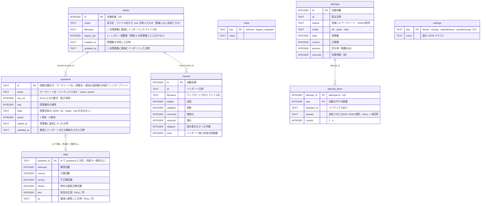

[English](../en/database.md) | **日本語** | [简体中文](../zh-CN/database.md)

# データベース

> データベースは SQLite で、**ファイルは `xexam.db` の 1 つだけ**です。Rust バックエンドは旧 Python 版のデータベースを引き継いでいます。元のテーブル定義（スキーマ v1）は**1 文字も変えずに**残し、v0.5 ではその上に**スキーマ v2** を加えています。加えるだけで（新しいテーブルと新しい列）、作り直しや書き換えは一切しません。既存のデータベースは、v0.5 を初めて起動したときに、バックアップのコピーを書き出してから自動的に移行されます（第 6 節）。
> 根拠：[audit/database.md](../zh-CN/history/audit/database.md)。突き合わせテスト：`backend/tests/db_golden.rs`（旧 Python 実装で作成した `tests/baseline/fixtures/sample.db` と、コミット済みのスナップショットを使用）と `backend/tests/v05_banks_records_settings.rs`（移行、バックアップ、問題集、試験記録、設定）。

## 1. ファイルの場所

| 実行方法 | 場所 |
|---|---|
| Docker（推奨） | 名前付きボリューム `xexam_data`。コンテナの `/data` にマウントされ、ファイルは `/data/xexam.db` です。コンテナを更新・削除しても失われません |
| Docker を使わない場合 | データディレクトリ（既定は `./data`、または `XEXAM_DATA`）の下の `xexam.db` |

ボリュームの実際の名前は `<プロジェクト名>_<ボリューム名>` = `xexam_data` で、`docker volume ls` で確認できます。**`docker compose down -v` は実行しないでください**。`-v` を付けるとボリュームも一緒に削除されます。

データベースと同じ場所にあるサブフォルダ `backups/` には、スキーマ移行の前に書き出したコピーが入ります（第 6 節）。例：`/data/backups/xexam-schema1-20261110-140501.db`。プログラムがこれらのファイルを削除することはありません。不要になったら自分で削除してください。

## 2. 接続設定

| 設定 | 値 | 理由 |
|---|---|---|
| `journal_mode` | `DELETE` | WAL は使いません。WAL は共有メモリファイルを必要としますが、Docker Desktop が Windows のフォルダをコンテナにマウントする場合は信頼できないためです |
| `synchronous` | `FULL` | 利用者は 1 人で、速度は問題になりません。データの安全のほうが重要です |
| `foreign_keys` | `ON` | （スキーマには実際には外部キーがありません。旧版との一貫性のために設定しています） |
| `busy_timeout` | 5000 ms | 他の接続にロックされているとき、最大 5 秒待ちます |
| トランザクション | `BEGIN IMMEDIATE … COMMIT`、失敗時は `ROLLBACK`（`COMMIT` に失敗した場合もロールバック） | すべて成功するか、何も変わらないかのどちらかです |

バックエンドの接続は**1 つだけ**で、ミューテックスの内側に置かれています。データベース呼び出しは専用のスレッド（`spawn_blocking`）で実行されるため、Tokio の実行スレッドをブロックせず、ロックも `.await` をまたぎません。これは旧版の「1 つの接続 + RLock」とそのまま対応しています。

## 3. テーブル



スキーマ v2 では、v1 のテーブルに 3 つの列を追加しています。`questions.bank_id INTEGER`（NULL になるのは古いバイナリが書き込んだ行だけです。第 6 節を参照）、`attempts.banks TEXT NOT NULL DEFAULT '[]'`（その試験の出題元になった問題集の JSON スナップショット。`[{"id": 1, "name": "…"}]`）、`imports.bank_id INTEGER` です。さらに、インデックス `idx_questions_bank (bank_id, active)` と `idx_attempt_items_question (question_id)` も追加しています。外部キー制約は今もありません。

v1 のテーブル作成文は `backend/src/database/schema.rs`（`SCHEMA`）に一字一句そのまま保存されており、旧版 `app/db.py` の `SCHEMA` と同じです。この文は今も起動のたびに最初に実行されます。v2 で追加した部分はそのすぐ隣にあります（`MIGRATE_V2_TABLES`、`V2_COLUMNS`、`MIGRATE_V2_INDEXES`）。どれも `IF NOT EXISTS` を使うか、先に確認してから実行するため、最新のデータベースを開いても**ファイルのバイト列は変わりません**（テスト済み）。SQLite は `ALTER TABLE … ADD COLUMN` を、保存済みの `CREATE TABLE` の文の末尾に列を書き足す形で記録します。そのため、`questions`、`attempts`、`imports` の `sqlite_master` の文は、v1 の文に `, bank_id INTEGER`（または `, banks TEXT NOT NULL DEFAULT '[]'`）が付いたものになります。新しく作ったデータベースと移行したデータベースのスキーマは完全に同じです（テスト済み）。

## 4. 学習記録を左右する細かな仕様

### 4.1 問題 id
`stats` と間違いノートは、どちらも問題 id をキーにしています。id は次のとおりです。

```
sha1( ワークシート名 + "\n" + 空白除去(問題文)[:300] + "|" + 空白除去(最初の選択肢または最初の小項目)[:200] )  の先頭 12 桁の 16 進数
```

- 「空白除去」の「空白」は Python の `\s`（29 コードポイント。U+001C–U+001F と、U+3000 の全角スペースを含みます）で、**空白を除去してから切り詰め**ます。切り詰めは**コードポイント**単位です。Rust の `char::is_whitespace` は 25 個しかないため、バックエンド側でこの 29 コードポイントの判定を自前で実装しています。
- **Unicode 正規化は一切行いません**（NFKC も行いません）。プロジェクトのオーナーが実際に使っている問題集では大半の問題に全角 ASCII が含まれており、正規化するとすべての id が変わってしまうためです。
- 同じワークブック内で重複する id には、順に `-2`、`-3`……が付きます。これは**行の並び順に依存します**。完全に同じ内容の 2 つの問題の行を入れ替えると、学習記録がもう一方の問題に移ります。これは旧版の挙動であり、そのまま維持し、ここに明記しています。
- 問題文の言い回しを変更した場合 = 新しい問題として扱われます（古い問題は無効化され、古い問題の記録は新しい問題に引き継がれません）。選択肢、答え、解説、翻訳だけを変更した場合は「更新」となり、記録には影響しません。
- 85 件のアサーション（`tests/baseline/golden/id_vectors.json`）によって、Rust と Python の id がバイト単位で同一であることが保証されています。
- **問題集（v0.5）**：上の id がそのまま保存に使われるのは、**レガシー問題集**の問題です（v0.5 より前のデータすべてと、`X-Bank-Target` を付けずにアップロードしたもの）。そのため、既存の統計、間違いノート、履歴はつながったままです。それ以外の問題集では、**問題集ごとの id** を保存します。`sha1("xexam-bank:" + bank_id + "\n" + id)` の先頭 12 桁の 16 進数です。これにより、同じワークブックを 2 つの独立した問題集としてインポートしても、記録が混ざりません。問題集の id は再利用されない（`AUTOINCREMENT`）ので、問題集ごとの id も再利用されません。

### 4.2 削除せずに無効化する
インポート時、**インポート先の問題集**にあるのにファイルに見つからない問題は `active = 0` になり、`stats` はそのまま保持されます。後でその問題を同じ問題集に再びアップロードすると、自動的に有効に復元され、間違いノートにも戻ります。ほかの問題集の問題が、インポートで変更されることはありません。

問題がデータベースから消えるのは、問題集を削除したとき（`POST /api/banks/delete`）だけです。その問題集の問題（有効なものも無効化されたものも）、`imports` の行、`banks` の行を、1 つのトランザクションで削除します。`withRecords` を指定すると、それらの問題の `stats` と `attempt_items` の行も削除します。さらに、`banks` スナップショットにその問題集が含まれていて、まだ存在するほかの問題集が含まれていない `attempts` の行も、残っている詳細と一緒に削除します。指定しない場合、`stats`、`attempts`、`attempt_items` はそのまま残ります。

### 4.3 間違いノート
`wrong > 0` かつ `streak < 2` の問題は間違いノートに入ります。連続で 2 回正解すると外れます。

### 4.4 成績履歴
`attempts` には直近 **500** 回分を残します（`RECORD_RETENTION`。v0.5 より前は 60 回でした）。提出のたびに、それより古いものを `attempt_items` と一緒に削除します。`GET /api/progress` の `history` で返すのは、今も直近 60 回分だけです。
v0.5 からは、新しい試験ごとに、1 問につき 1 行の `attempt_items`（ページが回答を送ってきた場合はその回答と、正解かどうか）と、`banks` スナップショットも保存します。それより前に保存した試験には詳細がありません。試験記録を 1 件削除すると（`POST /api/records/delete`）、その記録と詳細は消えますが、`stats` は変わりません。すべて削除するときは `stats` も空にでき（`withStats`）、これは `POST /api/reset` と同じです。

### 4.5 設定
`settings` には、変更された設定ごとに 1 行が入ります。`value` は値の JSON テキストです（`"dark"`、`true`）。行がない設定は既定値になります（`theme` は `system`、`uiLang` は `en`、`autoAdvance` は false、`questionLang` は `ja`）。保存されている値が正しくない場合は無視されます。ブラウザもコピーを持ちますが、最初の画面を描くためだけに使います。正となるのはデータベースなので、設定はコンテナを更新しても、ブラウザのキャッシュを消しても残り、別のブラウザでも同じです。

### 4.6 タイムスタンプ
ローカル時刻の文字列で、形式は `%Y-%m-%d %H:%M` です。**タイムゾーンの表記はなく**、分単位までです。コンテナ内では環境変数 `TZ`（既定は `Asia/Tokyo`）で決まります。イメージにはタイムゾーンのデータベースが含まれています。含まれていないと `TZ` が黙って無効になり、時刻が UTC になってしまいます。

## 5. バックアップと復元

先にプログラムを停止してから操作すると、データベースがより安全です。

```bash
docker compose stop

# バックアップ：ボリュームを現在のフォルダ内の xexam-data.tgz にまとめる（中身はデータベース全体。.gitignore で無視されるので、コミットしないこと）
docker run --rm -v xexam_data:/data -v "$PWD:/backup" alpine tar czf /backup/xexam-data.tgz -C /data .

docker compose start
```

**バックアップの検証**（コピーに対して行い、原本では決して試さないでください）：

```bash
mkdir work && tar xzf xexam-data.tgz -C work
sqlite3 work/xexam.db "PRAGMA integrity_check"      # ok と出力されること
```

復元：

```bash
docker compose stop
docker run --rm -v xexam_data:/data -v "$PWD:/backup" alpine tar xzf /backup/xexam-data.tgz -C /data
docker compose start
```

## 6. スキーマ v2 への移行（v0.5）と旧バージョンへの戻し方

### 6.1 v0.5 を初めて起動したときに起こること

`meta.schema` は、そのデータベースのスキーマを示します（v0.4 までは `1`、v0.5 からは `2`）。v0.5 は、`meta.schema` がないか `1` のデータベースを開くと、次のように処理します。

1. **バックアップ。** データベースに何かデータが入っていれば、SQLite の `VACUUM INTO` で整合性のとれたコピーを、`xexam.db` と同じ場所の `backups/xexam-schema1-<YYYYmmdd-HHMMSS>.db` に書き出します（既存のファイルは上書きせず、代わりに `-2`、`-3`……を付けます）。コピーは普通のスキーマ 1 のデータベースです。**コピーを書き出せない場合**（ディスクがいっぱい、権限がないなど）、プログラムは起動せず、何も変更しません。理由はログに出ます。
2. **移行。** **1 つの** `BEGIN IMMEDIATE` トランザクションの中で行います。`banks`、`attempt_items`、`settings` と新しいインデックスを作成し、3 つの列を追加します。問題があれば、続けて**レガシー問題集**を作成し、すべてをそこに結び付けます。`name` = 直近のインポートのファイル名から `.xlsx` を除いたもの（インポートがなければ `Question bank`）、`filename` = そのファイル名、`created_at` = いちばん古い `questions.added_at`、`updated_at` = 直近のインポートの日時（インポートがなければ、問題が最後に変更された日時）です。すべての問題とインポートの行に `bank_id` が入り、すべての試験記録の `banks` スナップショットにはこの問題集が入ります。問題 id、統計、試験記録、インポート履歴は変更しません。最後に `meta.schema` を `2` にします。

新規のデータベースも同じ手順を通ります（バックアップはなく、レガシー問題集も作りません）。そのため、新しいデータベースと移行したデータベースは同じ構造になります。バックアップの書き出し先はログに出ます。

2 回目以降の起動では、バックエンドは `bank_id` のない問題があるかどうかを確認するだけです（読み取りのみ）。そうした問題ができるのは、ロールバックの後に古いバイナリがファイルに書き込んだ場合だけです（下記を参照）。そのような問題と、問題集の付いていないインポートの行は、レガシー問題集に結び付けます（必要なら作成します）。直すものがなければ**何も書き込まず**、ファイルのバイト列も変わりません（テスト済み）。

### 6.2 v0.4（またはそれ以前）に戻す

v2 のファイルは、v0.4 でも旧 Python 版でも開けます。新しい列は NULL を許すか既定値を持ち、`journal_mode` は今も `delete`、`user_version` も今も 0 だからです。**ただし、問題集が 2 つ以上になったら、古いバージョンを使い続けないでください。** 古いバージョンはデータベース全体を 1 つの問題集として扱うため、次にインポートすると、ほかのすべての問題集の問題を無効化してしまいます。新しいテーブルも無視します。さらに、試験記録を 60 件まで削ってしまいます。

**ロールバックするときは、代わりにバックアップを復元してください。** プログラムを停止し、`xexam.db` を `backups/` 内のファイルに置き換え（ファイル名を `xexam.db` に変えます）、古いバージョンを起動します。移行後に v0.5 で行った変更は、このコピーには入っていません。

それでも古いバージョンが v2 のファイルに書き込んでしまった場合、v0.5 は次の起動時に、古いバージョンが追加した問題をレガシー問題集に結び付けます。古いバージョンが保存した試験記録には詳細がなく、問題集のスナップショットも空です。古いバージョンが削った試験の詳細の行は、使われない行として `attempt_items` に残ります（表示されることはありません）。

### 6.3 旧 Python 実装との互換性

v0.4 までは、2 つの実装が**同じファイル、同じスキーマ**を使っていました。当初は合成データを使って、この往復を一通り実際に確かめました（旧 Python でデータベースを作成 → Rust で読み書き → 旧 Python で読み戻し。原本の sha256 は前後で変わらず、`PRAGMA integrity_check` も通りました）。旧 Python のコードを削除した後は、残りの保証をテストが守っています。`sample.db`（旧実装が書き出したデータベース）はスキーマ v2 に移行され、問題 id、統計、試験記録、インポートはすべてそのまま残ります。そのバックアップは今もスキーマ 1 のままで、中身は元の行とまったく同じです。移行したファイルは、その後に開いて読み取り、閉じても 1 バイトも変わりません。また、新しいデータベースの `sqlite_master` は、旧実装の文に v2 の追加分を加えたものです。実際に Python 版へロールバックするには、バックアップを復元し（6.2）、旧イメージ（`ghcr.io/yumin-space/xexam:v0.2.2`。非公開の GHCR にしかないので、先に `docker login ghcr.io` を実行します）で開きます。

## 7. 旧 `progress.json`

さらに古いバージョンでは、成績を `progress.json` に保存していました。旧 Python 版と同じく、**起動のたびに**データディレクトリにそのファイルがあるかを確認します。ファイルがあり、かつデータベースにまだ学習記録がなく、移行も行われていない場合に、それをデータベースへ移行します。データベース内の `legacy_migrated` マークによって移行は一度だけになり、すでに学習記録がある場合は上書きされません。
そのため、「まず一度起動してデータボリュームを作成する → `progress.json` をボリュームに置く → 再起動する」という手順が有効です。形式が正しくないファイルは無視され、ログに理由が書かれ、手動で `xexam-backend migrate-progress` を実行できることも案内されます。プログラムが起動できなくなることはありません。
（`tests/integration/migrate_check.py` が、合成データでこれらのケースを検証しています。）

> ⚠️ v0.1 からアップグレードする場合：データベースファイルの名前が変わり、新しいバージョンは `xexam.db` だけを読み込みます。データディレクトリに別の `.db` ファイルがあって `xexam.db` がない場合は、起動ログでお知らせします。そのファイルを `xexam.db` に名前変更してから起動してください（古いファイルは削除も読み取りもされません）。
