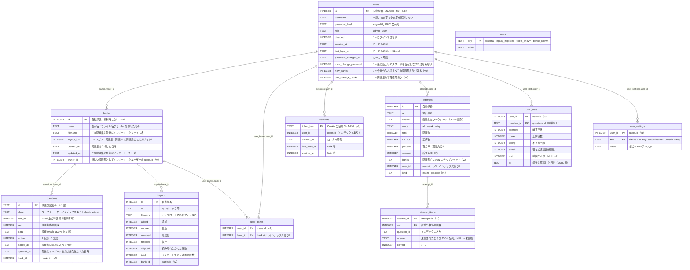

[English](../en/database.md) | **日本語** | [简体中文](../zh-CN/database.md)

# データベース

> データベースは SQLite で、**ファイルは `xexam.db` の 1 つだけ**です。Rust バックエンドは旧 Python 版のデータベースを引き継いでいます。元のテーブル定義（スキーマ v1）は**1 文字も変えずに**残し、その後のスキーマはどれも加えるだけです（新しいテーブルと新しい列。作り直しや書き換えは一切しません）：**スキーマ v2**（v0.5：問題集、試験の詳細、設定）、**スキーマ v3**（v0.6：ユーザーとログイン）、**スキーマ v4**（v0.7：ユーザーごとの問題集、問題集の所有者、練習の記録）。既存のデータベースは、新しいバージョンを初めて起動したときに、バックアップのコピーを書き出してから自動的に移行されます（第 6 節）。v0.7 からデータベースは **WAL モード** で動きます（第 2 節）。
> 根拠：[audit/database.md](../zh-CN/history/audit/database.md)。突き合わせテスト：`backend/tests/db_golden.rs`（旧 Python 実装で作成した `tests/baseline/fixtures/sample.db` と、コミット済みのスナップショットを使用）。移行とそのバックアップは、`backend/tests/v05_banks_records_settings.rs`（v2）、`v06_users_and_sign_in.rs`（v3）、`v065_bank_access_and_practice.rs`（v4）、`v07_bank_access_and_layouts.rs`（v4 の問題集へのアクセス、リリース前のデータベースの変換、古い形式の問題の出題停止）、`v07_wal_and_logs.rs`（WAL モード）でテストしています。

## 1. ファイルの場所

| 実行方法 | 場所 |
|---|---|
| Docker（推奨） | 名前付きボリューム `xexam_data`。コンテナの `/data` にマウントされ、ファイルは `/data/xexam.db` です。コンテナを更新・削除しても失われません |
| Docker を使わない場合 | データディレクトリ（既定は `./data`、または `XEXAM_DATA`、または `--data`）の下の `xexam.db` |

ボリュームの実際の名前は `<プロジェクト名>_<ボリューム名>` = `xexam_data` で、`docker volume ls` で確認できます。**`docker compose down -v` は実行しないでください**。`-v` を付けるとボリュームもコンテナと一緒に削除されます。

データベースと同じ場所にあるほかのファイル：

- **`xexam.db-wal` と `xexam.db-shm`** は、バックエンドの動作中にあります（WAL モード、第 2 節）。`-wal` ファイルには、SQLite が `xexam.db` へ書き写すまで、最新のコミット済みの変更が入っています。バックエンドが正常に停止すると、すべてが `xexam.db` に書き写され、`xexam.db-wal` は空になります。この 2 つのファイルは空のまま残ることがありますが、害はありません。これらはデータベースの一部です。バックエンドの動作中に削除しないでください。コピーするときは `xexam.db` と一緒にコピーします（第 5 節）。
- **`backups/`** には、スキーマ移行の前に書き出したコピーが入ります（第 6 節）。例：`/data/backups/xexam-schema3-20261111-140501.db`。プログラムがこれらのファイルを削除することはありません。不要になったら自分で削除してください。

何がどこに保存されるか：

| 場所 | 内容 |
|---|---|
| ボリューム内の `xexam.db`（動作中は `-wal` / `-shm` も） | 問題集とその所有者と問題（出題停止中のものを含む）、取り込み履歴、ユーザー（パスワードはハッシュだけ）とそのセッション、各ユーザーが使える問題集、ユーザーごとの問題ごとの統計（間違いノート）、問題ごとの詳細を含む学習記録（試験と練習）、設定（テーマ、表示言語、自動で次の問題へ進む設定、問題の言語） |
| ボリューム内の `backups/` | スキーマ移行の前に書き出されたデータベースのコピー（`xexam-schema1-…` から `xexam-schema4-…` まで） |
| バックエンドのメモリだけ | システムログ、ログインのロック、取り込みのプレビュー。どれも再起動すると空になります |
| ブラウザ（`localStorage`） | ユーザーごとに：未提出の試験や未完了の練習（問題 id、回答、印、答え合わせ済みの問題、経過時間。問題文は含みません）、最初の画面を表示するための設定のコピー |

## 2. 接続設定

| 設定 | 値 | 理由 |
|---|---|---|
| `journal_mode` | `WAL`（v0.7 から）。`XEXAM_SQLITE_JOURNAL=delete` のときは `DELETE` | コミットは `-wal` ファイルにだけ書き込み、読み取り側（たとえばサーバーの横で起動したコマンドラインツール）が書き込み側を止めません。2.1 を参照 |
| `synchronous` | `FULL` | コミットのたびに、ディスクに書かれるまで待ちます（WAL モードでは `-wal` ファイルの fsync 1 回）。そのため、停電してもコミット済みのものは失われません |
| `foreign_keys` | `ON` | （スキーマには実際には外部キーがありません。旧版と同じにしています） |
| `busy_timeout` | 5000 ms | 他の接続にロックされているとき、最大 5 秒待ちます |
| 自動チェックポイント | SQLite の既定（1000 ページごと） | バックエンドの動作中、`-wal` ファイルを小さく保ちます |
| トランザクション | `BEGIN IMMEDIATE … COMMIT`、失敗時は `ROLLBACK`（`COMMIT` に失敗した場合もロールバック） | すべて成功するか、何も変わらないかのどちらかです |

バックエンドの接続は**1 つだけ**で、ミューテックスの内側に置かれています。データベース呼び出しは専用のスレッド（`spawn_blocking`）で実行されるため、Tokio の実行スレッドをブロックせず、ロックも `.await` をまたぎません。これは旧版の「1 つの接続 + RLock」とそのまま対応しています。

### 2.1 WAL モード（v0.7）

- **保持される。** ジャーナルモードは `xexam.db` のヘッダーに記録されます。バックエンドはデータベースを開くたびに（サーバーでもコマンドラインのコマンドでも）このモードを求めますが、それは移行に成功した**後**だけです。開くのに失敗したとき（たとえば移行前のバックアップを書き出せないとき）は、古いデータベースファイルはまったくそのまま残ります。
- **使わない設定。** `XEXAM_SQLITE_JOURNAL=delete`（`docker/.env`、または Docker を使わない場合は環境変数）にすると、v0.6 以前のロールバックジャーナルのままになります。使うのは、データディレクトリが、WAL の共有メモリファイル `xexam.db-shm` を信頼できないストレージにある場合だけです：ネットワークファイルシステム、または Docker Desktop にバインドマウントした Windows のフォルダです。それ以外の値や値なしは WAL を意味します。この変数なしで次に起動すると、WAL に戻ります。
- **SQLite が拒否したとき。** ジャーナルモードのせいでバックエンドが起動に失敗することはありません。SQLite が WAL に切り替えられない場合（別のプロセスが切り替えを妨げる形でデータベースを開いている、またはファイルシステムが対応していない）、ログに `SQLite did not switch the journal mode to wal; continuing in mode delete` のような警告が出て、バックエンドは SQLite が報告したモードで動き続けます。
- **起動時の行。** 起動のたびに、実際のモードを 1 回ログに出します：`SQLite journal mode: wal`、または `SQLite journal mode: delete (XEXAM_SQLITE_JOURNAL=delete)`。
- **終了時。** 正常に停止すると（`docker compose stop`、Ctrl+C）、バックエンドは `PRAGMA wal_checkpoint(TRUNCATE)` を実行します。`xexam.db-wal` の中身がすべて `xexam.db` に書き写され、`-wal` ファイルは空になります。そのあと最後の接続を閉じると `-wal` と `-shm` が削除されることもありますが、（たとえば Windows では）空のまま残ることもあり、害はありません。ログには `WAL checkpoint at shutdown: everything is in xexam.db, the -wal file is empty` と出ます。そのときに別のプロセス（たとえばコマンドラインのコマンド）がまだデータベースを開いていると、チェックポイントは最後まで終わりません。そのことはログの警告に出て、SQLite が後で完了させます。
- **サーバーの動作中のコマンドラインのコマンド。** `reset-password`、`import`、`migrate-progress` は、別のプロセスから同じファイルを開きます。同じコンテナ（`docker compose exec backend …`）や同じマシンでなら、WAL モードでも安全です。
- **古いバージョン。** Xexam v0.6 以前は、データベースを開くときに `DELETE` を求めるので、WAL のデータベースを自分で元に戻します。ロールバックのときに、ジャーナルモードのための追加の手順は要りません（6.7 節）。

## 3. テーブル



13 のテーブルで、今も**外部キー制約はありません**。つながりはコードが保ち、削除のときは、それに属する行を同じトランザクションで削除します。図にない以前のスキーマのテーブルが 2 つあります：`stats`（v0.5 以前の問題ごとの統計）と `settings`（v0.5 の設定）です。v3 への移行のときに、その行は最初の管理者にコピーされました（`user_stats`、`user_settings`）。ロールバックを「バックアップを復元する」だけにしておくため、使われないまま残してあります。

各スキーマで加わったもの：

- **v1**（旧 Python 版。そのまま保持）：`meta`、`questions`、`attempts`、`stats`、`imports`。
- **v2**（v0.5）：テーブル `banks`、`attempt_items`、`settings`。列 `questions.bank_id INTEGER`（NULL になるのは古いバイナリが書き込んだ行だけです。6.6 を参照）、`attempts.banks TEXT NOT NULL DEFAULT '[]'`（その試験の出題元になった問題集の JSON スナップショット。`[{"id": 1, "name": "…"}]`）、`imports.bank_id INTEGER`。インデックス `idx_questions_bank (bank_id, active)` と `idx_attempt_items_question (question_id)`。
- **v3**（v0.6）：テーブル `users`、`sessions`、`user_stats`、`user_settings`。列 `attempts.user_id INTEGER`。インデックス `idx_sessions_user` と `idx_attempts_user`。
- **v4**（v0.7）：テーブル `user_banks`。列 `users.new_banks INTEGER NOT NULL DEFAULT 0`、`users.can_manage_banks INTEGER NOT NULL DEFAULT 0`、`banks.owner_id INTEGER`、`attempts.kind TEXT NOT NULL DEFAULT 'exam' CHECK (kind IN ('exam', 'practice'))`。インデックス `idx_user_banks_bank (bank_id)` と `idx_banks_owner (owner_id)`。`meta` のキー `users_known` と `banks_known`（6.6 節）。v0.7 の 6 列形式のワークブックには、列は必要ありませんでした。言語ごとの文は `questions.data` に入ります（4.7 節）。v0.7 のリリース前のビルドには、`users.new_banks` の代わりに `users.all_banks` がありました。そうしたデータベースは、開いたときに変換されます（6.5 節）。

v1 のテーブル作成文は `backend/src/database/schema.rs`（`SCHEMA`）に一字一句そのまま保存されており、旧版 `app/db.py` の `SCHEMA` と同じです。この文は今も起動のたびに最初に実行されます。その後の追加分はそのすぐ隣にあります（`MIGRATE_V2_TABLES`、`V2_COLUMNS`、…、`MIGRATE_V4_INDEXES`）。どれも `IF NOT EXISTS` を使うか、先に確認してから実行するため、最新のデータベースを開いても**何も書き込みません**（テスト済み：データベースファイルとその `-wal` ファイルは、どちらも 1 バイトも変わりません）。SQLite は `ALTER TABLE … ADD COLUMN` を、保存済みの `CREATE TABLE` の文の末尾に列を書き足す形で記録します。そのため、`questions`、`attempts`、`imports` の `sqlite_master` の文は、v1 の文に追加した列が付いたものになります。新しく作ったデータベースと移行したデータベースのスキーマは完全に同じです（`db_golden.rs` でテスト済み）。

## 4. 学習記録を左右する細かな仕様

### 4.1 問題 id
統計（`user_stats`）と間違いノートは、どちらも問題 id をキーにしています。id は次のとおりです。

```
sha1( ワークシート名 + "\n" + 空白除去(問題文)[:300] + "|" + 空白除去(最初の選択肢または最初の小項目)[:200] )  の先頭 12 桁の 16 進数
```

- 問題文と最初の選択肢は、問題の**基準の文**のものです：6 列形式では英語の問題（A 列）で、v0.7 からインポートできるのはこの形式だけです。以前の版の 3 列と 4 列形式では日本語の問題を使っていました。その問題は出題停止になり（4.2 節）、そうした問題集を 6 列のファイルで更新すると、すべての問題の id が変わります。統計のない新しい問題として追加され、古い問題は出題停止のままです。
- 「空白除去」の「空白」は Python の `\s`（29 コードポイント。U+001C–U+001F と、U+3000 の全角スペースを含みます）で、**空白を除去してから切り詰め**ます。切り詰めは**コードポイント**単位です。Rust の `char::is_whitespace` は 25 個しかないため、バックエンド側でこの 29 コードポイントの判定を自前で実装しています。
- **Unicode 正規化は一切行いません**（NFKC も行いません）。実際の問題集の多くには全角 ASCII が含まれており、正規化するとすべての id が変わってしまうためです。
- 同じワークブック内で重複する id には、順に `-2`、`-3`……が付きます。これは**行の並び順に依存します**。完全に同じ内容の 2 つの問題の行を入れ替えると、学習記録がもう一方の問題に移ります。これは旧版の挙動であり、そのまま維持し、ここに明記しています。
- 問題文の言い回しを変更した場合 = 新しい問題として扱われます（古い問題は無効化され、古い問題の記録は新しい問題に引き継がれません）。選択肢、答え、解説、翻訳だけを変更した場合は「更新」となり、記録には影響しません。
- 85 件のアサーション（`tests/baseline/golden/id_vectors.json`）によって、Rust と Python の id がバイト単位で同一であることが保証されています。
- **問題集（v0.5）**：上の id がそのまま保存に使われるのは、**レガシー問題集**の問題です（v0.5 より前のデータすべてと、`X-Bank-Target` を付けずにアップロードしたもの）。そのため、既存の統計、間違いノート、履歴はつながったままです。それ以外の問題集では、**問題集ごとの id** を保存します。`sha1("xexam-bank:" + bank_id + "\n" + id)` の先頭 12 桁の 16 進数です。これにより、同じワークブックを 2 つの独立した問題集としてインポートしても、記録が混ざりません。問題集の id は再利用されない（`AUTOINCREMENT`）ので、問題集ごとの id も再利用されません。

### 4.2 削除せずに無効化する
インポート時、**インポート先の問題集**にあるのにファイルに見つからない問題は `active = 0` になり、その統計はそのまま保持されます。後でその問題を同じ問題集に再びアップロードすると、自動的に有効に復元され、間違いノートにも戻ります。ほかの問題集の問題が、インポートで変更されることはありません。

**古い形式（v0.7）。** バックエンドと、データベースを開くコマンドラインのコマンドは、起動のたびに、6 節の移行と修復の後で、6 列形式でない有効な問題（`data` に `"lang": "en"` がないもの。4.7 節）をすべて出題停止にします。`active = 0`、`updated_at` = 現在時刻、`seq` は問題集のほかの問題の後ろ（順序は保ったまま）で、インポートがファイルからなくなった問題を出題停止にするのとまったく同じです。問題集、取り込み履歴、`user_stats`、`attempts`、`attempt_items` は残ります。有効な問題がなくなった問題集も残るので、6 列形式のファイルで更新することも、削除することもできます。1 つのトランザクションで実行し、問題集ごとに警告を 1 行記録します（`retired 12 questions of bank "Kitchen basics": they use the old 3- / 4-column layout; import the six-column version of the workbook`）。出題停止にするものがなければ、何も書き込みません。3 列や 4 列のファイルはインポートできないので、そうした問題がインポートで復帰することはありません。

問題がデータベースから消えるのは、問題集を削除したとき（`POST /api/banks/delete`）だけです。その問題集の問題（有効なものも無効化されたものも）、`imports` の行、`user_banks` の行（誰がそれを見られるか）、`banks` の行を、1 つのトランザクションで削除します。`withRecords` を指定すると、それらの問題の学習データも削除します：その `user_stats` と `attempt_items` の行、そして `banks` スナップショットにその問題集が含まれていて、まだ存在するほかの問題集が含まれていない `attempts` の行（残っている詳細と一緒に）です。管理者はこの方法で**すべての**ユーザーの学習データを削除します。問題集の管理権限を持つユーザーが自分の問題集を削除するときは、その問題集の**自分の**学習データだけを削除し、ほかのユーザーの記録は残ります（その問題は削除済みと表示されます）。`withRecords` を指定しない場合、`user_stats`、`attempts`、`attempt_items` はそのまま残ります。

### 4.3 間違いノート
ユーザーごとに、`user_stats` に自分の間違いノートがあります。`wrong > 0` かつ `streak < 2` の問題は間違いノートに入り、連続で 2 回正解すると外れます。試験も練習も、同じように間違いノートを更新します。一部の問題集だけを見られるユーザー（4.8 節）には、その問題集の問題の統計だけが見えます。

### 4.4 学習記録
各ユーザーの学習記録は、その `user_id` を持つ `attempts` の行です。`kind` は、記録が `exam`（試験）か `practice`（練習）かを示します（v0.7 より前の記録は、列の既定値どおりすべて試験です）。ユーザーごとに直近 **500** 件を残します（`RECORD_RETENTION`。v0.5 より前は 60 件でした）。提出のたびに、そのユーザーのそれより古いものを `attempt_items` と一緒に削除します。`GET /api/progress` の `history` で返すのは、直近 60 件だけです。

- v0.5 からは、新しい記録ごとに、1 問につき 1 行の `attempt_items`（ページが回答を送ってきた場合はその回答と、正解かどうか）と、`banks` スナップショットも保存します。それより前に保存した記録には詳細がありません。
- 数に入れるのは、まだ存在し、かつユーザーが見られる問題だけです（v0.7）。解答中に問題集が削除された問題や、ユーザーの範囲外の問題集の問題の結果は、統計も詳細の行も書き込まず、`total`、`correct`、`percent` から外します。このとき `sheets` には、数に入った問題が属するワークシートだけが並びます。1 問も残らなければ、何も保存しません。
- 記録を 1 件削除すると（`POST /api/records/delete`）、その記録と詳細は消えますが、統計は変わりません。すべて削除するときはユーザーの統計も空にでき（`withStats`）、これは `POST /api/reset` と同じです。

### 4.5 設定
`user_settings` には、ユーザーと変更された設定ごとに 1 行が入ります。`value` は値の JSON テキストです（`"dark"`、`true`）。行がない設定は既定値になります（`theme` は `system`、`uiLang` は `en`、`autoAdvance` は false、`questionLang` は `ja`）。保存されている値が正しくない場合は無視されます。ブラウザもコピーを持ちますが、最初の画面を描くためだけに使います。正となるのはデータベースなので、設定はコンテナを更新しても、ブラウザのキャッシュを消しても残り、別のブラウザでも同じです。

### 4.6 タイムスタンプ
ローカル時刻の文字列で、形式は `%Y-%m-%d %H:%M` です。**タイムゾーンの表記はなく**、分単位までです（`sessions` テーブルは Unix 時刻も 2 つ持ちます）。コンテナ内のタイムゾーンは、既定ではホストと同じです（`docker/docker-compose.yml` がホストの `/etc/localtime` を読み取り専用でマウントします）。`docker/.env` に `TZ` を設定するとそちらが優先され（例：`TZ=UTC`）、どちらもなければイメージは UTC になります。Docker Desktop（Windows、macOS）では、マウントされるのは Docker 自身の仮想マシンのファイル（たいてい UTC）なので、`TZ` を設定してください。イメージにはタイムゾーンのデータベースが含まれているので、`TZ` には任意のタイムゾーンを指定できます。後からタイムゾーンを変えても、保存済みの日時は書き換えません。書き込まれたときのタイムゾーンのままです。

### 4.7 問題の JSON（`questions.data`）
`data` は、問題全体の JSON から `id`、`sheet`、`row` を除いたものです（それぞれ専用の列があります）。主なキー：`kind`（`single`、`multi`、`hotspot`）、`stem`、`options`、`items`、`answer`、`translation`、`zh`（基準の問題に合わせて分割した中国語の文）、`explanation`、`mnemonic`、`note`。4 列形式の問題には、`english` と `en`（英語の文）もあります。

**6 列形式**の問題（v0.7）には、キーがさらに 3 つあり、`english` / `en` はありません。基準の文がすでに英語だからです。

- `"lang": "en"`：基準の文（`stem`、`options`、`items`）の言語。3 列と 4 列形式の問題には `lang` のキーはありません。基準の文は日本語です。
- `"ja"`：英語の問題に合わせて分割した日本語の問題（C 列）。形は `zh` と同じです。C 列が英語の問題と対応していないときはありません（そのとき試験ページは **日本語** のボタンをグレーアウトします）。
- `"explain"`：言語ごとの解説、覚え方、注記。`{"en": {"explanation", "mnemonic", "note"}, "zh": {…}, "ja": {…}}`。答えの列に 3 つのどれもない言語は省きます。

解説を 1 つしか知らないクライアントのために、6 列形式の問題の `explanation`、`mnemonic`、`note` には、E 列にあれば中国語の文、なければ日本語（F 列）、なければ英語（D 列）が入ります。3 列と 4 列形式の問題は、出題停止の問題としてデータベースに残り、その JSON は以前のバージョンとまったく同じです（新しいキーはありません）。パーサーは今もこれらの形式を読みます（インポートがそれを見分けて拒否するためです）。パーサーのゴールデンテストが、その出力をバイト単位で確かめています。

### 4.8 誰がどの問題集を見られるか（v0.7）
- **管理者** は、すべての問題集を利用・管理できます。
- **一般ユーザー** が見られるのは、`user_banks` にそのユーザーの分として並んだ問題集（管理者がチェックした既存の問題集）だけです。`users.new_banks = 1`（**今後インポートする問題集も含める**）は行を加えるだけです。問題集が作られるたびに（誰かが新しい問題集としてインポートしたとき、またはコマンドラインの `import` がレガシー問題集を作ったとき）、このフラグを持つユーザー全員に、同じトランザクションでその問題集の行が加わります。既存の問題集を加えることはなく、問題集のチェックを外すと、その行だけが削除されます。新しいユーザーは、行がなく、フラグもオフの状態で始まります。v4 への移行の時点でいたユーザーには、既存のすべての問題集の行とフラグを設定したので、アップグレードで問題集を失った人はいません。
- **問題集の管理権限を持つユーザー**（`users.can_manage_banks = 1`）は、権限がある間、自分が所有する問題集（`banks.owner_id`）も見られ、更新・削除できるのはその問題集だけです。新しい問題集としてインポートした問題集は、インポートしたユーザーのものです。v0.7 より前の問題集と、ログインしたユーザーなしで作られた問題集（コマンドラインの `import`）は、最初の管理者のものです。
- ユーザーを削除すると、そのセッション、学習記録（詳細を含む）、統計、設定、`user_banks` の行を削除します。そのユーザーが所有していた問題集は、削除した管理者に移ります。

## 5. バックアップと復元

**データベースをコピーする前に、バックエンドを停止してください。** WAL モードでは、バックエンドの動作中は最新の変更が `xexam.db-wal` にあることがあるので、`xexam.db` だけのコピーでは抜けることがあります。正常に停止した後は、すべてが `xexam.db` にあり、隣に `-wal` ファイルが残っていても空です。

```bash
docker compose stop

# バックアップ：ボリュームを現在のフォルダ内の xexam-data.tgz にまとめる（中身はデータベース全体。.gitignore で無視されるので、コミットしないこと）
docker run --rm -v xexam_data:/data -v "$PWD:/backup" alpine tar czf /backup/xexam-data.tgz -C /data .

docker compose start
```

停止できない場合は、`xexam.db`、`xexam.db-wal`、`xexam.db-shm` を一度にまとめてコピーし、下のようにコピーを確かめてください。コミット済みの変更がすべてそろうのは、3 つのファイルを合わせたときだけです。書き込みの途中に取ったコピーは矛盾していることもあるので、頼りにするのは停止したボリュームのコピーです。動作中のデータベースの矛盾のないコピーは、SQLite 自身でも作れます：`VACUUM INTO`、またはコマンドラインツール `sqlite3` の `.backup`。

**バックアップの検証**（コピーに対して行い、原本では決して試さないでください）：

```bash
mkdir work && tar xzf xexam-data.tgz -C work
sqlite3 work/xexam.db "PRAGMA integrity_check"      # ok と出力されること
```

**復元。** バックアップを置く前に、残っている `-wal` と `-shm` のファイルを削除してください。これらは置き換えるデータベースのもので、SQLite が復元したデータベースに適用してはいけないからです。正常に停止した後は空かなくなっているので、この `rm` で大事なものが消えることはありません。

```bash
docker compose stop
docker run --rm -v xexam_data:/data -v "$PWD:/backup" alpine sh -c 'rm -f /data/xexam.db-wal /data/xexam.db-shm && tar xzf /backup/xexam-data.tgz -C /data'
docker compose start
```

`backups/` のファイルはボリュームの一部なので、ボリュームのバックアップに含まれます。

**PC を替える場合**：新しい PC に新しい `docker-compose.yml` を配置し、一度 `docker compose up -d` を実行してボリュームを作成してから、上記の方法でそこにバックアップを復元します。バックアップファイルにはデータベース全体（パスワードのハッシュを含む）が入っているので、人に渡さず、コミットもしないでください（`.gitignore` で `*.tgz` は無視されます）。

## 6. スキーマの移行と古いバージョンへの戻し方

`meta.schema` は、そのデータベースのスキーマを示します（v0.4 までは `1`、v0.5 は `2`、v0.6 は `3`、v0.7 からは `4`）。あるバージョンが古いスキーマのデータベースを開くと、そのバージョンのスキーマまで一度に引き上げます。

1. **バックアップ。** データベースに何かデータが入っていれば、SQLite の `VACUUM INTO` で整合性のとれたコピーを、`xexam.db` と同じ場所の `backups/xexam-schema<N>-<YYYYmmdd-HHMMSS>.db` に書き出します。`<N>` は、今回の起動の前にファイルが持っていたスキーマです（既存のファイルは上書きせず、代わりに `-2`、`-3`……を付けます）。段階がいくつ続いても、バックアップは常に **1 つ** です。コピーは古いスキーマの、それだけで完結した 1 つのファイルで、`-wal` ファイルにまだあった変更も含みます。**コピーを書き出せない場合**（ディスクがいっぱい、権限がないなど）、プログラムは起動せず、何も変更しません。理由はログに出ます。
2. **移行。** **1 つの** `BEGIN IMMEDIATE` トランザクションの中で、古いスキーマから現在のスキーマまでのすべての段階を行い（6.1、6.4、6.5）、最後に `meta.schema` を設定します。
3. **ジャーナルモード。** その後で初めて、バックエンドはファイルを WAL に切り替えます（2.1 節）。

ログにはコピーの名前が出ます：`Upgraded the database to schema 4. A copy of the previous version was saved first: /data/backups/xexam-schema3-….db (restore it if you ever go back to an older version).`（「データベースをスキーマ 4 に更新しました。先に以前のバージョンのコピーを保存しました……（古いバージョンに戻すときは、これを復元してください）」）。新規のデータベースも同じ手順を通ります（バックアップはなく、レガシー問題集も作りません）。そのため、新しいデータベースと移行したデータベースは同じ構造になります。

### 6.1 スキーマ v2（v0.5）

v0.5 以降が、`meta.schema` がないか `1` のデータベースを開くと、バックアップの名前は `xexam-schema1-<YYYYmmdd-HHMMSS>.db` になります（普通のスキーマ 1 のデータベースです）。v2 の段階では、`banks`、`attempt_items`、`settings` と新しいインデックスを作成し、3 つの列を追加します。問題があれば、続けて**レガシー問題集**を作成し、すべてをそこに結び付けます：`name` = 直近のインポートのファイル名から `.xlsx` を除いたもの（インポートがなければ `Question bank`）、`filename` = そのファイル名、`created_at` = いちばん古い `questions.added_at`、`updated_at` = 直近のインポートの日時（インポートがなければ、問題が最後に変更された日時）です。すべての問題とインポートの行に `bank_id` が入り、すべての試験記録の `banks` スナップショットにはこの問題集が入ります。問題 id、統計、試験記録、インポート履歴は変更しません。

### 6.2 v0.4（またはそれ以前）に戻す

v2 のファイルは、v0.4 でも旧 Python 版でも開けます。新しい列は NULL を許すか既定値を持ち、`user_version` も今も 0 だからです。**ただし、問題集が 2 つ以上になったら、古いバージョンを使い続けないでください。** 古いバージョンはデータベース全体を 1 つの問題集として扱うため、次にインポートすると、ほかのすべての問題集の問題を無効化してしまいます。新しいテーブルも無視します。さらに、試験記録を 60 件まで削ってしまいます。スキーマ v3 以降のデータベースには、v0.4 が知らないユーザーもいます。

**ロールバックするときは、代わりにバックアップを復元してください。** プログラムを停止し、`xexam.db` を `backups/` 内の `xexam-schema1-…` のファイルに置き換え（ファイル名を `xexam.db` に変え、隣にある `xexam.db-wal` / `xexam.db-shm` は削除します）、古いバージョンを起動します。移行後に新しいバージョンで行った変更は、このコピーには入っていません。

それでも古いバージョンがファイルに書き込んでしまった場合、v0.5 以降は次の起動時に、古いバージョンが追加した問題をレガシー問題集に結び付けます（6.6）。古いバージョンが保存した試験記録には詳細がなく、問題集のスナップショットも空です。古いバージョンが削った試験の詳細の行は、使われない行として `attempt_items` に残ります（表示されることはありません）。

### 6.3 旧 Python 実装との互換性

v0.4 までは、2 つの実装が**同じファイル、同じスキーマ**を使っていました。当初は合成データを使って、この往復を一通り実際に確かめました（旧 Python でデータベースを作成 → Rust で読み書き → 旧 Python で読み戻し。原本の sha256 は前後で変わらず、`PRAGMA integrity_check` も通りました）。旧 Python のコードを削除した後は、残りの保証をテストが守っています。`sample.db`（旧実装が書き出したデータベース）は現在のスキーマに移行され、問題 id、統計、試験記録、インポートはすべてそのまま残ります。そのバックアップは今もスキーマ 1 のままで、中身は元の行とまったく同じです。移行したファイルは、その後に開いて読み取り、閉じても 1 バイトも変わりません。また、新しいデータベースの `sqlite_master` は、旧実装の文にその後の追加分を加えたものです。実際に Python 版へロールバックするには、スキーマ 1 のバックアップを復元し（6.2）、旧イメージ（`ghcr.io/yumin-space/xexam:v0.2.2`。非公開の GHCR にしかないので、先に `docker login ghcr.io` を実行します）で開きます。

### 6.4 スキーマ v3（v0.6）

`meta.schema` が `2` のとき（バックアップは `xexam-schema2-<YYYYmmdd-HHMMSS>.db`）、または `1` のときは 6.1 と同じトランザクションの中で行います。v3 の段階では、`users`、`sessions`、`user_stats`、`user_settings` を作成し、`attempts.user_id` を追加します。ユーザーがまだいなければ、既定の管理者 `admin`（パスワード `admin`。最初のログインで変更が必要）を作成し、既存のデータをこの管理者のものにします：ユーザーのないすべての試験記録、`stats` のすべての行の `user_stats` へのコピー、`settings` のすべての行の `user_settings` へのコピーです。古い `stats` と `settings` テーブルは、使われないまま残ります。

### 6.5 スキーマ v4（v0.7）

`meta.schema` が `3` のとき（バックアップは `xexam-schema3-<YYYYmmdd-HHMMSS>.db`）、または `1` や `2` のときはそれまでの段階と同じトランザクションの中で行います。v4 の段階では：

- `user_banks` とそのインデックスを作成し、`users.new_banks`、`users.can_manage_banks`、`banks.owner_id`、`attempts.kind` を追加します。
- **存在するすべてのユーザー** に、既存のすべての問題集の `user_banks` の行と `new_banks = 1` を設定するので、全員が引き続きすべての問題集を見られ、今後インポートするものも見られます。
- 全員の `can_manage_banks` は `0` のままです（管理者はもともと問題集を管理できます）。
- すべての問題集を **最初の管理者** のものにします：id がいちばん小さい有効な管理者です（有効な管理者がいないときだけ、無効な管理者）。
- `attempts.kind` には埋める値は要りません。既定値の `exam` が、古い記録のどれにも当てはまるからです。
- `meta.users_known` と `meta.banks_known`（6.6 を参照）を書き込み、`meta.schema` を `4` にします。

その後、起動は 6.6 の確認、WAL への切り替え（2.1 節）、古い形式の問題の出題停止（4.2 節）と続きます。v0.6 以前のデータベースには 3 列と 4 列形式の問題しかないので、そのすべてが出題停止になります。

**リリース前の v4。** v0.7 のリリース前に作られたビルドは、`users.new_banks` の代わりに `users.all_banks`（1 = 今後のものも含めすべての問題集）を保存していました。`4` と記録されていて、まだこの列があるデータベースは、開いたときに、バックアップ `backups/xexam-schema4-<YYYYmmdd-HHMMSS>.db` を作ってから 1 つのトランザクションで変換されます。`all_banks = 1` のユーザーには既存のすべての問題集の行と `new_banks = 1` を設定し、`all_banks = 0` のユーザーは自分の行をそのまま持ち、`new_banks = 0` になります。その後、列 `all_banks` を削除し、`meta.banks_known` を書き込みます。`meta.users_known` はリリース前のビルドが書いたままにするので、その間に古いバージョンが作ったユーザー（このマークより上）は、続いて実行される 6.6 の確認で、アップグレードのときのユーザーと同じく、すべての問題集と `new_banks = 1` を受け取ります。ログには、コピーの名前とともに `Converted the question bank access of a database written by a v0.7 pre-release to the released format.` と出ます。

### 6.6 起動のたびの確認

起動のたびに、移行の後で、バックエンドはロールバックの後に古いバイナリだけが残しうる行を（読み取りだけで）確認し、見つかればそれぞれ 1 つのトランザクションで直します。直すものがなければ、**何も書き込みません**。古いバージョンは `user_banks` も `users.new_banks` も知らず、そこでは全員がすべての問題集を見られました。

- **古いバージョンが作った問題集**：`meta.banks_known` には、このバージョンが知っている最大の問題集 id が入ります。v4 への移行のときと、このバージョンが問題集を作るたびに書き込みます（問題集 id は再利用しません）。`new_banks = 1` のユーザー全員に、それより大きい id の問題集ごとに行を加えます。このバージョンがその問題集を作った場合と同じです。その後、マークを進めます。この確認を最初に行うので、次の確認が作る問題集がそれらを隠すことはありません。
- **問題集のない問題**（`bank_id` が NULL）と、レガシー問題集があるときの問題集のないインポートの行：レガシー問題集に結び付けます（必要なら作成します）。
- **ユーザーが 1 人もいない**：既定の管理者 `admin` / `admin` をもう一度作成します。**ユーザーのない試験記録**：最初の管理者のものにします。
- **正しい所有者のいない問題集**（NULL、またはもう存在しないユーザー）：最初の管理者のものにします。
- もう存在しないユーザーや問題集の **`user_banks` の行**：削除します。
- **古いバージョンが作ったユーザー**：`meta.users_known` には、このバージョンが知っている最大のユーザー id が入ります。v4 への移行のときと、このバージョンがユーザーを作るたびに書き込みます（ユーザー id は再利用しません）。それより大きい id のユーザーは、ロールバックの後に古いバージョンが `user_banks` の行なしで作ったものです。そうしたユーザーには、アップグレードのときのユーザーと同じく、既存のすべての問題集の行と `new_banks = 1` を設定し、マークを進めます。
- マークがない場合（マークを書かないビルドが最初に開いたデータベース）は、そうした問題集やユーザーを見分けられないので、マークだけを書き込みます。

その後、古い形式の問題を出題停止にします（4.2 節）。

### 6.7 v0.6 に戻す

**バックアップを復元してください**：バックエンドを停止し、`xexam.db` を `backups/xexam-schema3-….db` に置き換え（ファイル名を `xexam.db` に変え、隣にある `xexam.db-wal` / `xexam.db-shm` は削除します）、v0.6 を起動します。移行の後に v0.7 以降で行ったことは、このコピーには入っていません。具体的なコマンドは [migration.md](migration.md) の 2.6 節にあります。

v0.6 はスキーマ 4 のファイルそのものも開けます。新しいテーブルと列を無視し、ファイルを `DELETE` ジャーナルに戻します。ただし、これは緊急のときだけにしてください。v0.6 は v0.7 の規則を知らないので、全員が再びすべての問題集を見られるようになり、問題集を取り込んだり削除したりできるのは管理者だけになり、練習の記録は試験のように見え、6 列形式の問題についても何も知りません。その後で新しいバージョンをもう一度起動すると、v0.6 が残したものを 6.6 が直します：v0.6 が取り込んだ問題集には所有者が付き、`new_banks = 1` のユーザーに届きます。v0.6 が作ったユーザーには、すべての問題集と `new_banks = 1` が設定され、v0.6 が取り込んだ問題は出題停止になります（4.2 節）。

## 7. 旧 `progress.json`

さらに古いバージョンでは、成績を `progress.json` に保存していました。旧 Python 版と同じく、**起動のたびに**データディレクトリにそのファイルがあるかを確認します。ファイルがあり、かつデータベースにまだ学習記録がなく、移行も行われていない場合に、それをデータベースへ（最初の管理者の記録として）移行します。`meta` の `legacy_migrated` マークによって移行は一度だけになり、すでにある学習記録が上書きされることはありません。
そのため、「まず一度起動してデータボリュームを作成する → `progress.json` をボリュームに置く → 再起動する」という手順が有効です。形式が正しくないファイルは無視され、ログに理由が書かれ、手動で `xexam-backend migrate-progress` を実行できることも案内されます。プログラムが起動できなくなることはありません。
（`tests/integration/migrate_check.py` が、合成データでこれらのケースを、WAL モードと `XEXAM_SQLITE_JOURNAL=delete` の両方で検証しています。）

Docker では、一時的なコンテナを使ってファイルをボリュームに入れます（コマンドは bash でも PowerShell でも動きます）。

```bash
docker compose stop
docker run --rm -v xexam_data:/data -v "${PWD}:/src:ro" alpine sh -c "cp /src/progress.json /data/progress.json && chown 10001:10001 /data/progress.json"
docker compose start
```

ここでは `docker cp` を使っていません。`docker cp` は既定で root として書き込み、コンテナ内のバックエンドは uid 10001 で動いているので、そのファイルを読み取れない場合があります。再起動の後、ログには `Migrated the old study records into the database` と出ます（`docker compose logs backend`）。

> ⚠️ v0.1 からアップグレードする場合：データベースファイルの名前が変わり、新しいバージョンは `xexam.db` だけを読み込みます。データディレクトリに別の `.db` ファイルがあって `xexam.db` がない場合は、起動ログでお知らせします。そのファイルを `xexam.db` に名前変更してから起動してください（古いファイルは削除も読み取りもされません）。
