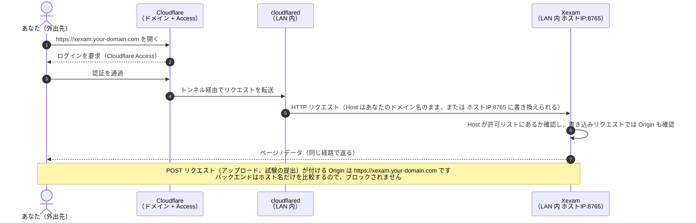

[English](../en/deployment.md) | **日本語** | [简体中文](../zh-CN/deployment.md)

# デプロイ

> 新しいアーキテクチャ：`nginx`（外部に公開されるのはこれだけ）+ `backend`（Rust、プライベートネットワーク内）+ SQLite（名前付きボリューム `xexam_data`）。構成図は [architecture.md](architecture.md)、セキュリティ境界は [security.md](security.md) を参照してください。

## 1. 前提

- Docker（Compose v2 を含む）が入ったマシン。x86（amd64）でも ARM（arm64）でも構いません。
  - arm64 イメージは CI 上で QEMU を使って**ビルドして起動する**ところまで検証済みです（`/api/info` が `aarch64` と正しいバージョンを返し、Nginx の `/healthz` も正常でした）。ただし、**本物の ARM ハードウェア上では動かしていません**。
  - バックエンドは、x86 のビルドマシン上で zig を使って aarch64 版をクロスコンパイルしています（キャッシュが空の状態で CI は約 5 分かかります。QEMU 上で Rust をコンパイルする必要はありません）。
    zig のリンカーは、rustc が aarch64 向けに既定で付ける `--fix-cortex-a53-843419` を受け付けないため、aarch64 のバイナリには Cortex-A53 コア向けのこのエラッタ回避策が**含まれていません**。
    Oracle Cloud の Ampere A1 は Ampere Altra（Wikipedia によれば Arm Neoverse N1 コア）を使っており、Cortex-A53 ではないため影響を受けません。
    Cortex-A53 コアのボード（一部の古い開発ボード）で動かす場合は、このイメージを使わず、先に知らせてください。
- `/etc/localtime` のあるホスト（一般的な Linux ディストリビューションにはどれもあります）。ない場合は 3.1 節を参照してください。

## 2. 起動

### 公開済みのイメージを pull する（推奨）

必要なのは、リポジトリの `docker/` フォルダにある [`docker-compose.yml`](../../docker/docker-compose.yml) というこの 1 つのファイルだけです。専用のフォルダにダウンロードして（例：`curl -fLO https://raw.githubusercontent.com/Yumin-Space/xexam/main/docker/docker-compose.yml`）、そのフォルダでコマンドを実行します。このファイルは 2 つのイメージを Docker Hub（`docker.io/yuminspace/xexam-backend` と `docker.io/yuminspace/xexam-frontend`）から pull します。そこでは公開されているので、`docker login` は必要ありません。同じタグは、非公開のミラーとして `ghcr.io/yumin-space/` にもあります（こちらは、`read:packages` を付けた classic の GitHub トークンで `docker login ghcr.io` する必要があります）。

```bash
# docker login は不要です：イメージは Docker Hub で公開されています
docker compose up -d
```

`docker compose up -d` で **2 つのコンテナ**が pull されて起動します：`xexam-frontend`（Nginx、外部に公開されるのはこれだけ）と `xexam-backend`（Rust、プライベートネットワーク内）です。次に、ブラウザで <http://localhost:8765> を開き、`admin` / `admin` でログインします。すぐに自分のパスワードを設定するよう求められます（第 10 節）。メニュー（右上の三本線のボタン）を開いて **Question banks** を選び、Excel ファイル（6 列形式。[usage.md](usage.md) の第 12 節を参照）をインポートします。画面は最初は英語で表示されます。**Settings** やログインページで日本語または中国語に切り替えられます（日本語表示では、この 2 つはそれぞれ **問題集の管理**、**設定** です）。

### ソースからビルドする（コードを変更するとき）

```bash
git clone git@github.com:Yumin-Space/xexam.git
cd xexam
docker compose -f docker/docker-compose.build.yml up -d --build
```

初回のビルドには数分かかります（Rust とフロントエンドをコンパイルするため）。2 回目以降はキャッシュが効きます。クローンしたリポジトリでは、compose ファイルと `.env` は `docker/` にあり、`docker/docker-compose.build.yml` はリポジトリのルートをビルドコンテキストにします。以下のコマンドは、リポジトリのルートで `-f docker/docker-compose.build.yml` を付けて実行してください（例：`docker compose -f docker/docker-compose.build.yml logs -f`）。

フロントエンドのイメージには 3 つの README が必要です。**Xexam について** のページにその更新履歴が表示され、フロントエンドに組み込まれるためです。そのため `nginx/Dockerfile` は `README.md`、`README/README.ja.md`、`README/README.zh-CN.md` をビルド段階にコピーし、`.dockerignore` は `README.md` と `README/` をビルドコンテキストに残します。完成したイメージに入るのはビルドした静的ファイルだけです。

以下のコマンドでは Compose の**サービス**の名前 `backend` と `frontend` を使います。コンテナの名前は `xexam-backend` と `xexam-frontend` です。素の `docker` コマンド（`docker logs`、`docker exec`）では、こちらの名前を使います。

| 操作 | コマンド |
|---|---|
| 状態を見る | `docker compose ps`（2 つのコンテナとも `healthy` になっているはずです） |
| ログを見る | `docker compose logs -f`（バックエンドだけなら `docker compose logs -f backend`。第 9 節を参照） |
| 停止 / 再起動 | `docker compose stop` / `docker compose start` |
| 最新バージョンに更新 | `docker compose pull && docker compose up -d`（ソースからビルドした場合：`git pull && docker compose -f docker/docker-compose.build.yml up -d --build`）。古いバージョンから更新する場合は、先に第 6 節を読んでください |
| バージョンとアーキテクチャ | <http://localhost:8765/api/info>、またはアプリで：メニューのバージョンの項目、たとえば **Xexam v0.7.5**（「Xexam について」のページ） |

> ⚠️ `docker compose down -v` は実行しないでください。`-v` を付けるとデータボリューム `xexam_data` が削除されます。問題集、アカウント、すべての学習記録は、このボリュームに入っています。

**`docker/docker-compose.yml` と `docker/docker-compose.build.yml` は、同じプロジェクト名（`xexam`）、同じボリューム（`xexam_data`）、同じコンテナ名を使います**。そのため、両者を同時に実行することはできません。切り替える前に `docker compose stop` を実行してください。データは共通です。詳しくは [migration.md](migration.md) を参照してください。

## 3. 設定（`.env`）

`docker-compose.yml` と同じ場所に `.env` を作成します。クローンしたリポジトリでは `docker/.env` です。リポジトリのルートから `-f docker/...` を付けて実行しても、Compose はこのファイルを読みます（以前にクローンしたリポジトリでルートに `.env` がある場合は、`docker/` に移動してください）。コミットされず、イメージにも含まれません。テンプレートは [`.env.example`](../../docker/.env.example) です：

| 変数 | 既定 | 役割 |
|---|---|---|
| `XEXAM_BIND` | `127.0.0.1:8765` | ホスト側で公開する「アドレス:ポート」で、Nginx に対応します。`IP:ポート番号` の形式で指定する必要があります。`0.0.0.0:8765` = LAN 内から接続可能。⚠️ ポート番号だけを書くと、すべてのネットワークインターフェースで公開されます |
| `XEXAM_ALLOWED_HOSTS` | 空 | アクセスを許可するドメイン / IP。カンマ / スペース / セミコロン区切り |
| `XEXAM_ALLOWED_ORIGINS` | 空 | プロキシが Host をオリジンサーバーのアドレスに書き換える場合：公開ドメイン（`https://` を含む）を指定します |
| `XEXAM_ALLOW_ANY_HOST` | `0` | `1` = Host を検査しません（前段にすでに認証がある場合のみ） |
| `XEXAM_PARSE_TIMEOUT_SECS` | `30` | Excel 1 ファイルの解析にかける最大時間 |
| `XEXAM_SQLITE_JOURNAL` | （未設定：WAL） | `delete` にすると、WAL ではなく SQLite の従来のロールバックジャーナルのままになります。データボリュームがネットワークファイルシステムや、Docker Desktop にバインドマウントした Windows のフォルダにある場合にだけ設定します。それ以外の値は WAL を意味します。[database.md](database.md) の 2.1 節を参照 |
| `XEXAM_COOKIE_SECURE` | （未設定） | `1` = セッションの Cookie に常に `Secure` を付けます。ブラウザが常に HTTPS で Xexam に届く場合（たとえば Cloudflare Tunnel 経由）だけ設定してください。未設定なら、`Secure` はリクエストごとに決まります（第 10 節） |
| `XEXAM_LOG` | （未設定：`info`） | バックエンドのログのフィルターで、`docker compose logs backend` とシステムログのページの両方に効きます。例：`debug`、`warn`。空やスペースだけなら `info` です。フィルターとして正しくない値の場合も `info` になり、ログの最初に、問題を示す警告が 1 行出ます |
| `TZ` | （未設定：ホストのタイムゾーン） | データベース内のタイムスタンプのタイムゾーン。compose ファイルがホストの `/etc/localtime` をマウントするので、別のタイムゾーン（例：`UTC`）を使うときだけ設定します |

`.env` を変更したら、`docker compose up -d` を実行します（必要に応じてコンテナが再作成されます）。compose ファイルは、`XEXAM_ALLOWED_HOSTS`、`XEXAM_ALLOWED_ORIGINS`、`XEXAM_ALLOW_ANY_HOST`、`XEXAM_PARSE_TIMEOUT_SECS` を常に渡します（`.env` で設定していなければ上の既定値で）。`TZ`、`XEXAM_SQLITE_JOURNAL`、`XEXAM_COOKIE_SECURE`、`XEXAM_LOG` を渡すのは、`.env` で設定したときだけです（`XEXAM_LOG=` のように後ろに何もない行は、空の値として渡されます）。`XEXAM_BIND` は Compose 自身が、公開するポートに使います。`xexam-backend --help` で、バックエンドが読むすべての変数が表示されます。

### 3.1 タイムゾーン

バックエンドは、タイムゾーンの表記のないローカル時刻を書き込みます（[database.md](database.md) の 4.6 節）。compose ファイルは、ホストの `/etc/localtime` を読み取り専用で、ボリュームの長い書き方でバックエンドのコンテナにマウントします。

```yaml
      - type: bind
        source: /etc/localtime
        target: /etc/localtime
        read_only: true
        bind:
          create_host_path: false
```

そのため、タイムスタンプはホストのタイムゾーンに従います。`.env` の `TZ` はそれより優先されます。`create_host_path: false` により、`/etc/localtime` のないホストでは、Compose はイメージのファイルの上にマウントできない空のフォルダをそこに作る代わりに、エラー（"bind source path does not exist"）で止まります。**そのようなホストでは、`docker-compose.yml` からこの 6 行を削除し、`.env` で `TZ` を設定してください**（例：`TZ=UTC`）。そうしないと、バックエンドのコンテナが起動しません。マウントも `TZ` もなければ、イメージは UTC を使います。

Docker Desktop（Windows、macOS）では、ホストの `/etc/localtime` はお使いのパソコンのファイルではなく Docker 自身の仮想マシンのファイルで、その仮想マシンはたいてい UTC で動いています。マウントは機能しますが、パソコンのタイムゾーンにかかわらず日時は UTC になります。使いたいタイムゾーンを `.env` の `TZ` に設定してください。

後からタイムゾーンを変えても、保存済みの日時は書き換えません。書き込まれたときのタイムゾーンのままです。

## 4. スマートフォン、別のパソコン、インターネットから Xexam を開く

既定では、Xexam はローカルマシン（`127.0.0.1`）にのみバインドされるため、<http://localhost:8765> を開けるのは Docker を動かしているマシンだけです。Xexam には自分のログイン機能がありますが、ポートに届く人は誰でもログインページまでたどり着くので、必要な範囲だけ開いてください。

### SSH で別のパソコンから開く（設定不要）

Xexam が、SSH でログインできるサーバー、NAS、仮想マシンで動いている場合は、ご自身のパソコンで次を実行します。

```bash
ssh -L 8765:127.0.0.1:8765 user@server
```

この SSH 接続を開いている間は、ご自身のパソコンのブラウザで <http://localhost:8765> を開けます。サーバー側では何も変わらず、ポートも開きません。

### 同じネットワーク内のスマートフォンやパソコン

これは**信頼できるネットワーク**（自宅の Wi-Fi など）でのみ行ってください。公共のネットワークや共有のネットワークでは行わないでください：

1. Docker を動かしているマシンの LAN 内 IP アドレスを調べます（多くは `192.168.x.x` か `10.x.x.x`）。Windows では `ipconfig` を実行して「IPv4 アドレス」の行を見ます。macOS では `ipconfig getifaddr en0`、Linux では `hostname -I`（通常は最初のアドレス）を実行します。
2. そのアドレスを使って、`.env` に 2 行を書きます：

   ```ini
   XEXAM_BIND=0.0.0.0:8765
   XEXAM_ALLOWED_HOSTS=192.168.1.20      # Docker を動かしているマシンの LAN 内 IP
   ```

3. `docker compose up -d` を実行し、スマートフォン（iPhone では Safari、iOS 15.4 以降）またはもう 1 台のパソコンのブラウザで、そのアドレスとポート 8765（ここでは `http://192.168.1.20:8765`）を開きます。

そのネットワークの外からは、Cloudflare Tunnel（下記）を使ってください。ルーターでポートを転送することは決してしないでください。

### Cloudflare Tunnel でインターネットからアクセスする

想定するシナリオ：Xexam を LAN 内で動かしていて、`cloudflared`（Cloudflare のトンネルクライアント）も同じ LAN 内のいずれかのマシン上にあり（Xexam と同じマシンでなくても構いません）、自分のドメイン名で外から Xexam にアクセスし、**Cloudflare Access** で保護する場合です。バックエンドはもともと外部に公開されていないので、トンネルの向き先は **Nginx**（`XEXAM_BIND` で公開したポート）だけで済みます。



必要な作業は 3 つです：

1. **cloudflared から Nginx に接続できるようにします。** 同じマシン上なら既定のバインドのままにして、トンネルの向き先を `http://localhost:8765` にします。LAN 内の別のマシンなら、`.env` に `XEXAM_BIND=0.0.0.0:8765`（または `192.168.1.20:8765` のような具体的な LAN の IP）と `XEXAM_ALLOWED_HOSTS=xexam.your-domain.com` を設定し、`docker compose up -d` を実行します。
2. Zero Trust ダッシュボードの **Public Hostname**（Networks → Tunnels → お使いのトンネル → Public Hostname）：Subdomain / Domain は `xexam` / `your-domain.com`、Service Type は `HTTP`（HTTPS ではありません）、URL は `host-IP:8765`（例：`192.168.1.20:8765`）。
3. **Cloudflare Access のポリシー** で、**自分と招待した人だけ**を許可します。ポリシーを設定していないドメイン名は、全世界に公開しているのと同じです。

バックエンドが受け取る Host は、トンネルによって変わります（`.env`）：

| トンネルの動作 | 設定 |
|---|---|
| Host がそのままあなたのドメイン名として転送される | `XEXAM_ALLOWED_HOSTS=xexam.your-domain.com` |
| `httpHostHeader` を設定していて、Host が `192.168.1.20:8765` に書き換えられる | `XEXAM_ALLOWED_HOSTS=192.168.1.20` + `XEXAM_ALLOWED_ORIGINS=https://xexam.your-domain.com`（ブラウザの `Origin` は公開ドメイン名のままなので、別途許可する必要があります） |
| 不明 | まず 1 行目のとおりに設定します。拒否（403）されると、ページに、サーバーが受け取った `Host` / `Origin` と、それをどのオプションに入れるべきかが表示されます。それを追加して、もう一度 `docker compose up -d` を実行してください。同じ理由は `docker compose logs backend` と **システムログ** にも出ます |
| ドメイン名を列挙したくなく、前段に Access がある | `XEXAM_ALLOW_ANY_HOST=1`（`Host` をもう検査しません。書き込みリクエストの `Origin` 検査とログインは引き続き有効です） |

Nginx は、ブラウザ（またはトンネル）から届いた `Host` を**そのまま**バックエンドに渡し、`X-Forwarded-*` を空にします。バックエンドが読むのは実際の `Host` だけです。

**トンネルの向こうの全員が、1 つのレート制限を共有します。** Nginx はクライアントのアドレスごとにリクエスト数を制限します：`/api/` は 1 秒あたり 30 リクエストでバースト 120、`/api/upload` は 1 秒あたり 1 リクエストでバースト 5 です（[security.md](security.md) の第 9 節）。トンネル経由では、全ユーザーが cloudflared のアドレスから届くので、全員が同じ制限に数えられます。ページを 1 回開くと約 10 リクエスト、システムログのページを開いていると 1 秒に 2 リクエストなので、制限には十分に余裕があります。それでも制限に達した場合、ページは読み込みをやり直し、その後 **リクエストが多すぎます** と表示します（[usage.md](usage.md) の第 17 節）。

忘れてはいけないこと：

- ⚠️ **Xexam 自身のログインが、ポートの唯一の鍵です。** `XEXAM_BIND=0.0.0.0:…` や `XEXAM_ALLOW_ANY_HOST=1` を設定すると、ポートに接続できる人は誰でもログインページまでたどり着き、パスワードを試せます（ロックが回を重ねるごとに長くなるので時間はかかりますが、弱いパスワードは弱いままです）。cloudflared だけがこのポートに接続できるようにし、ルーターでポートフォワーディングをしないでください。Linux では、ホストのファイアウォール（ufw、firewalld）は Docker が公開したポートを止められません。`DOCKER-USER` チェーンを使うか、`XEXAM_BIND` に具体的な LAN の IP を指定してください。最も確実なのは、cloudflared と Xexam を同じマシンに置き、既定の `127.0.0.1` のままにすることです。
- 初回ログインで既定の `admin` のパスワードを変更し、ユーザーごとに別々のパスワードを設定してください。
- Cloudflare Access の後ろでは、ログインが 2 回あります（Access、次に Xexam）。Access のログインの有効期限が切れると、アップロードや提出が失敗し、ログインの有効期限が切れている可能性がある、というメッセージが表示されます。ページを再読み込みして、ログインし直してください。途中まで進めた試験や練習はブラウザに保存されているので、失われません。

どこまで検証したか（ありのままに書きます）：

- 移行の際に、本物の Chrome + HTTPS リバースプロキシを使って、**旧 Python 版**に対し、Host の 2 つのケース（Host を保持 / Host を書き換え）でブラウザ操作の一連の流れを検証しました。そのスクリプトは旧 Python コードに依存していたため、旧コードとともに削除しました。
- **新しいスタック**については、`tests/integration/stack_check.py` がリクエストヘッダー単位の検査で「Nginx を通った後でも、Host / Origin ガードが引き続き有効で、`X-Forwarded-*` は信頼されない」ことを確認し、`nginx_check.py` が Host がそのまま透過されることを確認し、レート制限を検査します。
- 本物の Cloudflare では**テストしていません**。初めて公開するときは、上の表の「不明」の行に従い、ページに表示される 403 のメッセージを確認してください。

## 5. データ

- 場所：名前付きボリューム `xexam_data` → コンテナ内の `/data/xexam.db`。更新、再作成、コンテナの削除をしても失われません。データベースには、問題集、アカウント、学習記録、設定が保存されます。
- バックエンドの動作中は、データベースの隣に SQLite の `xexam.db-wal` と `xexam.db-shm` があります（WAL モード、v0.7 から）。正常に停止すると、バックエンドがすべてを `xexam.db` に書き写し、`xexam.db-wal` を空にします。この 2 つのファイルは空のまま残ることがありますが、害はありません。
- ボリュームには、スキーマ移行の前に書き出したコピーを入れた `/data/backups/` フォルダもできることがあります（第 6 節）。プログラムがこれらのファイルを削除することはありません。中身を見るには：`docker run --rm -v xexam_data:/data alpine ls -l /data /data/backups`。
- **バックアップ**：まずバックエンドを停止し（`docker compose stop`）、ボリュームをまとめてから、もう一度起動します。コマンドは [database.md](database.md) の第 5 節にあります。バックエンドの動作中に取った `xexam.db` だけのコピーでは、まだ `xexam.db-wal` にある最新の変更が抜けることがあります。停止できない場合は、`xexam.db`、`xexam.db-wal`、`xexam.db-shm` を一緒にコピーしてください。ボリュームのバックアップには `backups/` も含まれます。
- Docker を使わずにバックエンドを直接実行する（開発）：[development.md](development.md) を参照してください。

## 6. アップグレード

どのアップグレードも `docker compose pull && docker compose up -d` です（指示がある場合は新しい `docker-compose.yml` を使います）。新しいバックエンドは、初回の起動時に `/data/backups/` にコピーを書き出してから、データベースをそのスキーマに移行します。このコピーを書き出せない場合（ディスクがいっぱい、権限がないなど）、エラーで終了し、データベースは変更されません。Docker が再起動を繰り返し、起動のたびにもう一度試みます。Nginx は healthy なバックエンドを待つため、起動しません。理由は `docker compose logs backend` で確認できます。先にご自身でもボリュームをバックアップしてください（第 5 節）。ボリュームの外にもコピーがあるほうが安全です。

**v0.6 以前からの場合は、先に 6 列形式のワークブックを用意してください。** v0.7 からは 6 列形式しかインポートできず、バックエンドは起動のたびに、以前の版の 3 列・4 列形式から取り込んだ問題をすべて出題停止にします（問題集、学習記録、統計は残ります）。v0.6 以前の問題集はどれもこれらの形式なので、アップグレードの後は、各問題集を 6 列形式のファイルで更新するまで何も練習できません（[usage.md](usage.md) の 13.5 節）。

手順のチェックリスト、その後の確認、ロールバックは [migration.md](migration.md) にあります。

- **v0.7 から**（migration.md の第 1 節）：pull のほかにすることはありません。スキーマの変更はなく、`docker-compose.yml` と `.env` も同じままです。
- **v0.6 から**（migration.md の第 2 節）：スキーマ v3 → v4、バックアップ `xexam-schema3-<日時>.db`、WAL モード、その後に古い形式の問題の出題停止。新しい `docker-compose.yml` も取得してください。新しいファイルでは、決まった既定のタイムゾーンを設定しなくなり（ホストに従います。3.1 節）、コンテナのログを制限し（第 8 節）、`.env` で設定されていれば `XEXAM_SQLITE_JOURNAL`、`XEXAM_COOKIE_SECURE`、`XEXAM_LOG` を渡します。これまでのタイムスタンプがホストとは別のタイムゾーンで書かれていた場合は、新しい記録も同じタイムゾーンで続くように、そのタイムゾーンを `.env` の `TZ` に設定してください。追加しなければならない変数はありません。
- **v0.5 または v0.5.1 から**（migration.md の第 3 節）：スキーマ v2 → v4 を一度に、バックアップ `xexam-schema2-<日時>.db`。ログインが新しく加わります：`admin` / `admin` でログインしてください。これまでのデータはすべてこのアカウントのものになります。
- **v0.4 から**（migration.md の第 4 節）：スキーマ v1 → v4 を一度に、バックアップ `xexam-schema1-<日時>.db`。v0.5.1 から、イメージは `ghcr.io` ではなく Docker Hub（`docker.io/yuminspace/…`、公開、ログイン不要）から取得します。お使いの `docker-compose.yml` を新しいファイルに差し替えてください（または、その 2 つの `image:` の行を `docker.io/yuminspace/xexam-backend:latest` と `docker.io/yuminspace/xexam-frontend:latest` に変更します）。ソースからビルドする場合、compose ファイルは `docker/` に移ったので、リポジトリのルートにある `.env` は `docker/.env` に移動してください。

アップグレードの後、`/api/info` には `"version": "0.7.5"` と表示されます。2 回目以降の起動では移行は行われません。古い形式の問題の出題停止も、出題停止にするものが残っていなければ何も書き込みません。**ロールバック**とは、`backups/` のコピーを復元して古いイメージを動かすことです。移行済みのデータベースで古いバージョンを動かすのは、緊急のときだけにしてください。具体的なコマンドは [migration.md](migration.md)、背景は [database.md](database.md) の第 6 節にあります。

## 7. ヘルスチェックと停止

- `xexam-frontend`：`GET /healthz`（Host の許可リストを経由しません）。`xexam-backend`：`xexam-backend healthcheck`（コンテナ内で自分自身に `Host: 127.0.0.1` を付けてアクセスします）。バックエンドが healthy になってから Nginx が起動します（`depends_on`）。
- バックエンドが落ちたり再起動したりしても、Nginx は終了しません。`/api/` が一時的に JSON の 502（`后端暂时连不上`。「バックエンドに一時的に接続できません」）を返すだけで、バックエンドが復旧すれば自動的に元に戻ります。
- `docker compose stop`：バックエンドは 8 秒以内に正常終了します（Docker は最大 15 秒待ちます）。インポートのトランザクションは、コミットが完了するかロールバックされるかのどちらかになります。そのあと WAL のチェックポイントを実行するので、すべてが `xexam.db` に入り、`xexam.db-wal` は空になります（ログには `WAL checkpoint at shutdown: everything is in xexam.db, the -wal file is empty` と出ます）。クラッシュや `docker kill` の後は `-wal` ファイルが残りますが、SQLite が次の起動時にそれを適用するので、コミット済みのものは失われません。

## 8. リソースとイメージ

| | |
|---|---|
| `xexam-frontend` | nginx-unprivileged + 静的ファイル（「Xexam について」のページの更新履歴もその一部）。ポート 8080 で待ち受け。ルートファイルシステムは読み取り専用 |
| `xexam-backend` | 静的リンクされた単一の実行ファイル + tzdata（予備として UTC の `/etc/localtime`）+ `/VERSION`。uid 10001。ルートファイルシステムは読み取り専用で、書き込めるのは `/data` と `/tmp` だけ |
| ネットワーク | `internal`（バックエンド + Nginx。外部ネットワークにはアクセスできません）と `public`（Nginx だけ） |
| コンテナのログ | 各コンテナでログドライバー `json-file` を `max-size: 10m`、`max-file: 3` で使うので、Docker が残すログはコンテナごとに最大およそ 30 MB です（制限がないと、Docker はコンテナのログをいつまでも残します） |

## 9. ログ：システムログのページと `docker compose logs`

バックエンドが記録したログを読む場所は 2 つあります。どちらも同じ `XEXAM_LOG`（既定は `info`）で絞り込んだ同じ行を表示します。

| | **システムログ**（メニュー、管理者のみ） | `docker compose logs backend` |
|---|---|---|
| 場所 | アプリの中、ページ `#/logs`。開いている間は 0.5 秒ごとに読む（読み込みに失敗すると間隔が延び、最長 10 秒ごと） | サーバー上 |
| 量 | バックエンドが前回起動してからの最新 **2000** 行 | Docker がまだ残しているものすべて：10 MB のファイル最大 3 つ、再起動をまたいで |
| 再起動の後 | 空に戻る（メモリ上にだけあり、データベースには残しません） | 残る |
| ほかに | レベルの絞り込み、検索、**一時停止** / **再開**、**最新へ移動** | Nginx のアクセスログとエラーログ：`docker compose logs frontend` |

Compose のサービスの名前は `backend`（コンテナは `xexam-backend`）なので、ページの説明のとおり、サーバー上の compose ファイルのあるフォルダで `docker compose logs backend` を実行します。Compose を使わない場合は `docker logs xexam-backend` です。クローンしたリポジトリのルートから実行するときは、`-f docker/docker-compose.yml`（または `-f docker/docker-compose.build.yml`）を付けてください。

ログに含まれるもの：起動時の行（バージョン、データディレクトリ、ジャーナルモード、許可したホスト、既定のパスワードについての注意、アップグレードの行、古い Excel 形式のために出題停止にした問題）、ユーザー名によるログインとアカウントの変更（`user "admin" signed in`、`user "admin" updated user "alex"`。ログインで入力された、アカウントのない名前は決して記録しません）、拒否したアップロードと書き込み、警告とエラーです。パスワード、セッションのトークン、Cookie の値、確認コード、問題文は決して含みません。Host / Origin の確認で拒否したリクエスト、ログインの失敗、アカウントのないユーザー名のロックは、1 回記録したあとは多くても 1 分に 1 回まとめて記録するので、ログインせずに 2000 行からほかの行を押し出すことは誰にもできません。詳細：[security.md](security.md) の第 8 節。

## 10. 初回起動、アカウント、復旧

- インストールまたはアップグレードの後、Xexam を開いて `admin` / `admin` でログインし、すぐに自分のパスワードを設定してください。それまでは、このページを開ける人なら誰でも既定のパスワードを使えます。既定のパスワードのままの管理者がいる間は、ログインページにそのアカウントの名前が出て、バックエンドの起動のたびに注意が出力されます（`docker compose logs backend`）。
- ほかの人は **ユーザー管理**（メニュー、管理者のみ）で追加し、それぞれが使える問題集を選びます。**問題集を管理できる** 権限を持つユーザーは、問題集を取り込み、自分の問題集を更新・削除できます。
- **パスワードが分からなくなったとき**：`docker compose exec backend xexam-backend reset-password admin`（Compose を使わない場合：`docker exec xexam-backend xexam-backend reset-password admin`）で新しい仮パスワードが表示されます。アカウントは有効になり、すべての場所でログアウトされ、次のログインで新しいパスワードの設定を求められます。サーバーの動作中でも使えます。
- **パスワードの間違いでロックされたとき**：ログインのロックはバックエンドのメモリ上にあるので、`reset-password`（別のプロセス）では解除できません。ほかの管理者がユーザー管理で **ロック解除** を押すか、バックエンドを再起動します：`docker compose restart backend`。
- Cloudflare Access の背後では 2 回ログインします（Access、次に Xexam）。自宅のネットワークの HTTP でも使えます。セッションの Cookie に `Secure` が付くのは、ページを `https://` で開いたときだけです。`XEXAM_COOKIE_SECURE=1`（第 3 節）は常に `Secure` を付けます。ブラウザが常に HTTPS で Xexam に接続する場合にだけ設定してください。

## 11. リリース

`main` にプッシュすると、[`.github/workflows/ci.yml`](../../.github/workflows/ci.yml) がまずバージョン、更新履歴、ドキュメントの検査を行い、続いて 4 グループの検査（フロントエンド、バックエンド、Nginx と全スタック、arm64）を実行します。すべて通過した場合にだけ、`xexam-frontend` と `xexam-backend` の 2 つのイメージ（amd64 + arm64）を Docker Hub（`docker.io/yuminspace/`、公開）と、非公開のミラーとして `ghcr.io/yumin-space/` に公開します。タグはどちらも `latest`、`v<CODE_VERSION>`、`sha-<コミット>` で、対応する GitHub Release も作成します（そのリリースノートには、Docker Hub からの pull コマンドが最初に載ります）。最後にリリースを記録します：`VERSION` の `RELEASE_VERSION` と README のリリースバッジを、ボットが `main` に（早送りできるときは `dev` にも）コミットします。`dev` へのプッシュと `main` へのプルリクエストでは、同じ検査を行うだけで、公開はしません。詳しくは [development.md](development.md) の第 7 節を参照してください。

Docker Hub には、リポジトリのシークレット `DOCKERHUB_USERNAME` と `DOCKERHUB_TOKEN`（**Read & Write** の権限を持つアクセストークン）の 2 つが必要で、必要に応じてリポジトリ変数 `DOCKERHUB_NAMESPACE` も設定できます。シークレットがない場合や、`docker/docker-compose.yml` がその名前空間の Docker Hub のイメージを指していない場合、公開ジョブは何もプッシュせずに止まります。ghcr.io では、新しいイメージ名を初めて公開するときに、GitHub のパッケージ設定で、このリポジトリを **Manage Actions access** に追加し、ロールとして **Admin** を選んでください。そうしないとプッシュが拒否されます（`permission_denied: write_package`）。
