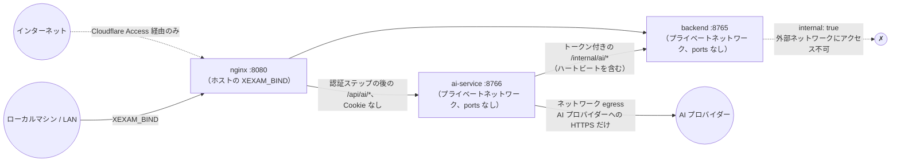

[English](../en/security.md) | **日本語** | [简体中文](../zh-CN/security.md)

# セキュリティ

> 対象範囲：互いに知り合いの少人数で使うセルフホスト型のプログラムで、v0.6 から**アカウントとログイン**があり、管理者、一般ユーザー、そして v0.7 からは**問題集の管理権限を持つユーザー**がいます。セキュリティは次の 5 つで成り立っています：**バックエンドを外部に公開しないこと**、**Host/Origin ガード**、セッションとパスワードを間違えたときの段階的なロックを伴う**すべてのルートでのログイン**、**バックエンドが確認する権限**（誰がどの問題集を見て管理するか、どの記録が誰のものか）、そしてインターネットからアクセスできる場合は**前段に Cloudflare Access のような認証を置くこと**です。v0.8 からは、任意の **AI サービス** が、認証情報を一切受け取らない専用のコンテナで、プロバイダーのキーを暗号化して動きます（§11）。v0.9 からは、AI+ 機能を持つアカウントに、そのアカウント自身の問題と記録についてのヒント、解説、要約も提供します。AI サービスがそれを読めるのはバックエンド経由だけで、しかも呼び出したユーザー自身のセッションがあるときだけです（§11）。
> 監査の根拠：[audit/security.md](../zh-CN/history/audit/security.md)。テスト：`backend/tests/`（コミット済みの旧版スナップショットと照合：172 件のゴールデンレスポンス、パース用フィクスチャ、id ベクトル。ログインとユーザーは `v06_users_and_sign_in.rs`、問題集へのアクセス、所有者、練習は `v065_bank_access_and_practice.rs` と `v07_bank_access_and_layouts.rs`、システムログと大量の拒否されたリクエストは `v07_wal_and_logs.rs` と `v07_log_floods.rs`、AI との接続、認証ステップ、内部ルートは `v08_ai_link.rs`、学習用のデータルートは `v09_ai_study.rs`）、`ai-service/tests/`（本人確認とアクセス、キーと設定、ストリーミング、管理者のアクセス、ログに秘密がないこと、プロキシの変数を無視すること。v0.9 からは、学習用のルート、ヒントのガード、ストアを `study_api.rs`、`study_guard.rs`、`v09_store.rs` で）、`tests/integration/nginx_check.py`（Nginx。レート制限と AI のルートを含む）。移行時には、340 項目の悪意あるリクエストのプローブを使って旧版と新版を項目ごとに比較しました（説明のつかない差異は 0 件、51 件は意図的な強化として登録）。このプローブ一式は旧 Python 版とともに削除しました。

## 1. 脅威モデル

| 誰が | できること | こちらの防御 |
|---|---|---|
| 同じネットワーク上の別のマシン | ポートに直接接続する | 既定では `127.0.0.1` にのみバインドします。公開するには自分で `XEXAM_BIND` を設定する必要があります。`/api/info`、`/api/auth/state`、ログインそのもの以外のすべてのルートにセッションが必要で（§5）、`/api/info` が答えるのはバージョン、CPU アーキテクチャ、プログラムを終了できるかどうかだけです（§7）。パスワードを間違えるとログインがロックされ、回を重ねるごとに長くなります（§6） |
| パスワードを推測する人 | 1 つのアカウントで多くのパスワードを試す、または架空のユーザー名を大量に試す | アカウントごとの段階的なロック。架空の名前とは別に、またオーナーが以前ログインしたブラウザとも別に数えます。Argon2id は同時に 2 つまでに制限しています（§6） |
| ログインしたユーザー | ほかのユーザーの記録を読む・変える、割り当てられていない問題集を見る、所有していない問題集を変える、管理者のルートを使う | ユーザー id は常にセッションから取ります。問題集の読み取りはすべてユーザーの範囲に限られ、所有者は書き込みのトランザクションの中で確認し、管理者のルートは権限を確認します（§7） |
| 悪意のある Web ページ（ご自身のブラウザ上） | ブラウザに `localhost:8765` へ書き込みや削除のリクエストを送らせる（CSRF） | セッションの Cookie は `SameSite=Strict` です。書き込みリクエストでは `Origin` のホスト名が `Host` と一致するか、許可リストに含まれている必要があります。JSON のエンドポイントは `Content-Type: application/json` を要求します（クロスサイトのフォームでは送れません）。削除はこれらの POST エンドポイントからしかできず、GET で削除されることはありません |
| DNS リバインディング | 悪意のあるドメイン名を 127.0.0.1 に解決させ、データを読み取る | `Host` の許可リストを検査します。GET も検査します |
| 悪意のある / 壊れた .xlsx | 圧縮爆弾、XML エンティティ展開、不正な構造でサービスを停止させる | §3 を参照 |
| プロキシチェーン上の偽造ヘッダー | `X-Forwarded-Host` など | バックエンドは**実際の `Host` ヘッダーだけを読みます**。Nginx はすべての転送ヘッダーを空にします |
| 誰でも送れる大量のリクエスト | システムログを埋めて、本当の行を押し出す。バックエンドを手一杯にする | 拒否されたリクエスト、ログインの失敗、架空の名前のロックは、多くても 1 分に 1 回まとめて記録します（§8）。Nginx はクライアントのアドレスごとにリクエスト数を制限します（§9） |
| サプライチェーン | 依存パッケージの脆弱性 | 依存関係を固定しています（バックエンドと ai-service それぞれの `Cargo.lock`、`package-lock.json`）。イメージにはパッケージマネージャー以外の余計なものを入れていません。§10 を参照 |
| 乗っ取られた、または不具合のある ai-service コンテナ | メインのアプリでユーザーになりすます、メインのデータベースを読む、バックエンドからインターネットに出る | Cookie も `Authorization` ヘッダーも Cloudflare Access のトークンも受け取らず、受け取るのはバックエンドが署名した 60 秒の本人確認の文だけです。メインのボリュームは決してマウントしません。バックエンドには、ai-service のために問題集や記録を読むルートはなく、バックエンドが ai-service を呼び出すこともありません（§11） |
| ログインしたユーザー | ほかのユーザーの AI チャットやメモを読む | ユーザー id は署名された本人確認からだけ取ります。他人のチャットには、存在しない場合と同じ応答を返します（§11） |
| AI+ 機能を持つログイン済みのユーザー | 見られない問題集の問題や、他人の記録について AI に尋ねる（細工した学習用のリクエスト） | ブラウザーが送るのは id だけです。ai-service は呼び出したユーザー自身のセッションでバックエンドに問い合わせ、バックエンドは、そのユーザーが見られる問題と、そのユーザー自身の記録にだけ答えます。ないもの、他人のもの、見えないものには、まったく同じ「見つからない」という応答を返すので、id を探ることはできません（§11） |
| AI+ 機能を持つログイン済みのユーザー、またはそのセッションで動く暴走したスクリプト | 多くの AI 呼び出しを行い、プロバイダーの請求やサーバーの負荷を増やす | 利用者ごとのリクエスト上限（1 分に 5 回、1 時間に 20 回、1 日に 100 回。管理者も含む）、ユーザーごとに実行中の回答は 1 つ、Nginx のアドレスごと・セッションごとの制限（§9、§11） |
| 答えが分かってしまう AI のヒント | ヒントに正しい選択肢を挙げさせる | ヒントのプロンプトは答えのキーなしで作られ、ガードは、答えを挙げたヒントをストリーミングの途中で差し止めます。ガードはベストエフォートのフィルターで、証明ではありません（§11、§12） |
| AI のボリュームやデータベースのコピーを持つ人 | AI プロバイダーのキーを読む | キーは暗号化されています（XChaCha20-Poly1305）。データベースだけをコピーしても復号できず、`XEXAM_AI_SECRET_KEY` を使えばキーはボリュームにまったくありません（§11） |

**対象外**：メインのデータベースの暗号化ストレージ（AI プロバイダーのキーは暗号化されます。§11）、システムログ以上の監査ログ、二要素のログイン、管理者に対する保護（管理者はすべてを見て管理でき、AI+ 機能を持つユーザーの AI チャットとメモも読み取り専用で見られます。そのような表示はすべて記録されます）。インターネットからアクセスする場合は、前段に Cloudflare Access（または同種のもの）を置いてください。

## 2. ネットワーク

- バックエンドは**決してポートを公開しません**。`docker/docker-compose.yml` の `backend` には `ports:` がなく、ネットワークは `internal: true` です。`tests/integration/stack_check.py` が「ホストからバックエンドに接続できないこと」を検査します。
- ai-service もポートを公開しません。同じプライベートネットワークにあり（そのため Nginx から届き、バックエンドにも届きます）、さらに `egress` にもあります。`egress` は外向きのインターネット接続を持つ唯一のネットワークで、ほかのコンテナは参加しません。
- `XEXAM_BIND` は `IP:port` の形式で書く必要があります。ポート番号だけ（例：`8766`）を書くとすべてのネットワークインターフェースにバインドされます。これはよくある操作ミスなので、ドキュメントで繰り返し注意を促しています。
- Linux では、ホストのファイアウォール（ufw / firewalld）は Docker が公開したポートを**制限できません**。接続元を制限するには、`DOCKER-USER` チェーンにルールを追加するか、`XEXAM_BIND` を具体的な LAN の IP にしてください。

## 3. アップロード（.xlsx）

アップロードできるのは管理者と問題集の管理権限を持つユーザーだけです（それ以外は、ボディを読む前に 403）。上から順に検査し、どの段階で失敗しても 400/413 と固定の（中国語の）メッセージを返し、**データベースには書き込みません**：

1. リクエストボディのサイズ：ストリーミングでカウントし、上限は **20 MiB**。実際のバイト数で数え、`Content-Length` は信用しません。その手前の Nginx にもさらに `client_max_body_size 20m` があります（同じ文面の JSON を返します）。
2. 取り込み先（`X-Bank-Target`）：Host、Origin、セッション、サイズの検査の後、ファイルを解析する前に読みます。存在しない問題集は 404、アップロードした人が更新できない問題集は 403 で、どちらも解析の時間はかかりません。
3. **内容**で判定します：マジックナンバー `PK`、ZIP 構造、ワークブックを含むこと。旧形式の `.xls`、空ファイル、拡張子を書き換えたファイルには、それぞれ個別のメッセージがあります。
4. ZIP：エントリ数は 10,000 以下。**重複したエントリ名は拒否**します（「検査したものと読み込むものが別」という事態を避けるため）。展開後の合計サイズには上限があります。宣言されたサイズは信用できないので、`take(limit)` で上限付きで読み取ります。
5. XML：拡張子やエンコーディングに関係なく（UTF-16 でも）、**DOCTYPE / エンティティ宣言は一律に拒否**します。深さは 64 以下、ノード数は 100 万以下（100 × 10,000）です。
6. 解析：協調的なデッドライン（既定 30 秒）があります。パーサーは一定数の行 / XML イベントを処理するたびに時計を確認し、時間が来たら**自分で停止する**ため、タイムアウト後も CPU やメモリを占有し続けることはありません。同時に実行される解析は最大 2 つ（`PARSE_CONCURRENCY`）で、それを超えたものはキューで待機し、待機時間も制限時間に含まれます。
   さらにメモリ上限もあります。同じ共有文字列が多くのセルから参照される場合は 1 つしか保持せず（ディープコピーしません）、A〜D 列のセルが参照するバイト数の合計は 64 MiB を超えません。E 列と F 列（6 列形式）には、別に 64 MiB の枠があります。1 つの XML 要素が持てる属性は最大 256 個です。
   取り込めるのは 6 列形式だけです（v0.7 から）。パーサーが古い 3 列・4 列形式の問題を 1 問でも読み取ったワークブックは、何かを一時保存する前に 400 で拒否し、確定時にももう一度確認します。
7. プレビューは、メモリ上の**アップロードした人自身の確認待ちスロット**に置かれ、30 分で期限切れになります。ほかの人が確定したり取り消したりすることはできません。すべてのスロットで 128 MiB のメモリの枠を共有します。アップロードを一時保存するとき、枠を超えた分はほかのユーザーのいちばん古いプレビューから捨てるので、問題集の管理権限を持つユーザーが大勢いても、プレビューでメモリを埋めることはできません。確認コードは 128 ビットのランダム値で、使い切りで、定数時間で比較されます。誤った確認コードでは、スロット内の内容は消費されません。
8. 確定時は**1 つのトランザクション**で書き込み、その中でアップロードした人が取り込み先の問題集を更新できるかをもう一度確認します。このファイルに使用可能な問題が 1 問もない場合はインポートを拒否します（問題集が空になるのを防ぐため）。

旧版は小文字の `.xml` / `.rels` の ASCII バイトしかスキャンしていなかったため、UTF-16 や別の拡張子で回避できました。この点が新版で強化された部分です（[api.md](api.md) の差異表に登録しています）。

## 4. Host と Origin

| 検査 | 対象 | ルール |
|---|---|---|
| Host | すべてのリクエスト。AI のルートも含む（バックエンドの認証ステップが確認します。§11） | 許可リストに含まれていること：既定は `localhost`、`127.0.0.1`、`::1`。`XEXAM_ALLOWED_HOSTS` で追加でき、`XEXAM_ALLOW_ANY_HOST=1` で検査を無効にできます |
| Origin | 書き込みリクエスト | 付いていない場合 → 通します（コマンドラインツールはクロスサイトのリクエストではないため）。付いている場合 → **ホスト名**が `Host` のホスト名と一致するか、`XEXAM_ALLOWED_ORIGINS` / 許可リストに含まれている必要があります |

ポイント：

- **比較するのはホスト名だけ**で、プロトコルやポートは比較しません。HTTPS のドメイン名経由でアクセスすると Origin は `https://example.com`、Host は `example.com` になりますが、誤ってブロックされることはありません。
- ガードが読むのは実際の `Host` ヘッダーです。`X-Forwarded-Host` / `Forwarded` は**読みません**。読んでしまうと、ガードをクライアントに預けるのと同じことになるためです。Nginx は `proxy_set_header Host $http_host` でそのまま転送し、それ以外の転送ヘッダーは空にします。
- これらの検査はセッションの確認の**前**に行うので、拒否されたリクエストがログインやデータに届くことはありません。
- 拒否された場合、レスポンスには、送られてきた Host / Origin と、どのオプションにどの値を追加すればよいかが書かれます（中国語で、ページが翻訳します）。ログには英語の行が出ます：静かな 1 分の後の最初の拒否はそれだけで 1 行（`rejected GET /api/bank: Host "evil.example" is not in the allowed list`）、それに続くものは多くても 1 分に 1 回まとめて（`rejected 250 request(s) by the Host / Origin check since the last report; the last one: …`）。
- `XEXAM_ALLOW_ANY_HOST=1` は、**前段にすでに認証がある**場合にのみ使ってください。これは Origin の検査もログインも無効にしません。

## 5. ログインとセッション

- **パスワード**：8〜128 文字。Argon2id で保存し（`argon2` クレートの既定のパラメーター、ハッシュごとにランダムなソルト）、ハッシュの計算と照合は、同時に 2 つまでに制限したブロッキングタスクで行います。それを超えたリクエストは待ちます。存在しないユーザー名もダミーのハッシュで照合するので、応答時間とメッセージ（`用户名或密码不对。`）からユーザー名の有無はわかりません。無効にしたアカウントにも同じ応答を返します。
- **ユーザー名**：1〜40 文字の ASCII の英字、数字と `. _ - @` で、大文字小文字を区別せずに一意です。ASCII だけにしているのは意図的で、見た目の似た名前を防ぎます。
- **セッション**：Cookie `xexam_session` に、オペレーティングシステムから得た 32 バイトの乱数。データベースにはその SHA-256 だけを保存するので、データベースのコピーに使えるトークンは入っていません。有効期間は 30 日で、使っている間は 1 時間に 1 回まで延長し、1 ユーザーあたり最大 20 個です（それを超えてログインすると、期限の早いセッションから終了します）。**ログインのたびに新しいトークンを作り**、クライアントが送ってきたトークンを再利用することはありません。期限切れのセッションは、起動時と、その後は多くても 1 時間に 1 回削除します。
- **パスワード変更時のセッションの入れ替え**：自分のパスワードを変更すると（**設定** で、または最初の強制的な変更で）、現在のセッションも含め、そのアカウントの**すべての**セッションが終了し、同じ応答の中でこのブラウザに新しい `xexam_session` Cookie が送られます。そのため、コピーされた Cookie や盗まれた Cookie は使えなくなり、あなたはこのブラウザでログインしたままです。リクエストの処理中にほかの場所でパスワードが変更・再設定された場合、変更は拒否されます。
- **ほかにユーザーをログアウトさせる変更**：管理者によるパスワード再設定、アカウントの無効化、権限の変更、削除、コマンドラインの `reset-password`。ユーザーの問題集や問題集の管理権限を変えても、ログアウトは**させません**。バックエンドはリクエストのたびに権限を読むからです。
- **Cookie**：`HttpOnly`、`SameSite=Strict`、`Path=/`。`Secure` は Origin が `https://` のとき、または `XEXAM_COOKIE_SECURE=1` のときだけなので、自宅のネットワークの HTTP でも使えます。書き込みリクエストは、それでも Origin の検査を通ります。
- **既知のブラウザ**：ログインとパスワードの変更では、`xexam_device`（`HttpOnly`、`SameSite=Strict`、`Path=/api/auth`、400 日）も設定します。ユーザー id の HMAC-SHA256 で、キーはユーザーの現在のパスワードハッシュです。サーバーには何も保存せず、新しいパスワードにするとこうした Cookie はすべて無効になります。この Cookie が決めるのは、試行をどのロックの枠で数えるかだけです（§6）。
- **既定の管理者**：ユーザーのいない新しいデータベースやアップグレードしたデータベースには `admin` / `admin` が作られ、最初のログインで変更しなければなりません。それまでは、ほかのすべてのルートが 403 を返します。有効な管理者が既定のパスワードのままの間は、ログインページにそのアカウントの名前が出て、バックエンドの起動のたびに注意が出力されます。インストールやアップグレードの直後に変更してください。
- **管理者の保護**：有効な管理者が少なくとも 1 人残っていなければなりません（`至少要保留一个启用的管理员。`）。管理者は、ユーザー管理で自分の権限を変える、自分のアカウントを無効にする、そのパスワードを再設定する、削除する、のどれもできません（`不能对自己的账户做这个操作。`）。自分のパスワードは **設定** で変更します。
- **ログインできなくなったとき**：`docker compose exec backend xexam-backend reset-password <ユーザー名>` で新しいランダムなパスワード（16 文字。ターミナルに 1 回だけ表示し、ログには出しません）を設定し、次のログインでの変更を求め、アカウントを有効にしてログアウトさせます。データベースのないデータディレクトリでは拒否し、エラーを表示して何も変更しません。メモリ上のログインのロックは解除できません（別のプロセスだからです）。**ロック解除** を使うか、バックエンドを再起動してください。
- **ログインを無効にするスイッチはありません**：環境変数も、フラグも、設定ファイルもありません。

## 6. ログインの制限

パスワードを間違えるとログインがロックされ、段階を追うごとに長くなります。状態は**メモリ上にだけ**あります。

| 段階 | 許される失敗 | その後のロック |
|---|---|---|
| 1 | 15 分以内に 5 回 | 1 分 |
| 2 | 3 回（前のロックが終わってから数える） | 5 分 |
| 3 | 3 回 | 15 分 |
| 4 | 3 回 | 30 分 |
| 5 | 3 回 | 1 時間 |
| 6 以降 | 3 回 | 1 日（上限） |

- どの試行も、ハッシュを計算する前の、始まった時点で失敗として数えるので、並行して推測しても数えられます。成功すれば取り消します。ロック中は、正しいパスワードでもすべての試行に **429** と `retryAfter`（秒）、`Retry-After` ヘッダーを返します。こうした拒否は数えず、ロックも延ばしません。
- **段階 1 に戻る**：ログインの成功、管理者の **ロック解除** またはパスワード再設定、バックエンドの再起動、または 24 時間ロックも失敗もないこと。
- **設定 → パスワードの変更** での**現在のパスワードの間違い**は、ログインと同じ枠で数えるので、盗んだセッションでパスワードを推測することはできません。

**アカウントごとに数えます。** ログインでは、まず入力された名前を調べます（軽い問い合わせで、ハッシュは計算しません）。

- **アカウントのある名前**（有効かどうかに関係なく）は、**ユーザー id** をキーにした枠で数えます。名前を変えてもロックは続き（**ロック解除** も見つけられます）、削除したアカウントの状態は忘れられ、後で古い名前を使った新しいアカウントは最初から始まります。これらの枠は専用のマップにあり、その大きさはアカウントの数で決まり、場所を空けるために消すことは**決してありません**：架空の名前を大量に送っても、推測されているアカウントを段階 1 に戻すことはできません。
- **アカウントのない名前**には、まったく同じ段階の専用の枠があるので、応答からユーザー名が存在するかどうかは分かりません。ユーザー名の規則に合わない名前は、1 つの枠を共有します。この**不明な名前**のマップには最大 **10,000** 個の名前が入ります。段階 1 に戻って最近何もない枠は定期的に掃除し、それでもいっぱいのときは、ロックされていない名前のうちいちばん進んでいないものから忘れます（すべての名前がロックされているときだけ、ロックされたものも）。こうした枠を忘れても、後ろにアカウントがないので、守るものは何もありません。
- **トレードオフ**：このような大量の送信（1 回の調べにおよそ 1 万リクエスト）のもとでは、攻撃者は名前にアカウントがあるかどうかを見分けられます。忘れられるのは、アカウントのない名前の状態だけだからです。これは受け入れています。その代わりに本物のアカウントの状態を消すと、推測しているアカウントのロックを誰でもリセットできてしまうからです。

**既知のブラウザ。** アカウントの有効な `xexam_device` Cookie を持つブラウザからの試行は、そのアカウントの 2 つ目の枠で、同じ段階で数えます。そのため、ほかの場所からの推測でロックされるのはほかのブラウザの枠だけで、オーナーは以前使ったブラウザから引き続きログインできます。そうしたブラウザで入力した間違ったパスワードは、そのブラウザ自身の枠をロックします。既知のブラウザでの成功は、その枠だけを最初に戻します。Cookie なしでの成功は、両方を最初に戻します。**ロック解除** は両方を消します。両方の枠がロックされているときは、アカウントはすべてのブラウザでロックされ、ユーザー管理にもそう表示されます。

**全体の負荷。** すべての枠を合わせて、15 分以内に 100 回以上の失敗があるときは、自分の最新の失敗が 1 分以内の枠もすべて拒否します（枠ごとに 1 分に 1 回の推測）。自分の最近の失敗がない枠は決して拒否しないので、架空の名前を大量に送れば推測は遅くなりますが、推測されていないアカウントを締め出すことはできません。負荷による拒否はロックと同じ 429 ですが、どの段階も進めません。

**ログに出るもの**（アカウントはユーザー名で示します。アカウントのない名前が入力されても、それは記録しません）：

- 本物のアカウントのロックは、**始まったときに 1 回**、ロックごとに 1 行記録します：`sign-in of user "alex" from other browsers locked for 300 s (lock 2 in a row) after repeated failed attempts`（または `from the browsers where it signed in before`）。
- **アカウントのないユーザー名**のロックはまとめて記録します。架空の名前ごとに誰でも 1 つ始められるからです：静かな 1 分の後の最初のものはそれだけで、その後は `N sign-in lock(s) of usernames without an account started since the last report; the last one: …`。
- **ログインの失敗**：静かな 1 分の後の最初のものは単独で記録し（`failed sign-in of user "alex"`。パスワードは正しいがアカウントが無効の場合は `(the account is disabled)` が付き、アカウントのないユーザー名の場合は `failed sign-in with a username that has no account`）、その後は多くても 1 分に 1 回 `N failed sign-in(s) since the last report`。
- **拒否した（429）試行**：1 件ずつは記録しません。静かな 1 分の後の最初のものはすぐに、残りは毎分のタイマーで報告します：`refused N password check(s) of locked or throttled sign-ins since the last report`。まとまりの最後の行は、次の試行が来なくても、およそ 1 分以内に出ます。

## 7. 権限、問題集、ほかの人のデータ

### 権限とルートのアクセス

バックエンドにはルート表が 1 つあり、どのルートにも誰が使えるかが書かれています。確認はディスパッチ関数の中で、リクエストボディを読む前に 1 回だけ行います。

| アクセス | ルート |
|---|---|
| 公開 | `GET /api/info`、`GET /api/auth/state`、`POST /api/auth/login` |
| ログイン | 自分の学習に関するすべて：見られる問題集、自分の進み具合、記録、設定、提出、自分のパスワード、ログアウト |
| 問題集の管理（管理者と、権限を持つユーザー） | `POST /api/upload`、`/api/import/confirm`、`/api/import/cancel`、`/api/banks/delete`、`GET /api/imports`。それ以外の人：403 `你没有管理题库的权限，请联系管理员。` |
| 管理者 | `GET /api/users`、`GET /api/logs`、`POST /api/users/*`、`POST /api/shutdown`。それ以外の人：403 `只有管理员可以进行这个操作。` |

AI のルート（`/api/ai/*`）には ai-service が応え、ai-service は独自の 3 つのレベルを持ちます（ログインした任意のユーザー。v0.9 からは学習機能の 2 つの保存済みの回答の取得を含みます。AI ユーザー：AI+ 機能がオンで ai-service が接続されており、ユーザーが管理者か AI+ 機能を持ち、一時停止されていないこと。v0.9 からはヒント、解説、要約を尋ねることを含みます。管理者：`/api/ai/admin/*` 用）。§11 と [api.md](api.md) の 5 節を参照してください。

`GET /api/info` は、ログインページとコンテナのヘルスチェックが使うので公開しています。答えるのは `version`、`arch`、`canShutdown` だけです（v0.7.5 からは問題数を返しません。サーバーに届く人なら誰でも、問題集の規模がわかってしまうためです）。データベースは今も読むので、データベースが壊れていればヘルスチェックは失敗します。

ルート表にないパスにもセッションが必要です。新しいパスワードを設定しなければならないアカウントは、パスワードの変更とログアウトしかできません（公開のルートは使えます）。それ以外はすべて 403 を返します。権限と問題集の管理権限は、セッションと一緒にデータベースから読むので、管理者による変更は、そのユーザーの次のリクエストから反映されます。

### ユーザーごとの問題集

- 管理者は、すべての問題集を利用・管理できます。一般ユーザーが見られるのは、管理者がそのユーザーのためにチェックした既存の問題集と、**今後インポートする問題集も含める** がオンのときは、その後にインポートされたすべての問題集です。新しいユーザーは、選ばれるまで何も見られません。問題集の管理権限を持つユーザーは、権限がある間、自分で取り込んだ問題集も見られます。
- バックエンドは、リクエストごとにセッションから（リクエストのボディからでは決してなく）`Viewer` を作り、すべての読み取りをその範囲に限ります：`/api/bank` と `/api/banks` は見られる問題集だけを並べ、`/api/progress` はその問題だけを数え、記録の詳細ではほかの問題集の問題の文を省き（削除された問題と同じように表示します）、`POST /api/attempt` はほかの問題集の問題を、存在しない問題とまったく同じに扱います（数に入れず、何も書き込みません）。そのため、でたらめなリクエストや古いリクエストで、ユーザーが見られない問題集の統計を書き込むことはできません。
- `/api/banks` が**所有者の名前を示すのは管理者にだけ**です。ほかのユーザーには、自分が所有する問題集のときだけ `ownerId` が入り、問題集ごとの学習の数も全員のものではなく自分のものです。

### 所有者（問題集の IDOR 対策）

- 問題集は、それを新しい問題集として取り込んだユーザーのものです。問題集の管理権限を持つユーザーが更新・削除できるのは**自分の**問題集だけで、ほかの問題集には 403 `这个题库不是你上传的，只能更新或删除你自己上传的题库。` を返します。
- この確認は、インポートの確定と問題集の削除の**書き込みのトランザクションの中で**行い、その前だけではありません。そのため、確認と書き込みの間に所有者が変わることはありません（たとえば、管理者がそのユーザーのアカウントを削除し、問題集がその管理者に移る場合）。拒否した書き込みは何も書き込みません。
- 問題集の管理権限を持つユーザーが **この問題集のあなたの学習記録も削除する** を付けて自分の問題集を削除すると、削除されるのは自分の記録だけです。ほかのユーザーの記録は残ります。
- 問題集の id、記録の id、ユーザーの id は、必ずパラメーターとして SQLite に渡します。

### ほかのユーザーの記録

- 学習記録、間違いノート、設定は、ログイン中のユーザーのものだけを読み書きします。ほかのユーザーの記録の id は、存在しない id とまったく同じに振る舞うので（`GET /api/record`、`POST /api/records/delete`：404）、id を探ることはできません。
- アップロードの確認待ちのインポートは、アップロードした人のものです（§3）。

### ライブラリのスタンプ

`GET /api/auth/state` は、開いているページが問題集の変更に気づけるように、ログインした各ユーザーに `library` のスタンプを渡します。もとになった数値ではなく、中身の見えない 16 進数 32 桁のダイジェスト（SHA-1 の先頭 16 バイト）です。一部の問題集だけを見られるユーザーでは、その問題集とそのアクセスだけから計算するので、見られない問題集のサイズ、問題数、更新日時を明かすことも、それに合わせて変わることもありません。

### 厳密なリクエストの形と明示的な削除

- **すべてのルートに同じガード**：すべてのリクエストで Host を、POST ではさらに Origin、セッション、`Content-Type: application/json`、1,000,000 バイトのボディ上限、「ボディが JSON オブジェクトであること」を検査します。Nginx はすべての `/api/` パスを同じように扱います（メソッド、レート制限、タイムアウト）。
- **厳密な形。** `id` は整数でなければなりません（真偽値は不可）。`withRecords`、`withStats`、`newBanks`、`canManageBanks` などのフラグは真偽値、`all` はちょうど `true`、`banks` は `"all"` か既存の問題集の id のリスト、`kind` は `exam` か `practice` でなければなりません。`GET /api/record` は、1〜18 桁の ASCII 数字からなる `id` をちょうど 1 つだけ受け取ります。それ以外はすべて 400 になり、何も変わりません。
- **設定の検証。** 読み取るのは既知の 4 つのキーだけです。`theme` は `system`、`light`、`dark` のいずれか、`uiLang` は `en`、`zh`、`ja` のいずれか、`questionLang` は `ja`、`zh`、`en` のいずれか、`autoAdvance` は真偽値でなければなりません。不正な値が 1 つでもあれば 400 になり、何も書き込みません。未知のキーは無視します。設定を読み出すときに、保存されている値が不正であればそれを無視し、既定値を使います。フロントエンドも適用する前に値をもう一度検査します。値が入るのは `data-theme` 属性と `lang` 属性だけで、HTML に入ることはありません。
- **データの削除は明示的に行います。** GET や副作用で何かが削除されることはありません。削除のルートはどれも JSON ボディを持つ POST なので、クロスサイトのフォームからは送れず（Content-Type）、他のサイトのスクリプトは Origin の検査で止まります。削除はそれぞれ 1 つのトランザクションです。UI では、どの削除でも確認ダイアログが開き、何が消えるかを示して、元に戻せないことを伝えます。問題集と一緒にその学習データを消すこと、すべての記録と一緒に間違いノートを消すことは、それぞれ別のチェックボックスで、既定ではオフです。問題を無効化することになるインポートは、確定する前にもう一度確認します。取り消し機能もごみ箱もありません。元に戻す手段はご自身のバックアップです（[database.md](database.md) の第 5 節）。
- **移行時のバックアップ。** スキーマを移行する前には毎回、バックエンドがデータベースをデータディレクトリの `backups/` にコピーします。既存のファイルを上書きすることはありません。コピーに失敗した場合は、バックアップなしで移行するのではなく、起動を中止します。

## 8. ログとプライバシー

- **決して記録しないもの**（どちらのサービスでも）：パスワード（`reset-password` が表示するものも）、セッションのトークン、Cookie の値、確認コード、アップロードされたファイルの内容、問題文。v0.8 からは、AI プロバイダーのキーとゲートウェイのキー、内部トークン、本人確認の文、ヘッダーの値、ベース URL（「変更された」とだけ記録）、AI のメッセージと回答（プロンプト）、チャットのタイトル、メモの内容、プロバイダーの応答のボディ、パーサーのエラーテキストも記録しません。v0.9 からは、学習機能の問題文、ヒント、解説、要約と、練習や試験のセッションのキー、記録の時刻も記録しません。Nginx のアクセスログはリクエストのパスだけを書き、クエリ文字列は決して書きません。保存済みの回答の取得が、キーと記録の時刻をクエリに載せるためです。AI サービスについては `ai-service/tests/logs_no_secrets.rs` がこれを確認しています。ログの行ではユーザーを id ではなくユーザー名で示します（`user "admin" signed in`、`user "admin" updated user "alex" (renamed from "al")`）。名前はセッションと、変更と同じトランザクションから取ります。ログインで入力された、アカウントのない名前は決して記録しません。別の欄に入力されたパスワードかもしれないためです。同じ行はコンテナのログにも出るので、ユーザー名は `docker compose logs backend` にも残ります（Docker が再起動をまたいで保持し、10 MB のファイルを最大 3 つ）。`backend/tests/v07_wal_and_logs.rs` の `the_log_never_holds_passwords_tokens_cookies_or_question_text` がこれを確認しています。
- **システムログ**（メニュー、管理者のみ）は、バックエンドが起動してからの最新 2000 行のログを、メモリから表示します。データベースには何も書き込まず、再起動すると空になります。`GET /api/logs` は管理者のルートです。それより前の行：`docker compose logs backend`（[deployment.md](deployment.md) の第 9 節を参照）。AI サービス自身の行も、接頭辞 `AI: ` を付けてここに表示されます。管理者がユーザーの AI データを表示または消去したときの監査の行も含みます。
- **大量の行はまとめます。** サーバーに届く人なら誰でも、ログインせずに起こせる行が 3 種類あります：Host / Origin の確認で拒否したリクエスト、ログインの失敗、アカウントのないユーザー名のロックです。それぞれ、静かな 1 分の後に 1 回記録し、その後は多くても 1 分に 1 回、1 行にまとめて記録します（まとまりの最後の行は、サーバーのタイマーがおよそ 1 分以内に書きます）。拒否した 429 の試行も同じようにまとめます。**本物のアカウントのロックは 1 件ずつ記録します**。1 つのアカウントがロックされるのは、ロックの長さごとに多くても 1 回だからです。そのため、ログインせずにシステムログの 2000 行を押し出すことは誰にもできません。
- 拒否したリクエストについての行は常に英語で、メソッド、パス（短くしたもの）、理由を示します。403 のボディは中国語のままです。
- 問題集はユーザー自身の Excel であり、**リポジトリには含まれません**（`.gitignore` で `*.xlsx` などを除外。例外は、`tests/baseline/fixtures/` にある架空のテスト用フィクスチャだけです）。
- `backups/` のファイルは、パスワードハッシュも含めたデータベースの完全なコピーです。同じデータボリュームに置かれ、ボリュームのバックアップにも含まれます。データベースそのものと同じように扱ってください。プログラムがこれらを削除することはありません。
- ブラウザが `localStorage` に保存するのは、ユーザーごとの小さなものだけです：進行中の試験や練習（問題 id、回答、印、時間。問題文は含みません）、最初の描画に使う設定のコピー、最後にログインしたユーザーの id。共用のコンピューターでは、使い終わったらログアウトし、サイトのデータを消去してください。

## 9. HTTP 層

| 項目 | 設定 |
|---|---|
| レスポンスヘッダー | バックエンドのすべてのレスポンス：`Cache-Control: no-store`、`X-Content-Type-Options: nosniff`。`index.html`：さらに `X-Frame-Options: DENY`、`Referrer-Policy: no-referrer`、`Permissions-Policy`（カメラ / マイク / 位置情報はすべて無効）、厳格な CSP。`/assets/`（スクリプト / スタイル）と Nginx 自身が生成するエラー JSON には `X-Content-Type-Options`（と assets のキャッシュヘッダー）だけが付きます。nginx の `add_header` は location 内で 1 つでも書くと上位の設定を継承しなくなるためで、これらは埋め込みや実行の対象になるページではありません |
| CSP | `default-src 'self'; img-src 'self' data:; style-src 'self'; script-src 'self'; base-uri 'none'; form-action 'self'; frame-ancestors 'none'`。インラインのスクリプトやスタイルはありません |
| HSTS | **設定しません**：TLS は Cloudflare で終端され、オリジンサーバーは HTTP です |
| CORS | CORS ヘッダーは送りません（同一オリジン） |
| メソッド | `GET` / `HEAD` / `POST`。それ以外のメソッドは Nginx が直接 403 を返し（`limit_except`）、バックエンドには届きません。バックエンド自身も、それらには 405 + `Allow` を返します |
| レート制限 | Nginx、クライアントのアドレスごと：`/api/` は 1 秒あたり 30 リクエスト（バースト 120）、`/api/upload` は 1 秒あたり 1 リクエスト（バースト 5）、`/api/ai/` は 1 秒あたり 30 リクエスト（バースト 120）、AI の回答の開始（`/api/ai/send`、`/api/ai/retry`、v0.9 からは `/api/ai/study/ask` と `/api/ai/summary/ask`）はさらにセッションごとに 1 分あたり 20 回（バースト 10）で、この 4 つを合わせて数えます。超過すると Nginx 自身が 429 を返します（ログインのロックと違い、JSON ではありません）。トンネル経由では、全員がトンネルのアドレスから来るので、この制限を共有します。ページを 1 回開くと約 10 リクエストで、システムログのページを開いていると 1 秒に 2 回問い合わせるので、この値なら数人で使える余裕があり、暴走したスクリプトは止められます。ページは拒否された読み込みを 2 回やり直し、それでもだめなら **リクエストが多すぎます** と表示します |
| タイムアウト | ヘッダー 15 秒、ボディ 30 秒（スロー攻撃対策）。アップストリームへの接続 5 秒、読み取り 90 秒。ストリーミングする 4 つの AI のルートは、バッファせずに読み取り 600 秒（AI サービスは 15 秒ごとに keep-alive のコメントを送ります）、AI のテスト（`/api/ai/admin/verify`）は 300 秒、認証ステップは 5 秒 |
| アクセスログ | Nginx のアクセスログ（`docker compose logs frontend`）は独自の形式で、リクエストのパス（`$uri`）を記録し、クエリ文字列は決して記録しないので、保存済みの回答の取得（`GET /api/ai/study/saved`、`GET /api/ai/summary/saved`）のセッションのキーと記録の時刻は残りません。Nginx のエラーログは、リクエストが失敗したとき（たとえばバックエンドが止まっているとき）に、リクエストの行全体を今も記録します。nginx はこれを伏せられず、その同じ 2 つの値が残るのは、そうした失敗のときだけです |
| 隠しファイル | `/.xxx` はすべて 404。ディレクトリ一覧は表示しません |
| `Server` ヘッダー | バックエンドは送りません。Nginx は `server_tokens off` |

## 10. コンテナ

- 3 つのコンテナはどれも**非 root** で動作し（バックエンドと AI サービスは uid 10001）、`cap_drop: ALL`、`no-new-privileges`、ルートファイルシステムは `read_only` です。書き込めるのは `/tmp`（tmpfs）と、バックエンドの `/data`（名前付きボリューム。`backups/` もここにあります）と `/link`、そして AI サービス自身の `/data` だけです。AI サービスは `/link` を読み取り専用でマウントします。ホストの `/etc/localtime` は読み取り専用でマウントします。
- **イメージに機密情報は含まれません**：`.env` も、データベースも、キーファイルも、実際の問題集もありません（`.dockerignore` で除外）。AI のキーファイルと内部トークンは、実行時にボリュームの中に作られます。
- バックエンドと AI のイメージは、それぞれ静的リンク（musl）された単一の実行可能ファイルと tzdata だけで、シェル以外のツールチェーンは含まれていません。
- コンテナのログは、10 MB のファイル 3 つまでに制限しています。
- `docker compose down -v` は 2 つのデータボリュームを削除します。ドキュメントでは `-v` を付けないよう明記しています。

## 11. AI サービス（v0.8。学習支援は v0.9）

AI チャットは専用のコンテナ `ai-service` で、専用のボリュームにある専用のデータベースを使って動きます。この設計は、メインのアプリのこれまでの保証（バックエンドはインターネットに接続できず、外向きのクライアントもない。ログインの Cookie はブラウザ – Nginx – バックエンドの経路から決して出ない）を保ったまま、ai-service をできるだけ信頼しない部品として加えます。

### 本人確認：ai-service のコンテナは認証情報を決して見ない

- `/api/ai/*` のリクエストは、どれもまずバックエンドが確認します（Nginx の `auth_request` で `GET /internal/ai/auth` へ）：`/api/*` と同じ Host / Origin ガード（§4。GET と HEAD 以外のすべてのメソッドで Origin を確認）、セッション、パスワードの変更待ち。拒否されたリクエストは ai-service に届かず、Nginx が JSON で応答します（`auth.signin` 401、`auth.password` 403、`auth.guard` 403、`ai.backendDown` 503）。
- その後、Nginx は `Cookie`、`Authorization`、`Cf-Access-Jwt-Assertion` とすべての転送用のヘッダー（`X-Forwarded-*`、`Forwarded`、`X-Real-IP`）を取り除き、`X-Xexam-Identity`、つまりバックエンドの **本人確認の文** だけを渡します：ユーザーの id、識別用のスタンプ、名前、権限、AI を使えるかどうか、セッションのトークンのハッシュ、60 秒先の有効期限で、内部トークンを使った HMAC-SHA-256 で署名されています。クライアントが送った値は常に上書きされます。ai-service は署名、有効期限（120 秒より先ではないこと）、正確な形を検証し、本人確認をこれ以外のものからは取りません。
- そのため、乗っ取られた AI のコンテナでも、メインのアプリでどのユーザーにもなりすませません：セッションの Cookie も Cloudflare Access のトークンも持たず、文の中のトークンのハッシュは Cookie として使えません。内部トークンで呼び出せるのは 7 つのトークンのルートだけです。4 つはセッションがまだ有効か、どのユーザーがいてその AI+ のフラグは何かに答え、ログの行と自分の状態の報告（下のハートビート）を受け取ります。v0.9 からの 3 つは、セッションの持ち主であるユーザーの問題や記録を 1 つ渡します（§11「AI+ の学習支援」）。ハートビートでできるのは、自分の状態について嘘をつくこと（有効だと言う、誰も一時停止されていないと言う）くらいで、それで変わるのはユーザー管理で AI+ 機能のスイッチが表示・提供されるかどうかだけで、メインのアプリのデータには何も及びません。
- 認証ステップは、そのままの形で書かれた `xexam_session` の Cookie をちょうど 1 つだけ受け付けます。2 つ目、空、引用符付き、大文字と小文字の違うものは拒否する（401）ので、この Cookie をキーにした、回答の開始に対する Nginx のセッションごとの制限をすり抜けることはできません。
- **回答を書いている間もアクセスを再確認します**：ai-service は 2 秒ごとに、セッションがまだあり、まだ AI+ 機能があるかをバックエンドに問い合わせ（`POST /internal/ai/introspect`）、そのユーザーの一時停止のフラグを自分のデータベースで読みます。ログアウト、パスワードの変更、無効化、ユーザーの削除、AI+ 機能のオフは、作成中の回答を約 2 秒以内に止め、管理者による **一時停止** はすぐに止めます。バックエンドが 3 回続けて応答しないときも回答は止まります（フェイルクローズ）。
- **内部トークン** は表示可能な ASCII 文字で 32 文字以上です（既定では 32 バイトのランダム値で、バックエンドがボリューム `xexam_link` の `<リンクディレクトリ>/internal.token` にモード 0600 で書き込み、ai-service はこのボリュームを読み取り専用でマウントします）。定数時間で比較し、どの `Debug` 出力にも含めず、決してログに記録せず、プロバイダーにも送りません。トークンが間違っているかないとき、トークンのルートは知らないパスと同じく 404 を返します。設定されているのに規則に合わない `XEXAM_INTERNAL_TOKEN` は両方のサービスで接続をオフにし、その理由をログの行で 1 回伝えます。
- `/internal/` は Nginx が決して転送せず（外からは 404）、`/_ai_auth` は internal の location です。Nginx が `.` / `..` のセグメントや、エスケープしたドット、スラッシュ、バックスラッシュ（`%2e`、`%2f`、`%5c`）を解決した後で初めて `/internal/` や `/api/` になるパスは、404 で拒否します。
- **ハートビート**（`POST /internal/ai/heartbeat`、ai-service からバックエンドへ、25 秒ごと）は、ほかの 3 つと同じトークンのルートです：トークンがなければ 404、ボディは最大 64 KiB の JSON オブジェクトでキーはちょうど 4 つ（`version`、`enabled`、正の id が最大 3000 件で一時停止中のユーザーを表す `suspended`、`stopping`）、それ以外は 400 で、保存済みの報告は変わりません。秘密も内容も、id 以外のユーザーのデータも含まず、バックエンドは最後の 1 件だけをメモリ上に保持し、受け入れた報告はログの行を書かないので、このルートでシステムログやディスクを埋めることはできません。バックエンドに ai-service が生きていると伝えるのはこれだけで、報告が 60 秒ないと「接続されていない」になり、安全な向きは常にオフです：AI+ 機能のスイッチは隠されて拒否され、ai-service 自身も、バックエンドが報告を受け付けない間は AI の利用に 503 `ai.backendDown` を返します。

### 誰が何を見られるか

- **ユーザー** が見られるのは、自分のチャットとメモだけです。ユーザーのルートはどれもユーザー id を本人確認の文から取り、チャット、メッセージ、メモの問い合わせはどれもそれで絞り込み、ほかのユーザーのチャットの id には存在しない場合とまったく同じ応答を返します（404 `ai.notFound`）。自分のデータの閲覧と削除は、AI+ 機能がオフのとき、ai-service がバックエンドを見失ったとき、ユーザーが一時停止されているときもできます。
- **管理者** は AI 設定で、すべてのユーザーの使用量を見て、AI+ 機能を持つユーザーのチャットとメモを（読み取り専用で）開いて **削除** でき、ユーザーの AI+ 機能を **一時停止** または **再開** できます（管理者のものは決してできません。確認はなく、一時停止されたユーザーのデータは残ります）。一時停止と再開も監査されます（監査の行は今も「AI function」と書きます）：`AI function turned off for user "sam" by admin "admin"`（と `… turned on …`）。表示と消去はすべて、内容を含めずにユーザー名でシステムログに書き込まれます（`user "admin" viewed an AI chat of user "sam" (4 messages)`）。これらの行が捨てられることはありません：表示は、その行がバックエンドに届いてから初めて応答し（届かなければ 503 でデータなし）、消去はその行を削除と同じトランザクションで AI のデータベースに書き、バックエンドが受け取るまで届け続けます。
- **フリーモード**（管理者のみ）では、管理者が学習アシスタントの指示もメモリーも付けずにモデルと話せます。加えられるテキストは返答言語の行だけです（切り替えの直後には、モードを伝える短い 1 行も加わります）。これはチャットではなく管理者本人の状態で、設定の **AI 対話モード** で選びます（`POST /api/ai/free`。`users.free_mode` に保存されます）。データ側は何も広げません：このルートが応えるのは管理者だけで（ほかの人には 403 `ai.adminOnly`）、状態を読むのも管理者に対してだけで（管理者でなくなったユーザーに保存されている値は何も起こしません）、送信や再試行のボディにある `free` は無視され、上限、使用量の行、保存期間、管理者の表示、システムログは、ほかのチャットと同じに適用されます。フリーモードでプロバイダーに渡るのは、入力したメッセージで、メモも日付も付きません。受け取る履歴には、それ以前の通常モードのメッセージが含まれることがあり、どのメッセージにもそのモードが記録されています（`messages.free`）。外れるのは Xexam 自身の学習アシスタントの役割だけで、プロバイダーの規則は決して外れません。再生成と再試行は、プロバイダーへのリクエストに番号付きのメモ（Cloudflare AI Gateway では `cf-aig-skip-cache: true` も）を加えます（v0.9.1）。メモにユーザーのデータは含まれず、保存もされません。
- **ユーザーにはコンテナが見えません**：一般ユーザー向けのテキスト（ページ、バッジのツールチップ、エラーメッセージ。ai-service が止まっているときも）が伝えるのは、AI が今は使えないこと、または管理者が AI+ 機能を一時停止した、あるいは付与していないことだけです。`ai-service` という名前が見えるのは管理者だけで、AI 設定の接続状態のパネルと、AI チャットのメッセージの中です。
- **プロンプトキャッシュ** で新たに保存するものはありません：プロバイダーが自分の側で、それぞれの規則に従ってリクエストの先頭をキャッシュします（Anthropic 形式：`cache_control` の区切りが 2 か所。OpenAI 形式：自動）。ai-service が保存するのは、キャッシュされた入力トークンの数を `usage.tokens_cached` に記録することだけで、内容は決して保存しません。
- **推論は決して保存しません**：推論モデルが思考を送ってくるとき、ai-service はそれをページに「考え中」と伝える（イベント 1 つ）ためだけに使い、そのテキストは保存も、ブラウザへの転送も、ログ記録もしません。ページが要求する言語（`lang`）は固定の一覧（`en`、`zh`、`ja`）と照合し、それ以外は 400 で、プロバイダーには何も送りません。
- **ユーザーに知らせます**：AI チャットは、どの画面でも上部に **管理者はあなたの AI チャットとメモリーを閲覧・削除でき、AI の使用量も確認できます。** という 1 行を常に表示します。
- **AI プロバイダー**（AI チャット）が受け取るのは、ユーザーのメッセージ、そのチャットのそれまでのメッセージ（既定で約 24 000 文字まで）、そのユーザーのメモ、日付です。それがこの機能の目的なので、それを踏まえてプロバイダーを選んでください。使用量の行に残るのは数字（呼び出し、トークン、待ち時間、エラーコード）だけで、内容は決して残りません。

### AI+ の学習支援（v0.9）

AI+ 機能を持つアカウントは、問題のヒントや解説、結果の問題の分析、記録の間違いの要約を AI に頼めます。これらの機能はユーザーの学習の資料を読むので、確認は AI チャットより厳しくしています。

- **問題と記録は、呼び出したユーザーのセッションに結び付いてバックエンドから来ます。** ブラウザーが送るのは id だけです：問題文も、回答も、記録の内容も送りません。ai-service は、内部トークン**と、呼び出したユーザーのセッション id とユーザー id**（本人確認の文から取り、リクエストのボディからは決して取りません）を付けて、`POST /internal/ai/question` または `/internal/ai/record` を呼び出します。バックエンドは、そのセッションがそのユーザーの有効なもので、パスワードの変更待ちがないこと、ユーザーが AI+ 機能を持つこと（管理者は常に持っています）を確認してから、**ユーザー自身の問題集の範囲を通して**問題を読み（ユーザーが見られない問題集の問題は、存在しない問題と同じです）、記録は**ユーザー自身のものであるときだけ**読みます。ないもの、他人のもの、見えないもの、一致しないもの（種類の違う記録、その記録にない問題）には、バイト単位でまったく同じ応答 `{"ok": false, "reason": "notFound"}` を返すので、id で何かを探ることはできません。これらのルートは何も書き込まず、何も記録しません。`/internal/ai/record-info` は、ユーザー自身の記録の識別情報（その時刻、種類、セッションのキー、開始）だけを、読み取り専用の保存済みの回答の取得のために示し、AI+ 機能を必要としないので、AI がオフでも保存済みの回答は読めます。
- **バックエンドから出るのは、上限をかけた射影です。** 指定された言語の問題（問題文、選択肢、記述）と、その解答（答えのキー、解説、覚え方、注、正しい選択肢の文）で、文は決まった文字数で切られ、最後に `…` が付きます。1 つの記録からは、間違いは最大 70 件、文は合計 120 000 文字までです。翻訳の生の列、シートや行、問題集の id や名前、所有者、ユーザー名、統計は一切含まれません。
- **ヒントは答えのキーを受け取りません。** 3 つの層があります：ヒントのプロンプトは問題だけから作られ（その関数には解答の引数がなく、`compile_fail` のテストで固定しています）、キーはモデルに渡すものに入りません。**ヒントのガード**は解答を受け取り、答えを挙げているヒント（判定を伴う選択肢の記号や番号、序数、記述が正しいか誤りかの主張、正しい選択肢の文、そして開始・終了を問わず `<think>` / `<thinking>` のタグ（本文に混じった推論））を差し止めます。そして**保持の規則**：生の文はガードの内部にだけ存在し、ガードが放出した文だけがブラウザーに送られ、保存、集計、記録されます。差し止めたヒントは、コード `ai.hintLeak` のエラーとして文なしで保存され、ページは表示していた分を取り除き、ログには内容のない行が 1 分に最大 1 回だけ出ます。解説と分析は、意図して答えを含みます。
- **規則だけで確認するヒントは、すり抜けることがあります**。モデル自身が答えを知っていることもあります：ガードは単語のリストによるフィルターで、そのテストには、ガードが捕まえない言い回しも載せています（§12）。確率を下げるものであって、境界ではありません。
- **試験が AI なしなのはページによるもので、セキュリティの境界ではありません。** 試験のページは、試験中は AI のコントロールを作らず、サーバーは試験についての質問を、記録とともにあるときだけ受け付けます。記録は試験を提出した後にだけ存在します。サーバーは、ある問題が進行中の試験のものだと知ることができない（進行中の試験の問題はブラウザーにある）ので、手作りの `practice` のリクエストなら、試験中にヒントを尋ねることもできてしまいます。これは記録の確認で裏付けた、画面上の規則です。
- **リクエストの規則。** 尋ねるルートは AI+ 機能（一時停止されておらず、AI がオン）を必要とし、AI チャットとまったく同じアクセスです。保存済みの回答の取得は有効な本人確認だけを必要とし、ユーザー自身のチャットだけを読みます。ボディのキーは決まったリストと照合し、意味のない組み合わせ（結果のページについてのヒント、記録付きの練習ページからの質問、記録なしの試験の質問）は 400 です。ボディのセッションのキーは記録自身のキーと同じでなければならず、違えば 404 です。
- **学習の回答はチャットなので、AI チャットと同じくユーザーの内容です。** それぞれ、そのセッションまたは記録のチャットに保存され、ユーザーが AI チャットで読んで削除でき、管理者は読み取り専用で読め（ほかのチャットと同じく監査されます）、保存期間で削除され、上限に数えられます。問題文と AI の文は **AI のデータベースにコピーされ**、ユーザーの問題集へのアクセスが取り消された後も、問題や問題集が削除された後も、記録が削除された後も（要約は回答を残します）、削除または保存期間でそのチャットが消えるまで残ります。AI のデータベースも、メインのデータベースと同じように扱ってください。
- **AI プロバイダーが受け取るもの**：ヒントでは問題（答えなし）、解説や分析では問題、答えのキー、保存されている解説、結果のページではユーザー自身の回答、要約ではユーザーが間違えた問題を最大 70 件、その回答と解答です。それがこの機能の目的です。
- **失敗は小さくとどめます。** 404 を返したデータルートや、ai-service が読めなかった応答は、その 1 つのリクエストだけを失敗させ（503 `ai.backendDown`）、接続を切れたことにはしません。そのため、新しい ai-service がすべてのユーザーの AI をオフにしてしまうことはありません。
- **セッション id は、これらのルートでは認証情報です。** 本人確認の文はセッションのトークンのハッシュ（`sid`）を持ちますが、これは Cookie としては使えません。内部トークンも持つ乗っ取られた ai-service は、見たことのある文の `sid` とユーザー id を使って、そのセッションが生きている間（文の有効期限の 60 秒間だけではありません）、そのユーザーの見られる問題とユーザー自身の記録を読めます。ログインすることも、何かを変更することも、文を見たことのないユーザーに届くこともできません。

### 暗号化したプロバイダーのキー

- API キーとゲートウェイのキーは、**XChaCha20-Poly1305** で暗号化して AI のデータベースに保存します（暗号化のたびにランダムな 24 バイトの nonce を使い、キーの名前を関連データにするので、値を別の行に移すことはできません）。暗号化キーは 32 バイトのマスターキーから（専用のラベルを付けた SHA-256 で）導き、同じように導いたキー id を各値と一緒に保存します。
- **マスターキー** は、設定されていれば `XEXAM_AI_SECRET_KEY`（32 バイトを 16 進数 64 桁か base64 で。無効な値では AI がオフになり、ファイルに切り替わることはありません）、なければ AI のデータボリュームにあるキーファイル `secret.key` です。このファイルは最初の起動時に、オペレーティングシステムの乱数源から作られます（モード 0600、ディレクトリは 0700）。このファイルはどのルートからも読めず、ログに出るのはそのパスだけです。
- **バックアップに含まれるもの**：AI のボリュームのバックアップには、キーファイル **と** データベースの両方が入っているので、それを持つ人はキーを復号できます。暗号化が守るのは、データベースのファイルだけのコピーです。2 つを切り離しておくには、`XEXAM_AI_SECRET_KEY` を（ボリュームの外の `docker/.env` に）設定してください。`xexam_data` のバックアップには、AI の秘密は一切入りません。
- **キーを失ったか変更したとき**：保存したキーを復号できなくなると（キー id が違うか、復号に失敗する）、AI は一度だけオフになり、システムログがそれを伝え、AI 設定がキーをもう一度求めます。何もクラッシュせず、古い値は何も表示されません。
- **二度と表示しません**：キー、暗号文、nonce、キー id を返すルートはなく、返すのはキーが設定されているか、その最後の 4 文字（12 文字以上のキー）、読めないかどうかだけです。AI 設定のキーの欄は常に空です。復号したキーは、プロバイダーへのリクエストを 1 つ組み立てる間だけ存在し、その後メモリから消去されます。それを運ぶヘッダーには機密の印が付きます。
- **保存したキーは、入力し直さない限り新しい場所へは送りません**：プロバイダー、またはアドレスのオリジン（スキーム、ホスト、ポート）が変わったときは、保存したすべてのキーを同じリクエストで入力し直すか削除しなければなりません（そうでなければ 400 `ai.keyReenter`）。リダイレクトには決して従わないので、3xx でキーがほかのホストに届くこともありません。

### 外向きの接続

- ネットワーク `egress` にあるのは ai-service のコンテナだけです。バックエンドは、インターネットに接続できない `internal: true` のネットワークにとどまります。
- TLS は、ring のプロバイダーと、バイナリに組み込んだ Mozilla のルート証明書を使う rustls です（システムの CA バンドルも OpenSSL も使いません。`aws-lc`、`openssl-sys`、`native-tls` が依存関係に入ると CI が失敗します）。プロキシの変数は無視する（`no_proxy`）ので、Docker が注入したプロキシにキーが送られることはありません。HTTP/1.1 だけ。接続 10 秒、最初のバイトまで 120 秒、無通信は最大 120 秒、1 つの回答に 10 分。
- **管理者が入力するアドレス**（SSRF）：設定できるのは管理者だけで、管理者はもともとインスタンス全体を操作できます。`http://` も許可します（ローカルのサーバー、LAN のゲートウェイ、テストのスタブ）。その場合はキーが暗号化されずに送られるという警告を UI に表示します。プライベートなアドレスや Docker 内部のアドレスも許可します。そのようなリクエストの応答の中身は決して表示しません：表示するのはモデルの id、成功か失敗か、固定のエラーコードだけで、プロバイダーのテキストは決して表示しません。内部トークンはプロバイダーに決して送りません。残るリスクは管理者が内部のホストを探ることですが、得られるのは「届く / 届かない / ステータスの種類」だけなので、これは受け入れています。
- 応答には上限があります（1 つの回答で 100 000 文字、1 つのイベントで 1 MiB、モデルの一覧で 4 MiB、エラーのボディは 16 KiB で、種類やコードを知るためだけに読みます）。

### 削除した内容

- AI のデータベースは `secure_delete=ON`（解放されたページを上書き）で動き、ユーザーの内容を削除するたびに（ユーザーや管理者による削除、保存期間、削除されたユーザーのデータの削除）、`wal_checkpoint(TRUNCATE)` を行います（多くても 10 秒に 1 回）。古いページが `xexam-ai.db-wal` に残らないようにするためです。
- これは SQLite のレベルでのベストエフォートです。**バックアップ、`VACUUM INTO` のコピー、ファイルシステムやボリュームのスナップショットには、削除したチャットやメモが残ります**。それが問題になるなら、それらのコピーも削除してください。これには、両方のデータベースがアップグレードの前に書き出すコピー（メインのボリュームの `backups/xexam-schema<N>-…`、AI のボリュームの `backups/xexam-ai-schema<N>-…`）も含まれます：プログラムはそれらを自動で削除せず、コピーを作った後に削除されたものもそこに残ります。メインのデータベースのコピーにはパスワードのハッシュが、AI のデータベースのコピーにはチャット、メモ、学習の回答、暗号化したキーが入っています。
- チャットは、学習用のチャットも含め、AI 設定で設定した保存期間が過ぎると自動で削除されます（既定では最後のメッセージから 90 日後、1 時間ごとに確認。20 件ずつのまとまりで短い間を置くので、大きな掃除でもデータベースを占有しません）。メインのアプリでユーザーを削除すると、ai-service は次の照合のとき（起動時、10 分ごと、管理者が **AI+ ユーザー** を開いたとき）に、そのチャット、メッセージ、メモを削除します。使用量の行はユーザーなしで残ります。別のアカウントのものとして戻ってきた id（メインのデータベースを復元したとき）はスタンプで見分け、何かを返す前にその古い AI データを削除します。

### リクエストと上限

- `/api/ai/*` が受け付けるのは GET と POST だけです（ほかのメソッドには Nginx が 403、ai-service が 405 を返します）。POST には `Content-Type: application/json` が必要です。ボディは Nginx で最大 256 KiB、ai-service で最大 128 KiB で、JSON のオブジェクトでなければならず、知らないキーは拒否します（400）。エラーの応答に、プロバイダーのテキストやパーサーのメッセージが含まれることはありません。
- Nginx：すべての AI のルートに、クライアントのアドレスごとに 1 秒あたり 30 リクエスト、バースト 120。回答の開始（`send`、`retry`、`study/ask`、`summary/ask`）は、さらにセッションごとに 1 分あたり 20 回、バースト 10。ai-service は、AI 設定の安全上限を加えます（既定では 1 ユーザーにつき作成中の回答 1 つと、同時に 16 のモデルの呼び出し、チャット、メッセージ、メモの数、16000 文字のメッセージの長さ。これは固定で、管理者の設定ではありません）。
- **利用者ごとのリクエスト上限（v1.0）。** 利用者が行うモデルの呼び出しは、すべて数えます：AI チャットの送信と再試行、AI ヒント、解説、解析、要約、再生成、メモの提案のそれぞれ。既定は **1 分に 5 回、1 時間に 20 回、1 日に 100 回** で、日の回数はサーバーのタイムゾーン（`TZ`）の 0:00 にリセットされます。**管理者にも上限があり**、自由モードも数えます。管理者の接続テストとモデル一覧は数えません。拒否された呼び出しには、どの上限に達したか、いつ再び使えるかが書かれます。これらの上限は、1 つのアカウントの暴走からプロバイダーの請求とサーバーを守るためのものです。AI 設定で変えられる管理者に対する境界ではなく、上の Nginx の制限の代わりにもなりません。
- **回答とメモリーの長さ（v1.0）。** 回答の長さ（既定 1000 文字、1 から 16000）は、出力の上限としてプロバイダーに送られるので、それを超える回答は途中で切れ、上限に達したと示されます。メモリーの長さ（既定 200 文字）は、保存された 1 件のメモリーを制限します。どちらも AI 設定の安全上限で、秘密を守るための仕組みではありません。

## 12. 既知の制限（正直に書いています）

- **ログインのロックはメモリ上にあります。** 再起動すると消え（ロックされた管理者のための、文書に書いた抜け道でもあります）、プロセス間では共有されません。
- **既定のパスワード。** `admin` / `admin` を変更するまでは、このページを開ける人なら誰でも管理者としてログインできます。ログインページと起動時のログが知らせるので、すぐに変更してください。
- **管理者は何でもできます**：すべての問題集、すべてのユーザーのログインの状態、システムログを見て、どの問題集でも全員の記録ごと削除できます。アプリを通してほかのユーザーの学習記録を読むことはできませんが、データベースは手元にあります。v0.8 からは、AI 設定で AI+ 機能を持つユーザーの AI チャットとメモを読めます。表示はすべて記録され、ユーザーにもそのことが知らされますが、サーバーも持つ管理者が AI のデータベースを直接読むことを止めるものはありません。
- **大量の送信のもとでのアカウントの有無**：§6 のトレードオフを参照してください。
- **サーバー側は `correct` と保存する `answer` を信頼します**（旧版と同じです）。採点はブラウザ側で行われるため、自分の成績を不正に操作しても、騙せるのは自分だけです。v0.7 からは、サーバーは各問題が存在し、ユーザーがそれを見られることを確認します。`answer` は見直しのために保存するだけで、採点や統計には使いません。
- Cloudflare 経由の経路は**ローカルでのシミュレーション**しか行っていません。ブラウザレベルのシミュレーション（本物の Chrome + HTTPS リバースプロキシ）は旧 Python 版に対して行ったもので、新しいスタックについてはリクエストヘッダーレベルの検査だけを行いました（Nginx を経由しても Host / Origin ガードが有効であること）。本物の Cloudflare ではテストしていません。
- iPhone Safari は実機でテストしていません。ビルドターゲットは iOS 15.4+ です。
- **AI の内容はサーバーの外に出ます**：ユーザーが AI チャットに書いたことは、そのメモと一緒に、管理者が選んだプロバイダーに送られます。v0.9 からは、学習機能が送る問題、答えのキー、解説、間違えた回答も同じです。削除したチャットはバックアップとスナップショットに残ります（§11）。
- **ヒントのガードはベストエフォートです。** 規則が知っている言い回しで答えを挙げたヒントは差し止めますが、v0.9 の最初のビルドのレビューでは、すり抜ける言い回しがまだあると分かりました（たとえば「Only A fits the requirement」、「所以是A」、「Aです」、「both correct」、「Option two is the right one」）。ヒントに答えが含まれないことが保証されているとは考えないでください。
- **試験が AI なしなのは画面によるもので**、サーバーの規則ではありません（§11）。
- **学習用のチャットは AI の上限に数えられ**、数が多くなることがあります：1 人の練習は、既定で最大 400 メッセージ（200 回の質問）の 1 つのチャットです。
- **本人確認の文は 60 秒間有効です。** Docker ネットワークの中でそれを読んだ人は、その間 AI サービスに再送できます。決してログに記録されず、それを見るのは Nginx と ai-service のコンテナだけです。また、ai-service は回答を書いている間、2 秒ごとにセッションを再確認します。
- **Cloudflare Tunnel を通したストリーミング** は、架空のプロバイダーを使って Nginx 経由で確認しましたが、本物の Cloudflare のアカウントでは確認していません。15 秒ごとの keep-alive は、Cloudflare の無通信の上限を十分に下回ります。それでも、AI 設定の遅い **テスト** は、約 100 秒で Cloudflare に切られることがあります（テスト自体は最後まで行われます）。
- 新しいイメージの arm64 版：CI では QEMU 上で**ビルドして起動**しました（`/api/info` が `aarch64` を返します）が、本物の ARM ハードウェアでは動かしていません。aarch64 のバックエンドのバイナリには、Cortex-A53 エラッタ #843419 に対するリンカーの回避策は入っていません（[deployment.md](deployment.md) を参照）。

## 13. 脆弱性の報告

これは個人プロジェクトのプライベートなリポジトリです。問題を見つけた場合は、オーナーに直接連絡してください。
