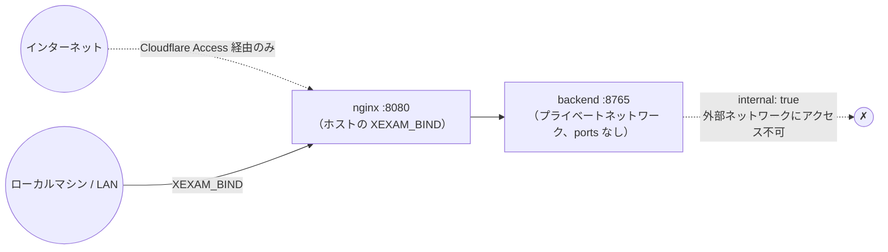

[English](../en/security.md) | **日本語** | [简体中文](../zh-CN/security.md)

# セキュリティ

> 対象範囲：**個人**で使うセルフホスト型のプログラムで、ユーザー管理もログインもありません。セキュリティは次の 3 つで成り立っています：**バックエンドを外部に公開しないこと**、**Host/Origin ガード**、**前段に Cloudflare Access のような認証を置くこと**。
> 監査の根拠：[audit/security.md](../zh-CN/history/audit/security.md)。テスト：`backend/tests/`（コミット済みの旧版スナップショットと照合：172 件のゴールデンレスポンス、パース用フィクスチャ、id ベクトル。v0.5 のルートは `v05_banks_records_settings.rs`）、`tests/integration/nginx_check.py`。移行時には、340 項目の悪意あるリクエストのプローブを使って旧版と新版を項目ごとに比較しました（説明のつかない差異は 0 件、51 件は意図的な強化として登録）。このプローブ一式は旧 Python 版とともに削除しました。

## 1. 脅威モデル

| 誰が | できること | こちらの防御 |
|---|---|---|
| 同じネットワーク上の別のマシン | ポートに直接接続する | デフォルトでは `127.0.0.1` にのみバインドします。公開するには自分で `XEXAM_BIND` を設定する必要があります。**アプリ自体にはログインがない**ため、公開後は接続できる人なら誰でも、問題集と記録の閲覧、インポート、削除、設定の変更ができます |
| 悪意のある Web ページ（ご自身のブラウザ上） | ブラウザに `localhost:8765` へ書き込みや削除のリクエストを送らせる（CSRF） | 書き込みリクエストでは `Origin` のホスト名が `Host` と一致するか、許可リストに含まれている必要があります。JSON のエンドポイントは `Content-Type: application/json` を要求します（クロスサイトのフォームでは送れません）。削除はこれらの POST エンドポイントからしかできず、GET で削除されることはありません |
| DNS リバインディング | 悪意のあるドメイン名を 127.0.0.1 に解決させ、データを読み取る | `Host` の許可リストを検査します。GET も検査します |
| 悪意のある / 壊れた .xlsx | 圧縮爆弾、XML エンティティ展開、不正な構造でサービスを停止させる | §3 を参照 |
| プロキシチェーン上の偽造ヘッダー | `X-Forwarded-Host` など | バックエンドは**実際の `Host` ヘッダーだけを読みます**。Nginx はすべての転送ヘッダーを空にします |
| サプライチェーン | 依存パッケージの脆弱性 | 依存関係を固定しています（`Cargo.lock`、`package-lock.json`）。イメージにはパッケージマネージャー以外の余計なものを入れていません。§7 を参照 |

**対象外**：マルチユーザーの分離、ログイン、監査ログ、暗号化ストレージ。インターネットからアクセスする場合は、前段に Cloudflare Access（または同種のもの）を置いてください。

## 2. ネットワーク

- バックエンドは**決してポートを公開しません**。`docker-compose.yml` の `backend` には `ports:` がなく、ネットワークは `internal: true` です。`tests/integration/stack_check.py` が「ホストからバックエンドに接続できないこと」を検査します。
- `XEXAM_BIND` は `IP:port` の形式で書く必要があります。ポート番号だけ（例：`8766`）を書くとすべてのネットワークインターフェースにバインドされます。これはよくある操作ミスなので、ドキュメントで繰り返し注意を促しています。
- Linux では、ホストのファイアウォール（ufw / firewalld）は Docker が公開したポートを**制限できません**。接続元を制限するには、`DOCKER-USER` チェーンにルールを追加するか、`XEXAM_BIND` を具体的な LAN の IP にしてください。

## 3. アップロード（.xlsx）

上から順に検査し、どの段階で失敗しても 400/413 と固定の中国語メッセージを返し、**データベースには書き込みません**：

1. リクエストボディのサイズ：ストリーミングでカウントし、上限は **20 MiB**。実際のバイト数で数え、`Content-Length` は信用しません。その手前の Nginx にもさらに `client_max_body_size 20m` があります（同じ文面の JSON を返します）。
2. **内容**で判定します：マジックナンバー `PK`、ZIP 構造、ワークブックを含むこと。旧形式の `.xls`、空ファイル、拡張子を書き換えたファイルには、それぞれ個別のメッセージがあります。
3. ZIP：エントリ数は 10,000 以下。**重複したエントリ名は拒否**します（「検査したものと読み込むものが別」という事態を避けるため）。展開後の合計サイズには上限があります。`take(limit)` で上限付きで読み取り、宣言されたサイズは信用しません。
4. XML：拡張子やエンコーディングに関係なく（UTF-16 でも）、**DOCTYPE / エンティティ宣言は一律に拒否**します。深さは 64 以下、ノード数は 100 万以下（100 × 10,000）です。
5. 解析：協調的なデッドライン（デフォルト 30 秒）があります。パーサーは一定数の行 / XML イベントを処理するたびに時計を確認し、時間が来たら**自分で停止する**ため、タイムアウト後も CPU やメモリを占有し続けることはありません。同時に実行される解析は最大 2 つ（`PARSE_CONCURRENCY`）で、それを超えたものはキューで待機し、待機時間も制限時間に含まれます。
   さらにメモリ上限もあります。同じ共有文字列が多くのセルから参照される場合は 1 つしか保持せず（ディープコピーしません）、すべての A/B/C セルが参照するバイト数の合計は 64 MB を超えません。1 つの XML 要素が持てる属性は最大 256 個です。
6. プレビューは、メモリ上の**唯一の確認待ちスロット**に置かれ、30 分で期限切れになります。確認コードは 128 ビットのランダム値で、使い切りで、定数時間で比較されます。誤った確認コードでは、スロット内の内容は消費されません。
7. 確定時は**1 つのトランザクション**で書き込みます。このファイルに使用可能な問題が 1 問もない場合はインポートを拒否します（問題集が空になるのを防ぐため）。

旧版は小文字の `.xml` / `.rels` の ASCII バイトしかスキャンしていなかったため、UTF-16 や別の拡張子で回避できました。この点が新版で強化された部分です（[api.md](api.md) の差異表に登録しています）。

## 4. Host と Origin

| 検査 | 対象 | ルール |
|---|---|---|
| Host | すべてのリクエスト | 許可リストに含まれていること：デフォルトは `localhost`、`127.0.0.1`、`::1`。`XEXAM_ALLOWED_HOSTS` で追加でき、`XEXAM_ALLOW_ANY_HOST=1` で検査を無効にできます |
| Origin | 書き込みリクエスト | 付いていない場合 → 通します（コマンドラインツールはクロスサイトのリクエストではないため）。付いている場合 → **ホスト名**が `Host` のホスト名と一致するか、`XEXAM_ALLOWED_ORIGINS` / 許可リストに含まれている必要があります |

ポイント：

- **比較するのはホスト名だけ**で、プロトコルやポートは比較しません。HTTPS のドメイン名経由でアクセスすると Origin は `https://example.com`、Host は `example.com` になりますが、誤ってブロックされることはありません。
- ガードが読むのは実際の `Host` ヘッダーです。`X-Forwarded-Host` / `Forwarded` は**読みません**。読んでしまうと、ガードをクライアントに預けるのと同じことになるためです。Nginx は `proxy_set_header Host $http_host` でそのまま転送し、それ以外の転送ヘッダーは空にします。
- 拒否された場合、レスポンスには、送られてきた Host / Origin と、どのオプションにどの値を追加すればよいかが書かれます。ログにも 1 行出力されます。
- `XEXAM_ALLOW_ANY_HOST=1` は、**前段にすでに認証がある**場合にのみ使ってください。これは Origin の検査を無効にしません。

## 5. 問題集、記録、設定（v0.5）

v0.5 では、GET のルートが 4 つ（`/api/banks`、`/api/records`、`/api/record`、`/api/settings`）、POST のルートが 4 つ（`/api/banks/delete`、`/api/records/delete`、`/api/settings`、`/api/settings/reset`）、それにアップロード用のヘッダー `X-Bank-Target` が加わりました。新しい種類の防御はどれにも必要ありませんでした。ルールは次のとおりです。

- **ガードは同じです。** 新しいルートは既存のルートと同じディスパッチ関数を通り、検査の順序も同じです。すべてのリクエストで Host を検査し、POST ではさらに Origin、`Content-Type: application/json`、1,000,000 バイトのボディ上限、「ボディが JSON オブジェクトであること」を検査します。Nginx はこれらを他の `/api/` パスと同じように扱います（メソッド、レート制限、タイムアウト）。`backend/tests/v05_banks_records_settings.rs` の `new_routes_go_through_the_same_guards` が、新しいルートのすべてについてこれを確認しています。
- **リクエストの形は厳密です。** `id` は整数でなければなりません（真偽値は不可）。`withRecords` や `withStats` などのフラグは真偽値、`all` はちょうど `true` でなければなりません。`GET /api/record` は、1〜18 桁の ASCII 数字からなる `id` をちょうど 1 つだけ受け取ります。それ以外はすべて 400 になり、何も変わりません。id は必ずパラメーターとして SQLite に渡します。
- **設定の検証。** 読み取るのは既知の 4 つのキーだけです。`theme` は `system`、`light`、`dark` のいずれか、`uiLang` は `en`、`zh`、`ja` のいずれか、`questionLang` は `ja`、`zh`、`en` のいずれか、`autoAdvance` は真偽値でなければなりません。不正な値が 1 つでもあれば 400 になり、何も書き込みません。未知のキーは無視します。設定を読み出すときに、保存されている値が不正であればそれを無視し、デフォルト値を使います。フロントエンドも適用する前に値をもう一度検査します。値が入るのは `data-theme` 属性と `lang` 属性だけで、HTML に入ることはありません。
- **`X-Bank-Target`。** Host、Origin、Content-Type の検査とサイズ制限のあと、ファイルを解析する前に読み取ります。受け付けるのは `new`、または 1〜18 桁の ASCII 数字からなる問題集の id です（前後の空白は無視）。それ以外は 400 です。存在しない問題集の id は解析の前に 404 になるので、解析の時間はかかりません。拒否されたアップロードは確認待ちスロットに触れません。
- **データの削除は明示的に行います。** GET や副作用で何かが削除されることはありません。2 つの削除ルートは JSON ボディを持つ POST なので、クロスサイトのフォームからは送れず（Content-Type）、他のサイトのスクリプトは Origin の検査で止まります。削除はそれぞれ 1 つのトランザクションです。UI では、どの削除でも確認ダイアログが開き、何が消えるかを示して、元に戻せないことを伝えます。問題集と一緒にその学習記録を消すこと、すべての記録と一緒に間違いノートを消すことは、それぞれ別のチェックボックスで、デフォルトではオフです。問題を無効化することになるインポートは、確定する前にもう一度確認します。取り消し機能もごみ箱もありません。元に戻す手段はご自身のバックアップです（[database.md](database.md) の第 5 節）。
- **移行時のバックアップ。** スキーマ v2 への移行の前に、バックエンドはデータベースをデータディレクトリの `backups/` にコピーします。既存のファイルを上書きすることはありません。コピーに失敗した場合は、バックアップなしで移行するのではなく、起動を中止します。

## 6. HTTP 層

| 項目 | 設定 |
|---|---|
| レスポンスヘッダー | バックエンドのすべてのレスポンス：`Cache-Control: no-store`、`X-Content-Type-Options: nosniff`。`index.html`：さらに `X-Frame-Options: DENY`、`Referrer-Policy: no-referrer`、`Permissions-Policy`（カメラ / マイク / 位置情報はすべて無効）、厳格な CSP。`/assets/`（スクリプト / スタイル）と Nginx 自身が生成するエラー JSON には `X-Content-Type-Options`（と assets のキャッシュヘッダー）だけが付きます。nginx の `add_header` は location 内で 1 つでも書くと上位の設定を継承しなくなるためで、これらは埋め込みや実行の対象になるページではありません |
| CSP | `default-src 'self'; img-src 'self' data:; style-src 'self'; script-src 'self'; base-uri 'none'; form-action 'self'; frame-ancestors 'none'`。インラインのスクリプトやスタイルはありません |
| HSTS | **設定しません**：TLS は Cloudflare で終端され、オリジンサーバーは HTTP です |
| CORS | CORS ヘッダーは送りません（同一オリジン） |
| メソッド | `GET` / `HEAD` / `POST`。それ以外のメソッドは Nginx が直接 403 を返し（`limit_except`）、バックエンドには届きません。バックエンド自身も、それらには 405 + `Allow` を返します |
| レート制限 | Nginx：`/api/` は 1 秒あたり 10 リクエスト（バースト 30）、`/api/upload` は 1 秒あたり 1 リクエスト（バースト 5）。超過すると 429 |
| タイムアウト | ヘッダー 15 秒、ボディ 30 秒（スロー攻撃対策）。アップストリームへの接続 5 秒、読み取り 90 秒 |
| 隠しファイル | `/.xxx` はすべて 404。ディレクトリ一覧は表示しません |
| `Server` ヘッダー | バックエンドは送りません。Nginx は `server_tokens off` |

## 7. コンテナ

- 2 つのコンテナはどちらも**非 root** で動作し（バックエンドは uid 10001）、`cap_drop: ALL`、`no-new-privileges`、ルートファイルシステムは `read_only` です。書き込めるのは `/tmp`（tmpfs）とバックエンドの `/data`（名前付きボリューム。`backups/` もここにあります）だけです。
- **イメージに機密情報は含まれません**：`.env` も、データベースも、実際の問題集もありません（`.dockerignore` で除外）。一方、3 つの README は `.dockerignore` で除外していません。フロントエンドのイメージのビルドでその更新履歴を読み、「Xexam について」のページ用の静的ファイルに組み込みます。README のファイルそのもの、`docs/`、ソースコードはイメージに入りません。
- バックエンドのイメージは、静的リンク（musl）された単一の実行可能ファイルと tzdata だけで、シェル以外のツールチェーンは含まれていません。
- `docker compose down -v` はデータボリュームを削除します。ドキュメントでは `-v` を付けないよう明記しています。

## 8. ログとプライバシー

- ログには確認コードも、アップロードされたファイルの内容も、問題の内容も記録しません。
- 拒否されたリクエストは、調査用に Host / Origin と理由を記録します。
- 問題集はご自身の Excel であり、**リポジトリには含まれません**（`.gitignore` で `*.xlsx` などを除外。例外は、`tests/baseline/fixtures/` にある架空のテスト用フィクスチャだけです）。
- `backups/` のファイルはデータベースの完全なコピーです。同じデータボリュームに置かれるので、ボリュームのバックアップにも含まれます。データベースそのものと同じように扱ってください。プログラムがこれらを削除することはありません。
- ブラウザが `localStorage` に保存するのは小さなものだけです：進行中の試験（問題 id、回答、「あとで見直す」の印、時間。問題文は含みません）、最初の描画に使う設定のコピー。共用のコンピューターでは、使い終わったらサイトのデータを消去してください。

## 9. 既知の制限（正直に書いています）

- **ログインはどのルートにもありません。** ポートを公開すると、接続できる人なら誰でも、問題集と試験記録の閲覧、ファイルのインポート、問題集や記録の削除、設定の変更ができます。v0.5 のルートにも独自の認証はありません。外部からアクセスする場合は、前段に認証（Cloudflare Access など）を置いてください。
- **アカウントはありません。** データベースに保存された設定は、このインスタンスを使うすべての人に適用されます。
- **サーバー側は `correct` と保存する `answer` を信頼**し、id が問題集に存在するかどうかも検査しません（旧版と同じです）。採点はブラウザ側で行われるため、自分の成績を不正に操作しても、騙せるのは自分だけです。`answer` は見直しのために保存するだけで、採点や統計には使いません。
- **確認待ちスロットは 1 つだけ**：同時にアップロードすると互いに置き換え合います（1 人での利用を前提としており、セッションの概念は導入していません）。
- Cloudflare 経由の経路は**ローカルでのシミュレーション**しか行っていません。ブラウザレベルのシミュレーション（本物の Chrome + HTTPS リバースプロキシ）は旧 Python 版に対して行ったもので、新しいスタックについてはリクエストヘッダーレベルの検査だけを行いました（Nginx を経由しても Host / Origin ガードが有効であること）。本物の Cloudflare ではテストしていません。
- iPhone Safari は実機でテストしていません。ビルドターゲットは iOS 15.4+ です。
- 新しいイメージの arm64 版：CI では QEMU 上で**ビルドして起動**しました（`/api/info` が `aarch64` を返します）が、本物の ARM ハードウェアでは動かしていません。aarch64 のバックエンドのバイナリには、Cortex-A53 エラッタ #843419 に対するリンカーの回避策は入っていません（[deployment.md](deployment.md) を参照）。

## 10. 脆弱性の報告

これは個人プロジェクトのプライベートなリポジトリです。問題を見つけた場合は、オーナーに直接連絡してください。
