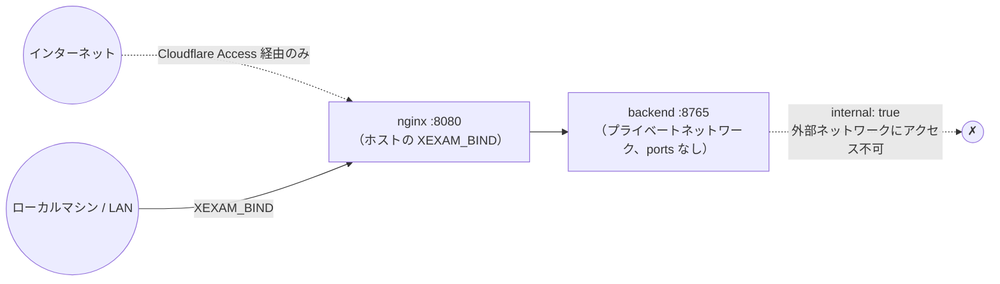

[English](../en/security.md) | **日本語** | [简体中文](../zh-CN/security.md)

# セキュリティ

> 対象範囲：互いに知り合いの少人数で使うセルフホスト型のプログラムで、v0.6 から**アカウントとログイン**があり、管理者、一般ユーザー、そして v0.7 からは**問題集の管理権限を持つユーザー**がいます。セキュリティは次の 5 つで成り立っています：**バックエンドを外部に公開しないこと**、**Host/Origin ガード**、セッションとパスワードを間違えたときの段階的なロックを伴う**すべてのルートでのログイン**、**バックエンドが確認する権限**（誰がどの問題集を見て管理するか、どの記録が誰のものか）、そしてインターネットからアクセスできる場合は**前段に Cloudflare Access のような認証を置くこと**です。
> 監査の根拠：[audit/security.md](../zh-CN/history/audit/security.md)。テスト：`backend/tests/`（コミット済みの旧版スナップショットと照合：172 件のゴールデンレスポンス、パース用フィクスチャ、id ベクトル。ログインとユーザーは `v06_users_and_sign_in.rs`、問題集へのアクセス、所有者、練習は `v065_bank_access_and_practice.rs`、システムログと大量の拒否されたリクエストは `v07_wal_and_logs.rs` と `v07_log_floods.rs`）、`tests/integration/nginx_check.py`。移行時には、340 項目の悪意あるリクエストのプローブを使って旧版と新版を項目ごとに比較しました（説明のつかない差異は 0 件、51 件は意図的な強化として登録）。このプローブ一式は旧 Python 版とともに削除しました。

## 1. 脅威モデル

| 誰が | できること | こちらの防御 |
|---|---|---|
| 同じネットワーク上の別のマシン | ポートに直接接続する | 既定では `127.0.0.1` にのみバインドします。公開するには自分で `XEXAM_BIND` を設定する必要があります。`/api/info`、`/api/auth/state`、ログインそのもの以外のすべてのルートにセッションが必要で（§5）、パスワードを間違えるとログインがロックされ、回を重ねるごとに長くなります（§6） |
| パスワードを推測する人 | 1 つのアカウントで多くのパスワードを試す、または架空のユーザー名を大量に試す | アカウントごとの段階的なロック。架空の名前とは別に、またオーナーが以前ログインしたブラウザとも別に数えます。Argon2id は同時に 2 つまでに制限しています（§6） |
| ログインしたユーザー | ほかのユーザーの記録を読む・変える、割り当てられていない問題集を見る、所有していない問題集を変える、管理者のルートを使う | ユーザー id は常にセッションから取ります。問題集の読み取りはすべてユーザーの範囲に限られ、所有者は書き込みのトランザクションの中で確認し、管理者のルートは権限を確認します（§7） |
| 悪意のある Web ページ（ご自身のブラウザ上） | ブラウザに `localhost:8765` へ書き込みや削除のリクエストを送らせる（CSRF） | セッションの Cookie は `SameSite=Strict` です。書き込みリクエストでは `Origin` のホスト名が `Host` と一致するか、許可リストに含まれている必要があります。JSON のエンドポイントは `Content-Type: application/json` を要求します（クロスサイトのフォームでは送れません）。削除はこれらの POST エンドポイントからしかできず、GET で削除されることはありません |
| DNS リバインディング | 悪意のあるドメイン名を 127.0.0.1 に解決させ、データを読み取る | `Host` の許可リストを検査します。GET も検査します |
| 悪意のある / 壊れた .xlsx | 圧縮爆弾、XML エンティティ展開、不正な構造でサービスを停止させる | §3 を参照 |
| プロキシチェーン上の偽造ヘッダー | `X-Forwarded-Host` など | バックエンドは**実際の `Host` ヘッダーだけを読みます**。Nginx はすべての転送ヘッダーを空にします |
| 誰でも送れる大量のリクエスト | システムログを埋めて、本当の行を押し出す | 拒否されたリクエスト、ログインの失敗、架空の名前のロックは、多くても 1 分に 1 回まとめて記録します（§8） |
| サプライチェーン | 依存パッケージの脆弱性 | 依存関係を固定しています（`Cargo.lock`、`package-lock.json`）。イメージにはパッケージマネージャー以外の余計なものを入れていません。§10 を参照 |

**対象外**：暗号化ストレージ、システムログ以上の監査ログ、二要素のログイン、管理者に対する保護（管理者はすべてを見て管理できます）。インターネットからアクセスする場合は、前段に Cloudflare Access（または同種のもの）を置いてください。

## 2. ネットワーク

- バックエンドは**決してポートを公開しません**。`docker/docker-compose.yml` の `backend` には `ports:` がなく、ネットワークは `internal: true` です。`tests/integration/stack_check.py` が「ホストからバックエンドに接続できないこと」を検査します。
- `XEXAM_BIND` は `IP:port` の形式で書く必要があります。ポート番号だけ（例：`8766`）を書くとすべてのネットワークインターフェースにバインドされます。これはよくある操作ミスなので、ドキュメントで繰り返し注意を促しています。
- Linux では、ホストのファイアウォール（ufw / firewalld）は Docker が公開したポートを**制限できません**。接続元を制限するには、`DOCKER-USER` チェーンにルールを追加するか、`XEXAM_BIND` を具体的な LAN の IP にしてください。

## 3. アップロード（.xlsx）

アップロードできるのは管理者と問題集の管理権限を持つユーザーだけです（それ以外は、ボディを読む前に 403）。上から順に検査し、どの段階で失敗しても 400/413 と固定の（中国語の）メッセージを返し、**データベースには書き込みません**：

1. リクエストボディのサイズ：ストリーミングでカウントし、上限は **20 MiB**。実際のバイト数で数え、`Content-Length` は信用しません。その手前の Nginx にもさらに `client_max_body_size 20m` があります（同じ文面の JSON を返します）。
2. 取り込み先（`X-Bank-Target`）：Host、Origin、セッション、サイズの検査の後、ファイルを解析する前に読みます。存在しない問題集は 404、アップロードした人が更新できない問題集は 403 で、どちらも解析の時間はかかりません。
3. **内容**で判定します：マジックナンバー `PK`、ZIP 構造、ワークブックを含むこと。旧形式の `.xls`、空ファイル、拡張子を書き換えたファイルには、それぞれ個別のメッセージがあります。
4. ZIP：エントリ数は 10,000 以下。**重複したエントリ名は拒否**します（「検査したものと読み込むものが別」という事態を避けるため）。展開後の合計サイズには上限があります。宣言されたサイズは信用できないので、`take(limit)` で上限付きで読み取ります。
5. XML：拡張子やエンコーディングに関係なく（UTF-16 でも）、**DOCTYPE / エンティティ宣言は一律に拒否**します。深さは 64 以下、ノード数は 100 万以下（100 × 10,000）です。
6. 解析：協調的なデッドライン（既定 30 秒）があります。パーサーは一定数の行 / XML イベントを処理するたびに時計を確認し、時間が来たら**自分で停止する**ため、タイムアウト後も CPU やメモリを占有し続けることはありません。同時に実行される解析は最大 2 つ（`PARSE_CONCURRENCY`）で、それを超えたものはキューで待機し、待機時間も制限時間に含まれます。
   さらにメモリ上限もあります。同じ共有文字列が多くのセルから参照される場合は 1 つしか保持せず（ディープコピーしません）、A〜D 列のセルが参照するバイト数の合計は 64 MiB を超えません。E 列と F 列（6 列形式）には、別に 64 MiB の枠があります。1 つの XML 要素が持てる属性は最大 256 個です。
7. プレビューは、メモリ上の**アップロードした人自身の確認待ちスロット**に置かれ、30 分で期限切れになります。ほかの人が確定したり取り消したりすることはできません。すべてのスロットで 128 MiB のメモリの枠を共有します。アップロードを一時保存するとき、枠を超えた分はほかのユーザーのいちばん古いプレビューから捨てるので、問題集の管理権限を持つユーザーが大勢いても、プレビューでメモリを埋めることはできません。確認コードは 128 ビットのランダム値で、使い切りで、定数時間で比較されます。誤った確認コードでは、スロット内の内容は消費されません。
8. 確定時は**1 つのトランザクション**で書き込み、その中でアップロードした人が取り込み先の問題集を更新できるかをもう一度確認します。このファイルに使用可能な問題が 1 問もない場合はインポートを拒否します（問題集が空になるのを防ぐため）。

旧版は小文字の `.xml` / `.rels` の ASCII バイトしかスキャンしていなかったため、UTF-16 や別の拡張子で回避できました。この点が新版で強化された部分です（[api.md](api.md) の差異表に登録しています）。

## 4. Host と Origin

| 検査 | 対象 | ルール |
|---|---|---|
| Host | すべてのリクエスト | 許可リストに含まれていること：既定は `localhost`、`127.0.0.1`、`::1`。`XEXAM_ALLOWED_HOSTS` で追加でき、`XEXAM_ALLOW_ANY_HOST=1` で検査を無効にできます |
| Origin | 書き込みリクエスト | 付いていない場合 → 通します（コマンドラインツールはクロスサイトのリクエストではないため）。付いている場合 → **ホスト名**が `Host` のホスト名と一致するか、`XEXAM_ALLOWED_ORIGINS` / 許可リストに含まれている必要があります |

ポイント：

- **比較するのはホスト名だけ**で、プロトコルやポートは比較しません。HTTPS のドメイン名経由でアクセスすると Origin は `https://example.com`、Host は `example.com` になりますが、誤ってブロックされることはありません。
- ガードが読むのは実際の `Host` ヘッダーです。`X-Forwarded-Host` / `Forwarded` は**読みません**。読んでしまうと、ガードをクライアントに預けるのと同じことになるためです。Nginx は `proxy_set_header Host $http_host` でそのまま転送し、それ以外の転送ヘッダーは空にします。
- これらの検査はセッションの確認の**前**に行うので、拒否されたリクエストがログインやデータに届くことはありません。
- 拒否された場合、レスポンスには、送られてきた Host / Origin と、どのオプションにどの値を追加すればよいかが書かれます（中国語で、ページが翻訳します）。ログには英語の行が出ます：静かな 1 分の後の最初の拒否はそれだけで 1 行（`rejected GET /api/bank: Host "evil.example" is not in the allowed list`）、それに続くものは多くても 1 分に 1 回まとめて（`rejected 250 request(s) by the Host / Origin check since the last report; the last one: …`）。
- `XEXAM_ALLOW_ANY_HOST=1` は、**前段にすでに認証がある**場合にのみ使ってください。これは Origin の検査もログインも無効にしません。

## 5. ログインとセッション

- **パスワード**：8〜128 文字。Argon2id で保存し（`argon2` クレートの既定のパラメーター、ハッシュごとにランダムなソルト）、ハッシュの計算と照合は、同時に 2 つまでに制限したブロッキングタスクで行います。それを超えたリクエストは待ちます。存在しないユーザー名もダミーのハッシュで照合するので、応答時間とメッセージ（`用户名或密码不对。`）からユーザー名の有無はわかりません。無効にしたアカウントにも同じ応答を返します。
- **ユーザー名**：1〜40 文字の ASCII の英字、数字と `. _ - @` で、大文字小文字を区別せずに一意です。ASCII だけにしているのは意図的で、見た目の似た名前を防ぎます。
- **セッション**：Cookie `xexam_session` に、オペレーティングシステムから得た 32 バイトの乱数。データベースにはその SHA-256 だけを保存するので、データベースのコピーに使えるトークンは入っていません。有効期間は 30 日で、使っている間は 1 時間に 1 回まで延長し、1 ユーザーあたり最大 20 個です（それを超えてログインすると、期限の早いセッションから終了します）。**ログインのたびに新しいトークンを作り**、クライアントが送ってきたトークンを再利用することはありません。期限切れのセッションは、起動時と、その後は多くても 1 時間に 1 回削除します。
- **パスワード変更時のセッションの入れ替え**：自分のパスワードを変更すると（**設定** で、または最初の強制的な変更で）、現在のセッションも含め、そのアカウントの**すべての**セッションが終了し、同じ応答の中でこのブラウザに新しい `xexam_session` Cookie が送られます。そのため、コピーされた Cookie や盗まれた Cookie は使えなくなり、あなたはこのブラウザでログインしたままです。リクエストの処理中にほかの場所でパスワードが変更・再設定された場合、変更は拒否されます。
- **ほかにユーザーをログアウトさせる変更**：管理者によるパスワード再設定、アカウントの無効化、権限の変更、削除、コマンドラインの `reset-password`。ユーザーの問題集や問題集の管理権限を変えても、ログアウトは**させません**。バックエンドはリクエストのたびに権限を読むからです。
- **Cookie**：`HttpOnly`、`SameSite=Strict`、`Path=/`。`Secure` は Origin が `https://` のとき、または `XEXAM_COOKIE_SECURE=1` のときだけなので、自宅のネットワークの HTTP でも使えます。書き込みリクエストは、それでも Origin の検査を通ります。
- **既知のブラウザ**：ログインとパスワードの変更では、`xexam_device`（`HttpOnly`、`SameSite=Strict`、`Path=/api/auth`、400 日）も設定します。ユーザー id の HMAC-SHA256 で、キーはユーザーの現在のパスワードハッシュです。サーバーには何も保存せず、新しいパスワードにするとこうした Cookie はすべて無効になります。この Cookie が決めるのは、試行をどのロックの枠で数えるかだけです（§6）。
- **既定の管理者**：ユーザーのいない新しいデータベースやアップグレードしたデータベースには `admin` / `admin` が作られ、最初のログインで変更しなければなりません。それまでは、ほかのすべてのルートが 403 を返します。有効な管理者が既定のパスワードのままの間は、ログインページにそのアカウントの名前が出て、バックエンドの起動のたびに注意が出力されます。インストールやアップグレードの直後に変更してください。
- **管理者の保護**：有効な管理者が少なくとも 1 人残っていなければなりません（`至少要保留一个启用的管理员。`）。管理者は、ユーザー管理で自分の権限を変える、自分のアカウントを無効にする、そのパスワードを再設定する、削除する、のどれもできません（`不能对自己的账户做这个操作。`）。自分のパスワードは **設定** で変更します。
- **ログインできなくなったとき**：`docker compose exec backend xexam-backend reset-password <ユーザー名>` で新しいランダムなパスワード（16 文字。ターミナルに 1 回だけ表示し、ログには出しません）を設定し、次のログインでの変更を求め、アカウントを有効にしてログアウトさせます。データベースのないデータディレクトリでは拒否し、エラーを表示して何も変更しません。メモリ上のログインのロックは解除できません（別のプロセスだからです）。**ロック解除** を使うか、バックエンドを再起動してください。
- **ログインを無効にするスイッチはありません**：環境変数も、フラグも、設定ファイルもありません。

## 6. ログインの制限

パスワードを間違えるとログインがロックされ、段階を追うごとに長くなります。状態は**メモリ上にだけ**あります。

| 段階 | 許される失敗 | その後のロック |
|---|---|---|
| 1 | 15 分以内に 5 回 | 1 分 |
| 2 | 3 回（前のロックが終わってから数える） | 5 分 |
| 3 | 3 回 | 15 分 |
| 4 | 3 回 | 30 分 |
| 5 | 3 回 | 1 時間 |
| 6 以降 | 3 回 | 1 日（上限） |

- どの試行も、ハッシュを計算する前の、始まった時点で失敗として数えるので、並行して推測しても数えられます。成功すれば取り消します。ロック中は、正しいパスワードでもすべての試行に **429** と `retryAfter`（秒）、`Retry-After` ヘッダーを返します。こうした拒否は数えず、ロックも延ばしません。
- **段階 1 に戻る**：ログインの成功、管理者の **ロック解除** またはパスワード再設定、バックエンドの再起動、または 24 時間ロックも失敗もないこと。
- **設定 → パスワードの変更** での**現在のパスワードの間違い**は、ログインと同じ枠で数えるので、盗んだセッションでパスワードを推測することはできません。

**アカウントごとに数えます。** ログインでは、まず入力された名前を調べます（軽い問い合わせで、ハッシュは計算しません）。

- **アカウントのある名前**（有効かどうかに関係なく）は、**ユーザー id** をキーにした枠で数えます。名前を変えてもロックは続き（**ロック解除** も見つけられます）、削除したアカウントの状態は忘れられ、後で古い名前を使った新しいアカウントは最初から始まります。これらの枠は専用のマップにあり、その大きさはアカウントの数で決まり、場所を空けるために消すことは**決してありません**：架空の名前を大量に送っても、推測されているアカウントを段階 1 に戻すことはできません。
- **アカウントのない名前**には、まったく同じ段階の専用の枠があるので、応答からユーザー名が存在するかどうかは分かりません。ユーザー名の規則に合わない名前は、1 つの枠を共有します。この**不明な名前**のマップには最大 **10,000** 個の名前が入ります。段階 1 に戻って最近何もない枠は定期的に掃除し、それでもいっぱいのときは、ロックされていない名前のうちいちばん進んでいないものから忘れます（すべての名前がロックされているときだけ、ロックされたものも）。こうした枠を忘れても、後ろにアカウントがないので、守るものは何もありません。
- **トレードオフ**：このような大量の送信（1 回の調べにおよそ 1 万リクエスト）のもとでは、攻撃者は名前にアカウントがあるかどうかを見分けられます。忘れられるのは、アカウントのない名前の状態だけだからです。これは受け入れています。その代わりに本物のアカウントの状態を消すと、推測しているアカウントのロックを誰でもリセットできてしまうからです。

**既知のブラウザ。** アカウントの有効な `xexam_device` Cookie を持つブラウザからの試行は、そのアカウントの 2 つ目の枠で、同じ段階で数えます。そのため、ほかの場所からの推測でロックされるのはほかのブラウザの枠だけで、オーナーは以前使ったブラウザから引き続きログインできます。そうしたブラウザで入力した間違ったパスワードは、そのブラウザ自身の枠をロックします。既知のブラウザでの成功は、その枠だけを最初に戻します。Cookie なしでの成功は、両方を最初に戻します。**ロック解除** は両方を消します。両方の枠がロックされているときは、アカウントはすべてのブラウザでロックされ、ユーザー管理にもそう表示されます。

**全体の負荷。** すべての枠を合わせて、15 分以内に 100 回以上の失敗があるときは、自分の最新の失敗が 1 分以内の枠もすべて拒否します（枠ごとに 1 分に 1 回の推測）。自分の最近の失敗がない枠は決して拒否しないので、架空の名前を大量に送れば推測は遅くなりますが、推測されていないアカウントを締め出すことはできません。負荷による拒否はロックと同じ 429 ですが、どの段階も進めません。

**ログに出るもの**（アカウントの名前は出さず、id だけ）：

- 本物のアカウントのロックは、**始まったときに 1 回**、ロックごとに 1 行記録します：`sign-in of user 3 from other browsers locked for 300 s (lock 2 in a row) after repeated failed attempts`（または `from the browsers where it signed in before`）。
- **アカウントのないユーザー名**のロックはまとめて記録します。架空の名前ごとに誰でも 1 つ始められるからです：静かな 1 分の後の最初のものはそれだけで、その後は `N sign-in lock(s) of usernames without an account started since the last report; the last one: …`。
- **ログインの失敗**：静かな 1 分の後の最初のものは `failed sign-in`、その後は多くても 1 分に 1 回 `N failed sign-in(s) since the last report`。
- **拒否した（429）試行**：1 件ずつは記録しません。静かな 1 分の後の最初のものはすぐに、残りは毎分のタイマーで報告します：`refused N password check(s) of locked or throttled sign-ins since the last report`。まとまりの最後の行は、次の試行が来なくても、およそ 1 分以内に出ます。

## 7. 権限、問題集、ほかの人のデータ

### 権限とルートのアクセス

バックエンドにはルート表が 1 つあり、どのルートにも誰が使えるかが書かれています。確認はディスパッチ関数の中で、リクエストボディを読む前に 1 回だけ行います。

| アクセス | ルート |
|---|---|
| 公開 | `GET /api/info`、`GET /api/auth/state`、`POST /api/auth/login` |
| ログイン | 自分の学習に関するすべて：見られる問題集、自分の進み具合、記録、設定、提出、自分のパスワード、ログアウト |
| 問題集の管理（管理者と、権限を持つユーザー） | `POST /api/upload`、`/api/import/confirm`、`/api/import/cancel`、`/api/banks/delete`、`GET /api/imports`。それ以外の人：403 `你没有管理题库的权限，请联系管理员。` |
| 管理者 | `GET /api/users`、`GET /api/logs`、`POST /api/users/*`、`POST /api/shutdown`。それ以外の人：403 `只有管理员可以进行这个操作。` |

ルート表にないパスにもセッションが必要です。新しいパスワードを設定しなければならないアカウントは、パスワードの変更とログアウトしかできません（公開のルートは使えます）。それ以外はすべて 403 を返します。権限と問題集の管理権限は、セッションと一緒にデータベースから読むので、管理者による変更は、そのユーザーの次のリクエストから反映されます。

### ユーザーごとの問題集

- 管理者は、すべての問題集を利用・管理できます。一般ユーザーが見られるのは、**すべての問題集（今後インポートするものも含む）** か、管理者がそのユーザーのために選んだ問題集だけです。新しいユーザーは、選ばれるまで何も見られません。問題集の管理権限を持つユーザーは、権限がある間、自分で取り込んだ問題集も見られます。
- バックエンドは、リクエストごとにセッションから（リクエストのボディからでは決してなく）`Viewer` を作り、すべての読み取りをその範囲に限ります：`/api/bank` と `/api/banks` は見られる問題集だけを並べ、`/api/progress` はその問題だけを数え、記録の詳細ではほかの問題集の問題の文を省き（削除された問題と同じように表示します）、`POST /api/attempt` はほかの問題集の問題を、存在しない問題とまったく同じに扱います（数に入れず、何も書き込みません）。そのため、でたらめなリクエストや古いリクエストで、ユーザーが見られない問題集の統計を書き込むことはできません。
- `/api/banks` が**所有者の名前を示すのは管理者にだけ**です。ほかのユーザーには、自分が所有する問題集のときだけ `ownerId` が入り、問題集ごとの学習の数も全員のものではなく自分のものです。

### 所有者（問題集の IDOR 対策）

- 問題集は、それを新しい問題集として取り込んだユーザーのものです。問題集の管理権限を持つユーザーが更新・削除できるのは**自分の**問題集だけで、ほかの問題集には 403 `这个题库不是你上传的，只能更新或删除你自己上传的题库。` を返します。
- この確認は、インポートの確定と問題集の削除の**書き込みのトランザクションの中で**行い、その前だけではありません。そのため、確認と書き込みの間に所有者が変わることはありません（たとえば、管理者がそのユーザーのアカウントを削除し、問題集がその管理者に移る場合）。拒否した書き込みは何も書き込みません。
- 問題集の管理権限を持つユーザーが **この問題集のあなたの学習記録も削除する** を付けて自分の問題集を削除すると、削除されるのは自分の記録だけです。ほかのユーザーの記録は残ります。
- 問題集の id、記録の id、ユーザーの id は、必ずパラメーターとして SQLite に渡します。

### ほかのユーザーの記録

- 学習記録、間違いノート、設定は、ログイン中のユーザーのものだけを読み書きします。ほかのユーザーの記録の id は、存在しない id とまったく同じに振る舞うので（`GET /api/record`、`POST /api/records/delete`：404）、id を探ることはできません。
- アップロードの確認待ちのインポートは、アップロードした人のものです（§3）。

### ライブラリのスタンプ

`GET /api/auth/state` は、開いているページが問題集の変更に気づけるように、ログインした各ユーザーに `library` のスタンプを渡します。もとになった数値ではなく、中身の見えない 16 進数 32 桁のダイジェスト（SHA-1 の先頭 16 バイト）です。一部の問題集だけを見られるユーザーでは、その問題集とそのアクセスだけから計算するので、見られない問題集のサイズ、問題数、更新日時を明かすことも、それに合わせて変わることもありません。

### 厳密なリクエストの形と明示的な削除

- **すべてのルートに同じガード**：すべてのリクエストで Host を、POST ではさらに Origin、セッション、`Content-Type: application/json`、1,000,000 バイトのボディ上限、「ボディが JSON オブジェクトであること」を検査します。Nginx はすべての `/api/` パスを同じように扱います（メソッド、レート制限、タイムアウト）。
- **厳密な形。** `id` は整数でなければなりません（真偽値は不可）。`withRecords` や `withStats` などのフラグは真偽値、`all` はちょうど `true`、`banks` は `"all"` か既存の問題集の id のリスト、`kind` は `exam` か `practice` でなければなりません。`GET /api/record` は、1〜18 桁の ASCII 数字からなる `id` をちょうど 1 つだけ受け取ります。それ以外はすべて 400 になり、何も変わりません。
- **設定の検証。** 読み取るのは既知の 4 つのキーだけです。`theme` は `system`、`light`、`dark` のいずれか、`uiLang` は `en`、`zh`、`ja` のいずれか、`questionLang` は `ja`、`zh`、`en` のいずれか、`autoAdvance` は真偽値でなければなりません。不正な値が 1 つでもあれば 400 になり、何も書き込みません。未知のキーは無視します。設定を読み出すときに、保存されている値が不正であればそれを無視し、既定値を使います。フロントエンドも適用する前に値をもう一度検査します。値が入るのは `data-theme` 属性と `lang` 属性だけで、HTML に入ることはありません。
- **データの削除は明示的に行います。** GET や副作用で何かが削除されることはありません。削除のルートはどれも JSON ボディを持つ POST なので、クロスサイトのフォームからは送れず（Content-Type）、他のサイトのスクリプトは Origin の検査で止まります。削除はそれぞれ 1 つのトランザクションです。UI では、どの削除でも確認ダイアログが開き、何が消えるかを示して、元に戻せないことを伝えます。問題集と一緒にその学習データを消すこと、すべての記録と一緒に間違いノートを消すことは、それぞれ別のチェックボックスで、既定ではオフです。問題を無効化することになるインポートは、確定する前にもう一度確認します。取り消し機能もごみ箱もありません。元に戻す手段はご自身のバックアップです（[database.md](database.md) の第 5 節）。
- **移行時のバックアップ。** スキーマを移行する前には毎回、バックエンドがデータベースをデータディレクトリの `backups/` にコピーします。既存のファイルを上書きすることはありません。コピーに失敗した場合は、バックアップなしで移行するのではなく、起動を中止します。

## 8. ログとプライバシー

- **決して記録しないもの**：パスワード（`reset-password` が表示するものも）、セッションのトークン、Cookie の値、確認コード、アップロードされたファイルの内容、問題文。ログの行ではユーザーを名前ではなく id で示します（`user 3 signed in`）。`backend/tests/v07_wal_and_logs.rs` の `the_log_never_holds_passwords_tokens_cookies_or_question_text` がこれを確認しています。
- **システムログ**（メニュー、管理者のみ）は、バックエンドが起動してからの最新 2000 行のログを、メモリから表示します。データベースには何も書き込まず、再起動すると空になります。`GET /api/logs` は管理者のルートです。それより前の行：`docker compose logs backend`（[deployment.md](deployment.md) の第 9 節を参照）。
- **大量の行はまとめます。** サーバーに届く人なら誰でも、ログインせずに起こせる行が 3 種類あります：Host / Origin の確認で拒否したリクエスト、ログインの失敗、アカウントのないユーザー名のロックです。それぞれ、静かな 1 分の後に 1 回記録し、その後は多くても 1 分に 1 回、1 行にまとめて記録します（まとまりの最後の行は、サーバーのタイマーがおよそ 1 分以内に書きます）。拒否した 429 の試行も同じようにまとめます。**本物のアカウントのロックは 1 件ずつ記録します**。1 つのアカウントがロックされるのは、ロックの長さごとに多くても 1 回だからです。そのため、ログインせずにシステムログの 2000 行を押し出すことは誰にもできません。
- 拒否したリクエストについての行は常に英語で、メソッド、パス（短くしたもの）、理由を示します。403 のボディは中国語のままです。
- 問題集はユーザー自身の Excel であり、**リポジトリには含まれません**（`.gitignore` で `*.xlsx` などを除外。例外は、`tests/baseline/fixtures/` にある架空のテスト用フィクスチャだけです）。
- `backups/` のファイルは、パスワードハッシュも含めたデータベースの完全なコピーです。同じデータボリュームに置かれ、ボリュームのバックアップにも含まれます。データベースそのものと同じように扱ってください。プログラムがこれらを削除することはありません。
- ブラウザが `localStorage` に保存するのは、ユーザーごとの小さなものだけです：進行中の試験や練習（問題 id、回答、印、時間。問題文は含みません）、最初の描画に使う設定のコピー、最後にログインしたユーザーの id。共用のコンピューターでは、使い終わったらログアウトし、サイトのデータを消去してください。

## 9. HTTP 層

| 項目 | 設定 |
|---|---|
| レスポンスヘッダー | バックエンドのすべてのレスポンス：`Cache-Control: no-store`、`X-Content-Type-Options: nosniff`。`index.html`：さらに `X-Frame-Options: DENY`、`Referrer-Policy: no-referrer`、`Permissions-Policy`（カメラ / マイク / 位置情報はすべて無効）、厳格な CSP。`/assets/`（スクリプト / スタイル）と Nginx 自身が生成するエラー JSON には `X-Content-Type-Options`（と assets のキャッシュヘッダー）だけが付きます。nginx の `add_header` は location 内で 1 つでも書くと上位の設定を継承しなくなるためで、これらは埋め込みや実行の対象になるページではありません |
| CSP | `default-src 'self'; img-src 'self' data:; style-src 'self'; script-src 'self'; base-uri 'none'; form-action 'self'; frame-ancestors 'none'`。インラインのスクリプトやスタイルはありません |
| HSTS | **設定しません**：TLS は Cloudflare で終端され、オリジンサーバーは HTTP です |
| CORS | CORS ヘッダーは送りません（同一オリジン） |
| メソッド | `GET` / `HEAD` / `POST`。それ以外のメソッドは Nginx が直接 403 を返し（`limit_except`）、バックエンドには届きません。バックエンド自身も、それらには 405 + `Allow` を返します |
| レート制限 | Nginx：`/api/` は 1 秒あたり 10 リクエスト（バースト 30）、`/api/upload` は 1 秒あたり 1 リクエスト（バースト 5）。超過すると 429 |
| タイムアウト | ヘッダー 15 秒、ボディ 30 秒（スロー攻撃対策）。アップストリームへの接続 5 秒、読み取り 90 秒 |
| 隠しファイル | `/.xxx` はすべて 404。ディレクトリ一覧は表示しません |
| `Server` ヘッダー | バックエンドは送りません。Nginx は `server_tokens off` |

## 10. コンテナ

- 2 つのコンテナはどちらも**非 root** で動作し（バックエンドは uid 10001）、`cap_drop: ALL`、`no-new-privileges`、ルートファイルシステムは `read_only` です。書き込めるのは `/tmp`（tmpfs）とバックエンドの `/data`（名前付きボリューム。`backups/` もここにあります）だけです。ホストの `/etc/localtime` は読み取り専用でマウントします。
- **イメージに機密情報は含まれません**：`.env` も、データベースも、実際の問題集もありません（`.dockerignore` で除外）。
- バックエンドのイメージは、静的リンク（musl）された単一の実行可能ファイルと tzdata だけで、シェル以外のツールチェーンは含まれていません。
- コンテナのログは、10 MB のファイル 3 つまでに制限しています。
- `docker compose down -v` はデータボリュームを削除します。ドキュメントでは `-v` を付けないよう明記しています。

## 11. 既知の制限（正直に書いています）

- **ログインのロックはメモリ上にあります。** 再起動すると消え（ロックされた管理者のための、文書に書いた抜け道でもあります）、プロセス間では共有されません。
- **既定のパスワード。** `admin` / `admin` を変更するまでは、このページを開ける人なら誰でも管理者としてログインできます。ログインページと起動時のログが知らせるので、すぐに変更してください。
- **管理者は何でもできます**：すべての問題集、すべてのユーザーのログインの状態、システムログを見て、どの問題集でも全員の記録ごと削除できます。アプリを通してほかのユーザーの学習記録を読むことはできませんが、データベースは手元にあります。
- **大量の送信のもとでのアカウントの有無**：§6 のトレードオフを参照してください。
- **サーバー側は `correct` と保存する `answer` を信頼します**（旧版と同じです）。採点はブラウザ側で行われるため、自分の成績を不正に操作しても、騙せるのは自分だけです。v0.7 からは、サーバーは各問題が存在し、ユーザーがそれを見られることを確認します。`answer` は見直しのために保存するだけで、採点や統計には使いません。
- Cloudflare 経由の経路は**ローカルでのシミュレーション**しか行っていません。ブラウザレベルのシミュレーション（本物の Chrome + HTTPS リバースプロキシ）は旧 Python 版に対して行ったもので、新しいスタックについてはリクエストヘッダーレベルの検査だけを行いました（Nginx を経由しても Host / Origin ガードが有効であること）。本物の Cloudflare ではテストしていません。
- iPhone Safari は実機でテストしていません。ビルドターゲットは iOS 15.4+ です。
- 新しいイメージの arm64 版：CI では QEMU 上で**ビルドして起動**しました（`/api/info` が `aarch64` を返します）が、本物の ARM ハードウェアでは動かしていません。aarch64 のバックエンドのバイナリには、Cortex-A53 エラッタ #843419 に対するリンカーの回避策は入っていません（[deployment.md](deployment.md) を参照）。

## 12. 脆弱性の報告

これは個人プロジェクトのプライベートなリポジトリです。問題を見つけた場合は、オーナーに直接連絡してください。
