[English](../en/usage.md) | **日本語** | [简体中文](../zh-CN/usage.md)

# Xexam の使い方

> ブラウザでの Xexam の使い方です：試験と練習、学習記録、設定、問題集とその Excel の形式、ユーザー、システムログ、練習と結果での AI サポート、AI チャットと AI 設定。Xexam のインストール、更新、環境設定は [README](../../README/README.ja.md) と [deployment.md](deployment.md) にあります。
>
> スクリーンショットには 2 つの**架空のデモ用問題集**「General knowledge」と「Kitchen basics」を使っており、実際の試験の内容ではありません。どちらも 6 列形式のブックなので、すべての問題、答え、解説が英語・中国語・日本語でそろっています。スクリーンショットは日本語の画面です。英語と中国語の画面のものは `docs/en/screenshots/` と `docs/zh-CN/screenshots/` にあります。

## 目次

- [1. 最初の試験](#1-最初の試験)
- [2. 画面の構成](#2-画面の構成)
- [3. ホーム](#3-ホーム)
- [4. 試験ページ](#4-試験ページ)
- [5. 練習](#5-練習)
- [6. 結果ページ](#6-結果ページ)
- [7. 学習記録](#7-学習記録)
- [8. 間違いノート](#8-間違いノート)
- [9. 設定](#9-設定)
- [10. Xexam について](#10-xexam-について)
- [11. 問題集の管理](#11-問題集の管理)
- [12. Excel 問題集の形式](#12-excel-問題集の形式)
- [13. 問題集のインポート](#13-問題集のインポート)
- [14. ユーザーとログイン](#14-ユーザーとログイン)
- [15. システムログ](#15-システムログ)
- [16. AI チャット](#16-ai-チャット)
- [17. AI 設定](#17-ai-設定)
- [18. iPhone で使う](#18-iphone-で使う)
- [19. 「リクエストが多すぎます」と表示されたとき](#19-リクエストが多すぎますと表示されたとき)

## 1. 最初の試験

1. メニュー（右上の三本線のボタン）を開き、**問題集の管理** を選びます（管理者と、問題集の管理権限を持つユーザーに表示されます）。**Excel インポート** で **新しい問題集** を選んだまま、**Excel ファイルをインポート** を押してブック（6 列形式。[第 12 節](#12-excel-問題集の形式) を参照）を選びます。プレビューを確認して、**問題集を作成する** を押します。
2. インポートの完了メッセージにある **試験を始める** を押します（またはメニューで **ホーム** を選びます）。**試験・練習を始める** パネルでは、最初はすべてのシートにチェックが入っています。不要なシートのチェックを外し、パネルの下部のバーにある **試験を開始** を押します（同じバーの **問題数** と **シャッフル** で、出題する数と順番を変えられます）。その隣の **練習を開始** を押すと、同じ問題で [練習](#5-練習) を始めます。
3. 問題に答えて、**提出する** を押します。結果ページには得点と、間違えた問題ごとに正解と解説が表示されます（**すべて（n）** ですべての問題を表示します）。
4. あとでもう一度その試験を見るには：メニューを開いて **学習記録** を選び、試験の日時をクリックします。

新しい問題集は、あなたと管理者、そして **今後インポートする問題集も含める** が設定されたすべてのユーザーに表示されます。ほかのユーザーには、管理者が [ユーザー管理](#14-ユーザーとログイン) で割り当てます。

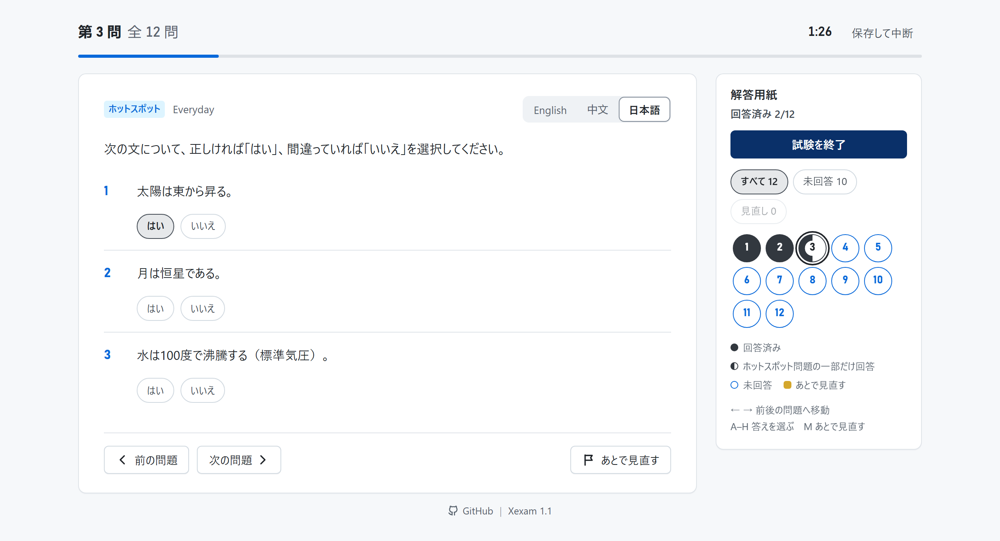

## 2. 画面の構成

- 試験以外のすべてのページには細いヘッダーがあります。左上に Xexam のロゴ（ホームに移動します）、右上にあなたのユーザー名（管理者には **管理者** のタグ、スマートフォンでは **Admin**）、**AI+** バッジ（今 AI を使えるときはオレンジ、AI+ 機能はあるが今は使えないときは暗い色。[第 14 節](#14-ユーザーとログイン) を参照）、そして三本線のメニューボタンがあります。
- メニューには、あなたの権限で使えるページだけが表示されます。
  - **ホーム**、**学習記録**、**設定** は全員に表示されます。
  - **問題集の管理** は、管理者と、問題集の管理権限を持つユーザーに表示されます。
  - **AI チャット** は、AI を使えるすべての人と、まだ読める AI チャットやメモが残っている人に表示されます（[第 16 節](#16-ai-チャット) を参照）。
  - **ユーザー管理**、**AI 設定**、**システムログ** は管理者に表示されます。
- 区切り線の下にはバージョンの項目（たとえば **Xexam v0.7.5**。[Xexam について](#10-xexam-について) のページを開きます）、続いてあなたのユーザー名と権限（**管理者** または **一般ユーザー**。権限があれば **問題集を管理** も）、そして **ログアウト** があります。
- 項目を選ぶ、メニューの外側をクリックする、または Esc キーを押すと、メニューは閉じます。
- 広い画面では、ページの内容は中央に寄せられ、幅は最大 1120 px です。
- **スマートフォン**（幅 719 px 以下）では、下にスクロールするとヘッダーが隠れ、上にスクロールすると戻ります。練習と試験の下部のバー、およびホームのバーは画面に残ります。
- **アイコン**：文字がなく、アイコンだけのボタン（たとえば練習の矢印、AI のアイコン、旗）には、スクリーンリーダー用の名前があります。タッチ画面では、長押しするとその名前が表示されます。
- **フッター**：すべてのページの最後に、中央に寄せた小さな 1 行 **GitHub | Xexam 1.1**（起動中のアプリのバージョン）があります。**GitHub** はプロジェクトのリポジトリを、**Xexam 1.1** はそのリリースを、どちらも新しいタブで開きます。問題集に関する免責事項はその上に残ります。AI チャットでは、この行はチャット一覧の一番下にあり、会話の中にはありません。
- 試験と練習は、ヘッダーのない、集中して解ける全画面のページです。
- 権限なしで **問題集の管理**、**AI 設定**、**システムログ** を開くと、**権限がありません** と **ホームに戻る** が表示されます。**ユーザー管理** は、管理者以外の人をホームに移します。
- 削除するものはすべて、先にダイアログで確認します。ダイアログには何が削除されるかと、元に戻せないことが書かれていて、確定ボタンは赤で塗りつぶされています。**削除** ボタンは赤か、マウスを重ねると赤になります。

## 3. ホーム

まだ使える問題集がないときは、**試験・練習を始める** パネルに短い説明が表示されます。

- 管理者や、問題集をまだ持っていない問題集の管理権限を持つユーザーには、**問題集の管理へ** が表示されます。
- まだ問題集を割り当てられていないユーザーには、「まだ管理者から問題集が割り当てられていません。管理者に問題集の利用を依頼してください。割り当てられると、ここに表示されます。」と表示されます。
- 問題集に有効な問題がないとき（たとえば古い Excel 形式のものだったため、すべての問題が出題停止のとき）は、管理者には 6 列形式のファイルで更新するよう案内が表示されます。問題集の管理権限を持つユーザーには、自分の問題集を 6 列形式の Excel ファイルで更新するか新しい問題集をインポートし、ほかの問題集は管理者に更新を依頼するよう、**問題集の管理へ** と一緒に案内が表示されます。ほかのユーザーには、管理者に依頼するよう案内が表示されます。

使える問題集がそろうと、ホームには次のものがあります。

- **未提出の試験** または **未完了の練習**：**保存して中断** で抜けたものが、ページの一番上にカードとして表示されます。タイトルと、中断した問題（例：**6/12 問目**）が出て、**続きから回答** と **破棄する** があります。ホバー時のヒントには問題集の名前と **このブラウザにだけ保存** が表示されます。ほかの端末には表示されません。**続きから回答** で中断したところから再開し、**破棄する** で破棄します。保存したものがあるうちに新しく始めようとすると、先に確認があります。
- **試験・練習を始める**：
  - パネルの右上で、出題する問題を選びます：**すべて**（選んだシートのすべての問題）または **間違いノート**（まだ復習が必要な問題だけ）。それぞれに問題数が表示されます。選んだシートに復習する問題がないときは **間違いノート** を選べず、タイトルの下の 1 行にその理由が表示されます。**間違いノート** を選んでいる間は、同じ行に、問題がノートから外れる条件が表示されます。スマートフォンでは、2 つのボタンはタイトルの横に並んだままで、日本語と英語の表示ではアイコンと問題数だけを表示します（中国語の表示では短い語も残ります）。
  - **問題集とシート**：問題集ごとに 1 枚のカードがあり、その中にシートが行として並びます。
    - 見出しの行の右側に **すべて選択** と **解除** があります。
    - 問題集のチェックボックスで、その問題集のすべてのシートを選択・解除できます。シートを 1 つずつ選ぶこともできます。一部のシートだけを選んでいる間はチェックボックスに − が表示され、カードには例えば **2 シート中 1 シートを選択** と表示されます（シートを隠しているときも表示されます）。
    - 問題集の行の右側にある矢印ボタンで、そのシートを表示したり隠したりできます。問題集が 2 つまでなら最初はシートが表示され、3 つ以上なら隠れています。表示するか隠すかの選択は、ページを再読み込みするまで保たれます。
    - 問題集の行には、間違いノートの問題が何問あるかが書かれます（例：**要復習 2**）。
  - パネルの下部のバー：**試験を開始**（緑）と **練習を開始**（オレンジ）、現在の範囲（例：**現在の範囲：12 問**、または **現在の範囲 12 問からランダムに 11 問を出題**）、そして 2 つのオプション **問題数**（出題する数）と **シャッフル**（出題の順番）。2 つのボタンは同じ範囲を使います。パネルが画面に表示されている間、このバーは画面下部に固定されます。
  - **問題数**：範囲の問題数より小さいときは、範囲全体から問題がランダムに選ばれます。**シャッフル** は、出題の順番をランダムにするか、問題集の順番にするかだけを決めます。
- **直近の結果**：最後に受けた試験または練習の得点と、その **試験** / **練習** のタグ、**詳細を見る**、**AI まとめ**（**AI+ 機能** があるときだけ、[第 7.1 節](#71-ai-まとめ)）、**すべての学習記録**。この順に並びます。
- **概要**：問題集、使えるシート、有効な問題、間違いノートの問題がそれぞれいくつあるかと、**間違えた問題を復習**（間違いノートに問題があるとき）、そして管理者と問題集の管理権限を持つユーザーには **問題集の管理**。

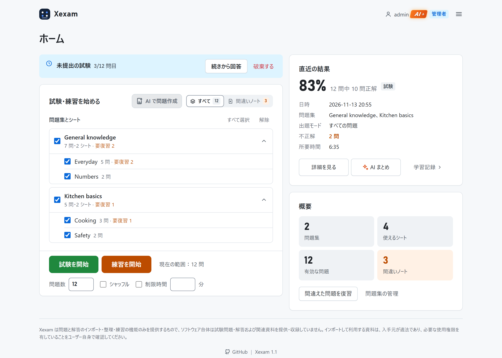

ページの一番上の小さなバナーになった未提出の試験、**試験・練習を始める** の右上にある **すべて** と **間違いノート**、**問題集とシート** の行にある **すべて選択** と **解除**、シートを含むカードになった 2 つのデモ用問題集（どちらもシートを表示した状態）、緑の **試験を開始**、オレンジの **練習を開始**、範囲、**問題数**、**シャッフル** のある下部のバー。右側には直近の結果と概要があります。

### 3.1 試験の制限時間

**ホーム** で、問題数と並べ替えの隣にある制限時間のチェックを入れ、分数（1〜600）を入力します。制限時間は **試験だけ** に使われ、練習では無視されます。入力欄とチェックは、ホームを開くたびに空でオフになります。数字を入力するとチェックが入り、チェックを外すと数字は無視されます。チェックが入っていて、数字が 1〜600 の整数でなければ、試験は始まらず、欄に理由が表示されます。

制限時間つきの試験は、ページ上部に **残り時間** を大きく太字で表示します。制限時間のない試験と練習は、これまでどおり経過時間を表示します。**保存して中断**、ページを閉じる、再読み込みのいずれでもカウントダウンは止まり、戻ると同じ秒から続きます。時間になると試験は自動で提出され、回答していない問題は、手動で提出したときと同じく **未回答** になります。


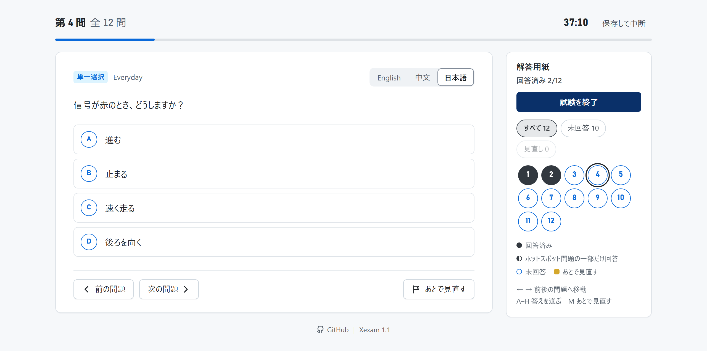

## 4. 試験ページ

[第 1 節](#1-最初の試験) のスクリーンショットが試験ページです。

- 上部：**第 4 問 全 12 問**（例）、経過時間、**保存して中断**。**保存して中断** は回答と経過時間を保存するので、同じブラウザのホームからあとで続けられます。
- **幅の狭いウィンドウやスマートフォン**（解答用紙が問題の横に表示されないとき）では、上部の行に **回答済み 3/12** と緑の **試験を終了** ボタン（練習ではオレンジの **練習を終了** ボタン）も、バーの中に表示されます。このとき解答用紙には終了のボタンがありません。いちばん狭いスマートフォンでは数が **3/12** だけになり、ボタンはアイコンだけになることがあります（長押しで名前が表示されます）。
- **制限時間**（ホームで設定したときだけ。[第 3.1 節](#31-試験の制限時間) を参照）：経過時間の代わりに、残り時間が上部で大きな太字でカウントダウンされます。残り 30 分になるとお知らせが表示されます（制限時間が 30 分以下のときは表示されません）。ページを閉じるか再読み込みすると、カウントダウンは止まります。0 になると試験は自動的に提出されます。
- **解答中は正誤もスコアも表示されません。**
- **English** / **中文** / **日本語** で問題文を切り替えます。切り替わるのは文字だけで、選んだ答え、選択肢の記号、タイマー、採点は変わりません。ホットスポット問題の選択肢ボタンも一緒に切り替わります。
  - どの問題も英語が基準の言語で、英語は常に表示できます。中国語と日本語は、ブックにあれば表示できます。
  - その問題にない言語や、文が英語の文と対応していない言語（選択肢や小問が違う）は、その問題ではグレーアウトされます。タップすると、その理由が表示されます。
  - 選んだ言語は設定として保存され、提出後の答えと解説も、まずこの言語で表示されます。
- **前の問題** と **次の問題** で問題を移動します（最後の問題では **次の問題** が **提出する** に変わります）。**あとで見直す** で、あとで戻りたい問題に印を付けます。
- **解答用紙**：問題ごとに 1 つのタイルがあります。塗りつぶし = 回答済み、半分塗りつぶし = ホットスポット問題の一部だけ回答、白抜き = 未回答、黄色の小さな四角 = あとで見直す。タイルをクリックすると、その問題に移動します。スマートフォンでは、解答用紙は開くまで折りたたまれています。開いているときは、タイルの上に 3 つのチップ **すべて n**、**未回答 n**、**見直し n** があり、その種類の問題だけを表示します（数は回答に合わせて変わります）。タイルの下に **回答済み 3 / 12 問** と **提出する** があります。
- **提出する** を押すと確認が表示されます。未回答の問題は **未回答** として扱われます。不正解ではなく、間違いノートにも入らず、結果と記録に一覧され、得点は全問を基準に計算されます。未回答や見直しの問題がある場合は、確認にその問題の番号が並びます。**回答を続ける** を押すと、最初の未回答の問題（未回答がなければ最初の見直しの問題）に移動します。
- 採点：単一選択・複数選択問題は、正しい選択肢だけをすべて選んだ場合にのみ正解です。ホットスポット問題は、すべての小問が正しい場合にのみ正解です。
- キーボード（パソコン）：`←` `→` で前後の問題へ移動、`A`–`H` で答えを選ぶ（選択問題）、`M` であとで見直す印を付けます。
- **試験の最中は、だれにも AI のサポートはありません**：試験ページには、[第 5.1 節](#51-ai-ヒントai-解説ai-パネル) の AI のボタンもアイコンもありません。試験で AI を使えるのは、提出したあと、その[結果ページ](#61-ai-解析)と学習記録だけです。

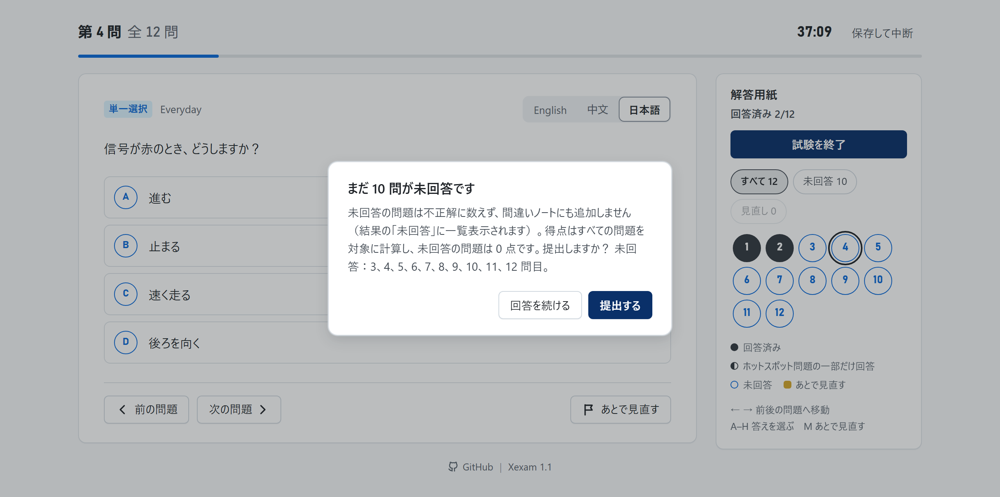

## 5. 練習

練習は試験と同じページを使いますが、答えるたびにすぐ答え合わせをします。ホームの **試験を開始** の隣にある **練習を開始** で始めます。問題集、シート、**問題数**、**シャッフル** は試験と同じです。

- **第 4 問 全 12 問** の横に **練習** のタグが付きます。
- **下部のバー** には、この順に **前の問題**（‹）、**答え合わせ**、**次の問題**（›）、**AI ヒント** と **AI 解説**（AI+ 機能のあるユーザーだけ。[第 5.1 節](#51-ai-ヒントai-解説ai-パネル)）、**あとで見直す**（旗）があります。**答え合わせ** と **次の問題** は、どの問題でも同じ場所にある別々のボタンで、互いに変わることはありません。
- スマートフォンでは、矢印、AI のアイコン、旗はアイコンだけになり、それぞれ名前は長押しで表示されます。**答え合わせ** と **次の問題** は文字を残します（狭い画面では **確認** と **次へ** に短くなります）。タッチ画面では、どのボタンも高さ 44 px 以上です。
- **答え合わせ** は、何かを選んでいて、まだ答え合わせしていない問題で押せます。それまでは、同じ場所でグレーアウトされています。どの問題も **答え合わせ** でだけ確認されます。単一選択でも、選択肢を選んだだけでは確認されず、答え合わせをするまで選び直せます。複数選択問題とホットスポット問題は **答え合わせ** で確認します。ホットスポット問題は 1 つの小問に答えれば十分で、答えていない小問は不正解になります。
- **次の問題** はいつでも次の問題へ進みます。最後の問題では、同じ場所のボタンが **練習を終了** に変わります。
- **答え合わせの後**、その問題はロックされ、次のものが表示されます。
  - **正解** または **不正解**
  - 答えと解説と同じ選択肢の色分け：正しい選択肢は緑、間違えて選んだ選択肢はオレンジで塗りつぶされます
  - あなたの回答と正解
  - 解説と覚え方。言語は、ページの **English** / **中文** / **日本語** の切り替えに従います
- 練習では、自動で次の問題へ進むことはありません。**次の問題** で進みます。
- 解答用紙では、答え合わせ済みの問題が緑（正解）またはオレンジ（不正解）になり、例えば **答え合わせ済み 4 / 12 問・正解 3 問** と表示されます。
- **練習を終了**（広い画面では解答用紙の下、幅の狭いウィンドウやスマートフォンでは上部の行、そして最後の問題にあります）は、答え合わせをしていない問題があるときだけ確認を求めます。そうした問題は、答えを選んでいても未回答（不正解）として採点されます。
- **保存して中断** は試験と同じように使えます。ホームには **未完了の練習** と、答え合わせ済みの問題数が表示されます。
- 終えた練習は **練習の結果** のページを開き、**学習記録** に **練習** の記録として保存され、試験と同じように間違いノートに反映されます。

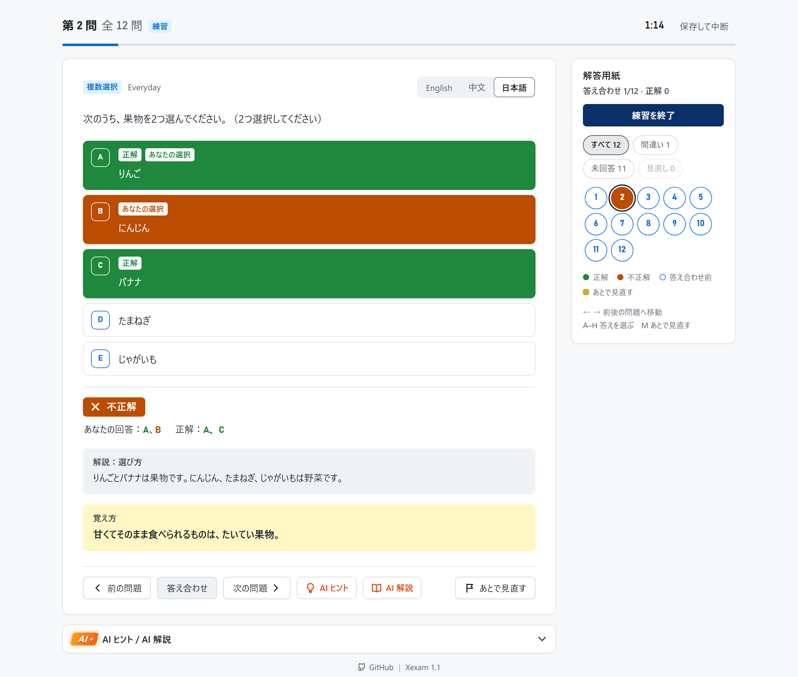

**答え合わせ** を押した後の複数選択問題：**練習** のタグ、判定の **不正解**、オレンジで塗りつぶされた間違えて選んだ選択肢、緑で塗りつぶされた正しい選択肢、そして解説と覚え方。

### 5.1 AI ヒント、AI 解説、AI+ パネル

**AI+ 機能** のあるユーザーは、練習のどの問題でも AI モデルに助けを求められます。ほかのユーザーには、上で説明したとおりのページが表示されます。試験の最中は、試験ページに AI に関するものは何もありません。

**コントロールが表示される人。** **AI+ 機能** のあるアカウントだけです：名前の隣にオレンジの **AI+** バッジがあるユーザーと、[AI 設定](#17-ai-設定) で AI+ 機能がオンの間の管理者です。機能はあるものの今は AI を使えないユーザー（管理者が一時停止した、AI 設定で AI+ 機能がオフ、または ai-service に接続できない）にもコントロールは表示されますが、グレーアウトされ、**利用不可** のタグが付きます。ツールチップが理由を伝えます（タッチ画面ではタップするとメッセージとして表示されます）：**AI ヒント：利用不可。AI+ 機能は管理者によって一時停止されています。**、または **…AI は現在利用できません。しばらくしてからもう一度試すか、管理者に連絡してください。** 確認している間は **AI が使えるか確認しています…** と表示されます。サーバーもこれらのリクエストを拒否します。練習中に管理者が AI+ 機能を取り上げると、リクエストが拒否された次のタイミングでコントロールが消えます。

**場所。** **AI+ パネル** は問題カードの下、解答用紙の上にあります。ページを開いたときは閉じています。操作バーの **AI ヒント** と **AI 解説** は、その問題の回答を表示してパネルを開きます（同じボタンをもう一度押しても閉じることはありません）。パネルの見出しには、AI+ バッジ、短い状態の文（**回答中…**、推論モデルがまだ考えている間は **考え中…**、**15:04 に保存**、**停止**）、パネルを開閉する山形のボタンがあります。本文はパネルの中でスクロールし、レイアウト上の位置は固定されているので、回答の開始と終了で画面がずれることはありません。

**パネルのボタン。** パネルの下部に、決まった位置で、**コピー**、**再生成**（回答を書いている間は **停止**。何も書かれていないときは **停止** はグレーアウトされます）があります。今は使えないボタンは、グレーアウトされたまま同じ場所に残ります。スマートフォンでは、これらのボタンはアイコンになり、名前は長押しで表示されます。

**AI チャットに保存済み。** パネルは AI チャットを開きません。そのため、ボタンを押しても練習を離れることはありません。回答がチャットに保存されると、パネルの右側に控えめな **AI チャットに保存済み** が表示されます。マウスを重ねるか、タッチ画面ではタップすると、チャットの名前が表示されます（例：**AI チャット「2026-11-12 14:05-練習」に保存されています**）。回答は、これまでどおり AI チャットにあります（[第 16.1 節](#161-練習と試験とまとめのチャット)）。

**AI ヒント** は、問題の解き方と、その背景にある知識のポイントを、**答えを言わずに** 示します：モデルへのリクエストには問題と選択肢が含まれ、答えは決して含まれません。さらに、どの選択肢も指し示したり、除外したり、引用したりしないようにモデルへ指示します。それでもヒントが答えを明かしてしまったときは、Xexam はそれを非表示にし、**このヒントは答えを明かしてしまったため非表示にしました。再生成してください。** と表示して、保存しません。この検査は、そうした言い方の多くを捉える安全策であって、すべてを捉えるわけではなく、無害なヒントを隠すこともあります。そのときは **再生成** を押して別のヒントを得てください。

**AI 解説** は、問題に答えを出します：まず正解（太字）、その問題が問う知識、なぜそれが正しいのか、ほかの選択肢がなぜ間違いなのか。問題集自身の答えと解説を使うので、その正しさは問題集しだいです。

**問題の切り替え。** パネルには一度に 1 つの回答が表示されます。**AI 解説** はパネルのヒントを置き換えます。別の問題へ移動すると（**前の問題**、**次の問題**、解答用紙のタイル、または矢印キー）、パネルは開いていたか閉じていたかのまま残り、その問題の同じ種類の保存済みの回答を表示します。まだない場合は、そのことを示し、作成するボタンを案内します。問題を移動しただけでは、何も尋ねません。パネルを閉じても、実行中の回答は止まりません。回答は書き続けられ、保存され、状態の文がそれを伝え続けます。

**保存された回答。** すべての回答が保存されます。同じ問題で同じボタン（またはアイコン）をもう一度押すと、保存された回答がすぐに表示され、モデルには何も尋ねません。**再生成** は新しい回答を書き、それを代わりに表示します。新しい回答が失敗した、停止された、または非表示になったときは、前の回答がそのまま残り、そのことが表示されます。問題のヒントと解説は別々に保存されます。**保存して中断** してあとで続きから再開しても、練習は保存された回答とチャットを保ちます。再生成は常に新しいリクエストとしてモデルに送られます（末尾に番号付きのメモが加わり、どこにも保存されず、どこにも表示されません）。そのため、応答をキャッシュする AI Gateway がキャッシュした回答を返すことはありません。

**言語。** 回答は、問題の言語にかかわらず、**設定** で選んだ言語で書かれます。モデルに送る問題文は、ページが表示しているもの（**English** / **中文** / **日本語** の切り替え）です。設定と別の言語で保存された回答には、その旨が表示されます（**この回答は…です。再生成すると設定の言語で作り直します。**）。

**一度に 1 つの回答。** 回答の作成中は、別の回答のリクエストは開始されません。パネルは、どれがまだ実行中かを伝え（**第 3 問の AI ヒントはまだ作成中です。**、または AI まとめや AI チャットの回答であること）、**それを止めてこちらを作成**（このページにあるときは **表示** も）を示します。自動で止まるものはありません。既定では、各ユーザーが同時に持てる回答は 1 つです（[第 17 節](#17-ai-設定)）。

**上限。** モデルに求めるすべての回答は、ユーザーごとの AI リクエストの上限（1 分あたり、1 時間あたり、1 日あたり。[第 17 節](#17-ai-設定)）に数えられます（チャット・ヒント・解説・総括）。AI による問題集作成と AI インポートはこの 3 つの上限の対象外で、それぞれの呼び出し上限と 1 日の AI 問題集ジョブ数だけで制限されます。上限に達すると、パネルはどの上限か、いつ AI が再び使えるかを示し、ボタンはその時刻まで待ちます。

**AI チャットでは。** 練習ごとに 1 つのチャット `<開始時刻>-練習` があり、その練習のすべてのヒントと解説が順に入ります（[第 16.1 節](#161-練習と試験とまとめのチャット)）。AI プロバイダーに送られるものは、[第 16 節](#16-ai-チャット) の終わりに一覧があります。

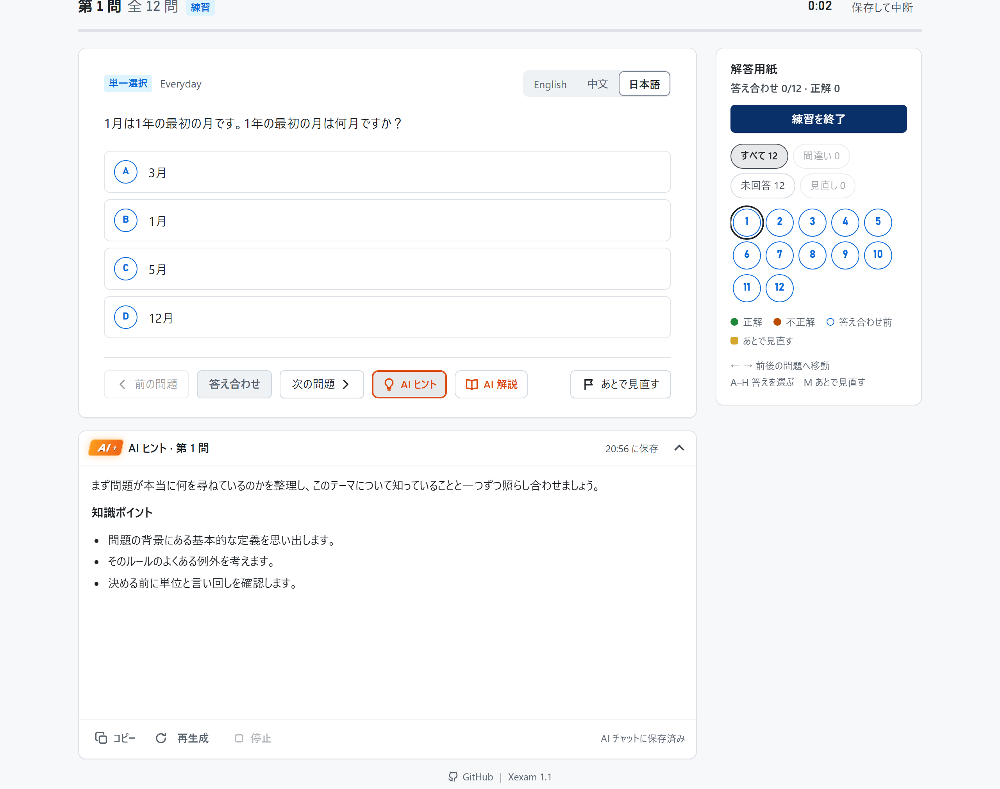

## 6. 結果ページ

得点、正解数と不正解数、そして問題ごとに 1 つの枠が並んだ帯（正解の問題には緑のチェック）が表示されます。練習のときは、タイトルが **練習の結果** になります。

**正解と解説** では **間違いのみ（n）** または **すべて（n）** を表示します。各問題のカードには、次のものがあります。

- **正解** または **不正解**、そしてあなたの選択と正解：正しい選択肢は緑、間違えて選んだ選択肢はオレンジで塗りつぶされ、それぞれに **正解** / **あなたの選択** のタグが付きます（ホットスポット問題の文は中立的な背景で、色が付くのは選択だけです）。
- **あなたの回答** / **正解** の行：複数選択の答えでは、あなたの答えの文字が正解の 1 つなら緑、そうでなければオレンジになるので、一部だけ正しい答えでは両方の色が表示されます。
- カードごとの **English** / **中文** / **日本語** の切り替え。最初は問題の言語の設定で表示され、切り替えるとそのカードだけが変わります：問題、選択肢、解説、覚え方、備考。その問題にない言語はグレーアウトされます。
- 解説と覚え方。ブックにある言語ごとにあり、ある言語にない場合はほかの言語の文が表示されます。
- その問題をこれまでに何回回答したか。

解答中に問題が（問題集ごと）削除された場合は、その旨が表示されます。得点と保存される記録には、残りの問題だけが含まれます。

ボタン：**間違えた問題だけやり直す**、**もう一度受ける**（練習の後は **もう一度練習する**）、**学習記録で見る**、**ホームに戻る**。やり直しと受け直しは、結果と同じ種類で始まります。試験は試験として、練習は練習として始まります。

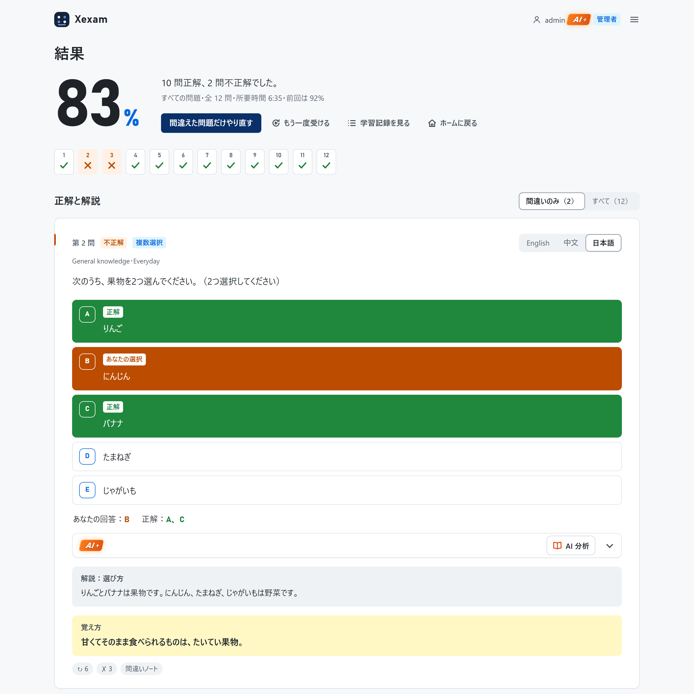

2 問間違えた試験で、**間違いのみ** を表示したところ：得点、続いて選んだ選択肢がオレンジ、正しい選択肢が緑で塗りつぶされた選択問題、カードごとの **English** / **中文** / **日本語** の切り替え、そして解説と覚え方。

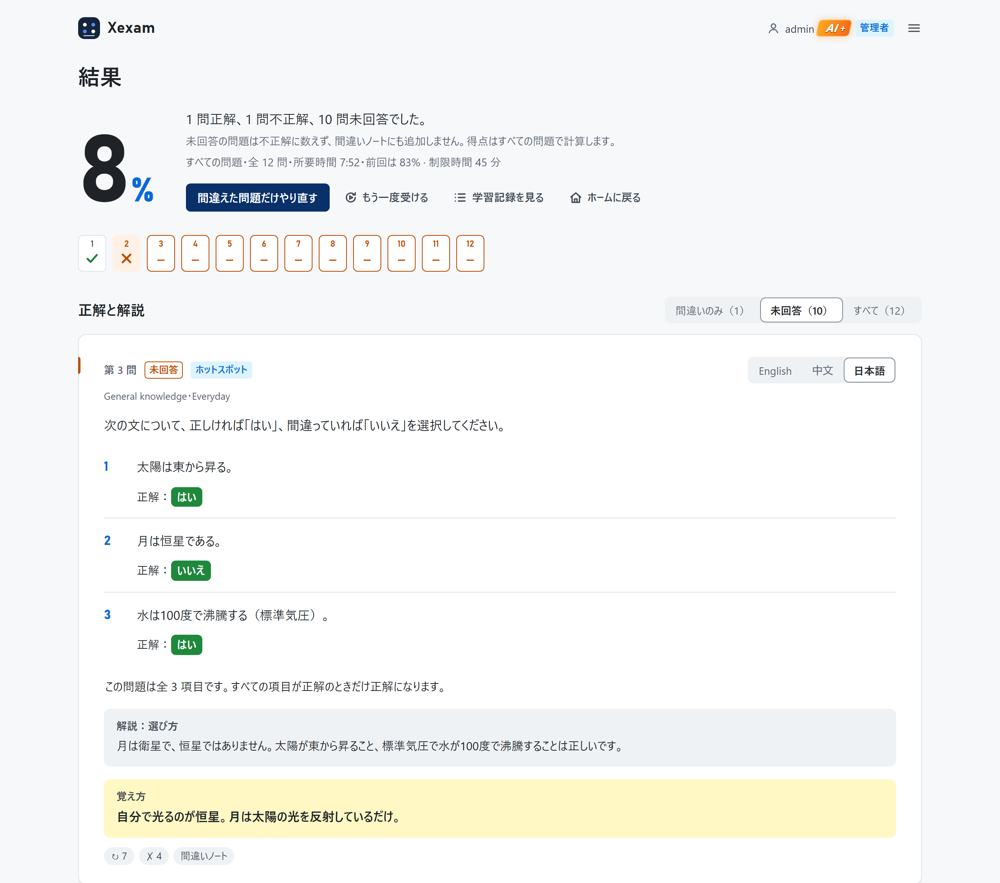

### 6.1 AI 分析

**AI+ 機能** があると、練習の結果と試験の結果のすべての問題カードには、**あなたの回答** / **正解** の行の下に **AI+ バー** があります：AI+ バッジ、状態の文、**AI 分析**（ボタン）、山形のボタン。同じバーが、学習記録の詳細ページのすべての問題にもあります。試験の最中に、試験ページにこれが表示されることはありません。

- **最初は折りたたまれています。** **AI 分析** は、そのカードのパネルを保存済みの分析で開きます。保存されていないときは、モデルに尋ねます。山形のボタンは、リクエストなしでパネルを開き、もう一度押すと閉じます。**AI 分析** をもう一度押すと、保存済みの解析が表示され、何も尋ねません。一度に開くパネルは 1 つだけで、別のカードのパネルを開くと、そちらに移ります。
- **スマートフォンでは** 折りたたんだバーにも状態の文が残ります（省略記号で短くなり、とても狭い画面でだけ隠れます）。そのため、解析のあるカードとないカードを区別できます。
- **何をするか**：モデルは、**AI 解説**（[第 5.1 節](#51-ai-ヒントai-解説ai-パネル)：正解、問われた知識、なぜそれが正しく、ほかがなぜ間違いか）と同じように問題を解説し、あなたの回答も渡されるので、間違えたときは、何があなたを惑わせたのかを短く伝えます。未回答の問題には、回答していないことを伝えます。
- **第 5.1 節と同じ点**：パネル、保存された回答、**再生成**、**コピー**、回答の言語、一度に 1 つの回答というルール、グレーアウトの状態は同じように働きます。**AI チャットに保存済み**（そのヒント付き）が、AI チャットへのリンクに代わります。送る問題文は、尋ねた時点のカード自身の言語の切り替えに従います（カードを別の言語に切り替えたあとの **再生成** でも同じです）。
- **どのチャットか**：回答は、それが属する練習または試験のチャット（`<開始時刻>-練習` または `<開始時刻>-試験`）に、練習中に書かれたものと一緒に保存されます。あとで記録の詳細ページで尋ねても、同じチャットに入ります。v0.9 より前に作られた記録にはそのようなチャットがありません。その詳細ページでの最初の解析が 1 つ作り、記録の日時で名付けます（第 16.1 節）。
- **グレーアウト**：記録を保存できなかった試験の結果（**この結果は保存されていないため、AI 分析は使えません。**）。保存できなかった練習の結果では、引き続き使えます。

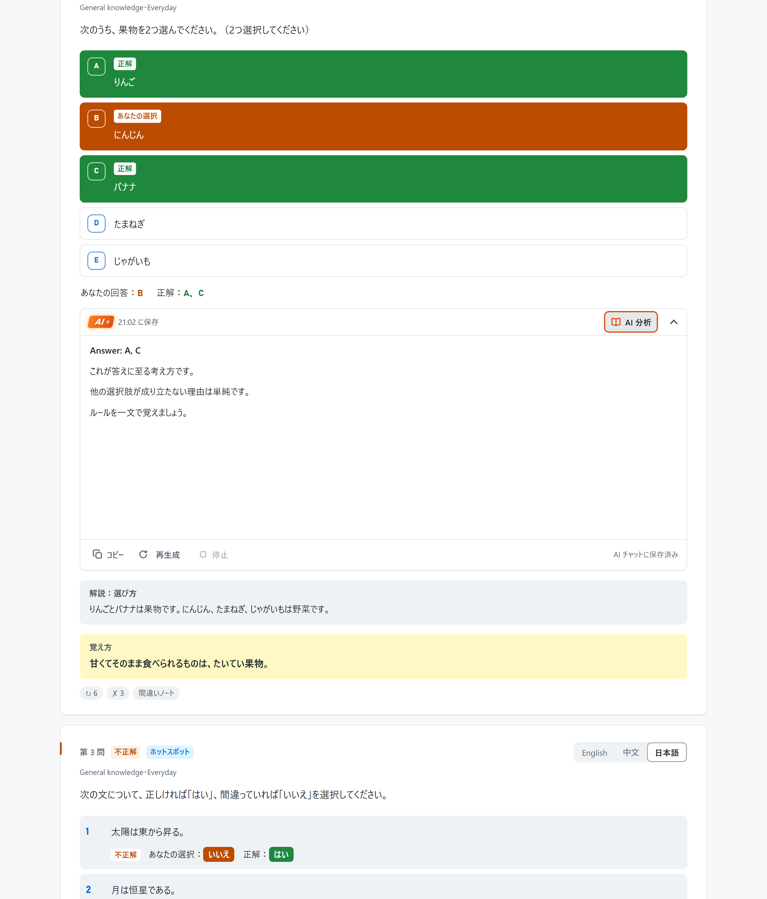

## 7. 学習記録

- **概要**：記録の数（**記録数**。種類で絞り込んでいるときは **受験回数** / **練習回数**）、**平均正答率**、**最高正答率** と、直近の結果を示す小さな棒グラフ。
- **絞り込み**：**種類**（**すべての種類**、**試験**、**練習**）、**問題集**、**開始日** と **終了日** による期間、**正答率**（**指定なし**、**60% 未満**、**60%〜79%**、**80% 以上**）。**絞り込みを解除** で元に戻ります。
- **記録の一覧**：試験や練習ごとに 1 行（スマートフォンでは 1 枚のカード）で、**試験** / **練習** のタグ、日時、問題集、回答した問題数、所要時間、正解数、正答率（80 % 以上は緑、60 % 未満はオレンジ）を表示します。日時をクリックするとその記録が開き、**削除** でその記録を削除します。**AI+ 機能** があると、表の最初に新しい列があり、すべての行に **AI まとめ** のボタンがあります（[第 7.1 節](#71-ai-まとめ)）。AI が一時停止中または使えないユーザーには、ボタンが **利用不可** のタグ付きでグレーアウトされ、表の上の 1 行が理由を伝えます。
- **試験記録** / **練習記録**（1 件の記録）：得点と記録の情報（**種類** を含む）、続いてすべての問題について、あなたの回答、正解、解説、覚え方を表示します。各カードに言語の切り替えがあります。**間違いのみ（n）** / **すべて（n）** で、間違えた問題だけかすべての問題かを切り替えます。**間違えた問題をやり直す** は間違えた問題を、**この試験をもう一度受ける**（**この練習をもう一度する**）は同じ問題をもう一度出題します。どちらも記録と同じ種類で始まります。**この記録を削除** は、その記録を削除します。v0.5 より前に受けた試験は得点だけが表示されます。v0.4 は回答内容を保存していなかったためです。出題停止の問題も、記録には問題文と **出題停止** のタグ付きで表示されます。やり直しや受け直しで出題されるのは、今有効な問題だけです。**AI+ 機能** があると、すべての問題カードに **AI 分析**（[第 6.1 節](#61-ai-解析)）があり、その練習または試験のチャットに保存されます。
- 右上の **間違えた問題を復習** で **間違えた問題の復習** が開きます。間違いノートの有効なすべての問題が、回答した回数と、あと何回続けて正解すればノートから外れるかと一緒に表示されます。1 つの問題集に絞り込むこともでき、**これらを練習する** でそれらの問題の練習を始めます。
- 削除について：記録を 1 件削除しても、各問題の統計は残るので、間違いノートは変わりません。また、その記録のために作った AI チャットも残ります（第 16.1 節）。**すべて削除** は、すべての記録（試験と練習）を削除します。**間違いノートと各問題の回答統計も消去する** にチェックを入れると、それらも消去されます。削除のたびに確認があり、元に戻すことはできません。
- Xexam は直近 500 件の記録（試験と練習）を保存します。それより古い記録は自動的に削除されます。

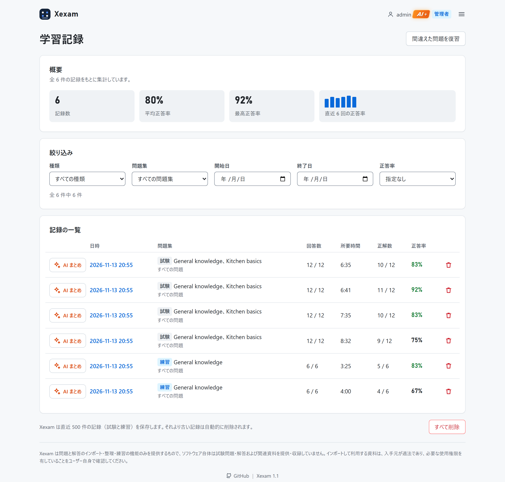

### 7.1 AI まとめ

**AI+ 機能** があると、**学習記録** の最初に新しい列 **AI まとめ** があり、記録ごとに 1 つのボタンがあります（幅の狭いウィンドウでは、記録のカードの中）。**ホーム** にも、直近の結果に同じボタンが、**詳細を見る** と **すべての学習記録** の間にあります。どちらも同じ記録に対して同じウィンドウを開き、同じ保存済みのまとめを表示します。

- **何をするか**：モデルには、その記録であなたが **間違えた** 問題（あなたの回答、正解、問題文、問題集の解説）が渡され、次のものを書きます：あなたの弱い知識のポイント、注意すべき点、これからそのような問題にどう取り組むか、そしてそれらの知識のポイントについての、詳しいけれど簡単なまとめ。問題を 1 問ずつ順に説明するわけではありません。
- **どの問題か**：間違えた問題だけです。未回答の問題は含まれません。記録に間違えた問題が 70 問を超えるときは、そのうち 70 問がランダムに選ばれ、**再生成** を押すたびに新しいランダムな 70 問になります。タイトルの下の 1 行が、まとめの根拠を示します。たとえば **間違えた 6 問すべてに基づいています。**、**間違えた 80 問からランダムに選んだ 70 問に基づいています。**、あるいは、問題の一部がなくなっている（問題集が削除された、またはアクセス権を失った）ときは **間違えた 6 問のうち 5 問に基づいています（残りは利用できません）。**
- **ウィンドウ**：タイトルの下のページの大部分を覆う大きなウィンドウです。上部に、左に **AI まとめ**、右に **再生成**（回答中は **停止**）と閉じるボタンがあります。文章はウィンドウの中でスクロールし、後ろのページは動きません。閉じるボタン、**Esc**、ウィンドウの外のクリックで閉じます。下部には **コピー** と、右側に控えめな **AI チャットに保存済み** があります。そのヒントは[第 5.1 節](#51-ai-ヒントai-解説ai-パネル)と同じで、まとめのチャットの名前を示します。ウィンドウから AI チャットは開きません。**AI まとめ** をもう一度押すと、保存済みのまとめがすぐに表示されます。**再生成** は新しいまとめを加えてそれを表示し、新しいまとめが失敗したときは前のものが残ります。まとめは **設定** の言語で書かれます。
- **グレーアウト**：間違えた問題のない記録（**今回は間違えた問題がありません（未回答の問題は AI まとめに含まれません）。**）と、問題ごとの記録を保存していなかった古いバージョンの記録（**この記録は古いバージョンで保存されたため問題ごとの記録がなく、まとめられません。**）。間違えた問題がすべてその後なくなっていた場合は、これらの間違いがもう利用できないことが表示されます。AI が一時停止中または使えないときは、[第 5.1 節](#51-ai-ヒントai-解説ai-パネル) と同じ **利用不可** の状態になります（ホームでは、タグがボタンの隣に付きます）。
- **AI チャットでは**：記録ごとに 1 つのチャット `<記録の日時>-AI まとめ` があり、その記録のすべてのまとめが入ります（AI チャットでは、まとめのリクエストはラベルだけが表示されます。たとえば **AI まとめ · 間違えた 80 問中 70 問**）。学習記録を削除しても、そのチャットは残ります。通常のチャットのルールに従います。回答が書かれるのは一度に 1 つだけです（[第 5.1 節](#51-ai-ヒントai-解説ai-パネル)）。
- **上限**：まとめは、ほかのすべての回答と同じように、ユーザーごとの AI リクエストの上限に数えられます（[第 17 節](#17-ai-設定)）。長いまとめは回答の長さの上限に達することがあり、その場合は途中で切れて、そのことが示されます。

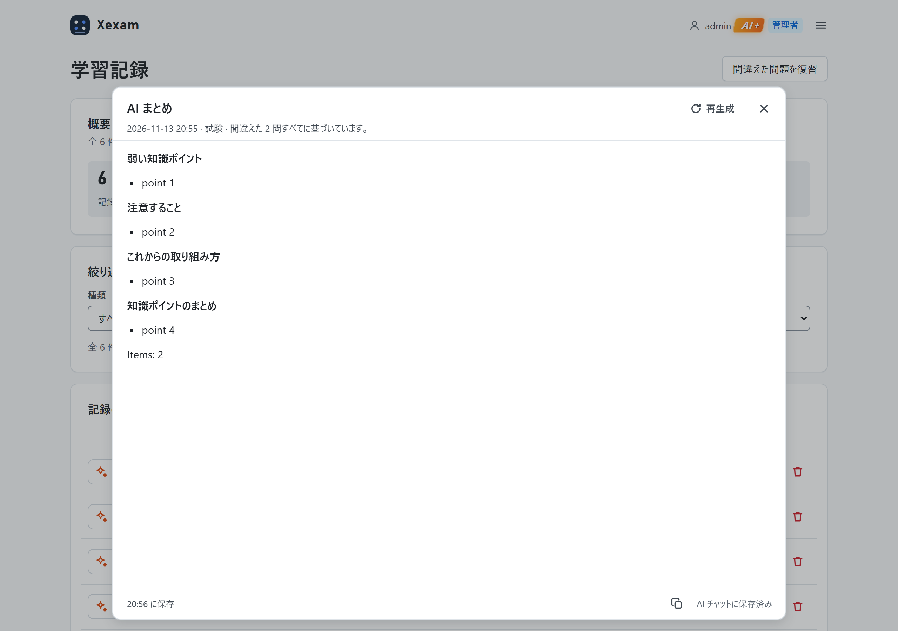

## 8. 間違いノート

試験でも練習でも、間違えた問題は間違いノートに入り、**2 回続けて**正解すると（試験でも練習でも）外れます。使い方は 3 つあります。ホーム（**試験・練習を始める** の右上にある **間違いノート**）、**学習記録** → **間違えた問題を復習** → **これらを練習する**、または試験の直後の **間違えた問題だけやり直す** です。出題停止の問題は統計には残りますが、復習には出ません。あとでその問題集をインポート直して出題再開になれば、また出てきます。

## 9. 設定

- **アカウント**：あなたの **ユーザー名** と **権限**（権限があれば **問題集を管理** も、AI+ 機能があるときは **AI+** バッジも。バッジが暗い色のときは、その下の 1 行が理由を伝えます）、そして **パスワードの変更**。問題集の管理権限を持つユーザーには、その権限でできることの説明も表示されます。
- **外観**（テーマ）：**システムに合わせる**（既定。端末のライト／ダーク設定に従います）、**ライト**、**ダーク**。
- **言語**（表示言語）：**English**（既定）、**中文**、**日本語**。メニュー、ボタン、メッセージがすべてこの言語になります。試験ページや、サーバーからのエラーメッセージも含みます。問題文の言語は、試験ページで別に切り替えます。
- **回答** → **回答したら自動で次の問題へ進む**（既定はオフ。試験だけ）：単一選択問題に答えたとき、またはホットスポット問題のすべての小問に答えたときに、次の問題が自動で開きます。複数選択問題では自動では進みません。オンの間は、試験ページの上部に **自動で次へ：オン** と表示されます。
- **AI チャットモード**（管理者のみ。AI+ 機能がオンの間だけ）：**通常モード** または **フリーモード**。**通常モード**：AI は学習アシスタントとして答え、AI メモリーを使います。**フリーモード**：学習アシスタントの指示と AI メモリーなしで、モデルと直接やり取りします。選択は、古いチャットも新しいチャットもすべての AI チャットに、次のメッセージから適用され、オンの間は AI チャットのタイトルの隣に緑の **フリーモード** のタグが表示されます（[第 16 節](#16-ai-チャット) を参照）。この選択はこのブラウザではなくサーバーに保存されるので、再読み込みや別の端末でのログインでも残ります。**フリーモード** を選ぶまではオフで、**既定の設定に戻す** でも変わりません。
- **既定の設定に戻す**：テーマ、表示言語、「回答したら自動で次の問題へ進む」を既定値に戻します。問題の言語と AI チャットモードはそのままです。

設定はアカウントごとに、最後に選んだ問題の言語と一緒に Xexam サーバーに保存されます。そのため、再起動やイメージの更新、ブラウザのキャッシュの削除、別のブラウザや端末への切り替えでも消えません。設定はユーザーごとに分かれています。現在のブラウザにだけ残るのは、未提出の試験や未完了の練習だけです。「設定と一緒に保存される」の唯一の例外は管理者の **AI チャットモード** で、AI サービス専用のデータベースに保存されます。

<table>
<tr>
<td width="50%">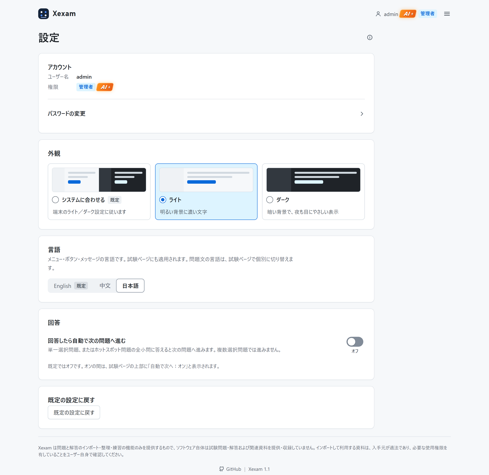</td>
<td width="50%">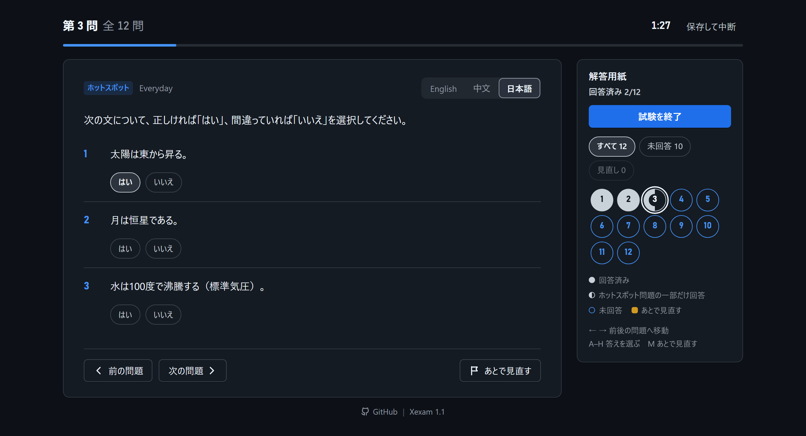</td>
</tr>
<tr>
<td>設定：<b>アカウント</b>、<b>外観</b>、<b>言語</b>、<b>回答</b>、そして管理者だけに <b>AI チャットモード</b>（<b>通常モード</b> / <b>フリーモード</b>）。</td>
<td><b>ダーク</b> テーマ（ここでは試験ページ）。</td>
</tr>
</table>

## 10. Xexam について

メニューのバージョンの項目（たとえば **Xexam v0.7.5**）を選ぶと、**Xexam について** が開きます。**バージョン**、**サーバー** の CPU アーキテクチャ、**ライセンス**、そして **更新内容** が表示されます。**更新内容** は、表示言語の [更新履歴](changelog.md) です。最新のバージョンは開いた状態で、それより前のバージョンは **以前のバージョン** の下に折りたたまれています。

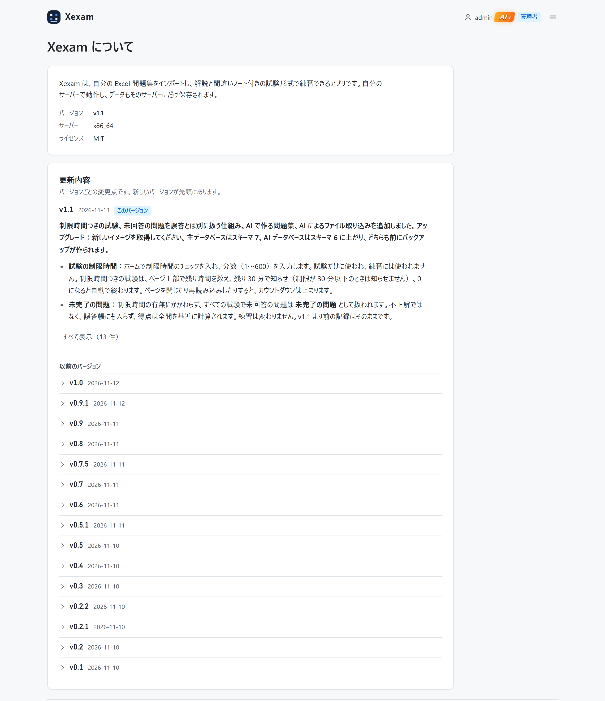

## 11. 問題集の管理

ここでは、管理者と、問題集の管理権限を持つユーザーが Excel ブックをインポートします。権限のないユーザーのメニューにはこのページが表示されず、直接開くと **権限がありません** と **ホームに戻る** が表示されます。

- **Excel インポート**：**新しい問題集** か **問題集を更新** を選び（タイトルの横にある 2 つの小さなボタンで、マウスを重ねると説明が表示されます。更新する場合は、**更新する問題集** でその問題集を選びます）、**Excel ファイルをインポート** を押すか、パネルのどこかにファイルをドロップします。ヒントの 1 行は、ブック全体を 6 列形式でアップロードするよう伝え、**Excel の書き方** へのリンクで終わります。
- **問題集の一覧**：問題集ごとにコンパクトな 1 行があり、ファイル、問題数（出題停止の問題も含めて。例：**5 問（ほかに出題停止 2 問）**）、シート数、最終更新日と、**更新** と **削除** が並びます。シートは行の右側の矢印の下に折りたたまれています。古い Excel 形式のものだったため、問題がすべて出題停止になっている問題集には、そのことと、6 列形式のファイルで更新すればまた使えることが表示されます。
  - **管理者** には **登録済みの問題集** が表示されます。各問題集にはインポートした人（**sam がアップロード**、**あなたがアップロード**）が表示され、どの問題集も更新・削除できます。
  - **問題集の管理権限を持つユーザー** には **あなたの問題集** が表示されます。自分でインポートした問題集だけが並び、それらを更新・削除できます。管理者から割り当てられた学習用の問題集は、ホームにあります。
- **インポート履歴**：1 回のインポートが 1 行で、最新の 8 件が表示されます（管理者にはすべてのインポート、問題集の管理権限を持つユーザーには自分の問題集のインポート）。
- **Excel の書き方とインポートの説明** は、開くまで折りたたまれており、[第 12 節](#12-excel-問題集の形式) と [第 13 節](#13-問題集のインポート) の要約です。 最後の部分 **外部の AI で Excel ファイルを作る** には、手順と、**コピー** ボタン付きのそのまま使えるプロンプトがあります（[第 13.10 節](#1310-外部の-ai-で-excel-ファイルを作る)）。

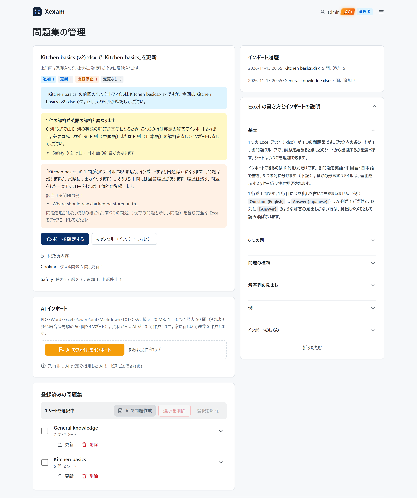

スクリーンショットは、「Kitchen basics」を新しいファイル `Kitchen basics (v2).xlsx` で更新するときの、保存する前のプレビューです。数のチップ（追加 1、更新 1、出題停止 1）、出題停止になる問題、そして 1 行の日本語の解答が英語の解答と異なるという警告（この行は英語の解答でインポートされます）が表示されています。その下は **登録済みの問題集** の一覧で（「Kitchen basics」は問題集の管理権限を持つユーザー sam がアップロードしたもの）、さらに **Excel の書き方とインポートの説明** を開き、最初の 2 つの部分、基本と 6 つの列を表示しています。

## 12. Excel 問題集の形式

1 つのブック（`.xlsx`）が 1 つの問題集です。各シートが 1 つの問題グループで、1 行に 1 問を書きます。**インポートできるのは 6 列形式だけです**：各問題に英語・中国語・日本語の列があり、その答えと解説にも同じく 3 つの列があります。ほかの形式のファイルは、以前の版の 3 列形式と 4 列形式も含めて、そう伝えるメッセージとともに拒否され、何もインポートされません。

| 列 | 内容 |
|---|---|
| **A** | **英語**の問題。そのあとに選択肢またはホットスポット問題の小問を書きます。問題の種類、選択肢、小問はこの列から取られ、問題もこの列で識別されます |
| **B** | **中国語**の問題（省略可）。A 列と同じ選択肢（A、B、C…）または同じ番号の小問にします |
| **C** | **日本語**の問題（省略可）。選択肢や小問は A 列と同じにします |
| **D** | **英語**の答え・解説・覚え方：`【Answer】B` のあとに `【Explanation】…` と `【Memory aid】…`。正解はこの列から取られます |
| **E** | **中国語**の答え・解説・覚え方（省略可）：`【答案】B`、`【解析】…`、`【记忆口诀】…` |
| **F** | **日本語**の答え・解説・覚え方（省略可）：`【正解】B`、`【解説】…`、`【覚え方】…` |

次は、単一選択問題 1 問の完全な例です（ここにあるほかの例と同じく架空のもので、**問題集の管理** ページの説明にあるものと同じです）。

| 列 | セル |
|---|---|
| A | Which planet is known as the Red Planet?<br>A. Venus<br>B. Mars<br>C. Jupiter<br>D. Saturn |
| B | 哪颗行星被称为“红色星球”？<br>A. 金星<br>B. 火星<br>C. 木星<br>D. 土星 |
| C | 「赤い惑星」と呼ばれる惑星はどれですか。<br>A. 金星<br>B. 火星<br>C. 木星<br>D. 土星 |
| D | 【Answer】B<br>【Explanation】Iron oxide (rust) in the dust on its surface makes Mars look red.<br>【Memory aid】Mars rusts red. |
| E | 【答案】B<br>【解析】火星表面的尘土含有氧化铁（铁锈），所以看起来是红色的。<br>【记忆口诀】火星生锈红彤彤。 |
| F | 【正解】B<br>【解説】火星の表面の砂には酸化鉄（さび）が含まれているため、赤く見えます。<br>【覚え方】火星はさびて赤い。 |

セルの中で改行するには、Alt+Enter（Windows）または Control+Option+Return（Mac）を押します。

### 12.1 行と見出し

- 1 行が 1 問です。1 行目には見出しを書いてもかまいません（例：`Question (English)` … `Answer (Japanese)`）。A 列が 1 行だけで、D 列に `【Answer】` のような解答の見出しがない行は、見出しやメモとして読み飛ばされます。
- Xexam は各シートの内容から 6 列形式を判別します。少なくとも 1 行に、C 列のかなを含む日本語の問題（A 列と B 列にはかなを含まない）と、E 列または F 列の見出し付きの解答（見出しは 3 言語のどれでもかまいません）が必要です。

### 12.2 英語が基準

- 問題の種類、選択肢、ホットスポット問題の小問、問題の識別は A 列から、正解は D 列から取られます。A 列に英語の問題がない行や、D 列に英語の答えがない行は読み取れません。プレビューに理由とともに一覧表示されます。
- B・C・E・F 列は行ごとに空欄にできます。B 列や C 列がないと、その問題では中国語や日本語がグレーアウトされます。E 列や F 列がないと、カードにはほかの言語の解説が表示されます。
- B 列と C 列は A 列と対応している必要があります（同じ選択肢の記号、同じ数の小問）。対応していない言語は、その問題ではグレーアウトされます。
- E 列や F 列の答えが D 列と違う意味の場合も、その行は英語の答えでインポートされ、プレビューに例えば **1 件の解答が英語の解答と異なります** という警告が表示されます。該当する行は **該当する行を表示** の下にあります。答えは意味で比べます。同じ記号か、ホットスポット問題では小問ごとに同じ選択かどうかです（`Yes`、`是`、`はい` は同じものとして扱います）。

### 12.3 問題の種類

- **単一選択**：A 列に問題文を書き、続けて選択肢を 1 行に 1 つずつ書きます：`A. 内容`、`B. 内容` …（選択肢は 2〜8 個、A〜H。`A)`、`A、`、`A:` でもかまいません）。解答は記号 1 つです：`【Answer】B`。
- **複数選択**：書き方は同じで、解答に記号を複数書きます：`【Answer】C, E` または `【Answer】CE`。ちょうどその選択肢だけを選んだときに正解になります。
- **ホットスポット**（複数の文のそれぞれについて 1 つを選ぶ問題）：A 列の 1 行目に `HOTSPOT` と書き（推奨：ホットスポット問題であることがはっきりします。書かない場合も、末尾に選択肢がある番号付きの小問から判別されます）、続けて問題文、そのあとに番号付きの小問を 1 行に 1 つずつ書き、各小問の末尾に ` / ` で区切った選択肢を書きます：`1. Water is wet. Yes / No`。複数の単語からなる選択肢（例：`Before cooking / After cooking`）は、前にタブまたは全角スペース（`　`）を入れます。解答には小問ごとの答えを `;` で区切って書きます：`【Answer】1 Yes; 2 No`。
- B 列と C 列には、同じ小問を同じ番号で書きます。小問の末尾にその言語の選択肢（`是 / 否`、`はい / いいえ`）を書くと、その言語で選択肢が表示されます。どの答えの列でも、はい・いいえは 3 言語のどれで書いてもかまいません：`Yes` / `是` / `はい`、`No` / `否` / `いいえ`。

例えば、次のようなホットスポット問題です（A 列と D 列。B・C・E・F 列には同じ内容を中国語と日本語で書き、`是 / 否` と `はい / いいえ` の前には全角スペースを置きます）。

```
HOTSPOT
For each statement, choose Yes or No.
1. The sun rises in the east. Yes / No
2. The moon is a star. Yes / No
```

```
【Answer】1 Yes; 2 No
【Explanation】The sun rises in the east. The moon only reflects sunlight; it is not a star.
```

### 12.4 解答列の見出し

D・E・F 列には、まず解答を書き、続けて解説と覚え方を、それぞれ `【…】` で囲んだ見出しのあとに書きます。3 つの列のどれでも、3 言語のどの見出しも使えます：

- 解答：`【Answer】`、`【答案】`、`【正解】`、`【答え】`。
- 解説：`【Explanation】`、`【解析】`、`【解説】`。
- 覚え方：`【Memory aid】`、`【Mnemonic】`、`【记忆口诀】`、`【口诀】`、`【覚え方】`。

英語の見出しは大文字・小文字を区別しません。これらの語を含む長い見出し（例：`【解析·怎么选】`）も使えます。解答だけを書くセルは、記号だけ（`B`）や `Answer: B` の 1 行でもかまいません。解答のあとの括弧内の文字（例：`【Answer】B (see chapter 2)`）は解答には含まれず、解答カードに **備考** として表示されます。

### 12.5 読み取れない問題

読み取れない問題は**推測されません**。プレビューに理由とともに一覧表示され（多くは D 列に見出し付きの答えが書かれていないか、答えの記号が選択肢にないことが原因です）、黙って不正解と判定されることはありません。

## 13. 問題集のインポート

### 13.1 インポートできる人

- **管理者** は新しい問題集をインポートし、すべての問題集を更新・削除できます。
- **問題集の管理権限を持つユーザー**（[ユーザー管理](#14-ユーザーとログイン) で **問題集を管理できる** を設定されたユーザー）は新しい問題集をインポートできます。その問題集はそのユーザーのものになり、更新・削除できるのも自分でインポートした問題集だけです。管理者やほかのユーザーの問題集は変更できません。
- それ以外のユーザーには **問題集の管理** のページが表示されません。

### 13.2 新しい問題集か、更新か

問題集とは、インポートした 1 つの Excel ブックのことです。**問題集の管理** → **Excel インポート** で、タイトルの横にある 2 つの小さなボタンでファイルのインポート先を選びます。

| 選択 | 何が起きるか |
|---|---|
| **新しい問題集** | 新しい問題集が作られ、ファイル名（`.xlsx` を除く）がその名前になります（同じ名前がすでにある場合は ` (2)`、` (3)`、… が付きます）。既存の問題集は変更されません。同じブックを 2 回インポートして別々の 2 つの問題集にすることもでき、それぞれの学習記録は混ざりません |
| **問題集を更新** | **更新する問題集** で選んだ問題集の問題を、このファイルで置き換えます（問題集の管理権限を持つユーザーが選べるのは自分の問題集だけです）。ファイルにない問題は、**その問題集の中でだけ**出題停止になります。問題集の名前、所有者、それを見られるユーザーはそのままです |

別のブックには **新しい問題集** を、インポート済みのブックの新しい版には **問題集を更新** を使います。新しい問題だけではなく、必ずブック**全体**をアップロードしてください。

新しい問題集は、インポートした人、管理者、そして **今後インポートする問題集も含める** が設定されたすべてのユーザーに表示されます。ほかのユーザーには、管理者が **ユーザー管理** で割り当てます。

### 13.3 プレビューしてから確定

アップロードすると、Xexam はファイルを読み込んでチェックし、プレビューを表示します。**追加**、**更新**、**出題再開**、**出題停止** になる問題の数と **変更なし**、**読み取れず** の数を示す小さなチップ（数が 0 のものは表示されません）、シートごとに 1 行でその数、そして読み取れなかった行ごとの行番号と理由です。読み取れなかった行は、そのシートの行の下に折りたたまれています（例：**読み取れず 2 問**）。**確定するまで何も書き込まれません**（**問題集を作成する** または **インポートを確定する** で確定し、**キャンセル（インポートしない）** で破棄します）。次の場合は、プレビューに注意が表示されます。

- 既存の問題集のインポート元と同じ名前のファイルから、新しい問題集を作ろうとしたとき（代わりにその問題集を更新するよう提案されます）
- 前回のインポートとは名前の違うファイルで、問題集を更新しようとしたとき
- 出題停止になる問題があるとき。その一部が一覧表示され、インポートする前にもう一度確認されます
- ある行の中国語や日本語の答えが英語の答えと異なるとき（その行は英語の答えでインポートされます）

インポートする人ごとに自分のプレビューがあり、メモリ上に 30 分間保持されます。開いているすべてのプレビューは、1 つのメモリの枠を共有します。大きなファイルのプレビューがいくつも同時に開かれると、ほかの人のいちばん古いプレビューが破棄されることがあります。破棄されたプレビューや 30 分を過ぎたプレビューを確定しようとすると、期限切れと表示されます。ファイルをもう一度アップロードしてください。

### 13.4 インポートのルール

ファイルは、インポート先の**問題集の全内容**として扱われます。ほかの問題集には一切影響しません。

| 状況 | 結果 |
|---|---|
| ファイルにあり、問題集にない問題 | **追加** |
| 同じ問題で、それ以外の内容（ほかの選択肢、答え、解説、中国語や日本語の文）が変わった | **更新**（回答履歴には影響しません） |
| 問題集にあり、ファイルに見つからない問題 | **出題停止**：回答履歴とともに保存されたままですが、試験にも練習にも出なくなります |
| 以前に出題停止になった問題が再び現れた | **出題再開**。間違いノートの登録も一緒に戻ります |
| シート名、英語の問題文、または最初の選択肢が変わった | **新しい問題**として扱われます。古い問題は出題停止になり、新しい問題は回答履歴なしで始まります |
| ファイルに使える問題が 1 問もない | インポートを拒否（問題集が空になるのを防ぐため） |

問題は、ワークシート名、英語の問題文（A 列の選択肢以外の部分）、最初の選択肢または小問で識別されます（スペースの違いは無視されます）。

### 13.5 古い Excel 形式の問題集

v0.6 までの Xexam は、3 列形式と 4 列形式のブックをインポートしていました。その問題は日本語の文で識別されていました。v0.7 からはこれらの形式はインポートできず、**それらからインポートした問題は、バックエンドの起動のたびに出題停止になります**。問題集、そのインポート履歴、学習記録、問題ごとの統計は残ります。問題はもう出題されず、問題がすべて出題停止になった問題集には、問題集の一覧でそのことが表示されます。

そうした問題集をまた使うには、**ブックの 6 列形式の版で更新します**（**問題集を更新**）。問題集の名前、所有者、それを見られるユーザーはそのままです。6 列形式は英語の文で問題を識別するので、ファイルの問題はすべて新しい問題として回答履歴なしで追加され、古い問題は出題停止のままで、古い記録には引き続き表示されます。6 列形式のファイルを **新しい問題集** としてインポート、古い問題集を削除することもできます。

### 13.6 問題集の削除

問題集の行の **削除** を押すと、確認が表示されます（例：**「Kitchen basics」を削除しますか？**）。問題集の問題（有効なものと出題停止中のもの）と、インポート履歴が削除され、その問題集はすべてのユーザーの問題集から消えます。その下のチェックボックスは、既定ではオフです。

- **チェックなし**：回答履歴と試験記録は残ります。それらの記録では、この問題集の問題は削除済みとして表示されます。
- 管理者が **チェックあり**（**この問題集の学習記録も削除する**）：この問題集の問題の回答履歴と、残っているほかの問題集を含まない記録も削除されます。
- 問題集の管理権限を持つユーザーが **チェックあり**（**この問題集のあなたの学習記録も削除する**）：削除されるのは、自分の回答履歴と記録だけです。ほかのユーザーの学習記録は常に残り、その問題は削除済みとして表示されます。

削除は元に戻せません。戻す方法は、ご自身のバックアップだけです（[database.md](database.md) の第 5 節）。

### 13.7 チェックボックスと一括操作

問題集の一覧では、すべての問題集とシートにチェックボックスがあります。問題集にチェックを入れると、そのシートすべてにチェックが入ります。一部のシートだけにチェックが入っているときは、混合の表示になります。何かにチェックが入ると、一覧の上にツールバーが現れます：

- **選択を削除**：チェックした問題集とシートを、何が消えるかを示す 1 つの確認で削除します（学習記録も消すかどうかは、問題集の削除と同じ選択です）。シートがすべてチェックされた問題集は、問題集全体として削除されます。シートだけの削除は、同じ問題集に別のシートが残るときにだけ行えます。AI で作った問題集はシートが 1 つなので、問題集全体として削除されます。
- **AI で問題作成**：チェックした問題集とシートから AI 問題集の作成を始めます（[13.9 節](#139-ai-で作る問題集)）。ボタンはフラットな琥珀色に白い文字です。使えないとき（使える項目がチェックされていない、AI+ 問題集がチェックされている、1 日の上限に達したなど）は普通の灰色のボタンになり、下には何も書かれません。タップ、ホバー、フォーカスすると小さなヒントに理由が出ます（Esc かほかの場所のタップで閉じます）。新しくできた AI 問題集は、ホームで自動的にはチェックされません。

問題集の行には、太字の名前、件数の行（例：**7 問・2 シート**）、シートを折りたたむ矢印があり、AI で作った問題集には AI+ バッジが付きます（[13.9 節](#139-ai-で作る問題集)）。スマートフォンでは、行のボタン（**更新** と **削除**）は名前の下の独立した行に並び、バッジも独立した行に表示され、長い名前は折り返されます。

### 13.8 AI によるファイルインポート

**問題集** ページでは、**AI インポート** カードが **Excel インポート** カードの下にあり、専用のドロップ領域を持ちます。ファイルを選ぶか、そこへドラッグします：PDF、Word（.docx）、Excel（.xlsx）、PowerPoint（.pptx）、Markdown、TXT、CSV、最大 20 MB。カードには、ファイルが [AI 設定](#17-ai-設定) で設定した AI サービスに送られることと、そこで設定された上限（サイズと、1 回のインポートで最大 50 問）が表示されます。AI インポート機能があり AI+ を使えるユーザーにだけカードが表示されます。それ以外の場合は表示されないか、灰色になります（理由はタップ、ホバー、フォーカスで出るヒントにあります）。ボタンは AI 作成ボタンと同じフラットな琥珀色で、**Excel ファイルをインポート** と同じ大きさです。

ai-service はファイルをメモリ上で読み、ディスクには保存しません。処理が終わるとファイルは消えます。ファイル全体は一度だけ、このジョブのすべてのリクエストのキャッシュされた先頭部分（プロンプトキャッシュ）として送られるため、以降の呼び出しは主にプロバイダーのキャッシュから読み取ります。最初の呼び出しでファイル全体を読み、問題か学習資料か、問題が何問あるかを判断します。その後、最大 4 つの呼び出しが同時に問題を書きます。モデルにとって大きすぎるファイルは、代わりに 2〜3 区間ずつ分けて読み、カードに進み具合が表示されます（例：**3/9 区間を認識中…**）。

確認の段階では、読み取った結果が表示されます。ファイルが問題の場合、ラベルが問題数を示します（**ファイル内 69 問**）。上限（既定 50）を超えると、このラベルは赤くなり、2 つ目の赤いラベル **インポートできるのは先頭の 50 問まで** が並びます。インポートはファイルの順に先頭の 50 問を取り込み、完了したカードには「全 69 問のうち先頭の 50 問」と表示されます。資料の場合、AI がそこからちょうど 20 問を作ります。**インポート** の前に、新しい問題集に名前を付けます。入力欄には候補が入っていて、空の間はボタンが灰色のままです。すでにある名前は **この名前はすでに使われています。別の名前にしてください。** と断られます。確認するまで何も保存されません。断る場合や確認の段階が期限切れになる場合は、何も消費しません。確認すると、その日の AI 問題集の処理を 1 回使います（作成とインポートで共通。管理者は対象外、[13.9 節](#139-ai-で作る問題集) と同じ）。AI インポートは AI 作成と同じく、ユーザーごとの AI リクエスト上限（1 分、1 時間、1 日）に数えられず、それで断られることもありません。

ジョブの実行中、カードには進み具合と数値の 1 行が表示されます。例：**今回の作成：呼び出し 9 回、入力/出力 1.4K/21K Token**（プロバイダーが報告するときは **キャッシュ書き込み** も）。この行は完了したカードにも残ります。3 回失敗した問題（欠落、読み取れない、チェックで不合格）は、**無制限** がオンでもスキップされるため、ジョブは必ず終わります。問題集には合格した問題が入り、カードはスキップした問題を示します（例：**50 問中 48 問をインポート、2 問は変換できませんでした**）。すでに変換済みの問題がある実行中のインポートで **中止** を押すと、**完了した N 問を保存**（AI 問題集として保存）、**すべて破棄**、**続ける** のどれにするかを尋ねます（資料は必ず 20 問が必要なので、その場合は普通の中止です）。失敗したジョブは理由を示し、問題集は作られません。

### 13.9 AI で作る問題集

対象：AI+ 機能、問題生成の機能、問題集の管理権限を持つユーザー（管理者は常に対象）。始める場所は 3 つあります：問題集管理のツールバーの **AI で問題作成**（チェックした問題集とシート）、ホームの **AI で問題作成**（チェックした問題集とシート）、ホームの間違いノートモードの **AI 間違い練習**。

- **元になる最低数**：チェックした問題集の単一選択または複数選択の問題が 30 問以上（ホットスポットは数えません）。間違い練習モードでは、単一選択または複数選択の誤答が 10 問以上。
- **AI で作った問題集は元にできません**：チェックした問題集とシートに AI で作った問題集が含まれていると、チェックを外すまで AI 作成は灰色になります（両方のモード、ホームと問題集管理で同じ）。
- **結果**：シート名 **AI** が 1 つだけの新しい問題集に、有効な問題がちょうど 20 問入ります。各問題は中国語・英語・日本語で、解答と解説付き：単一選択 14 問、複数選択 6 問（ホットスポットはありません）。不完全な問題集は保存されません。欠けた問題や無効な問題は作り直されます（1 問につき最大 5 回）。それでも失敗した場合、ジョブは失敗し、何も保存されません。
- **名前**：開始ダイアログで入力します（ホームでも問題集管理でも同じ）。候補があらかじめ入ります。例：`Kitchen basics_sample01_20261113101530`（元、ユーザー名の先頭 8 文字、開始時刻）。
- **枠**：1 人 1 日 3 回の AI 問題集の処理（作成とファイルインポートの合計）。サーバー時刻の 0:00 にリセットされます。1 回のジョブは、AI の呼び出し回数にかかわらず 1 回と数えます。完了したとき、または呼び出しを送ったあとで中止したときに数えます。失敗したジョブと、最初の呼び出しの前に中止したジョブは数えません。管理者は対象外です。ユーザーごとの AI リクエスト上限（1 分、1 時間、1 日）は作成とインポートには適用されません。
- **上限**：作成とインポートでは **無制限** が既定でオンです（[17.5 節](#175-ai-問題集タブ)）：呼び出し回数の上限、1 回の呼び出しの回答の長さの制限、時間制限がありません。2 つの安全装置は常に残ります：プロバイダーのエラーが 3 回続くとジョブは失敗し、いつでも中止できます。**無制限** をオフにすると、作成は AI の呼び出しが最大 15 回（インポートは 25 回。AI 設定で 8〜40、管理者を含む全員に同じ）、各呼び出しは 17.5 節の長さ、ジョブの時間は 30 分です。失敗すると理由と、理由ごとの不合格の数が表示され、同じ理由がシステムログに ERROR レベルで書かれます。
- **進み具合**：ホームと問題集管理の進行カードに、作成済みの問題数と目標、数値の 1 行（呼び出し回数と入力 / 出力 Token）が表示されます。ページを離れても構いません。ジョブが終わったときや失敗したときはカードが知らせ、右上のボタンで閉じられます。完成した問題集は、別のページや隠れたタブにいても、すぐにホームと問題集管理に表示されます。
- **マーク**：AI+ バッジのあとの語で、問題集の出どころを示します：**AI+練習問題集**（チェックした問題集とシート。ホームまたは問題集管理）、**AI+間違い問題集**（間違いノートモード）、**AI+インポート問題集**（AI ファイルインポート）。問題集の行、その問題の問題カード、すべての振り返りカード（結果、記録、間違いの振り返り）に表示されます。ヒントには、誰がいつ作ったかと、AI が生成した答えには誤りがある場合があることが書かれています。
- **共有**：AI で作った問題集も、ほかの新しい問題集と同じように共有されます。元の問題集をすべて見られるユーザーは、「今後の問題集を含む」設定があれば受け取ります。管理者は、ユーザー管理から、ほかの問題集と同じく、そのユーザーの AI 問題集を外せます。


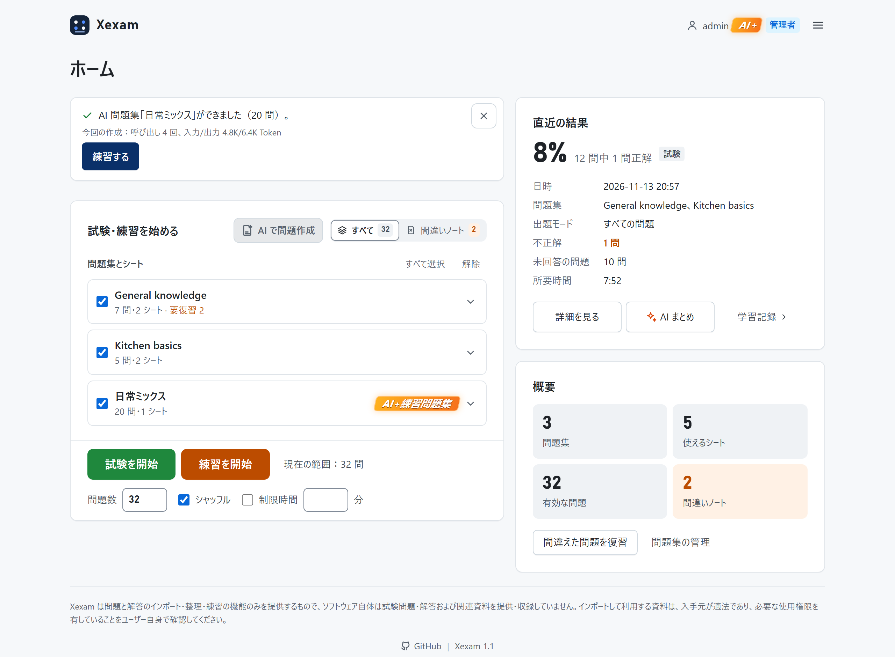

### 13.10 外部の AI で Excel ファイルを作る

これは「問題集」ページの Excel の書き方の説明の中にある **外部の AI で Excel ファイルを作る** の部分です。プロンプトは中だけでスクロールする枠に表示され、**コピー** ボタンがあります。送る前に、角かっこの 2 か所を書き換えてください。プロンプトの本文（日本語）：

1. Xexam の外で普段使っている AI チャットを開きます。
2. 自分の資料（ノート、PDF、問題の一覧、Web ページの文章など）を添付するか貼り付けます。
3. 下のプロンプトをコピーしてチャットに貼り付け、[問題数] と [テーマ] を自分の内容に書き換えます。
4. 結果をダウンロードできる .xlsx ファイルで出してもらいます。ファイルを作れない場合は表で出してもらい、Excel の A1 セルから貼り付けて「Excel ブック (.xlsx)」で保存します。
5. ファイルを開き、数行を確認します。選択肢、正解の記号、3 つの言語を見てください。
6. ここで「Excel ファイルをインポート」からインポートします。新しい問題集にも、既存の問題集の更新にも使えます。

```text
自分の資料から問題集を作りたいです。Excel ファイル（.xlsx）を 1 つ作り、あとで学習アプリにインポートします。資料は私が渡したもの（添付または貼り付け）だけを使い、資料にない事実は加えないでください。

[テーマ] について、[問題数] 問を作ってください。

ファイル
- .xlsx ブックを 1 つ。シートは 1 枚だけで、シート名はテーマ名にしてください（短く。 : \ / ? * [ ] の文字は使わない）。
- ファイルを作れない場合は、同じ 6 列の表を 1 つ出してください。私が Excel の A1 セルから貼り付けます。
- 普通の文字だけのセルにしてください。セルの結合、画像、数式、余分なシート、余分な列、コメントは使わないでください。

行
- 1 行目は見出し行で、A 列から F 列に次の 6 つをそのとおりに入れてください：Question (English)、Question (Chinese)、Question (Japanese)、Answer (English)、Answer (Chinese)、Answer (Japanese)。
- 2 行目から 1 行に 1 問ずつ書きます。1 行に 2 問入れたり、1 問を 2 行に分けたりしないでください。どの行も 6 つのセルをすべて埋めてください。

A・B・C 列：英語・中国語（簡体字）・日本語の問題文
- 各セルには問題文を書き、続けて選択肢を 1 行に 1 つずつ書きます（セル内で改行）。選択肢は A. 内容、B. 内容、C. 内容 … の形にします（4 つか 5 つ、多くても 8 つ。記号は順番どおり）。
- 同じ行の 3 つのセルは同じ問題です。選択肢の内容、順番、記号をそろえてください。
- 単一選択は正解が 1 つだけ。複数選択は正解が 2 つ以上で、問題文にいくつ選ぶかを書いてください。
- C 列は自然な日本語（ひらがなとカタカナを含む文）で書いてください。資料が別の言語なら翻訳してください。

D・E・F 列：英語・中国語・日本語の正解
- 各セルの 1 行目は、見出しと正解の記号だけにします。単一選択は 【Answer】B、複数選択は 【Answer】C, E（記号はアルファベット順、カンマ区切り）。中国語は 【答案】、日本語は 【正解】 を使います。
- 次の行に解説を 1〜2 文で書きます。英語は 【Explanation】、中国語は 【解析】、日本語は 【解説】 です。
- さらに次の行に短い覚え方を書きます。英語は 【Memory aid】、中国語は 【记忆口诀】、日本語は 【覚え方】 です。
- かっこ 【 】 は上のとおりに書いてください。D・E・F 列の記号は同じにしてください。

ファイル（または表）だけを出し、セルにそれ以外の文字は入れないでください。
```

- 外部の AI の利用規約や料金はご自身の責任です。共有してはいけない資料は送らないでください。
- AI は間違えることがあります。学習する前に正解を確認してください。

## 14. ユーザーとログイン

v0.6 からは全員がログインして使います。アカウントには 3 種類あります。

- **管理者**：すべての機能。すべての問題集、**ユーザー管理**、**AI 設定**、**システムログ** を含み、AI+ 機能がオンの間は AI チャットも使えます。
- **問題集を管理できる** 権限を持つ **一般ユーザー**：新しい問題集をインポートし、自分でインポートした問題集を更新・削除できます。ほかの人の問題集は変更できません。
- **一般ユーザー**：管理者から割り当てられた問題集で、試験や練習をします。

学習記録、間違いノート、未提出の試験、設定は、ユーザーごとに分かれます。AI には **AI+ 機能** という 1 つの名前と 3 つのコントロールがあります：[AI 設定](#17-ai-設定) の全体のスイッチ、ユーザー管理のユーザーごとのスイッチ、そして AI 設定の **AI+ ユーザー** の下にあるユーザーごとの **一時停止** / **再開** です。

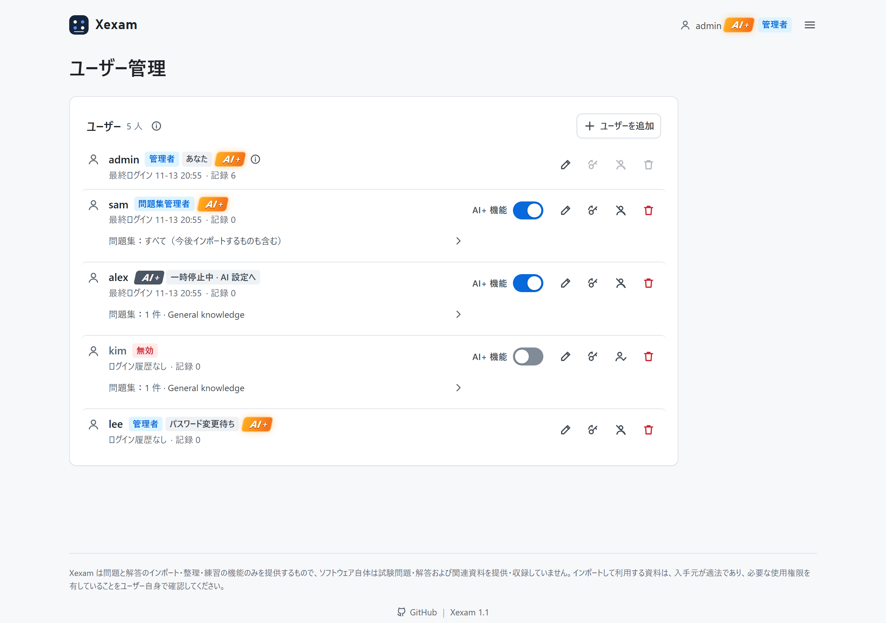

ユーザー管理の画面：2 人の管理者（admin と lee）、sam（**問題集を管理**、すべての問題集。今後インポートするものも含む。**AI+ 機能** がオンで、明るいバッジ付き）、alex（問題集 1 つ、General knowledge。**AI+ 機能** はオンだが **一時停止中** なので、バッジは暗い色で、スイッチの隣に **一時停止中** のチップが付きます）、kim（無効。**AI+ 機能** なし、バッジなし）。一般ユーザーには、問題集の行の下に **AI+ 機能** のスイッチがあります。

- **初回起動**（新規インストール、または v0.5 以前からアップグレードした後の最初の起動）：`admin` / `admin` でログインします（ログインページにも案内が出ます）。続けて新しいパスワード（8〜128 文字）の設定を求められます。v0.6 より前の学習記録、間違いノート、設定は、この管理者のものになります。
- **ユーザー管理**（メニュー、管理者のみ）：1 ユーザー 1 行で、権限、状態（**正常**、**無効**、**ロック中 · あと …**、**あと 3 回**、**パスワード変更待ち**）、権限があれば **問題集を管理**、**AI+** バッジ、作成日時、最終ログイン、学習記録（試験と練習）の数を表示します。操作：**編集**、**パスワード再設定**、**無効にする** / **有効にする**、**削除**、そして必要なときは **ロック解除**。管理者が作成またはパスワードを再設定したユーザーは、次のログインで自分のパスワードを設定します。自分自身を無効化・降格・削除することはできず、有効な管理者が最後の 1 人のときはその管理者を外せません。一覧は開いている間に自動で更新されるので、ロックが始まればそれも表示されます。
- **ユーザーが見られる問題集** は、独立した 2 つの設定で決まります：そのユーザーのためにチェックした既存の問題集と、**今後インポートする問題集も含める** です。後者を選ぶと、その後に（誰が、コマンドラインの `import` でインポートしたものでも）インポートされる問題集がすべて加わります。既存の問題集が加わることはありません。
  - 各ユーザーの行には、そのユーザーの問題集が表示されます：**問題集：すべて（今後インポートするものも含む）**（すべての問題集にチェックがあり、今後のものも含む）、**問題集：1 件 · General knowledge**（今後のものを含む場合は **（今後インポートするものも追加）** 付き）、**問題集：未選択（このユーザーには問題集が表示されません）**、または **問題集：今はなし（今後インポートするものは自動で追加）**。問題集の管理権限を持つユーザーの場合は、本人がアップロードした問題集がその下に並びます。
  - **変更** を押すと、例えば **alex が使える問題集** が開きます。問題集の一覧のすぐ上に、3 つのチェックボックスが 1 行に並びます：**問題集を管理**（問題集の管理権限）、**すべて選択**、**すべて解除**。一覧の先頭は **今後インポートする問題集も含める** で、専用のアイコンと細い線でほかと分けられ、その後に問題集ごとのチェックボックスが続き、それぞれにアップロードした人が表示されます。**すべて選択** は一覧のすべての問題集にチェックを入れ、すべてにチェックがあるときはすべて外します。**すべて解除** はチェックを外します。どちらも **今後インポートする問題集も含める** には触れません。チェックはオンを意味します。ページに説明文はありません：項目にマウスを重ねるかキーボードで移動するとツールチップとして表示され、**問題集** の隣の小さな **i** ボタンが一覧を説明します。**保存** は、何が変わったか（問題集か、**問題集を管理** だけか）を伝えます。
  - 変更はすぐに反映され、そのユーザーはログインしたままです。管理者は常にすべての問題集を見られます。問題集を外しても、そのユーザーの学習記録は履歴として残ります。問題集の管理権限を持つユーザーは、権限がある間、自分でインポートした問題集を常に見られます。
- **AI+ 機能**：問題集の行の下、一般ユーザーの各行に **AI+ 機能** のスイッチがあります。このスイッチは、ai-service が接続されていて、かつ [AI 設定](#17-ai-設定) で **AI+ 機能** がオンの間だけ表示されます。そうでないときは、各行に AI+ の行はなく、**ユーザーを追加** にも AI+ のチェックボックスはなく、ページの説明の下の注記 1 つが理由（AI 設定で機能がオフ、または ai-service が接続されていない）を伝えます。スイッチは保存されたまま残り、AI が使えるようになるとまた表示されます。確認なしですぐに反映され、そのユーザーはログインしたままです。ページは、サーバーが変更を確認した後にだけ、新しい状態と **sam の AI+ 機能をオンにしました。**（または **…オフにしました。**）を表示します。機能がオンなら、AI 設定で **AI+ 機能** がオンで、一時停止されていない間、そのユーザーは [AI チャット](#16-ai-チャット) を使えます。オフにすると、そのユーザーのために作成中の回答は約 2 秒以内に止まり、チャットとメモリーの閲覧と削除は引き続きできます。管理者にはスイッチがありません：その行には **AI+ 機能がオンなら、管理者は常に使えます。** と表示されます。AI が使えなくなった後も開いたままのページでは、クリックが **先に AI 設定で AI+ 機能をオンにしてください。** で拒否され（成功のメッセージは決して出ません）、何も変わらず、一覧が読み直されてスイッチが消えます。
  - **一時停止** と **再開** はもう 1 つのコントロールで、ユーザーごとに [AI 設定](#17-ai-設定) の **AI+ ユーザー** の下にあります。一時停止されたユーザーは機能とデータを保ち、ここではスイッチの隣に **一時停止中** のチップが表示され、一時停止してもこのスイッチは決して変わりません。
  - **バッジ**：名前の隣（自分の分はヘッダー、管理者にはユーザー管理と AI 設定）。3 つの状態があります：**明るいオレンジ** = このユーザーは今 AI を使える。**暗い色** = AI+ 機能はあるが、今は AI を使えない。管理者が一時停止した、AI 設定で機能がオフ、または ai-service に接続できないためで、ツールチップがどれかを示します（**AI+ 機能は管理者によって一時停止されています。**、一般ユーザーには **AI は現在利用できません。しばらくしてからもう一度試すか、管理者に連絡してください。**。管理者には **AI+ 機能は現在利用できません。**）。**バッジなし** = AI+ 機能なし。タッチ画面では暗いバッジをタップするとツールチップが開き、ほかの場所をタップするか **Esc** で閉じます。**設定** → **アカウント** にも理由が文で書かれます。管理者は、AI が使える間は明るいバッジ、そうでなければバッジなしです。
- **ユーザーを追加**：ユーザー名、初期パスワード、権限、権限の下の独立した行にある **AI+ 機能** のチェックボックス（AI が使える間だけ）、そして **変更** と同じ操作のある問題集の一覧（何もチェックがなく、**今後インポートする問題集も含める** もオフ。選ぶまで、新しいユーザーには問題集が表示されません）。新しいアカウントは有効な状態で作られます。管理者では **問題集を管理** と **AI+ 機能** のチェックボックスが表示されず、一覧はグレーアウトされます：管理者はもともとすべてを見られ、管理できるからです。**編集** では、ユーザー名、権限、**アカウントを有効にする** を変更できます（**問題集を管理** は v0.8 で **変更** に移りました）。問題集の管理権限を外すと、そのユーザーが次にページを移動したときから反映されます。
- **ユーザーの削除** では、そのユーザーの学習記録（ダイアログに件数が表示されます）、間違いノート、設定も削除されます。そのユーザーがインポートした問題集は削除されず、削除した管理者（あなた）に引き継がれます。
- **パスワードの間違い**：1 つのアカウントで 15 分以内に 5 回間違えると、1 分間ログインできなくなります。その後は 3 回間違えるごとに再びロックされ、時間は 5 分、15 分、30 分、1 時間、1 日と長くなります。ロックは入力されたユーザー名ではなくアカウントに対して記録され、ほかのユーザー名を試してもロックを回避することはできません。そのアカウントで以前ログインしたブラウザは別に数えるので、ほかの場所からの推測でロックされることはありません。ログインに成功する、**ロック解除**、管理者によるパスワード再設定、バックエンドの再起動、または 24 時間間違いがないと、5 回試せる状態に戻ります。ログインページに待ち時間が表示されます。
  - **ユーザー管理** では、行の下の短い説明に、どのブラウザがいつまでロックされているか、何回続けてロックされたかが表示されます。**ロック解除** は確認なしで、すぐに 5 回試せる状態に戻します。まだ試せる回数が残っているユーザーにも表示されます。
- **パスワードの変更**：**設定** → **アカウント** → **パスワードの変更**。ほかのブラウザでのログインは解除されます。
- **管理者のパスワードを忘れたとき**：`docker compose exec backend xexam-backend reset-password admin` で新しい仮パスワードが表示されます（次のログインで変更が必要です）。Xexam が動いたままでも使えます。ロックをすぐに解除するには、バックエンドを再起動します：`docker compose restart backend`。

<table>
<tr>
<td width="50%">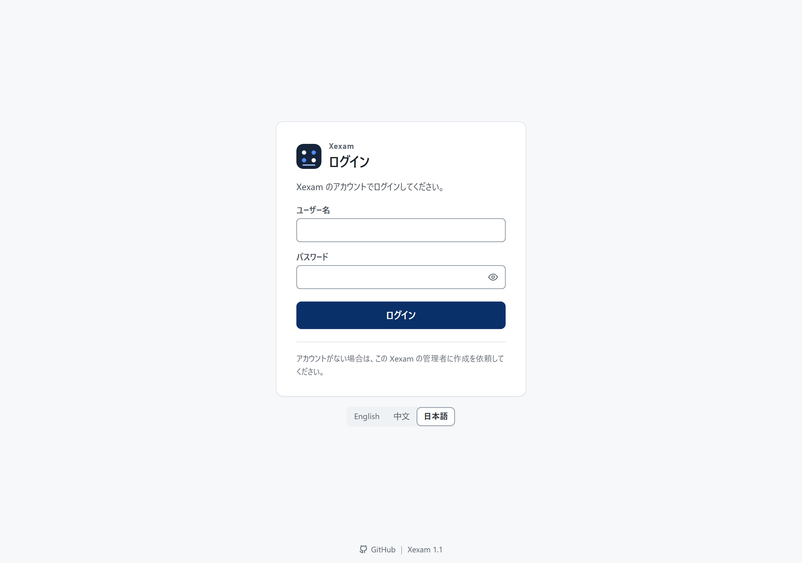</td>
<td width="50%">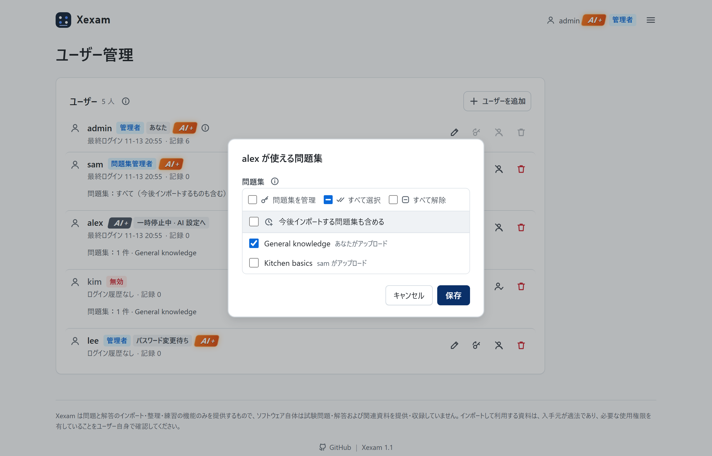</td>
</tr>
<tr>
<td>ログインページ。</td>
<td><b>alex が使える問題集</b>：一覧の上に <b>問題集を管理</b>、<b>すべて選択</b>、<b>すべて解除</b>、一覧の最初の項目に <b>今後インポートする問題集も含める</b>、その下にアップロードした人が分かる問題集。ここでは General knowledge だけにチェックがあります。</td>
</tr>
</table>

## 15. システムログ

**システムログ**（メニュー、管理者のみ。ほかのユーザーには **権限がありません** と表示されます）には、バックエンドが前回の起動以降に記録したログが、新しいものを一番下にして表示されます。起動、ログイン、ユーザーの変更、拒否されたリクエストやアップロードなどです。AI サービスの行も、`AI: ` で始まる形でここに表示されます。

- このページを開いている間、0.5 秒ごとに新しい行を読み込み、届いた行を追いかけて表示します。上にスクロールすると読み返せ、**最新へ移動** で一番下に戻ります。読み込みに失敗すると、次に試すまでの間隔を延ばし（最長 10 秒）、その理由を表示します。10 秒を超える読み込みは打ち切られ、失敗として数えられます。
- **一時停止** で新しい行の読み込みをいったん止め、**再開** で再び読み込みます。
- **レベル** で **すべて** の行、**警告**（とエラー）だけ、または **エラー** だけを表示します。**ログを検索** で文字列による絞り込みができます。
- 保持されるのは最新の 2000 行だけで、メモリ上にしかありません。再起動すると一覧は空に戻ります。それより前のログは、サーバー上の compose ファイルのあるフォルダで `docker compose logs backend` を実行して確認してください（Compose を使わない場合：`docker logs xexam-backend`）。
- ログの行ではユーザーをユーザー名で示します（`user "admin" updated user "alex"`。名前を変えると `(renamed from "…")` が付きます）。ログインで入力された、アカウントのない名前は決して記録しません。パスワード、セッションの Token、Cookie の値、問題文も決して含みません。まとまって届く拒否されたリクエストやログインの失敗は 1 分ごとにまとめるので、ログインしていない人がほかの行を押し出すことはできません。
- **AI の行**（`AI: …`）：ai-service の起動とバックエンドとの接続、AI 設定の変更、テスト、**AI+ 機能** のオン・オフ、失敗した AI の呼び出し（理由ごとに 1 分に最大 1 行）、チャットの保存期間、そして管理者がユーザーの AI チャットやメモを表示または削除するたび、ユーザーの AI+ 機能を一時停止または再開するたびの行です。たとえば `AI: user "admin" cleared one AI chat of user "sam"` と `AI: AI function turned off for user "sam" by admin "admin"`（一時停止のログの行）。ユーザーの **AI+ 機能** のオン・オフはバックエンドが記録します：`user "admin" turned AI+ on for user "sam"`。AI の行には、キー、メッセージ、回答、チャットのタイトル、メモの内容は決して含まれません。しばらくバックエンドに接続できなかったときは、ai-service が保持していた行（最大 500 行）を後から送り、捨てなければならなかった行の数も書き添えます。管理者による表示、削除、一時停止、再開の行が捨てられることはありません。ai-service が 25 秒ごとに送る定期的な報告は行を書きませんが、接続の状態は書きます：接続するたびに（起動時と再接続のたびに）一度 `AI: AI link: connected to the main service`、接続が切れたときに一度 `AI: AI link: lost the main service` です。

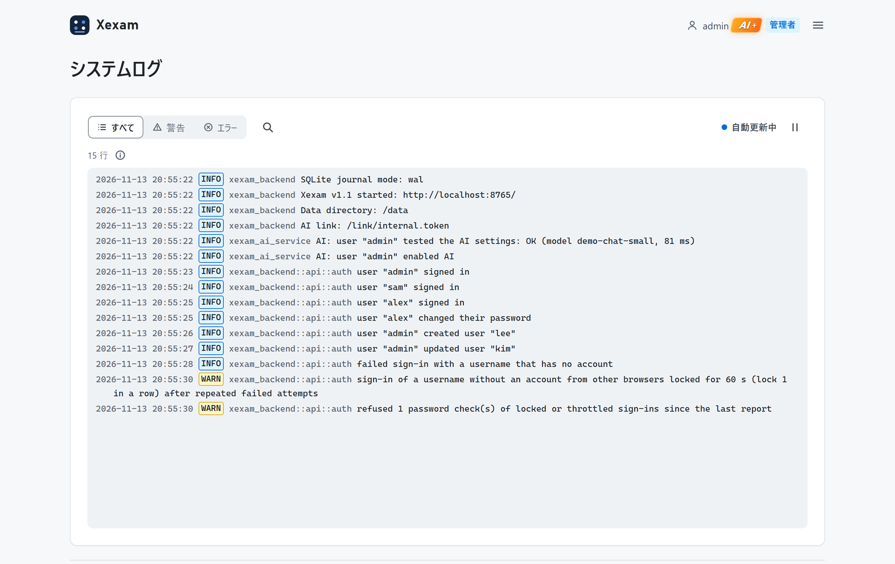

起動の行（最後の行は AI リンク）、admin、sam、alex のログイン、管理者によるモデルの一覧・AI 設定の保存・テスト・AI+ 機能のオンについての AI サービスの行、alex のパスワードの変更、管理者による lee の作成と kim の更新、そしてロックされるまで推測された架空のユーザー名が並んだシステムログ。上には **レベル** の絞り込み、検索欄、**一時停止**、下にはそれより古い行がどこにあるかの説明があります。

## 16. AI チャット

**AI チャット**（メニュー、**学習記録** と **ユーザー管理** の間）は、AI モデルとのチャットです。管理者が [AI 設定](#17-ai-設定) で AI を設定して **AI+ 機能** をオンにし、管理者でないユーザーには [ユーザー管理](#14-ユーザーとログイン) でそのユーザーの **AI+ 機能** をオンにする（かつ、一時停止していない）と表示されます。管理者は、AI+ 機能がオンの間はいつでも使えます。同じ **AI+ 機能** で、学習ページの AI サポートも使えます：練習中の **AI ヒント** と **AI 解説**（[第 5.1 節](#51-ai-ヒントai-解説ai-パネル)）、結果ページの **AI 分析**（[第 6.1 節](#61-ai-解析)）、記録の **AI まとめ**（[第 7.1 節](#71-ai-まとめ)）。その回答はここに保存されます（[第 16.1 節](#161-練習と試験とまとめのチャット)）。AI は専用のコンテナ `ai-service` で動きますが、ユーザーにその名前が表示されることはありません。AI に接続できないときは、AI チャットはメニューに表示されず、直接開くと **AI は現在利用できません。しばらくしてからもう一度試すか、管理者に連絡してください。** と **再試行** が表示されます（管理者には代わりに **ai-service に接続していません。** と表示されます）。AI を使えず、チャットもメモもないユーザーには、**AI チャット** のページに、理由と対処を伝える短い注記が表示されます：**管理者があなたの AI+ 機能を一時停止しました。再び使いたい場合は管理者に連絡してください。**、**AI+ 機能は現在利用できません。しばらくしてからもう一度お試しください。**、または **このアカウントには AI+ 機能がありません。管理者がユーザー管理でオンにできます。**

- **上部の案内**：タイトルの下に、常に **管理者はあなたの AI チャットとメモリーを閲覧・削除でき、AI の使用量も確認できます。** という 1 行があります。閉じることはできず、ポップアップもありません。管理者に見えるものは [第 17 節](#17-ai-設定) にあります。管理者による表示と削除はすべて、内容を含めずにシステムログに書き込まれます。
- **チャット** と **メモリー** は、タイトルの隣の 2 つのタブです。幅 900 px 以上では、チャットの一覧と開いたチャットが横に並びます。それより狭い画面では一度に 1 つずつ表示され、**チャット一覧** で一覧に戻ります。スマートフォンでは、会話の中でタイトル行（タイトルとタブ）は隠れ、会話自身のヘッダーだけが残ります。タイトル行は一覧に戻ると再び表示されます。
- **高さが固定されたウィンドウ**：メッセージはその中でスクロールし、入力欄は下に残るので、長いチャットでもページは伸びません。チャットを開くと、最新のメッセージから始まります。メッセージの領域は **Tab** で移動でき（フォーカスの枠と **メッセージ** という名前があります）、矢印キーでスクロールできます。
- **アドレスがチャットを保持します**：開いているチャットはアドレスバーでは `#/ai/<id>`、まだ送っていない新しいチャットは `#/ai/new` なので、再読み込みしたり同じアドレスをもう一度開いたりすると、同じチャットが表示されます。**新しいチャット** と **チャット一覧** は `#/ai` に戻ります。
- **フリーモード**（管理者のみ）：フリーモードは AI チャットのスイッチではなく管理者の状態で、**設定** の **AI チャットモード** で選びます（[第 9 節](#9-設定)）。オンの間は、**AI チャット** のタイトルの右に緑の **フリーモード** のタグが表示されます。通常モードでは何も表示されず、AI チャットにはスイッチも区切りもありません。通常は、すべての回答が Xexam の学習アシスタントの指示に従い、AI にはあなたのメモと今日の日付が渡されます。フリーモードでは、どのチャットでも（新しいものでも古いものでも）あなたが送るすべてのメッセージと、すべての **再試行** が、その指示も日付もメモもなしでモデルに送られます：モデルと直接やり取りし、後述の返答言語のルールだけが残ります。プロバイダー自身の安全ルールは常に適用されます。選択は次のメッセージから適用され、サーバーに保存されるので（再読み込みや別の端末でも同じ状態が表示されます）、既定ではオフです。すべてのメッセージが送られたときのモードを記録し、チャットが一方のモードからもう一方へ移った後は、モデルに現在のモードが短い 1 行で伝えられます。チャット自体にモードはありません。上限、使用量の統計、保存期間、**停止** と **再試行**、**覚えておく**、管理者のビュー、システムログは通常どおりに働きます。フリーモードではメモが使われないだけで、使えるのは管理者だけです。
- **返答の言語** は、あなたが何語で書いても、**設定** で選んだ言語（英語、中国語、日本語）です。そのメッセージで別の言語を頼んだ場合は除きます。**覚えておく** で作るメモもその言語で書かれます。各メッセージは、そのときの言語設定を使うので、画面の言語を切り替えると、次の回答の言語が変わります。
- **チャットの一覧**：**新しいチャット**、続いてあなたのチャットが新しい順に並び、それぞれにタイトル（最初のメッセージの冒頭、最大 60 文字）、最後のメッセージの時刻（開いているチャットの回答の作成中は、代わりに行に **回答中…**、または **考え中…** と表示されます）、削除ボタンがあります。その下に **すべてのチャットを削除** と、チャットの保存期間が表示されます。たとえば **チャットは最後のメッセージから 90 日後に自動で削除されます。** チャットは最初のメッセージで作られます。まだメッセージのない新しいチャットには、**質問すると会話が始まります。AI は設定で選んだ言語（日本語）で答えます。** と表示されます（言語名はあなたの言語のものです）。
- **メッセージ**：あなたのメッセージは書いたとおりに、回答は簡単な書式（太字、斜体、インラインコード、コードブロック、箇条書き。見出しは太字の行になり、リンクはリンクではなくただの文字として表示されます）で表示されます。各メッセージの上には **あなた** または **AI** とモデル、そして時刻。下には **コピー**（空のメッセージには表示されません）、あなたのメッセージにはさらに **覚えておく**（後述のメモリーを参照）があります。
- **メッセージを書く**：下部の入力欄（**何でも聞いてください…**）。パソコンでは **Enter** で送信し、**Shift+Enter** で改行します。タッチスクリーンでは **Enter** で改行します。**Ctrl+Enter**（Mac では **Cmd+Enter**）はどこでも送信です。入力メソッドで単語を変換している間（中国語や日本語の入力）は何も送信されません。メッセージは最大 16 000 文字です（サーバーを守るための固定の上限で、設定ではありません）。上限が近づくとカウンターが表示されます。
- **回答の作成中** は、回答が少しずつ表示され、その下に **回答中…** と出ます（推論モデルが最初の言葉の前にまだ考えている間は **考え中…**。考えている内容は表示も保存もされません）。上にスクロールすると **最新へ移動** が表示されます。次の質問はもう入力でき、回答が終わったら送信できます。**送信** ボタンは **停止** に変わります：**停止** は回答を終わらせ、そこまでの文章を残して **停止しました** と表示します。（**送信** をダブルクリックしても送信されるだけです。送信から 0.4 秒以内の **停止** のクリックは無視されるので、ダブルクリックで始めたばかりの回答が止まることはありません。）
- **回答はページがなくても続きます**：タブを閉じても、再読み込みしても、アプリを切り替えても、スマートフォンをロックしても回答は止まりません。AI サービスが書き続けて保存します。戻ってくると、チャットにはそこまでの文章が表示され、回答が終わるまで続きを追いかけます。
- **問題が起きたとき** は、回答はそれまでの文章を残し、その下に理由を表示します：**回答が中断されました：…** または **回答なし：…**（たとえば AI プロバイダーが混雑していたときや、時間内に応答しなかったとき）、あるいは **回答がモデルの長さの上限に達しました。** AI の設定の問題（キーの拒否、クレジットの不足、知らないモデル）は、ユーザーには **AI が正しく設定されていません。管理者に連絡してください。** と表示されます。チャットの最後の回答が失敗したか停止されたときは、その下の **再試行** でその回答を、今オンのモードで同じ場所に書き直します。フォーカスは入力欄に移り、入力欄に入力した文字はそのまま残ります。
- **回答は一度に 1 つ**：既定では、各ユーザーが同時に作成できる回答は 1 つです（AI ヒント、解説、解析、まとめも 1 つに数えます）。2 つ目は **まだ回答を作成中です。終わるまで待つか、停止を押してください。** になります（学習機能のウィンドウでは、**それを止めてこちらを作成** の付いた注記になります。[第 5.1 節](#51-ai-ヒントai-解説ai-パネル)）（管理者は 4 つまで許可できますが、同じチャットで 2 つになることはありません）。1 つのチャットのメッセージは最大 400 件（その後は **新しいチャットを始めてください**）、1 ユーザーのチャットは最大 1000 件（その後は古いチャットを削除）です。どちらも管理者が変更できます。練習・試験・まとめのチャット（[第 16.1 節](#161-練習と試験とまとめのチャット)）もどちらにも数えられます。
- **スマートフォン**では、会話の中のヘッダーは 1 行です：左に **チャット一覧**、中央にタイトル、右に削除ボタン。チャットの一覧では、**チャット** と **メモリー** のタブのあるタイトルの行が表示されます。画面のキーボードでページは押し上げられず、メッセージの一覧が短くなり、メッセージの入力欄はキーボードのすぐ上に残ります。
- **削除**：チャットの削除ボタンと **すべてのチャットを削除** は先に確認します。削除したチャットはすぐに消え、管理者からも見えなくなります。それより前に作ったバックアップには残っています。
- **読み取り専用**：AI を使えないときも、チャットやメモがある限り AI チャットは残り、上部の 1 行が理由を、暗いバッジのツールチップの言葉に **チャットとメモリーの閲覧と削除はできます。** を続けて伝えます：**AI+ 機能は管理者によって一時停止されています。**、**このアカウントには AI+ 機能がありません。**（あなたに AI+ 機能がない）、または **AI は現在利用できません。しばらくしてからもう一度試すか、管理者に連絡してください。**（AI 設定で AI+ 機能がオフ、または ai-service に接続できない）。閲覧と削除はできますが、書く、再試行する、覚えることはできません。作成中の回答は、切り替えから約 2 秒以内に止まり、一時停止の場合はすぐに止まります。

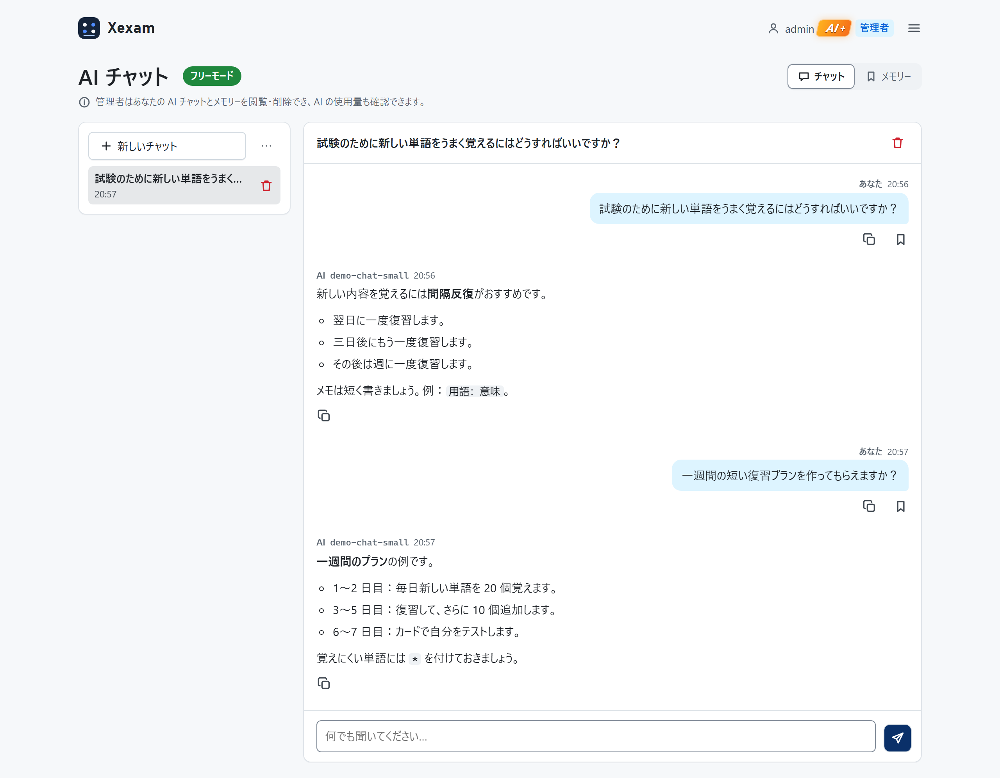

管理者として開いた AI チャット（名前の隣に **AI+** バッジ、フリーモードはオン）：タイトルの右の緑の **フリーモード** のタグ、タイトルの下の案内、**新しいチャット**、**すべてのチャットを削除**、保存期間の行のあるチャットの一覧、そして架空のプロバイダーへの 2 つの質問とその回答（太字、箇条書き、インラインコード）のあるチャット。すべてのメッセージの上に **あなた** または **AI** とモデルと時刻、下に **コピー**、質問の下に **覚えておく**、そして **送信** のあるメッセージの入力欄。通常モードではタグは表示されません。AI チャット自体にはモードの切り替えがありません（**設定** の **AI チャットモード** で選びます）。

**メモリー** は、AI がすべてのチャットで受け取る、あなたについての短いメモの一覧です（**AI はすべてのチャットでこのメモを参考にします。**）。たとえば、準備している試験のことです。

- **メモリー** のタブにはメモが並び、それぞれに **チャットから** 来たのか **手動で追加** したのかが表示され、**編集** と **削除** があります。**すべてのメモリーを削除**（赤い枠）もあります。**Esc** で編集を取り消し、フォーカスをその **編集** ボタンに戻します。入力欄 **新しいメモ** と **追加** でメモを 1 件加えます。カウンターが、上限に対して使った文字数を示します。既定では、1 件最大 200 文字のメモを 50 件まで残せます（管理者は両方の数を [第 17 節](#17-ai-設定) で変えられます）。
- あなたのメッセージの下の **覚えておく** は、そのメッセージを短いメモにするよう AI に頼みます。メモは回答の下に、編集できる欄として **メモリーに保存しますか？** と表示されます：**保存** で残し、**今はしない** で捨てます。メッセージが「Remember …」や「Please remember …」で始まるとき（中国語では 记住 や 请记住、日本語では 覚えておいて で始まるか、覚えておいて で終わるとき）は、回答が終わるとメモが自動で提案されます。**保存** を押さない限り何も保存されません。
- メモはチャットの保存期間では削除されません。あなた（または管理者）が削除するまで残ります。

AI チャットで AI プロバイダーが受け取るもの：あなたのメッセージ、同じチャットのそれまでのメッセージ、設定の言語を含む学習アシスタントの指示、あなたのメモ、今日の日付。履歴は、既定で約 24 000 文字に収まる新しいメッセージに限られ、毎回同じ方法で短縮されます：新しい 4 件のメッセージはそのまま、それより古い回答は 800 文字まで（「…(shortened)」の印付き）、古い質問は 2000 文字までに切り詰めます。フリーモードでは、その履歴、あなたのメッセージ、言語のルールだけを受け取り、チャットが一方のモードからもう一方へ移った後は、現在のモードを示す短い 1 行も受け取ります。プロバイダーは、このようなリクエストの先頭をプロンプトキャッシュに保持できることがあり、その後のリクエストが安く、速くなります：Anthropic では、指示と新しい質問の前の履歴にキャッシュポイントが付き、OpenAI 形式のプロバイダーは、対応していれば自動でキャッシュします。キャッシュから返された Token は、AI 設定の使用量に **キャッシュ** として表示されます。問題集や学習記録の内容は、あなたがメッセージに貼り付けない限り、AI チャットからは送られません。学習機能は、そのボタンを押したときにだけ、自分で問題を送り、どのリクエストも単独で扱われます（メモ、それまでのメッセージ、フリーモードは関係しません）：**AI ヒント** は、ページに表示している言語の問題と選択肢を送ります。**AI 解説** と **AI 分析** は、さらに問題集の答えとその解説を送り、解析ではあなた自身の回答も送ります。**AI まとめ** は、最大 70 問の間違えた問題のそれぞれについて、あなたの回答、正解、問題文、問題集の解説を送ります。問題と一緒に、言語のルールとその機能の指示を送り、あなたについてのそれ以外のことは何も送りません。ヒントに答えが含まれることはありません。それらのウィンドウは、何に基づいているかを表示し、回答を保存するチャットは第 16.1 節にあります。

### 16.1 練習と試験とまとめのチャット

AI ヒント、解説、解析、まとめのすべてが **AI チャット** に、それぞれの種類のチャットとして保存されます。通常のチャットのルールに従います：読む、続ける、削除することができ、管理者はほかのチャットと同じように閲覧・削除でき（[第 17 節](#17-ai-設定)）、保存期間で削除され、ユーザーごとのチャット数とチャットごとのメッセージ数の上限に数えられ、使用量は内容なしで集計されます。

- **練習または試験ごとに 1 つのチャット** で、タイトルは **`<開始時刻>-練習`** または **`<開始時刻>-試験`** です。たとえば `2026-11-11 21:58-練習`。時刻は、あなたが始めた時刻です（ブラウザーの時計を、ai-service のタイムゾーン、つまり使用量の日付と同じもので表します）。練習ページのヒントと解説、その結果ページの解析、記録の詳細ページの解析は、すべてこの 1 つのチャットに順に入り、それぞれに種類と問題の番号が付きます（**AI ヒント · 第 3 問**、**AI 解説 · 第 3 問**、**AI 分析 · 第 3 問**）。保存して中断し、あとで続けた練習は、同じチャットに書き続けます。
- **記録ごとに 1 つのまとめのチャット** で、タイトルは **`<記録の日時>-AI まとめ`** です。その記録のすべてのまとめが入り、まとめのリクエストはラベルだけが表示されます。たとえば **AI まとめ · 間違えた 80 問中 70 問**。
- **v0.9 より前に作られた記録** には開始時刻もセッションキーもありません。そのような記録の詳細ページでの最初の AI 分析は、その記録専用のチャットを作り、記録の日時と **-練習** または **-試験** で名付けます。一覧では、同じ分の 2 つ目のチャットのように見えることがあります。
- 時刻のあとの言葉は、画面の言語に従います（英語では **-Practice**、**-Exam**、**-AI summary**。中国語では **-练习**、**-考试**、**-AI总结**。日本語では **-練習**、**-試験**、**-AI まとめ**）。
- 学習の回答には **再試行** も **覚えておく** もありません。**コピー** はほかと同じように使えます。そのようなチャットにも、ほかのチャットと同じようにフォローアップの質問を書けます。それは通常の AI チャットのメッセージで、そのチャットのそれまでのメッセージが履歴になります。学習ウィンドウの **再生成** は、同じチャットに新しい回答を加えてそれを表示し、前の回答はチャットに残ります。
- **学習チャットを開く**：学習のウィンドウが AI チャットを開くことは決してありません。パネルには回答が保存されると **AI チャットに保存済み** と表示され、そのヒントがチャットの名前を示します。**AI チャット** をメニューから開き、そのチャットを自分で選んでください。
- **削除**：学習記録を削除しても、そのチャットは残ります。AI チャットでチャットを削除すると、その保存済みの回答も消えます：その問題のウィンドウは、次にそのボタンを押したときに、新しいチャットに新しい回答を書きます。**すべてのチャットを削除** と管理者による消去も、すべてについて同じです。

## 17. AI 設定

**AI 設定**（メニュー、管理者のみ。ほかのユーザーには **AI 設定を開けるのは管理者だけです。** と表示されます）では、AI を接続し、テストし、オンにし、見守ります。このページは、ai-service が動いていないときも必ず開きます。

**5 つのタブ。** AI 設定は、状態のチップの下にタブが 5 つある 1 つのページです：**AI+ 機能**（スイッチ、接続、モデル。下の 1〜3）、**AI+ ユーザー**（4）、**AI 使用量**（5）、**AI 問題集**（[17.5 節](#175-ai-問題集タブ)）、**AI セキュリティ**（チャットの保存期間とセキュリティ上限。6 と 7）。スマートフォンでは、タブは 1 行のアイコンと短いラベル（**機能**、**ユーザー**、**使用量**、**安全**）になります。問題集を AI で生成する 5 つ目のタブは後のバージョンで加わり、このバージョンにはありません。

**ai-service との接続。** ページはまず、ai-service が接続されているかをメインサービスに尋ねます：ai-service は、起動したとき、何かが変わったときはすぐに、25 秒ごとに、そして停止するときに、自分の状態をメインサービスに報告します。60 秒より古い報告は、接続されていないものとして扱われます。接続されている間は、チップの下の 1 行に **ai-service に接続済みです（バージョン 1.0、最終報告：15:04）。** と表示され、その下の設定が読み込まれます。接続されていないときは、ページには、原因を示す **ai-service との接続** のパネルだけが、**最終報告：…**（または **メインサービスの起動後、報告はまだありません。**）、**バージョン：…**、**このページは 10 秒ごとに自動で再確認します。**、**再試行** と一緒に表示され、ai-service が接続されると、設定は自動で表示されます。原因は次のとおりです：

| パネルの表示 | 意味 | 対処 |
|---|---|---|
| **メインサービスに接続できません。しばらくしてからもう一度お試しください。** | ブラウザがメインサービス（バックエンド）から応答を得られない | `xexam-backend` が動いているか確認する |
| **メインサービスに内部 Token が設定されていないため、ai-service が接続できません。** | メインサービスで AI のリンクがオフになっている | メインサービスのログの、`AI link off` で始まる行を読む |
| **ai-service が動いていないか、接続できません。** | ai-service に応答するものがない | `ai-service` コンテナが動いているか確認する。v0.7.5 からのアップグレード後は、新しい `docker-compose.yml` をダウンロードする（このコンテナが加わります） |
| **ai-service は停止しました。** | 最終報告が、停止中であることを伝えていた | `ai-service` コンテナをもう一度起動する |
| **ai-service は動いていますが、メインサービスに接続していません。** | 応答はあるが、その報告が受け付けられていない | `XEXAM_INTERNAL_TOKEN` が両方のサービスで同じ（または両方とも未設定）であること、`XEXAM_AI_BACKEND_URL` がメインサービスを指していることを確認する |
| **ai-service は動いていますが、メインサービスの起動後まだ報告が届いていません。** | 起動したばかり | 待つ：25 秒ごとに報告します |

メインサービスについての文は、メインサービス自体に接続できないときにだけ表示されます。ai-service がないことをメインサービスのせいにすることはありません。

上部の 4 つのチップが、設定がどこまで進んだかを示します：**接続を保存済み**（または **接続未設定**）、**モデルを保存済み**（**モデル未設定**）、**テスト成功**（**テスト失敗**、**未テスト**）、**AI+ 機能はオン**（**AI+ 機能はオフ**。これは全体のスイッチの状態を示します）。新規インストールで、またチャットの保存期間だけを保存した後は、最初のチップが **接続未設定** と表示され、接続を保存するまで、ページはプロバイダーにモデルの一覧を要求しません。保存したキーを復号できなくなったとき（AI の暗号化キーが変更されたか失われたとき。[deployment.md](deployment.md) の 3.2 節を参照）は、案内がそれを伝えます：キーを入力し直してから、テストして AI+ 機能をオンにしてください。その下に次のセクションが続きます。

1. **接続**：**プロバイダー** と、そのアドレスとキー。
   - **OpenAI 互換 API**（既定）：**API ベース URL**（最初は `https://api.openai.com/v1`。OpenAI 互換のアドレスは、ローカルのサーバーのものも含めて通常 `/v1` で終わります）と **API キー**。
   - **Anthropic**：**API ベース URL**（`https://api.anthropic.com`。Xexam が自分で `/v1/messages` を付けるので、末尾の `/v1` は取り除かれます）と **API キー**。
   - **Cloudflare AI Gateway**：**Gateway ベース URL**。例：`https://ai-gateway.example.com/<route>`（`…/openai` または `…/anthropic`）。**API 形式**：OpenAI（chat completions）または Anthropic（messages）。アドレスの最後の部分から自動で入り、変更もできます。**Gateway の認証方式**：`Authorization: Bearer`、`x-api-key`、`cf-aig-authorization` のいずれか。**Gateway の API キー**。そして **プロバイダーのキー（Gateway が必要とする場合のみ）**。Gateway 自体がプロバイダーのキーを持っているときは不要です。
   - キーの欄は常に空です（欄の隣の目のボタンは **キーを表示** / **キーを隠す** で、入力した内容だけを表示します）。各欄の下に **保存済み：…1234**（12 文字以上のキーでは最後の 4 文字）、**保存済み**、**未設定**、または **復号できません。入力し直してください** と表示されます。空欄なら保存済みのキーを使い、**このキーを削除** で削除します。キーは空白なしの表示可能な文字 1〜400 文字です。
   - **保存したキーが勝手に新しいアドレスへ送られることはありません**：プロバイダーを変えたとき、またはアドレスを別のサーバー（別のスキーム、ホスト、ポート）に変えたときは、保存したキーをすべて入力し直す必要があります（そのとき空欄ならキーは削除されます）。同じサーバーの別のパス、たとえば 1 つの Gateway で `/openai` から `/anthropic` に変えたときは、キーはそのままです。
   - `http://` のアドレスには警告 **このアドレスは http:// のため、キーは暗号化されずに送られます。** が表示されます（`localhost`、`127.0.0.1`、同じ Docker ネットワークのコンテナのようにドットのない名前では表示されません）。
   - Gateway の認証方式が `Authorization: Bearer`（OpenAI 形式）か `x-api-key`（Anthropic 形式）のときは、Gateway のキーとプロバイダーのキーが同じヘッダーを必要とします。その場合は `cf-aig-authorization` を選ぶか、プロバイダーのキーを削除してください。
   - **保存**。AI+ 機能がオンで、変更に新しいテストが必要なときは、Xexam が先に確認します（**保存すると、AI+ 機能が全員に対してオフになります。新しい設定のテストに成功したら、もう一度オンにしてください。保存しますか？**）。それから保存して、それを伝えます（**AI 設定を保存しました。AI+ 機能は全員に対してオフになりました。新しい設定をテストしてから、AI+ 機能をもう一度オンにしてください。**）。保存すると、モデルが自動で一覧になります。チャットの保存期間やセキュリティ上限だけを保存しても、何もオフになりません。
2. **モデル**：**現在のモデル：…**、続いて、プロバイダーが返したモデルを専用のスクロールする一覧から選べる欄が 1 つ（入力すると絞り込まれ、合うものがないときは **一致するモデルがありません。**）、**一覧を更新**、**モデルを保存**。チャットモデルではなさそうなモデル（名前が、埋め込み、リランキング、安全分類、画像生成、音声、文書解析、画像専用のモデルを思わせるもの）は一覧の最後に、小さなタグ（**埋め込み**、**リランキング**、**安全分類**、**画像生成**、**音声**、**文書解析**、**画像専用**）付きで並び、それらを入力・選択・保存したときは、ヒントがそれを伝えます（**… はチャットモデルではなく埋め込みモデルのようです。AI チャットにはチャットモデルが必要です。使えるかどうかはテストで確認できます。**）。何も隠されません：どのモデルでも保存できます。プロバイダーがモデルの一覧を返さないときは、モデル ID を手入力します。別のモデルを保存したときも新しいテストが必要です。接続のフォームに保存していない変更がある間は、一覧の取得とテストは待ちます：**先に接続設定を保存してください。**
3. **テストと有効化**：**テスト** は、保存した設定で短いリクエスト（「Test」）を 1 つ、チャットと同じ方法で送ります（モデルの欄に保存済みとは別のモデルが入っているときは、ボタンが **モデルを保存してテスト** になり、先にそれを保存します）。実行中は秒数を数え（**テスト中…（12 秒）**）、**遅いモデルでは 1〜2 分かかることがあります。** と添えます。その後、**テストに成功しました（… ms）。AI+ 機能をオンにできます。**（機能がすでにオンのときは **テストに成功しました（… ms）。**）または **テストに失敗しました：…** とヒント（キーを確認する、別のモデルを選ぶかアドレスを確認する、モデルが遅いか今は使えないかもしれない、`ai-service` コンテナが `egress` ネットワークにあることを確認する）を、さらに **最後に成功したテスト：…** を表示します。**テスト** の下の行は、隣のスイッチに、どちらの向きでも常に従います。設定に原因がある失敗（キーの拒否、クレジットや利用枠の不足、知らないモデルやアドレス、拒否されたリクエスト、読み取れない応答）では AI+ 機能がオフになります。プロバイダー側の一時的な問題（レート制限、過負荷、プロバイダーのエラー、時間内の応答なし、接続できない）ではオフになりません：**AI+ 機能はオンのままです。プロバイダー側の一時的な問題のようです。** **AI+ 機能** のスイッチは、今の設定のテストに通った後にだけオンにできます（そうでなければ **設定を保存してテストに成功すると、オンにできます。** と表示されます）。テストに通っても、自動でオンになることはありません。オンにすると **AI+ 機能をオンにしました。**（オフなら **AI+ 機能をオフにしました。**）と表示され、メインサービスにもすぐに伝わるので、**ユーザー管理** の AI+ のスイッチが表示または非表示になります。オフにすると、作成中の回答はすべてすぐに止まります。**AI+ ユーザー** の一覧は、テストの後とスイッチの操作の後に読み直されます。
   - 遅いプロバイダーでは、テストに時間がかかることがあります：最大 2 分で、プロバイダーが最初のリクエストを拒否したときは、設定を調整してもう一度試します。Cloudflare Tunnel の後ろでは、Cloudflare が約 100 秒でリクエストを切ることがあります。それでもテストは最後まで行われ、ページを再読み込みすると結果が表示されます。
4. **AI+ ユーザー**：すべての管理者と、**AI+ 機能**（ユーザー管理のスイッチ）を持つすべてのユーザー。一時停止中のユーザーも含みます。列は、**ユーザー**、**バッジ**（[第 14 節](#14-ユーザーとログイン) のように、明るい、暗い、なし。管理者にはツールチップの管理者向けの文言が表示されます）、**ロール**、**AI+ 機能** の状態、**チャット**、**メモリー**、**入力 Token**、**出力 Token**、**最終利用**、**表示** です。幅 900 px 未満では 2 つの Token の列が省かれ（**使用量** にあります）、時刻が折り返されることがあるので、表はタブレットに収まります。560 px 未満では、各ユーザーが小さなカードになり、1 行目に名前と **表示**、その後に項目ごとに「列名：値」の 1 行が並びます。（ユーザー管理で削除したアカウントの AI データは、この一覧を読み込むときに、そしていずれにせよ 10 分ごとに削除されます。）
   - **AI+ 機能** の状態：**利用中** または **一時停止中**。ボタンは 1 つで、**一時停止** または **再開** です（管理者には **管理者は常に AI を使えます。** と表示され、ボタンはありません）。確認はありません。**一時停止** は、そのユーザーの作成中の回答をすぐに止め、それ以降、そのユーザーはチャットとメモリーの閲覧と削除はできますが、書く、再試行する、覚えることはできません（AI チャットは読み取り専用の行に **AI+ 機能は管理者によって一時停止されています。** と表示します）。**再開** は機能を元に戻します。ユーザーは一覧に残ってデータを保ち、ユーザー管理の **AI+ 機能** のスイッチには触れません。一時停止は **再開** するまで続き、そのユーザーの AI+ 機能をオフにしてまたオンにしても変わりません。システムログは両方を記録します。たとえば `AI: AI function turned off for user "sam" by admin "admin"`（一時停止のログの行）。ユーザー管理で **AI+ 機能** をオフにしたユーザーはこの一覧から外れます。そのユーザーのチャットとメモは残り（閲覧と削除はできます）、削除されるか、保存期間でチャットが消えるまで続きます。
   - **表示** を押すと、例えば **sam の AI データ** が **読み取り専用** の印付きで開き、チャット（各メッセージに書いた人と時刻）とメモリーが表示されます。チャットをクリックすると読めます。**このチャットを削除**、**すべてのチャットを削除**、**すべてのメモリーを削除** は、先に確認します（確定ボタンは **削除**）。削除の後も、フォーカスはダイアログの中に残ります。ビューアーにはフリーモードも通常モードも表示されません。表示と削除はすべて、ユーザー名でシステムログに書き込まれます。たとえば `AI: user "admin" viewed the AI chats and memories of user "sam"` で、内容は決して含まれません。
5. **使用量**：**過去 7**、**30**、**90**、**365 日** について、合計（**呼び出し**、**入力 Token**、**出力 Token**、**キャッシュ**、**エラー**）、続いて **ユーザー別**、**モデル別**、**機能別**、**期間別**（7 日と 30 日は日ごと、90 日と 365 日は月ごと）。**ユーザー別** には検索欄、並べ替えできる列、1 ページ 10 行があります（スマートフォンでは横にスクロールできる小さな表で、名前の列は固定）。**機能別** は呼び出しを **AI チャット**（メモリーの作成を含む）、**AI ヒント**、**AI 解説**（結果ページの AI 分析を含みます）、**AI まとめ**、**AI 問題集作成**、**AI 問題集のインポート**、**その他（モデル一覧 / 接続テスト）** に分けるので、棒の合計が全体の合計になります。合計の下の 1 行にキャッシュの数値が出ます：**キャッシュ：読み取り X / 書き込み Y Token**。古いバージョンで記録された回答は **AI チャット** として数えます。**キャッシュ** は、**入力 Token** のうち、プロバイダーがプロンプトキャッシュから返した分です（プロバイダーが報告しないときは 0）。呼び出しには、テスト、モデルの一覧取得、メモリーの作成も含まれます。削除されたユーザーは、1 行の **削除されたユーザー** にまとめられます。Token はプロバイダーが報告するとおりに数え、報告しないプロバイダーでは 0 になります。残るのは数字だけで、質問や回答の内容は決して残りません。日付は ai-service のタイムゾーン（`TZ`）に従います。
6. **チャットの保存期間**：**自動削除までの日数**。1〜3650 で、既定は 90 です。チャットは、種類にかかわらず、最後のメッセージからその日数が過ぎると削除されます（1 時間ごとに確認。実行中の回答を待たせないよう、少しずつに分けて削除します）。メモには影響しません。練習・試験・まとめのチャット（[第 16.1 節](#161-練習と試験とまとめのチャット)）も同じです。
7. **セキュリティ上限**（タブ **AI セキュリティ**）：各数値に範囲と初期値があり、**初期値に戻す** と **保存** があります。変更はすぐに反映され、AI がオフになることはありません。上限を下げても、何も削除・短縮されません：それを超える新しいチャット、メッセージ、メモ、リクエストを拒否するだけです。変更はすべてシステムログに書き込まれます。たとえば `AI limits changed by admin "admin": callsPerHour 20 -> 30`。
   - **プロバイダーへのユーザーごとのリクエスト数**（管理者を含め全員に対して。リクエストは結果にかかわらず数えられ、フリーモード、メモの提案、すべてのヒント、解説、解析、まとめ、チャットの回答が数えられます。管理者の接続 **テスト** とモデル一覧は数えられません）：

     | 上限 | 初期値 | 範囲 |
     |---|---|---|
     | **1 分あたり** | 5 | 1–100 |
     | **1 時間あたり** | 20 | 1–2000 |
     | **1 日あたり** | 100 | 1–20000 |

     直近の 1 分と 1 時間は、ローリングの期間（直近 60 秒と直近 60 分）です。1 日の数は **ai-service のタイムゾーン**（その `TZ` 設定。たとえば `TZ=UTC`）の 0:00 に再び 0 から始まります。各値は、その前の値以上でなければなりません：1 時間あたりは 1 分あたり以上、1 日あたりは 1 時間あたり以上。どれかの上限に達すると、リクエストは何も送られる前に拒否され、何も保存されず、メッセージはどの上限か、いつ再び AI を使えるかを示します。例：**AI リクエストの上限に達しました（1 時間あたり 20 回）。上限の変更は管理者に依頼してください。約 12 分後（14:05）に再び使えます。** 1 日の上限では **明日 0 時以降に再び使えます。** と示されます。この理由で拒否されたリクエストはプロバイダーに送られず、数えられません。
   - **回答とメモリーの長さ**：

     | 上限 | 初期値 | 範囲 | 意味 |
     |---|---|---|---|
     | **回答 1 件の最大 Token 数** | 3000 | 1–250000 | 回答の最大 Token 数。サーバーはこの値をそのまま `max_tokens` としてモデルに送ります。プロバイダーの上限がそれより小さければ、そちらが適用されます。 |
     | **メモリー 1 件の最大 Token 数** | 1000 | 50–250000 | 最も長いメモの長さ（推定 Token 数）。ASCII 文字は約 1/4 Token、そのほかの文字は 3/2 Token として数えます。 |

     上限に達した回答は途中で切れ、**回答がモデルの長さの上限に達しました。** と表示されます。多くの間違えた問題をまとめる AI まとめが最も切れやすいので、そのときは上限を上げてください。先に考えてから答えるモデルにも上限を上げてください。既存のメモリーやメッセージが切られることはありません。
   - **サーバーの保護**（これらはサーバーを守るためのもので、利用量の制限ではありません）：

     | 上限 | 初期値 | 範囲 |
     |---|---|---|
     | **ユーザーが同時に作成できる回答** | 1 | 1–4 |
     | **同時に実行するモデル呼び出し（サーバー全体）**。管理者のテストも含む | 16 | 1–64 |
     | **1 ユーザーのチャット数** | 1000 | 10–100000 |
     | **1 チャットのメッセージ数** | 400 | 20–5000 |
     | **1 ユーザーのメモリー数** | 50 | 1–1000 |

     ユーザーのメッセージは常に **16 000 文字** までです。これは固定で、設定ではありません。

   練習・試験・まとめのチャットも、ほかのチャットと同じようにチャットの上限を使います：練習、試験、記録のまとめごとに 1 つのチャットで、AI ヒント、解説、解析、まとめのそれぞれが 2 件のメッセージ（質問と回答）です。**1 チャットのメッセージ数** が既定の 400 のとき、1 つの練習または試験のチャットは約 200 回のリクエストで、ウィンドウに **このチャットは長くなりすぎました（最大 400 件のメッセージ）。新しいチャットを始めてください。** と表示されます。とても長い練習をするときは、上限を上げてください。**1 ユーザーのチャット数** に達すると、新しい学習のチャットが、新しい AI チャットのチャットと同じように止まります（ウィンドウには、設定した数が表示されます）。

<table>
<tr>
<td width="50%">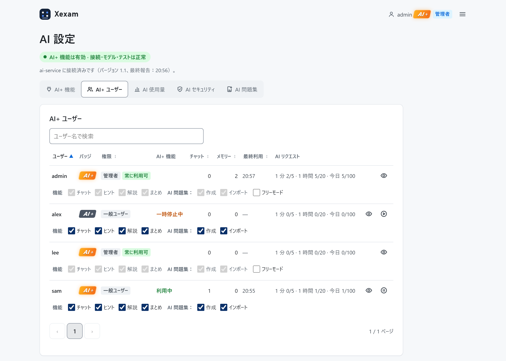</td>
<td width="50%">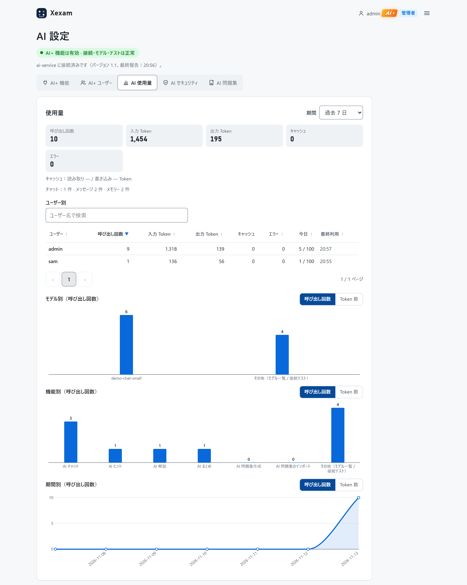</td>
</tr>
<tr>
<td><b>AI+ ユーザー</b> タブ：状態のチップと 4 つのタブの下に、AI+ のある各ユーザーのバッジ、役割、<b>AI+ 機能</b>（<b>常に利用可</b>、一時停止のある <b>利用中</b>、再開のある <b>一時停止中</b>）、上限に対する直近 1 分・1 時間・今日の AI リクエスト。これらの画像の値はすべて架空のプロバイダーのものです。</td>
<td><b>AI 使用量</b> タブ：過去 7 日の合計、会話、続いて <b>ユーザー別</b>（1 日の上限に対する <b>今日</b>）、<b>モデル別</b>、<b>機能別</b>、<b>期間別</b>。</td>
</tr>
</table>

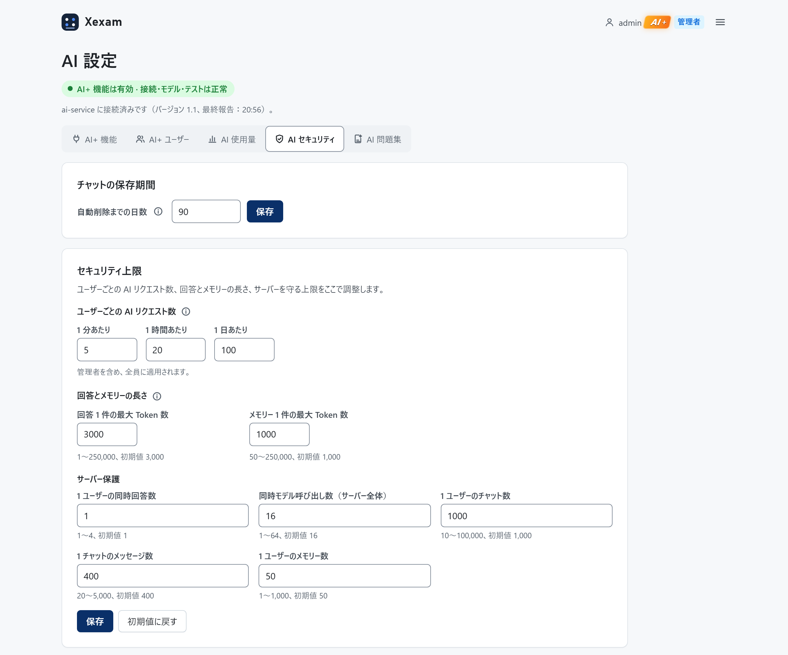

**AI の設定の手順**：**AI 設定** に **ai-service は接続されています** と表示されているか確認する。プロバイダーを選び、アドレスとキーを入力して **保存**。一覧からモデルを選び（または ID を入力し）、**モデルを保存**。**テスト**。**AI+ 機能** をオン。その後、使ってよいユーザーの **AI+ 機能** を **ユーザー管理** でオンにし（上の手順が終わるとスイッチが表示されます）、ユーザーの **AI+ 機能** の一時停止と再開はここの **AI+ ユーザー** で行います。モデルと直接話したい管理者は、**設定** の **AI チャットモード** で **フリーモード** を選びます。ai-service がどこで動き、どのようにプロバイダーに接続し、各プロバイダーに何が必要か：[deployment.md](deployment.md) の 3.4 節。

### 17.5 AI 問題集タブ

**AI 問題集** タブでは、作成とインポートの上限を 2 つのカードで設定します：**AI 問題作成**（回数、出題元、1 回の作成、呼び出し）と **AI ファイルインポート**（ファイル、呼び出し）。その後に **最近の AI 問題集の処理** が続きます：時刻、ユーザー、元、新しい問題集、状態、問題数、呼び出し / Token（スマートフォンでは各ジョブが小さなカード）。上限を変えても AI はオフにならず、作成済みのものも変わりません。

| 設定 | 既定値 | 内容 |
|---|---|---|
| 1 ユーザーの 1 日の回数 | 3 | 作成とファイルインポートの合計。サーバー時刻の 0:00 にリセット。スイッチがオンのとき管理者は対象外。 |
| 無制限（作成） | オン | 作成ジョブに呼び出し回数の上限、1 回の呼び出しの回答の長さの制限、時間制限がありません。プロバイダーのエラー 3 回連続と **中止** では止まります。 |
| 生成 1 回あたりの呼び出し | 15 | 無制限がオフのときに使います（8〜40）。管理者を含む全員に適用。 |
| 1 回の呼び出しの最大 Token 数 | 20000 | 1 回の呼び出しで書ける最大 Token 数（1000〜250000）。1 回で作れる問題数はこれで決まります。どちらかの無制限スイッチがオンの間は灰色。 |
| 無制限（インポート） | オン | ファイルインポートも同様（認識を含む）。 |
| インポート 1 回あたりの呼び出し | 25 | 無制限がオフのときに使います（8〜40）。認識の呼び出しを含みます。 |
| 認識 1 回あたりの呼び出し | 20 | 無制限がオフのときに使います：確認の段階の前に 1 つのファイルを読むときの最大呼び出し回数（8〜40）。 |
| インポートファイルの最大サイズ | 20 MB | AI インポートカードのサイズ上限。 |
| インポートの最大問題数 | 50 | 問題がすでに含まれるファイルから 1 回で取り込む最大問題数（1〜50）。それより多いファイルは先頭から取り込みます。 |

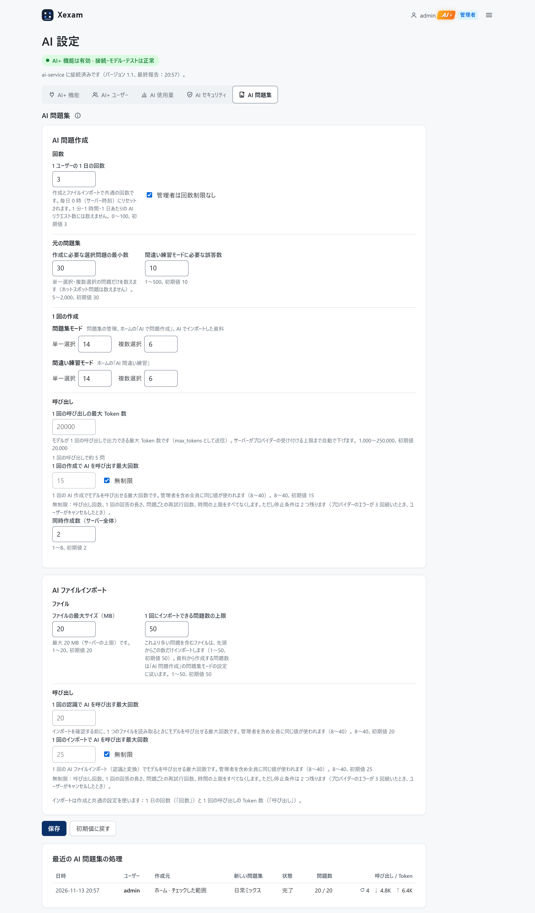

### 17.6 機能の権限

**AI+ ユーザー** では、ユーザーごとに 6 つのチェックボックスがあります：**チャット**、**ヒント**、**解説**、**まとめ**、**作成**、**インポート**。オフの機能は、そのユーザーにはグレーアウトされ、**このユーザーはこの機能を使えません。** と表示されます。管理者の行では 6 つすべてがオンで固定されています。また、管理者の行には **フリーモード** のスイッチがあります（以前は設定にありました）。一時停止は、どのチェックボックスよりも優先されます。

### 17.7 AI 使用量のグラフ

**AI 使用量** には 3 つのグラフがあります：**モデル別**、**機能別**、**期間別**。タイトルには描かれているものが書かれます（例：**モデル別（呼び出し回数）**、**モデル別（Token：入力 / 出力）**）。3 つすべての右上に **呼び出し回数 | Token 数** の切り替えがあります（選択はこのブラウザーに記憶されます）。Token 数では、棒は入力と出力の Token を積み上げて上に合計を表示し、**期間別** は合計の線の下に入力と出力を積み上げた面で描き、小さな凡例が付きます。軸も K / M です。すべての棒に数字があり、**その他（モデル一覧と接続テスト）** の棒で合計が一致します。棒と軸の大きな数は K / M で表示されます（例：12.3K、4.5M）。上部の合計は正確な値で、桁区切りが付きます。ヒント（ホバー、タップ、矢印キー）には、正確な呼び出し回数、Token、エラーが出ます。**期間別** は日ごと（長い期間では月ごと）の線で、各点の周囲は広くホバーやタップができます。スクリーンリーダー向けに、各グラフの数字は文字の表でも読めます。


## 18. iPhone で使う

- iPhone の Safari でサービスのアドレスを開きます（先に [deployment.md](deployment.md) の第 4 節に従って、スマートフォンから Xexam に接続できるようにしてください）。**iOS 15.4 以降**が必要です。
- 共有ボタン → **ホーム画面に追加** をタップすると、以降は独立したアプリのように全画面で開きます。アイコンは Xexam のアイコンで、紺色の正方形に 4 つの点と水色のバーです。
- 右上の三本線のボタンで、パソコンと同じ小さなメニューが開きます。
- ホームでは、**すべて** と **間違いノート** が **試験・練習を始める** のタイトルの横に（日本語と英語の表示ではアイコンと問題数だけで）表示されます。画面下部に固定されたバーは 2 行で、1 行目に範囲、**問題数**、**シャッフル**、2 行目に **試験を開始**（幅の広いほう）と **練習を開始** が並びます。
- 試験と練習のページでは、画面下部のバーに **前の問題**、**次の問題**、**あとで見直す** がアイコンで並びます。練習では **答え合わせ** と **次の問題** が、決まった場所にある 2 つの別々のボタンになり、AI+ 機能のあるユーザーには、同じバーに AI のアイコンもあります。上部の行に **回答済み x/n** と緑の **試験を終了**（練習ではオレンジの **練習を終了**）ボタンがあり、問題の下の解答用紙には終了のボタンはありません。
- 学習記録はコンパクトなカードで表示されます。**AI+ 機能** があると、各カードに **AI まとめ** のボタンがあります。
- **AI+ 機能** があると、AI+ パネルは問題カードの下にあります。最初は閉じていて、バーの **AI ヒント** または **AI 解説** で開き、山形のボタンで閉じます。パネルのボタンは決まった位置にあり、回答が保存されると、パネルの中の **AI チャットに保存済み** が表示されます（タップするとチャットの名前が出ます）。使えないコントロール（AI が一時停止中または使えない）は同じ場所に残り、タップすると使えない理由が表示されます。**AI まとめ** はページの大部分を覆うウィンドウを開きます。
- **AI チャット** は、チャットの一覧か 1 つのチャットのどちらかを表示します（**チャット一覧** で戻ります）。会話の中ではヘッダーが 1 行になり、メッセージの入力欄は画面の下部、キーボードのすぐ上に残ります。
- ボタンなどのタッチ領域は 44 px 以上で、ノッチと下部のホームバーのセーフエリアにも対応しています。

iPhone でのスクリーンショット（幅 390 px）：

<table>
<tr>
<td width="25%">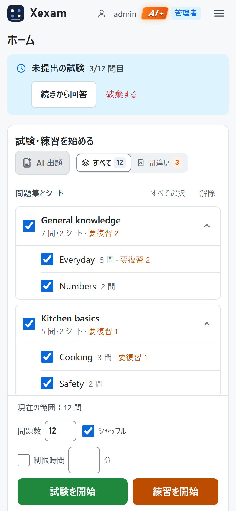</td>
<td width="25%">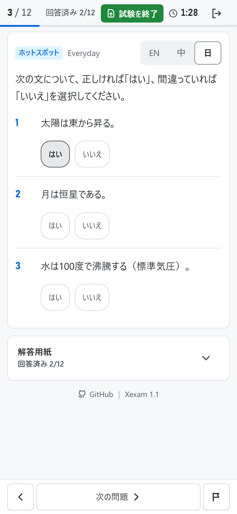</td>
<td width="25%">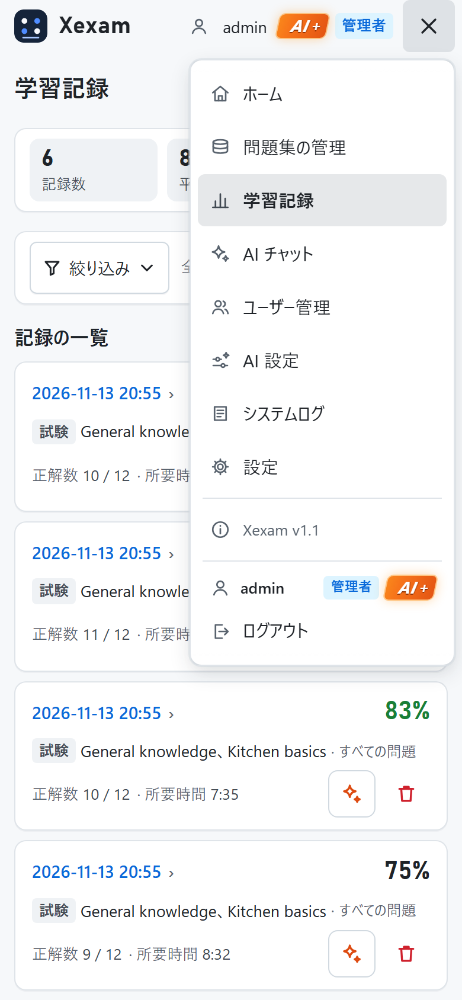</td>
<td width="25%">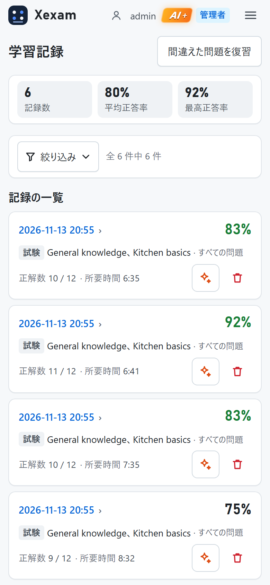</td>
</tr>
<tr>
<td>ホーム：画面下部に、範囲、<b>問題数</b>、<b>シャッフル</b>、その下に <b>試験を開始</b> と <b>練習を開始</b>。</td>
<td>試験：<b>前の問題</b>、<b>次の問題</b>、<b>あとで見直す</b> は画面下部に固定されています。</td>
<td>三本線のボタンから開いた管理者のメニュー。</td>
<td>学習記録：記録ごとにコンパクトなカードで表示されます。</td>
</tr>
</table>

<table>
<tr>
<td width="33%">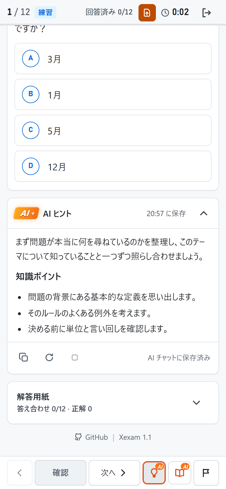</td>
<td width="33%">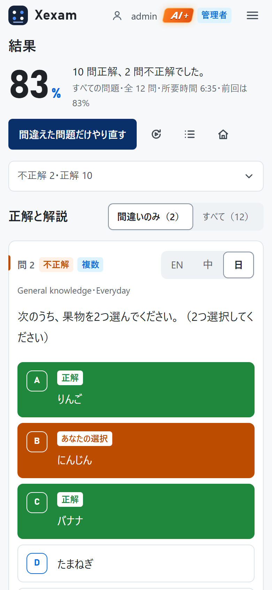</td>
<td width="33%">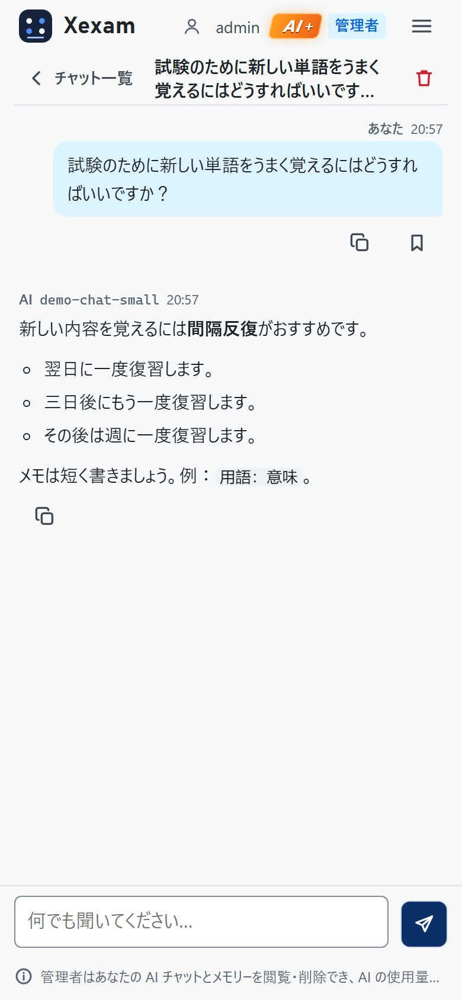</td>
</tr>
<tr>
<td><b>AI+ 機能</b> のある練習：問題の下の AI+ パネルを AI ヒントで開いたところ。バーのボタンは同じ場所のままです。</td>
<td>試験の結果：コンパクトなスコア、折りたたまれた一覧、AI+ バーのあるカード。</td>
<td>AI チャット：画面の高さいっぱいの 1 つの会話。入力欄は下部にあります。</td>
</tr>
</table>

<table>
<tr>
<td width="33%">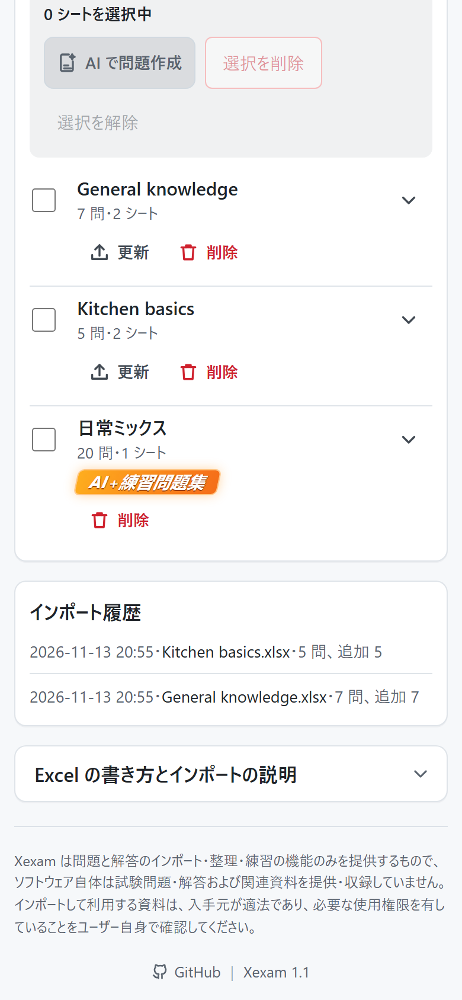</td>
<td>問題集管理：各問題集の操作ボタンは名前の下の独立した行に並び、AI 問題集の AI+ バッジも独立した行に表示されます。</td>
</tr>
</table>

## 19. 「リクエストが多すぎます」と表示されたとき

Xexam の Nginx は、1 つのアドレスから 1 秒あたりにバックエンドへ届くリクエストの数を制限しています（[security.md](security.md) の第 9 節）。Cloudflare Tunnel のようなトンネルの後ろでは、全ユーザーがトンネルのアドレスから届くので、全員でこの制限を共有します。制限に達すると、ページは読み込んでいたものを自分でやり直します（合わせて 3 回、1〜2 秒の間隔で）。保存やそのほかの変更はやり直しません。それでもリクエストが拒否される場合、ページに **リクエストが多すぎます** と表示されます。数秒待ってから、ページを再読み込みするか、もう一度試してください。これは、パスワードを間違えたときのログインのロックとは別のもので、ロックではどれだけ待てばよいかが表示されます。

AI チャットには、Nginx に専用の制限があります：回答の開始（AI チャットの **送信** と **再試行**、そして **AI ヒント**、**AI 解説**、**AI 分析**、**AI まとめ** とそれらの **再生成**）は、ログインしたブラウザごとに、バースト 10 の後は 1 分に 20 回まで、すべて合わせて数えます。拒否された開始はやり直されません。メッセージの入力欄は入力した文字を残し、リクエストが多すぎたことを伝え、AI のウィンドウには **短時間にリクエストが多すぎました。数秒待ってから、もう一度お試しください。** と表示されます。長い結果ページで、カードを次々に AI 分析で開くと、こうなることがあります。数秒待ってください。また、AI のリクエストはすべて、[第 17 節](#17-ai-設定) の利用者ごとの上限（1 分、1 時間、1 日）に数えられます。上限に達すると、メッセージにどの上限かと、いつ AI が使えるようになるかが示され、何も送信されません。
