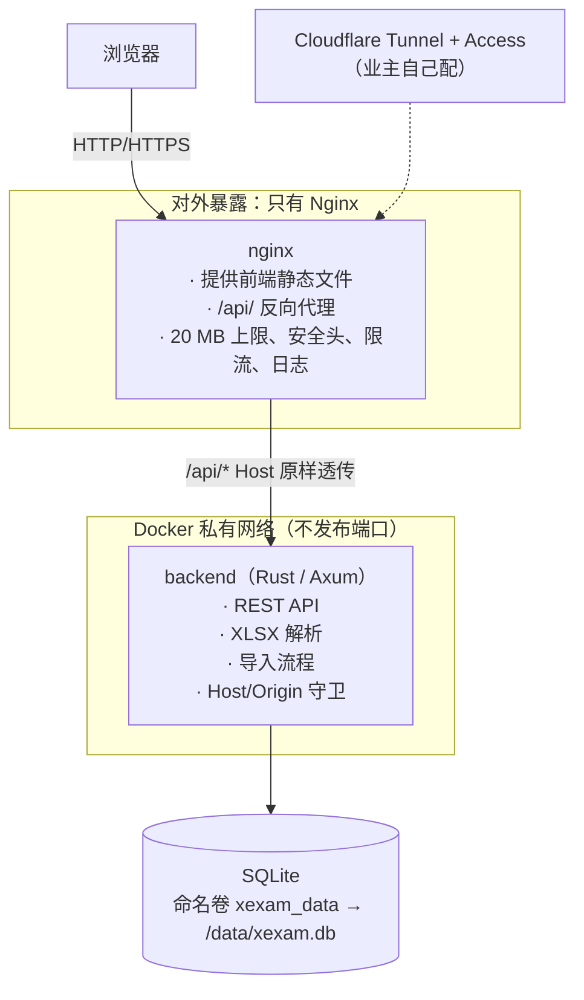

# 迁移计划（Phase 0）

> 把 Xexam 从"Python 单进程 + 原生 JS"改成"Rust（Axum）后端 + TypeScript（Vite）前端 + Nginx"，数据库仍是 SQLite、`xexam.db` 原样沿用。
> 配套文档：[architecture-audit.md](architecture-audit.md)（现状）、[risk-assessment.md](risk-assessment.md)（风险）、[test-strategy.md](test-strategy.md)（验证）。详细依据在 [`docs/audit/`](audit/)。

## 1. 决策表与将被采用的默认值

业主已经说明：不需要中途确认，按 Phase 0→5 的顺序做完，最后上传 GitHub。所以下面每一项都给出**默认值**，实现就按它做。规格里写明"先停下来问"的几个点（删源码、覆盖数据库、改业务规则、删功能、暴露后端端口、公开部署、改访问模型），默认值被设计成**不触发它们**。

| # | 问题 | 默认（将被采用） | 理由 |
|---|---|---|---|
| Q1 | 规格里的 `<旧名>.db` | **`xexam.db`** | 代码、CI、文档都是它；业主要求旧名字一个字母都不留 |
| Q2 | 生产数据存放 | **命名卷 `xexam_data` 不变**；`./data` 只给测试副本和开发 | 命名卷是业主明确要求的做法（Beszel 风格）；绑定挂载会遇到 uid 10001 权限问题 |
| Q3 | 判分与错题本规则放在哪里 | **留在浏览器**，抽成纯函数 `src/domain/grading.ts` 并加金标准测试；文档里标注"这是对规格的有意偏离" | 服务端只存 `{id, correct}`；改成服务端判分要改 `/api/bank` 和 `/api/attempt`，破坏"API 向后兼容"，也让旧版不能再当对照。题目答案本来就通过 `/api/bank` 到了浏览器，服务端判分挡不住唯一能作弊的人（业主自己） |
| Q4 | 镜像命名 | **新名字 `xexam-web` + `xexam-backend`**；旧 `ghcr.io/yumin-space/xexam` 冻结在 v0.2.x | 如果把新 nginx 镜像沿用旧名，业主现有 compose 下次 `pull` 就会拿到完全不同的东西 |
| Q5 | 待确认导入怎么隔离 | **全局单槽位**，取消不需要令牌；非 ASCII 令牌回 409 | 没有用户和会话概念，规格也说不要凭空引入认证 |
| Q6 | 错误文案 | 其余中文**逐字保留**；只把两处回显异常文本的位置换成固定中文 | 前端直接显示这些文案，它们是 API 行为的一部分 |
| Q7 | UTF-16 / 非 `.xml` 扩展名里的 DOCTYPE | **拒绝**（在 XML 事件层） | 现有检查可被绕过；登记为有意加固 |
| Q8 | 服务端 `.xlsx` 扩展名检查 | 保持按**内容**判断 | 旧版就是这样；前端另有扩展名检查 |
| Q9 | 分块请求体 | 流式计数，上限 20 MiB，超限 413 + 同一中文文案 | 不信任 `Content-Length` |
| Q10 | 解析时间上限 | **30 秒**，`XEXAM_PARSE_TIMEOUT_SECS` 可调 | 协作式截止检查 |
| Q11 | 速率限制 | Nginx：`/api/` 10 r/s（突发 30）；上传 1 r/s（突发 5） | 单人使用，只防失控脚本 |
| Q12 | CORS | **不发** CORS 头 | 同源 |
| Q13 | 不支持的方法 | **405 + `Allow`** | 旧版的 501 是标准库的偶然产物 |
| Q14 | 安全头 | `nosniff`、`X-Frame-Options: DENY`、`Referrer-Policy: no-referrer`、严格 CSP（样式不用内联）；**不设 HSTS** | TLS 在 Cloudflare 终止 |
| Q15 | 成绩百分比取整 | **复刻 Python 的半偶数** | 与学习记录一致；前端 v0.2 已用同一规则 |
| Q16 | 时区 | 时间戳格式不变；镜像带时区库，`TZ=Asia/Tokyo` | 否则静默变 UTC |
| Q17 | `/api/shutdown` | **保留**（Docker 里恒 403） | 删功能需要批准 |
| Q18 | `--import` 与 `progress.json` 迁移 | **移植** | 删功能需要批准；迁移改为**只在数据目录里没有任何数据库文件时**才做 |
| Q19 | `start.bat` / 不用 Docker | 随旧实现保留在 `legacy/python/`；新栈以 Docker 为主，另附 Windows 开发脚本 | |
| Q20 | 端口与访问模型 | `XEXAM_BIND` 默认 `127.0.0.1:8765`，现在指向 **Nginx**；Host/Origin 守卫留在后端；Nginx 透传 `$host`、不转发 `X-Forwarded-*`；无认证 | 访问模型不变 |
| Q21 | Python 版怎么留存 | **标签 `python-v0.2`（已在 GitHub）+ 分支 `legacy/python`（本地）+ 切换时 `git mv` 到 `legacy/python/`** | 绝不 `rm` |
| Q22 | 版本号 | **v0.3.0**（`VERSION` 写 `0.3`，清单里写 `0.3.0`）；`VERSION` 是唯一来源，CI 校验清单与它一致 | |
| Q23 | 文档 | README 为入口，详细内容在 `docs/`，中文 | |
| Q24 | "上传到 GitHub" | **推分支 `modernize/rust-ts`，不推 `main`** | 推 `main` 会触发 `publish` 并移动 `latest`（见 §6） |
| Q25 | OpenAPI | 手写 `docs/openapi.yaml` + `openapi-typescript` 生成类型 + 契约测试 | 比从代码派生更接近"旧行为"的描述 |
| Q26 | 夹具与忽略规则 | 虚构夹具入库（`.gitignore` 加例外规则）；真实工作簿永不入库 | |
| Q27 | 缺少的工具 | 已装 Rust 1.99.1 + gcc；Nginx 用官方镜像；Docker 里构建 | 业主已授权自行安装 |
| Q28 | 基线测试语言 | 标准库 `unittest` / 脚本，基址参数化 | 同一套测试跑新旧两个后端 |
| Q29 | 验证工具 | 迁入仓库，改成点击驱动 | |

## 2. 目标架构



**目录**（规格给出的结构，额外文件在允许范围内）：

```
frontend/   src/{api,components,pages,types,utils,styles,domain,state}/ + main.ts
            public/（icon.svg、apple-touch-icon.png）  package.json  vite.config.ts  tsconfig.json
backend/    src/{api,services,parser,database,security,models,config}/ + error.rs + main.rs
            tests/  Cargo.toml  Cargo.lock  rust-toolchain.toml  deny.toml
nginx/      nginx.conf  Dockerfile
legacy/     python/   （切换提交时用 git mv 放进去；之前 Python 文件留在根目录原位）
tests/      baseline/（已有）  integration/
data/       仅测试副本，不入库
docs/       见 §9
```

**后端要点**（详见 [audit/rust-stack.md](audit/rust-stack.md)）：

- Axum 0.8 + Tokio 1.54.1 + rusqlite 0.41（`bundled`）。**同步的 rusqlite 不直接放进 async 处理器**：`Arc<Mutex<Connection>>` + `spawn_blocking`，锁不跨 `.await`；与旧版"一个连接 + RLock"一一对应。
- 请求体上限：自写流式读取，先看 `Content-Length` 再逐帧计数（`DefaultBodyLimit` 只对缓冲型提取器有效，tower-http 的限制层回的是它自己的文本 413），另保留全局层兜底。
- XLSX：`zip`（`default-features = false`，不调用 `extract()`）+ `quick-xml`；`take(limit)` 有界读取；在 XML 事件层拒绝任何 DOCTYPE；限条目数、元素深度、单元格数；拒绝重复条目名；30 秒协作式截止。
- 令牌：`getrandom` 16 字节 + 常量时间比较 + 一次取出。
- 日志：`tracing`，关 ANSI，**不记令牌、不记文档内容**。
- 优雅停机：SIGTERM/SIGINT，8 秒超时包装；导入提交作为独立任务，客户端断开也跑完。
- 子命令：`serve`、`healthcheck`（容器内自检，带正确的 Host）、`import <xlsx>`、`migrate-progress`。
- **只读真实 `Host` 头**；永远不用 axum-extra 的 `Host` 提取器（它优先读 `X-Forwarded-Host`）。

**Nginx 要点**：`proxy_set_header Host $host`；清掉 `X-Forwarded-*`、`Forwarded`、`X-Real-IP`；未知 Host `default_server` 返回 444；`client_max_body_size 20m`；`error_page 413` 返回 JSON；`limit_except GET HEAD POST`；超时；不列目录；挡点文件；访问日志与错误日志。

## 3. 配置：旧变量 → 新栈

| 变量 | 含义 | 在哪里生效 |
|---|---|---|
| `XEXAM_BIND` | 宿主机上发布的 `地址:端口`，默认 `127.0.0.1:8765` | compose → **nginx** 的端口 |
| `XEXAM_ALLOWED_HOSTS` | 允许的 Host（域名 / IP） | 后端；Nginx 的 `default_server` 也读同一份 |
| `XEXAM_ALLOWED_ORIGINS` | 额外放行的 Origin | 后端 |
| `XEXAM_ALLOW_ANY_HOST` | 不检查 Host | 后端 |
| `XEXAM_DATA` / `XEXAM_HOST` / `XEXAM_PORT` | 数据目录 / 监听地址 / 端口 | 后端（容器内 `/data`、`0.0.0.0`、`8765`） |
| `XEXAM_PARSE_TIMEOUT_SECS` | 解析超时，默认 30 | 后端（新） |

## 4. 阶段与退出标准

每个阶段的"完成"定义见 [test-strategy.md](test-strategy.md) §10。

| 阶段 | 做什么 | 交付 | 能并行的 |
|---|---|---|---|
| **0 审计** | 只读 | 4 份文档 + `docs/audit/` | — |
| **1 基线** | 固定旧版行为 | `tests/baseline/`（已完成） | — |
| **2 Rust 后端** | 先写 OpenAPI 与错误枚举 → 解析器 → 数据库层 → 服务层 → 路由与守卫 → 优雅停机 | `backend/` | 解析器、数据库层、路由可以并行（接口先定好） |
| **3 TypeScript 前端** | 脚手架 → 类型与 API 客户端 → 纯函数（判分）→ 状态 → 组件 → 页面 → 接线 | `frontend/` | 页面（首页、管理、答题、成绩）可并行 |
| **4 Nginx + Docker** | `nginx.conf`、两个镜像、compose、健康检查、`.env.example`；CI 改成两镜像 | `nginx/`、`docker-compose.yml`、`.github/workflows` | Dockerfile 与 nginx.conf 可并行 |
| **5 回归** | 对黄金响应差分；安全探针；隧道模拟；前端 UI 流程；Docker 集成 | 报告 + 文档 | 各类测试可并行 |
| **6 文档** | `architecture.md`、`api.md`、`database.md`、`security.md`、`deployment.md`、`migration.md`、`development.md` | `docs/` | 可并行 |

## 5. 兼容性问题（需要显式决定的旧行为）

| 旧行为 | 决定 |
|---|---|
| JSON 键后有空格、键顺序固定；`smoke-test.sh` 靠 `grep` 依赖它 | 自写与 Python 默认一致的格式化器，字段按旧顺序（也把冒烟测试改成语义比较，两边都稳） |
| 不支持的方法 501 / 未知 POST 路径 404 / GET 只写路径 404 | 405 + `Allow`（登记为有意差异） |
| `//api/info` 被标准库折叠成 200 | 不复刻（登记） |
| HTTP/1.0、每次关闭连接 | HTTP/1.1，Nginx 负责 |
| 分块请求体当作空体 → 400 | 流式计数，上限 20 MiB |
| `percent` 半偶数 | 复刻 |
| `\s`、`strip` 的 Unicode 集合；码点切片；全角数字 | 自写谓词，按码点切，`\d` 行为逐项对照 |
| 负数共享字符串索引按 Python 负下标回绕 | 视为畸形文件，跳过并报告原因（登记） |
| 数字串超 4300 位让整个上传报英文错误 | 视为畸形，返回中文 400（登记） |
| 过期的待确认项一直留在内存里 | 过期即清（行为上看不出差别） |
| `bank()` 两次拿锁 | 一次读完 |

## 6. 数据迁移

- **schema 不变**；不加表、不加列、不设 `user_version`、不改 `journal_mode`。证明方式：旧代码新建的库 ↔ Rust 打开后 `sqlite_master` 逐字相同；Rust 写后旧代码读；`PRAGMA integrity_check`。
- **题目 id** 的稳定性是头号风险：85 条向量 + 用两个实现分别解析同一批合成工作簿后 id 逐项相等；**切换前**对业主库的**副本**里全部现有题目重算 id 并比对。
- **命名卷**：新栈沿用 `xexam_data`（项目名 `xexam`、卷名 `data`）。容器名 `xexam` 与旧栈相同，所以新旧不能同时运行（回滚时先停一个）。
- `progress.json`：只有在数据目录里**没有任何** `.db` 时才迁移；格式不对时返回说明，不崩溃（v0.2 已修）。

> **GitHub 上推镜像的陷阱**：`docker.yml` 在 push 到 `main` 时会发布镜像并移动 `latest`。新镜像用新名字（Q4），并且重构只推到分支、不合并 `main`（Q24），所以业主现有 compose 拉到的东西不会变。

## 7. 保留 Python 实现（可恢复）

1. 标签 **`python-v0.2`**（已推到 GitHub）指向 v0.2 的提交 `1ee64c8`。
2. 分支 **`legacy/python`**（同一个提交）用于以后热修。
3. 重构在 **`modernize/rust-ts`** 上做。Phase 1–4 **不移动任何现有文件**：新代码放进 `frontend/ backend/ nginx/ tests/ docs/`，与根目录的 Python 文件并存。Phase 1 的基线测试针对根目录里原样的 Python 应用（`XEXAM_LEGACY_ROOT`）。
4. **切换提交**（Phase 5 末，一个单独的提交）：`git mv server.py app web Dockerfile docker-compose.build.yml scripts/smoke-test.sh start.bat → legacy/python/`；`legacy/python/docker-compose.yml` 固定到 `ghcr.io/yumin-space/xexam:v0.2.2`（不用 `latest`）。`start.bat` 里有 `cd /d "%~dp0"`，搬家后不用改。
5. CI：新增只在 `legacy/python/**` 变动时跑的工作流，**不发布 `latest`**。

## 8. 回滚

| 阶段 | 怎么回滚 |
|---|---|
| 2–5（开发期） | 分支上的工作随时可丢；`main` 与 `python-v0.2` 不受影响；业主的数据从未被触碰 |
| 切换之后（业主决定上线） | ① `docker compose stop`（新栈）② 备份卷并 `integrity_check` ③ 用旧版的 compose 起：`docker compose -f legacy/python/docker-compose.yml up -d`，指向同一个 `xexam_data`。因为 schema 与日志模式都没改，旧代码可以直接读写新后端写过的库 |
| 彻底回退到 Python | 检出标签：`git checkout python-v0.2` |

**不可逆的事**（需要业主动手确认）：把新栈指向真实卷；删除 `legacy/`；合并到 `main`。

## 9. 本机工具与前置条件

- 已装并验证：Rust 1.99.1（`stable-x86_64-pc-windows-gnu`）、gcc 16.2、clippy、rustfmt；Docker Desktop 28.1.1；`rust:1-slim-bookworm`、`nginx:1.27-alpine`。
- Rust 依赖的试编译已通过：axum 0.8.9、tokio 1.54.1、tower-http 0.7.1、rusqlite 0.41.1（bundled）、quick-xml 0.42.0、zip、regex、utoipa 6.0.0。
- Nginx 用官方镜像在 Docker 里跑，不装到宿主机。

## 10. 迁移检查表

实际进度和结果见 [migration.md](migration.md)（切换 / 回滚步骤、已演练的内容）。当前状态：

| 阶段 | 状态 |
|---|---|
| 0 审计 | ✅ 本文及其余三份文档、`docs/audit/` |
| 1 基线 | ✅ `tests/baseline/`，对当前旧版重抓 172 项全部相同 |
| 2 Rust 后端 | ✅ `backend/`：130 个测试；172 份黄金响应 0 项未解释的差异；安全探针 0 项未解释；85 条 id 向量与 49 个解析夹具一致 |
| 3 TypeScript 前端 | ✅ `frontend/`：strict 类型检查、19 个单元测试、构建通过 |
| 4 Nginx + Docker | ✅ `nginx/`、`backend/Dockerfile`、`docker-compose.modern.yml`；本机整栈 34 项、Nginx 38 项；GitHub Actions（Linux）`modern.yml` 三个 job 通过 |
| 5 回归 | ✅ 黄金响应、安全探针、解析差分、回滚演练（19 项）、整栈。⚠️ 未做：真实 Cloudflare、iPhone 真机、新镜像 arm64、业主真实库的副本 |
| 6 文档 | ✅ `docs/` 下 architecture / api / database / security / deployment / migration / development |

**与原计划不同的一点**：§7 第 4 条的「切换提交」（把 Python 文件 `git mv` 到 `legacy/python/`、`docker-compose.modern.yml` 改名为 `docker-compose.yml`）**没有**在这个分支里做。原因：这个分支一旦合并，`main` 上的 `docker.yml` 就会按旧 Dockerfile / 旧 compose 的位置发布；把文件搬走而不同时改发布流水线，会让 `main` 的构建直接失败，改了又等于替业主决定发布新镜像。所以搬家和发布流水线作为合并时的一个单独步骤，留给业主决定（写在 [migration.md](migration.md) 的「还没做的事」）。

## 11. 开放事项

1. **GHCR 写权限（已解决）**：v0.2.2 的 `publish` 曾被拒（`permission_denied: write_package`），而 v0.2、v0.2.1 成功。原因在包的设置里：业主在 GitHub → Packages → `xexam` → Package settings → Manage Actions access 里把本仓库的角色设为 **Admin** 之后，重跑通过。新镜像（`xexam-web`、`xexam-backend`）第一次发布时也要做同样的设置。
2. 业主真实数据库的副本（可选）：有了才能做一次真实数据的差分；没有就只用合成数据。切换前**不由我执行**。
3. v0.2 的 Release 已手动补建；之后由流水线自动建。
4. 新栈的 compose 文件目前叫 `docker-compose.modern.yml`（和旧的 `docker-compose.yml` 并存，不会改变业主现在拉到的东西）。切换提交时才改名。
