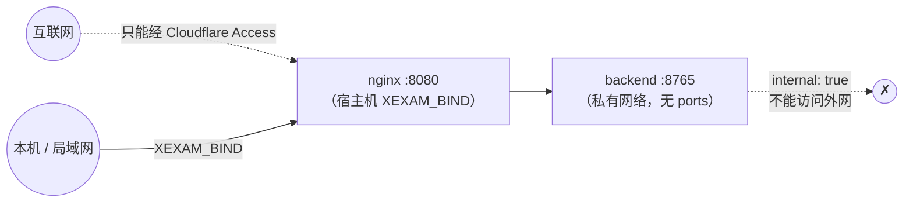

# 安全

> 范围：一个**个人**使用的自托管程序，没有用户系统、没有登录。安全靠三件事：**后端不对外**、**Host/Origin 守卫**、**前面加 Cloudflare Access 这样的身份验证**。
> 审计依据：[audit/security.md](audit/security.md)。测试：`backend/tests/`、`tests/baseline/tools/security_probe.py`（把一批恶意请求同时打给旧版和新版，逐项比较）、`tests/integration/nginx_check.py`。

## 1. 威胁模型

| 谁 | 能做什么 | 我们的防线 |
|---|---|---|
| 同一网络里的别的机器 | 直接连端口 | 默认只绑定 `127.0.0.1`；要开放必须自己写 `XEXAM_BIND`；**程序自己没有登录**，开放后能连上的人就能改题库 |
| 恶意网页（在你的浏览器里） | 让浏览器向 `localhost:8765` 发写请求（CSRF） | 写请求检查 `Origin` 主机名必须和 `Host` 一致或在白名单里；JSON 接口要求 `Content-Type: application/json`（跨站表单发不出） |
| DNS 重绑定 | 让恶意域名解析到 127.0.0.1，读你的数据 | 检查 `Host` 白名单；GET 也检查 |
| 恶意 / 损坏的 .xlsx | 压缩炸弹、XML 实体展开、畸形结构拖垮服务 | 见 §3 |
| 代理链上的伪造头 | `X-Forwarded-Host` 之类 | 后端**只读真实的 `Host` 头**；Nginx 把所有转发头清空 |
| 供应链 | 依赖里的漏洞 | 依赖锁定（`Cargo.lock`、`package-lock.json`）；镜像里没有包管理器以外的多余内容；见 §6 |

**不在范围内**：多用户隔离、登录、审计日志、加密存储。要从互联网访问，请在前面放 Cloudflare Access（或同类）。

## 2. 网络

- 后端**永远不发布端口**。`docker-compose.modern.yml` 里 `backend` 没有 `ports:`，网络 `internal: true`；`tests/integration/stack_check.py` 断言「从宿主机连不到后端」。
- `XEXAM_BIND` 必须写成 `IP:端口`。只写端口号（如 `8766`）= 绑定所有网卡，是常见的误操作，文档里反复提醒。
- Linux 上主机防火墙（ufw / firewalld）**拦不住** Docker 发布的端口；限制来源要在 `DOCKER-USER` 链里加规则，或把 `XEXAM_BIND` 写成具体的局域网 IP。

## 3. 上传（.xlsx）

按顺序，任何一步失败都是 400/413 + 固定的中文说明，**不写库**：

1. 请求体大小：流式计数，**20 MiB**，按真实字节，不信任 `Content-Length`；Nginx 在前面还有一道 `client_max_body_size 20m`（返回同样文案的 JSON）。
2. 按**内容**判断：魔数 `PK`、ZIP 结构、含工作簿。旧版 `.xls`、空文件、改了扩展名的文件各有说明。
3. ZIP：条目数 ≤ 10,000；**重复的条目名拒绝**（避免「检查的是一个、读的是另一个」）；解压后总大小有上限；用 `take(limit)` 有界读取，声明的大小不可信。
4. XML：**任何 DOCTYPE / 实体声明一律拒绝**，不管扩展名、不管编码（UTF-16 也拒绝）；深度 ≤ 64、节点 ≤ 100 万。
5. 解析：有协作式的截止时间（默认 30 秒）——解析器每处理一批行 / XML 事件就看一次时钟，到了**自己停下**，超时后不会继续占着 CPU 和内存；同时最多 2 个解析在跑（`PARSE_CONCURRENCY`），多出来的排队，排队时间也算在时限里。
   另外还有内存上限：同一个共享字符串被很多单元格引用时只存一份（不深拷贝），所有 A/B/C 单元格引用的字节总数不超过 64 MB；一个 XML 元素最多 256 个属性。
6. 预览放进内存里**唯一的待确认槽位**，30 分钟过期；确认码 128 位随机，一次性，常量时间比较；错误的确认码不会消耗槽位里的内容。
7. 确认时在**一个事务**里写入；这份文件里没有可用题时拒绝导入（防止把题库清空）。

旧版只扫描小写 `.xml` / `.rels` 的 ASCII 字节，UTF-16 或别的扩展名可以绕过——这是新版加固的地方（登记在 [api.md](api.md) 的差异表里）。

## 4. Host 与 Origin

| 检查 | 对象 | 规则 |
|---|---|---|
| Host | 所有请求 | 在白名单里：默认 `localhost`、`127.0.0.1`、`::1`；`XEXAM_ALLOWED_HOSTS` 追加；`XEXAM_ALLOW_ANY_HOST=1` 关闭检查 |
| Origin | 写请求 | 没带 → 放行（命令行工具不是跨站请求）；带了 → **主机名**必须和 `Host` 的主机名一致，或在 `XEXAM_ALLOWED_ORIGINS` / 白名单里 |

要点：

- **只比较主机名**，不比协议和端口：经 HTTPS 域名访问时 Origin 是 `https://域名`，Host 是 `域名`，不会被误拦。
- 守卫读的是真实的 `Host` 头。**不读** `X-Forwarded-Host` / `Forwarded`——否则等于把守卫交给了客户端。Nginx 用 `proxy_set_header Host $http_host` 原样转发，并清空其余转发头。
- 被拒绝时响应里写明「你的 Host / Origin 是什么、该把哪个值加进哪个选项」，日志里也有一行。
- `XEXAM_ALLOW_ANY_HOST=1` 只在**前面已经有身份验证**时使用；它不关闭 Origin 检查。

## 5. HTTP 层

| 项 | 设置 |
|---|---|
| 响应头 | 后端的所有响应：`Cache-Control: no-store`、`X-Content-Type-Options: nosniff`。`index.html`：另有 `X-Frame-Options: DENY`、`Referrer-Policy: no-referrer`、`Permissions-Policy`（相机 / 麦克风 / 定位全关）、严格 CSP。`/assets/`（脚本 / 样式）和 Nginx 自己生成的错误 JSON 只带 `X-Content-Type-Options`（及 assets 的缓存头），因为 nginx 的 `add_header` 在 location 里一旦写了就不再继承上层；它们不是可被嵌入或执行的页面 |
| CSP | `default-src 'self'; img-src 'self' data:; style-src 'self'; script-src 'self'; base-uri 'none'; form-action 'self'; frame-ancestors 'none'`——没有内联脚本和样式 |
| HSTS | **不设**：TLS 在 Cloudflare 终止，源站是 HTTP |
| CORS | 不发 CORS 头（同源） |
| 方法 | `GET` / `HEAD` / `POST`；其它方法 Nginx 直接回 403（`limit_except`），到不了后端；后端自己对它们回 405 + `Allow` |
| 限流 | Nginx：`/api/` 10 请求/秒（突发 30）；`/api/upload` 1 请求/秒（突发 5）；超限 429 |
| 超时 | 头 15 秒、体 30 秒（防慢速攻击）；上游连接 5 秒、读取 90 秒 |
| 隐藏文件 | `/.xxx` 一律 404；不列目录 |
| `Server` 头 | 后端不发；Nginx `server_tokens off` |

## 6. 容器

- 两个容器都以**非 root** 运行（后端 uid 10001），`cap_drop: ALL`，`no-new-privileges`，根文件系统 `read_only`，只有 `/tmp`（tmpfs）和后端的 `/data`（命名卷）可写。
- **镜像里没有机密**：没有 `.env`、没有数据库、没有真实题库（`.dockerignore` 排除）。
- 后端镜像是静态链接（musl）的单个可执行文件 + tzdata，没有 shell 以外的工具链。
- `docker compose down -v` 会删除数据卷。文档里明确提示不要加 `-v`。

## 7. 日志与隐私

- 日志不记确认码、不记上传文件的内容、不记题目内容。
- 被拒绝的请求记 Host / Origin 与原因，供排查。
- 题库是用户自己的 Excel，**仓库里没有**（`.gitignore` 排除 `*.xlsx` 等，仅 `tests/baseline/fixtures/` 里虚构的测试夹具除外）。

## 8. 已知的限制（如实写出）

- **没有登录**。开放端口 = 任何能连上的人都能看到、修改题库。
- **服务端信任 `correct`**，也不检查 id 是否在题库里（与旧版一致）：判分在浏览器里，你对自己的成绩作弊只会骗到自己。
- **单个待确认槽位**：并发上传会互相替换（单人使用，不引入会话概念）。
- Cloudflare 路径只做了**本机模拟**：浏览器级的模拟（真实 Chrome + HTTPS 反向代理）是对旧 Python 版做的；对新栈只做了请求头级别的检查（经 Nginx 后 Host / Origin 守卫仍生效）。没有用真正的 Cloudflare 测过。
- iPhone Safari 没有在真机上测过；构建目标是 iOS 15.4+。
- 新镜像（`xexam-web` / `xexam-backend`）的 arm64 构建在 CI 里尚未验证。

## 9. 漏洞报告

这是个人项目的私有仓库；发现问题请直接联系业主。
